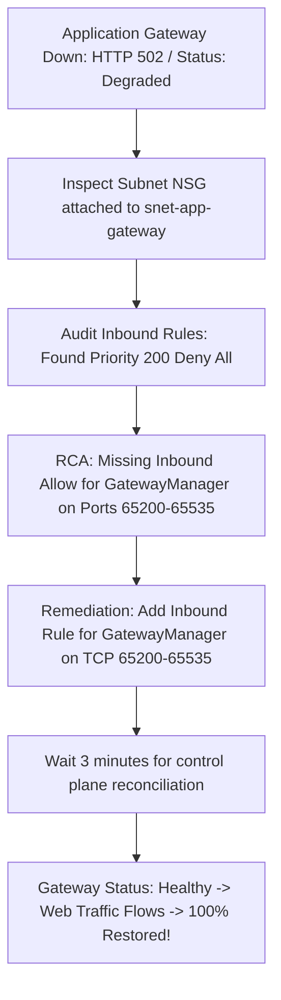

# Module 13-104-07: Administer Network Traffic, Load Balancing, Firewall & Network Watcher

**Breadcrumbs:** [[13-Index - Azure|☁️ Azure Reference MOC]] > [[13-Index - AZ-104|📘 AZ-104 Exam Track]] > **07 - Administer Network Traffic**

---

## 🎯 Stage 1: Executive Overview & The Conceptual Lecture

### 1. The Zero-Knowledge Starting Point: Why Do We Need Load Balancing?
Imagine you launch an enterprise online banking application. On Day 1, you host the website on a single Azure Virtual Machine. 
* At 9:00 AM, 50 users log in. The VM runs smoothly at 10% CPU.
* At 12:00 PM, a major financial news event breaks. Suddenly, 50,000 users hit your website simultaneously. The server's CPU spikes to 100%, RAM memory is completely exhausted, and the VM crashes. Every customer receives connection timeouts.
* Even worse: what happens at 2:00 AM when Microsoft updates the physical host blade running your VM, requiring a hardware reboot? Your entire application goes offline because you have **a single point of failure (SPOF)**.

In modern cloud computing, high availability and scalability are achieved through **horizontal scaling (scaling out)**:
* Instead of buying one giant server, you deploy an array of 5, 10, or 50 identical virtual machines running your application in parallel across Availability Zones.
* But now a fundamental routing challenge arises: when an external customer types `https://mybank.com` into their browser, **which specific VM receives their request?** How do you distribute the traffic evenly across all 50 servers? And if Server #12 crashes, how do you automatically route traffic away from the dead server so users never notice?

This is the responsibility of Azure's traffic management and load-balancing services.

---

### 2. The Supermarket Checkout Analogy (Layer 4 vs. Layer 7)
Understanding the difference between **Layer 4 (Transport)** and **Layer 7 (Application)** load balancing is the single most critical conceptual foundation for Azure architecture:

```text
+------------------------------------------------------------------------------------------------+
|                         LAYER 4 vs. LAYER 7: THE SUPERMARKET ANALOGY                           |
+------------------------------------------------------------------------------------------------+
|  Layer 4: The Parking Lot Attendant (Azure Load Balancer)                                      |
+------------------------------------------------------------------------------------------------+
| - Sits at the entrance of the parking lot.                                                     |
| - Inspects ONLY: What kind of vehicle is this? (TCP vs UDP) and what license plate? (IP/Port). |
| - Directs cars to Lane 1, Lane 2, or Lane 3 purely based on mathematical speed and volume.     |
| - Cannot see inside the trunk or know what groceries the customer wants to buy!                |
| - Blazingly fast (Microseconds latency), but completely blind to HTTP content.                 |
+------------------------------------------------------------------------------------------------+
|  Layer 7: The Concierge & Maitre d' (Azure Application Gateway)                                |
+------------------------------------------------------------------------------------------------+
| - Stands inside the store at the checkout lanes.                                               |
| - Inspects the actual shopping cart (HTTP Headers, URLs, Cookies, SSL Certificates).           |
| - "You have frozen meat? Go to Lane 4 (/meat/*). You have fresh bakery? Go to Lane 2 (/bakery)|
| - "You already started a transaction with Cashier Bob? Here is a loyalty cookie (Session       |
|    Affinity) so you stay at Cashier Bob's register."                                           |
| - Can decrypt SSL, check for shoplifters (WAF), but takes a few milliseconds to inspect items! |
+------------------------------------------------------------------------------------------------+
```

---

### 3. Terminology Matrix: Zero-Knowledge to Enterprise Architect

| Terminology | What It Means to a Beginner | Real-World Analog | Enterprise Architecture Reality |
| :--- | :--- | :--- | :--- |
| **Azure Load Balancer (ALB)** | A fast traffic splitter for network packets. | A traffic cop directing cars to open highway lanes. | A non-terminating Layer 4 SDN multiplexer distributing TCP/UDP flows based on a 5-tuple hash at hypervisor line rate. |
| **Application Gateway** | A smart web traffic router that reads URLs. | A restaurant host seating guests based on their reservation type. | A dedicated Layer 7 reverse proxy ADC supporting URL path routing, multi-site hosting, SSL termination, and cookie affinity. |
| **Health Probe** | Pinging a server to see if it is still alive. | A doctor checking a patient's pulse every 5 seconds. | An automated TCP/HTTP polling mechanism from Wire Server `168.63.129.16` that marks failing nodes unhealthy and pulls them from rotation. |
| **Inbound NAT Rule** | Port forwarding to one specific server. | Dialing a company's main phone number plus an employee's extension. | A static 1:1 port translation mapping a frontend public port directly to a specific backend VM for management (SSH/RDP). |
| **HA Ports (All Ports)** | Load balancing all 65,535 ports at once. | An all-access VIP pass that lets all vehicle types through. | An option on Internal Standard Load Balancers forwarding all TCP/UDP ports simultaneously to active NVA firewall clusters. |
| **Floating IP (DSR)** | Server replies directly to the client bypassing LB return. | Ordering food through a drive-thru speaker, but having food delivered directly to your car window. | Direct Server Return (DSR). Disables IP rewrite on backend VMs so VMs respond directly using the frontend IP; mandatory for SQL AlwaysOn. |
| **Outbound SNAT** | VMs using load balancer public IP to reach the internet. | Multiple office phones sharing one outbound company phone line. | Source Network Address Translation mapping private backend IPs to public frontend IPs using ephemeral port pools (1,024 ports/VM). |
| **WAF (Web App Firewall)** | A security guard checking web traffic for hacker attacks. | A metal detector and luggage X-ray scanner at an airport terminal. | An OWASP-compliant Layer 7 inspection engine that detects and blocks SQL Injection (SQLi), Cross-Site Scripting (XSS), and CVE exploits. |
| **Azure Firewall** | A central security appliance inspecting all subnet traffic. | A state border customs inspection station checking all commercial trucks. | A fully managed, stateful Layer 3-7 firewall service with built-in threat intelligence, FQDN filtering, and network/application rules. |
| **Azure Front Door** | A global edge accelerator for web applications. | A global network of express package delivery hubs located in every major city. | A global Layer 7 Anycast reverse proxy and CDN terminating SSL at edge Points of Presence (PoPs) using Split-TCP. |
| **Azure Traffic Manager** | A DNS phonebook that sends users to the closest region. | A telephone operator giving callers the phone number of their nearest branch office. | A DNS-based global traffic distribution engine supporting Priority, Weighted, Performance, and Geographic resolution. |
| **Network Watcher** | The cloud network diagnostic toolkit. | A mechanic's computer diagnostic scan tool plugged into your car's OBD port. | An Azure SDN suite offering packet-level tracing (IP Flow Verify, Next Hop, Connection Troubleshoot, and Packet Capture). |

---

## 🏛️ Stage 2: Core Mental Model & Component Architecture

### 1. The Azure Load Balancing Decision Matrix
Azure provides four distinct traffic management solutions. Every AZ-104 architecture scenario is resolved using this exact decision tree:

```text
                                [ Incoming Client Traffic ]
                                             │
                  ┌──────────────────────────┴──────────────────────────┐
                  ▼                                                     ▼
        [ Global (Multi-Region) ]                             [ Regional (Single Region) ]
                  │                                                     │
        ┌─────────┴─────────┐                                 ┌─────────┴─────────┐
        ▼                   ▼                                 ▼                   ▼
[ Layer 7: HTTP/HTTPS ] [ Non-HTTP / DNS ]            [ Layer 7: HTTP/HTTPS ] [ Layer 4: TCP/UDP ]
        │                   │                                 │                   │
        ▼                   ▼                                 ▼                   ▼
 Azure Front Door    Traffic Manager                  Application Gateway    Azure Load Balancer
 - Anycast CDN       - DNS Resolution                 - Regional Reverse     - Ultra-low latency
 - Edge SSL Offload  - Priority / Perf                  Proxy (WAF v2)       - 5-tuple TCP/UDP
 - Split-TCP / WAF   - No SSL offload                 - URL Path / Cookie    - HA Ports / DSR
```

#### Detailed Architecture Comparison Matrix:

| Capability | Azure Load Balancer | Azure Application Gateway | Azure Front Door | Azure Traffic Manager |
| :--- | :---: | :---: | :---: | :---: |
| **OSI Layer** | **Layer 4** (TCP/UDP) | **Layer 7** (HTTP/HTTPS) | **Layer 7** (HTTP/HTTPS) | **DNS Layer** (Resolution) |
| **Scope** | Regional | Regional | **Global (Anycast Edge)** | **Global (DNS)** |
| **Routing Latency** | Microseconds | Low Milliseconds | Low Milliseconds (Edge PoP) | Zero (DNS resolution only) |
| **SSL/TLS Termination** | ❌ No (Pass-through) | ✅ Yes | ✅ Yes (At Edge PoPs) | ❌ No (Client talks direct) |
| **URL Path Routing** | ❌ No | ✅ Yes (`/images/*`) | ✅ Yes (`/api/*`) | ❌ No |
| **Cookie Session Affinity** | ❌ No (IP hash only) | ✅ Yes (`ARRAffinity`) | ✅ Yes | ❌ No |
| **Web App Firewall (WAF)** | ❌ No | ✅ Yes (WAF v2 CRS 3.2) | ✅ Yes (Global WAF) | ❌ No |
| **HA Ports (All Ports 0)** | ✅ Yes (Internal Standard) | ❌ No | ❌ No | ❌ No |
| **Direct Server Return (DSR)** | ✅ Yes (Floating IP) | ❌ No | ❌ No | ❌ No |

---

### 2. Azure Load Balancer: Architectural Components & SKU Comparison
An Azure Load Balancer consists of 5 decoupled building blocks:

```text
[ Frontend IP Configuration ] (Public Standard IP or Subnet Private IP)
             │
             ├──► [ Load Balancing Rule ] (e.g., Port 80 -> Backend Port 8080)
             │          │ (Monitors Health Probe from 168.63.129.16)
             │          ▼
             │    [ Backend Address Pool ] (VMs / VMSS across Availability Zones)
             │
             ├──► [ Inbound NAT Rules ] (Port 50001 -> VM-01 Port 22 SSH)
             │
             └──► [ Outbound Rules ] (Allocates SNAT ports for Internet egress)
```

#### Basic SKU vs. Standard SKU (High-Yield Exam Core):

| Feature | Basic Load Balancer (Legacy/Deprecated) | Standard Load Balancer (Enterprise Standard) |
| :--- | :--- | :--- |
| **Backend Pool Size** | Up to 300 instances (Single Availability Set only) | Up to **1,000 instances** (Any VM/VMSS in VNet) |
| **Zone Redundancy** | ❌ No (Non-zonal only) | ✅ **Zone-redundant, Zonal, or Non-zonal** |
| **Security Default** | **Open by Default** (Traffic passes without NSG!) | **Secure by Default** (Closed; requires explicit NSG allow rule) |
| **Health Probes** | TCP and HTTP only | TCP, HTTP, and **HTTPS (validates TLS)** |
| **High Availability (HA) Ports** | ❌ No | ✅ **Yes** (Internal ALB only: balances all 65,535 ports) |
| **Floating IP (DSR)** | Supported | Supported (Enhanced for SQL AlwaysOn) |
| **Outbound Rules** | ❌ No (Uses implicit allocation) | ✅ **Yes** (Declarative SNAT allocation & tuning) |
| **SLA** | None ($0 cost) | **99.99% SLA** |

---

### 3. Load Balancing Distribution Modes & Hash Algorithms
Azure Load Balancer uses an N-tuple hash algorithm to determine which backend VM receives each incoming packet:

```text
1. 5-Tuple Distribution (Default / "None"):
   ├── Hash Input: {Source IP, Source Port, Destination IP, Destination Port, Protocol}
   └── Behavior: Every new TCP connection from the same client may land on a DIFFERENT backend VM!

2. 2-Tuple Distribution ("Client IP"):
   ├── Hash Input: {Source IP, Destination IP}
   └── Behavior: All successive connections from the SAME client IP address land on the SAME backend VM.

3. 3-Tuple Distribution ("Client IP and Protocol"):
   ├── Hash Input: {Source IP, Destination IP, Protocol}
   └── Behavior: Successive connections from same client IP using the same protocol hit the same VM.
```

---

### 4. Floating IP (Direct Server Return - DSR) Architecture
In standard load balancing, the Load Balancer rewrites the Destination IP address of the incoming packet to match the private IP of the selected backend VM. 
When **Floating IP (Direct Server Return)** is enabled:

```text
[ Client (203.0.113.10) ]
        │ 1. Request: Src=203.0.113.10, Dst=Frontend_IP (20.50.1.1)
        ▼
[ Azure Standard Load Balancer ]
        │ 2. DSR Active: DOES NOT REWRITE DESTINATION IP!
        │    Forwards packet with Dst STILL set to 20.50.1.1!
        ▼
[ Backend VM (SQL AlwaysOn Node) ]
  ├── Network Interface: Private IP = 10.0.1.4
  ├── Loopback Adapter: Configured with IP = 20.50.1.1 (Frontend IP)
  │   └── Accepts the packet because the loopback IP matches the packet's destination!
  │
  └── 3. DIRECT RETURN: VM transmits response packet directly back to client:
      └── Packet Headers: Src=20.50.1.1 (Frontend IP), Dst=203.0.113.10
      └── Bypasses Load Balancer entirely on return!
```

> [!IMPORTANT]
> **Mandatory SQL AlwaysOn Invariant:**
> Floating IP (DSR) is **strictly required** for SQL Server Always On Availability Group Listeners. If Floating IP is disabled, SQL client failover will fail because secondary replicas cannot bind to the primary listener socket.

---

### 5. Application Gateway v2 & WAF Architecture
Azure Application Gateway v2 is a dedicated Layer 7 Application Delivery Controller (ADC) running as an orchestrated reverse proxy cluster:

```text
[ Client Browser ]
        │ HTTPS (Port 443)
        ▼
[ Application Gateway Frontend IP & HTTPS Listener ]
  ├── 1. Terminates incoming client TCP session & TLS encryption
  ├── 2. WAF v2 Engine inspects payload against OWASP Core Rule Set (CRS 3.2)
  └── 3. Evaluates Routing Rules:
             │
             ├── Path: /images/*  ──► [ Backend Pool: Blob Storage Static Site ]
             ├── Path: /api/*     ──► [ Backend Pool: Microservices VMSS ]
             └── Path: Default /* ──► [ Backend Pool: Main Web VMs ]
                        │
                        ▼ (Opens NEW TCP Session from AppGW private IP to Backend)
```

#### Key Application Gateway Features:
* **Multi-Site Hosting:** Hosts up to 100+ separate websites on the exact same frontend IP and port. It evaluates the HTTP `Host:` header and Server Name Indication (SNI) extension to route `shop.contoso.com` and `hr.contoso.com` to different backend pools.
* **URL Path-Based Routing:** Routes traffic based on the URL path (`/video/*` goes to media servers, `/images/*` goes to CDN/storage).
* **HTTP Redirection:** Seamlessly redirects HTTP port 80 traffic to HTTPS port 443.
* **HTTP Header & URL Rewrites:** Strips sensitive headers (e.g. `Server: Microsoft-IIS/10.0`), injects security headers (`Strict-Transport-Security`), or rewrites URL paths before sending to backends.
* **Cookie-Based Session Affinity:** Injects an `ApplicationGatewayAffinity` cookie into the client's browser so all subsequent requests during that session hit the exact same backend server.
* **Connection Draining (Graceful Shutdown):** When updating or scaling in VMs, connection draining prevents active user sessions from abruptly dropping by waiting a configurable grace period (e.g., 300 seconds) for in-flight requests to complete.

---

## 🏢 Stage 3: Deep-Intuition Platform Mechanics & Topology

### 1. Azure Load Balancer Under the Hood: The SLB MUX Layer
Unlike traditional F5 or NGINX load balancers, the Azure Load Balancer is **not an appliance, VM, or software instance** in your subnet.
* It is a distributed Software Defined Network (SDN) service running directly inside the **physical hypervisor kernel** across all Azure server blades (the Software Load Balancer - SLB MUX).
* Packets are distributed via stateless hash calculations at line-rate optical switching speeds with **microseconds latency**.
* Because it does not terminate TCP connections, it cannot perform SSL offloading, cookie injection, or URL inspection.

---

### 2. Outbound SNAT Port Exhaustion Mechanics
When backend VMs without instance-level public IPs initiate outbound connections to external public APIs, the Load Balancer performs **Source Network Address Translation (SNAT)**:

```text
[ Backend VM (10.0.1.4) ] ──► Outbound API Call to https://api.stripe.com
                                       │
                                       ▼
                       [ Azure Standard Load Balancer ]
                       ├── Translates Source IP to Frontend Public IP (20.50.1.1)
                       ├── Allocates an Ephemeral Port from SNAT Pool (e.g., Port 52140)
                       └── Sends packet out: [ 20.50.1.1:52140 ──► api.stripe.com:443 ]
```

#### The SNAT Exhaustion Failure Loop:
* By default, Azure allocates a fixed pool of **1,024 SNAT ports** per backend VM.
* If your application opens thousands of rapid, short-lived HTTP connections without connection pooling, all 1,024 ports are consumed and enter the `TIME_WAIT` state (waiting 4 minutes for closure).
* Once all 1,024 ports are exhausted, subsequent outbound calls **fail silently with TCP connection timeouts!**
* **The Architecture Fix:** Associate an **Azure NAT Gateway** with the backend subnet. A NAT Gateway provides **64,512 dynamic, on-demand SNAT ports** per public IP, completely eliminating SNAT port exhaustion!

---

### 3. Application Gateway: The Port 65200–65535 GatewayManager Trap
Because Application Gateway v2 is an orchestrated managed compute cluster, Azure's regional control plane must communicate with the instances to monitor health and manage autoscaling:
* This internal control plane communication occurs over **TCP ports 65200 through 65535**.
* If you attach a Network Security Group (NSG) to the Application Gateway subnet, you **MUST create an Inbound Allow rule** for:
  - **Source:** `GatewayManager` (Service Tag)
  - **Destination Port Range:** `65200-65535`
  - **Protocol:** `TCP`
  - **Action:** `Allow`

> [!CAUTION]
> If ports `65200-65535` are blocked, the Application Gateway transitions to `Failed` status within 10 minutes, health probe evaluation halts, and all external user traffic is dropped with `HTTP 502 Bad Gateway`!

---

### 4. Azure Firewall Architecture & Rule Processing Logic
Azure Firewall is a cloud-native, stateful Layer 3-7 security appliance deployed into a dedicated subnet named strictly **`AzureFirewallSubnet`** (`/26` minimum).

```text
                             [ Incoming Packet to Azure Firewall ]
                                              │
                                              ▼
                                 [ 1. DNAT Rules Evaluated ]
                                 ├── First match wins!
                                 └── Translates external public IP/Port to internal private IP
                                              │ (If no DNAT match)
                                              ▼
                               [ 2. Network Rules Evaluated ]
                                 ├── Evaluated in order of Rule Priority (100 to 65000)
                                 ├── Inspects 5-Tuple: IP Source, IP Dest, Protocol, Port
                                 └── Action: Allow or Deny (First match terminates evaluation!)
                                              │ (If no Network match)
                                              ▼
                             [ 3. Application Rules Evaluated ]
                                 ├── Evaluated in order of Rule Priority
                                 ├── Inspects Layer 7: HTTP/HTTPS FQDNs, URLs, Web Categories
                                 └── Action: Allow or Deny (First match terminates evaluation!)
                                              │ (If no Application match)
                                              ▼
                                     [ Default Deny Rule ]
                                     └── Packet is Dropped!
```

#### Rule Processing Invariant (High-Yield Exam Core):
Rules are processed in a strict hierarchy: **DNAT Rules $\rightarrow$ Network Rules $\rightarrow$ Application Rules**.
If a packet matches an **Allow** in Network Rules, it is permitted immediately and **Application Rules are never evaluated!**

---

### 5. Azure Network Watcher Diagnostic Toolkit
When traffic drops occur across Azure SDN, administrators do not guess—they execute the **Network Watcher Suite**:

```text
+-------------------------------------------------------------------------------------------------+
|                                 AZURE NETWORK WATCHER TOOLKIT                                   |
+-------------------------------------------------------------------------------------------------+
|  1. IP Flow Verify          |  2. Next Hop                 |  3. Connection Troubleshoot        |
+-----------------------------+------------------------------+------------------------------------+
| - Checks: Is a 5-tuple      | - Checks: Where is Azure's   | - Checks: End-to-end TCP latency   |
|   packet allowed by NSGs?   |   SDN routing this packet?   |   and hop-by-hop packet drops.     |
| - Output: "Access Allowed"  | - Output: "Next Hop Type:    | - Output: Visual topological path  |
|   or "Access Denied by      |   VirtualAppliance (10.0.1.4)|   with latency in milliseconds and |
|   Rule: Custom-Deny-100"    |   or 'None' (Blackhole!)"    |   firewall drop indicators.        |
+-----------------------------+------------------------------+------------------------------------+
|  4. Packet Capture          |  5. NSG Flow Logs            |  6. Effective Security Rules       |
+-----------------------------+------------------------------+------------------------------------+
| - Remotely captures .pcap   | - Streams flow metadata to   | - Displays the merged evaluation   |
|   traces on live VM disks   |   Storage & Log Analytics    |   of Subnet NSG + NIC NSG rules    |
|   without logging in!       |   for security audits.       |   with winning priority rankings.  |
+-------------------------------------------------------------------------------------------------+
```

---

## ⚙️ Stage 4: Declarative & Automation Engine (CLI & PowerShell Core)

### 1. Azure CLI: Standard Load Balancer with Health Probe, HA Ports & Floating IP

```bash
# ==============================================================================
# 1. CREATE STANDARD PUBLIC LOAD BALANCER
# ==============================================================================
RG_NAME="rg-traffic-prod"
LOCATION="eastus"

# Create Standard Public IP for Load Balancer
az network public-ip create \
  --resource-group "${RG_NAME}" \
  --name "pip-lb-web" \
  --sku "Standard" \
  --zone 1 2 3 \
  --location "${LOCATION}"

# Create Standard Load Balancer with Frontend IP & Backend Pool
az network lb create \
  --resource-group "${RG_NAME}" \
  --name "lb-web-prod" \
  --sku "Standard" \
  --location "${LOCATION}" \
  --public-ip-address "pip-lb-web" \
  --frontend-ip-name "fe-lb-public" \
  --backend-pool-name "be-web-pool"

# ==============================================================================
# 2. CONFIGURE HEALTH PROBE & LOAD BALANCING RULE (WITH FLOATING IP / DSR)
# ==============================================================================

# Health probe checking port 80 /healthz every 5 seconds
az network lb probe create \
  --resource-group "${RG_NAME}" \
  --lb-name "lb-web-prod" \
  --name "hp-http-healthz" \
  --protocol "Http" \
  --port 80 \
  --path "/healthz" \
  --interval 5 \
  --threshold 2

# Load balancing rule with 2-tuple affinity and TCP reset on idle timeout
az network lb rule create \
  --resource-group "${RG_NAME}" \
  --lb-name "lb-web-prod" \
  --name "rule-http-lb" \
  --protocol "Tcp" \
  --frontend-port 80 \
  --backend-port 80 \
  --frontend-ip-name "fe-lb-public" \
  --backend-pool-name "be-web-pool" \
  --probe-name "hp-http-healthz" \
  --load-distribution "SourceIP" \
  --idle-timeout 15 \
  --enable-tcp-reset true \
  --enable-floating-ip false

# ==============================================================================
# 3. CONFIGURE INBOUND NAT RULE FOR SSH
# ==============================================================================
az network lb inbound-nat-rule create \
  --resource-group "${RG_NAME}" \
  --lb-name "lb-web-prod" \
  --name "nat-ssh-vm01" \
  --protocol "Tcp" \
  --frontend-port 50001 \
  --backend-port 22 \
  --frontend-ip-name "fe-lb-public"
```

### 2. Azure CLI: Provision Application Gateway v2 with WAF & URL Path Routing

```bash
# ==============================================================================
# 4. DEPLOY APPLICATION GATEWAY V2 WITH WAF
# ==============================================================================

# Create Public IP for Application Gateway
az network public-ip create \
  --resource-group "${RG_NAME}" \
  --name "pip-appgw" \
  --sku "Standard" \
  --zone 1 2 3 \
  --location "${LOCATION}"

# Deploy Application Gateway v2 into dedicated subnet
az network application-gateway create \
  --resource-group "${RG_NAME}" \
  --name "appgw-web-prod" \
  --location "${LOCATION}" \
  --sku "WAF_v2" \
  --capacity 2 \
  --vnet-name "vnet-traffic-prod" \
  --subnet "snet-app-gateway" \
  --public-ip-address "pip-appgw" \
  --frontend-port 80 \
  --http-settings-port 80 \
  --http-settings-protocol "Http" \
  --http-settings-cookie-based-affinity "Enabled" \
  --priority 100
```

### 3. Azure CLI: Network Watcher Diagnostics Testing

```bash
# ==============================================================================
# 5. DIAGNOSE CONNECTIVITY WITH IP FLOW VERIFY & NEXT HOP
# ==============================================================================

# Verify if Inbound HTTP 80 traffic is allowed by NSGs
az network watcher test-ip-flow \
  --resource-group "${RG_NAME}" \
  --vm "vm-web-01" \
  --direction "Inbound" \
  --protocol "TCP" \
  --local "10.60.1.4:80" \
  --remote "203.0.113.50:49200"

# Verify next hop destination for egress traffic
az network watcher show-next-hop \
  --resource-group "${RG_NAME}" \
  --vm "vm-web-01" \
  --source-ip "10.60.1.4" \
  --dest-ip "8.8.8.8"
```

---

## 🖥️ Stage 5: Step-by-Step Azure Portal GUI Walkthrough

### Task 1: Provisioning an Azure Standard Load Balancer in the GUI
1. In the top search bar, type **Load balancers** and select it.
2. Click **+ Create** on the command bar:
   - **Resource group:** `rg-traffic-prod`.
   - **Name:** `lb-web-prod`.
   - **Region:** `East US`.
   - **SKU:** Select **Standard**.
   - **Type:** Select **Public**.
   - **Tier:** Select **Regional**.
3. In the **Frontend IP configuration** tab:
   - Click **+ Add a frontend IP configuration**.
   - *Name:* `fe-lb-public`.
   - *IP type:* Select *IP address* $\rightarrow$ click *Create new* public IP $\rightarrow$ name it `pip-lb-web`.
   - Click **Add**.
4. In the **Backend pools** tab:
   - Click **+ Add a backend pool**.
   - *Name:* `be-web-pool`.
   - *Virtual network:* Select `vnet-traffic-prod`.
   - Click **Add**.
5. Click **Review + create** $\rightarrow$ **Create**.

### Task 2: Adding Health Probes and Load Balancing Rules
1. Open your newly created `lb-web-prod`:
2. In the left navigation menu under **Settings**, click **Health probes** $\rightarrow$ click **+ Add**:
   - **Name:** `hp-http-check`.
   - **Protocol:** `HTTP`.
   - **Port:** `80`.
   - **Path:** `/healthz`.
   - **Interval:** `5` seconds.
   - **Unhealthy threshold:** `2`.
   - Click **Add**.
3. In the left menu under **Settings**, click **Load balancing rules** $\rightarrow$ click **+ Add**:
   - **Name:** `rule-web-http`.
   - **Frontend IP address:** Select `fe-lb-public`.
   - **Backend pool:** Select `be-web-pool`.
   - **Protocol:** `TCP`.
   - **Port:** `80`.
   - **Backend port:** `80`.
   - **Health probe:** Select `hp-http-check`.
   - **Session persistence:** Select **Client IP** (2-tuple).
   - Click **Save**.

### Task 3: Creating Application Gateway v2 with URL Path Routing
1. In the top search bar, type **Application gateways** and select it.
2. Click **+ Create**:
   - **Resource group:** `rg-traffic-prod`.
   - **Application gateway name:** `appgw-web-prod`.
   - **Tier:** Select **WAF V2**.
   - **Virtual network:** Select `vnet-traffic-prod`.
   - **Subnet:** Select `snet-app-gateway` (must be dedicated!).
3. In the **Frontends** tab:
   - *Frontend IP type:* Select **Public**. Create a new public IP named `pip-appgw`.
4. In the **Backend pools** tab:
   - Add Pool 1: `pool-main-web` (Web VMs).
   - Add Pool 2: `pool-images` (Dedicated image servers or storage blob endpoints).
5. In the **Configuration** tab:
   - Add a routing rule $\rightarrow$ Name: `rule-path-routing`.
   - *Listener:* Name: `listener-http`, Port `80`, Protocol `HTTP`.
   - *Backend targets:* Target type: **Path-based**.
     - Default target: `pool-main-web`.
     - Add Path: `/images/*` $\rightarrow$ Target: `pool-images`.
6. Click **Review + create** $\rightarrow$ **Create**.

### Task 4: Troubleshooting with Network Watcher IP Flow Verify
1. In the top search bar, type **Network Watcher** and select it.
2. In the left navigation menu under **Network diagnostic tools**, click **IP flow verify**.
3. Fill out the verification form:
   - **Target virtual machine:** Select `vm-web-01`.
   - **Direction:** Select **Inbound**.
   - **Protocol:** Select **TCP**.
   - **Local IP:** `10.60.1.4` | **Local Port:** `80`.
   - **Remote IP:** `203.0.113.10` | **Remote Port:** `54321`.
4. Click **Verify IP flow**.
5. Within 5 seconds, Network Watcher reports:
   - **Access:** `Allowed` (or `Denied`).
   - **Rule Name:** It identifies the **exact winning NSG rule** (e.g., `rule-allow-http`) and its priority!

---

## 🔬 Stage 6: Hands-On Enterprise Lab Bridge

To apply these traffic distribution principles, configure path-based routing, and practice Network Watcher diagnostics, proceed directly to the practical enterprise lab:

> [!TIP]
> **Practical Implementation Companion:**
> Access the comprehensive engineering lab at:
> **[[Lab-07_Azure_Load_Balancer_Application_Gateway_and_WAF|Lab 07: Azure Standard Load Balancer, Application Gateway v2 & WAF Inspection]]**
> 
> *Target Lab File:* `Projects/AZ-104/07_Network_Traffic_Management/Lab-07_Azure_Load_Balancer_Application_Gateway_and_WAF.md`

### Lab Objectives Matrix:

```text
+-----------------------------------------------------------------------------------------+
| Lab 07 Enterprise Milestone Goals                                                       |
+-----------------------------------------------------------------------------------------+
| 1. Deploy an Azure Standard Public Load Balancer with HTTP Health Probes and LB rules   |
| 2. Configure Inbound NAT Rules for direct administrative port forwarding to VMs         |
| 3. Provision Azure Application Gateway v2 inside a dedicated /26 subnet                 |
| 4. Author URL Path-Based Routing Rules (/images/* vs default web pool)                  |
| 5. Execute Network Watcher IP Flow Verify and Next Hop tools to diagnose packet drops   |
+-----------------------------------------------------------------------------------------+
```

---

## ⚠️ Stage 7: "See It in Action" Real-World Failure & Recovery Loop (AARF)

### Scenario 1: The "GatewayManager Outage" Production Failure Loop

#### 1. The Architectural Setup & Assumptions
A security operations team audits an enterprise cloud environment and notices that the dedicated subnet hosting an **Azure Application Gateway v2** (`snet-app-gateway`) has no Network Security Group attached. The junior engineer applies an NSG named `nsg-app-gateway` with a strict Zero-Trust baseline:
* Inbound Rule 100: Allow HTTP (Port 80) and HTTPS (Port 443) from `Internet`.
* Inbound Rule 200: Deny All Inbound from Any to Any.

#### 2. The Production Failure Manifestation
Ten minutes after applying the NSG, the entire production website crashes. External users attempting to reach `https://mycompany.com` receive browser gateway timeouts:
> `HTTP 502 Bad Gateway` or `HTTP 504 Gateway Timeout`

In the Azure Portal, the Application Gateway's status displays a warning:
> **Status:** `Degraded` / `Failed`
> **Message:** `Application Gateway is unable to retrieve health status of backend instances.`

#### 3. Root Cause Analysis (RCA) & Deep Investigation
Why did the Application Gateway fail when HTTP/HTTPS ports 80 and 443 were explicitly allowed?
1. **The GatewayManager Infrastructure Dependency:** Azure Application Gateway v2 is an orchestrated managed cluster. Microsoft's internal SDN control plane must continuously communicate with the gateway instances to check compute health, distribute TLS certificates, and manage autoscaling.
2. **The Infrastructure Port Range:** This control plane communication occurs over **TCP ports 65200 through 65535**.
3. **The Custom Deny Rule Interception:** The engineer's custom rule at Priority 200 (`Deny All`) blocked incoming traffic on ports 65200–65535 originating from the Azure platform.
4. **The Health Check Failure:** Because the Azure control plane could not reach the gateway on port 65200+, it could not update routing definitions or receive backend health telemetry, forcing the gateway into an unrecoverable `Failed` state!

#### 4. Remediation & Diagnostic Verification Loop



```bash
# Diagnostic & Remediation Script (Azure CLI)

# 1. Remediate: Add mandatory GatewayManager control plane rule to the AppGW NSG
az network nsg rule create \
  --resource-group "rg-traffic-prod" \
  --nsg-name "nsg-app-gateway" \
  --name "Allow-GatewayManager-ControlPlane" \
  --priority 110 \
  --direction Inbound \
  --access Allow \
  --protocol Tcp \
  --source-address-prefixes "GatewayManager" \
  --destination-address-prefixes "*" \
  --destination-port-ranges "65200-65535"

# 2. Verify: Ensure health probes from AzureLoadBalancer are also permitted
az network nsg rule create \
  --resource-group "rg-traffic-prod" \
  --nsg-name "nsg-app-gateway" \
  --name "Allow-AzureLoadBalancer-Probes" \
  --priority 120 \
  --direction Inbound \
  --access Allow \
  --protocol "*" \
  --source-address-prefixes "AzureLoadBalancer" \
  --destination-address-prefixes "*" \
  --destination-port-ranges "*"
```

---

### Scenario 2: The "Silent SNAT Exhaustion" Black Hole

#### 1. The Architectural Setup
A fleet of 10 e-commerce backend virtual machines sits behind an Azure Standard Load Balancer. The VMs process customer checkouts and make outbound API calls to an external third-party credit card gateway (`https://api.paymentgateway.com`).

#### 2. The Production Failure Manifestation
During Black Friday sales, checkout transactions begin failing intermittently. Customer transactions freeze and throw `HTTP 504 Gateway Timeout`. However, the VMs show healthy CPU ($<30\%$) and healthy RAM memory ($<40\%$), and inbound traffic to the web servers is normal.

#### 3. Root Cause Analysis (RCA)
* **The SNAT Limit:** Each VM behind the Load Balancer was allocated the default **1,024 outbound SNAT ports**.
* Under high transaction load, backend applications opened hundreds of rapid TCP sessions to the payment gateway without connection pooling (`Keep-Alive`).
* Ports entered the 4-minute `TIME_WAIT` cooldown. Once 1,024 ports were exhausted on a VM, all subsequent outbound API calls were silently discarded by the hypervisor!
* **Remediation:** Associate an **Azure NAT Gateway** to the backend subnet (`az network nat gateway create`). NAT Gateway dynamically assigns up to 64,512 SNAT ports per public IP across the entire subnet pool, resolving the outage instantly.

---

## 💡 Stage 8: High-Yield AZ-104 Exam Scenarios & Trick Question Traps

### Trick Question Trap 1: Application Gateway Dedicated Subnet Violation
* **The Scenario:** An administrator creates a new Application Gateway v2. In the setup wizard, they attempt to select `Subnet-1`, which currently hosts two domain controller virtual machines.
* **The Trap:** Why does Azure disable the subnet or throw an error?
* **The Ground Truth:** **Application Gateway v2 mandates a DEDICATED subnet.** You **CANNOT** place virtual machines, storage private endpoints, or any other resources inside an Application Gateway subnet!

### Trick Question Trap 2: HA Ports Availability Constraint
* **The Scenario:** A network engineer wants to configure High Availability (HA) Ports (`Protocol: All`, `Port: 0`) on an Internet-facing Public Standard Load Balancer.
* **The Trap:** Does Azure support HA Ports on a Public Load Balancer?
* **The Ground Truth:** **NO!** HA Ports are available **EXCLUSIVELY on Internal Standard Load Balancers**. Public Load Balancers require explicit frontend and backend port mapping rules.

### Trick Question Trap 3: Load Balancer vs. App Gateway for Cookie Sticky Sessions
* **The Scenario:** A legacy e-commerce application stores user shopping cart items in local web server RAM memory. The company requires all requests from a user's browser session to stick to the same backend server.
* **The Trap:** The question offers Azure Load Balancer with 5-tuple hash, Azure Load Balancer with Client IP, and Azure Application Gateway with Cookie-Based Affinity.
* **The Ground Truth:** **Azure Application Gateway with Cookie-Based Affinity (`ApplicationGatewayAffinity`)** is the correct answer! Client IP persistence on an Azure Load Balancer fails when thousands of mobile users browse through corporate proxy firewalls or cellular carrier NATs (where thousands of distinct users share a single public IP). Application Gateway cookie affinity injects a unique browser cookie that tracks the individual user session accurately.

### Trick Question Trap 4: Azure Firewall Rule Evaluation Order
* **The Scenario:** An administrator creates a Network Rule that denies TCP port 443 to `*.microsoft.com`, and an Application Rule that allows HTTPS to `*.microsoft.com`.
* **The Trap:** Will traffic to `microsoft.com` be allowed or denied?
* **The Ground Truth:** **Denied!** Azure Firewall evaluates **Network Rules before Application Rules**. Because the Network Rule denied port 443, the packet is immediately dropped; Application Rules are never evaluated!

### Trick Question Trap 5: Network Watcher "Next Hop" Output of "None"
* **The Scenario:** An administrator runs Network Watcher *Next Hop* from a source VM to an external IP. The tool outputs: `nextHopType: None`.
* **The Trap:** What does a next hop type of `None` mean?
* **The Ground Truth:** It means **traffic is dropped (a routing blackhole)**! Azure SDN has no valid path to forward the packet, so the packet is immediately discarded.

---

## 🌐 Authoritative References & Inflow Citations

* **Udemy AZ-104 Master Class by Scott Duffy:** [Inflow: Module 09 - Network Traffic, Security and Load Balancing](file:///F:/Dump%20one/BrainDump/inflow/AZ-104-ScottDuffy/09_Administer_Network_Traffic_Security_and_Load_Balancing.md)
* **John Savill’s Azure Master Class & Deep Dives:**
  - [Inflow: Azure Load Balancer Deep Dive](file:///F:/Dump%20one/BrainDump/inflow/AZ-104-JohnSavill-DeepDives/01_Azure_Load_Balancer_Deep_Dive.md) *(Layer 4 MUX, Basic vs Standard, Floating IP / DSR, HA Ports)*
  - [Inflow: Application Gateway Deep Dive](file:///F:/Dump%20one/BrainDump/inflow/AZ-104-JohnSavill-DeepDives/13_Microsoft_Azure_Application_Gateway_Deep_Dive.md) *(Layer 7 reverse proxy, multi-site listeners, path routing, SSL termination, GatewayManager 65200-65535)*
  - [Inflow: Azure Firewall Deep Dive](file:///F:/Dump%20one/BrainDump/inflow/AZ-104-JohnSavill-DeepDives/14_Azure_Firewall_Deep_Dive.md) *(DNAT -> Network -> Application rules hierarchy, FQDN filtering)*
  - [Inflow: Azure Front Door Deep Dive](file:///F:/Dump%20one/BrainDump/inflow/AZ-104-JohnSavill-DeepDives/17_Microsoft_Azure_Front_Door_Deep_Dive.md) *(Global Anycast, Split-TCP)*
* **Moe Intelligence AZ-104 Curriculum:** Lessons 23 through 24 *(Load Balancer and Application Gateway)*
* **KodeKloud AZ-104 Course:** [Administer Network Traffic Module](https://notes.kodekloud.com/docs/Updated-AZ-104-Microsoft-Azure-Administrator/Administer-Network-Traffic/Module-Introduction/page.md)
* **Official Microsoft Learn Documentation:**
  - [Azure Load Balancer Overview](https://learn.microsoft.com/en-us/azure/load-balancer/load-balancer-overview)
  - [What is Azure Application Gateway?](https://learn.microsoft.com/en-us/azure/application-gateway/overview)
  - [Application Gateway infrastructure configuration](https://learn.microsoft.com/en-us/azure/application-gateway/configuration-infrastructure)
  - [Azure Firewall rule processing logic](https://learn.microsoft.com/en-us/azure/firewall/rule-processing)
  - [What is Azure Network Watcher?](https://learn.microsoft.com/en-us/azure/network-watcher/network-watcher-monitoring-overview)
