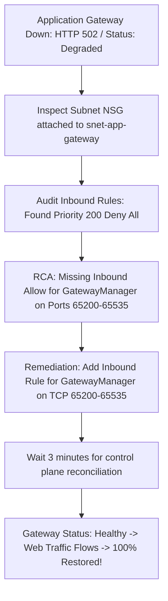

# Module 13-104-07: Administer Network Traffic, Load Balancing & Network Watcher

**Breadcrumbs:** [[13-Index - Azure|☁️ Azure Reference MOC]] > [[13-Index - AZ-104|📘 AZ-104 Exam Track]] > **07 - Administer Network Traffic**

---

## 🎯 Stage 1: Executive Overview & The Conceptual Lecture

### 1. The Zero-Knowledge Starting Point: Why Do We Need Load Balancing?
Imagine you launch a new online banking application. On Day 1, you host the website on a single Azure Virtual Machine. 
* At 9:00 AM, 50 users log in. The VM runs smoothly at 10% CPU.
* At 12:00 PM, a major news story breaks. Suddenly, 50,000 users hit your website simultaneously. The server's CPU spikes to 100%, RAM is exhausted, and the VM crashes. Every customer receives connection timeouts.
* Even worse: what happens at 2:00 AM when Microsoft updates the physical host running your VM, requiring a host reboot? Your entire application is offline for 10 minutes because you have **a single point of failure (SPOF)**.

In cloud computing, we achieve high availability and scalability through **horizontal scaling (scaling out)**:
* Instead of buying one giant server, you deploy an array of 5, 10, or 50 identical virtual machines running your application in parallel.
* But now a new challenge arises: when an external customer types `https://mybank.com` into their browser, **which specific VM receives their request?** How do you distribute the traffic evenly across all 50 servers? And if Server #12 crashes, how do you automatically route traffic away from the dead server so users never notice?

This is the job of a **Load Balancer**.

### 2. The Supermarket Checkout Analogy (Layer 4 vs. Layer 7)
Understanding the difference between **Layer 4** and **Layer 7** load balancing is the single most important conceptual foundation for the AZ-104 exam:

```text
+------------------------------------------------------------------------------------------------+
|                         LAYER 4 vs. LAYER 7: THE SUPERMARKET ANALOGY                           |
+------------------------------------------------------------------------------------------------+
|  Layer 4: The Parking Lot Attendant (Azure Load Balancer)                                      |
+------------------------------------------------------------------------------------------------+
| - Sits at the entrance of the parking lot.                                                     |
| - Inspects ONLY: What kind of vehicle is this? (TCP vs UDP) and what license plate? (IP/Port). |
| - Directs cars to Lane 1, Lane 2, or Lane 3 purely based on mathematical speed and volume.     |
| - Cannot see inside the trunk or know what groceries the customer wants to buy!                |
| - Blazingly fast (Microseconds latency), but completely blind to HTTP content.                 |
+------------------------------------------------------------------------------------------------+
|  Layer 7: The Concierge & Maitre d' (Azure Application Gateway)                                |
+------------------------------------------------------------------------------------------------+
| - Stands inside the store at the checkout lanes.                                               |
| - Inspects the actual shopping cart (HTTP Headers, URLs, Cookies, SSL Certificates).           |
| - "You have frozen meat? Go to Lane 4 (/meat/*). You have fresh bakery? Go to Lane 2 (/bakery)|
| - "You already started a transaction with Cashier Bob? Here is a loyalty cookie (Session       |
|    Affinity) so you stay at Cashier Bob's register."                                           |
| - Can decrypt SSL, check for shoplifters (WAF), but takes a few milliseconds to inspect items! |
+------------------------------------------------------------------------------------------------+
```

### 3. Terminology Matrix: Zero-Knowledge to Enterprise Architect

| Terminology | What It Means to a Beginner | Real-World Analog | Enterprise Architecture Reality |
| :--- | :--- | :--- | :--- |
| **Azure Load Balancer** | A fast traffic splitter for network packets. | A traffic cop directing cars to open highway lanes. | A non-terminating Layer 4 SDN multiplexer distributing TCP/UDP flows based on a 5-tuple hash at line rate. |
| **Application Gateway** | A smart web traffic router that reads URLs. | A restaurant host seating guests based on their reservation type. | A dedicated Layer 7 reverse proxy ADC supporting URL path routing, multi-site hosting, SSL termination, and cookie affinity. |
| **Health Probe** | Pinging a server to see if it is still alive. | A doctor checking a patient's pulse every 5 seconds. | An automated TCP/HTTP polling mechanism from `168.63.129.16` that marks failing nodes unhealthy and removes them from rotation. |
| **Inbound NAT Rule** | Port forwarding to one specific server. | Dialing a company's main phone number plus an employee's extension. | A static 1:1 port translation mapping a frontend public port directly to a specific backend VM for management (SSH/RDP). |
| **HA Ports (High Availability Ports)** | Load balancing all 65,535 ports at once. | An all-access VIP pass that lets all vehicle types through. | An option on Internal Standard Load Balancers forwarding all TCP/UDP ports simultaneously to active NVA firewall clusters. |
| **WAF (Web Application Firewall)** | A security guard checking web traffic for hacker attacks. | A metal detector and luggage X-ray scanner at an airport terminal. | An OWASP-compliant Layer 7 inspection engine that detects and blocks SQL Injection, Cross-Site Scripting (XSS), and CVE exploits. |
| **Network Watcher** | The cloud network diagnostic toolkit. | A mechanic's computer diagnostic scan tool plugged into your car's OBD port. | An Azure SDN suite offering packet-level tracing (IP Flow Verify, Next Hop, Connection Troubleshoot, and Packet Capture). |

---

## 🏛️ Stage 2: Core Mental Model & Component Architecture

### 1. The Azure Load Balancing Decision Matrix
Azure provides four primary load balancing solutions. Every AZ-104 scenario can be solved using this exact decision logic:

```mermaid
flowchart TD
    Client["Incoming Client Request"] --> Scope{"Is traffic Global (Multi-Region)\nor Regional (Within 1 Region)?"}
    
    Scope -->|Global / Multi-Region| GlobalType{"Is traffic HTTP/HTTPS Web\nor Non-HTTP (TCP/UDP)?"}
    GlobalType -->|HTTP/HTTPS Web| AFD["Azure Front Door\n- Global Anycast CDN & Reverse Proxy\n- Layer 7 SSL Offload & WAF\n- Instant multi-region failover"]
    GlobalType -->|Non-HTTP / DNS-based| ATM["Azure Traffic Manager\n- DNS-based Global Load Balancer\n- Priority, Weighted, Geographic\n- No SSL offloading (Pass-through)"]

    Scope -->|Regional / Intra-Region| RegionalType{"Is routing Layer 7 (HTTP/S)\nor Layer 4 (TCP/UDP)?"}
    RegionalType -->|Layer 7 (HTTP/S)| AppGW["Azure Application Gateway v2\n- Regional Reverse Proxy\n- URL Path Routing (/images/*)\n- Cookie-based Session Affinity & WAF"]
    RegionalType -->|Layer 4 (TCP/UDP)| ALB["Azure Load Balancer (Standard)\n- Regional Ultra-Low Latency (Microseconds)\n- TCP/UDP 5-tuple flow distribution\n- HA Ports & Inbound NAT Rules"]
```

| Capability | Azure Load Balancer | Azure Application Gateway | Azure Front Door | Azure Traffic Manager |
| :--- | :---: | :---: | :---: | :---: |
| **OSI Layer** | **Layer 4** (TCP/UDP) | **Layer 7** (HTTP/HTTPS) | **Layer 7** (HTTP/HTTPS) | **DNS Layer** (Resolution) |
| **Scope** | Regional | Regional | **Global (Anycast)** | **Global (DNS)** |
| **SSL/TLS Termination** | ❌ No | ✅ Yes | ✅ Yes | ❌ No |
| **URL Path Routing** | ❌ No | ✅ Yes (`/images/*`) | ✅ Yes | ❌ No |
| **Cookie Affinity** | ❌ No | ✅ Yes (`ARRAffinity`) | ✅ Yes | ❌ No |
| **Web App Firewall (WAF)** | ❌ No | ✅ Yes (WAF v2) | ✅ Yes | ❌ No |
| **HA Ports (All ports)** | ✅ Yes (Internal Standard) | ❌ No | ❌ No | ❌ No |

---

### 2. Azure Load Balancer: Architectural Components
An Azure Load Balancer consists of 5 decoupled building blocks:

```text
[ Frontend IP Configuration ] (Public Standard IP or Subnet Private IP)
             │
             ├──► [ Load Balancing Rule ] (e.g., Port 80 -> Backend Port 8080)
             │          │ (Evaluates Health Probe)
             │          ▼
             │    [ Backend Pool ] (VM-01, VM-02, VM-03)
             │
             ├──► [ Inbound NAT Rule 1 ] (Port 50001 -> VM-01 Port 22 SSH)
             ├──► [ Inbound NAT Rule 2 ] (Port 50002 -> VM-02 Port 22 SSH)
             │
             └──► [ Outbound Rules ] (Source NAT for internet egress)
```

1. **Frontend IP Configuration:** The entry point. Can be an external **Public IP** (Internet-facing LB) or an internal **Private IP** (Internal / Private LB).
2. **Backend Address Pool:** The pool of virtual machines or Virtual Machine Scale Set (VMSS) instances that will service incoming requests.
3. **Health Probes:** Actively polls backend VMs every few seconds. If a VM fails consecutive probe checks, it is removed from the rotation until it recovers.
4. **Load Balancing Rules:** Binds a specific frontend port to a backend port and pool (e.g., traffic arriving on port 80 is forwarded to backend port 80).
5. **Inbound NAT Rules:** 1:1 port forwarding rules used for administrative access (e.g., hitting the public IP on port `50001` connects directly to VM-01's SSH port `22` without giving VM-01 a public IP).

#### Session Persistence Modes:
* **None (Default - 5-Tuple):** Hash calculated from `{Source IP, Source Port, Destination IP, Destination Port, Protocol}`. Every new TCP session may land on a different VM.
* **Client IP (2-Tuple):** Hash calculated from `{Source IP, Destination IP}`. Guarantees that all requests from a single client machine always hit the same backend VM (used for sticky legacy applications).
* **Client IP and Protocol (3-Tuple):** Hash calculated from `{Source IP, Destination IP, Protocol}`.

---

### 3. Azure Application Gateway v2 & WAF Architecture
Application Gateway v2 is a dedicated HTTP reverse proxy. It terminates incoming client TCP connections, decrypts TLS certificates, evaluates URL paths, and initiates a brand new connection to the backend servers:

```text
[ Client Browser ]
        │ HTTPS (Port 443)
        ▼
[ Application Gateway Frontend IP & HTTPS Listener ]
  ├── 1. Terminates TLS using SSL Certificate (Stored in Azure Key Vault)
  ├── 2. WAF v2 Engine inspects payload against OWASP Core Rule Set (CRS 3.2)
  └── 3. Evaluates Routing Rules:
             │
             ├── Path: /images/*  ──► [ Backend Pool: Blob Storage Static Site ]
             ├── Path: /api/*     ──► [ Backend Pool: Microservices VMSS ]
             └── Path: Default /* ──► [ Backend Pool: Main Web VMs ]
```

#### Application Gateway Components:
* **Dedicated Subnet Requirement:** Application Gateway v2 **must be deployed into its own dedicated subnet** (at least `/27` or `/26`). No virtual machines or other gateways can reside in this subnet!
* **Listeners:** Listens on specific ports. Supports **Basic** (listens on all traffic) and **Multi-Site** (inspects the HTTP `Host:` header, hosting `shop.contoso.com` and `hr.contoso.com` on the exact same IP and port!).
* **Backend HTTP Settings:** Configures the protocol (HTTP vs HTTPS), backend port, and **Cookie-Based Affinity** (injects an `ApplicationGatewayAffinity` cookie so browser sessions stick to one server).
* **Web Application Firewall (WAF v2):**
  * *Detection Mode:* Logs attacks to Azure Log Analytics without blocking them (used to baseline traffic and avoid false positives).
  * *Prevention Mode:* Actively drops malicious packets and returns `HTTP 403 Forbidden`.

---

## 🏢 Stage 3: Deep-Intuition Platform Mechanics & Topology

### 1. Azure Load Balancer Under the Hood: The SDN Multiplexing Engine
Junior administrators often assume that an Azure Load Balancer is a virtual machine VM sitting in the middle of their subnet routing packets. 
* **It is NOT an appliance or VM.**
* Azure Load Balancer is a distributed Software Defined Network (SDN) component running directly inside the **physical hypervisor kernel (the SLB MUX layer)** across the datacenter!
* Because there is no intermediary proxy software or TCP termination, Layer 4 load balancing happens in **microseconds** with zero packet inspection overhead.

#### Outbound SNAT Port Exhaustion (The Silent Failure Loop):
When backend VMs without dedicated public IPs make outbound calls to the internet (e.g., calling an external payment gateway API), the Load Balancer performs **Source Network Address Translation (SNAT)** using its frontend public IP:
* Azure allocates a fixed pool of SNAT ports (typically 1,024 ports per VM).
* If your application opens hundreds of rapid, short-lived outbound HTTP connections without connection pooling, the assigned SNAT ports enter `TIME_WAIT` status.
* Once all 1,024 ports are exhausted, subsequent outbound API calls **fail silently with TCP handshake timeouts!**
* **The Architecture Fix:** Deploy **Azure NAT Gateway** to the backend subnet. A NAT Gateway provides 64,512 dynamic, shared SNAT ports per public IP, completely eliminating SNAT port exhaustion!

---

### 2. Application Gateway: The Port 65200–65535 GatewayManager Trap
Because Application Gateway v2 is an active managed cluster of instances, Azure's internal control plane needs to communicate with the gateway to monitor health and orchestrate autoscaling.
* Azure communicates with the gateway instances over **TCP ports 65200 through 65535**.
* If an administrator attaches a Network Security Group (NSG) to the Application Gateway subnet, they **MUST create an Inbound Allow rule** for:
  - **Source:** `GatewayManager` (Service Tag)
  - **Destination Port Range:** `65200-65535`
  - **Protocol:** `TCP`
  - **Action:** `Allow`

> [!CAUTION]
> **The GatewayManager Outage Trap:**
> If you block ports `65200-65535` from the `GatewayManager` service tag, the Application Gateway **cannot communicate with the Azure control plane**. Within minutes, the gateway status transitions to `Failed`, health monitoring ceases, and the gateway stops servicing all web traffic!

---

### 3. Azure Network Watcher Diagnostic Toolkit
When network packets fail to reach a destination in Azure SDN, administrators do not guess—they use the **Network Watcher Diagnostic Suite**:

```text
+-------------------------------------------------------------------------------------------------+
|                                 AZURE NETWORK WATCHER TOOLKIT                                   |
+-------------------------------------------------------------------------------------------------+
|  1. IP Flow Verify          |  2. Next Hop                 |  3. Connection Troubleshoot        |
+-----------------------------+------------------------------+------------------------------------+
| - Checks: Is a 5-tuple      | - Checks: Where is Azure's   | - Checks: End-to-end TCP latency   |
|   packet allowed by NSGs?   |   SDN routing this packet?   |   and hop-by-hop packet drops.     |
| - Output: "Access Allowed"  | - Output: "Next Hop Type:    | - Output: Visual topological path  |
|   or "Access Denied by      |   VirtualAppliance (10.0.1.4)|   with latency in milliseconds and |
|   Rule: Custom-Deny-100"    |   or 'None' (Blackhole!)"    |   firewall drop indicators.        |
+-----------------------------+------------------------------+------------------------------------+
|  4. Packet Capture          |  5. NSG Flow Logs            |  6. Effective Security Rules       |
+-----------------------------+------------------------------+------------------------------------+
| - Remotely captures .pcap   | - Streams flow metadata to   | - Displays the merged evaluation   |
|   traces on live VM disks   |   Storage & Log Analytics    |   of Subnet NSG + NIC NSG rules    |
|   without logging in!       |   for security audits.       |   with winning priority rankings.  |
+-------------------------------------------------------------------------------------------------+
```

---

## ⚙️ Stage 4: Declarative & Automation Engine (CLI & PowerShell Core)

### 1. Azure CLI: Standard Load Balancer with Health Probe & Inbound NAT Rule

```bash
# ==============================================================================
# 1. CREATE STANDARD PUBLIC LOAD BALANCER
# ==============================================================================

# Create a Standard Public IP for the Load Balancer
az network public-ip create \
  --resource-group "rg-traffic-lab" \
  --name "pip-lb-web" \
  --sku "Standard" \
  --location "eastus"

# Create the Load Balancer with Frontend IP and Backend Pool
az network lb create \
  --resource-group "rg-traffic-lab" \
  --name "lb-web-prod" \
  --sku "Standard" \
  --location "eastus" \
  --public-ip-address "pip-lb-web" \
  --frontend-ip-name "fe-lb-public" \
  --backend-pool-name "be-web-pool"

# ==============================================================================
# 2. CONFIGURE HEALTH PROBE & LOAD BALANCING RULE
# ==============================================================================

# Create an HTTP Health Probe testing port 80 every 15 seconds
az network lb probe create \
  --resource-group "rg-traffic-lab" \
  --lb-name "lb-web-prod" \
  --name "hp-http-80" \
  --protocol "Http" \
  --port 80 \
  --path "/healthz" \
  --interval 15 \
  --threshold 2

# Create Load Balancing Rule with 2-Tuple Session Persistence (Client IP)
az network lb rule create \
  --resource-group "rg-traffic-lab" \
  --lb-name "lb-web-prod" \
  --name "rule-http-lb" \
  --protocol "Tcp" \
  --frontend-port 80 \
  --backend-port 80 \
  --frontend-ip-name "fe-lb-public" \
  --backend-pool-name "be-web-pool" \
  --probe-name "hp-http-80" \
  --load-distribution "SourceIP" \
  --idle-timeout 15 \
  --enable-tcp-reset true

# ==============================================================================
# 3. CONFIGURE INBOUND NAT RULE FOR SSH MANAGEMENT
# ==============================================================================
az network lb inbound-nat-rule create \
  --resource-group "rg-traffic-lab" \
  --lb-name "lb-web-prod" \
  --name "nat-ssh-vm01" \
  --protocol "Tcp" \
  --frontend-port 50001 \
  --backend-port 22 \
  --frontend-ip-name "fe-lb-public"
```

### 2. Azure CLI: Network Watcher Diagnostics Commands

```bash
# ==============================================================================
# 4. NETWORK WATCHER IP FLOW VERIFY & NEXT HOP
# ==============================================================================

# Test if inbound HTTP port 80 traffic is permitted by NSG
az network watcher test-ip-flow \
  --resource-group "rg-traffic-lab" \
  --vm "vm-web-01" \
  --direction "Inbound" \
  --protocol "TCP" \
  --local "10.60.1.4:80" \
  --remote "203.0.113.50:49200"

# Diagnose Next Hop to verify if internet egress is routing to a firewall
az network watcher show-next-hop \
  --resource-group "rg-traffic-lab" \
  --vm "vm-web-01" \
  --source-ip "10.60.1.4" \
  --dest-ip "8.8.8.8"
```

---

## 🖥️ Stage 5: Step-by-Step Azure Portal GUI Walkthrough

Follow these exact navigation steps in the **Azure Portal** (`https://portal.azure.com`) to master traffic management:

### Task 1: Provisioning an Azure Standard Load Balancer in the GUI
1. In the top search bar, type **Load balancers** and select it.
2. Click **+ Create** on the command bar:
   - **Resource group:** `rg-traffic-lab`.
   - **Name:** `lb-web-prod`.
   - **Region:** `East US`.
   - **SKU:** Select **Standard**.
   - **Type:** Select **Public**.
   - **Tier:** Select **Regional**.
3. In the **Frontend IP configuration** tab:
   - Click **+ Add a frontend IP configuration**.
   - *Name:* `fe-lb-public`.
   - *IP type:* Select *IP address* $\rightarrow$ click *Create new* public IP $\rightarrow$ name it `pip-lb-web`.
   - Click **Add**.
4. In the **Backend pools** tab:
   - Click **+ Add a backend pool**.
   - *Name:* `be-web-pool`.
   - *Virtual network:* Select `vnet-traffic-prod`.
   - Click **Add**.
5. Click **Review + create** $\rightarrow$ **Create**.

### Task 2: Adding Health Probes and Load Balancing Rules
1. Open your newly created `lb-web-prod`:
2. In the left navigation menu under **Settings**, click **Health probes** $\rightarrow$ click **+ Add**:
   - **Name:** `hp-http-check`.
   - **Protocol:** `HTTP`.
   - **Port:** `80`.
   - **Path:** `/` (or `/healthz`).
   - **Interval:** `5` seconds.
   - **Unhealthy threshold:** `2`.
   - Click **Add**.
3. In the left menu under **Settings**, click **Load balancing rules** $\rightarrow$ click **+ Add**:
   - **Name:** `rule-web-http`.
   - **Frontend IP address:** Select `fe-lb-public`.
   - **Backend pool:** Select `be-web-pool`.
   - **Protocol:** `TCP`.
   - **Port:** `80`.
   - **Backend port:** `80`.
   - **Health probe:** Select `hp-http-check`.
   - **Session persistence:** Select **Client IP** (2-tuple).
   - Click **Save**.

### Task 3: Creating Application Gateway v2 with URL Path Routing
1. In the top search bar, type **Application gateways** and select it.
2. Click **+ Create**:
   - **Resource group:** `rg-traffic-lab`.
   - **Application gateway name:** `appgw-web-prod`.
   - **Tier:** Select **WAF V2**.
   - **Virtual network:** Select `vnet-traffic-prod`.
   - **Subnet:** Select `snet-app-gateway` (must be dedicated!).
3. In the **Frontends** tab:
   - *Frontend IP type:* Select **Public**. Create a new public IP named `pip-appgw`.
4. In the **Backend pools** tab:
   - Add Pool 1: `pool-main-web` (Web VMs).
   - Add Pool 2: `pool-images` (Dedicated image servers or storage blob endpoints).
5. In the **Configuration** tab:
   - Add a routing rule $\rightarrow$ Name: `rule-path-routing`.
   - *Listener:* Name: `listener-http`, Port `80`, Protocol `HTTP`.
   - *Backend targets:* Target type: **Path-based**.
     - Default target: `pool-main-web`.
     - Add Path: `/images/*` $\rightarrow$ Target: `pool-images`.
6. Click **Review + create** $\rightarrow$ **Create**.

### Task 4: Troubleshooting with Network Watcher IP Flow Verify
1. In the top search bar, type **Network Watcher** and select it.
2. In the left navigation menu under **Network diagnostic tools**, click **IP flow verify**.
3. Fill out the verification form:
   - **Target virtual machine:** Select `vm-web-01`.
   - **Network interface:** Default NIC.
   - **Direction:** Select **Inbound**.
   - **Protocol:** Select **TCP**.
   - **Local IP:** `10.60.1.4` | **Local Port:** `80`.
   - **Remote IP:** `203.0.113.10` | **Remote Port:** `54321`.
4. Click **Verify IP flow**.
5. Within 5 seconds, Network Watcher reports:
   - **Access:** `Allowed` (or `Denied`).
   - **Rule Name:** It identifies the **exact winning NSG rule** (e.g., `rule-allow-http`) and its priority!

---

## 🔬 Stage 6: Hands-On Enterprise Lab Bridge

To apply these traffic distribution principles, configure path-based routing, and practice Network Watcher diagnostics, proceed directly to the practical enterprise lab:

> [!TIP]
> **Practical Implementation Companion:**
> Access the comprehensive engineering lab at:
> **[[Lab-07_Azure_Load_Balancer_Application_Gateway_and_WAF|Lab 07: Azure Standard Load Balancer, Application Gateway v2 & WAF Inspection]]**
> 
> *Target Lab File:* `Projects/AZ-104/07_Network_Traffic_Management/Lab-07_Azure_Load_Balancer_Application_Gateway_and_WAF.md`

### Lab Objectives Matrix:

```text
+-----------------------------------------------------------------------------------------+
| Lab 07 Enterprise Milestone Goals                                                       |
+-----------------------------------------------------------------------------------------+
| 1. Deploy an Azure Standard Public Load Balancer with HTTP Health Probes and LB rules   |
| 2. Configure Inbound NAT Rules for direct administrative port forwarding to VMs         |
| 3. Provision Azure Application Gateway v2 inside a dedicated /26 subnet                 |
| 4. Author URL Path-Based Routing Rules (/images/* vs default web pool)                  |
| 5. Execute Network Watcher IP Flow Verify and Next Hop tools to diagnose packet drops   |
+-----------------------------------------------------------------------------------------+
```

---

## ⚠️ Stage 7: "See It in Action" Real-World Failure & Recovery Loop (AARF)

### Scenario: The "GatewayManager Outage" Production Failure Loop

#### 1. The Architectural Setup & Assumptions
A security operations team audits an enterprise cloud environment and notices that the dedicated subnet hosting an **Azure Application Gateway v2** (`snet-app-gateway`) has no Network Security Group attached. The junior engineer applies an NSG named `nsg-app-gateway` with a strict Zero-Trust baseline:
* Inbound Rule 100: Allow HTTP (Port 80) and HTTPS (Port 443) from `Internet`.
* Inbound Rule 200: Deny All Inbound from Any to Any.

#### 2. The Production Failure Manifestation
Ten minutes after applying the NSG, the entire production website crashes. External users attempting to reach `https://mycompany.com` receive browser gateway timeouts:
> `HTTP 502 Bad Gateway` or `HTTP 504 Gateway Timeout`

In the Azure Portal, the Application Gateway's status displays a warning:
> **Status:** `Degraded` / `Failed`
> **Message:** `Application Gateway is unable to retrieve health status of backend instances.`

#### 3. Root Cause Analysis (RCA) & Deep Investigation
Why did the Application Gateway fail when HTTP/HTTPS ports 80 and 443 were explicitly allowed?
1. **The GatewayManager Infrastructure Dependency:** Azure Application Gateway v2 is an orchestrated managed cluster. Microsoft's internal SDN control plane must continuously communicate with the gateway instances to check compute health, distribute TLS certificates, and manage autoscaling.
2. **The Infrastructure Port Range:** This control plane communication occurs over **TCP ports 65200 through 65535**.
3. **The Custom Deny Rule Interception:** The engineer's custom rule at Priority 200 (`Deny All`) blocked incoming traffic on ports 65200–65535 originating from the Azure platform.
4. **The Health Check Failure:** Because the Azure control plane could not reach the gateway on port 65200+, it could not update routing definitions or receive backend health telemetry, forcing the gateway into an unrecoverable `Failed` state!

#### 4. Remediation & Diagnostic Verification Loop



```bash
# Diagnostic & Remediation Script (Azure CLI)

# 1. Remediate: Add mandatory GatewayManager control plane rule to the AppGW NSG
az network nsg rule create \
  --resource-group "rg-traffic-lab" \
  --nsg-name "nsg-app-gateway" \
  --name "Allow-GatewayManager-ControlPlane" \
  --priority 110 \
  --direction Inbound \
  --access Allow \
  --protocol Tcp \
  --source-address-prefixes "GatewayManager" \
  --destination-address-prefixes "*" \
  --destination-port-ranges "65200-65535"

# 2. Verify: Ensure health probes from AzureLoadBalancer are also permitted
az network nsg rule create \
  --resource-group "rg-traffic-lab" \
  --nsg-name "nsg-app-gateway" \
  --name "Allow-AzureLoadBalancer-Probes" \
  --priority 120 \
  --direction Inbound \
  --access Allow \
  --protocol "*" \
  --source-address-prefixes "AzureLoadBalancer" \
  --destination-address-prefixes "*" \
  --destination-port-ranges "*"
```

---

## 💡 Stage 8: High-Yield AZ-104 Exam Scenarios & Trick Question Traps

### Trick Question Trap 1: Application Gateway Dedicated Subnet Violation
* **The Scenario:** An administrator creates a new Application Gateway v2. In the setup wizard, they attempt to select `Subnet-1`, which currently hosts two domain controller virtual machines.
* **The Trap:** Why does Azure disable the subnet or throw an error?
* **The Ground Truth:** **Application Gateway v2 mandates a DEDICATED subnet.** You **CANNOT** place virtual machines, storage private endpoints, or any other resources inside an Application Gateway subnet!

### Trick Question Trap 2: HA Ports Availability Constraint
* **The Scenario:** A network engineer wants to configure High Availability (HA) Ports (`Protocol: All`, `Port: 0`) on an Internet-facing Public Standard Load Balancer.
* **The Trap:** Does Azure support HA Ports on a Public Load Balancer?
* **The Ground Truth:** **NO!** HA Ports are available **EXCLUSIVELY on Internal Standard Load Balancers**. Public Load Balancers require explicit frontend and backend port mapping rules.

### Trick Question Trap 3: Load Balancer vs. App Gateway for Cookie Sticky Sessions
* **The Scenario:** A legacy e-commerce application stores user shopping cart items in local web server RAM memory. The company requires all requests from a user's browser session to stick to the same backend server.
* **The Trap:** The question offers Azure Load Balancer with 5-tuple hash, Azure Load Balancer with Client IP, and Azure Application Gateway with Cookie-Based Affinity.
* **The Ground Truth:** **Azure Application Gateway with Cookie-Based Affinity (`ApplicationGatewayAffinity`)** is the correct answer! Client IP persistence on an Azure Load Balancer fails when thousands of mobile users browse through corporate proxy firewalls or cellular carrier NATs (where thousands of distinct users share a single public IP). Application Gateway cookie affinity injects a unique browser cookie that tracks the individual user session accurately.

### Trick Question Trap 4: Network Watcher "Next Hop" Output of "None"
* **The Scenario:** An administrator runs Network Watcher *Next Hop* from a source VM to an external IP. The tool outputs: `nextHopType: None`.
* **The Trap:** What does a next hop type of `None` mean?
* **The Ground Truth:** It means **traffic is dropped (a routing blackhole)**! Azure SDN has no valid path to forward the packet, so the packet is immediately discarded.

---

## 🌐 Authoritative References & Inflow Citations

* **Udemy AZ-104 Master Class by Scott Duffy:** [Inflow: Module 09 - Network Traffic, Security and Load Balancing](file:///F:/Dump%20one/BrainDump/inflow/AZ-104-ScottDuffy/09_Administer_Network_Traffic_Security_and_Load_Balancing.md)
* **John Savill’s Azure Master Class & Deep Dives:** Load Balancing Internals, Layer 4 vs Layer 7 Architectures, Gateway Load Balancer, and Front Door Split-TCP.
* **Moe Intelligence AZ-104 Video Curriculum:** Lessons 23 through 24 (Load Balancers, Health Probes, App Gateway).
* **KodeKloud AZ-104 Course:** [Administer Network Traffic Module](https://notes.kodekloud.com/docs/Updated-AZ-104-Microsoft-Azure-Administrator/Administer-Network-Traffic/Module-Introduction/page.md)
* **Official Microsoft Learn Documentation:**
  - [Azure Load Balancer Overview](https://learn.microsoft.com/en-us/azure/load-balancer/load-balancer-overview)
  - [What is Azure Application Gateway?](https://learn.microsoft.com/en-us/azure/application-gateway/overview)
  - [Application Gateway infrastructure configuration](https://learn.microsoft.com/en-us/azure/application-gateway/configuration-infrastructure)
  - [What is Azure Network Watcher?](https://learn.microsoft.com/en-us/azure/network-watcher/network-watcher-monitoring-overview)