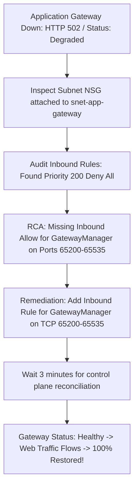

# Module 13-104-07: Administer Network Traffic, Load Balancing, Firewall & Network Watcher

**Breadcrumbs:** [[13-Index - Azure|☁️ Azure Reference MOC]] > [[13-Index - AZ-104|📘 AZ-104 Exam Track]] > **07 - Administer Network Traffic**

---

## 🎯 Stage 1: Executive Overview & The Conceptual Lecture

### 1. The Zero-Knowledge Starting Point: Why Do We Need Load Balancing?
Imagine you launch an enterprise online banking application. On Day 1, you host the website on a single Azure Virtual Machine. 
* At 9:00 AM, 50 users log in. The VM runs smoothly at 10% CPU.
* At 12:00 PM, a major financial news event breaks. Suddenly, 50,000 users hit your website simultaneously. The server's CPU spikes to 100%, RAM memory is completely exhausted, and the VM crashes. Every customer receives connection timeouts.
* Even worse: what happens at 2:00 AM when Microsoft updates the physical host blade running your VM, requiring a hardware reboot? Your entire application goes offline because you have **a single point of failure (SPOF)**.

In modern cloud computing, high availability and scalability are achieved through **horizontal scaling (scaling out)**:
* Instead of buying one giant server, you deploy an array of 5, 10, or 50 identical virtual machines running your application in parallel across Availability Zones.
* But now a fundamental routing challenge arises: when an external customer types `https://mybank.com` into their browser, **which specific VM receives their request?** How do you distribute the traffic evenly across all 50 servers? And if Server #12 crashes, how do you automatically route traffic away from the dead server so users never notice?

This is the responsibility of Azure's traffic management and load-balancing services.

---

### 2. The Supermarket Checkout Analogy (Layer 4 vs. Layer 7)
Understanding the difference between **Layer 4 (Transport)** and **Layer 7 (Application)** load balancing is the single most critical conceptual foundation for Azure architecture:

```text
+------------------------------------------------------------------------------------------------+
|                         LAYER 4 vs. LAYER 7: THE SUPERMARKET ANALOGY                           |
+------------------------------------------------------------------------------------------------+
|  Layer 4: The Parking Lot Attendant (Azure Load Balancer)                                      |
+------------------------------------------------------------------------------------------------+
| - Sits at the entrance of the parking lot.                                                     |
| - Inspects ONLY: What kind of vehicle is this? (TCP vs UDP) and what license plate? (IP/Port). |
| - Directs cars to Lane 1, Lane 2, or Lane 3 purely based on mathematical speed and volume.     |
| - Cannot see inside the trunk or know what groceries the customer wants to buy!                |
| - Blazingly fast (Microseconds latency), but completely blind to HTTP content.                 |
+------------------------------------------------------------------------------------------------+
|  Layer 7: The Concierge & Maitre d' (Azure Application Gateway)                                |
+------------------------------------------------------------------------------------------------+
| - Stands inside the store at the checkout lanes.                                               |
| - Inspects the actual shopping cart (HTTP Headers, URLs, Cookies, SSL Certificates).           |
| - "You have frozen meat? Go to Lane 4 (/meat/*). You have fresh bakery? Go to Lane 2 (/bakery)|
| - "You already started a transaction with Cashier Bob? Here is a loyalty cookie (Session       |
|    Affinity) so you stay at Cashier Bob's register."                                           |
| - Can decrypt SSL, check for shoplifters (WAF), but takes a few milliseconds to inspect items! |
+------------------------------------------------------------------------------------------------+
```

---

### 3. Terminology Matrix: Zero-Knowledge to Enterprise Architect

| Terminology | What It Means to a Beginner | Real-World Analog | Enterprise Architecture Reality |
| :--- | :--- | :--- | :--- |
| **Azure Load Balancer (ALB)** | A fast traffic splitter for network packets. | A traffic cop directing cars to open highway lanes. | A non-terminating Layer 4 SDN multiplexer distributing TCP/UDP flows based on a 5-tuple hash at hypervisor line rate. |
| **Application Gateway** | A smart web traffic router that reads URLs. | A restaurant host seating guests based on their reservation type. | A dedicated Layer 7 reverse proxy ADC supporting URL path routing, multi-site hosting, SSL termination, and cookie affinity. |
| **Health Probe** | Pinging a server to see if it is still alive. | A doctor checking a patient's pulse every 5 seconds. | An automated TCP/HTTP polling mechanism from Wire Server `168.63.129.16` that marks failing nodes unhealthy and pulls them from rotation. |
| **Inbound NAT Rule** | Port forwarding to one specific server. | Dialing a company's main phone number plus an employee's extension. | A static 1:1 port translation mapping a frontend public port directly to a specific backend VM for management (SSH/RDP). |
| **HA Ports (All Ports)** | Load balancing all 65,535 ports at once. | An all-access VIP pass that lets all vehicle types through. | An option on Internal Standard Load Balancers forwarding all TCP/UDP ports simultaneously to active NVA firewall clusters. |
| **Floating IP (DSR)** | Server replies directly to the client bypassing LB return. | Ordering food through a drive-thru speaker, but having food delivered directly to your car window. | Direct Server Return (DSR). Disables IP rewrite on backend VMs so VMs respond directly using the frontend IP; mandatory for SQL AlwaysOn. |
| **Outbound SNAT** | VMs using load balancer public IP to reach the internet. | Multiple office phones sharing one outbound company phone line. | Source Network Address Translation mapping private backend IPs to public frontend IPs using ephemeral port pools (1,024 ports/VM). |
| **WAF (Web App Firewall)** | A security guard checking web traffic for hacker attacks. | A metal detector and luggage X-ray scanner at an airport terminal. | An OWASP-compliant Layer 7 inspection engine that detects and blocks SQL Injection (SQLi), Cross-Site Scripting (XSS), and CVE exploits. |
| **Azure Firewall** | A central security appliance inspecting all subnet traffic. | A state border customs inspection station checking all commercial trucks. | A fully managed, stateful Layer 3-7 firewall service with built-in threat intelligence, FQDN filtering, and network/application rules. |
| **Azure Front Door** | A global edge accelerator for web applications. | A global network of express package delivery hubs located in every major city. | A global Layer 7 Anycast reverse proxy and CDN terminating SSL at edge Points of Presence (PoPs) using Split-TCP. |
| **Azure Traffic Manager** | A DNS phonebook that sends users to the closest region. | A telephone operator giving callers the phone number of their nearest branch office. | A DNS-based global traffic distribution engine supporting Priority, Weighted, Performance, and Geographic resolution. |
| **Network Watcher** | The cloud network diagnostic toolkit. | A mechanic's computer diagnostic scan tool plugged into your car's OBD port. | An Azure SDN suite offering packet-level tracing (IP Flow Verify, Next Hop, Connection Troubleshoot, and Packet Capture). |

---

## 🏛️ Stage 2: Core Mental Model & Component Architecture

### 1. The Azure Load Balancing Decision Matrix
Azure provides four distinct traffic management solutions. Every AZ-104 architecture scenario is resolved using this exact decision tree:

```text
                                [ Incoming Client Traffic ]
                                             │
                  ┌──────────────────────────┴──────────────────────────┐
                  ▼                                                     ▼
        [ Global (Multi-Region) ]                             [ Regional (Single Region) ]
                  │                                                     │
        ┌─────────┴─────────┐                                 ┌─────────┴─────────┐
        ▼                   ▼                                 ▼                   ▼
[ Layer 7: HTTP/HTTPS ] [ Non-HTTP / DNS ]            [ Layer 7: HTTP/HTTPS ] [ Layer 4: TCP/UDP ]
        │                   │                                 │                   │
        ▼                   ▼                                 ▼                   ▼
 Azure Front Door    Traffic Manager                  Application Gateway    Azure Load Balancer
 - Anycast CDN       - DNS Resolution                 - Regional Reverse     - Ultra-low latency
 - Edge SSL Offload  - Priority / Perf                  Proxy (WAF v2)       - 5-tuple TCP/UDP
 - Split-TCP / WAF   - No SSL offload                 - URL Path / Cookie    - HA Ports / DSR
```

#### Detailed Architecture Comparison Matrix:

| Capability | Azure Load Balancer | Azure Application Gateway | Azure Front Door | Azure Traffic Manager |
| :--- | :---: | :---: | :---: | :---: |
| **OSI Layer** | **Layer 4** (TCP/UDP) | **Layer 7** (HTTP/HTTPS) | **Layer 7** (HTTP/HTTPS) | **DNS Layer** (Resolution) |
| **Scope** | Regional | Regional | **Global (Anycast Edge)** | **Global (DNS)** |
| **Routing Latency** | Microseconds | Low Milliseconds | Low Milliseconds (Edge PoP) | Zero (DNS resolution only) |
| **SSL/TLS Termination** | ❌ No (Pass-through) | ✅ Yes | ✅ Yes (At Edge PoPs) | ❌ No (Client talks direct) |
| **URL Path Routing** | ❌ No | ✅ Yes (`/images/*`) | ✅ Yes (`/api/*`) | ❌ No |
| **Cookie Session Affinity** | ❌ No (IP hash only) | ✅ Yes (`ARRAffinity`) | ✅ Yes | ❌ No |
| **Web App Firewall (WAF)** | ❌ No | ✅ Yes (WAF v2 CRS 3.2) | ✅ Yes (Global WAF) | ❌ No |
| **HA Ports (All Ports 0)** | ✅ Yes (Internal Standard) | ❌ No | ❌ No | ❌ No |
| **Direct Server Return (DSR)** | ✅ Yes (Floating IP) | ❌ No | ❌ No | ❌ No |

---

### 2. Azure Load Balancer: Architectural Components & SKU Comparison
An Azure Load Balancer consists of 5 decoupled building blocks:

```text
[ Frontend IP Configuration ] (Public Standard IP or Subnet Private IP)
             │
             ├──► [ Load Balancing Rule ] (e.g., Port 80 -> Backend Port 8080)
             │          │ (Monitors Health Probe from 168.63.129.16)
             │          ▼
             │    [ Backend Address Pool ] (VMs / VMSS across Availability Zones)
             │
             ├──► [ Inbound NAT Rules ] (Port 50001 -> VM-01 Port 22 SSH)
             │
             └──► [ Outbound Rules ] (Allocates SNAT ports for Internet egress)
```

#### Basic SKU vs. Standard SKU (High-Yield Exam Core):

| Feature                          | Basic Load Balancer (Legacy/Deprecated)            | Standard Load Balancer (Enterprise Standard)                     |
| :------------------------------- | :------------------------------------------------- | :--------------------------------------------------------------- |
| **Backend Pool Size**            | Up to 300 instances (Single Availability Set only) | Up to **1,000 instances** (Any VM/VMSS in VNet)                  |
| **Zone Redundancy**              | ❌ No (Non-zonal only)                              | ✅ **Zone-redundant, Zonal, or Non-zonal**                        |
| **Security Default**             | **Open by Default** (Traffic passes without NSG!)  | **Secure by Default** (Closed; requires explicit NSG allow rule) |
| **Health Probes**                | TCP and HTTP only                                  | TCP, HTTP, and **HTTPS (validates TLS)**                         |
| **High Availability (HA) Ports** | ❌ No                                               | ✅ **Yes** (Internal ALB only: balances all 65,535 ports)         |
| **Floating IP (DSR)**            | Supported                                          | Supported (Enhanced for SQL AlwaysOn)                            |
| **Outbound Rules**               | ❌ No (Uses implicit allocation)                    | ✅ **Yes** (Declarative SNAT allocation & tuning)                 |
| **SLA**                          | None ($0 cost)                                     | **99.99% SLA**                                                   |

---

### 3. Load Balancing Distribution Modes & Hash Algorithms
Azure Load Balancer uses an N-tuple hash algorithm to determine which backend VM receives each incoming packet:

```text
1. 5-Tuple Distribution (Default / "None"):
   ├── Hash Input: {Source IP, Source Port, Destination IP, Destination Port, Protocol}
   └── Behavior: Every new TCP connection from the same client may land on a DIFFERENT backend VM!

2. 2-Tuple Distribution ("Client IP"):
   ├── Hash Input: {Source IP, Destination IP}
   └── Behavior: All successive connections from the SAME client IP address land on the SAME backend VM.

3. 3-Tuple Distribution ("Client IP and Protocol"):
   ├── Hash Input: {Source IP, Destination IP, Protocol}
   └── Behavior: Successive connections from same client IP using the same protocol hit the same VM.
```

---

### 4. Floating IP (Direct Server Return - DSR) Architecture

#### The Traditional On-Premises Clustering Paradigm (GARP)
In traditional physical on-premises data centers, high-availability clustering—such as **Windows Server Failover Clustering (WSFC)** and **SQL Server Always On Availability Groups**—relies on a shared Virtual IP (VIP) address known as the **Availability Group Listener IP** (e.g., `10.0.0.100`):
* Under normal operations, Primary Node 1 owns the Listener IP `10.0.0.100`.
* When Node 1 fails and failover occurs to Node 2, Node 2 broadcasts an unsolicited **Gratuitous ARP (GARP)** packet across the physical Layer 2 broadcast domain.
* The physical network switches receive this GARP packet, update their Layer 2 CAM/MAC address tables, and instantly begin forwarding all client traffic destined for `10.0.0.100` to Node 2's physical network adapter MAC address.
* The application clients experience seamless failover without changing IP addresses or connection strings.

#### The Azure SDN Limitation: No Layer 2 Broadcasts or Multicasts
In Microsoft Azure's Software-Defined Network (SDN), **all Layer 2 ARP broadcasts and multicasts are deliberately dropped by the virtual switch / hypervisor fabric** to prevent broadcast storms and security breaches across the multi-tenant physical infrastructure:
* Virtual machines running in Azure **cannot** emit GARP packets to migrate an IP address between nodes.
* If a secondary SQL node attempts to announce that it now owns `10.0.0.100` via ARP, Azure's SDN silently swallows the broadcast.
* **The Azure Engineering Solution:** To provide a single, static entry point for the SQL Availability Group Listener, Azure mandates placing an **Internal Load Balancer (ILB)** in front of the SQL cluster nodes:
  - The ILB's Frontend IP is assigned the Availability Group Listener IP (`10.0.0.100`).
  - An ILB Health Probe continuously queries a dedicated cluster probe port (e.g., TCP `59999`) on both SQL nodes.
  - The WSFC cluster service running inside Windows ensures that **only the active primary SQL replica responds with an HTTP 200 or TCP ACK** on port `59999`. The secondary passive node rejects the probe.
  - The ILB automatically steers all incoming client database queries (`10.0.0.100:1433`) to whichever SQL node is currently healthy and active.

```text
+--------------------------------------------------------------------------------------------------+
|               AZURE SDN BROADCAST LIMITATION & INTERNAL LOAD BALANCER ARBITRATION                |
+--------------------------------------------------------------------------------------------------+
|                                    [ Client Application ]                                        |
|                                              │                                                   |
|                        Connects to SQL Listener IP: 10.0.0.100:1433                              |
|                                              ▼                                                   |
|                 [ Azure Internal Standard Load Balancer (ILB) ]                                  |
|                 Frontend IP: 10.0.0.100 (Availability Group Listener)                            |
|                                              │                                                   |
|                 Health Probe: TCP Port 59999 (Cluster Health Check)                              |
|                 ┌────────────────────────────┴───────────────────────────┐                       |
|                 ▼                                                        ▼                       |
|   [ SQL Node 1 (Primary) ]                                 [ SQL Node 2 (Secondary) ]            |
|   Physical IP: 10.0.1.4                                    Physical IP: 10.0.1.5                 |
|   Loopback IP: 10.0.0.100                                  Loopback IP: 10.0.0.100               |
|   Probe 59999: ACTIVE (Responds ACK / 200)                 Probe 59999: INACTIVE (Drops Probe)   |
|   Status: HEALTHY -> Receives 100% of Traffic              Status: UNHEALTHY -> Standby          |
+--------------------------------------------------------------------------------------------------+
```

#### What Happens When Floating IP is DISABLED (The DNAT Trap)
In a standard Azure Load Balancer rule, **Floating IP is Disabled by default**. The Load Balancer operates using **Destination Network Address Translation (DNAT)**:
1. The client sends a SQL query to the Frontend Listener IP (`10.0.0.100:1433`).
2. The Azure Load Balancer intercepts the packet and selects Node 1 (`10.0.1.4`).
3. **The DNAT Rewrite:** Azure SDN rewrites the packet's **Destination IP** header from `10.0.0.100` to the VM's primary physical network interface IP: `10.0.1.4`.
4. The packet arrives at Node 1's physical NIC with:
   - `Source IP: Client IP`
   - `Destination IP: 10.0.1.4` (Port 1433)
5. **The Fatal Socket Mismatch:** Inside the Windows Server operating system, the SQL Server Always On Availability Group listener service does **NOT** bind to the physical NIC IP (`10.0.1.4`). By Microsoft design, the AG Listener service binds its TCP listening socket **exclusively to the virtual Listener IP address (`10.0.0.100:1433`)**!
6. **The Result:** The Windows TCP/IP network stack inspects its active socket table. It finds no service listening on `10.0.1.4:1433`. Windows immediately rejects the connection by transmitting a **TCP RST (Connection Refused)** or dropping the packet entirely. The client connection fails even though the SQL instance is completely healthy!

#### What Happens When Floating IP is ENABLED (Direct Server Return - DSR)
When **Floating IP (Direct Server Return / DSR)** is enabled on the Load Balancing rule:
1. The client sends a SQL query to `10.0.0.100:1433`.
2. The Azure Load Balancer selects Node 1.
3. **Header Preservation:** Azure SDN **DOES NOT rewrite the Destination IP!** The packet header retains `Destination IP = 10.0.0.100:1433`.
4. Azure SDN routes the raw Ethernet frame directly to Node 1's virtual NIC.
5. Inside Node 1's operating system:
   - A **virtual Loopback network adapter** (or cluster network binding) is pre-configured with the Listener IP `10.0.0.100` (subnet mask `255.255.255.255`).
   - The OS kernel inspects the incoming packet. Because `Destination IP = 10.0.0.100`, the loopback adapter recognizes and accepts the packet.
   - The packet is passed cleanly to the SQL Server Always On listener socket listening on `10.0.0.100:1433`. The TCP handshake completes successfully!
6. **Direct Server Return (DSR) Mechanics:**
   - When Node 1 sends query results back to the client, the OS constructs a response packet with:
     - `Source IP = 10.0.0.100` (The Listener IP)
     - `Destination IP = Client IP`
   - Because the packet already has the correct source identity (`10.0.0.100`), **the return packet does NOT need to traverse the Load Balancer!**
   - The return packet is transmitted **directly from Node 1's NIC across the Azure SDN fabric straight to the client** at full wire speed.
   - This asymmetric routing eliminates the Load Balancer as a return bandwidth bottleneck, providing ultra-low database latency and maximum read/write throughput.

```text
+--------------------------------------------------------------------------------------------------+
|                    FLOATING IP (DSR) PACKET FLOW vs. RETURN TRAFFIC FLOW                         |
+--------------------------------------------------------------------------------------------------+
|                                    [ Client (10.2.0.50) ]                                        |
|                                     │                  ▲                                         |
|      1. Request Packet:             │                  │  4. DIRECT RETURN PACKET:               |
|      Src: 10.2.0.50, Dst: 10.0.0.100│                  │     Src: 10.0.0.100, Dst: 10.2.0.50    |
|                                     ▼                  │     (BYPASSES LOAD BALANCER ENTIRELY!)  |
|                       [ Azure Internal Load Balancer ] │                                         |
|                       ├── Floating IP Enabled:         │                                         |
|                       └── Preserves Dst: 10.0.0.100    │                                         |
|                                     │                  │                                         |
|      2. Forwarded Packet:           │                  │                                         |
|      Src: 10.2.0.50, Dst: 10.0.0.100▼                  │                                         |
|                 [ SQL AlwaysOn Primary Node (10.0.1.4) ]─────────────────────────────────────────┘
|                 ├── Physical NIC: 10.0.1.4                                                       |
|                 ├── Loopback Adapter: 10.0.0.100 (Accepts Dst 10.0.0.100)                        |
|                 └── 3. SQL Engine processes query and replies with Src: 10.0.0.100               |
+--------------------------------------------------------------------------------------------------+
```

#### Detailed Comparison Matrix: Floating IP Disabled vs. Enabled

| Architectural Dimension | Floating IP Disabled (Default / Standard LB) | Floating IP Enabled (Direct Server Return - DSR) |
| :--- | :--- | :--- |
| **Destination IP Translation** | **DNAT Executed:** Destination IP is rewritten from Frontend IP (`10.0.0.100`) to Backend VM NIC IP (`10.0.1.4`). | **Preserved:** Destination IP remains the Frontend IP (`10.0.0.100`). No DNAT occurs. |
| **Return Traffic Path** | **Symmetric:** Response packets must flow back through the Load Balancer to reverse the DNAT translation. | **Asymmetric (Direct Return):** Response packets bypass the Load Balancer, routing directly from VM to Client. |
| **Guest OS Configuration** | Standard network configuration. No special loopback adapters required. | **Mandatory Loopback Adapter:** Guest OS must have a loopback adapter configured with the Frontend IP (`/32` mask). |
| **Backend Port Requirement** | **Flexible Port Mapping:** Frontend Port can differ from Backend Port (e.g., Frontend `80` $\rightarrow$ Backend `8080`). | **Strict Port Match:** Frontend Port and Backend Port **MUST be identical** (e.g., Frontend `1433` $\rightarrow$ Backend `1433`). |
| **Primary Use Cases** | Standard Web servers (IIS, NGINX), stateless microservices, container ingress. | **SQL Server Always On AG Listeners**, SAP HANA Pacemaker clusters, Oracle RAC, Windows Failover Clusters. |
| **SQL AlwaysOn Behavior** | **FAILED:** Windows drops connection or sends TCP RST because AG Listener does not bind to physical NIC IP. | **SUCCEEDS:** Windows accepts packet on loopback IP matching listener socket binding cleanly. |

> [!IMPORTANT]
> **Port Mapping Rule with Floating IP:**
> When Floating IP is enabled on an Azure Load Balancer rule, **port translation is completely unsupported**. The Backend Port is automatically locked to match the Frontend Port because Azure SDN forwards the original, unmodified Layer 4 packet directly to the VM's network stack.

---

### 5. High Availability (HA) Ports (Port 0 / Protocol: All) Architecture

#### The Enterprise NVA Firewall Problem in Hub-and-Spoke Topologies
In modern enterprise Azure hub-and-spoke network architectures, all ingress, egress, and spoke-to-spoke inter-network traffic is routed through a central **Hub Virtual Network** hosting an active cluster of **Network Virtual Appliances (NVAs)** (such as Palo Alto Networks VM-Series, Fortinet FortiGate, Check Point CloudGuard, or Cisco Secure Firewall):
* Unlike standard web applications that listen on well-known ports (HTTP 80 and HTTPS 443), an enterprise firewall cluster must inspect, filter, and route traffic across **hundreds or thousands of unpredictable, multi-protocol flows**:
  - **Identity & Directory:** Active Directory Kerberos (TCP/UDP 88), LDAP/LDAPS (TCP 389/636), RPC Endpoint Mapper (TCP 135)
  - **Core Infrastructure:** DNS (TCP/UDP 53), NTP (UDP 123), SMB/CIFS (TCP 445)
  - **Remote Administration:** SSH (TCP 22), RDP (TCP 3389)
  - **Enterprise Applications:** SAP, Oracle, custom internal microservice APIs spanning ports `1024` through `65535`
* **The Traditional Load Balancing Failure:** In legacy cloud architectures without HA Ports, if network engineers wanted to load-balance traffic across an active-active pool of two or more NVAs, they were forced to create an individual load balancing rule for *every single port and protocol* (Rule 1 for TCP 80, Rule 2 for TCP 443, Rule 3 for UDP 53, Rule 4 for TCP 88, etc.).
* **The Impasse:** Because Azure Load Balancer enforces a hard quota on the maximum number of load balancing rules (maximum 300 rules per Load Balancer), and because enterprise application traffic utilizes random dynamic ephemeral ports that cannot be predicted in advance, managing active-active firewall clusters with individual rules was **technically impossible and unmanageable**.

```text
+--------------------------------------------------------------------------------------------------+
|                    THE PRE-HA PORTS CRISIS vs. THE HA PORTS SOLUTION                             |
+--------------------------------------------------------------------------------------------------+
|  THE OLD WAY: Port-by-Port Rule Exhaustion                                                       |
|  - Rule 1: TCP Port 80    ──► NVA Pool                                                           |
|  - Rule 2: TCP Port 443   ──► NVA Pool                                                           |
|  - Rule 3: UDP Port 53    ──► NVA Pool                                                           |
|  - Rule 4: TCP Port 88    ──► NVA Pool                                                           |
|  ... Thousands of rules required! Hits Azure rule quotas and drops unmapped enterprise ports!    |
+--------------------------------------------------------------------------------------------------+
|  THE HA PORTS WAY: A Single Rule for All 65,535 Ports                                            |
|  - Frontend Port: 0 | Backend Port: 0 | Protocol: All                                             |
|  - Health Probe: Dedicated Monitoring Port (e.g., TCP Port 8080 or Port 443)                     |
|  - Balances all TCP/UDP flows simultaneously across active-active NVA firewalls at wire speed!   |
+--------------------------------------------------------------------------------------------------+
```

#### The HA Ports Solution: Port 0 and Protocol "All"
Azure resolved this enterprise challenge by introducing **High Availability (HA) Ports**:
* An HA Ports rule is a single load-balancing rule configured with:
  - **Frontend Port:** `0`
  - **Backend Port:** `0`
  - **Protocol:** `All` (both TCP and UDP)
* When an HA Ports rule is activated, the Azure Standard Load Balancer balances **all 65,535 TCP and UDP ports simultaneously** across the backend pool instances.
* Traffic arriving at the Internal Load Balancer frontend on *any* port is hashed according to the configured load distribution mode (e.g., 5-tuple) and delivered to an available NVA appliance.
* This unlocks true **active-active, horizontally scalable firewall architectures** in Azure with zero downtime during appliance maintenance or patching.

```text
+--------------------------------------------------------------------------------------------------+
|                       HA PORTS ARCHITECTURE IN HUB-AND-SPOKE TOPOLOGY                            |
+--------------------------------------------------------------------------------------------------+
|  [ Spoke VNet: App Subnet ] ──► Route Table (UDR 0.0.0.0/0 -> Next Hop: 10.0.1.100)              |
|                                        │                                                         |
|                                        ▼                                                         |
|                       [ Hub Internal Standard Load Balancer ]                                    |
|                       ├── Frontend IP: 10.0.1.100                                                |
|                       ├── HA Ports Rule: Frontend Port 0 / Backend Port 0 / Protocol: All        |
|                       └── Health Probe: TCP Port 8080 (Probes NVA Health Daemon)                 |
|                                        │                                                         |
|                 ┌──────────────────────┴──────────────────────┐                                  |
|                 ▼                                             ▼                                  |
|     [ Active NVA Firewall 01 ]                    [ Active NVA Firewall 02 ]                     |
|     - Private IP: 10.0.1.4                        - Private IP: 10.0.1.5                         |
|     - Inspects all 65,535 ports                   - Inspects all 65,535 ports                    |
|     - Probe Port 8080: Responding OK              - Probe Port 8080: Responding OK               |
+--------------------------------------------------------------------------------------------------+
```

#### The Three Strict HA Ports Invariants

Every cloud architect and AZ-104 candidate must memorize the three absolute invariants governing HA Ports:

```text
+--------------------------------------------------------------------------------------------------+
|                                THREE STRICT HA PORTS INVARIANTS                                  |
+--------------------------------------------------------------------------------------------------+
|  1. Internal Load Balancer (ILB) ONLY                                                            |
|     - HA Ports is supported EXCLUSIVELY on Internal Load Balancers (private frontend IPs).       |
|     - Strictly FORBIDDEN on Public Load Balancers to prevent catastrophic security breaches      |
|       (exposing all 65,535 ports to the public Internet without granular firewall rules).        |
+--------------------------------------------------------------------------------------------------+
|  2. Standard SKU ONLY                                                                            |
|     - HA Ports is supported ONLY on the Standard Load Balancer SKU.                              |
|     - The Basic Load Balancer SKU DOES NOT support HA Ports under any circumstance.              |
+--------------------------------------------------------------------------------------------------+
|  3. Dedicated Health Probe (Single Monitoring Port)                                              |
|     - The Load Balancer CANNOT probe all 65,535 ports individually!                              |
|     - The HA Ports rule binds to a SINGLE, dedicated health probe port (e.g., TCP 8080 or 443).  |
|     - Whichever NVA responds healthy on the probe port receives traffic across all 65,535 ports. |
+--------------------------------------------------------------------------------------------------+
```

1. **Internal Load Balancer (ILB) ONLY:**
   - HA Ports is supported **exclusively on Internal Load Balancers** (Private Frontend IP within a VNet).
   - Attempting to configure HA Ports on a Public Load Balancer is blocked by the Azure Resource Manager (ARM) validation engine.
   - *The Security Rationale:* Enabling HA Ports on a public IP would expose all 65,535 ports on backend virtual machines directly to the public internet, completely bypassing port filtering and creating an unacceptable attack surface.
2. **Standard SKU ONLY:**
   - HA Ports requires the Azure Standard Load Balancer SKU.
   - The legacy Basic SKU lacks the underlying SDN routing capabilities and does not support HA Ports.
3. **Dedicated Health Probe (Single Monitoring Port):**
   - Because HA Ports covers the entire transport spectrum, the Load Balancer does not (and cannot) poll 65,535 distinct ports.
   - Instead, the HA Ports rule is paired with a **single dedicated health probe** configured on a specific port (for example, TCP port `8080`, `443`, or a custom port defined by the NVA vendor).
   - An agent or monitoring daemon running inside the NVA responds to this probe only when the firewall engine, routing tables, and interfaces are fully functional.
   - If the NVA fails the single probe check on port `8080`, the Load Balancer instantly marks that NVA instance unhealthy and ceases forwarding traffic on **all 65,535 ports**, shifting all active flows to surviving NVAs in the backend pool.

---

### 6. Application Gateway v2 & WAF Architecture
Azure Application Gateway v2 is a dedicated Layer 7 Application Delivery Controller (ADC) running as an orchestrated reverse proxy cluster:

```text
[ Client Browser ]
        │ HTTPS (Port 443)
        ▼
[ Application Gateway Frontend IP & HTTPS Listener ]
  ├── 1. Terminates incoming client TCP session & TLS encryption
  ├── 2. WAF v2 Engine inspects payload against OWASP Core Rule Set (CRS 3.2)
  └── 3. Evaluates Routing Rules:
             │
             ├── Path: /images/*  ──► [ Backend Pool: Blob Storage Static Site ]
             ├── Path: /api/*     ──► [ Backend Pool: Microservices VMSS ]
             └── Path: Default /* ──► [ Backend Pool: Main Web VMs ]
                        │
                        ▼ (Opens NEW TCP Session from AppGW private IP to Backend)
```

#### Key Application Gateway Features:
* **Multi-Site Hosting:** Hosts up to 100+ separate websites on the exact same frontend IP and port. It evaluates the HTTP `Host:` header and Server Name Indication (SNI) extension to route `shop.contoso.com` and `hr.contoso.com` to different backend pools.
* **URL Path-Based Routing:** Routes traffic based on the URL path (`/video/*` goes to media servers, `/images/*` goes to CDN/storage).
* **HTTP Redirection:** Seamlessly redirects HTTP port 80 traffic to HTTPS port 443.
* **HTTP Header & URL Rewrites:** Strips sensitive headers (e.g. `Server: Microsoft-IIS/10.0`), injects security headers (`Strict-Transport-Security`), or rewrites URL paths before sending to backends.
* **Cookie-Based Session Affinity:** Injects an `ApplicationGatewayAffinity` cookie into the client's browser so all subsequent requests during that session hit the exact same backend server.
* **Connection Draining (Graceful Shutdown):** When updating or scaling in VMs, connection draining prevents active user sessions from abruptly dropping by waiting a configurable grace period (e.g., 300 seconds) for in-flight requests to complete.

---

## 🏢 Stage 3: Deep-Intuition Platform Mechanics & Topology

### 1. Azure Load Balancer Under the Hood: The SLB MUX Layer
Unlike traditional F5 or NGINX load balancers, the Azure Load Balancer is **not an appliance, VM, or software instance** in your subnet.
* It is a distributed Software Defined Network (SDN) service running directly inside the **physical hypervisor kernel** across all Azure server blades (the Software Load Balancer - SLB MUX).
* Packets are distributed via stateless hash calculations at line-rate optical switching speeds with **microseconds latency**.
* Because it does not terminate TCP connections, it cannot perform SSL offloading, cookie injection, or URL inspection.

---

### 2. Outbound SNAT & Ephemeral Port Allocation Mechanics

#### 1. Inbound DNAT vs. Outbound SNAT: The Fundamental Distinction
To master Azure traffic architecture, one must clearly distinguish between how traffic enters versus how traffic leaves a virtual network:
* **Inbound DNAT (Destination Network Address Translation):** When an external client connects to an Azure service, the client addresses the packet to the Load Balancer's Public IP. The Load Balancer inspects the packet and rewrites the **Destination IP** from the Public IP to the private IP of a backend VM (`10.0.1.4`).
* **Outbound SNAT (Source Network Address Translation):** When a private backend VM (e.g., `10.0.1.4`) initiates an outbound connection to an external internet endpoint (such as an external SaaS API, package repository, or payment gateway `api.stripe.com:443`), the packet cannot route across the public Internet with an unroutable private RFC 1918 source address (`10.0.1.4`). Azure's Load Balancer intercepts the egress packet and rewrites the **Source IP** from `10.0.1.4` to the Load Balancer's Public Frontend IP (`20.50.1.1`).

```text
+--------------------------------------------------------------------------------------------------+
|                         INBOUND DNAT vs. OUTBOUND SNAT TRAFFIC COMPARISON                        |
+--------------------------------------------------------------------------------------------------+
|  INBOUND DNAT (Client to Azure VM):                                                              |
|  [ Client: 203.0.113.50 ] ──► [ Load Balancer VIP: 20.50.1.1 ] ──► [ Backend VM: 10.0.1.4 ]      |
|  - Packet Header: Src = 203.0.113.50 | Dst rewritten from 20.50.1.1 to 10.0.1.4                  |
+--------------------------------------------------------------------------------------------------+
|  OUTBOUND SNAT (Azure VM to Internet):                                                           |
|  [ Backend VM: 10.0.1.4 ] ──► [ Load Balancer VIP: 20.50.1.1 ] ──► [ Stripe API: 54.187.1.1 ]   |
|  - Packet Header: Dst = 54.187.1.1 | Src rewritten from 10.0.1.4 to 20.50.1.1:52140              |
+--------------------------------------------------------------------------------------------------+
```

#### 2. Why Ports Matter: Port Address Translation (PAT) and the Demultiplexing Puzzle
Consider the following real-world architectural dilemma:
* Suppose you have **10 backend VMs** with private IP addresses (`10.0.1.4` through `10.0.1.13`) residing behind a single Azure Standard Load Balancer with one public IP (`20.50.1.1`).
* At the exact same microsecond, all 10 VMs send an outbound HTTPS API call to `api.github.com` (IP: `140.82.121.4`, Port: 443).
* When all 10 packets leave Azure's physical hypervisor edge, their private source IPs have been replaced by the public IP:
  - All 10 outgoing packets share the exact same Source IP (`20.50.1.1`).
  - All 10 outgoing packets share the exact same Destination IP (`140.82.121.4`).
  - All 10 outgoing packets share the exact same Destination Port (`443`).
* When GitHub transmits the response packets back across the Internet to `20.50.1.1`, **how does the Azure Load Balancer know which returning packet belongs to VM-01 and which belongs to VM-08?**
* **The Solution: Port Address Translation (PAT).** The Load Balancer allocates a unique, temporary **ephemeral source port** (`1024` through `65535`) from its port pool to each outbound TCP flow:
  - VM-01's outbound flow is rewritten to: `20.50.1.1:50001 ──► 140.82.121.4:443`
  - VM-08's outbound flow is rewritten to: `20.50.1.1:50008 ──► 140.82.121.4:443`
* When GitHub replies, its response arrives addressed to `20.50.1.1:50008`. The Load Balancer inspects the destination port (`50008`), looks up `50008` in its internal stateful translation table, demultiplexes the flow, and translates the destination IP back to `10.0.1.11` (VM-08).

#### 3. The Telephone Switchboard Analogy
To intuitively grasp PAT and ephemeral port allocation, imagine a corporate headquarters:
* The office building houses 1,000 employees at separate desks (private VMs `10.0.1.x`).
* The company owns a **single official public telephone number** (`+1-800-555-0100` = Public Load Balancer IP).
* When Alice in Accounting dials an external client, the corporate PBX telephone switchboard places the call out on the company's main line, but tags the call with **Extension 101** (Alice's ephemeral port).
* When Bob in Sales calls a different customer simultaneously, the switchboard places the call on the same main line using **Extension 202** (Bob's ephemeral port).
* When an external customer calls back on the main line (`+1-800-555-0100`), the automated switchboard asks for the extension:
  - Extension 101 rings directly at Alice's desk.
  - Extension 202 rings directly at Bob's desk.
* If the corporate PBX runs out of free extension numbers, no employee can make an outside call until an existing call hangs up!

```text
+--------------------------------------------------------------------------------------------------+
|                            THE TELEPHONE SWITCHBOARD (PAT) ANALOGY                               |
+--------------------------------------------------------------------------------------------------+
|   [ VM-01 (10.0.1.4) ]   ──► Extension 50001 ──┐                                                 |
|   [ VM-02 (10.0.1.5) ]   ──► Extension 50002 ──┼──► [ PBX Switchboard: 20.50.1.1 ] ──► Internet  |
|   [ VM-08 (10.0.1.11) ]  ──► Extension 50008 ──┘                                                 |
|                                                                                                  |
|   Internet Replies Address: 20.50.1.1:50008                                                      |
|   Switchboard reads Extension 50008 ──► Demultiplexes directly to VM-08 (10.0.1.11)!             |
+--------------------------------------------------------------------------------------------------+
```

#### 4. Azure Standard Load Balancer: Static Ephemeral Port Allocation
Out of the 65,535 total TCP ports available on an IPv4 address, ports 0–1023 are reserved well-known system ports. This leaves **approximately 64,512 usable ephemeral SNAT ports** per public IP:
* In Azure Standard Load Balancer Outbound Rules, Azure carves up these 64,512 ports into **rigid, static pre-allocated quotas** per VM instance in the backend pool:
  - By default, Azure assigns a fixed quota of **1,024 SNAT ports** to each VM.
* **The Flaw of Static Slicing (The "Siloed Port" Problem):**
  - Because ports are pre-sliced and statically tied to individual VMs, **idle ports cannot be shared or borrowed across instances!**
  - Suppose VM-01 is a busy worker processing hundreds of third-party API webhooks. It opens 1,025 concurrent outbound connections and completely exhausts its 1,024-port quota.
  - At the exact same moment, VM-02 through VM-10 are sitting idle, consuming only 10 ports each and leaving **9,126 unused ports sitting dormant**.
  - Even though the Load Balancer has over 9,000 free ports available on the public IP, VM-01 is **strictly prohibited from using any of them** because of its static per-VM quota!

#### 5. The SNAT Exhaustion Failure Loop & The 4-Minute TIME_WAIT Cooldown
When an application under heavy load opens and closes outbound TCP connections rapidly, it triggers the **SNAT Exhaustion Failure Loop**:
1. **Connection Churn:** The application creates hundreds of short-lived outbound HTTP requests without connection reuse (e.g., creating a new `HttpClient` instance per request instead of using a singleton or connection pool).
2. **The 4-Minute `TIME_WAIT` Cooldown:** When a TCP connection is closed, the TCP protocol state machine enforces a mandatory `TIME_WAIT` cooldown period (2 $\times$ Maximum Segment Lifetime = **4 minutes / 240 seconds**). This cooldown ensures that delayed or out-of-order packets wandering the Internet do not accidentally corrupt future sessions.
3. **Port Lockup:** During these 4 minutes, the allocated SNAT port **remains locked and unusable**, even though the application has finished its work!
4. **The Ghost Outage:**
   - Once all 1,024 ports assigned to that VM enter the active or `TIME_WAIT` state, **the VM has exhausted its SNAT allocation**.
   - Subsequent outbound TCP SYN packets are **silently dropped by the Azure hypervisor**.
   - Outbound API calls hang and fail with `TCP Connection Timeout` or `HTTP 504 Gateway Timeout`.
   - Inbound traffic continues to work normally, and VM CPU and RAM usage remain low ($<20\%$), creating a confusing and deceptive "ghost outage" where administrators assume the remote third-party API is down.

#### 6. The Enterprise Solution: Azure NAT Gateway (Dynamic Port Allocation)
To eliminate the limitations of static Load Balancer SNAT slicing, Microsoft built **Azure NAT Gateway**:
* **Subnet-Level Integration:** NAT Gateway is attached directly to the **Subnet** containing your VMs or Virtual Machine Scale Sets. All egress traffic from any VM in that subnet automatically routes through the NAT Gateway.
* **Shared Dynamic Port Pool:** Instead of carving ports into 1,024-port silos per VM, NAT Gateway provides a **shared pool of 64,512 dynamic ports per public IP** across the entire subnet:
  - Ports are allocated on-demand in real-time as outbound flows are created.
  - As soon as a connection closes and clears its cooldown, the port returns instantly to the shared pool.
  - If VM-01 experiences a massive traffic burst and needs 15,000 outbound ports, it dynamically pulls all 15,000 ports from the shared subnet pool without being blocked by an arbitrary per-VM ceiling!
* **High Scale:** You can attach up to 16 static public IP addresses or prefixes to a single NAT Gateway, providing a massive pool of **over 1,000,000 concurrent dynamic SNAT ports** ($16 \times 64,512 = 1,032,192$).
* **Deterministic Egress IP:** All outbound traffic from the subnet emerges from the NAT Gateway's dedicated public IPs, simplifying IP allow-listing for external banking, payment, or enterprise partner APIs.

```text
+--------------------------------------------------------------------------------------------------+
|                    STANDARD LOAD BALANCER SNAT vs. AZURE NAT GATEWAY                             |
+--------------------------------------------------------------------------------------------------+
|  Standard Load Balancer SNAT (Static Slicing)                                                    |
|  ├── Public IP: 20.50.1.1 (64,512 Total Ports)                                                   |
|  ├── VM-01: Statically assigned 1,024 ports ──► [ Exhausted! Drops packets at connection 1,025 ] |
|  ├── VM-02: Statically assigned 1,024 ports ──► [ Idle (990 ports wasted) ]                      |
|  └── VM-03: Statically assigned 1,024 ports ──► [ Idle (1,020 ports wasted) ]                    |
|      Result: SNAT Exhaustion on VM-01 while overall pool is 95% empty!                           |
+--------------------------------------------------------------------------------------------------+
|  Azure NAT Gateway (Dynamic On-Demand Allocation)                                                |
|  ├── Public IP: 20.50.1.1 (64,512 Shared Dynamic Ports across Subnet)                            |
|  ├── VM-01 bursts to 15,000 connections ────► Dynamically allocated 15,000 ports from shared pool|
|  ├── VM-02 uses 50 connections ─────────────► Dynamically allocated 50 ports from shared pool    |
|  └── VM-03 uses 10 connections ─────────────► Dynamically allocated 10 ports from shared pool    |
|      Result: ZERO SNAT Exhaustion! Complete utilization of all available ports!                  |
+--------------------------------------------------------------------------------------------------+
```

#### Detailed Comparison Matrix: Load Balancer Outbound SNAT vs. Azure NAT Gateway

| Feature / Capability | Load Balancer Outbound SNAT | Azure NAT Gateway |
| :--- | :--- | :--- |
| **Allocation Model** | **Static Pre-Allocation:** Rigid port quotas (e.g., 1,024 ports/VM). | **Dynamic On-Demand:** Shared pool across all subnet resources. |
| **Port Sharing Across VMs** | ❌ **No:** Idle ports on VM-02 cannot be used by VM-01. | ✅ **Yes:** All VMs draw from the same shared 64,512 port pool. |
| **Max Ports Per Public IP** | ~64,512 (sliced across backend pool instances). | **64,512 dynamic ports** (fully shared). |
| **Scale Limits** | Bound by backend pool size and static rule limits. | Scalable up to **16 Public IPs (>1,000,000 SNAT ports)** per gateway. |
| **SNAT Exhaustion Risk** | **High:** Rapid connection bursts on a single VM easily exhaust 1,024 ports. | **Negligible:** Bursting workloads access the full shared pool. |
| **Attachment Scope** | Attached to backend pool of Load Balancer. | **Attached directly to the Subnet.** |
| **TCP Reset on Idle Timeout** | Configurable (4 to 30 minutes). | Configurable (4 to 120 minutes) with automatic TCP reset. |
| **Recommended Scenario** | Low-volume outbound traffic or basic development environments. | **Enterprise Production:** Microservices, high-traffic APIs, Kubernetes (AKS). |

---

### 3. Application Gateway: The Port 65200–65535 GatewayManager Trap
Because Application Gateway v2 is an orchestrated managed compute cluster, Azure's regional control plane must communicate with the instances to monitor health and manage autoscaling:
* This internal control plane communication occurs over **TCP ports 65200 through 65535**.
* If you attach a Network Security Group (NSG) to the Application Gateway subnet, you **MUST create an Inbound Allow rule** for:
  - **Source:** `GatewayManager` (Service Tag)
  - **Destination Port Range:** `65200-65535`
  - **Protocol:** `TCP`
  - **Action:** `Allow`

> [!CAUTION]
> If ports `65200-65535` are blocked, the Application Gateway transitions to `Failed` status within 10 minutes, health probe evaluation halts, and all external user traffic is dropped with `HTTP 502 Bad Gateway`!

---

### 4. Azure Firewall Architecture & Rule Processing Logic
Azure Firewall is a cloud-native, stateful Layer 3-7 security appliance deployed into a dedicated subnet named strictly **`AzureFirewallSubnet`** (`/26` minimum).

```text
                             [ Incoming Packet to Azure Firewall ]
                                              │
                                              ▼
                                 [ 1. DNAT Rules Evaluated ]
                                 ├── First match wins!
                                 └── Translates external public IP/Port to internal private IP
                                              │ (If no DNAT match)
                                              ▼
                               [ 2. Network Rules Evaluated ]
                                 ├── Evaluated in order of Rule Priority (100 to 65000)
                                 ├── Inspects 5-Tuple: IP Source, IP Dest, Protocol, Port
                                 └── Action: Allow or Deny (First match terminates evaluation!)
                                              │ (If no Network match)
                                              ▼
                             [ 3. Application Rules Evaluated ]
                                 ├── Evaluated in order of Rule Priority
                                 ├── Inspects Layer 7: HTTP/HTTPS FQDNs, URLs, Web Categories
                                 └── Action: Allow or Deny (First match terminates evaluation!)
                                              │ (If no Application match)
                                              ▼
                                     [ Default Deny Rule ]
                                     └── Packet is Dropped!
```

#### Rule Processing Invariant (High-Yield Exam Core):
Rules are processed in a strict hierarchy: **DNAT Rules $\rightarrow$ Network Rules $\rightarrow$ Application Rules**.
If a packet matches an **Allow** in Network Rules, it is permitted immediately and **Application Rules are never evaluated!**

---

### 5. Azure Network Watcher Diagnostic Toolkit
When traffic drops occur across Azure SDN, administrators do not guess—they execute the **Network Watcher Suite**:

```text
+-------------------------------------------------------------------------------------------------+
|                                 AZURE NETWORK WATCHER TOOLKIT                                   |
+-------------------------------------------------------------------------------------------------+
|  1. IP Flow Verify          |  2. Next Hop                 |  3. Connection Troubleshoot        |
+-----------------------------+------------------------------+------------------------------------+
| - Checks: Is a 5-tuple      | - Checks: Where is Azure's   | - Checks: End-to-end TCP latency   |
|   packet allowed by NSGs?   |   SDN routing this packet?   |   and hop-by-hop packet drops.     |
| - Output: "Access Allowed"  | - Output: "Next Hop Type:    | - Output: Visual topological path  |
|   or "Access Denied by      |   VirtualAppliance (10.0.1.4)|   with latency in milliseconds and |
|   Rule: Custom-Deny-100"    |   or 'None' (Blackhole!)"    |   firewall drop indicators.        |
+-----------------------------+------------------------------+------------------------------------+
|  4. Packet Capture          |  5. NSG Flow Logs            |  6. Effective Security Rules       |
+-----------------------------+------------------------------+------------------------------------+
| - Remotely captures .pcap   | - Streams flow metadata to   | - Displays the merged evaluation   |
|   traces on live VM disks   |   Storage & Log Analytics    |   of Subnet NSG + NIC NSG rules    |
|   without logging in!       |   for security audits.       |   with winning priority rankings.  |
+-------------------------------------------------------------------------------------------------+
```

---

## ⚙️ Stage 4: Declarative & Automation Engine (CLI & PowerShell Core)

### 1. Azure CLI: Standard Load Balancer with Health Probe, HA Ports & Floating IP

```bash
# ==============================================================================
# 1. CREATE STANDARD PUBLIC LOAD BALANCER
# ==============================================================================
RG_NAME="rg-traffic-prod"
LOCATION="eastus"

# Create Standard Public IP for Load Balancer
az network public-ip create \
  --resource-group "${RG_NAME}" \
  --name "pip-lb-web" \
  --sku "Standard" \
  --zone 1 2 3 \
  --location "${LOCATION}"

# Create Standard Load Balancer with Frontend IP & Backend Pool
az network lb create \
  --resource-group "${RG_NAME}" \
  --name "lb-web-prod" \
  --sku "Standard" \
  --location "${LOCATION}" \
  --public-ip-address "pip-lb-web" \
  --frontend-ip-name "fe-lb-public" \
  --backend-pool-name "be-web-pool"

# ==============================================================================
# 2. CONFIGURE HEALTH PROBE & LOAD BALANCING RULE (WITH FLOATING IP / DSR)
# ==============================================================================

# Health probe checking port 80 /healthz every 5 seconds
az network lb probe create \
  --resource-group "${RG_NAME}" \
  --lb-name "lb-web-prod" \
  --name "hp-http-healthz" \
  --protocol "Http" \
  --port 80 \
  --path "/healthz" \
  --interval 5 \
  --threshold 2

# Load balancing rule with 2-tuple affinity and TCP reset on idle timeout
az network lb rule create \
  --resource-group "${RG_NAME}" \
  --lb-name "lb-web-prod" \
  --name "rule-http-lb" \
  --protocol "Tcp" \
  --frontend-port 80 \
  --backend-port 80 \
  --frontend-ip-name "fe-lb-public" \
  --backend-pool-name "be-web-pool" \
  --probe-name "hp-http-healthz" \
  --load-distribution "SourceIP" \
  --idle-timeout 15 \
  --enable-tcp-reset true \
  --enable-floating-ip false

# ==============================================================================
# 3. CONFIGURE INBOUND NAT RULE FOR SSH
# ==============================================================================
az network lb inbound-nat-rule create \
  --resource-group "${RG_NAME}" \
  --lb-name "lb-web-prod" \
  --name "nat-ssh-vm01" \
  --protocol "Tcp" \
  --frontend-port 50001 \
  --backend-port 22 \
  --frontend-ip-name "fe-lb-public"
```

### 2. Azure CLI: Provision Application Gateway v2 with WAF & URL Path Routing

```bash
# ==============================================================================
# 4. DEPLOY APPLICATION GATEWAY V2 WITH WAF
# ==============================================================================

# Create Public IP for Application Gateway
az network public-ip create \
  --resource-group "${RG_NAME}" \
  --name "pip-appgw" \
  --sku "Standard" \
  --zone 1 2 3 \
  --location "${LOCATION}"

# Deploy Application Gateway v2 into dedicated subnet
az network application-gateway create \
  --resource-group "${RG_NAME}" \
  --name "appgw-web-prod" \
  --location "${LOCATION}" \
  --sku "WAF_v2" \
  --capacity 2 \
  --vnet-name "vnet-traffic-prod" \
  --subnet "snet-app-gateway" \
  --public-ip-address "pip-appgw" \
  --frontend-port 80 \
  --http-settings-port 80 \
  --http-settings-protocol "Http" \
  --http-settings-cookie-based-affinity "Enabled" \
  --priority 100
```

### 3. Azure CLI: Network Watcher Diagnostics Testing

```bash
# ==============================================================================
# 5. DIAGNOSE CONNECTIVITY WITH IP FLOW VERIFY & NEXT HOP
# ==============================================================================

# Verify if Inbound HTTP 80 traffic is allowed by NSGs
az network watcher test-ip-flow \
  --resource-group "${RG_NAME}" \
  --vm "vm-web-01" \
  --direction "Inbound" \
  --protocol "TCP" \
  --local "10.60.1.4:80" \
  --remote "203.0.113.50:49200"

# Verify next hop destination for egress traffic
az network watcher show-next-hop \
  --resource-group "${RG_NAME}" \
  --vm "vm-web-01" \
  --source-ip "10.60.1.4" \
  --dest-ip "8.8.8.8"
```

---

## 🖥️ Stage 5: Step-by-Step Azure Portal GUI Walkthrough

### Task 1: Provisioning an Azure Standard Load Balancer in the GUI
1. In the top search bar, type **Load balancers** and select it.
2. Click **+ Create** on the command bar:
   - **Resource group:** `rg-traffic-prod`.
   - **Name:** `lb-web-prod`.
   - **Region:** `East US`.
   - **SKU:** Select **Standard**.
   - **Type:** Select **Public**.
   - **Tier:** Select **Regional**.
3. In the **Frontend IP configuration** tab:
   - Click **+ Add a frontend IP configuration**.
   - *Name:* `fe-lb-public`.
   - *IP type:* Select *IP address* $\rightarrow$ click *Create new* public IP $\rightarrow$ name it `pip-lb-web`.
   - Click **Add**.
4. In the **Backend pools** tab:
   - Click **+ Add a backend pool**.
   - *Name:* `be-web-pool`.
   - *Virtual network:* Select `vnet-traffic-prod`.
   - Click **Add**.
5. Click **Review + create** $\rightarrow$ **Create**.

### Task 2: Adding Health Probes and Load Balancing Rules
1. Open your newly created `lb-web-prod`:
2. In the left navigation menu under **Settings**, click **Health probes** $\rightarrow$ click **+ Add**:
   - **Name:** `hp-http-check`.
   - **Protocol:** `HTTP`.
   - **Port:** `80`.
   - **Path:** `/healthz`.
   - **Interval:** `5` seconds.
   - **Unhealthy threshold:** `2`.
   - Click **Add**.
3. In the left menu under **Settings**, click **Load balancing rules** $\rightarrow$ click **+ Add**:
   - **Name:** `rule-web-http`.
   - **Frontend IP address:** Select `fe-lb-public`.
   - **Backend pool:** Select `be-web-pool`.
   - **Protocol:** `TCP`.
   - **Port:** `80`.
   - **Backend port:** `80`.
   - **Health probe:** Select `hp-http-check`.
   - **Session persistence:** Select **Client IP** (2-tuple).
   - Click **Save**.

### Task 3: Creating Application Gateway v2 with URL Path Routing
1. In the top search bar, type **Application gateways** and select it.
2. Click **+ Create**:
   - **Resource group:** `rg-traffic-prod`.
   - **Application gateway name:** `appgw-web-prod`.
   - **Tier:** Select **WAF V2**.
   - **Virtual network:** Select `vnet-traffic-prod`.
   - **Subnet:** Select `snet-app-gateway` (must be dedicated!).
3. In the **Frontends** tab:
   - *Frontend IP type:* Select **Public**. Create a new public IP named `pip-appgw`.
4. In the **Backend pools** tab:
   - Add Pool 1: `pool-main-web` (Web VMs).
   - Add Pool 2: `pool-images` (Dedicated image servers or storage blob endpoints).
5. In the **Configuration** tab:
   - Add a routing rule $\rightarrow$ Name: `rule-path-routing`.
   - *Listener:* Name: `listener-http`, Port `80`, Protocol `HTTP`.
   - *Backend targets:* Target type: **Path-based**.
     - Default target: `pool-main-web`.
     - Add Path: `/images/*` $\rightarrow$ Target: `pool-images`.
6. Click **Review + create** $\rightarrow$ **Create**.

### Task 4: Troubleshooting with Network Watcher IP Flow Verify
1. In the top search bar, type **Network Watcher** and select it.
2. In the left navigation menu under **Network diagnostic tools**, click **IP flow verify**.
3. Fill out the verification form:
   - **Target virtual machine:** Select `vm-web-01`.
   - **Direction:** Select **Inbound**.
   - **Protocol:** Select **TCP**.
   - **Local IP:** `10.60.1.4` | **Local Port:** `80`.
   - **Remote IP:** `203.0.113.10` | **Remote Port:** `54321`.
4. Click **Verify IP flow**.
5. Within 5 seconds, Network Watcher reports:
   - **Access:** `Allowed` (or `Denied`).
   - **Rule Name:** It identifies the **exact winning NSG rule** (e.g., `rule-allow-http`) and its priority!

---

## 🔬 Stage 6: Hands-On Enterprise Lab Bridge

To apply these traffic distribution principles, configure path-based routing, and practice Network Watcher diagnostics, proceed directly to the practical enterprise lab:

> [!TIP]
> **Practical Implementation Companion:**
> Access the comprehensive engineering lab at:
> **[[Lab-07_Azure_Load_Balancer_Application_Gateway_and_WAF|Lab 07: Azure Standard Load Balancer, Application Gateway v2 & WAF Inspection]]**
> 
> *Target Lab File:* `Projects/AZ-104/07_Network_Traffic_Management/Lab-07_Azure_Load_Balancer_Application_Gateway_and_WAF.md`

### Lab Objectives Matrix:

```text
+-----------------------------------------------------------------------------------------+
| Lab 07 Enterprise Milestone Goals                                                       |
+-----------------------------------------------------------------------------------------+
| 1. Deploy an Azure Standard Public Load Balancer with HTTP Health Probes and LB rules   |
| 2. Configure Inbound NAT Rules for direct administrative port forwarding to VMs         |
| 3. Provision Azure Application Gateway v2 inside a dedicated /26 subnet                 |
| 4. Author URL Path-Based Routing Rules (/images/* vs default web pool)                  |
| 5. Execute Network Watcher IP Flow Verify and Next Hop tools to diagnose packet drops   |
+-----------------------------------------------------------------------------------------+
```

---

## ⚠️ Stage 7: "See It in Action" Real-World Failure & Recovery Loop (AARF)

### Scenario 1: The "GatewayManager Outage" Production Failure Loop

#### 1. The Architectural Setup & Assumptions
A security operations team audits an enterprise cloud environment and notices that the dedicated subnet hosting an **Azure Application Gateway v2** (`snet-app-gateway`) has no Network Security Group attached. The junior engineer applies an NSG named `nsg-app-gateway` with a strict Zero-Trust baseline:
* Inbound Rule 100: Allow HTTP (Port 80) and HTTPS (Port 443) from `Internet`.
* Inbound Rule 200: Deny All Inbound from Any to Any.

#### 2. The Production Failure Manifestation
Ten minutes after applying the NSG, the entire production website crashes. External users attempting to reach `https://mycompany.com` receive browser gateway timeouts:
> `HTTP 502 Bad Gateway` or `HTTP 504 Gateway Timeout`

In the Azure Portal, the Application Gateway's status displays a warning:
> **Status:** `Degraded` / `Failed`
> **Message:** `Application Gateway is unable to retrieve health status of backend instances.`

#### 3. Root Cause Analysis (RCA) & Deep Investigation
Why did the Application Gateway fail when HTTP/HTTPS ports 80 and 443 were explicitly allowed?
1. **The GatewayManager Infrastructure Dependency:** Azure Application Gateway v2 is an orchestrated managed cluster. Microsoft's internal SDN control plane must continuously communicate with the gateway instances to check compute health, distribute TLS certificates, and manage autoscaling.
2. **The Infrastructure Port Range:** This control plane communication occurs over **TCP ports 65200 through 65535**.
3. **The Custom Deny Rule Interception:** The engineer's custom rule at Priority 200 (`Deny All`) blocked incoming traffic on ports 65200–65535 originating from the Azure platform.
4. **The Health Check Failure:** Because the Azure control plane could not reach the gateway on port 65200+, it could not update routing definitions or receive backend health telemetry, forcing the gateway into an unrecoverable `Failed` state!

#### 4. Remediation & Diagnostic Verification Loop



```bash
# Diagnostic & Remediation Script (Azure CLI)

# 1. Remediate: Add mandatory GatewayManager control plane rule to the AppGW NSG
az network nsg rule create \
  --resource-group "rg-traffic-prod" \
  --nsg-name "nsg-app-gateway" \
  --name "Allow-GatewayManager-ControlPlane" \
  --priority 110 \
  --direction Inbound \
  --access Allow \
  --protocol Tcp \
  --source-address-prefixes "GatewayManager" \
  --destination-address-prefixes "*" \
  --destination-port-ranges "65200-65535"

# 2. Verify: Ensure health probes from AzureLoadBalancer are also permitted
az network nsg rule create \
  --resource-group "rg-traffic-prod" \
  --nsg-name "nsg-app-gateway" \
  --name "Allow-AzureLoadBalancer-Probes" \
  --priority 120 \
  --direction Inbound \
  --access Allow \
  --protocol "*" \
  --source-address-prefixes "AzureLoadBalancer" \
  --destination-address-prefixes "*" \
  --destination-port-ranges "*"
```

---

### Scenario 2: The "Silent SNAT Exhaustion" Black Hole

#### 1. The Architectural Setup
A fleet of 10 e-commerce backend virtual machines sits behind an Azure Standard Load Balancer. The VMs process customer checkouts and make outbound API calls to an external third-party credit card gateway (`https://api.paymentgateway.com`).

#### 2. The Production Failure Manifestation
During Black Friday sales, checkout transactions begin failing intermittently. Customer transactions freeze and throw `HTTP 504 Gateway Timeout`. However, the VMs show healthy CPU ($<30\%$) and healthy RAM memory ($<40\%$), and inbound traffic to the web servers is normal.

#### 3. Root Cause Analysis (RCA)
* **The SNAT Limit:** Each VM behind the Load Balancer was allocated the default **1,024 outbound SNAT ports**.
* Under high transaction load, backend applications opened hundreds of rapid TCP sessions to the payment gateway without connection pooling (`Keep-Alive`).
* Ports entered the 4-minute `TIME_WAIT` cooldown. Once 1,024 ports were exhausted on a VM, all subsequent outbound API calls were silently discarded by the hypervisor!
* **Remediation:** Associate an **Azure NAT Gateway** to the backend subnet (`az network nat gateway create`). NAT Gateway dynamically assigns up to 64,512 SNAT ports per public IP across the entire subnet pool, resolving the outage instantly.

---

## 💡 Stage 8: High-Yield AZ-104 Exam Scenarios & Trick Question Traps

### Trick Question Trap 1: Application Gateway Dedicated Subnet Violation
* **The Scenario:** An administrator creates a new Application Gateway v2. In the setup wizard, they attempt to select `Subnet-1`, which currently hosts two domain controller virtual machines.
* **The Trap:** Why does Azure disable the subnet or throw an error?
* **The Ground Truth:** **Application Gateway v2 mandates a DEDICATED subnet.** You **CANNOT** place virtual machines, storage private endpoints, or any other resources inside an Application Gateway subnet!

### Trick Question Trap 2: HA Ports Availability Constraint
* **The Scenario:** A network engineer wants to configure High Availability (HA) Ports (`Protocol: All`, `Port: 0`) on an Internet-facing Public Standard Load Balancer.
* **The Trap:** Does Azure support HA Ports on a Public Load Balancer?
* **The Ground Truth:** **NO!** HA Ports are available **EXCLUSIVELY on Internal Standard Load Balancers**. Public Load Balancers require explicit frontend and backend port mapping rules.

### Trick Question Trap 3: Load Balancer vs. App Gateway for Cookie Sticky Sessions
* **The Scenario:** A legacy e-commerce application stores user shopping cart items in local web server RAM memory. The company requires all requests from a user's browser session to stick to the same backend server.
* **The Trap:** The question offers Azure Load Balancer with 5-tuple hash, Azure Load Balancer with Client IP, and Azure Application Gateway with Cookie-Based Affinity.
* **The Ground Truth:** **Azure Application Gateway with Cookie-Based Affinity (`ApplicationGatewayAffinity`)** is the correct answer! Client IP persistence on an Azure Load Balancer fails when thousands of mobile users browse through corporate proxy firewalls or cellular carrier NATs (where thousands of distinct users share a single public IP). Application Gateway cookie affinity injects a unique browser cookie that tracks the individual user session accurately.

### Trick Question Trap 4: Azure Firewall Rule Evaluation Order
* **The Scenario:** An administrator creates a Network Rule that denies TCP port 443 to `*.microsoft.com`, and an Application Rule that allows HTTPS to `*.microsoft.com`.
* **The Trap:** Will traffic to `microsoft.com` be allowed or denied?
* **The Ground Truth:** **Denied!** Azure Firewall evaluates **Network Rules before Application Rules**. Because the Network Rule denied port 443, the packet is immediately dropped; Application Rules are never evaluated!

### Trick Question Trap 5: Network Watcher "Next Hop" Output of "None"
* **The Scenario:** An administrator runs Network Watcher *Next Hop* from a source VM to an external IP. The tool outputs: `nextHopType: None`.
* **The Trap:** What does a next hop type of `None` mean?
* **The Ground Truth:** It means **traffic is dropped (a routing blackhole)**! Azure SDN has no valid path to forward the packet, so the packet is immediately discarded.

---

## 🌐 Authoritative References & Inflow Citations

* **Udemy AZ-104 Master Class by Scott Duffy:** [Inflow: Module 09 - Network Traffic, Security and Load Balancing](file:///F:/Dump%20one/BrainDump/inflow/AZ-104-ScottDuffy/09_Administer_Network_Traffic_Security_and_Load_Balancing.md)
* **John Savill’s Azure Master Class & Deep Dives:**
  - [Inflow: Azure Load Balancer Deep Dive](file:///F:/Dump%20one/BrainDump/inflow/AZ-104-JohnSavill-DeepDives/01_Azure_Load_Balancer_Deep_Dive.md) *(Layer 4 MUX, Basic vs Standard, Floating IP / DSR, HA Ports)*
  - [Inflow: Application Gateway Deep Dive](file:///F:/Dump%20one/BrainDump/inflow/AZ-104-JohnSavill-DeepDives/13_Microsoft_Azure_Application_Gateway_Deep_Dive.md) *(Layer 7 reverse proxy, multi-site listeners, path routing, SSL termination, GatewayManager 65200-65535)*
  - [Inflow: Azure Firewall Deep Dive](file:///F:/Dump%20one/BrainDump/inflow/AZ-104-JohnSavill-DeepDives/14_Azure_Firewall_Deep_Dive.md) *(DNAT -> Network -> Application rules hierarchy, FQDN filtering)*
  - [Inflow: Azure Front Door Deep Dive](file:///F:/Dump%20one/BrainDump/inflow/AZ-104-JohnSavill-DeepDives/17_Microsoft_Azure_Front_Door_Deep_Dive.md) *(Global Anycast, Split-TCP)*
* **Moe Intelligence AZ-104 Curriculum:** Lessons 23 through 24 *(Load Balancer and Application Gateway)*
* **KodeKloud AZ-104 Course:** [Administer Network Traffic Module](https://notes.kodekloud.com/docs/Updated-AZ-104-Microsoft-Azure-Administrator/Administer-Network-Traffic/Module-Introduction/page.md)
* **Official Microsoft Learn Documentation:**
  - [Azure Load Balancer Overview](https://learn.microsoft.com/en-us/azure/load-balancer/load-balancer-overview)
  - [What is Azure Application Gateway?](https://learn.microsoft.com/en-us/azure/application-gateway/overview)
  - [Application Gateway infrastructure configuration](https://learn.microsoft.com/en-us/azure/application-gateway/configuration-infrastructure)
  - [Azure Firewall rule processing logic](https://learn.microsoft.com/en-us/azure/firewall/rule-processing)
  - [What is Azure Network Watcher?](https://learn.microsoft.com/en-us/azure/network-watcher/network-watcher-monitoring-overview)
