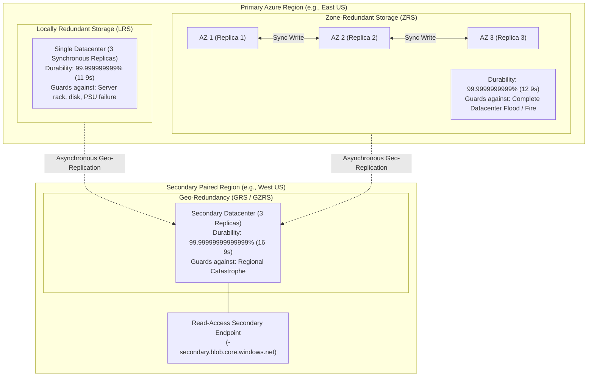

# Module 13-104-08: Administer Azure Storage, Blob Tiers, Replication & File Sync

**Breadcrumbs:** [[13-Index - Azure|☁️ Azure Reference MOC]] > [[13-Index - AZ-104|📘 AZ-104 Exam Track]] > **08 - Administer Azure Storage**

---

## 🎯 Stage 1: Executive Overview & The Conceptual Lecture

### 1. The Zero-Knowledge Starting Point: What is Cloud Storage?
In traditional on-premises IT, enterprise file storage was anchored to physical hardware:
* If a company needed storage, sysadmins purchased expensive physical disk arrays or multimillion-dollar **Storage Area Network (SAN)** frames from EMC, NetApp, or HP.
* If a physical disk died, an alarm sounded, a red LED illuminated on the drive bay, and an engineer rushed into the cold aisle of the datacenter to pull and replace the drive.
* If a business grew rapidly and consumed all disk space, IT had to purchase new drive expansion shelves, wait weeks for shipping, rack them, and manually expand Logical Unit Numbers (LUNs).
* If a fire, flood, or power surge destroyed the datacenter, every corporate document and database was lost forever unless someone physically carried backup tapes offsite in a briefcase.

In Microsoft Azure, storage is treated as a **massively scalable, software-defined cloud utility**:
* You never buy physical hard drives, format partitions, or monitor bad sectors.
* You provision an **Azure Storage Account**, which instantly gives you an elastic, virtually limitless, triple-replicated storage namespace accessible globally over standard web protocols (HTTPS REST, SMB 3.0, NFS 4.1).
* Every single byte written to Azure Storage is automatically encrypted at rest using 256-bit AES and synchronously replicated across multiple independent storage nodes to eliminate hardware single points of failure.

---

### 2. The Four Pillars of Azure Storage
An Azure Storage Account provides a unified management plane for four distinct storage data services:

```text
+-------------------------------------------------------------------------------------------------+
|                               THE 4 PILLARS OF AZURE STORAGE                                    |
+-------------------------------------------------------------------------------------------------+
|  1. Azure Blob Storage       |  2. Azure Files              |  3. Azure Queues & Tables         |
+------------------------------+------------------------------+-----------------------------------+
| - Type: Object Storage       | - Type: Managed File Shares  | - Type: Messaging & NoSQL Data    |
| - Protocol: HTTPS REST APIs  | - Protocol: SMB 3.0 / NFS    | - Protocol: HTTPS REST APIs       |
| - Analog: Amazon S3, Google  | - Analog: Windows Network    | - Analog: AWS SQS (Queues) and    |
|   Cloud Storage              |   Share (\\server\share)     |   DynamoDB / SimpleDB (Tables)    |
| - Use: Unstructured images,  | - Use: Lift-and-shift VM file| - Use: Decoupling application     |
|   videos, backups, logs,     |   shares, FSLogix VDI user   |   components via messaging, fast  |
|   static web hosting, big    |   profiles, hybrid cloud     |   schemaless key-value storage    |
|   data lake analytics        |   caching with File Sync     |   for state metadata              |
+-------------------------------------------------------------------------------------------------+
```

---

### 3. Terminology Matrix: Zero-Knowledge to Enterprise Architect

| Terminology | What It Means to a Beginner | Real-World Analog | Enterprise Architecture Reality |
| :--- | :--- | :--- | :--- |
| **Storage Account** | A master account that holds all your cloud files. | A safe deposit box container at a bank. | A unified HTTP/HTTPS endpoint namespace (`https://<account>.*.core.windows.net`) providing multi-service data persistence. |
| **Blob (Binary Large Object)** | Any unstructured file (video, PDF, zip, image). | An unformatted digital document in a drawer. | Object storage organized into Account $\rightarrow$ Container $\rightarrow$ Blob, accessible globally via URL. |
| **LRS (Locally Redundant)** | Saving 3 copies in one building. | Keeping 3 photocopies of a birth certificate in 3 different drawers in your house. | 3 synchronous data copies within a single physical Azure datacenter cluster (11 nines durability). |
| **ZRS (Zone-Redundant)** | Saving 3 copies across 3 separate buildings. | Keeping one photocopy at home, one at the bank, and one at your parents' house. | 3 synchronous copies distributed across 3 distinct Availability Zones in the primary region (12 nines durability). |
| **GRS (Geo-Redundant)** | Saving copies in another city 500 miles away. | Sending a duplicate archive box to an earthquake-proof bunker in another state. | LRS in primary region + asynchronous replication to a paired secondary region (16 nines durability). |
| **Customer Failover** | Forcing Azure to switch to your backup city. | Declaring your primary office unusable and redirecting all mail to your satellite branch. | Swapping storage DNS endpoints so the secondary region becomes primary. Unplanned failover drops GRS to LRS! |
| **Lifecycle Management** | An automated rule that moves old files to cheaper storage. | A cleaning service that moves 1-month-old papers to the basement and shreds 7-year-old tax forms. | An ARM policy engine evaluating blob metadata daily to transition blobs between Hot, Cool, Cold, and Archive tiers. |
| **Rehydration** | Bringing a frozen archived file back to life. | Thawing a frozen steak before cooking it. | Moving a blob from the offline Archive tier back to an online tier (Hot/Cool), taking up to 15 hours. |
| **Shared Access Signature (SAS)** | A temporary, restricted URL key for a file. | A guest hotel keycard that only unlocks Room 304 and expires at 11:00 AM tomorrow. | A signed URI granting granular, time-bound, IP-restricted read/write access to storage without exposing master root keys. |
| **User Delegation SAS** | A temporary key signed with your employee ID instead of the master key. | A visitor pass signed by an authenticated security officer with an audit trail. | A Zero-Trust SAS token signed via Microsoft Entra ID credentials, revocable instantly without regenerating master storage keys. |
| **Azure File Sync** | Replicating local Windows servers to the cloud. | A magic filing cabinet that keeps local copies of active files while syncing everything to HQ. | A hybrid sync agent linking Windows File Servers to an Azure File Share with Cloud Tiering (reparse stub pointers). |
| **Point-in-Time Restore** | Rolling back all blobs to an exact minute in the past. | Rewinding a security camera video tape to see files before a ransomware attack. | Restores block blob containers to any minute within retention window using Blob Versioning + Soft Delete + Change Feed. |

---

## 🏛️ Stage 2: Core Mental Model & Component Architecture

### 1. Storage Account Kinds & Performance Tiers
Selecting the appropriate storage account kind determines available features, performance, and pricing:

```text
General-Purpose v2 (GPv2) - The Default Enterprise Choice
├── Storage Media: Standard (Magnetic HDD) or Premium (Solid State SSD)
├── Supported Services: Blobs, Files, Queues, Tables, and Data Lake Storage Gen2 (Hierarchical Namespace)
├── Access Tiers: Hot, Cool, Cold, and Archive
└── Redundancy Options: LRS, ZRS, GRS, RA-GRS, GZRS, RA-GZRS

Specialized Premium Accounts (SSD Only - High Throughput / Sub-Millisecond Latency)
├── BlockBlobStorage: High-transaction containerized applications, big data analytics, AI ingest
├── FileStorage: High-IOPS enterprise file shares, FSLogix virtual desktop user profiles
└── PageBlobStorage: Premium OS and data disks for Azure Virtual Machines
```

---

### 2. The Data Redundancy Hierarchy & Durability Math
Azure Storage guarantees industry-leading durability by maintaining multiple synchronized copies of your data:



#### Redundancy Models Comparison Matrix:

| Redundancy Option | Primary Region Placement | Secondary Region Placement | Durability SLA | Secondary Read Access | Customer Failover Support |
| :--- | :---: | :---: | :---: | :---: | :--- |
| **LRS** | 3 copies in 1 Datacenter | None | **11 9s** ($10^{-11}$) | ❌ No | N/A |
| **ZRS** | 3 copies across 3 AZs | None | **12 9s** ($10^{-12}$) | ❌ No | N/A (Survives AZ loss) |
| **GRS** | 3 copies via LRS | 3 copies via LRS | **16 9s** ($10^{-16}$) | ❌ No | ✅ Yes (Account Failover) |
| **RA-GRS** | 3 copies via LRS | 3 copies via LRS | **16 9s** ($10^{-16}$) | ✅ **Yes** (`-secondary`) | ✅ Yes (Account Failover) |
| **GZRS** | 3 copies across 3 AZs | 3 copies via LRS | **16 9s** ($10^{-16}$) | ❌ No | ✅ Yes (Account Failover) |
| **RA-GZRS** | 3 copies across 3 AZs | 3 copies via LRS | **16 9s** ($10^{-16}$) | ✅ **Yes** (`-secondary`) | ✅ Yes (Account Failover) |

---

### 3. Customer-Managed Account Failover (Unplanned vs. Planned)
Azure provides the ability for administrators to trigger an account failover if the primary region suffers degradation:

```text
[ Primary Region: East US ] ══(Asynchronous Sync: RPO < 15 Mins)══► [ Secondary Region: West US ]
              │                                                                 │
              ▼                                                                 ▼
      [ PRIMARY OUTAGE ]                                               [ ACCOUNT FAILOVER ]
              │                                                                 │
              └───────────────────────────┬─────────────────────────────────────┘
                                          ▼
                      State After Unplanned Failover:
                      ├── Secondary (West US) becomes the NEW PRIMARY!
                      ├── DNS endpoint flips: 'staccount.blob.core.windows.net' -> West US
                      ├── CRITICAL CAVEAT: Storage redundancy DROPS TO LRS!
                      └── Administrator must manually re-enable GRS to replicate back!
```

* **Last Sync Time:** Before initiating failover, inspect the `Last Sync Time` property. Any write made *after* this timestamp will be lost upon failover!

---

### 4. Blob Access Tiers & FinOps Economics
Azure Blob Storage provides four storage tiers to optimize storage cost versus access latency:

```text
Hot Tier (Active Working Set)
├── Cost: Highest storage cost ($0.018/GB), lowest access cost
├── Latency: Milliseconds (Online)
└── Minimum Retention: None (0 days)
       │
       │ Inactive for 30 days
       ▼
Cool Tier (Infrequently Accessed Data)
├── Cost: Lower storage cost ($0.010/GB), higher access cost
├── Latency: Milliseconds (Online)
└── Minimum Retention: 30 DAYS (Early deletion incurs prorated penalty!)
       │
       │ Inactive for 90 days
       ▼
Cold Tier (Rarely Accessed Data)
├── Cost: Very low storage cost ($0.0036/GB), higher access cost
├── Latency: Milliseconds (Online)
└── Minimum Retention: 90 DAYS (Early deletion incurs prorated penalty!)
       │
       │ Inactive for 180 days
       ▼
Archive Tier (Deep Offline Storage)
├── Cost: Lowest possible storage cost ($0.00099/GB - 90% cheaper than Hot!)
├── Latency: 1 TO 15 HOURS (Blobs are OFFLINE and cannot be read directly!)
├── Minimum Retention: 180 DAYS (Early deletion incurs prorated penalty!)
└── Rehydration Required: Must set tier to Hot or Cool before reading!
```

---

## 🏢 Stage 3: Deep-Intuition Platform Mechanics & Topology

### 1. Storage Access Security Triad: Keys vs. SAS vs. Entra ID
Securing Azure Storage is a core responsibility on the AZ-104 exam. There are three primary access mechanisms:

```text
1. Storage Account Access Keys (Master Root Keys: Key 1 & Key 2)
   ├── Full superuser administrative control over EVERYTHING in the account!
   ├── Bypasses all Azure RBAC data roles and network controls.
   └── Severe Security Hazard: If a developer leaks an access key, attackers have total control.
       (Enterprise Best Practice: Disable shared key access via 'allowSharedKeyAccess: false').

2. Shared Access Signatures (SAS)
   ├── Temporary, time-bound, IP-restricted URL tokens granting scoped permissions (Read/Write).
   ├── Account SAS: Spans multiple services (Blob, File, Queue). Signed by Master Key.
   ├── Service SAS: Scoped to one container or blob. Signed by Master Key.
   └── User Delegation SAS: Signed via Microsoft Entra ID OAuth credentials!
       (Enterprise Standard: Can be revoked instantly without rotating master keys).

3. Microsoft Entra ID (Azure RBAC Data Plane Roles)
   ├── Zero secrets or tokens to manage.
   ├── Uses Azure RBAC identities (Users, Groups, Managed Identities).
   └── Built-In Roles:
       - 'Storage Blob Data Reader': Read blob contents and metadata.
       - 'Storage Blob Data Contributor': Read, write, and delete blobs.
       - 'Storage Blob Data Owner': Full data control + grant RBAC roles.
```

#### The Stored Access Policy (SAP) Revocation Problem:
* When an ad-hoc SAS token is generated using the master storage key, **it CANNOT be revoked early!** It remains valid until its expiration date arrives, unless you regenerate the master storage key (which breaks all other applications using that key).
* **The Solution:** Associate the Service SAS with a **Stored Access Policy (SAP)** on the container. If the SAS token is leaked or compromised, an administrator simply deletes or edits the Stored Access Policy, **instantly invalidating the SAS token** without affecting account keys!

---

### 2. Data Protection: Point-in-Time Restore, Soft Delete & Immutability (WORM)
* **Point-in-Time Restore (PITR):** Enables rolling back an entire block blob container to any second or minute within the retention window (e.g. 14 days). PITR is constructed from three interdependent platform capabilities:
  1. **Blob Versioning:** Retains previous versions when overwritten.
  2. **Blob Soft Delete:** Retains deleted blobs in a recycle bin.
  3. **Blob Change Feed:** An ordered log of every create, write, and delete event.
* **Immutable Blob Storage (WORM - Write Once, Read Many):**
  * *Time-Based Retention:* Blobs can be written and read, but **cannot be modified or deleted** for a mandatory time window (e.g., 7 years for SEC/FINRA compliance).
  * *Legal Hold:* Freezes data indefinitely until an ongoing litigation or audit tag is explicitly cleared.

---

### 3. Object Replication (Cross-Account & Cross-Region)
Azure Object Replication asynchronously copies block blobs between a source storage account and a destination storage account:
* Can replicate across different Azure regions or different Microsoft Entra tenants.
* **Prerequisites:** Blob Versioning and Blob Change Feed **MUST be enabled on both source and destination accounts**!
* Does not support replicating blobs in the Archive tier.

---

### 4. Azure Files & Azure File Sync: Hybrid Architecture
* **Azure Files:** Fully managed serverless file shares accessible concurrently from Windows, Linux, and macOS via **SMB 3.0** (port 445) and **NFS 4.1**.
* **Azure File Sync:** Links multiple on-premises Windows File Servers to an Azure File Share:

```text
[ Azure Files Share: corp-share (Cloud Endpoint) ]
                         ▲
                         │ HTTPS / Port 443 Sync Engine
                         ▼
        [ Storage Sync Service: Sync Group ]
                         │
        ┌────────────────┴────────────────┐
        ▼                                 ▼
[ Windows File Server 1 ]       [ Windows File Server 2 ]
(Branch Office New York)        (Branch Office London)
- Server Endpoint: D:\Data      - Server Endpoint: E:\Data
- Cloud Tiering: Active         - Cloud Tiering: Active
  (Keeps 20% Free Space)          (Keeps 20% Free Space)
```

#### Cloud Tiering Mechanics:
* **Volume Free Space Policy:** Ensures a specified percentage of free space remains on the local Windows disk (e.g., tier when free space drops below 20%).
* **Date Policy:** Tiers files that have not been accessed within a specified number of days (e.g., 60 days).
* **Reparse Point Stubs:** When a file is tiered, its content is removed from local disk, but a small metadata pointer stub remains visible in Windows File Explorer. When a user opens the file, Azure File Sync transparently recalls the data from Azure Files over HTTPS!
* **Asymmetric Change Detection:** Local server changes are detected instantly using the Windows NTFS **USN Journal**. Changes made directly in the Azure File Share are detected via a scheduled scan that runs every 24 hours (or immediately via `Invoke-AzStorageSyncChangeDetection`).

---

## ⚙️ Stage 4: Declarative & Automation Engine (CLI & PowerShell Core)

### 1. Azure CLI: Enterprise Storage Account with Versioning, Soft Delete & Immutability

```bash
# ==============================================================================
# 1. CREATE ENTERPRISE STORAGE ACCOUNT WITH REDUNDANCY & SECURITY
# ==============================================================================
RG_NAME="rg-storage-prod"
LOCATION="eastus"
STORAGE_NAME="stenterpriseblob$(az rand --max 99999)"

az storage account create \
  --resource-group "${RG_NAME}" \
  --name "${STORAGE_NAME}" \
  --location "${LOCATION}" \
  --sku "Standard_ZRS" \
  --kind "StorageV2" \
  --access-tier "Hot" \
  --min-tls-version "TLS1_2" \
  --allow-blob-public-access false \
  --allow-shared-key-access true

# ==============================================================================
# 2. CONFIGURE BLOB SOFT DELETE, VERSIONING & CHANGE FEED (PITR PREREQUISITES)
# ==============================================================================
az storage account blob-service-properties update \
  --resource-group "${RG_NAME}" \
  --account-name "${STORAGE_NAME}" \
  --enable-versioning true \
  --enable-change-feed true \
  --enable-delete-retention true \
  --delete-retention-days 14 \
  --enable-container-delete-retention true \
  --container-delete-retention-days 14 \
  --enable-restore-policy true \
  --restore-days 7
```

### 2. Azure CLI: Automated Lifecycle Management Rules

```bash
# ==============================================================================
# 3. APPLY AUTOMATED LIFECYCLE MANAGEMENT POLICY
# ==============================================================================
cat << 'EOF' > lifecycle-policy.json
{
  "rules": [
    {
      "enabled": true,
      "name": "TierInvoicesToCoolAndArchive",
      "type": "Lifecycle",
      "definition": {
        "filters": {
          "blobTypes": ["blockBlob"],
          "prefixMatch": ["invoices/"]
        },
        "actions": {
          "baseBlob": {
            "tierToCool": { "daysAfterModificationGreaterThan": 30 },
            "tierToCold": { "daysAfterModificationGreaterThan": 90 },
            "tierToArchive": { "daysAfterModificationGreaterThan": 180 },
            "delete": { "daysAfterModificationGreaterThan": 365 }
          },
          "snapshot": {
            "delete": { "daysAfterCreationGreaterThan": 90 }
          }
        }
      }
    }
  ]
}
EOF

az storage account management-policy create \
  --resource-group "${RG_NAME}" \
  --account-name "${STORAGE_NAME}" \
  --policy @lifecycle-policy.json
```

### 3. Azure CLI: User Delegation SAS via Entra ID

```bash
# ==============================================================================
# 4. GENERATE USER DELEGATION SAS SIGNED VIA ENTRA ID
# ==============================================================================

# Create private container
az storage container create \
  --account-name "${STORAGE_NAME}" \
  --name "confidential-reports" \
  --auth-mode login

# Generate a 2-hour read-only User Delegation SAS token
END_TIME=$(date -u -d "2 hours" '+%Y-%m-%dT%H:%MZ')

az storage blob generate-sas \
  --account-name "${STORAGE_NAME}" \
  --container-name "confidential-reports" \
  --name "Q3_Financials.pdf" \
  --permissions "r" \
  --expiry "${END_TIME}" \
  --auth-mode login \
  --as-user \
  --output tsv
```

---

## 🖥️ Stage 5: Step-by-Step Azure Portal GUI Walkthrough

### Task 1: Provisioning a Secure Storage Account in the GUI
1. In the top search bar, type **Storage accounts** and select it.
2. Click **+ Create** on the command bar:
   - **Resource group:** Select `rg-storage-prod`.
   - **Storage account name:** Enter globally unique name (e.g., `staz104corpstore`).
   - **Region:** `East US`.
   - **Performance:** Select **Standard**.
   - **Redundancy:** Select **Zone-redundant storage (ZRS)**.
3. In the **Security** tab:
   - Ensure *Require secure transfer for REST API operations* is checked.
   - Set *Minimum TLS version* to **Version 1.2**.
   - Uncheck *Allow enabling public access on individual containers*.
4. Click **Review + create** $\rightarrow$ **Create**.

### Task 2: Configuring Lifecycle Management via Visual Rule Builder
1. Open your storage account $\rightarrow$ under **Data management**, click **Lifecycle management**.
2. Click **+ Add a rule**:
   - **Rule name:** `TierAndPurgeLogs`.
   - **Rule scope:** Select **Limit blobs with filters**.
   - **Blob type:** Select **Block blobs** $\rightarrow$ check **Base blobs**.
3. In the **Base blobs** rule builder tab:
   - *If Base blobs were last modified more than:* Enter `30` days $\rightarrow$ Action: **Move to cool storage**.
   - Click **+ Add condition**:
     - *If Base blobs were last modified more than:* Enter `90` days $\rightarrow$ Action: **Move to archive storage**.
   - Click **+ Add condition**:
     - *If Base blobs were last modified more than:* Enter `365` days $\rightarrow$ Action: **Delete the blob**.
4. In the **Filter set** tab: enter prefix `logs/` $\rightarrow$ click **Add**.

### Task 3: Enabling Point-in-Time Restore & Soft Delete
1. In the left navigation menu under **Data management**, click **Data protection**.
2. Configure recovery settings:
   - Check **Enable point-in-time restore for containers** $\rightarrow$ set retention to `7` days.
   - Check **Enable soft delete for blobs** $\rightarrow$ set retention to `14` days.
   - Check **Enable soft delete for containers** $\rightarrow$ set retention to `14` days.
   - Check **Enable versioning for blobs**.
3. Click **Save** on the toolbar.

---

## 🔬 Stage 6: Hands-On Enterprise Lab Bridge

To apply these storage principles, configure lifecycle rules, test blob versioning, and generate revocable SAS tokens, proceed directly to the comprehensive practical lab:

> [!TIP]
> **Practical Implementation Companion:**
> Access the comprehensive engineering lab at:
> **[[Lab-08_Storage_Redundancy_Lifecycle_and_User_Delegation_SAS|Lab 08: Storage Account Redundancy, Lifecycle Automation, WORM & User Delegation SAS]]**
> 
> *Target Lab File:* `Projects/AZ-104/08_Storage_Accounts_and_Data_Protection/Lab-08_Storage_Redundancy_Lifecycle_and_User_Delegation_SAS.md`

### Lab Objectives Matrix:

```text
+-----------------------------------------------------------------------------------------+
| Lab 08 Enterprise Milestone Goals                                                       |
+-----------------------------------------------------------------------------------------+
| 1. Provision an Azure Storage Account with Zone-Redundant Storage (ZRS)                 |
| 2. Deploy Lifecycle Management rules to automate Hot -> Cool -> Archive -> Delete tiers |
| 3. Configure Point-in-Time Restore, Blob Versioning, and 14-day Soft Delete            |
| 4. Generate User Delegation SAS tokens signed via Microsoft Entra ID                    |
| 5. Deploy an Azure File Share and configure Cloud Tiering with Azure File Sync          |
+-----------------------------------------------------------------------------------------+
```

---

## ⚠️ Stage 7: "See It in Action" Real-World Failure & Recovery Loop (AARF)

### Scenario: The "Inaccessible Archived Blob" Production Outage

#### 1. The Architectural Setup & Assumptions
A financial institution archives customer tax returns into an Azure Blob Storage container (`tax-returns`). An automated Lifecycle Management policy runs daily and moves any PDF untouched for 90 days into the **Archive** access tier to slash storage costs.

#### 2. The Production Failure Manifestation
An auditor requests a tax return from 2 years ago (`return_2024_0912.pdf`). A customer service representative searches the internal CRM, finds the file link, and clicks *Download*. The application crashes with the following error:

```text
HTTP 409 Conflict
ErrorCode: BlobArchived
ErrorMessage: This operation is not permitted on an archived blob.
RequestId: xxxxxxxx-xxxx-xxxx-xxxx-xxxxxxxxxxxx
```

#### 3. Root Cause Analysis (RCA) & Deep Investigation
Why did the download fail with `HTTP 409 Conflict`?
1. **The Nature of the Archive Tier:** The Archive tier is an **offline storage medium**. The underlying storage blocks are unmounted and spun down to minimize electrical power and hardware costs.
2. **Direct Read Impossibility:** While a blob is in the Archive tier, it **CANNOT be read, downloaded, or copied directly** over HTTP GET.
3. **The Mandatory Rehydration Step:** To read an archived blob, the blob must first be **rehydrated** back to an online access tier (Hot or Cool).
4. **The Latency Window:** Standard priority rehydration takes **up to 15 hours**. High-priority rehydration takes **under 1 hour** for blobs smaller than 10 GB.

#### 4. Remediation & Diagnostic Verification Loop

```mermaid
flowchart TD
    Error409["Application Error: HTTP 409 BlobArchived"] --> Step1["Check Blob Properties: Access Tier = Archive"]
    Step1 --> Step2["Initiate Rehydration: Change Tier back to Hot or Cool"]
    
    Step2 --> Choice{"Choose Rehydration Priority"}
    Choice -->|Standard Priority (Free / Default)| P1["Takes up to 15 hours"]
    Choice -->|High Priority (Expedited / Paid)| P2["Completes in < 1 hour for blobs < 10GB"]
    
    P1 --> StatusCheck["Monitor Archive Status: 'rehydrate-pending-to-hot'"]
    P2 --> StatusCheck
    
    StatusCheck --> Complete["Rehydration Complete: Blob status returns to 'Hot'"]
    Complete --> Restored["Application executes HTTP GET -> Download Succeeds!"]
```

```bash
# Diagnostic & Remediation Script (Azure CLI)

# 1. Inspect blob tier and rehydration status
az storage blob show \
  --account-name "stenterpriseblob2026" \
  --container-name "tax-returns" \
  --name "return_2024_0912.pdf" \
  --query "{Tier:properties.blobTier, Status:properties.rehydrationStatus}"

# 2. Initiate High-Priority Rehydration to Hot Tier
az storage blob set-tier \
  --account-name "stenterpriseblob2026" \
  --container-name "tax-returns" \
  --name "return_2024_0912.pdf" \
  --tier "Hot" \
  --rehydrate-priority "High"
```

---

## 💡 Stage 8: High-Yield AZ-104 Exam Scenarios & Trick Question Traps

### Trick Question Trap 1: The Only Way to Revoke a Leaked Service SAS
* **The Scenario:** A contractor is given a Service SAS token valid for 6 months. After 2 weeks, the contractor leaves the company. You must immediately invalidate their SAS token without impacting other production applications using the storage account.
* **The Trap:** The exam suggests "Delete the user account" or "Change the container permissions".
* **The Ground Truth:** If the SAS was generated as an ad-hoc SAS, the ONLY way to revoke it is to rotate the master storage account key (which breaks all other apps!). However, if the SAS was associated with a **Stored Access Policy (SAP)**, you simply **delete or modify the Stored Access Policy**, which immediately invalidates the SAS token without affecting master keys!

### Trick Question Trap 2: Customer-Initiated Failover Drops Redundancy to LRS
* **The Scenario:** A company uses GRS storage in `East US` paired with `West US`. When degradation occurs in `East US`, the administrator initiates customer-managed account failover.
* **The Trap:** What is the storage redundancy level in `West US` after the failover completes?
* **The Ground Truth:** **It becomes LRS (Locally Redundant Storage)!** Azure does not automatically reverse replication after an unplanned failover. The account in `West US` operates strictly as LRS until the administrator manually re-enables GRS or GZRS.

### Trick Question Trap 3: Early Deletion Penalties in Cool and Archive Tiers
* **The Scenario:** An administrator creates a blob in the **Cool** tier. Five days later, the application deletes the blob.
* **The Question:** How is the company billed?
* **The Ground Truth:** The Cool tier has a **30-day minimum retention period**. If a blob is deleted after 5 days, Azure bills you for the 5 days of actual storage PLUS a **prorated early deletion fee for the remaining 25 days**! (Archive tier has a 180-day minimum, Cold has a 90-day minimum).

### Trick Question Trap 4: Azure Files SMB Port 445 Blocking
* **The Scenario:** An employee attempts to mount an Azure Files SMB share (`\\stacc.file.core.windows.net\share`) from their home office Wi-Fi, but the connection times out.
* **The Trap:** Why does it fail from home but work from the corporate office?
* **The Ground Truth:** SMB 3.0 communicates over **TCP port 445**. Most residential Internet Service Providers (ISPs) block outbound port 445 by default to prevent legacy SMB malware attacks. To access Azure Files from home, users must use a VPN, ExpressRoute, or switch to Azure File Sync / REST endpoints.

---

## 🌐 Authoritative References & Inflow Citations

* **Udemy AZ-104 Master Class by Scott Duffy:** [Inflow: Module 04 - Administer Azure Storage](file:///F:/Dump%20one/BrainDump/inflow/AZ-104-ScottDuffy/04_Administer_Azure_Storage.md)
* **John Savill’s Azure Master Class & Deep Dives:**
  - [Inflow: Part 5 - Storage](file:///F:/Dump%20one/BrainDump/inflow/AZ-104-JohnSavill/16_Azure_Master_Class_v3_-_Part_5_-_Storage.md) *(LRS/ZRS/GRS durability math, Customer Failover mechanics, Point-in-Time Restore, Azure File Sync cloud tiering)*
  - [Inflow: Blob Permissions Deep Dive](file:///F:/Dump%20one/BrainDump/inflow/AZ-104-JohnSavill-DeepDives/05_Azure_Blob_Data_Permissions_Deep_Dive_(360_in_360).md) *(User Delegation SAS vs Service SAS, Azure RBAC Data roles)*
  - [Inflow: Azure Elastic SAN Deep Dive](file:///F:/Dump%20one/BrainDump/inflow/AZ-104-JohnSavill-DeepDives/27_Azure_Elastic_SAN_Deep_Dive.md) *(iSCSI cloud SAN)*
* **Moe Intelligence AZ-104 Curriculum:** Lessons 30 through 34 *(Storage Accounts, Versioning, Replication, Storage Explorer)*
* **KodeKloud AZ-104 Course:** [Administer Azure Storage Module](https://notes.kodekloud.com/docs/Updated-AZ-104-Microsoft-Azure-Administrator/Administer-Azure-Storage/Module-Introduction/page.md)
* **Official Microsoft Learn Documentation:**
  - [Azure Storage account overview](https://learn.microsoft.com/en-us/azure/storage/common/storage-account-overview)
  - [Azure Storage redundancy and account failover](https://learn.microsoft.com/en-us/azure/storage/common/storage-redundancy)
  - [Optimize costs by automatically managing the data lifecycle](https://learn.microsoft.com/en-us/azure/storage/blobs/lifecycle-management-overview)
  - [What is Azure File Sync?](https://learn.microsoft.com/en-us/azure/storage/file-sync/file-sync-introduction)
  - [Grant limited access to Azure Storage resources using SAS](https://learn.microsoft.com/en-us/azure/storage/common/storage-sas-overview)
