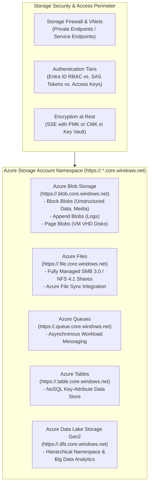
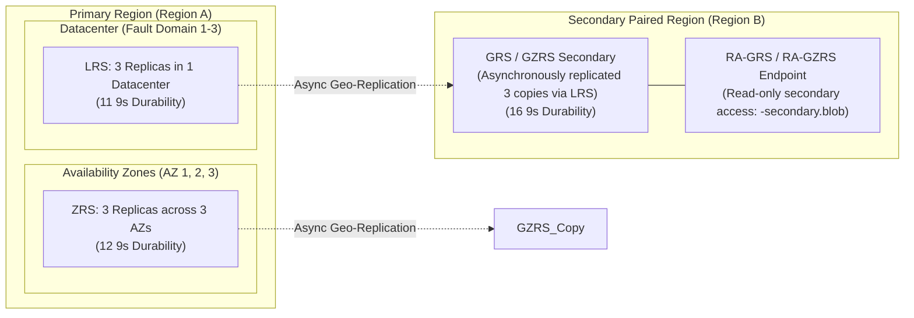
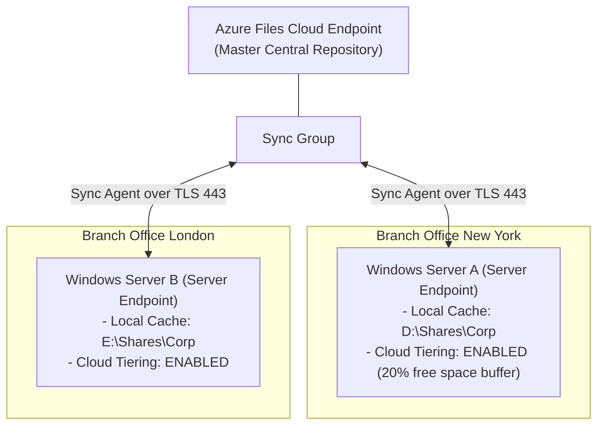
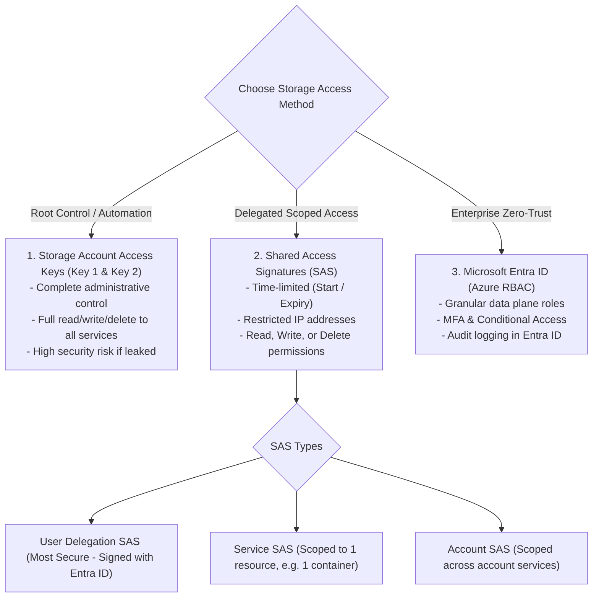
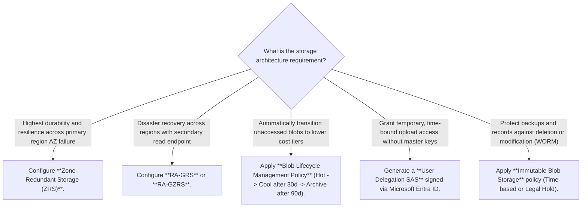
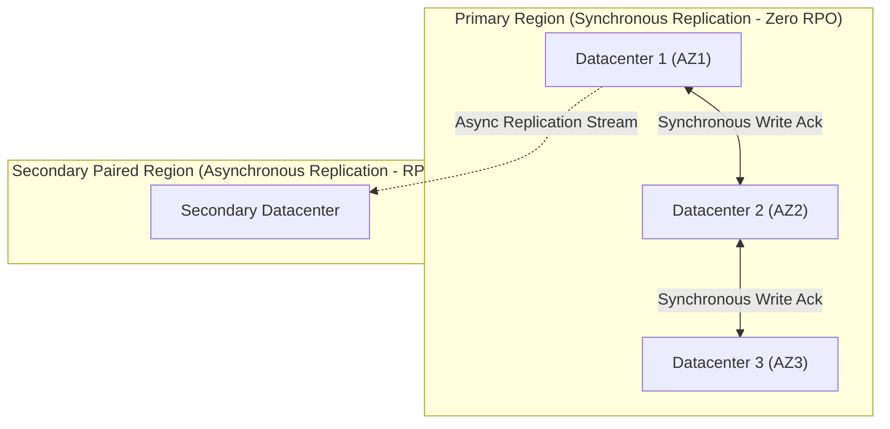
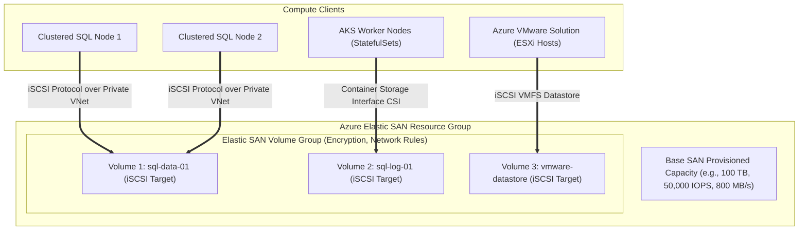

# Module 13-104-08: Administer Azure Storage, Blob Tiers & Security

**Breadcrumbs:** [[13-Index - Azure|☁️ Azure Reference MOC]] > [[13-Index - AZ-104|📘 AZ-104 Exam Track]] > **08 - Administer Azure Storage**

---

## 🎯 Executive Overview & Storage Architecture

Azure Storage is Microsoft's cloud storage platform providing highly available, massively scalable, durable, and secure storage for data objects, virtual machine disks, managed file shares, messaging queues, and NoSQL tables. Azure Storage accounts expose a unified namespace across five core storage services:



---

## 🏛️ Storage Account Kinds & Performance Tiers

| Storage Account Kind | Supported Services | Performance Tiers | Target Workloads & Architecture |
| :--- | :--- | :---: | :--- |
| **General-purpose v2 (GPv2)** | Blobs, Files, Queues, Tables, Data Lake Gen2 | Standard (HDD) / Premium (SSD) | **Default choice for modern workloads.** Delivers the lowest per-gigabyte storage costs and full support for all replication tiers and lifecycle management. |
| **BlockBlobStorage** | Block Blobs, Append Blobs | **Premium Only** (SSD) | High-transaction workloads, low-latency analytics, processing small files with sustained high I/O throughput. |
| **FileStorage** | Azure Files Only | **Premium Only** (SSD) | Enterprise I/O-intensive file sharing, virtual desktop infrastructure (FSLogix profiles), high-performance databases over SMB/NFS. |
| **PageBlobStorage** | Page Blobs Only | **Premium Only** (SSD) | Unmanaged VM OS and data disks (legacy; modern architectures prioritize Managed Disks). |

---

## 🔄 Data Redundancy Strategies & Durability SLA

Azure Storage automatically replicates data to guard against transient hardware failures, datacenter network/power outages, and regional natural disasters:



### Redundancy Model Comparison Table

| Replication Strategy | Primary Region Copies | Secondary Region Copies | Durability (Annual SLA) | Secondary Read Access | Failover Mechanics |
| :--- | :---: | :---: | :---: | :---: | :--- |
| **Locally Redundant (LRS)** | 3 copies in single DC | None | 99.999999999% (11 9s) | ❌ No | N/A |
| **Zone-Redundant (ZRS)** | 3 copies across 3 AZs | None | 99.9999999999% (12 9s) | ❌ No | N/A (Survives single AZ outage) |
| **Geo-Redundant (GRS)** | 3 copies via LRS | 3 copies via LRS | 99.99999999999999% (16 9s)| ❌ No (Write/Read primary only) | Customer-initiated account failover |
| **Read-Access GRS (RA-GRS)**| 3 copies via LRS | 3 copies via LRS | 99.99999999999999% (16 9s)| ✅ **Yes** (`<acc>-secondary`) | Secondary read-only without failover |
| **Geo-Zone-Redundant (GZRS)**| 3 copies across 3 AZs | 3 copies via LRS | 99.99999999999999% (16 9s)| ❌ No | Customer-initiated account failover |
| **Read-Access GZRS (RA-GZRS)**| 3 copies across 3 AZs | 3 copies via LRS | 99.99999999999999% (16 9s)| ✅ **Yes** (`<acc>-secondary`) | Secondary read-only without failover |

---

## 📦 Blob Storage Access Tiers & Lifecycle Management

Azure Blob Storage provides four distinct storage access tiers tailored to data access patterns and retention costs:

```mermaid
flowchart LR
    HotTier["Hot Access Tier\n(Frequent Access)\n- Highest storage cost\n- Lowest access cost\n- 0 days minimum"]
    CoolTier["Cool Access Tier\n(Infrequent Access)\n- Lower storage cost\n- Higher access cost\n- 30 days minimum"]
    ColdTier["Cold Access Tier\n(Rare Access)\n- Much lower storage cost\n- Higher access cost\n- 90 days minimum"]
    ArchiveTier["Archive Access Tier\n(Offline Long-term)\n- Lowest storage cost\n- Highest access cost\n- 180 days minimum\n- Blobs are OFFLINE"]

    HotTier -->|After 30 Days Inactive| CoolTier
    CoolTier -->|After 90 Days Inactive| ColdTier
    ColdTier -->|After 180 Days Inactive| ArchiveTier
    ArchiveTier -.->|Rehydration (Standard: 15h / High: <1h)| HotTier
```

### Tier Comparison Details

| Tier Name | Online Status | Minimum Retention | Early Deletion Penalty | Rehydration Latency | Ideal Use Case |
| :--- | :---: | :---: | :---: | :---: | :--- |
| **Hot** | Online | None | None | Instantaneous | Actively read/written data, application assets, active databases. |
| **Cool** | Online | **30 days** | Yes (Pro-rated for 30 days) | Instantaneous | Short-term backups, raw data to be processed later, monthly reports. |
| **Cold** | Online | **90 days** | Yes (Pro-rated for 90 days) | Instantaneous | Access once or twice a year, archival data requiring fast search. |
| **Archive** | **Offline** | **180 days** | Yes (Pro-rated for 180 days)| **1 to 15 hours** | Regulatory compliance, healthcare records, long-term backups. |

### Lifecycle Management JSON Rule
Lifecycle management runs once every 24 hours to automatically transition or purge blobs:

```json
{
  "rules": [
    {
      "enabled": true,
      "name": "ArchiveAndPurgeComplianceLogs",
      "type": "Lifecycle",
      "definition": {
        "filters": {
          "blobTypes": ["blockBlob"],
          "prefixMatch": ["auditlogs/"]
        },
        "actions": {
          "baseBlob": {
            "tierToCool": { "daysAfterModificationGreaterThan": 30 },
            "tierToArchive": { "daysAfterModificationGreaterThan": 90 },
            "delete": { "daysAfterModificationGreaterThan": 2555 }
          }
        }
      }
    }
  ]
}
```

---

## 📁 Azure Files & Azure File Sync

### Azure Files Protocol Support
- **SMB 3.0:** Native Windows, Linux, and macOS file share integration with Active Directory Domain Services (AD DS) and Microsoft Entra Kerberos authentication.
- **NFS 4.1:** Native Linux enterprise file sharing (requires Premium FileStorage accounts and VNet Private Endpoints).

### Azure File Sync Architecture
Azure File Sync enables centralizing an organization's file shares in Azure Files while preserving local caching performance on Windows File Servers:



- **Cloud Tiering:** Separates frequently accessed "hot" files (cached locally on the server) from infrequently accessed "cold" files (tiered to Azure Files as pointer stubs). Saves substantial on-premises disk storage without breaking file system paths.

---

## 🔐 Securing Azure Storage: Access Keys, SAS & Entra ID

Azure Storage provides three distinct authentication and authorization tiers:



### Shared Access Signature (SAS) Types & Revocation
1. **User Delegation SAS:** Signed using **Microsoft Entra ID credentials** rather than the account root key. If an administrator revokes the user's role or password, the SAS token is immediately invalidated.
2. **Service SAS & Account SAS:** Signed using the primary or secondary storage access key.
3. **Stored Access Policy:** Configured on a container or file share to manage Service SAS tokens. Allows administrators to **change start/expiry times or revoke access immediately** without rotating the entire storage account key.

### Data Plane RBAC Roles vs. Management Roles
- **Contributor:** Can manage storage account properties (replication, firewall, keys), but **CANNOT read blob data**.
- **Storage Blob Data Contributor:** Can read, write, and delete blobs within containers.
- **Storage Blob Data Reader:** Can read blob contents and metadata.

---

## 🛠️ Contextual Proof of Concept: CLI Automation

```bash
# 1. Create a General Purpose v2 Storage Account with GZRS redundancy and TLS 1.2
az storage account create \
  --resource-group "rg-enterprise-core" \
  --name "staz104corpstore" \
  --location "eastus" \
  --sku "Standard_GZRS" \
  --kind "StorageV2" \
  --access-tier "Hot" \
  --min-tls-version "TLS1_2" \
  --allow-blob-public-access false

# 2. Create a private Blob Container
az storage container create \
  --account-name "staz104corpstore" \
  --name "confidential-assets" \
  --auth-mode login

# 3. Create a Stored Access Policy on the container
az storage container policy create \
  --account-name "staz104corpstore" \
  --container-name "confidential-assets" \
  --name "Policy-AuditTeam-Read" \
  --permissions "r" \
  --expiry "2026-12-31T23:59:59Z" \
  --auth-mode key

# 4. Generate a Service SAS token bound to the Stored Access Policy
az storage container generate-sas \
  --account-name "staz104corpstore" \
  --name "confidential-assets" \
  --policy-name "Policy-AuditTeam-Read" \
  --output tsv
```

---

## 🔍 Deep-Intuition AARF Framework

### Scenario: Diagnosing Inaccessible Blobs in the Archive Access Tier

- **The Answer (Core Configuration):** Initiate blob rehydration by changing the blob's access tier back to `Hot` or `Cool` using `az storage blob set-tier --account-name "stprod" --container-name "data" --name "archive.tar.gz" --tier "Hot" --rehydrate-priority "High"`.
- **The Assumptions (Prerequisites):** 
  - Blob is currently residing in the `Archive` access tier.
  - Client application requires reading or downloading the blob content.
- **The Rationale (Why):** The Archive access tier is an offline storage medium (similar to tape or deep cold storage disks). When a blob is tiered to Archive, its data blocks are taken completely offline. The storage engine does not support direct streaming or reads while a blob is archived.
- **The Failure Loop (What if misconfigured):**
  - *Symptom:* Application attempts to read or download an archived blob via HTTP GET.
  - *HTTP Status Code:* `409 Conflict`.
  - *Error Response:* `<Error><Code>BlobArchived</Code><Message>This operation is not permitted on an archived blob.</Message></Error>`.
- **The Alternative Case (When to use 'if not'):** If the application requires low-latency, immediate read access while still minimizing storage costs, store the data in the **Cold** tier (90-day minimum retention) or **Cool** tier (30-day minimum retention), both of which support instantaneous online access without rehydration delays.

---

## 💡 AZ-104 Exam Tips & Gotchas

> [!TIP]
> **Zero Downtime Access Key Rotation Procedure:**
> 1. Applications are configured to use **Key 1**.
> 2. Update application configuration connection strings to use **Key 2**.
> 3. Regenerate **Key 1** in the portal or via CLI (`az storage account keys renew --key primary`).
> 4. Update applications to use the newly regenerated **Key 1**.
> 5. Regenerate **Key 2** (`az storage account keys renew --key secondary`).

> [!WARNING]
> **Public Access vs. Container Access Levels:**
> - In modern Azure Storage accounts, the account-level setting **"Allow Blob public access"** defaults to `Disabled`.
> - If public access is disabled at the storage account level, even if an administrator sets a container's access level to `Container (anonymous read access for containers and blobs)`, anonymous requests will be **blocked by the account-level policy**.

---

## 🏛️ Enterprise Storage Architecture: Redundancy, Lifecycle & Access Governance

### 1. Storage Account Redundancy & Disaster Recovery Matrix
- **Primary Region High Availability:**
  - *Locally Redundant Storage (LRS):* 3 synchronous copies within a single physical datacenter. Protects against hardware failures (disk, rack, server), but vulnerable to full datacenter disaster.
  - *Zone-Redundant Storage (ZRS):* 3 synchronous copies across 3 distinct Availability Zones within the primary region. Survives total datacenter loss without data unavailability.
- **Cross-Region Geographic Disaster Recovery:**
  - *Geo-Redundant Storage (GRS):* LRS in primary region + asynchronous copy to paired secondary region hundreds of miles away (RPO < 15 minutes).
  - *Geo-Zone-Redundant Storage (GZRS):* ZRS in primary region + asynchronous LRS copy in secondary region. Maximum durability and resilience.
  - *Read-Access Secondary (RA-GRS / RA-GZRS):* Exposes a secondary read-only endpoint (`<account>-secondary.blob.core.windows.net`), enabling application read availability during primary region failover.

### 2. Data Protection: Blob Versioning, Soft Delete & Object Replication
- **Blob Versioning:**
  - Every blob overwrite automatically creates a historical version stamped with a UTC timestamp ID.
  - Historical versions can be listed, restored, or promoted to active state without losing intervening versions.
  - *Critical Protection Rule:* Versioning alone does not prevent explicit blob deletions; it must be coupled with **Blob Soft Delete** (retaining deleted versions for 7–365 days).
- **Object Replication:**
  - Asynchronously replicates block blobs across accounts and regions according to prefix filter rules.
  - *Mandatory Prerequisites:* Both source and destination accounts must have **Blob Versioning** and **Blob Change Feed** enabled.

### 3. Managing Storage Access: SAS Security vs. Entra ID Authentication
- **Access Control Hierarchy:**
  1. *Access Keys (Primary & Secondary Master Keys):* Full superuser control-plane and data-plane access. Completely bypasses RBAC. Prohibited in secure production applications.
  2. *Account SAS:* Signed by master keys. Spans services (Blob, File, Queue, Table).
  3. *Service SAS:* Signed by master keys, but constrained to a single container or blob resource.
  4. *User Delegation SAS (Enterprise Best Practice):* Signed using Microsoft Entra ID credentials rather than storage account keys. Permissions are strictly bounded by the requesting identity's Entra RBAC roles, eliminating credential leakage.
- **Azure Storage Explorer Desktop:**
  - Cross-platform desktop management application for managing storage containers, blobs, queues, and tables.
  - Supported authentication modes: Entra ID account (SSO), SAS token URI, Connection String, or Local Azurite emulator.

---

## 💡 Storage Architecture Decision Framework & Articulation Tree



---

---

## 🏛️ Deep-Dive Storage Architecture & SAS Security (John Savill Master Class Insights)

### 1. Storage Account Unified Architecture & Redundancy Math
John Savill explains that an Azure Storage Account is a single partitioned storage namespace that hosts four distinct data services:
- **Blob:** Massive unstructured object storage (block, append, page blobs).
- **Files:** Managed SMB 3.0 and NFS 4.1 file shares for enterprise migration.
- **Queues:** Asynchronous reliable message passing between application tiers.
- **Tables:** NoSQL key-value structured data store.

#### Synchronous vs. Asynchronous Replication Trade-offs


- **LRS (Locally Redundant Storage):** 3 synchronous copies within one datacenter. Write committed only when written to all 3 replicas. Protects against disk/server failure.
- **ZRS (Zone-Redundant Storage):** 3 synchronous copies distributed across 3 distinct Availability Zones. Write acknowledged only when stored across separate datacenter facilities. Survives total datacenter loss with **zero data loss (RPO = 0)**.
- **GRS (Geo-Redundant Storage):** LRS in primary region + asynchronous copy to secondary paired region hundreds of miles away. Because cross-region replication is asynchronous, a primary region disaster failover incurs a potential data loss of up to 15 minutes (RPO < 15 min).

### 2. User Delegation SAS vs. Master Key SAS: The Security Boundary
John Savill highlights that Account SAS and Service SAS signed by storage account access keys represent a massive enterprise vulnerability:
- **Master Key Risk:** If a developer signs a SAS with the storage account key, anyone possessing that SAS string has unrevocable access until the token expires, unless the administrator regenerates the master key (breaking all applications using that key).
- **User Delegation SAS (The Zero Trust Standard):**
  - Signed using a user's **Microsoft Entra ID token** rather than storage account keys.
  - The SAS token cannot exceed 7 days validity.
  - Permissions are strictly capped by the user's Azure RBAC permissions.
  - Can be instantly revoked by revoking the user's Entra ID session without impacting other storage users.

---

## 🚀 Going the Extra Mile: Architectural Deep Dive - Enterprise Storage Fabrics

> [!IMPORTANT]
> **Going the Extra Mile:** In this section, we are taking an extra mile on this topic and start deep diving into the cloud-native iSCSI block storage fabric of Azure Elastic SAN, granular POSIX permissions in ADLS Gen2, and cryptographic immutability with Azure Confidential Ledger based on John Savill's Azure Deep Dives Master Class.

### 1. Azure Elastic SAN: Cloud-Native Block Storage Area Network

High-performance clustered workloads (SQL Server Failover Clusters, Oracle DB, SAP HANA, Azure VMware Solution) traditionally required running complex virtual SAN appliances or provisioning dozens of expensive Ultra Disks.



#### A. Core Architectural Differentiators
* **Native iSCSI Block Storage:** Unlike Azure Files (SMB/NFS) or Blob storage (REST), Elastic SAN exposes pure block-level **iSCSI targets** directly over the Azure VNet fabric.
* **Shared Storage Clustering:** Multiple independent virtual machines or ESXi hosts can attach to the same volume concurrently with SCSI-3 persistent reservations, enabling true clustered shared volumes.
* **Elastic Pool Economics:** Capacity and performance (IOPS and throughput) are pooled across the entire SAN rather than provisioned per individual disk. You scale the base SAN, and dozens of volumes share the underlying IOPS burst capacity.

---

### 2. Azure Blob Data Permissions Deep Dive: Control Plane vs. Data Plane

A frequent source of enterprise cloud outages and data exfiltration stems from conflating the Azure control plane with the storage data plane:

| Access Method | Protocol / Mechanism | Scope & Boundary | Security Posture |
| :--- | :--- | :--- | :--- |
| **Storage Account Access Keys** | Master symmetric 512-bit HMAC shared secret. | Grants full, unrestricted root superuser access across ALL services (Blob, File, Queue, Table). | **High Risk:** Keys bypass RBAC and lack audit identity logging. Must be disabled (`allowSharedKeyAccess: false`). |
| **Service SAS Token** | Signed with Storage Account Key. | Scoped to a specific service and container; valid for hours/days. | Medium Risk: If leaked, valid until expiration timestamp. |
| **User Delegation SAS Token** | Signed using an Entra ID user/managed identity OAuth token. | Scoped strictly to blob containers; maximum lifetime capped at 7 days. | **Enterprise Standard:** Revocable immediately by revoking the user's Entra credentials. |
| **Azure RBAC Data Roles** | Direct Entra ID role assignment (`Storage Blob Data Contributor`). | Scoped at Subscription, Resource Group, Account, or Container. | **Recommended:** Fully audited in Azure Monitor and integrated with Conditional Access. |
| **POSIX ACLs (ADLS Gen2)** | Read/Write/Execute permissions applied to specific directories and files. | Evaluated directly inside the Hierarchical Namespace. | Essential for big data (Synapse, Databricks) granular directory access. |

---

### 3. Azure Confidential Ledger: Cryptographic Tamper-Proof Immutability

For mission-critical audit trails, financial transactions, and regulatory compliance logs, standard storage accounts with WORM policies can still be vulnerable to administrative tenant destruction.

#### A. Hardware Enclave Security (AMD SEV-SNP / Intel SGX)
* Azure Confidential Ledger runs exclusively inside hardware-enforced **Confidential Computing Enclaves**.
* Memory encryption ensures that neither cloud administrators, hypervisor hosts, nor compromised subscription Owners can inspect or alter data residing in memory.

#### B. Confidential Consortium Framework (CCF)
* Powered by an open-source decentralized ledger governance engine.
* Every transaction produces a cryptographic receipt containing a **Merkle tree root hash proof**.
* Any third-party auditor can cryptographically prove that the ledger history has not been altered, deleted, or rolled back since inception.


## 🌐 Authoritative References & Citations

- [John Savill: Azure Master Class v3 - Part 5 - Storage](https://www.youtube.com/playlist?list=PLlVtbbG169nGlGPWs9xaLKT1KfwqREHbs)

- [KodeKloud AZ-104 Course - Administer Azure Storage Module](https://notes.kodekloud.com/docs/Updated-AZ-104-Microsoft-Azure-Administrator/Administer-Azure-Storage/Module-Introduction/page.md)
- [Moe Intelligence AZ-104 Video Series (Lessons 30–34)](https://www.youtube.com/playlist?list=PLczK3J2J4clmeh328CC13dJrcALcSFZFb)
- [Microsoft Learn: Configure storage accounts and blob storage](https://learn.microsoft.com/en-us/training/modules/configure-storage-accounts/)
- [Microsoft Learn: Secure your Azure Storage data](https://learn.microsoft.com/en-us/training/modules/secure-azure-storage-account/)
- [Azure Storage Redundancy Technical Documentation](https://learn.microsoft.com/en-us/azure/storage/common/storage-redundancy)
