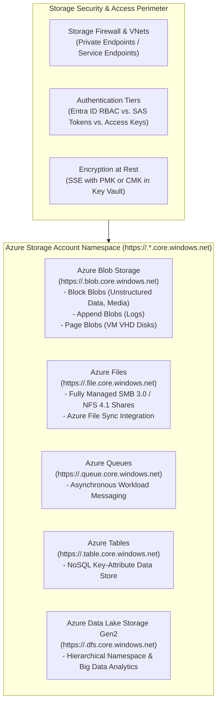
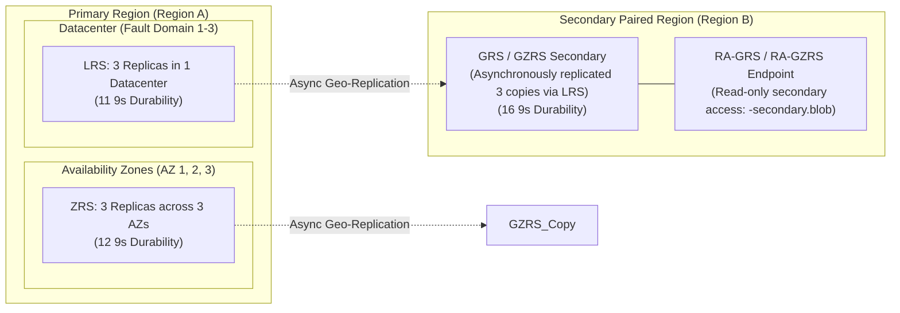
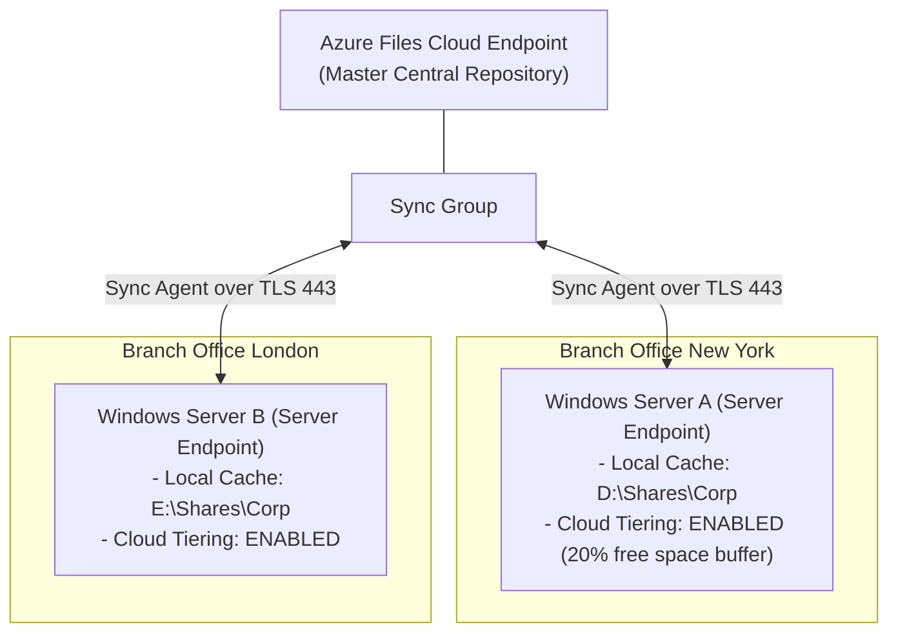
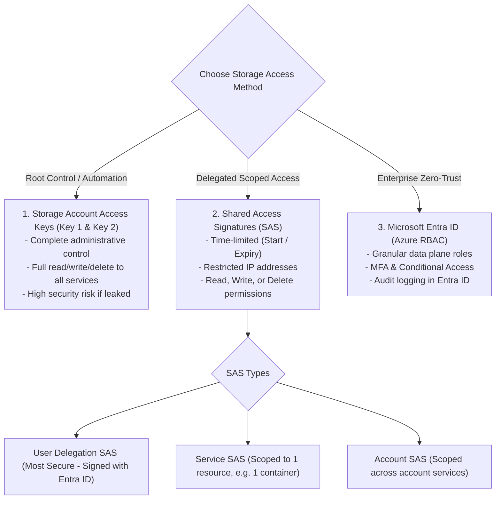

# Module 13-104-08: Administer Azure Storage, Blob Tiers & Security

**Breadcrumbs:** [[13-Index - Azure|☁️ Azure Reference MOC]] > [[13-Index - AZ-104|📘 AZ-104 Exam Track]] > **08 - Administer Azure Storage**

---

## 🎯 Executive Overview & Storage Architecture

Azure Storage is Microsoft's cloud storage platform providing highly available, massively scalable, durable, and secure storage for data objects, virtual machine disks, managed file shares, messaging queues, and NoSQL tables. Azure Storage accounts expose a unified namespace across five core storage services:



---

## 🏛️ Storage Account Kinds & Performance Tiers

| Storage Account Kind | Supported Services | Performance Tiers | Target Workloads & Architecture |
| :--- | :--- | :---: | :--- |
| **General-purpose v2 (GPv2)** | Blobs, Files, Queues, Tables, Data Lake Gen2 | Standard (HDD) / Premium (SSD) | **Default choice for modern workloads.** Delivers the lowest per-gigabyte storage costs and full support for all replication tiers and lifecycle management. |
| **BlockBlobStorage** | Block Blobs, Append Blobs | **Premium Only** (SSD) | High-transaction workloads, low-latency analytics, processing small files with sustained high I/O throughput. |
| **FileStorage** | Azure Files Only | **Premium Only** (SSD) | Enterprise I/O-intensive file sharing, virtual desktop infrastructure (FSLogix profiles), high-performance databases over SMB/NFS. |
| **PageBlobStorage** | Page Blobs Only | **Premium Only** (SSD) | Unmanaged VM OS and data disks (legacy; modern architectures prioritize Managed Disks). |

---

## 🔄 Data Redundancy Strategies & Durability SLA

Azure Storage automatically replicates data to guard against transient hardware failures, datacenter network/power outages, and regional natural disasters:



### Redundancy Model Comparison Table

| Replication Strategy | Primary Region Copies | Secondary Region Copies | Durability (Annual SLA) | Secondary Read Access | Failover Mechanics |
| :--- | :---: | :---: | :---: | :---: | :--- |
| **Locally Redundant (LRS)** | 3 copies in single DC | None | 99.999999999% (11 9s) | ❌ No | N/A |
| **Zone-Redundant (ZRS)** | 3 copies across 3 AZs | None | 99.9999999999% (12 9s) | ❌ No | N/A (Survives single AZ outage) |
| **Geo-Redundant (GRS)** | 3 copies via LRS | 3 copies via LRS | 99.99999999999999% (16 9s)| ❌ No (Write/Read primary only) | Customer-initiated account failover |
| **Read-Access GRS (RA-GRS)**| 3 copies via LRS | 3 copies via LRS | 99.99999999999999% (16 9s)| ✅ **Yes** (`<acc>-secondary`) | Secondary read-only without failover |
| **Geo-Zone-Redundant (GZRS)**| 3 copies across 3 AZs | 3 copies via LRS | 99.99999999999999% (16 9s)| ❌ No | Customer-initiated account failover |
| **Read-Access GZRS (RA-GZRS)**| 3 copies across 3 AZs | 3 copies via LRS | 99.99999999999999% (16 9s)| ✅ **Yes** (`<acc>-secondary`) | Secondary read-only without failover |

---

## 📦 Blob Storage Access Tiers & Lifecycle Management

Azure Blob Storage provides four distinct storage access tiers tailored to data access patterns and retention costs:

```mermaid
flowchart LR
    HotTier["Hot Access Tier\n(Frequent Access)\n- Highest storage cost\n- Lowest access cost\n- 0 days minimum"]
    CoolTier["Cool Access Tier\n(Infrequent Access)\n- Lower storage cost\n- Higher access cost\n- 30 days minimum"]
    ColdTier["Cold Access Tier\n(Rare Access)\n- Much lower storage cost\n- Higher access cost\n- 90 days minimum"]
    ArchiveTier["Archive Access Tier\n(Offline Long-term)\n- Lowest storage cost\n- Highest access cost\n- 180 days minimum\n- Blobs are OFFLINE"]

    HotTier -->|After 30 Days Inactive| CoolTier
    CoolTier -->|After 90 Days Inactive| ColdTier
    ColdTier -->|After 180 Days Inactive| ArchiveTier
    ArchiveTier -.->|Rehydration (Standard: 15h / High: <1h)| HotTier
```

### Tier Comparison Details

| Tier Name | Online Status | Minimum Retention | Early Deletion Penalty | Rehydration Latency | Ideal Use Case |
| :--- | :---: | :---: | :---: | :---: | :--- |
| **Hot** | Online | None | None | Instantaneous | Actively read/written data, application assets, active databases. |
| **Cool** | Online | **30 days** | Yes (Pro-rated for 30 days) | Instantaneous | Short-term backups, raw data to be processed later, monthly reports. |
| **Cold** | Online | **90 days** | Yes (Pro-rated for 90 days) | Instantaneous | Access once or twice a year, archival data requiring fast search. |
| **Archive** | **Offline** | **180 days** | Yes (Pro-rated for 180 days)| **1 to 15 hours** | Regulatory compliance, healthcare records, long-term backups. |

### Lifecycle Management JSON Rule
Lifecycle management runs once every 24 hours to automatically transition or purge blobs:

```json
{
  "rules": [
    {
      "enabled": true,
      "name": "ArchiveAndPurgeComplianceLogs",
      "type": "Lifecycle",
      "definition": {
        "filters": {
          "blobTypes": ["blockBlob"],
          "prefixMatch": ["auditlogs/"]
        },
        "actions": {
          "baseBlob": {
            "tierToCool": { "daysAfterModificationGreaterThan": 30 },
            "tierToArchive": { "daysAfterModificationGreaterThan": 90 },
            "delete": { "daysAfterModificationGreaterThan": 2555 }
          }
        }
      }
    }
  ]
}
```

---

## 📁 Azure Files & Azure File Sync

### Azure Files Protocol Support
- **SMB 3.0:** Native Windows, Linux, and macOS file share integration with Active Directory Domain Services (AD DS) and Microsoft Entra Kerberos authentication.
- **NFS 4.1:** Native Linux enterprise file sharing (requires Premium FileStorage accounts and VNet Private Endpoints).

### Azure File Sync Architecture
Azure File Sync enables centralizing an organization's file shares in Azure Files while preserving local caching performance on Windows File Servers:



- **Cloud Tiering:** Separates frequently accessed "hot" files (cached locally on the server) from infrequently accessed "cold" files (tiered to Azure Files as pointer stubs). Saves substantial on-premises disk storage without breaking file system paths.

---

## 🔐 Securing Azure Storage: Access Keys, SAS & Entra ID

Azure Storage provides three distinct authentication and authorization tiers:



### Shared Access Signature (SAS) Types & Revocation
1. **User Delegation SAS:** Signed using **Microsoft Entra ID credentials** rather than the account root key. If an administrator revokes the user's role or password, the SAS token is immediately invalidated.
2. **Service SAS & Account SAS:** Signed using the primary or secondary storage access key.
3. **Stored Access Policy:** Configured on a container or file share to manage Service SAS tokens. Allows administrators to **change start/expiry times or revoke access immediately** without rotating the entire storage account key.

### Data Plane RBAC Roles vs. Management Roles
- **Contributor:** Can manage storage account properties (replication, firewall, keys), but **CANNOT read blob data**.
- **Storage Blob Data Contributor:** Can read, write, and delete blobs within containers.
- **Storage Blob Data Reader:** Can read blob contents and metadata.

---

## 🛠️ Contextual Proof of Concept: CLI Automation

```bash
# 1. Create a General Purpose v2 Storage Account with GZRS redundancy and TLS 1.2
az storage account create \
  --resource-group "rg-enterprise-core" \
  --name "staz104corpstore" \
  --location "eastus" \
  --sku "Standard_GZRS" \
  --kind "StorageV2" \
  --access-tier "Hot" \
  --min-tls-version "TLS1_2" \
  --allow-blob-public-access false

# 2. Create a private Blob Container
az storage container create \
  --account-name "staz104corpstore" \
  --name "confidential-assets" \
  --auth-mode login

# 3. Create a Stored Access Policy on the container
az storage container policy create \
  --account-name "staz104corpstore" \
  --container-name "confidential-assets" \
  --name "Policy-AuditTeam-Read" \
  --permissions "r" \
  --expiry "2026-12-31T23:59:59Z" \
  --auth-mode key

# 4. Generate a Service SAS token bound to the Stored Access Policy
az storage container generate-sas \
  --account-name "staz104corpstore" \
  --name "confidential-assets" \
  --policy-name "Policy-AuditTeam-Read" \
  --output tsv
```

---

## 🔍 Deep-Intuition AARF Framework

### Scenario: Diagnosing Inaccessible Blobs in the Archive Access Tier

- **The Answer (Core Configuration):** Initiate blob rehydration by changing the blob's access tier back to `Hot` or `Cool` using `az storage blob set-tier --account-name "stprod" --container-name "data" --name "archive.tar.gz" --tier "Hot" --rehydrate-priority "High"`.
- **The Assumptions (Prerequisites):** 
  - Blob is currently residing in the `Archive` access tier.
  - Client application requires reading or downloading the blob content.
- **The Rationale (Why):** The Archive access tier is an offline storage medium (similar to tape or deep cold storage disks). When a blob is tiered to Archive, its data blocks are taken completely offline. The storage engine does not support direct streaming or reads while a blob is archived.
- **The Failure Loop (What if misconfigured):**
  - *Symptom:* Application attempts to read or download an archived blob via HTTP GET.
  - *HTTP Status Code:* `409 Conflict`.
  - *Error Response:* `<Error><Code>BlobArchived</Code><Message>This operation is not permitted on an archived blob.</Message></Error>`.
- **The Alternative Case (When to use 'if not'):** If the application requires low-latency, immediate read access while still minimizing storage costs, store the data in the **Cold** tier (90-day minimum retention) or **Cool** tier (30-day minimum retention), both of which support instantaneous online access without rehydration delays.

---

## 💡 AZ-104 Exam Tips & Gotchas

> [!TIP]
> **Zero Downtime Access Key Rotation Procedure:**
> 1. Applications are configured to use **Key 1**.
> 2. Update application configuration connection strings to use **Key 2**.
> 3. Regenerate **Key 1** in the portal or via CLI (`az storage account keys renew --key primary`).
> 4. Update applications to use the newly regenerated **Key 1**.
> 5. Regenerate **Key 2** (`az storage account keys renew --key secondary`).

> [!WARNING]
> **Public Access vs. Container Access Levels:**
> - In modern Azure Storage accounts, the account-level setting **"Allow Blob public access"** defaults to `Disabled`.
> - If public access is disabled at the storage account level, even if an administrator sets a container's access level to `Container (anonymous read access for containers and blobs)`, anonymous requests will be **blocked by the account-level policy**.

---

## 🌐 Authoritative References & Citations

- [KodeKloud AZ-104 Course - Administer Azure Storage Module](https://notes.kodekloud.com/docs/Updated-AZ-104-Microsoft-Azure-Administrator/Administer-Azure-Storage/Module-Introduction/page.md)
- [Microsoft Learn: Configure storage accounts and blob storage](https://learn.microsoft.com/en-us/training/modules/configure-storage-accounts/)
- [Microsoft Learn: Secure your Azure Storage data](https://learn.microsoft.com/en-us/training/modules/secure-azure-storage-account/)
- [Azure Storage Redundancy Technical Documentation](https://learn.microsoft.com/en-us/azure/storage/common/storage-redundancy)
