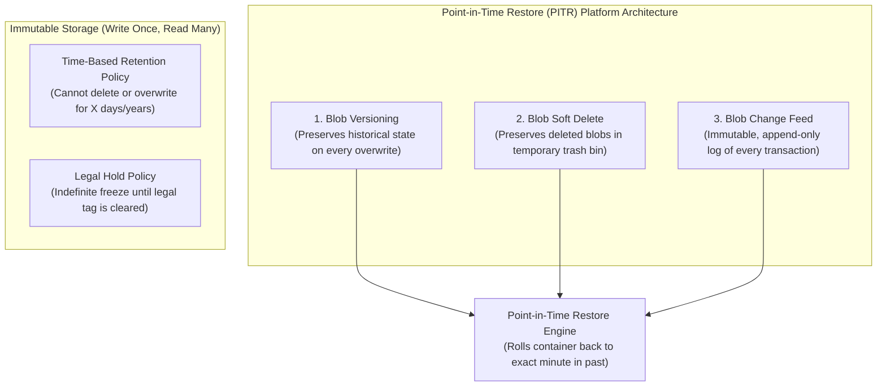

# Module 13-104-08: Administer Azure Storage, Blob Tiers, Replication & File Sync

**Breadcrumbs:** [[13-Index - Azure|☁️ Azure Reference MOC]] > [[13-Index - AZ-104|📘 AZ-104 Exam Track]] > **08 - Administer Azure Storage**

---

## 🎯 Stage 1: Executive Overview & The Conceptual Lecture

### 1. The Zero-Knowledge Starting Point: What is Cloud Storage?
In traditional on-premises IT, enterprise file storage was anchored to physical hardware:
* If a company needed storage, sysadmins purchased expensive physical disk arrays or multimillion-dollar **Storage Area Network (SAN)** frames from EMC, NetApp, or HP.
* If a physical disk died, an alarm sounded, a red LED illuminated on the drive bay, and an engineer rushed into the cold aisle of the datacenter to pull and replace the drive.
* If a business grew rapidly and consumed all disk space, IT had to purchase new drive expansion shelves, wait weeks for shipping, rack them, and manually expand Logical Unit Numbers (LUNs).
* If a fire, flood, or power surge destroyed the datacenter, every corporate document and database was lost forever unless someone physically carried backup tapes offsite in a briefcase.

In Microsoft Azure, storage is treated as a **massively scalable, software-defined cloud utility**:
* You never buy physical hard drives, format partitions, or monitor bad sectors.
* You provision an **Azure Storage Account**, which instantly gives you an elastic, virtually limitless, triple-replicated storage namespace accessible globally over standard web protocols (HTTPS REST, SMB 3.0, NFS 4.1).
* Every single byte written to Azure Storage is automatically encrypted at rest using 256-bit AES and synchronously replicated across multiple independent storage nodes to eliminate hardware single points of failure.

---

### 2. The Four Pillars of Azure Storage
An Azure Storage Account provides a unified management plane for four distinct storage data services:

```text
+-------------------------------------------------------------------------------------------------+
|                               THE 4 PILLARS OF AZURE STORAGE                                    |
+-------------------------------------------------------------------------------------------------+
|  1. Azure Blob Storage       |  2. Azure Files              |  3. Azure Queues & Tables         |
+------------------------------+------------------------------+-----------------------------------+
| - Type: Object Storage       | - Type: Managed File Shares  | - Type: Messaging & NoSQL Data    |
| - Protocol: HTTPS REST APIs  | - Protocol: SMB 3.0 / NFS    | - Protocol: HTTPS REST APIs       |
| - Analog: Amazon S3, Google  | - Analog: Windows Network    | - Analog: AWS SQS (Queues) and    |
|   Cloud Storage              |   Share (\\server\share)     |   DynamoDB / SimpleDB (Tables)    |
| - Use: Unstructured images,  | - Use: Lift-and-shift VM file| - Use: Decoupling application     |
|   videos, backups, logs,     |   shares, FSLogix VDI user   |   components via messaging, fast  |
|   static web hosting, big    |   profiles, hybrid cloud     |   schemaless key-value storage    |
|   data lake analytics        |   caching with File Sync     |   for state metadata              |
+-------------------------------------------------------------------------------------------------+
```

---

### 3. Terminology Matrix: Zero-Knowledge to Enterprise Architect

| Terminology | What It Means to a Beginner | Real-World Analog | Enterprise Architecture Reality |
| :--- | :--- | :--- | :--- |
| **Storage Account** | A master account that holds all your cloud files. | A safe deposit box container at a bank. | A unified HTTP/HTTPS endpoint namespace (`https://<account>.*.core.windows.net`) providing multi-service data persistence. |
| **Blob (Binary Large Object)** | Any unstructured file (video, PDF, zip, image). | An unformatted digital document in a drawer. | Object storage organized into Account $\rightarrow$ Container $\rightarrow$ Blob, accessible globally via URL. |
| **LRS (Locally Redundant)** | Saving 3 copies in one building. | Keeping 3 photocopies of a birth certificate in 3 different drawers in your house. | 3 synchronous data copies within a single physical Azure datacenter cluster (11 nines durability). |
| **ZRS (Zone-Redundant)** | Saving 3 copies across 3 separate buildings. | Keeping one photocopy at home, one at the bank, and one at your parents' house. | 3 synchronous copies distributed across 3 distinct Availability Zones in the primary region (12 nines durability). |
| **GRS (Geo-Redundant)** | Saving copies in another city 500 miles away. | Sending a duplicate archive box to an earthquake-proof bunker in another state. | LRS in primary region + asynchronous replication to a paired secondary region (16 nines durability). |
| **Customer Failover** | Forcing Azure to switch to your backup city. | Declaring your primary office unusable and redirecting all mail to your satellite branch. | Swapping storage DNS endpoints so the secondary region becomes primary. Unplanned failover drops GRS to LRS! |
| **Lifecycle Management** | An automated rule that moves old files to cheaper storage. | A cleaning service that moves 1-month-old papers to the basement and shreds 7-year-old tax forms. | An ARM policy engine evaluating blob metadata daily to transition blobs between Hot, Cool, Cold, and Archive tiers. |
| **Rehydration** | Bringing a frozen archived file back to life. | Thawing a frozen steak before cooking it. | Moving a blob from the offline Archive tier back to an online tier (Hot/Cool), taking up to 15 hours. |
| **Shared Access Signature (SAS)** | A temporary, restricted URL key for a file. | A guest hotel keycard that only unlocks Room 304 and expires at 11:00 AM tomorrow. | A signed URI granting granular, time-bound, IP-restricted read/write access to storage without exposing master root keys. |
| **User Delegation SAS** | A temporary key signed with your employee ID instead of the master key. | A visitor pass signed by an authenticated security officer with an audit trail. | A Zero-Trust SAS token signed via Microsoft Entra ID credentials, revocable instantly without regenerating master storage keys. |
| **Azure File Sync** | Replicating local Windows servers to the cloud. | A magic filing cabinet that keeps local copies of active files while syncing everything to HQ. | A hybrid sync agent linking Windows File Servers to an Azure File Share with Cloud Tiering (reparse stub pointers). |
| **Point-in-Time Restore** | Rolling back all blobs to an exact minute in the past. | Rewinding a security camera video tape to see files before a ransomware attack. | Restores block blob containers to any minute within retention window using Blob Versioning + Soft Delete + Change Feed. |

---

## 🏛️ Stage 2: Core Mental Model & Component Architecture

### 1. Storage Account Kinds & Performance Tiers

#### 1. The Real-World Dilemma (The 'Why' / Cost-Performance Pain)
In modern cloud engineering, storage requirements are deeply heterogeneous. Consider two real-world enterprise workloads:
* **Workload A (High-Throughput / Sub-Millisecond Latency):** An AI computer vision training cluster or an Azure Kubernetes Service (AKS) cluster backing a high-frequency trading platform. This workload executes 80,000 read/write operations per second on thousands of tiny image chunks.
* **Workload B (Petabyte-Scale Cold Ingestion):** A healthcare regulatory compliance system archiving 5 petabytes of patient medical scans and hospital security camera footage that must be retained for 10 years by law but is almost never queried.

If you provision Workload A on a standard magnetic storage account, transactions get throttled by account-level throughput limits (20,000 IOPS / 500 Gbps egress per account), latencies spike from 2ms to 65ms, and the company is hit with enormous per-transaction billing charges. Conversely, if you provision Workload B on a high-performance SSD-backed tier, the sheer monthly storage footprint cost (~$0.15/GB/month vs. $0.00099/GB/month in Archive) will bleed millions of dollars from the IT budget.

Furthermore, enterprise environments often suffer from **legacy account sprawl**. Organizations that migrated to Azure years ago frequently host deprecated **General-Purpose v1 (GPv1)** or legacy **BlobStorage** accounts. These accounts lack access tiering (Hot/Cool/Cold/Archive), lack Data Lake Hierarchical Namespace (ADLS Gen2) support, cannot leverage Zone-Redundant (ZRS) or Geo-Zone-Redundant (GZRS) replication, and incur higher per-gigabyte storage pricing. Cloud administrators must understand which account kind to provision, when to migrate, and the architectural trade-offs involved.

#### 2. The Concrete Metaphor
Think of Azure Storage Account kinds as a fleet of specialized commercial vehicles:
* **General-Purpose v2 (GPv2) = The Heavy-Duty Utility Van:** It is the versatile everyday workhorse of the fleet. It carries tools, packages, passengers, or equipment. It can drive in the city, on the highway, and park anywhere. It supports every service (Blobs, Files, Queues, Tables) and every temperature tier. It handles 95% of enterprise business tasks cost-effectively.
* **Premium BlockBlobStorage = The Formula 1 Dragster:** Built purely for raw speed on a paved track. It burns expensive high-octane fuel (cost per GB is high), but it accelerates with sub-millisecond response times for high-transaction container image registries, AI pipelines, and streaming analytics.
* **Premium FileStorage = The Enterprise Freight Cargo Truck:** Built with a specialized hydraulic lift and loading dock coupling (NFS 4.1 and high-IOPS SMB). Designed specifically for heavy corporate file systems, Linux enterprise shares, and FSLogix Virtual Desktop profile containers.
* **Premium PageBlobStorage = The Freight Locomotive:** Engineered specifically to pull massive 512-byte fixed-page trains (Azure Virtual Machine unmanaged VHD disks, now largely superseded by Azure Managed Disks).

#### 3. The Mechanical & Topological Reality
Under the hood, Microsoft Azure Storage is implemented as a globally distributed, massive-scale storage utility built on three distinct internal abstraction layers:
1. **The Front-End (FE) Layer:** A stateless fleet of load-balanced HTTP/HTTPS proxy servers. The FE layer terminates TLS handshakes, parses incoming REST/SMB requests, authenticates callers (verifying Entra ID tokens, Shared Keys, or SAS signatures), enforces firewall and private endpoint rules, and routes calls to partition servers.
2. **The Partition Layer:** A distributed metadata and indexing tier. Partition servers manage the logical namespace (containers, directories, blob names), enforce strong object consistency, handle transaction locking, and map logical byte ranges to physical storage extents.
3. **The Stream Layer:** The bare-metal append-only storage engine running across storage clusters (stamps). The Stream Layer writes data blocks into contiguous physical allocations called *extents* across racks of physical storage nodes (JBOD chassis with magnetic spindle drives for Standard storage, or NVMe SSD flash enclosures for Premium storage). Extents are triple-replicated across fault domains.

```text
+---------------------------------------------------------------------------------------------------+
|                                 AZURE STORAGE INTERNALS ARCHITECTURE                              |
+---------------------------------------------------------------------------------------------------+
|  Client REST API / SMB 3.0 / NFS 4.1 Requests                                                     |
|       │                                                                                           |
|       ▼                                                                                           |
|  [ FRONT-END (FE) LAYER ]  --> Terminates TLS 1.2/1.3, authenticates HMAC/OAuth/Kerberos,        |
|                                checks Storage Firewall / VNet Service Endpoints / Private Links   |
|       │                                                                                           |
|       ▼                                                                                           |
|  [ PARTITION LAYER ]       --> Manages object namespaces, blob metadata, range locks,             |
|                                strong read-after-write consistency, transaction limits            |
|       │                                                                                           |
|       ▼                                                                                           |
|  [ STREAM LAYER (STAMPS)]  --> Append-only distributed block engine (Extents). Flushes data to    |
|                                physical media: Standard (Magnetic HDD) vs. Premium (NVMe SSD)     |
+---------------------------------------------------------------------------------------------------+
```

##### Comprehensive Storage Account Kinds Comparison Matrix:

| Account Kind | Media Type | Supported Services | Supported Access Tiers | Max Account Capacity | IOPS / Latency Profile | Primary Enterprise Use Cases |
| :--- | :---: | :--- | :---: | :---: | :---: | :--- |
| **General-Purpose v2 (GPv2)** | Standard HDD or Premium SSD | Blobs, Files, Queues, Tables, ADLS Gen2 | Hot, Cool, Cold, Archive | Up to 5 PB | Up to 20,000 IOPS, 10-20ms latency | The default enterprise choice for general cloud data, web assets, backups, logs, and relational staging. |
| **Premium BlockBlobStorage** | NVMe SSD only | Block Blobs, Append Blobs | **None** (Always Hot equivalent) | Up to 5 PB | Up to 100,000+ IOPS, sub-millisecond latency | High-frequency container registries, AI/ML dataset ingestion, real-time telemetry streaming. |
| **Premium FileStorage** | NVMe SSD only | Azure Files (SMB 3.0 & NFS 4.1) | **None** (SSD Provisioned IOPS) | Up to 100 TiB per share | Up to 100,000 IOPS, single-digit ms | High-IOPS enterprise file shares, Linux clusters requiring NFS 4.1, FSLogix user profile disks in AVD. |
| **Premium PageBlobStorage** | NVMe SSD only | Page Blobs (512-byte pages) | **None** (Always Hot) | Up to 5 PB | Sub-millisecond latency | Random-access 512-byte read/write patterns, legacy VM unmanaged operating system and data VHDs. |

#### 4. The Production Failure Loop & Exam Trap
* **The NFS 4.1 Account Kind Trap:** On the AZ-104 exam, a common scenario asks: *"You need to create an enterprise file share accessible via NFS 4.1 from Linux compute nodes. What storage account kind must you deploy?"*
  * **The Trap:** Selecting General-Purpose v2 (Standard).
  * **The Ground Truth:** Standard GPv2 accounts **do not support NFS 4.1 file shares**! NFS shares strictly require **Premium FileStorage** accounts. Attempting to select NFS in a GPv2 account in the portal or CLI will result in an immediate validation error.
* **The Premium BlockBlob Archive Trap:** An engineer attempts to write an Azure Lifecycle Management policy to automatically transition blobs older than 90 days to the **Archive** tier inside a Premium BlockBlobStorage account.
  * **The Trap:** Expecting the rule to lower costs on older blobs.
  * **The Ground Truth:** The Archive access tier is physically unsupported on SSD-backed media. Premium BlockBlob accounts **do not support access tiers** (Hot, Cool, Cold, Archive). The lifecycle policy will fail with an ARM validation error (`InvalidTierForStorageAccountType`). If data must be archived, it must be copied or replicated to a Standard GPv2 account!
* **The One-Way Upgrade Trap:** Migrating a legacy GPv1 account to GPv2 is executed with a single click or CLI command (`az storage account update --name <st> --set kind=StorageV2`). However, **this upgrade is strictly irreversible!** You cannot downgrade a GPv2 account back to GPv1. While storage costs are lower in GPv2, per-transaction read/write costs are slightly higher; workloads with millions of transactions on small files will see an increase in transaction billing if not planned.

---

### 2. The Data Redundancy Hierarchy & Durability Math

#### 1. The Real-World Dilemma (The 'Why' / Cost-Performance Pain)
Computer hardware fails relentlessly at cloud scale. In a hyperscale datacenter housing 150,000 server blades and hundreds of thousands of spinning platters and flash cells:
* Multiple storage drives suffer physical sector decay or spindle lockup every day.
* Top-of-Rack (ToR) network switches experience ASIC freezes or optical transceiver burnout.
* Uninterruptible Power Supply (UPS) units and Power Distribution Units (PDUs) trip or suffer short-circuit fires.
* Regional catastrophes—such as the 2018 South Central US lightning storm that knocked out datacenter cooling systems, or hurricanes that submerge coastal facilities—can render an entire geographical metropolitan area dark for days.

If an enterprise stores its mission-critical database backups, proprietary IP, or ERP data on a single physical server rack, a simple power surge permanently obliterates the business. Conversely, if an architect indiscriminately replicates all data across three continents with read-access secondary endpoints, the company pays triple storage fees and massive cross-region network egress charges for data that could easily be recreated. The architect's dilemma is finding the exact mathematical threshold between **durability, latency, RPO (Recovery Point Objective), and cost**.

#### 2. The Concrete Metaphor
Imagine protecting your family’s most precious legal documents (birth certificates, house deeds, passports):
* **Locally Redundant Storage (LRS) = Three Copies in One Filing Cabinet:** You make three photocopies and place them in three different folders inside your home office filing cabinet. If your toddler spills juice in one drawer, you still have two pristine copies. But if your house catches fire, all three copies turn to ash simultaneously.
* **Zone-Redundant Storage (ZRS) = Copies in Three Separate Buildings Across the City:** You keep one copy at your house, one at your downtown corporate office, and one in a safe deposit box at your bank across town. If your house burns down, or the bank suffers a water pipe burst, the other two locations are completely unaffected. But if a catastrophic regional earthquake levels the entire city, all three locations are impacted.
* **Geo-Redundant Storage (GRS) = A Mountain Bunker 500 Miles Away:** You maintain the copies in your city, but every 15 minutes a secure courier transports updated duplicates to an earthquake-proof underground vault in another state. If an asteroid or hurricane wipes out your entire home city, your records survive intact 500 miles away.

#### 3. The Mechanical & Topological Reality
Azure Storage guarantees industry-leading durability by combining synchronous rack-level replication with asynchronous inter-region data streaming:

```mermaid
flowchart TD
    subgraph PrimaryRegion ["Primary Azure Region (e.g., East US)"]
        subgraph LRS_Scope ["Locally Redundant Storage (LRS)"]
            DC1["Single Datacenter Cluster\n(3 Synchronous Replicas across Fault Domains)\nDurability: 99.999999999% (11 9s)\nProtects against: Disk, Server, Rack, PDU failure"]
        end

        subgraph ZRS_Scope ["Zone-Redundant Storage (ZRS)"]
            AZ1["AZ 1 (Replica 1)\nIndependent Power/Cooling"] <-->|Low-Latency Sync Bus| AZ2["AZ 2 (Replica 2)\nIndependent Power/Cooling"]
            AZ2 <-->|Low-Latency Sync Bus| AZ3["AZ 3 (Replica 3)\nIndependent Power/Cooling"]
            NoteZRS["Durability: 99.9999999999% (12 9s)\nProtects against: Complete Datacenter Outage"]
        end
    end

    subgraph SecondaryRegion ["Secondary Paired Region (e.g., West US - Minimum 300 Miles Away)"]
        subgraph GeoReplication ["Geo-Redundancy (GRS / GZRS)"]
            SecDC["Secondary Datacenter Cluster\n(3 Synchronous Replicas via LRS)\nDurability: 99.99999999999999% (16 9s)\nProtects against: Total Regional Devastation"]
        end
        RA_Endpoint["Read-Access Secondary Endpoint\nhttps://<account>-secondary.blob.core.windows.net\n(Allows read-only queries during primary degradation)"]
    end

    LRS_Scope -.->|Asynchronous WAN Journal Sync (RPO < 15 min)| SecDC
    ZRS_Scope -.->|Asynchronous WAN Journal Sync (RPO < 15 min)| SecDC
    SecDC --- RA_Endpoint
```

##### The Durability Math (First Principles):
Durability represents the probability that a stored object will remain completely intact and uncorrupted over a one-year window:
$$\text{Annual Object Loss Probability} = 1 - \text{Durability}$$
* **11 Nines ($99.999999999\%$ - LRS):** The probability of losing an object is $10^{-11}$. If an enterprise stores $100,000,000,000$ ($100$ billion) blobs in an LRS account, they can statistically expect to lose on average **1 blob per year**.
* **12 Nines ($99.9999999999\%$ - ZRS):** The probability of loss is $10^{-12}$. For every $1$ trillion blobs stored, an average of 1 blob is lost per year.
* **16 Nines ($99.99999999999999\%$ - GRS / GZRS):** The probability of loss is $10^{-16}$. An enterprise storing $10,000,000,000,000,000$ ($10$ quadrillion) blobs can expect to lose only 1 blob per year.

##### Write Path Mechanics:
* **Synchronous Quorum (LRS & ZRS):** When an HTTP `PUT` request hits the Front-End layer, the stream layer writes the data to the primary storage replica and synchronously flushes it to two secondary replicas across separate fault domains (LRS) or separate Availability Zones (ZRS). The storage service **only returns `HTTP 201 Created` to the client once all three replicas acknowledge the write to disk**. If an AZ goes down during a ZRS write, the quorum adapts transparently.
* **Asynchronous Geo-Streaming (GRS & GZRS):** In GRS and GZRS, the write is committed synchronously in the primary region first (LRS for GRS; ZRS for GZRS). Once committed, an asynchronous background engine reads the transaction journal and replicates the extents across Microsoft's high-speed dedicated dark fiber WAN backbone to the secondary paired region. In the secondary region, the data is committed across three replicas using LRS. Because this replication is asynchronous, the **Recovery Point Objective (RPO) is typically under 15 minutes**.

##### Comprehensive Redundancy Matrix:

| Redundancy SKU | Primary Placement | Secondary Placement | Durability SLA | Availability SLA (Read) | Availability SLA (Write) | Secondary Read Access | Customer-Managed Failover |
| :--- | :--- | :--- | :---: | :---: | :---: | :---: | :---: |
| **LRS** (Locally Redundant) | 3 copies in 1 Datacenter (3 Fault Domains) | None | **11 9s** ($10^{-11}$) | 99.9% (Hot/Cool) | 99.9% (Hot/Cool) | ❌ No | ❌ N/A |
| **ZRS** (Zone-Redundant) | 3 copies across 3 distinct AZs | None | **12 9s** ($10^{-12}$) | 99.9% (Hot/Cool) | 99.9% (Hot/Cool) | ❌ No | ❌ N/A (Survives AZ loss) |
| **GRS** (Geo-Redundant) | 3 copies in 1 Datacenter (LRS) | 3 copies via LRS in Paired Region | **16 9s** ($10^{-16}$) | 99.9% | 99.9% | ❌ No | ✅ Supported |
| **RA-GRS** (Read-Access Geo) | 3 copies in 1 Datacenter (LRS) | 3 copies via LRS in Paired Region | **16 9s** ($10^{-16}$) | **99.99%** | 99.9% | ✅ **Yes** (`-secondary`) | ✅ Supported |
| **GZRS** (Geo-Zone-Redundant) | 3 copies across 3 distinct AZs (ZRS) | 3 copies via LRS in Paired Region | **16 9s** ($10^{-16}$) | 99.9% | 99.9% | ❌ No | ✅ Supported |
| **RA-GZRS** (Read-Access Geo-Zone) | 3 copies across 3 distinct AZs (ZRS) | 3 copies via LRS in Paired Region | **16 9s** ($10^{-16}$) | **99.99%** | 99.9% | ✅ **Yes** (`-secondary`) | ✅ Supported |

#### 4. The Production Failure Loop & Exam Trap
* **The Secondary Endpoint Fallback Myth (Automatic Failover Trap):**
  * **The Trap:** An administrator configures `Standard_RAGRS` and assumes that if `East US` suffers an outage, applications accessing `https://staccount.blob.core.windows.net` will automatically read from the secondary region (`West US`).
  * **The Ground Truth:** **RA-GRS DOES NOT PROVIDE AUTOMATIC READ FAILOVER!** If the primary region goes offline, DNS queries to `staccount.blob.core.windows.net` will fail with timeouts or HTTP 503 errors. The secondary endpoint is a completely distinct DNS hostname: `staccount-secondary.blob.core.windows.net`. Unless the client application code is explicitly written with circuit-breaker logic (such as using the Azure SDK's `LocationMode.PrimaryThenSecondary`), the application remains down!
* **The Eventual Consistency & Stale Read Trap:** Because geo-replication is asynchronous, reading from `staccount-secondary.blob.core.windows.net` is **eventually consistent**. If a web service writes an avatar image to the primary endpoint and immediately directs the user's browser to fetch it from the `-secondary` endpoint, the browser may receive `HTTP 404 BlobNotFound` or an outdated version because replication has not caught up! Applications querying secondary endpoints must inspect the `x-ms-or-sync-time` response header or the account’s `GeoReplicationStats.LastSyncTime`.

---

### 3. Customer-Managed Account Failover (Unplanned vs. Planned)

#### 1. The Real-World Dilemma (The 'Why' / Cost-Performance Pain)
When a severe catastrophe strikes an Azure primary region—such as an uncontained fire in a transformer yard or an extended fiber severed across multiple metro paths—Microsoft's official policy for automated geo-failover is highly conservative:
* Microsoft will **NOT** initiate an automatic regional failover unless the primary region is deemed physically ruined beyond near-term recovery.
* Automated failovers can take many hours or even days to be officially declared by Microsoft Azure leadership.

If an enterprise operates a 24/7 global e-commerce engine or healthcare triage system with a strict 2-hour Recovery Time Objective (RTO), waiting 24 hours for Microsoft to declare a regional disaster is unacceptable. The organization must take fate into its own hands by executing a **Customer-Managed Account Failover**. However, pulling this emergency ripcord without understanding its low-level mechanics can permanently destroy committed corporate data and leave the company completely unprotected against subsequent failures.

#### 2. The Concrete Metaphor
Imagine your corporate headquarters is located in a city experiencing an uncontrollable wildfire. You have an emergency evacuation satellite office 600 miles away:
* An **Unplanned Customer Failover** is the equivalent of issuing an immediate emergency decree that the satellite office is now the permanent global corporate headquarters. You burn the bridges behind you: whatever files were loaded onto the delivery truck five minutes before the fire hit are lost forever.
* Worse, the satellite office does **not** have an underground bunker behind it. It is standing completely alone. If another disaster strikes the satellite office tomorrow, you have zero backup facilities until you manually contract a new remote facility!

#### 3. The Mechanical & Topological Reality
Customer-Managed Failover works by manipulating Azure Public DNS CNAME records and flipping the storage cluster's active role:

```text
[ Primary Region: East US ] ════(Asynchronous Replication: RPO < 15 Min)════► [ Secondary Region: West US ]
              │                                                                             │
              ▼                                                                             ▼
      [ REGIONAL OUTAGE ]                                                          [ INITIATE FAILOVER ]
              │                                                                             │
              └──────────────────────────────────────┬──────────────────────────────────────┘
                                                     ▼
                             MECHANICAL STATE AFTER UNPLANNED FAILOVER:
                             1. Public DNS CNAME flipped:
                                'staccount.blob.core.windows.net' -> Points to West US IP VIPs!
                             2. Secondary endpoint ('-secondary') is DECOMMISSIONED.
                             3. Data Loss Window: Writes made after 'LastSyncTime' are LOST FOREVER.
                             4. CRITICAL CAVEAT: Redundancy DROPS TO LRS in the new region!
                             5. Manual Action Required: Re-enable GRS/GZRS to re-protect data!
```

##### The Two Failover Types:
1. **Planned Account Failover (Zero Data Loss - RPO = 0):**
   * Supported for GRS and GZRS storage accounts.
   * Azure ensures all pending replication journal entries are completely flushed and committed to the secondary region before swapping DNS records.
   * Used for planned disaster recovery drills, regional migrations, or anticipated weather emergencies.
   * **Result:** Zero data loss.
2. **Unplanned Account Failover (Emergency Cutover - RPO > 0):**
   * Executed during an active, catastrophic primary regional outage where the primary region is completely unresponsive.
   * Azure immediately terminates replication, points the primary DNS records to the secondary storage stamp, and promotes the secondary region to Primary.
   * **Result:** Any write made to the original primary region that was not replicated prior to the failure **is permanently lost!**

##### The Failover Diagnostic Verification:
Before initiating an unplanned failover, administrators must query the `LastSyncTime` property:

```bash
# Inspect the Last Sync Time before initiating failover
az storage account show \
  --name "stenterpriseblob2026" \
  --resource-group "rg-storage-prod" \
  --query "geoReplicationStats" \
  --output json
```

*Output Example:*
```json
{
  "canFailover": true,
  "canPlannedFailover": false,
  "lastSyncTime": "2026-11-21T15:42:10+00:00",
  "status": "Live"
}
```
> [!WARNING]
> If the current time is `16:00:00Z` and `lastSyncTime` is `15:42:10Z`, executing an unplanned failover will **permanently destroy all transactions committed between 15:42:10Z and 16:00:00Z (a 17-minute data loss window)**!

#### 4. The Production Failure Loop & Exam Trap
* **The Post-Failover Redundancy Trap (THE #1 AZ-104 STORAGE EXAM QUESTION):**
  * **The Scenario:** A company uses GRS storage in `East US` paired with `West US`. When `East US` suffers a major network partition, the administrator triggers a customer-managed failover. The failover succeeds and applications resume normal operations against `West US`.
  * **The Exam Trap:** The exam asks: *"What is the storage redundancy level of the account after the failover completes?"*
    * Option A: `GRS` (reversing replication back to East US).
    * Option B: `RA-GRS`.
    * Option C: `LRS` (Locally Redundant Storage).
  * **The Ground Truth:** **Option C is the absolute ground truth!** Following a customer-managed account failover, the storage account in the new primary region **automatically drops to LRS (Locally Redundant Storage)**. Azure **does not** automatically configure replication back to the failed region. The account operates with zero geo-redundancy.
  * **The Mandatory Production Remediation:** To re-establish disaster recovery protection, the administrator MUST manually update the account SKU back to `Standard_GRS` or `Standard_GZRS` via CLI or Portal:
    ```bash
    az storage account update \
      --name "stenterpriseblob2026" \
      --resource-group "rg-storage-prod" \
      --sku "Standard_GRS"
    ```
    This triggers a brand-new initial asynchronous baseline sync from the new primary to the designated paired region.

---

### 4. Blob Access Tiers & FinOps Economics

#### 1. The Real-World Dilemma (The 'Why' / Cost-Performance Pain)
Data has an economic lifecycle. When a file is created—such as a current-month PDF invoice, an ongoing build artifact, or a hot database export—it is queried frequently by users, applications, and analytics pipelines. Within 30 to 90 days, access drops precipitously: 99% of files are never opened again after 60 days.

Consider an enterprise holding 1 Petabyte (1,000,000 GB) of unstructured data:
* In the **Hot Tier**, storing 1 PB costs approximately **$18,000 every single month**.
* In the **Archive Tier**, storing that same 1 PB costs approximately **$990 per month** (a staggering 94% cost reduction).

However, naive FinOps implementations cause catastrophic billing shocks. If an administrator blindly scripts all files to move to Cool or Archive storage without understanding platform billing rules, the organization can receive an invoice tens of thousands of dollars *higher* than if they had left the data in Hot storage. These billing disasters stem from **prorated early deletion penalties, data retrieval fees, and rehydration priority surcharges**.

#### 2. The Concrete Metaphor
Think of Azure Blob Access Tiers as the four thermal states of corporate document preservation:
* **Hot (The Active Desk):** Documents sitting right on top of your office desk. Zero delay to pick up and read, but your desk is located in prime Manhattan real estate: the monthly rent per square foot is high. Ideal for active files you read daily.
* **Cool (The Office Filing Cabinet):** Documents filed away in a cabinet in the hallway. Rent is lower than desk space. But there is a 30-day lease contract: if you pull a folder and throw it in the shredder on Day 3, the building manager charges you for the full 30 days anyway.
* **Cold (The Basement Locker):** Documents stored in an offsite self-storage unit down the street. Extremely cheap monthly rent, but governed by a strict 90-day minimum lease contract.
* **Archive (The Sub-Zero Mountain Salt Mine):** Documents microfilmed and lowered into an underground salt mine vault carved inside a mountain. Monthly storage rent is virtually free ($0.00099/GB/month), but the vault door is frozen solid. Files are **offline**; you cannot open a folder inside the vault. To read a single page, you must submit a formal requisition request to the miners to thaw the vault door, which takes up to 15 hours!

#### 3. The Mechanical & Topological Reality
Azure Blob Storage provides four distinct access tiers within General-Purpose v2 accounts to balance storage capacity cost against access latency and transaction fees:

```text
Hot Tier (Active Working Set)
├── Storage Cost: Highest (~$0.018/GB/mo)
├── Read/Write Operation Cost: Lowest (~$0.05 per 10k writes; ~$0.004 per 10k reads)
├── Data Retrieval Fee: $0.00 (Free)
├── Access Latency: Milliseconds (Online)
└── Minimum Retention: None (0 Days)
       │
       │ Blob inactive for 30 days
       ▼
Cool Tier (Infrequently Accessed Data - accessed < 1 time/month)
├── Storage Cost: Lower (~$0.010/GB/mo - ~45% savings)
├── Read/Write Operation Cost: Higher (~$0.10 per 10k writes; ~$0.01 per 10k reads)
├── Data Retrieval Fee: ~$0.01 per GB retrieved
├── Access Latency: Milliseconds (Online)
└── Minimum Retention: 30 DAYS (Early deletion incurs prorated fee!)
       │
       │ Blob inactive for 90 days
       ▼
Cold Tier (Rarely Accessed Data - accessed < 1 time/year)
├── Storage Cost: Very Low (~$0.0036/GB/mo - ~80% savings)
├── Read/Write Operation Cost: Substantially Higher
├── Data Retrieval Fee: ~$0.03 per GB retrieved
├── Access Latency: Milliseconds (Online)
└── Minimum Retention: 90 DAYS (Early deletion incurs prorated fee!)
       │
       │ Blob inactive for 180 days
       ▼
Archive Tier (Deep Offline Storage - compliance, disaster recovery)
├── Storage Cost: Lowest Possible (~$0.00099/GB/mo - >90% cheaper than Hot!)
├── Read/Write Operation Cost: Highest
├── Data Retrieval Fee: ~$0.022 per GB retrieved
├── Access Latency: 1 TO 15 HOURS (Blobs are OFFLINE - HTTP GET returns 409!)
├── Minimum Retention: 180 DAYS (Early deletion incurs prorated fee!)
└── Rehydration Required: Must set tier to Hot/Cool before reading bytes!
```

##### Deep Mechanics of the Archive Tier & Rehydration:
When a blob is transitioned to the Archive tier, its underlying storage extents are unmounted from active partition caching and written to high-density, low-power storage hardware.
* **Direct Read Blockade:** Any attempt by an application, web browser, or script to execute an HTTP GET or download an archived blob results in an immediate failure:
  `HTTP 409 Conflict (ErrorCode: BlobArchived - This operation is not permitted on an archived blob.)`
* **Rehydration Priorities:** To read the data, the blob must be rehydrated back to an online tier (Hot or Cool):
  1. **Standard Priority (Default):** Rehydrates using opportunistic, unreserved background capacity. Takes **up to 15 hours**. Standard rehydration retrieval fees apply.
  2. **High Priority (Expedited):** Uses reserved, high-priority processing pipelines. Restores blobs under 10 GB in **less than 1 hour**. Incurs significantly higher per-request and per-GB retrieval fees.
* **Two Architectural Rehydration Patterns:**
  * **Pattern 1: In-Place Tier Change (`set-blob-tier`):**
    The blob's tier is modified from Archive to Hot or Cool. The blob enters the transitional status `rehydrate-pending-to-hot`. While pending, the blob remains offline and unreadable. Once rehydration completes, the blob permanently resides in the Hot tier.
  * **Pattern 2: Copy to New Blob (`copy-blob`):**
    The application issues a `Copy Blob` REST API call specifying the archived blob as the source and a new blob name in the Hot tier as the destination (`--destination-tier Hot`). The original blob remains untouched in the Archive tier, while a thawed copy is created in the Hot tier!

#### 4. The Production Failure Loop & Exam Trap
* **The Early Deletion Prorated Penalty Trap (The FinOps Gotcha):**
  * **The Rule:** The Cool, Cold, and Archive tiers enforce mandatory minimum retention periods:
    * **Cool Tier:** 30 days minimum.
    * **Cold Tier:** 90 days minimum.
    * **Archive Tier:** 180 days minimum.
  * **The Mathematical Penalty Calculation:** If an object is deleted, overwritten, or transitioned to another tier before its minimum retention days expire, Azure bills the customer for the days the blob actually lived **PLUS a prorated early deletion fee for the remaining days**!
    $$\text{Penalty Bill} = \text{Blob Size in GB} \times (\text{Minimum Days} - \text{Days Existed}) \times \frac{\text{Tier Storage Rate}}{30}$$
  * **The Scenario:** An automated cleanup script uploads 10 TB of ephemeral logs directly to the **Archive** tier to save money, and a cron job deletes them after 10 days.
  * **The Cost Penalty:** Azure bills for 10 days of storage PLUS **170 days of early deletion penalty fees** for 10 TB of data! Furthermore, if you rehydrate a blob from Archive to Hot after 30 days, **changing the tier counts as an early deletion from the Archive tier**, triggering 150 days of early deletion fees!
* **The Account Default Tier Trap:**
  * **The Trap:** An AZ-104 question asks: *"You are configuring a new GPv2 storage account. You want all newly created blobs to automatically default to the Archive tier. Which setting should you configure?"*
  * **The Ground Truth:** **You cannot set the default access tier of a storage account to Cold or Archive!** The storage account default tier can strictly only be set to **Hot** or **Cool**. Cold and Archive tiers can only be assigned to individual blobs via the REST API, CLI, or automated **Lifecycle Management rules**!

---

## 🏢 Stage 3: Deep-Intuition Platform Mechanics & Topology

### 1. Storage Access Security Triad: Keys vs. SAS vs. Entra ID

#### 1. The Real-World Dilemma (The 'Why' / Cost-Performance Pain)
Securing cloud storage represents one of the most severe attack surfaces in enterprise IT. Historically, cloud applications connected to Azure Storage using the master **Storage Account Access Keys (Key 1 & Key 2)**. A master access key is a 512-bit symmetric secret that grants complete, unrestricted, superuser administrative power over every byte in the account:
* It bypasses all Azure RBAC data restrictions.
* It bypasses all container-level ACLs.
* It grants permissions to read, write, modify, or permanently delete every blob, file share, queue, and database table.
* It even allows modifying account firewall settings and creating new access tokens.

If an application developer accidentally commits a connection string containing an Account Key into a public GitHub repository, automated adversary crawlers harvest the key within 45 seconds. Attackers can exfiltrate multi-terabyte confidential databases, deploy ransomware by encrypting all blobs, or delete entire storage accounts.

Worse, when the security team detects the leak, they face the **Master Key Rotation Dilemma**: rotating Key 1 immediately terminates authentication for **every single production microservice, backend function, mobile app, and third-party data pipeline** that relies on Key 1. The blast radius of rotating an account key is catastrophic. To eliminate this risk, modern enterprise architecture adheres to the principle of least privilege using **Shared Access Signatures (SAS)** and **Microsoft Entra ID Role-Based Access Control**.

#### 2. The Concrete Metaphor
Imagine the physical security infrastructure of a massive commercial skyscraper:
* **Storage Account Access Keys (Key 1 & 2) = The Master Skeleton Key:** A physical master brass key carried by the building superintendent. It opens every office door, the executive safe, the electrical closets, and the rooftop elevator shaft. It has no expiration date, no name engraved on it, and leaves zero electronic audit trails. If an employee loses this key on the subway, the building management has to replace every lock on every door in the entire skyscraper.
* **Account SAS = The Contractor Master Pass:** A printed temporary paper badge granting a contractor access to the 4th, 5th, and 6th floors until 5:00 PM. Better than the skeleton key, but if the contractor drops the pass on the street, anyone who picks it up can use it until 5:00 PM because the pass cannot be revoked without changing the master door locks!
* **Service SAS with Stored Access Policy (SAP) = The Electronic Keycard Linked to Security HQ:** An RFID keycard programmed to unlock only Room 302 until tomorrow morning. However, it is connected to a central computer console at the security front desk. If the visitor is caught acting suspiciously, the security guard simply clicks "Deactivate Card #42" in the software, and **the card becomes dead instantly**, without affecting any other lock in the building!
* **User Delegation SAS = The Biometric Security Badge Issued by Entra ID:** A visitor badge issued and digitally signed by the Chief of Corporate Security (Microsoft Entra ID) using their corporate identity credentials. If the security director revokes the user's employment in HR, the badge dies immediately. No master brass keys were ever touched or exposed.

#### 3. The Mechanical & Topological Reality
Azure provides three distinct authentication and authorization tiers for the storage data plane:

```text
+---------------------------------------------------------------------------------------------------+
|                                 THE STORAGE ACCESS SECURITY CONTINUUM                             |
+---------------------------------------------------------------------------------------------------+
|  1. MASTER ACCOUNT KEYS (Shared Key: Key 1 & Key 2)                                              |
|     ├── 512-bit symmetric HMAC-SHA256 root secret. Full superuser god-mode.                      |
|     └── Enterprise Best Practice: Disable via 'az storage account update --allow-shared-key-access false'|
|                                                                                                   |
|  2. SHARED ACCESS SIGNATURES (SAS)                                                                |
|     ├── Scoped, time-bound, IP-restricted signed URI tokens.                                      |
|     ├── Account SAS: Spans multiple services (Blob, File, Queue). Signed by Master Key.           |
|     ├── Service SAS: Scoped to 1 resource (container/blob). Signed by Master Key.                |
|     │    └── Revocation Vulnerability: Ad-hoc SAS cannot be revoked without rotating Master Key!   |
|     │    └── Production Fix: Bind Service SAS to a STORED ACCESS POLICY (SAP)!                   |
|     └── User Delegation SAS: Scoped to Blob storage. Signed via MICROSOFT ENTRA ID OAuth Token!  |
|          └── Enterprise Standard: Revocable via Entra ID without touching master keys.           |
|                                                                                                   |
|  3. MICROSOFT ENTRA ID (Azure RBAC Data Plane Roles)                                              |
|     ├── True Zero-Trust identity plane. Zero hardcoded secrets, connection strings, or URI tokens.|
|     └── Built-in Data Roles:                                                                      |
|          - Storage Blob Data Reader: Read blob contents and metadata.                             |
|          - Storage Blob Data Contributor: Read, write, and delete blobs.                          |
|          - Storage Blob Data Owner: Full data plane control + grant Azure RBAC roles.             |
+---------------------------------------------------------------------------------------------------+
```

##### Anatomy of a Shared Access Signature (SAS) URI:
When an application accesses Azure Storage via a SAS token, it appends a query string to the resource URL. The storage Front-End layer inspects and cryptographically validates these parameters:

```text
https://staccount.blob.core.windows.net/invoices/inv_2026.pdf?
  sv=2023-11-03        --> Signed Storage API Version
  &sr=b                --> Signed Resource (b = blob; c = container; s = service)
  &sp=rw               --> Signed Permissions (r = read; w = write; d = delete; l = list)
  &st=2026-11-21T12:00 --> Signed Start Time (UTC)
  &se=2026-11-21T14:00 --> Signed Expiration Time (UTC)
  &sip=198.51.100.10   --> Signed IP Range (Restricts access to specific client IP/CIDR)
  &spr=https           --> Signed Protocol (Forces HTTPS only)
  &si=read-policy-q3   --> Stored Access Policy Identifier (If bound to an SAP)
  &sig=a8F3kd...%3D    --> Cryptographic HMAC-SHA256 signature calculated from String-to-Sign
```

##### Mechanical Comparison of SAS Types:

| Architectural Property | Account SAS | Service SAS (Ad-Hoc) | Service SAS (with SAP) | User Delegation SAS |
| :--- | :---: | :---: | :---: | :---: |
| **Signing Key** | Master Account Key | Master Account Key | Master Account Key | **Entra ID OAuth Token** (User Delegation Key) |
| **Supported Services** | Blob, File, Queue, Table | Blob, File, Queue, Table | Blob, File, Queue, Table | **Blob Storage Only** |
| **Granularity Scope** | Service-level & Object-level | Container or Blob | Container or Blob | Container or Blob |
| **Stored Access Policy Support** | ❌ No | ❌ No | ✅ **Yes** | ❌ No |
| **Early Revocation Method** | Rotate Master Storage Key | Rotate Master Storage Key | **Delete/Modify Stored Access Policy** | **Revoke Entra ID user session / role** |
| **Blast Radius if Leaked** | High (Entire Account) | Medium (Single Resource) | Minimal (Revocable in 1 sec) | Minimal (Bound to user identity) |

##### Stored Access Policy (SAP) Architecture:
A Stored Access Policy is created directly on a container, file share, queue, or table. It defines the permissions, start time, and expiry time centrally on the server. When generating a Service SAS, the token does not encode permissions or expiration dates directly; it simply references the policy name (`&si=policyname`).
* **Instant Revocation:** To revoke the SAS immediately, an administrator simply deletes the policy or changes its expiration time to the past. The storage Front-End layer immediately rejects all requests using that policy token!
* **Policy Limit:** A single container, share, queue, or table can have a **maximum of 5 Stored Access Policies** simultaneously.

##### Disabling Master Key Access Entirely:
In regulated Zero-Trust environments, security standards demand that Master Shared Keys be permanently locked down. Running the following command disables all Shared Key authentication at the storage gateway:
```bash
az storage account update \
  --name "stenterpriseblob2026" \
  --resource-group "rg-storage-prod" \
  --allow-shared-key-access false
```
When `allow-shared-key-access` is set to `false`, **all attempts to authenticate using Key 1, Key 2, Account SAS, or Service SAS are rejected with `HTTP 403 KeyBasedAuthenticationNotPermitted`**. Only **Microsoft Entra ID** and **User Delegation SAS** requests will be honored!

#### 4. The Production Failure Loop & Exam Trap
* **The Revocation Dilemma (The #1 Security Trap on AZ-104):**
  * **The Scenario:** A software developer creates an ad-hoc Service SAS token valid for 90 days and embeds it in a partner application. Two weeks later, the partnership terminates. The security officer demands that the SAS token be revoked immediately without causing downtime for three other production services using the storage account.
  * **The Trap:** The administrator looks for a "Revoke SAS" button in the Azure Portal or attempts to delete the container.
  * **The Ground Truth:** **An ad-hoc SAS CANNOT be revoked individually!** Because an ad-hoc SAS is signed mathematically using the Master Account Key, the storage frontend verifies it autonomously using local cryptography without checking a central database. The ONLY way to revoke an ad-hoc SAS is to **regenerate the Master Account Key** that signed it! Doing so immediately invalidates ALL connection strings and all SAS tokens signed by that key across the entire enterprise!
  * **The Exam Solution:** If the SAS was created using a **Stored Access Policy (SAP)**, the administrator simply deletes or alters the Stored Access Policy on the container. The SAS is instantly invalidated with zero impact on master account keys or other applications!
* **The User Delegation SAS Lifetime Limit Trap:**
  * **The Trap:** An engineer attempts to generate a User Delegation SAS token valid for 30 days.
  * **The Ground Truth:** A User Delegation SAS is signed using a temporary **User Delegation Key** acquired from Entra ID. The maximum valid lifetime of a User Delegation Key is **7 days**! Attempting to request a key with an expiration date beyond 7 days will be rejected by the identity provider.

---

### 2. Data Protection: Point-in-Time Restore, Soft Delete & Immutability (WORM)

#### 1. The Real-World Dilemma (The 'Why' / Cost-Performance Pain)
Data corruption and ransomware attacks do not announce themselves in advance. Consider two catastrophic production events:
* **Event 1 (The Errant Batch Job):** At 2:15 PM, an automated database cleanup script runs with a corrupted `WHERE` clause, overwriting 50,000 production customer profile blobs with null values.
* **Event 2 (Ransomware Extortion):** A compromised administrative workstation executes a ransomware payload that enumerates all Azure storage containers and issues `DELETE` API calls across all historical financial archives.

If the enterprise relies solely on standard backups, restoring 50,000 individual blobs from tape or secondary accounts can take days of downtime. If the account lacks immutability, ransomware can permanently destroy historical corporate records. Cloud administrators must establish a multi-layered data protection perimeter using **Point-in-Time Restore (PITR), Soft Delete, Versioning, and Immutable WORM policies**.

#### 2. The Concrete Metaphor
* **Blob Soft Delete = The Desktop Recycle Bin:** When you delete a file, it is not shredded immediately; it sits in a temporary trash can for 14 days. If you realize your mistake, you click "Restore" and it pops back into place.
* **Blob Versioning = The Automatic Document Revision History:** Every time you click "Save" in Microsoft Word, Word secretly preserves the older version in a hidden drawer. If an employee overwrites page 3 with garbage, you can flip back to Version 2 from this morning.
* **Point-in-Time Restore (PITR) = The Security Camera Rewind Button:** You can rewind the entire storage container like a VHS tape to the exact minute before the ransomware or corrupted script executed (e.g., 2:14 PM), rolling back all creates, updates, and deletes in one operation.
* **Immutable Storage (WORM) = The Concrete Stone Tablet:** Once engraved, the text cannot be modified, overwritten, or erased with a hammer until the mandatory time lock (e.g. 7 years) expires. Not even the Azure Subscription Owner or Microsoft Support can delete it!

#### 3. The Mechanical & Topological Reality



##### 1. Point-in-Time Restore (PITR) Platform Prerequisites:
PITR cannot operate in isolation. It is a composite orchestration engine built directly on top of three foundational platform services:
1. **Blob Versioning:** When an application modifies a blob, Azure generates a unique, timestamped `versionId`. The current version points to the latest data; older versions remain read-only.
2. **Blob Soft Delete:** Retains deleted blobs or versions in a soft-deleted state for a configurable retention window (1 to 365 days).
3. **Blob Change Feed:** An append-only, ordered log of all create, update, and delete events occurring across the storage account, formatted in Apache Avro.
* **How PITR Restores:** When an administrator triggers a restore to `2026-11-21T14:14:00Z`, the PITR engine reads the Change Feed in reverse, reinstates soft-deleted blobs, and resets active pointers to the specific blob version that was active at that precise minute!

##### 2. Immutable Blob Storage (WORM - Write Once, Read Many):
Regulated financial institutions (SEC Rule 17a-4, FINRA) and healthcare systems require absolute proof that electronic records cannot be altered or destroyed:
* **Time-Based Retention Policies:** Blobs can be written and read, but **cannot be modified, overwritten, or deleted** for a mandatory time window (e.g., 2,555 days / 7 years).
  * *Unlocked State:* Can be tested in staging. Retention duration can be increased or decreased.
  * *Locked State:* The policy is permanently cryptographically locked. **Nobody—not even the Subscription Owner, Global Admin, or Microsoft Datacenter Engineers—can delete the storage container or the blobs until the retention timer elapses!**
* **Legal Holds:** An administrative tag (e.g., `Audit-2026-Case-409`) applied to a container. While a legal hold tag exists, blobs can be read and created, but **cannot be deleted or modified**. The freeze remains active indefinitely until the legal hold tag is explicitly cleared.

#### 4. The Production Failure Loop & Exam Trap
* **The PITR Retention Window Hierarchy Trap:**
  * **The Rule:** The Point-in-Time Restore retention window **MUST be at least 1 day less than the Blob Soft Delete retention period**!
  * **The Scenario:** If an administrator configures Soft Delete retention for `7` days, the maximum Point-in-Time Restore window that Azure will allow is `6` days! Attempting to set PITR retention to `7` days or `14` days will result in an immediate validation error.
* **The Locked Immutability Disaster:** Locking a time-based immutability policy is **100% irreversible**. If an administrator locks a 7-year retention policy on a container holding 100 TB of useless junk data, the company is legally and contractually obligated to pay for that 100 TB of storage every month for 7 years. Azure customer support will refuse requests to delete the container or subscription.

---

### 3. Object Replication (Cross-Account & Cross-Region)

#### 1. The Real-World Dilemma (The 'Why' / Cost-Performance Pain)
Standard storage account geo-redundancy (GRS/GZRS) replicates all data inside an account to a Microsoft-mandated fixed paired region (e.g., East US to West US). However, enterprise compliance and operational architectures frequently require bespoke data placement:
* An organization in Germany must replicate customer data to a secondary account in Switzerland (not the default paired region) to satisfy European Union GDPR sovereignty laws.
* A media streaming company needs to replicate only the `/media/trailers/` container from a US production account to regional distribution accounts across Asia, Europe, and South America, without copying the petabytes of raw video footage stored in other containers.

Cloud administrators need **Azure Object Replication** to achieve granular, asynchronous, container-to-container block blob replication across different regions, different subscriptions, and different Microsoft Entra tenants.

#### 2. The Concrete Metaphor
Think of Azure Object Replication as an automated postal forwarding rule configured for specific envelopes:
Instead of moving your entire house to another city (account-level GRS failover), you tell the post office: *"Whenever a blue envelope marked 'Finance' arrives at my New York office, immediately photocopy it and mail a duplicate copy directly to my Geneva office filing room."*

#### 3. The Mechanical & Topological Reality
Azure Object Replication asynchronously copies block blobs according to declarative replication policies configured between a source storage account and a destination storage account:

```text
[ Source Storage Account: stprodus ]                 [ Destination Storage Account: stbackupch ]
  Container: telemetry/                               Container: telemetry-replica/
  ├── Blob Versioning: ENABLED                        ├── Blob Versioning: ENABLED
  ├── Blob Change Feed: ENABLED                       ├── Blob Change Feed: ENABLED
  └── Prefix Filter: 'telemetry/logs/'                └── Receives Replicated Blobs Asynchronously
            │                                                      ▲
            └═══════════════(Asynchronous Object Replication)═════┘
```

##### Mandatory Platform Prerequisites:
For Object Replication to function, the following four conditions MUST be satisfied on BOTH accounts:
1. **Blob Versioning MUST be enabled** on both the source and destination storage accounts.
2. **Blob Change Feed MUST be enabled** on the source storage account.
3. Both source and destination accounts must be **General-Purpose v2 (GPv2) or Premium BlockBlob**.
4. Both accounts must reside in supported Azure regions.

##### Replication Scope & Constraints:
* **Supported Blobs:** Object Replication **strictly supports Block Blobs**. Append blobs and Page blobs are not supported.
* **Archive Tier Restriction:** Blobs residing in the **Archive** tier cannot be replicated! If a blob in the source container is transitioned to Archive, replication of that blob ceases.
* **Replication SLA:** Object Replication is asynchronous; replication completion times depend on blob size and network traffic, typically finishing within minutes.

#### 4. The Production Failure Loop & Exam Trap
* **The Missing Versioning / Change Feed Exam Trap:**
  * **The Scenario:** An administrator creates an Object Replication policy between two accounts, but the replication status permanently displays `Failed` or blobs never appear in the destination container.
  * **The Exam Trap:** The exam suggests firewall issues or incorrect container permissions.
  * **The Ground Truth:** The administrator failed to enable **Blob Versioning** on the destination account or failed to enable **Blob Change Feed** on the source account! Object Replication fundamentally relies on the Change Feed to detect newly created blobs and uses Versioning to ensure idempotency. If either feature is disabled, Object Replication cannot function.

---

### 4. Azure Files & Azure File Sync: Hybrid Architecture

#### 1. The Real-World Dilemma (The 'Why' / Cost-Performance Pain)
Enterprise file management across distributed organizations faces two massive operational roadblocks:
* **Roadblock 1 (The Branch Office Latency Trap):** A global civil engineering company has 60 regional branch offices with hundreds of architects working on massive 2 GB AutoCAD `.dwg` and Revit BIM files. If the company moves all files purely into the cloud (Azure Blob or Azure Files) and forces architects to open 2 GB files across their branch internet pipes, opening a single blueprint takes 8 minutes, causing massive productivity loss. Conversely, maintaining dedicated 100 TB physical Windows file server SANs in every branch office costs millions in hardware, maintenance, and offsite tape backups.
* **Roadblock 2 (The Residential TCP Port 445 Blackhole):** When remote architects work from home and attempt to mount Azure Files directly over SMB (`net use Z: \\staccount.file.core.windows.net\share`), the connection instantly hangs and terminates with:
  `System error 53 has occurred. The network path was not found.`
  Why? Because almost every residential Internet Service Provider (ISP) in the world actively **blocks outbound TCP port 445**!

To resolve this dilemma, enterprise architects deploy **Azure File Sync** with **Cloud Tiering**, creating a seamless hybrid caching fabric.

#### 2. The Concrete Metaphor
Think of Azure File Sync and Cloud Tiering as the inventory management system of an elite boutique hotel:
* **Azure Files (The Cloud Endpoint) = The Massive Central Supply Warehouse:** A 500,000-square-foot mega-warehouse in the desert that holds every single case of wine, spare mattress, and luxury amenity ever purchased.
* **Windows File Server (The Server Endpoint) = The In-Room Mini-Bar:** A compact, refrigerated cabinet inside your hotel room. It holds only the cold drinks you actively consume today at zero delay (local LAN speed).
* **Cloud Tiering = The Invisible Restocking Robot:** When a bottle of champagne sits untouched in the mini-bar for 30 days, the robot empties the liquid back to the central warehouse, leaving behind an exact empty glass replica (a reparse stub) that takes up zero space. To you, the bottle still looks like it's sitting on the shelf. The split second your fingers touch the bottle to twist the cap, the robot instantly pipes the liquid into the bottle from the warehouse over an encrypted pipe, and you enjoy your cold drink without ever realizing the liquid was stored 500 miles away!

#### 3. The Mechanical & Topological Reality

```text
[ Azure Files: Cloud Endpoint ('corp-share') ]  <-- Central Source of Truth (Up to 100 TiB)
                         ▲
                         │ HTTPS / TCP Port 443 Sync Engine (Bypasses all ISP Port 445 blocks!)
                         ▼
        [ Storage Sync Service: Sync Group ]
                         │
        ┌────────────────┴────────────────┐
        ▼                                 ▼
[ Windows File Server 1 ]       [ Windows File Server 2 ]
(Branch Office New York)        (Branch Office London)
- Server Endpoint: D:\Shares    - Server Endpoint: E:\Shares
- Cloud Tiering: Active         - Cloud Tiering: Active
  (Maintains 20% Free Space)      (Maintains 20% Free Space)
- Local Cache: Hot Files        - Local Cache: Hot Files
- Reparse Stubs: 0 KB on disk   - Reparse Stubs: 0 KB on disk
```

##### 1. The TCP Port 445 ISP Block & SMB Protocols:
Server Message Block (SMB 3.0) communicates over **TCP port 445**.
* **The WannaCry / EternalBlue Legacy:** In May 2017, the **WannaCry and NotPetya** ransomware outbreaks weaponized the NSA EternalBlue exploit targeting legacy Microsoft SMBv1 (MS17-010) over port 445, crippling hundreds of thousands of computers globally. In response, consumer and residential Internet Service Providers (Comcast, AT&T, Charter, Vodafone, etc.) implemented permanent network access control lists (ACLs) **dropping all outbound TCP 445 traffic** to protect residential networks.
* **Architectural Workarounds for Enterprise Remote Workers:**
  1. **Point-to-Site (P2S) or Site-to-Site (S2S) VPN:** Encapsulates SMB port 445 packets inside an encrypted IPsec/IKEv2 or OpenVPN tunnel terminating at an Azure Virtual Network Gateway.
  2. **SMB over QUIC:** Transports SMB 3.1.1 traffic over **UDP port 443** (using TLS 1.3 encryption), completely bypassing all ISP TCP 445 blocks without requiring a VPN! (Requires Windows Server 2022 Datacenter: Azure Edition).
  3. **Azure File Sync:** Branch users connect locally over LAN to their Windows File Server. The Windows File Server syncs to Azure Files over **HTTPS (TCP port 443)**!

##### 2. Azure File Sync Core Architectural Topologies:
* **Storage Sync Service:** The top-level Azure Resource Manager resource that manages sync relationships.
* **Sync Group:** Defines the replication topology. A Sync Group contains exactly **ONE Cloud Endpoint** (an Azure File Share) and **one or more Server Endpoints** (registered Windows Server directory paths).
* **Cloud Endpoint:** The master Azure File Share that serves as the centralized cloud source of truth.
* **Server Endpoint:** A specific folder path on a registered Windows Server (e.g., `D:\CorporateData`).

##### 3. Cloud Tiering Internal Mechanics:
Cloud Tiering transforms a local Windows File Server into a high-speed caching engine.
* **The Reparse Point Stub:** When Cloud Tiering is enabled and a file becomes cold, the sync filter driver (`StorageSync.sys`) strips the file's data blocks from the local NTFS volume and replaces them with a **Windows NTFS Reparse Point**:
  * Attributes set: `FILE_ATTRIBUTE_REPARSE_POINT` (0x400) and `FILE_ATTRIBUTE_OFFLINE` (0x1000).
  * **Size on Disk:** Consumes **0 KB on disk** (only a small pointer metadata stub remains in the Master File Table / MFT).
  * **Logical Size:** Retains the original full file size (e.g., 2.5 GB).
  * **User Experience:** In Windows File Explorer, the file displays a cloud badge or grey 'X' icon.
* **Transparent On-Demand Recall:**
  1. A user double-clicks the tiered file, or an application calls Win32 `CreateFile` / `ReadFile`.
  2. The NTFS filesystem filter driver (`StorageSync.sys`) intercepts the I/O request.
  3. The driver issues an HTTPS REST read request to the Azure File Share over port 443.
  4. The data streams into the local file system cache; the application receives the bytes seamlessly without crashing.
* **Cloud Tiering Policies:**
  * **Volume Free Space Policy (High Priority):** Ensures a specified percentage of free space remains on the local disk (e.g., tier files whenever free space drops below 20%). Evaluated every 5 minutes; tiers the least recently accessed files first.
  * **Date Policy:** Tiers any file that has not been opened, read, or modified within $X$ days (e.g., 60 days).
  * *Policy Interaction:* If both policies are configured, the **Volume Free Space Policy takes precedence** to prevent local volume out-of-disk crashes!

##### 4. Asymmetric Change Detection & Sync:
* **Local Windows Server:** Changes made locally on the Windows File Server are detected **instantly** by monitoring the NTFS **USN (Update Sequence Number) Journal**. The sync engine uploads changes to Azure Files within seconds.
* **Cloud Azure File Share:** Changes made directly inside the Azure File Share (via the Azure Portal, AzCopy, or cloud-native VMs) do not generate an NTFS USN event. Azure File Sync runs a scheduled cloud change enumeration job **once every 24 hours**.
  * To force an immediate cloud sync detection without waiting 24 hours, run the PowerShell command:
    ```powershell
    Invoke-AzStorageSyncChangeDetection `
      -ResourceGroupName "rg-storage-prod" `
      -StorageSyncServiceName "sync-storage-prod" `
      -SyncGroupName "syncgroup-corp" `
      -DirectoryPath "engineering/"
    ```

#### 4. The Production Failure Loop & Exam Trap
* **The Antivirus Mass-Recall Storm:**
  * **The Disaster:** A security administrator installs a new enterprise endpoint antivirus or backup agent on a Windows File Server running Azure File Sync. The antivirus software executes a scheduled full-system disk scan. The scanner fails to respect the `FILE_ATTRIBUTE_OFFLINE` flag and opens every single file on the disk.
  * **The Catastrophic Consequence:** Opening each tiered stub triggers an immediate **mass on-demand recall**. Terabytes of data download simultaneously over the branch office internet link, saturating the company's WAN bandwidth and driving the local server hard drive to **100% full capacity**, crashing the server!
  * **The Production Fix:** Antivirus scanners and backup software MUST be explicitly configured with filter drivers that skip offline reparse points (`FILE_ATTRIBUTE_OFFLINE`).
* **The System Drive (`C:\`) Cloud Tiering Restriction:**
  * **The Exam Trap:** Can an administrator enable Cloud Tiering on a folder located on `C:\Shares`?
  * **The Ground Truth:** **NO! Cloud Tiering is strictly unsupported on the Windows operating system boot volume (`C:\`)!** Server Endpoints with Cloud Tiering enabled must reside on a dedicated data partition (e.g., `D:\` or `E:\`).
* **The Sync Group Cardinality Trap:**
  * An Azure File Share (Cloud Endpoint) can be associated with **exactly ONE Sync Group** across all Storage Sync Services.
  * A registered server folder path (Server Endpoint) can be associated with **only ONE Sync Group**. You cannot create overlapping server endpoints on the same directory hierarchy!

---

## ⚙️ Stage 4: Declarative & Automation Engine (CLI & PowerShell Core)

### 1. Azure CLI: Enterprise Storage Account with Versioning, Soft Delete & Immutability

```bash
# ==============================================================================
# 1. CREATE ENTERPRISE STORAGE ACCOUNT WITH REDUNDANCY & SECURITY
# ==============================================================================
RG_NAME="rg-storage-prod"
LOCATION="eastus"
STORAGE_NAME="stenterpriseblob$(az rand --max 99999)"

az storage account create \
  --resource-group "${RG_NAME}" \
  --name "${STORAGE_NAME}" \
  --location "${LOCATION}" \
  --sku "Standard_ZRS" \
  --kind "StorageV2" \
  --access-tier "Hot" \
  --min-tls-version "TLS1_2" \
  --allow-blob-public-access false \
  --allow-shared-key-access true

# ==============================================================================
# 2. CONFIGURE BLOB SOFT DELETE, VERSIONING & CHANGE FEED (PITR PREREQUISITES)
# ==============================================================================
az storage account blob-service-properties update \
  --resource-group "${RG_NAME}" \
  --account-name "${STORAGE_NAME}" \
  --enable-versioning true \
  --enable-change-feed true \
  --enable-delete-retention true \
  --delete-retention-days 14 \
  --enable-container-delete-retention true \
  --container-delete-retention-days 14 \
  --enable-restore-policy true \
  --restore-days 7
```

### 2. Azure CLI: Automated Lifecycle Management Rules

```bash
# ==============================================================================
# 3. APPLY AUTOMATED LIFECYCLE MANAGEMENT POLICY
# ==============================================================================
cat << 'EOF' > lifecycle-policy.json
{
  "rules": [
    {
      "enabled": true,
      "name": "TierInvoicesToCoolAndArchive",
      "type": "Lifecycle",
      "definition": {
        "filters": {
          "blobTypes": ["blockBlob"],
          "prefixMatch": ["invoices/"]
        },
        "actions": {
          "baseBlob": {
            "tierToCool": { "daysAfterModificationGreaterThan": 30 },
            "tierToCold": { "daysAfterModificationGreaterThan": 90 },
            "tierToArchive": { "daysAfterModificationGreaterThan": 180 },
            "delete": { "daysAfterModificationGreaterThan": 365 }
          },
          "snapshot": {
            "delete": { "daysAfterCreationGreaterThan": 90 }
          }
        }
      }
    }
  ]
}
EOF

az storage account management-policy create \
  --resource-group "${RG_NAME}" \
  --account-name "${STORAGE_NAME}" \
  --policy @lifecycle-policy.json
```

### 3. Azure CLI: User Delegation SAS via Entra ID

```bash
# ==============================================================================
# 4. GENERATE USER DELEGATION SAS SIGNED VIA ENTRA ID
# ==============================================================================

# Create private container
az storage container create \
  --account-name "${STORAGE_NAME}" \
  --name "confidential-reports" \
  --auth-mode login

# Generate a 2-hour read-only User Delegation SAS token
END_TIME=$(date -u -d "2 hours" '+%Y-%m-%dT%H:%MZ')

az storage blob generate-sas \
  --account-name "${STORAGE_NAME}" \
  --container-name "confidential-reports" \
  --name "Q3_Financials.pdf" \
  --permissions "r" \
  --expiry "${END_TIME}" \
  --auth-mode login \
  --as-user \
  --output tsv
```

---

## 🖥️ Stage 5: Step-by-Step Azure Portal GUI Walkthrough

### Task 1: Provisioning a Secure Storage Account in the GUI
1. In the top search bar, type **Storage accounts** and select it.
2. Click **+ Create** on the command bar:
   - **Resource group:** Select `rg-storage-prod`.
   - **Storage account name:** Enter globally unique name (e.g., `staz104corpstore`).
   - **Region:** `East US`.
   - **Performance:** Select **Standard**.
   - **Redundancy:** Select **Zone-redundant storage (ZRS)**.
3. In the **Security** tab:
   - Ensure *Require secure transfer for REST API operations* is checked.
   - Set *Minimum TLS version* to **Version 1.2**.
   - Uncheck *Allow enabling public access on individual containers*.
4. Click **Review + create** $\rightarrow$ **Create**.

### Task 2: Configuring Lifecycle Management via Visual Rule Builder
1. Open your storage account $\rightarrow$ under **Data management**, click **Lifecycle management**.
2. Click **+ Add a rule**:
   - **Rule name:** `TierAndPurgeLogs`.
   - **Rule scope:** Select **Limit blobs with filters**.
   - **Blob type:** Select **Block blobs** $\rightarrow$ check **Base blobs**.
3. In the **Base blobs** rule builder tab:
   - *If Base blobs were last modified more than:* Enter `30` days $\rightarrow$ Action: **Move to cool storage**.
   - Click **+ Add condition**:
     - *If Base blobs were last modified more than:* Enter `90` days $\rightarrow$ Action: **Move to archive storage**.
   - Click **+ Add condition**:
     - *If Base blobs were last modified more than:* Enter `365` days $\rightarrow$ Action: **Delete the blob**.
4. In the **Filter set** tab: enter prefix `logs/` $\rightarrow$ click **Add**.

### Task 3: Enabling Point-in-Time Restore & Soft Delete
1. In the left navigation menu under **Data management**, click **Data protection**.
2. Configure recovery settings:
   - Check **Enable point-in-time restore for containers** $\rightarrow$ set retention to `7` days.
   - Check **Enable soft delete for blobs** $\rightarrow$ set retention to `14` days.
   - Check **Enable soft delete for containers** $\rightarrow$ set retention to `14` days.
   - Check **Enable versioning for blobs**.
3. Click **Save** on the toolbar.

---

## 🔬 Stage 6: Hands-On Enterprise Lab Bridge

To apply these storage principles, configure lifecycle rules, test blob versioning, and generate revocable SAS tokens, proceed directly to the comprehensive practical lab:

> [!TIP]
> **Practical Implementation Companion:**
> Access the comprehensive engineering lab at:
> **[[Lab-08_Storage_Redundancy_Lifecycle_and_User_Delegation_SAS|Lab 08: Storage Account Redundancy, Lifecycle Automation, WORM & User Delegation SAS]]**
> 
> *Target Lab File:* `Projects/AZ-104/08_Storage_Accounts_and_Data_Protection/Lab-08_Storage_Redundancy_Lifecycle_and_User_Delegation_SAS.md`

### Lab Objectives Matrix:

```text
+-----------------------------------------------------------------------------------------+
| Lab 08 Enterprise Milestone Goals                                                       |
+-----------------------------------------------------------------------------------------+
| 1. Provision an Azure Storage Account with Zone-Redundant Storage (ZRS)                 |
| 2. Deploy Lifecycle Management rules to automate Hot -> Cool -> Archive -> Delete tiers |
| 3. Configure Point-in-Time Restore, Blob Versioning, and 14-day Soft Delete            |
| 4. Generate User Delegation SAS tokens signed via Microsoft Entra ID                    |
| 5. Deploy an Azure File Share and configure Cloud Tiering with Azure File Sync          |
+-----------------------------------------------------------------------------------------+
```

---

## ⚠️ Stage 7: "See It in Action" Real-World Failure & Recovery Loop (AARF)

### Scenario: The "Inaccessible Archived Blob" Production Outage

#### 1. The Architectural Setup & Assumptions
A financial institution archives customer tax returns into an Azure Blob Storage container (`tax-returns`). An automated Lifecycle Management policy runs daily and moves any PDF untouched for 90 days into the **Archive** access tier to slash storage costs.

#### 2. The Production Failure Manifestation
An auditor requests a tax return from 2 years ago (`return_2024_0912.pdf`). A customer service representative searches the internal CRM, finds the file link, and clicks *Download*. The application crashes with the following error:

```text
HTTP 409 Conflict
ErrorCode: BlobArchived
ErrorMessage: This operation is not permitted on an archived blob.
RequestId: xxxxxxxx-xxxx-xxxx-xxxx-xxxxxxxxxxxx
```

#### 3. Root Cause Analysis (RCA) & Deep Investigation
Why did the download fail with `HTTP 409 Conflict`?
1. **The Nature of the Archive Tier:** The Archive tier is an **offline storage medium**. The underlying storage blocks are unmounted and spun down to minimize electrical power and hardware costs.
2. **Direct Read Impossibility:** While a blob is in the Archive tier, it **CANNOT be read, downloaded, or copied directly** over HTTP GET.
3. **The Mandatory Rehydration Step:** To read an archived blob, the blob must first be **rehydrated** back to an online access tier (Hot or Cool).
4. **The Latency Window:** Standard priority rehydration takes **up to 15 hours**. High-priority rehydration takes **under 1 hour** for blobs smaller than 10 GB.

#### 4. Remediation & Diagnostic Verification Loop

```mermaid
flowchart TD
    Error409["Application Error: HTTP 409 BlobArchived"] --> Step1["Check Blob Properties: Access Tier = Archive"]
    Step1 --> Step2["Initiate Rehydration: Change Tier back to Hot or Cool"]
    
    Step2 --> Choice{"Choose Rehydration Priority"}
    Choice -->|Standard Priority (Free / Default)| P1["Takes up to 15 hours"]
    Choice -->|High Priority (Expedited / Paid)| P2["Completes in < 1 hour for blobs < 10GB"]
    
    P1 --> StatusCheck["Monitor Archive Status: 'rehydrate-pending-to-hot'"]
    P2 --> StatusCheck
    
    StatusCheck --> Complete["Rehydration Complete: Blob status returns to 'Hot'"]
    Complete --> Restored["Application executes HTTP GET -> Download Succeeds!"]
```

```bash
# Diagnostic & Remediation Script (Azure CLI)

# 1. Inspect blob tier and rehydration status
az storage blob show \
  --account-name "stenterpriseblob2026" \
  --container-name "tax-returns" \
  --name "return_2024_0912.pdf" \
  --query "{Tier:properties.blobTier, Status:properties.rehydrationStatus}"

# 2. Initiate High-Priority Rehydration to Hot Tier
az storage blob set-tier \
  --account-name "stenterpriseblob2026" \
  --container-name "tax-returns" \
  --name "return_2024_0912.pdf" \
  --tier "Hot" \
  --rehydrate-priority "High"
```

---

## 💡 Stage 8: High-Yield AZ-104 Exam Scenarios & Trick Question Traps

### Trick Question Trap 1: The Only Way to Revoke a Leaked Service SAS
* **The Scenario:** A contractor is given a Service SAS token valid for 6 months. After 2 weeks, the contractor leaves the company. You must immediately invalidate their SAS token without impacting other production applications using the storage account.
* **The Trap:** The exam suggests "Delete the user account" or "Change the container permissions".
* **The Ground Truth:** If the SAS was generated as an ad-hoc SAS, the ONLY way to revoke it is to rotate the master storage account key (which breaks all other apps!). However, if the SAS was associated with a **Stored Access Policy (SAP)**, you simply **delete or modify the Stored Access Policy**, which immediately invalidates the SAS token without affecting master keys!

### Trick Question Trap 2: Customer-Initiated Failover Drops Redundancy to LRS
* **The Scenario:** A company uses GRS storage in `East US` paired with `West US`. When degradation occurs in `East US`, the administrator initiates customer-managed account failover.
* **The Trap:** What is the storage redundancy level in `West US` after the failover completes?
* **The Ground Truth:** **It becomes LRS (Locally Redundant Storage)!** Azure does not automatically reverse replication after an unplanned failover. The account in `West US` operates strictly as LRS until the administrator manually re-enables GRS or GZRS.

### Trick Question Trap 3: Early Deletion Penalties in Cool and Archive Tiers
* **The Scenario:** An administrator creates a blob in the **Cool** tier. Five days later, the application deletes the blob.
* **The Question:** How is the company billed?
* **The Ground Truth:** The Cool tier has a **30-day minimum retention period**. If a blob is deleted after 5 days, Azure bills you for the 5 days of actual storage PLUS a **prorated early deletion fee for the remaining 25 days**! (Archive tier has a 180-day minimum, Cold has a 90-day minimum).

### Trick Question Trap 4: Azure Files SMB Port 445 Blocking
* **The Scenario:** An employee attempts to mount an Azure Files SMB share (`\\stacc.file.core.windows.net\share`) from their home office Wi-Fi, but the connection times out.
* **The Trap:** Why does it fail from home but work from the corporate office?
* **The Ground Truth:** SMB 3.0 communicates over **TCP port 445**. Most residential Internet Service Providers (ISPs) block outbound port 445 by default to prevent legacy SMB malware attacks. To access Azure Files from home, users must use a VPN, ExpressRoute, or switch to Azure File Sync / REST endpoints.

---

## 🌐 Authoritative References & Inflow Citations

* **Udemy AZ-104 Master Class by Scott Duffy:** [Inflow: Module 04 - Administer Azure Storage](file:///F:/Dump%20one/BrainDump/inflow/AZ-104-ScottDuffy/04_Administer_Azure_Storage.md)
* **John Savill’s Azure Master Class & Deep Dives:**
  - [Inflow: Part 5 - Storage](file:///F:/Dump%20one/BrainDump/inflow/AZ-104-JohnSavill/16_Azure_Master_Class_v3_-_Part_5_-_Storage.md) *(LRS/ZRS/GRS durability math, Customer Failover mechanics, Point-in-Time Restore, Azure File Sync cloud tiering)*
  - [Inflow: Blob Permissions Deep Dive](file:///F:/Dump%20one/BrainDump/inflow/AZ-104-JohnSavill-DeepDives/05_Azure_Blob_Data_Permissions_Deep_Dive_(360_in_360).md) *(User Delegation SAS vs Service SAS, Azure RBAC Data roles)*
  - [Inflow: Azure Elastic SAN Deep Dive](file:///F:/Dump%20one/BrainDump/inflow/AZ-104-JohnSavill-DeepDives/27_Azure_Elastic_SAN_Deep_Dive.md) *(iSCSI cloud SAN)*
* **Moe Intelligence AZ-104 Curriculum:** Lessons 30 through 34 *(Storage Accounts, Versioning, Replication, Storage Explorer)*
* **KodeKloud AZ-104 Course:** [Administer Azure Storage Module](https://notes.kodekloud.com/docs/Updated-AZ-104-Microsoft-Azure-Administrator/Administer-Azure-Storage/Module-Introduction/page.md)
* **Official Microsoft Learn Documentation:**
  - [Azure Storage account overview](https://learn.microsoft.com/en-us/azure/storage/common/storage-account-overview)
  - [Azure Storage redundancy and account failover](https://learn.microsoft.com/en-us/azure/storage/common/storage-redundancy)
  - [Optimize costs by automatically managing the data lifecycle](https://learn.microsoft.com/en-us/azure/storage/blobs/lifecycle-management-overview)
  - [What is Azure File Sync?](https://learn.microsoft.com/en-us/azure/storage/file-sync/file-sync-introduction)
  - [Grant limited access to Azure Storage resources using SAS](https://learn.microsoft.com/en-us/azure/storage/common/storage-sas-overview)
