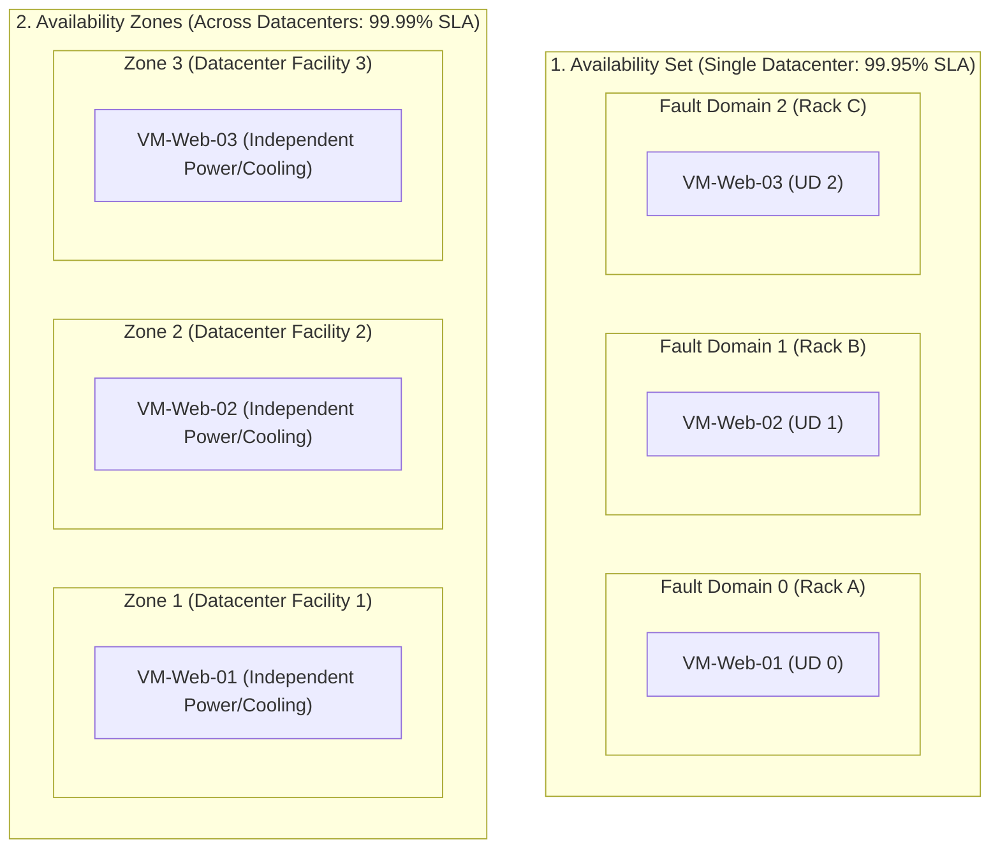
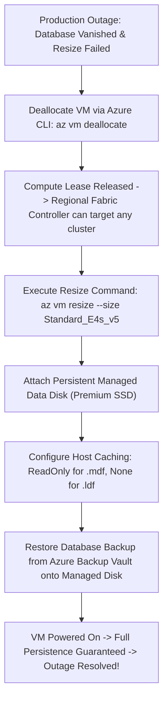

# Module 13-104-09: Administer Azure Virtual Machines, Bastion & Scale Sets

**Breadcrumbs:** [[13-Index - Azure|☁️ Azure Reference MOC]] > [[13-Index - AZ-104|📘 AZ-104 Exam Track]] > **09 - Administer Azure Virtual Machines**

---

## 🎯 Stage 1: Executive Overview & The Conceptual Lecture

### 1. The Zero-Knowledge Starting Point: What is an IaaS Virtual Machine?
In a traditional datacenter, if you needed to run Windows Server 2022 or Ubuntu Linux, you purchased a physical steel server blade (from Dell or HP), mounted it into a 19-inch rack, connected dual power supplies, ran Ethernet cables, and installed an operating system from a bootable USB drive.
* If you needed more CPU power later, you had to physically shut down the server, pop open the chassis, and insert physical CPU chips and RAM sticks.
* If a fan died or a power supply blew up, that specific server halted immediately.

In Microsoft Azure, an **Infrastructure as a Service (IaaS) Virtual Machine** is a virtual slice of a massive physical server blade running inside Microsoft's datacenter:
* Microsoft installs enterprise-grade physical server hardware running the **Azure Hypervisor**.
* When you request a virtual machine, the Azure Resource Manager (ARM) commands the hypervisor to carve out specific virtual CPUs (vCPUs), RAM memory, and virtual network interfaces (vNICs) from the underlying hardware blade.
* **The Shared Responsibility Model in Action:**
  - **Microsoft Manages:** The physical building, cooling, electrical generators, physical motherboard, CPU silicon, RAM chips, hypervisor operating system, and physical fiber networking.
  - **You Manage:** The guest operating system (Windows/Linux), system updates and security patches, user accounts, firewall settings, software runtimes, and application code.

### 2. The Apartment Lease Analogy (IaaS vs. PaaS)
* **IaaS (Virtual Machines):** Renting an unfurnished apartment. The landlord (Microsoft) guarantees the walls, roof, plumbing, and electricity work. However, you must bring your own furniture, paint the walls, lock your own doors, clean the floors, and install your own appliances. If your stove breaks, it is your responsibility to fix it.
* **PaaS (App Services / Serverless):** Staying at a luxury hotel room. You just show up with your clothes (application code). The hotel changes the sheets, cleans the bathroom, and maintains all appliances. You have zero control over the plumbing or building wiring, but you have zero maintenance burden!

### 3. Terminology Matrix: Zero-Knowledge to Enterprise Architect

| Terminology | What It Means to a Beginner | Real-World Analog | Enterprise Architecture Reality |
| :--- | :--- | :--- | :--- |
| **Virtual Machine (VM)** | A software computer running in the cloud. | A virtual partition on a shared physical server. | An ARM compute resource (`Microsoft.Compute/virtualMachines`) allocated vCPUs and RAM by the Azure Hypervisor. |
| **Managed Disk** | A virtual hard drive attached to your VM. | A plug-in external SSD that Azure manages so you don't worry about storage accounts. | An enterprise block-storage volume backed by page blobs with 99.999% availability, isolated across storage clusters. |
| **Temporary Disk (`D:` or `/dev/sdb`)** | A temporary scratch drive that wipes when restarted. | A hotel room dry-erase whiteboard that gets wiped clean every morning. | Physical NVMe SSD storage residing directly on the host server blade; all data is lost upon deallocation or hardware migration! |
| **Availability Set** | Spreading VMs across different power racks in one building. | Placing backup generators on different electrical circuits in the same basement. | A logical grouping of VMs distributed across up to 3 Fault Domains (FD) and 20 Update Domains (UD) within a single datacenter (99.95% SLA). |
| **Availability Zone (AZ)** | Spreading VMs across separate buildings in the same city. | Opening three branch offices across town so an earthquake in one neighborhood doesn't stop business. | Distinct physical datacenter facilities within an Azure region, each with independent power, cooling, and networking (99.99% SLA). |
| **Azure Bastion** | A secure web portal to log into servers without public IPs. | A private guarded airlock hallway leading into a high-security vault. | A fully managed PaaS reverse proxy residing in `AzureBastionSubnet` (`/26`) providing RDP/SSH access over browser TLS 443. |
| **VMSS (Scale Sets)** | An auto-scaling fleet of identical worker VMs. | An automated taxi fleet that dispatches more cars when passenger lines grow long. | A managed pool of identical compute instances that dynamically scales out or in based on CPU/RAM metrics or scheduled rules. |

---

## 🏛️ Stage 2: Core Mental Model & Component Architecture

### 1. VM Sizing Families & Architecture
Selecting the correct VM size ensures you do not overpay for compute power you do not need:

```text
+-------------------------------------------------------------------------------------------------+
|                                 AZURE VM SIZING FAMILIES                                        |
+-------------------------------------------------------------------------------------------------+
|  General Purpose (B-series, D-series)     |  Compute Optimized (F-series)                       |
|  - CPU-to-RAM Ratio: 1:4 (e.g., 2 CPU, 8GB)|  - CPU-to-RAM Ratio: 1:2 (e.g., 4 CPU, 8GB)         |
|  - B-series: Burstable (accumulates CPU   |  - High clock-speed processors                      |
|    credits; ideal for low-traffic web/dev)|  - Workloads: Batch processing, web app servers,    |
|  - D-series: Balanced enterprise baseline |    analytics, game servers                          |
+-------------------------------------------+-----------------------------------------------------+
|  Memory Optimized (E-series, M-series)    |  Storage & GPU Optimized (L-series, N-series)       |
|  - CPU-to-RAM Ratio: 1:8 to 1:28          |  - L-series: High NVMe throughput (NoSQL/Cassandra) |
|  - Massive RAM capacity (up to 12 TiB)    |  - N-series: Dedicated NVIDIA GPU co-processors     |
|  - Workloads: In-memory caches (Redis),   |  - Workloads: AI/ML deep learning model training,   |
|    enterprise SQL Server, SAP HANA        |    3D ray tracing, video rendering pipelines        |
+-------------------------------------------------------------------------------------------------+
```

---

### 2. The 3-Disk Storage Hierarchy of an Azure VM
Every Azure Virtual Machine contains at least two disks, with the ability to attach multiple persistent data disks:

```text
[ Azure Virtual Machine Host Engine ]
       │
       ├──► 1. OS Disk (Persistent Managed Disk)
       │    ├── Contains the Operating System (Windows `C:` or Linux `/dev/sda`)
       │    ├── Backed by remote triple-replicated Azure Storage
       │    └── Default Host Caching: ReadWrite
       │
       ├──► 2. Temporary Disk (Ephemeral Host SSD - Non-Persistent!)
       │    ├── Windows `D:\pagefile.sys` or Linux `/dev/sdb1` swap space
       │    ├── Physical NVMe SSD sitting directly on the server blade hardware
       │    └── DANGER: WIPED CLEAN WHENEVER VM IS STOPPED / DEALLOCATED!
       │
       └──► 3. Data Disks (Persistent Managed Disks - Optional LUN 0 to N)
            ├── Stores databases, logs, web content, application data
            ├── Backed by remote triple-replicated Azure Storage
            └── Configurable Host Caching: None, ReadOnly, or ReadWrite
```

#### Managed Disk Performance Tiers Reference:
* **Standard HDD:** Magnetic spinning platters. Up to 2,000 IOPS / 500 MB/s. Used for backup and non-critical batch jobs.
* **Standard SSD:** Entry-level solid-state storage. Up to 6,000 IOPS / 750 MB/s. Cost-effective for dev/test and light web servers.
* **Premium SSD (v1 & v2):** High-performance solid-state storage. Up to 20,000 to 80,000 IOPS. Mandatory for production enterprise databases.
* **Ultra Disk:** Extreme performance tier. Up to 160,000 IOPS and 4,000 MB/s with sub-millisecond latency. Supports dynamic IOPS/throughput tuning on-the-fly without rebooting!

---

### 3. High Availability: Availability Sets vs. Availability Zones
To prevent application outages caused by hardware failures or Microsoft maintenance, Azure provides two distinct physical placement models:



#### Fault Domains vs. Update Domains:
1. **Fault Domains (FD):** Physical hardware racks sharing a single power supply unit (PSU) and Top-of-Rack network switch. An Availability Set supports up to **3 Fault Domains** (FD 0, 1, 2). If a power supply blows, only 1 fault domain loses power.
2. **Update Domains (UD):** Logical groupings of virtual machines that are rebooted together during planned Azure platform host maintenance. An Availability Set supports up to **20 Update Domains**. Only one update domain is rebooted at a time, keeping at least 80–95% of your application capacity running!

#### Availability Sets vs. Zones Architectural Matrix:

| Dimension | Availability Sets | Availability Zones |
| :--- | :--- | :--- |
| **Physical Scope** | Multiple server racks within **one single datacenter** | Multiple **distinct physical datacenters** in a region |
| **Failure Protection** | Rack power supply failure, switch failure, server blade crash | Complete datacenter facility loss (flood, fire, substation power loss) |
| **High Availability SLA** | **99.95%** (for 2+ VMs in the set) | **99.99%** (for 2+ VMs across zones) |
| **Configuration Timing** | Must be selected **during VM creation** (cannot add VM later!) | Must be selected **during VM creation** |

---

## 🏢 Stage 3: Deep-Intuition Platform Mechanics & Topology

### 1. VM States: Stopped vs. Stopped (Deallocated) (High-Yield Concept!)
One of the most common billing traps in Azure computing is misunderstanding the two different "stopped" states of a virtual machine:

```text
State 1: Stopped (Guest OS Shutdown)
├── Triggered By: Running 'shutdown -h now' inside Linux or Windows Start -> Shut down
├── Hypervisor Action: OS halts, but hardware vCPUs and RAM remain RESERVED on the physical blade!
└── Billing Impact: YOU ARE STILL BILLED FOR FULL COMPUTE CORES AND RAM! (No cost savings!)

State 2: Stopped (Deallocated) (Cloud Fabric Shutdown)
├── Triggered By: Clicking 'Stop' in Azure Portal, or running 'az vm deallocate'
├── Hypervisor Action: Fabric Controller releases hardware lease; CPU and RAM freed back to pool
└── Billing Impact: COMPUTE BILLING DROPS TO $0.00! (You only pay for attached disk storage).
```

---

### 2. The VM Resizing Mechanics & The `AllocationFailed` Error
When you resize a virtual machine (e.g., from `Standard_B2s` to `Standard_D4s_v5`):
* If the VM is currently **Running**, Azure attempts to resize the VM *in-place on the same physical server blade cluster*.
* If that physical server blade cluster does not have enough unallocated RAM or does not support the new hardware family (e.g., jumping from an older Intel cluster to a newer AMD EPYC cluster), ARM immediately aborts with:
  `AllocationFailed: Allocation failed. We do not have sufficient capacity for the requested VM size in this region or cluster.`
* **The Solution:** You must first **Deallocate** the VM (`az vm deallocate`). Once deallocated, Azure's regional fabric controller is free to allocate the VM onto *any physical hardware cluster in the entire datacenter* that supports the target VM size!

---

### 3. Managed Disk Host Caching Mechanics (Database Integrity Law)
When data is written to a Managed Disk, the Azure Hypervisor on the host server blade provides an in-memory and local SSD cache:

```text
[ Application Write: INSERT INTO Orders VALUES (...) ]
                       │
                       ▼
            [ Host Hypervisor Cache ]
                       │
       ┌───────────────┴───────────────┐
       ▼                               ▼
[ ReadWrite Caching ]          [ None (No Caching) ]
- Writes acked in Host RAM     - Write passes through host cache directly
- Flushed to disk later        - Acked ONLY when committed to triple-replicated disk
- DANGER: If host loses power, - Zero data loss risk during unexpected crash!
  unwritten blocks are lost!   - MANDATORY FOR SQL TRANSACTION LOGS (.ldf)!
```

#### Host Caching Rules of Thumb:
* **`ReadWrite` (Default):** Ideal for OS disks. Speeds up general OS boot times and application loading.
* **`ReadOnly`:** Reads are cached in fast host RAM; writes pass through directly to disk. **Recommended for SQL Server data files (`.mdf`)** and static read-heavy files.
* **`None` (No Caching):** Bypasses host cache completely. **Mandatory for database transaction logs (SQL `.ldf`, Oracle redo logs)** to prevent database corruption during unexpected physical host crashes!

---

### 4. Azure Bastion Architecture: Zero Public IP Management
Exposing SSH port 22 or RDP port 3389 directly to the public internet using Public IPs is an extreme security vulnerability—automated botnets scan the internet and attack open ports with brute-force dictionary exploits within seconds.

**Azure Bastion** eliminates public IPs from virtual machines entirely:

```text
[ Administrator Browser ]
        │ HTTPS over Port 443 (TLS Encrypted WebRTC Session)
        ▼
[ AzureBastionSubnet (/26) inside your Virtual Network ]
  ├── Azure Bastion Host (Managed PaaS Cluster)
  └── Communicates internally over private SDN IP:
        ├── Private RDP (Port 3389) ──► [ Target Windows VM: 10.90.1.4 ] (NO Public IP!)
        └── Private SSH (Port 22)   ──► [ Target Linux VM: 10.90.1.5 ]   (NO Public IP!)
```

#### Mandatory Azure Bastion Requirements:
* Must reside in a dedicated subnet named strictly **`AzureBastionSubnet`**.
* The subnet prefix must be **`/26` or larger** (`/26`, `/25`, `/24`) to support autoscale proxy instances.
* Cannot contain any other resources (no VMs, no load balancers).
* Does not support User-Defined Routes (UDRs) redirecting traffic to firewalls.

---

## ⚙️ Stage 4: Declarative & Automation Engine (CLI & PowerShell Core)

### 1. Azure CLI: Complete VM Provisioning with Managed Disks & Caching

```bash
# ==============================================================================
# 1. CREATE VIRTUAL MACHINE IN AVAILABILITY ZONE 1 WITH MANAGED IDENTITY
# ==============================================================================
az vm create \
  --resource-group "rg-compute-lab" \
  --name "vm-app-node01" \
  --image "Ubuntu2204" \
  --size "Standard_D2s_v5" \
  --zone 1 \
  --admin-username "azureadmin" \
  --generate-ssh-keys \
  --vnet-name "vnet-compute-prod" \
  --subnet "snet-workload" \
  --public-ip-address "" \
  --assign-identity \
  --output json

# ==============================================================================
# 2. ATTACH DATA DISKS WITH SPECIALIZED HOST CACHING RULES
# ==============================================================================

# Attach Analytical Data Disk (ReadOnly Caching - LUN 0)
az vm disk attach \
  --resource-group "rg-compute-lab" \
  --vm-name "vm-app-node01" \
  --name "disk-app-data" \
  --size-gb 256 \
  --sku "Premium_LRS" \
  --caching "ReadOnly" \
  --lun 0 \
  --new

# Attach Transactional Database Log Disk (None Caching - LUN 1)
az vm disk attach \
  --resource-group "rg-compute-lab" \
  --vm-name "vm-app-node01" \
  --name "disk-app-wal-log" \
  --size-gb 128 \
  --sku "Premium_LRS" \
  --caching "None" \
  --lun 1 \
  --new
```

### 2. Azure CLI: Deploy Virtual Machine Scale Set (VMSS) with Autoscale

```bash
# ==============================================================================
# 3. CREATE MULTI-ZONE VIRTUAL MACHINE SCALE SET (VMSS)
# ==============================================================================
az vmss create \
  --resource-group "rg-compute-lab" \
  --name "vmss-web-fleet" \
  --image "Ubuntu2204" \
  --vm-sku "Standard_B2s" \
  --instance-count 2 \
  --zones 1 2 3 \
  --vnet-name "vnet-compute-prod" \
  --subnet "snet-workload" \
  --load-balancer "lb-web-prod" \
  --backend-pool-name "be-web-pool" \
  --admin-username "azureadmin" \
  --generate-ssh-keys \
  --orchestration-mode "Flexible"

# ==============================================================================
# 4. CONFIGURE METRIC-BASED AUTOSCALE RULES (CPU > 75%)
# ==============================================================================
az monitor autoscale create \
  --resource-group "rg-compute-lab" \
  --resource "vmss-web-fleet" \
  --resource-type "Microsoft.Compute/virtualMachineScaleSets" \
  --name "autoscale-cpu-rules" \
  --min-count 2 \
  --max-count 10 \
  --count 2

# Scale Out Rule: Add 2 instances if Average CPU > 75% for 5 minutes
az monitor autoscale rule create \
  --resource-group "rg-compute-lab" \
  --autoscale-name "autoscale-cpu-rules" \
  --condition "Percentage CPU > 75 avg 5m" \
  --scale out 2

# Scale In Rule: Remove 1 instance if Average CPU < 25% for 5 minutes
az monitor autoscale rule create \
  --resource-group "rg-compute-lab" \
  --autoscale-name "autoscale-cpu-rules" \
  --condition "Percentage CPU < 25 avg 5m" \
  --scale in 1
```

---

## 🖥️ Stage 5: Step-by-Step Azure Portal GUI Walkthrough

Follow these exact navigation steps in the **Azure Portal** (`https://portal.azure.com`) to master compute administration:

### Task 1: Provisioning a Virtual Machine in an Availability Zone
1. In the top search bar, type **Virtual machines** and select it.
2. Click **+ Create** $\rightarrow$ **Azure virtual machine**:
   - **Resource group:** `rg-compute-lab`.
   - **Virtual machine name:** `vm-app-node01`.
   - **Region:** `East US`.
   - **Availability options:** Select **Availability zones**.
   - **Availability zone:** Select **Zone 1**.
   - **Security type:** *Standard* (or Trusted launch).
   - **Image:** Select *Ubuntu Server 22.04 LTS - x64 Gen2*.
   - **Size:** Select *Standard_D2s_v5* (2 vCPUs, 8 GiB memory).
3. Under **Administrator account**:
   - **Authentication type:** Select **SSH public key**.
   - **Username:** `azureadmin`.
   - **SSH public key source:** *Generate new key pair*.
4. In the **Disks** tab:
   - **OS disk type:** Select **Premium SSD (locally-redundant storage)**.
   - Under *Data disks*, click **Create and attach a new disk**:
     - *Name:* `disk-app-data`.
     - *Size:* `256 GiB`.
     - *Host caching:* Change dropdown from Read/Write to **Read-only**!
     - Click **OK**.
5. In the **Networking** tab:
   - **Virtual network:** Select `vnet-compute-prod`.
   - **Subnet:** Select `snet-workload`.
   - **Public IP:** Select **None** (Security best practice: No public IP!).
6. In the **Management** tab:
   - Check **Enable system-assigned managed identity**.
7. Click **Review + create** $\rightarrow$ **Create**. Download your private key pair (`.pem`).

### Task 2: Deploying Azure Bastion in the Portal
1. In the top search bar, type **Bastions** and select it.
2. Click **+ Create**:
   - **Resource group:** `rg-compute-lab`.
   - **Name:** `bastion-core`.
   - **Region:** `East US`.
   - **Tier:** Select **Basic** (or Standard).
   - **Virtual network:** Select `vnet-compute-prod`.
   - Under *Subnet*, verify that `AzureBastionSubnet` (`10.90.10.0/26`) is selected.
   - **Public IP:** Create new public IP named `pip-bastion`.
3. Click **Review + create** $\rightarrow$ **Create**.
4. Once deployed, open your private VM `vm-app-node01`:
   - Click **Connect** on the top toolbar $\rightarrow$ select **Connect via Bastion**.
   - Enter username `azureadmin` and upload your downloaded `.pem` private key.
   - Click **Connect**. A full interactive SSH terminal opens directly inside your web browser over secure HTTPS port 443!

### Task 3: Creating a Virtual Machine Scale Set (VMSS)
1. In the top search bar, type **Virtual machine scale sets** and select it.
2. Click **+ Create**:
   - **Resource group:** `rg-compute-lab`.
   - **Virtual machine scale set name:** `vmss-web-fleet`.
   - **Region:** `East US`.
   - **Orchestration mode:** Select **Flexible**.
   - **Availability zones:** Check **Zone 1**, **Zone 2**, and **Zone 3**.
   - **Image:** *Ubuntu Server 22.04 LTS*.
   - **Size:** *Standard_B2s*.
3. In the **Scaling** tab:
   - **Initial instance count:** `2`.
   - **Scaling policy:** Select **Custom**.
   - *Minimum number of VMs:* `2`.
   - *Maximum number of VMs:* `10`.
   - *Scale out metric:* CPU threshold `75%` for `5` minutes $\rightarrow$ increase by `2`.
   - *Scale in metric:* CPU threshold `25%` for `5` minutes $\rightarrow$ decrease by `1`.
4. Click **Review + create** $\rightarrow$ **Create**.

---

## 🔬 Stage 6: Hands-On Enterprise Lab Bridge

To implement this full multi-zone compute topology, configure managed disk caching, and manage instances through Azure Bastion, proceed directly to the comprehensive practical lab:

> [!TIP]
> **Practical Implementation Companion:**
> Access the comprehensive engineering lab at:
> **[[Lab-09_VM_Resilience_Managed_Disks_Bastion_and_VMSS|Lab 09: Enterprise Virtual Machines, Managed Disks, Azure Bastion & VMSS Autoscaling]]**
> 
> *Target Lab File:* `Projects/AZ-104/09_Virtual_Machines_and_Scale_Sets/Lab-09_VM_Resilience_Managed_Disks_Bastion_and_VMSS.md`

### Lab Objectives Matrix:

```text
+-----------------------------------------------------------------------------------------+
| Lab 09 Enterprise Milestone Goals                                                       |
+-----------------------------------------------------------------------------------------+
| 1. Deploy multi-zone IaaS virtual machines pinned across Availability Zones (Zone 1, 2) |
| 2. Attach Managed Disks with specialized ReadOnly and None host-caching configurations  |
| 3. Deploy Azure Bastion inside dedicated /26 subnet and establish browser-based SSH    |
| 4. Engineer a Virtual Machine Scale Set (VMSS) with Flexible Orchestration              |
| 5. Configure metric-based CPU autoscale rules and inspect instance scale-in policies    |
+-----------------------------------------------------------------------------------------+
```

---

## ⚠️ Stage 7: "See It in Action" Real-World Failure & Recovery Loop (AARF)

### Scenario: The "Temporary Disk Data Loss & Resizing Lock" Outage

#### 1. The Architectural Setup & Assumptions
An administrator deploys an Azure Virtual Machine running SQL Server 2022 to host a critical internal reporting database. During installation, the administrator notices drive `D:` is labeled as a fast physical SSD with 64 GB of free space. To achieve high disk I/O, the administrator places the database data files (`.mdf`) and backup archives onto drive `D:`.

#### 2. The Production Failure Manifestation
A month later, reporting queries begin running slowly during peak hours. The administrator decides to upgrade the VM from `Standard_B2s` (2 vCPUs, 4 GB RAM) to `Standard_E4s_v5` (4 vCPUs, 32 GB RAM). 
The administrator navigates to the portal while the VM is running and clicks *Resize*:
```text
Failed to resize virtual machine 'vm-sql-prod'.
Error: AllocationFailed
Allocation failed. We do not have sufficient capacity for the requested VM size in this region or cluster.
```
Frustrated, the administrator runs `shutdown -h now` inside the VM, starts it back up, and discovers: **The entire database has vanished! Drive `D:` is completely empty except for a file named `DATALOSS_WARNING_README.txt`!**

#### 3. Root Cause Analysis (RCA) & Deep Investigation
Why did this catastrophic double failure occur?
1. **The Temporary Disk Disaster:** Drive `D:` on Windows (or `/dev/sdb1` on Linux) is the **Temporary Ephemeral Disk**. It is physical NVMe storage on the server blade host hardware designed strictly for pagefile swap space. **Azure explicitly wipes this drive clean** whenever a VM is stopped (deallocated), restarted onto another host, or migrated during hardware servicing!
2. **The Allocation Lock:** The VM was running on an older physical blade cluster that did not physically host E-series hardware blades. Because the VM was running, ARM was restricted to searching only that specific blade cluster.
3. **The Guest Shutdown Mistake:** Running `shutdown` from inside the OS transitioned the VM to **Stopped**, but NOT **Stopped (Deallocated)**. Compute cores remained locked to the old blade cluster, continuing the allocation lock!

#### 4. Remediation & Diagnostic Verification Loop



```bash
# Diagnostic & Remediation Script (Azure CLI)

# 1. Properly deallocate the VM to break cluster pinning
az vm deallocate \
  --resource-group "rg-compute-lab" \
  --name "vm-sql-prod"

# 2. Resize the deallocated VM to the target memory-optimized SKU
az vm resize \
  --resource-group "rg-compute-lab" \
  --name "vm-sql-prod" \
  --size "Standard_E4s_v5"

# 3. Attach a persistent Managed Disk (Never use Temporary Drive D: for real data!)
az vm disk attach \
  --resource-group "rg-compute-lab" \
  --vm-name "vm-sql-prod" \
  --name "disk-sql-persistent-data" \
  --size-gb 256 \
  --sku "Premium_LRS" \
  --caching "ReadOnly" \
  --new

# 4. Start the VM
az vm start \
  --resource-group "rg-compute-lab" \
  --name "vm-sql-prod"
```

---

## 💡 Stage 8: High-Yield AZ-104 Exam Scenarios & Trick Question Traps

### Trick Question Trap 1: The Ephemeral Temporary Disk (`D:`) Trap
* **The Scenario:** A developer installs an application on an Azure VM and stores uploaded customer images on drive `D:`. That evening, the administrator resizes the VM to a larger SKU. The developer logs in the next day and reports all uploaded images are gone.
* **The Trap:** Did an attacker hack the server? Did the disk corrupt?
* **The Ground Truth:** Drive `D:` is the **Temporary Disk**! It is ephemeral host storage. Any data written to drive `D:` is **permanently destroyed** when the VM is deallocated or moved to another physical host blade. Always store application data on attached **Managed Data Disks**!

### Trick Question Trap 2: Adding Existing VMs to an Availability Set
* **The Scenario:** A company deploys a standalone production VM. Later, management requests adding this VM to an existing Availability Set named `as-prod-web` to improve SLA.
* **The Trap:** The administrator searches the portal for a button to add the VM to the set.
* **The Ground Truth:** **You CANNOT add an existing VM to an Availability Set!** A VM can only be placed into an Availability Set **during VM creation**. To move an existing VM into an Availability Set, you must delete the VM (retaining its OS disk) and recreate the VM from the OS disk while specifying the Availability Set.

### Trick Question Trap 3: Stopped vs. Stopped (Deallocated) Billing
* **The Scenario:** An administrator wants to save money on a test VM over the weekend. They log into Windows and click *Start $\rightarrow$ Shut down*. On Monday, the finance team notices the company was still billed 100% of the compute costs for the weekend.
* **The Trap:** Why did shutting down the OS fail to stop billing?
* **The Ground Truth:** Shutting down from within the OS changes the state to **Stopped**. Azure continues reserving the physical CPU cores and RAM on the blade, so compute billing continues! To stop compute charges, the administrator must stop the VM from the **Azure Portal, CLI, or PowerShell (`az vm deallocate`)**, transitioning the state to **Stopped (Deallocated)**.

### Trick Question Trap 4: Azure Bastion Subnet Sizing Constraint
* **The Scenario:** An administrator creates a subnet named `AzureBastionSubnet` with CIDR `10.0.10.0/28` (16 total addresses). When they attempt to deploy Azure Bastion into this subnet, the deployment fails.
* **The Trap:** Why does Bastion fail on a `/28` subnet?
* **The Ground Truth:** Azure Bastion requires a **dedicated subnet sized at minimum `/26`** (64 addresses) or larger (`/25`, `/24`). A `/27` or `/28` subnet does not have sufficient IP space to support Bastion's autoscale instance pool!

---

## 🌐 Authoritative References & Inflow Citations

* **Udemy AZ-104 Master Class by Scott Duffy:** [Inflow: Module 05 - Virtual Machines and VMSS](file:///F:/Dump%20one/BrainDump/inflow/AZ-104-ScottDuffy/05_Administer_Azure_Virtual_Machines_and_VMSS.md)
* **John Savill’s Azure Master Class & Deep Dives:** VM Sizing and Sizing Constraints, Host Disk Caching Mechanics, Availability Sets vs. Availability Zones, and Elastic SAN.
* **Moe Intelligence AZ-104 Video Curriculum:** Lessons 28 through 29 (Virtual Machines, Managed Disks, Availability Sets, Scale Sets).
* **KodeKloud AZ-104 Course:** [Administer Azure Virtual Machines Module](https://notes.kodekloud.com/docs/Updated-AZ-104-Microsoft-Azure-Administrator/Administer-Azure-Virtual-Machines/Module-Introduction/page.md)
* **Official Microsoft Learn Documentation:**
  - [Sizes for virtual machines in Azure](https://learn.microsoft.com/en-us/azure/virtual-machines/sizes)
  - [Azure Managed Disks overview](https://learn.microsoft.com/en-us/azure/virtual-machines/managed-disks-overview)
  - [Availability options for Azure Virtual Machines](https://learn.microsoft.com/en-us/azure/virtual-machines/availability)
  - [What is Azure Bastion?](https://learn.microsoft.com/en-us/azure/bastion/bastion-overview)
  - [What are virtual machine scale sets?](https://learn.microsoft.com/en-us/azure/virtual-machine-scale-sets/overview)