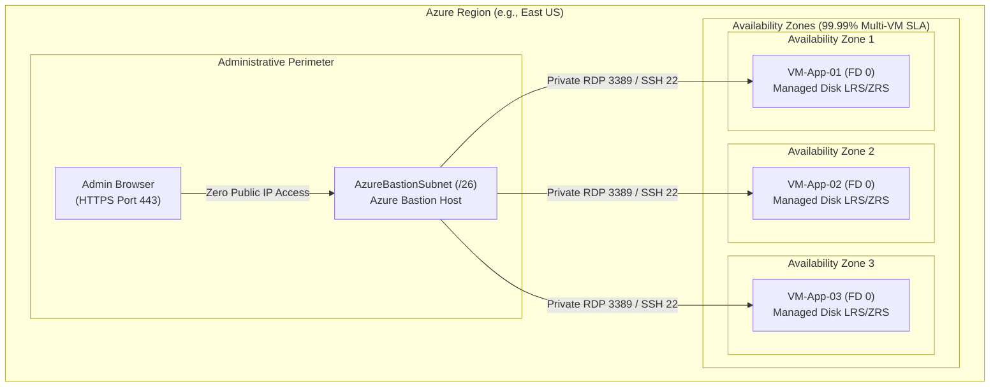
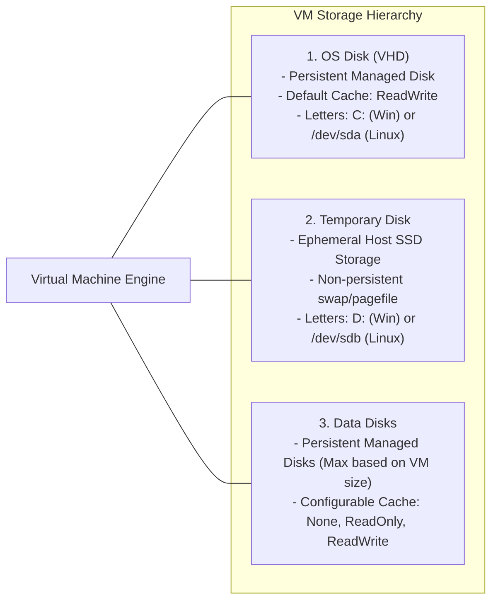
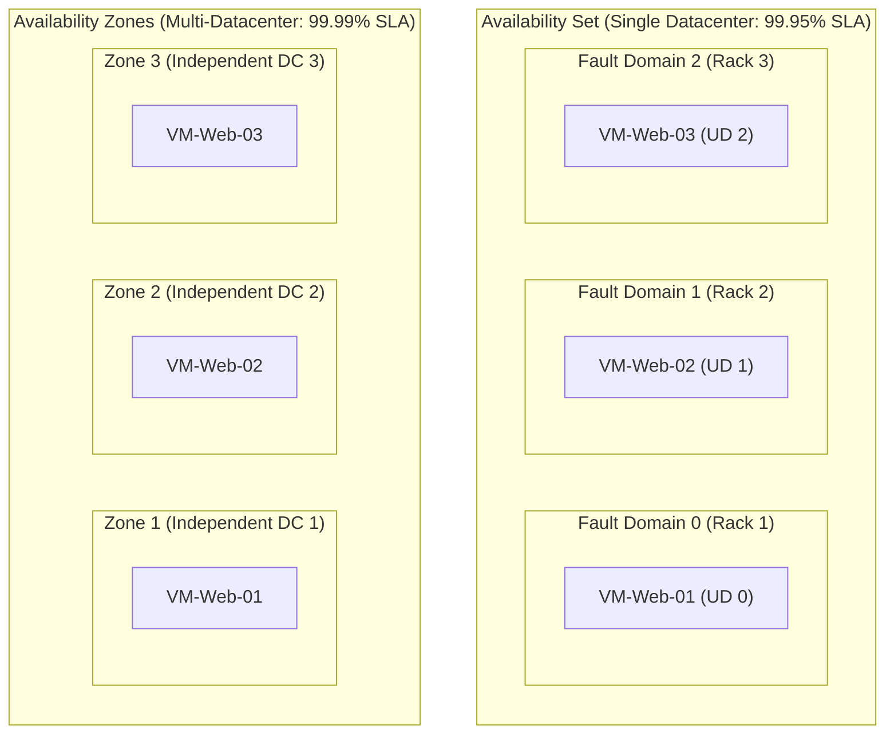
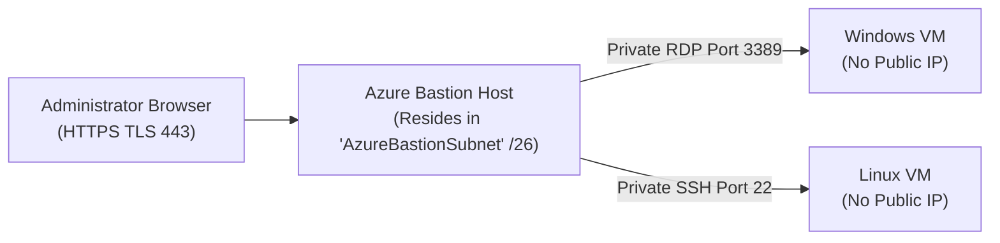
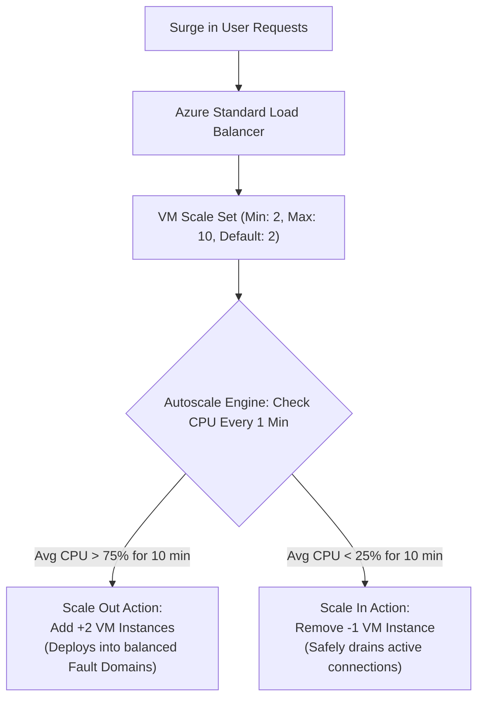
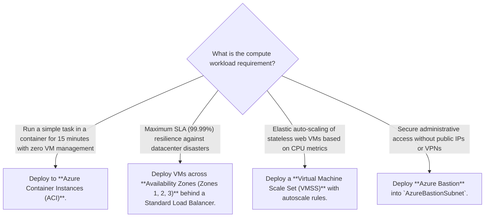
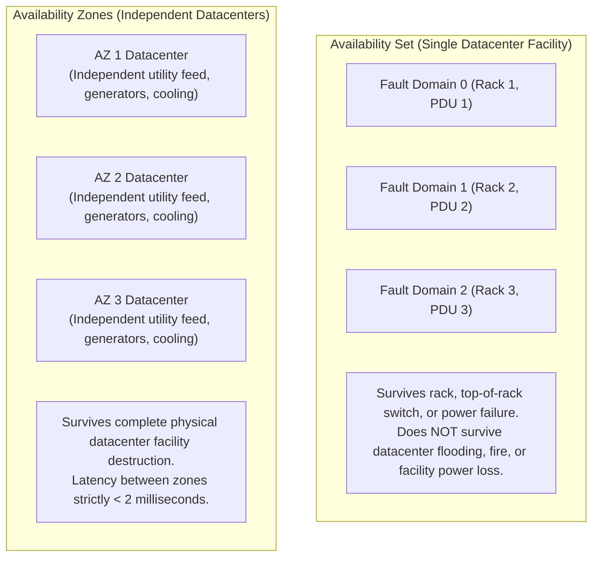
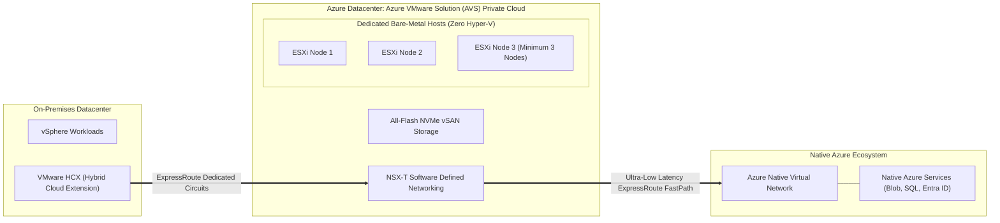

# Module 13-104-09: Administer Azure Virtual Machines, Bastion & Scale Sets

**Breadcrumbs:** [[13-Index - Azure|☁️ Azure Reference MOC]] > [[13-Index - AZ-104|📘 AZ-104 Exam Track]] > **09 - Administer Azure Virtual Machines**

---

## 🎯 Executive Overview & IaaS Compute Architecture

Azure Virtual Machines (VMs) provide on-demand, scalable Infrastructure as a Service (IaaS) compute resources. In the cloud shared responsibility model, Microsoft manages the physical hardware, hypervisors, and datacenter infrastructure, while the enterprise administrator retains responsibility for operating system configuration, patch management, network interface bindings, disk encryption, and application software.



---

## 🖥️ VM Sizing & Workload Families

Selecting the appropriate VM size balances computational throughput, memory capacity, IOPS limits, and cost:

| Family | Series Identifiers | CPU to Memory Ratio | Optimized Workloads |
| :--- | :--- | :---: | :--- |
| **General Purpose** | **B-series** (burstable), **D-series** (Dsv5) | Balanced (1:4) | Web servers, small-to-medium databases, dev/test environments. |
| **Compute Optimized** | **F-series** (Fsv2) | High CPU (1:2) | Batch processing, web application servers, game servers. |
| **Memory Optimized** | **E-series** (Esv5), **M-series** | High Memory (1:8 to 1:28)| In-memory caches (Redis), enterprise SQL/SAP HANA databases. |
| **Storage Optimized** | **L-series** (Lsv3) | High Disk I/O | Big Data analytics, NoSQL engines (Cassandra, MongoDB). |
| **GPU Accelerated** | **N-series** (NC, NV, ND) | GPU Co-processors | AI/ML model training, 3D rendering, video encoding. |
| **Confidential Compute**| **DC-series**, **EC-series** | Hardware Enclaves (AMD SEV-SNP / Intel SGX) | Financial fraud detection, sensitive medical data processing. |

---

## 💾 Virtual Machine Storage & Disk Types

Every Azure VM contains at least an **OS disk** and a local **Temporary disk**, with the ability to attach multiple **Data disks**:



> [!CAUTION]
> **Temporary Disk Data Loss:** The temporary disk (`D:` on Windows, `/dev/sdb` on Linux) resides on the physical host machine hardware. **Any data stored on the temporary disk is permanently lost** when the VM is stopped (deallocated), restarted onto another host, or serviced during hardware maintenance. Never store application databases or user files on the temporary drive.

### Managed Disk Performance Tiers

| Disk Tier | Max Disk Size | Max IOPS | Max Throughput | Typical Production Workloads |
| :--- | :---: | :---: | :---: | :--- |
| **Standard HDD** | 32 TiB | 2,000 IOPS | 500 MB/s | Backup, non-critical batch jobs, infrequent access. |
| **Standard SSD** | 32 TiB | 6,000 IOPS | 750 MB/s | Web servers, lightly used enterprise apps, dev/test. |
| **Premium SSD (v1/v2)**| 32 TiB | 20,000 / 80,000 IOPS| 900 / 1,200 MB/s | Production databases, high-transaction enterprise apps. |
| **Ultra Disk** | 64 TiB | **160,000 IOPS** | **4,000 MB/s** | Extremely demanding I/O workloads (SAP HANA, Oracle). Dynamic IOPS scaling without reboot. |

---

## 🏰 High Availability: Availability Sets vs. Availability Zones

Azure provides two primary high-availability architectures to protect workloads against physical failures:



### Fault Domains vs. Update Domains
1. **Fault Domains (FD):** Physical server racks sharing common power sources and network switches. An Availability Set supports up to **3 Fault Domains** (FD 0, 1, 2).
2. **Update Domains (UD):** Logical groups of virtual machines that are rebooted together during planned Azure platform maintenance. An Availability Set supports up to **20 Update Domains**. Only one update domain is rebooted at a time, ensuring at least 80–95% of capacity remains online.

| HA Architecture | Scope of Isolation | Resiliency Level | SLA for 2+ VMs |
| :--- | :--- | :--- | :---: |
| **Single VM (Premium SSD)**| Single Host Server | Hardware failure on host causes automatic migration. | 99.9% |
| **Availability Set** | Single Datacenter (Across racks) | Protects against power, rack, and top-of-rack switch failures. | **99.95%** |
| **Availability Zones** | Across Datacenters within Region | Protects against complete datacenter facility outages (flood, power). | **99.99%** |

---

## 🛡️ Secure Remote Access: Azure Bastion

Azure Bastion is a fully platform-managed PaaS reverse proxy that provides secure, seamless RDP and SSH connectivity to virtual machines directly through the Azure Portal over **TLS port 443**, without exposing public IP addresses on target VMs:



### Architectural Requirements for Azure Bastion
- Must be deployed into a dedicated subnet named exactly **`AzureBastionSubnet`**.
- Subnet mask must be at least **`/26`** (e.g., `10.0.100.0/26`) to accommodate Bastion autoscale host instances.
- Cannot place any other resources (VMs, gateways) inside `AzureBastionSubnet`.
- NSG on `AzureBastionSubnet` must permit inbound HTTPS (port 443) from `Internet` and outbound RDP/SSH (ports 3389/22) to `VirtualNetwork`.

---

## 📈 Virtual Machine Scale Sets (VMSS) & Autoscaling

Virtual Machine Scale Sets deploy and manage a group of identical, load-balanced virtual machines that automatically scale in or out based on demand or scheduled rules:



### Orchestration Modes
1. **Uniform (Classic):** Optimized for large-scale, stateless workloads with identical VM instances deployed from a single golden image.
2. **Flexible:** High-availability orchestration that allows mixing different VM sizes, spot/on-demand instances, and manual VM additions across availability zones.

---

## 🛠️ Contextual Proof of Concept: CLI & PowerShell Recipes

### 1. Azure CLI: Deploy Linux VM with SSH Key, Custom Script Extension & NSG

```bash
# 1. Create a Linux Virtual Machine in an Availability Zone with SSH key generation
az vm create \
  --resource-group "rg-enterprise-core" \
  --name "vm-web-prod-01" \
  --image "Ubuntu2204" \
  --size "Standard_D2s_v5" \
  --zone 1 \
  --admin-username "azureadmin" \
  --generate-ssh-keys \
  --vnet-name "vnet-enterprise" \
  --subnet "snet-web" \
  --public-ip-address "" \
  --nsg "nsg-backend"

# 2. Attach a 128 GB Premium SSD Data Disk with ReadOnly caching
az vm disk attach \
  --resource-group "rg-enterprise-core" \
  --vm-name "vm-web-prod-01" \
  --name "disk-web-data-01" \
  --size-gb 128 \
  --sku "Premium_LRS" \
  --caching "ReadOnly" \
  --new

# 3. Deploy Custom Script Extension to install Nginx
az vm extension set \
  --resource-group "rg-enterprise-core" \
  --vm-name "vm-web-prod-01" \
  --name "customScript" \
  --publisher "Microsoft.Azure.Extensions" \
  --settings '{"commandToExecute": "apt-get update && apt-get install -y nginx"}'
```

### 2. Azure CLI: Deploy Virtual Machine Scale Set (VMSS)

```bash
# Deploy a multi-zone VM Scale Set with autoscale capabilities
az vmss create \
  --resource-group "rg-enterprise-core" \
  --name "vmss-web-cluster" \
  --image "Ubuntu2204" \
  --vm-sku "Standard_B2s" \
  --instance-count 2 \
  --zones 1 2 3 \
  --vnet-name "vnet-enterprise" \
  --subnet "snet-web" \
  --load-balancer "lb-web-prod" \
  --backend-pool-name "be-web-pool" \
  --admin-username "azureadmin" \
  --generate-ssh-keys \
  --upgrade-policy-mode "Automatic"
```

---

## 🔍 Deep-Intuition AARF Framework

### Scenario: Diagnosing VM Allocation Failure During Sizing Reconfiguration

- **The Answer (Core Configuration):** Stop and deallocate the virtual machine (`az vm deallocate --resource-group "rg-core" --name "vm-app"`) before modifying its size to a new hardware family, or select a VM size available within the current physical cluster hardware cluster.
- **The Assumptions (Prerequisites):** 
  - Operator executes `az vm resize --size "Standard_M128s"` while the VM is in the `Running` state.
- **The Rationale (Why):** When a VM is running, its hardware execution context is pinned to a specific physical server blade and cluster in the datacenter. Some specialized VM sizes (such as M-series memory-optimized or N-series GPU hosts) exist only on dedicated physical hardware clusters. Resizing a running VM requires the new size to be supported by the *same physical blade cluster*.
- **The Failure Loop (What if misconfigured):**
  - *Symptom:* The resize operation fails with an allocation error.
  - *Exact Error Message:* `AllocationFailed: Allocation failed. We do not have sufficient capacity for the requested VM size in this region or cluster. Try resizing after stopping (deallocating) the VM.`
- **The Alternative Case (When to use 'if not'):** If the VM is deallocated, Azure releases its lease on the physical blade. Resizing the deallocated VM allows Azure's regional fabric controller to allocate the VM onto any physical hardware cluster in the datacenter capable of hosting that size.

---

## 💡 AZ-104 Exam Tips & Gotchas

> [!TIP]
> **Stopped vs. Stopped (Deallocated):**
> - If an administrator shuts down a Windows/Linux VM from *inside the guest OS* (`shutdown -h now` or Windows Start -> Shut down), the VM status is **Stopped**. **You are still billed for compute cores and RAM** because hardware resources remain reserved on the physical blade.
> - To completely stop billing for compute, you must stop the VM from the Azure Portal, CLI, or PowerShell (`az vm deallocate`), transitioning the status to **Stopped (Deallocated)**. Only disk storage costs apply while deallocated.

> [!WARNING]
> **Availability Set Placement Rule:**
> - A virtual machine can ONLY be placed into an Availability Set **during VM creation**.
> - You **cannot add an existing virtual machine to an Availability Set** after deployment without deleting and recreating the VM from its OS disk.

---

## 🏛️ Enterprise Compute Architecture: Sizing, Caching & High Availability

### 1. Compute Paradigm Selection: VMs vs. Containers vs. ACI
- **Architectural Trade-offs:**
  - *Virtual Machines (IaaS):* Full OS abstraction with dedicated kernel space. Ideal for legacy monolithic applications, workloads requiring custom kernel drivers, or Windows Desktop services. Slower provisioning (1–5 minutes) and higher maintenance overhead (OS patching, antivirus, backups).
  - *Azure Container Instances (ACI):* Serverless container execution. Spins up individual OCI/Docker containers on demand in seconds without managing VMs or Kubernetes clusters. Billed per second of vCPU/RAM allocation.
  - *Azure Container Apps (ACA) / AKS:* Microservice orchestration with automated KEDA scaling, Envoy ingress, and revision management.
- **Decision Matrix:**
  - Short-lived batch jobs or event-driven tasks $\rightarrow$ **Azure Container Instances (ACI)**.
  - Monolithic services with custom OS configurations $\rightarrow$ **Azure Virtual Machines**.
  - Scalable containerized microservice architectures $\rightarrow$ **Azure Container Apps (ACA)**.

### 2. VM Disk Storage Architecture & Host Caching Rules
- **The Ephemeral Temporary Disk (`D:` in Windows, `/dev/sdb` in Linux):**
  - High-speed physical NVMe SSD located directly on the hypervisor host blade.
  - *Critical Architectural Trap:* Designed strictly for pagefile/swap space. **All data on this disk is permanently destroyed** whenever the VM is deallocated, restarted, or live-migrated to another host blade during Azure hardware servicing.
- **Host Disk Caching Guidelines:**
  - *Read/Write Caching:* Default for OS disks; caches reads and writes in host blade RAM for high throughput.
  - *ReadOnly Caching:* Recommended for high-read data disks (e.g., database read-replicas, reporting stores).
  - *None (No Caching):* Mandatory best practice for transactional write workloads (e.g., SQL Server transaction logs `.ldf` and data files `.mdf`) to eliminate write-cache writeback loss during unexpected host crashes.

### 3. High Availability Architecture: Availability Sets vs. Availability Zones

| Dimension | Availability Sets | Availability Zones |
| :--- | :--- | :--- |
| **Physical Isolation** | Distinct racks, power supplies, and network switches within **one datacenter** | Distinct physical datacenters with independent cooling and power within **one region** |
| **Fault Tolerance** | Fault Domains (FD: up to 3) & Update Domains (UD: up to 20) | Zonal isolation (Zones 1, 2, 3) |
| **Availability SLA** | **99.95%** (for 2+ VMs in the set) | **99.99%** (for 2+ VMs across zones) |
| **Configuration Timing** | Must be chosen **at VM creation** (cannot add VM later) | Must be chosen **at VM creation** |
| **Disk Constraint** | Requires Managed Disks aligned to the set | Managed Disks automatically pinned to target zone |

---

## 💡 Compute Architecture Decision Tree & Articulation Guide



---

---

## 🏛️ Deep-Dive Compute Resiliency & Hypervisor Mechanics (John Savill Master Class Insights)

### 1. Azure Hypervisor Virtualization & Disk Caching
John Savill explores the virtualization layer running on Azure host blades:
- **Host Caching Architecture:**
  - *Read/Write Cache:* Uses host RAM and fast local SSDs. Provides high burst read/write speeds, but writeback to remote managed disk storage is deferred. If the host blade loses power, unwritten cache pages can be lost. **Never use Read/Write caching on database log files.**
  - *ReadOnly Cache:* Reads are cached in host memory; writes pass through directly to remote storage. Safe for SQL Server data files (`.mdf`) and static web assets.
  - *None:* All read/write operations commit directly to remote storage. Mandatory for SQL Server transaction log files (`.ldf`) to guarantee ACID compliance.

### 2. Availability Sets vs. Availability Zones: Physical Fault Boundaries


### 3. Virtual Machine Scale Sets (VMSS): Flexible vs. Uniform Orchestration
- **Uniform Orchestration (Legacy):** Pre-configured identical VMs deployed from a single template. Slower to update individual instances, but supports auto-scaling up to 1,000 instances.
- **Flexible Orchestration (Modern Standard):** Mix and match various VM sizes, operating systems, and pricing tiers (Spot + On-Demand) within the same availability set boundary. Allows manual management of individual VMs while retaining automated scale-out capabilities.

---

## 🚀 Going the Extra Mile: Architectural Deep Dive - Enterprise Compute & Hybrid VMware

> [!IMPORTANT]
> **Going the Extra Mile:** In this section, we are taking an extra mile on this topic and start deep diving into the physical storage abstractions of Azure Managed Disks (bursting, Premium v2, shared disks) and the bare-metal virtualization fabric of Azure VMware Solution (AVS) based on John Savill's Azure Deep Dives Master Class.

### 1. Azure Managed Disks Under the Hood: Tiers, Bursting & Shared Disks

#### A. Storage Fabric Architecture
* Managed Disks are not physical hard drives sitting inside the server chassis running your VM. They are virtualized block abstractions backed by **Azure Blob Storage page blobs** Triple-replicated within the datacenter (LRS) or across availability zones (ZRS).
* The physical hypervisor communicates with the storage cluster over high-speed redundant 40/100 Gbps network fabrics.

#### B. Premium SSD v1 vs. Premium SSD v2 vs. Ultra Disk
* **Premium SSD v1:** Disk performance (IOPS and throughput) is strictly coupled to disk capacity (e.g., a P30 1TB disk gives 5,000 IOPS and 200 MB/s). If an application requires 15,000 IOPS, you must provision an expensive 4TB P50 disk even if you only need 200 GB of data.
* **Premium SSD v2:** Decouples capacity from performance! You can provision a 100 GB disk with 20,000 IOPS and 600 MB/s throughput, paying independently for size, IOPS, and MB/s.
* **Ultra Disk:** The lowest-latency tier (sub-millisecond), dynamically tunable on-the-fly without detaching the disk or rebooting the VM.

#### C. Credit-Based vs. On-Demand Bursting
* **Credit-Based Bursting:** Small disks (P1 to P20) accumulate burst credits when running below their baseline IOPS limit. During workload spikes (booting OS or loading batch jobs), disks can burst up to 3,500 IOPS and 170 MB/s for up to 30 minutes.
* **On-Demand Bursting:** For unpredictable production workloads, enables continuous bursting up to 30,000 IOPS, billed on a per-burst-transaction model to guarantee zero I/O throttling.

#### D. Azure Shared Disks for Enterprise Clustering
* Attaches a single Managed Disk (Premium SSD or Ultra Disk) to multiple virtual machines concurrently.
* Utilizes **SCSI-3 Persistent Reservations (SCSI PR)**, allowing multi-node clusters (SQL Server Failover Cluster Instances, SAP ASCS) to arbitrate node fencing without software replication overhead.

---

### 2. Azure VMware Solution (AVS): Bare-Metal Hybrid Cloud

Enterprise workloads deeply entrenched in VMware ecosystems (vSphere, vCenter, vSAN, NSX-T) cannot always be rapidly containerized or converted to Azure VMs.



* **Zero Hypervisor Emulation:** Microsoft deploys dedicated, bare-metal physical servers inside Azure datacenters running VMware ESXi directly (zero Hyper-V nested virtualization).
* **VMware HCX Seamless Migration:** Enables live **vMotion** of running workloads from on-premises datacenters into Azure over dedicated ExpressRoute interconnects with zero application downtime.
* **Unified Management:** Systems engineers manage clusters using native vCenter Server, while Azure operations manage lifecycle, hardware replacement, and vSphere version upgrades.


## 🌐 Authoritative References & Citations

- [John Savill: Azure Master Class v3 - Part 7 - VMs and VMSS](https://www.youtube.com/playlist?list=PLlVtbbG169nGlGPWs9xaLKT1KfwqREHbs)
- [John Savill: Understanding Microsoft Azure Availability Zones](https://www.youtube.com/playlist?list=PLlVtbbG169nGlGPWs9xaLKT1KfwqREHbs)

- [KodeKloud AZ-104 Course - Administer Azure Virtual Machines Module](https://notes.kodekloud.com/docs/Updated-AZ-104-Microsoft-Azure-Administrator/Administer-Azure-Virtual-Machines/Module-Introduction/page.md)
- [Moe Intelligence AZ-104 Video Series (Lessons 28–29)](https://www.youtube.com/playlist?list=PLczK3J2J4clmeh328CC13dJrcALcSFZFb)
- [Microsoft Learn: Manage virtual machines in Azure](https://learn.microsoft.com/en-us/training/modules/manage-virtual-machines-with-azure-cli/)
- [Microsoft Learn: Create high availability virtual machine infrastructure](https://learn.microsoft.com/en-us/training/modules/build-first-azure-virtual-machine/)
- [Azure Virtual Machines Documentation](https://learn.microsoft.com/azure/virtual-machines/)
- [Kubernetes Documentation Ecosystem Reference](https://kubernetes.io/docs/)
- [Terraform Registry Provider for Azure (azurerm)](https://registry.terraform.io/)
