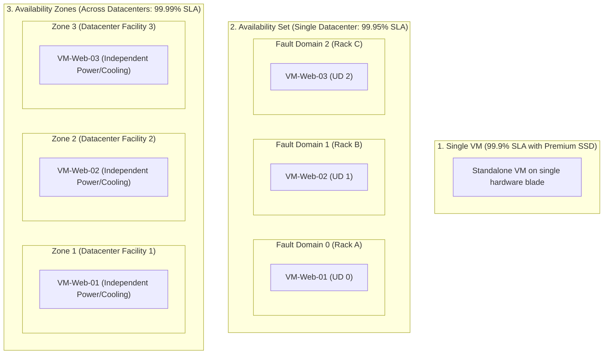
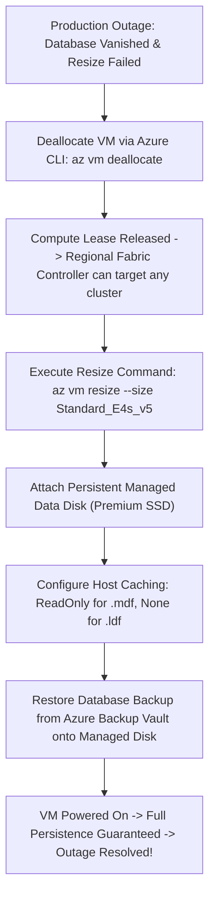

# Module 13-104-09: Administer Azure Virtual Machines, Managed Disks, Bastion & Scale Sets

**Breadcrumbs:** [[13-Index - Azure|☁️ Azure Reference MOC]] > [[13-Index - AZ-104|📘 AZ-104 Exam Track]] > **09 - Administer Azure Virtual Machines**

---

## 🎯 Stage 1: Executive Overview & The Conceptual Lecture

### 1. The Zero-Knowledge Starting Point: What is an IaaS Virtual Machine?
In a traditional on-premises datacenter, if an enterprise needed to run Windows Server 2022 or Ubuntu Linux, engineers purchased a physical steel server blade (from Dell, HP, or Cisco), mounted it into a 19-inch rack, connected dual power supplies, ran redundant Ethernet cables to Top-of-Rack switches, and installed an operating system from a bootable USB drive or PXE server.
* If you needed more CPU or RAM later, you had to physically shut down the server, pop open the chassis, and insert physical CPU chips and DIMM RAM sticks.
* If a motherboard capacitor blew up or a power supply died, that specific server halted immediately, taking down critical business applications.

In Microsoft Azure, an **Infrastructure as a Service (IaaS) Virtual Machine** is a virtual slice of a massive physical server blade running inside Microsoft's global datacenter fleet:
* Microsoft installs enterprise-grade physical server hardware running the **Azure Hypervisor** managed by regional Fabric Controllers.
* When you request a virtual machine, the Azure Resource Manager (ARM) commands the fabric controller to carve out specific virtual CPUs (vCPUs), RAM memory, and virtual network interfaces (vNICs) from the underlying hardware blade.
* **The Shared Responsibility Model in Action:**
  - **Microsoft Manages:** Physical datacenter security, HVAC cooling, electrical generators, physical motherboard, CPU silicon, RAM chips, hypervisor host OS, and physical fiber SDN backbones.
  - **You Manage:** The guest operating system (Windows/Linux), system updates, security patches, user accounts, firewall settings, software runtimes, application code, and data encryption.

### 2. The Apartment Lease Analogy (IaaS vs. PaaS)
* **IaaS (Virtual Machines):** Renting an unfurnished apartment. The landlord (Microsoft) guarantees the walls, roof, plumbing, and electricity work. However, you must bring your own furniture, paint the walls, lock your own doors, clean the floors, and install your own appliances. If your stove breaks, it is your responsibility to fix it.
* **PaaS (App Services / Serverless):** Staying at a luxury hotel room. You just show up with your clothes (application code). The hotel changes the sheets, cleans the bathroom, and maintains all appliances. You have zero control over the plumbing or building wiring, but you have zero maintenance burden!

### 3. Terminology Matrix: Zero-Knowledge to Enterprise Architect

| Terminology | What It Means to a Beginner | Real-World Analog | Enterprise Architecture Reality |
| :--- | :--- | :--- | :--- |
| **Virtual Machine (VM)** | A software computer running in the cloud. | A virtual partition on a shared physical server. | An ARM compute resource (`Microsoft.Compute/virtualMachines`) allocated vCPUs and RAM by the Azure Hypervisor. |
| **Managed Disk** | A virtual hard drive attached to your VM. | A plug-in external SSD that Azure manages so you don't worry about storage accounts. | An enterprise block-storage volume backed by page blobs with 99.999% availability, isolated across storage clusters. |
| **Temporary Disk (`D:` or `/dev/sdb`)** | A temporary scratch drive that wipes when restarted. | A hotel room dry-erase whiteboard that gets wiped clean every morning. | Physical NVMe SSD storage residing directly on the host server blade; all data is lost upon deallocation or hardware migration! |
| **Server-Side Encryption (SSE)** | Transparent disk encryption provided by Azure storage. | A bank vault that automatically locks any lockbox placed inside it. | Storage fabric encryption at rest using 256-bit AES. Supports Platform-Managed Keys (PMK) or Customer-Managed Keys (CMK) via Disk Encryption Sets. |
| **Azure Disk Encryption (ADE)** | BitLocker or DM-Crypt running inside the guest OS. | Locking your luggage with your own personal padlock before putting it in a bank vault. | Guest OS-level volume encryption using BitLocker (Windows) or DM-Crypt (Linux) backed by Azure Key Vault secrets and keys. Incompatible with Encryption at Host. |
| **Encryption at Host** | Encrypting data on the server blade before sending it to storage. | Encrypting a letter before it leaves your desk so the mail carrier never sees plain text. | Hypervisor host blade encryption protecting temp disks, host RAM caches, and storage flows over the network. Zero guest OS CPU overhead. |
| **Disk Encryption Set (DES)** | An Azure resource that links managed disks to Key Vault keys. | The security keycard reader that authorizes disk encryption using your corporate master key. | An ARM resource (`Microsoft.Compute/diskEncryptionSets`) with a managed identity holding crypto permissions in Key Vault. |
| **Trusted Launch** | Hardened VM boot security against rootkits. | A secure checkpoint verifying your ID and badge before allowing you into a building. | Gen2 VM security combining Secure Boot and virtual Trusted Platform Module (vTPM) to enforce boot integrity. |
| **Confidential Computing** | Memory encryption protecting data while in use. | A soundproof, lead-lined room where calculations occur in total isolation from the building owner. | Hardware-enforced memory encryption using AMD SEV-SNP (entire VM isolation) or Intel SGX (application enclave isolation). |
| **Ephemeral OS Disk** | Storing the OS disk on the host blade instead of remote storage. | Running an operating system entirely from high-speed RAM and temporary cache. | Bypasses remote Azure Storage, placing the OS disk directly on the host cache or temp SSD for instant re-imaging, sub-millisecond I/O, and $0 storage cost. |
| **Disk Bursting** | Temporarily exceeding disk IOPS/MBps limits during spikes. | A turbocharger in a sports car providing a burst of acceleration when passing. | Credit-based bursting (free for $\le 512$ GiB Premium SSDs) or On-demand bursting (paid per burst for $\ge 512$ GiB disks) to absorb traffic spikes. |
| **Availability Set** | Spreading VMs across different power racks in one building. | Placing backup generators on different electrical circuits in the same basement. | A logical grouping of VMs distributed across up to 3 Fault Domains (FD) and 20 Update Domains (UD) within a single datacenter (99.95% SLA). |
| **Availability Zone (AZ)** | Spreading VMs across separate buildings in the same city. | Opening three branch offices across town so an earthquake in one neighborhood doesn't stop business. | Distinct physical datacenter facilities within an Azure region, each with independent power, cooling, and networking (99.99% SLA). |
| **Proximity Placement Group (PPG)** | Pinning VMs physically close together inside one datacenter. | Seating team members in adjacent desks in the same room to eliminate walking time. | A logical grouping constraint ensuring VMs and scale sets reside in the same physical spine cluster to achieve $<1\text{ ms}$ network latency. |
| **Dedicated Host** | Renting the entire physical server blade just for your company. | Renting an entire private charter plane rather than buying individual passenger seats. | Single-tenant physical blade hardware (`Microsoft.Compute/hosts`) dedicated exclusively to your subscription for compliance and core licensing (BYOL). |
| **Azure Bastion** | A secure web portal to log into servers without public IPs. | A private guarded airlock hallway leading into a high-security vault. | A fully managed PaaS reverse proxy residing in `AzureBastionSubnet` (`/26`) providing RDP/SSH access over browser TLS 443. |
| **VMSS (Scale Sets)** | An auto-scaling fleet of identical worker VMs. | An automated taxi fleet that dispatches more cars when passenger lines grow long. | A managed pool of compute instances that dynamically scales out or in based on CPU/RAM metrics, schedules, or predictive AI algorithms. |

---

## 🏛️ Stage 2: Core Mental Model & Component Architecture

### 1. VM Sizing Families & Architecture
Selecting the correct VM size ensures you optimize both compute performance and cloud cost:

```text
+-------------------------------------------------------------------------------------------------+
|                                 AZURE VM SIZING FAMILIES                                        |
+-------------------------------------------------------------------------------------------------+
|  General Purpose (B-series, D-series)     |  Compute Optimized (F-series)                       |
|  - CPU-to-RAM Ratio: 1:4 (e.g., 2 CPU, 8GB)|  - CPU-to-RAM Ratio: 1:2 (e.g., 4 CPU, 8GB)         |
|  - B-series: Burstable (accumulates CPU   |  - High clock-speed processors                      |
|    credits; ideal for low-traffic dev/web)|  - Workloads: Batch processing, web app servers,    |
|  - D-series: Balanced enterprise baseline |    analytics, game servers                          |
+-------------------------------------------+-----------------------------------------------------+
|  Memory Optimized (E-series, M-series)    |  Storage & GPU Optimized (L-series, N-series)       |
|  - CPU-to-RAM Ratio: 1:8 to 1:28          |  - L-series: High NVMe throughput (NoSQL/Cassandra) |
|  - Massive RAM capacity (up to 12 TiB)    |  - N-series: Dedicated NVIDIA GPU co-processors     |
|  - Workloads: In-memory caches (Redis),   |  - Workloads: AI/ML deep learning model training,   |
|    enterprise SQL Server, SAP HANA        |    3D ray tracing, video rendering pipelines        |
+-------------------------------------------+-----------------------------------------------------+
|  Confidential Compute (DC-series, EC-series)                                                    |
|  - Hardware-enforced isolation and memory encryption for sensitive workloads                    |
|  - DC-series (Intel SGX): Application enclave isolation (requires code modification)            |
|  - DCA-series (AMD SEV-SNP): Whole VM memory encryption (zero code changes required)             |
+-------------------------------------------------------------------------------------------------+
```

#### Sizing Nomenclature Rules:
- **`s` suffix:** Supports Premium SSD storage (e.g., `Standard_D2s_v5` supports Premium SSD; `Standard_D2_v5` supports only Standard HDD/SSD).
- **`a` suffix:** AMD processors (e.g., `Standard_D4as_v5`).
- **`d` suffix:** Includes local temporary disk (e.g., `Standard_D2ds_v5` has a local temp SSD; `Standard_D2s_v5` is diskless or relies on remote storage).
- **`v` number:** Generation/version of hardware (e.g., `v5` runs newer processors and architecture than `v3`).

---

### 2. The 3-Disk Storage Hierarchy of an Azure VM
Every Azure Virtual Machine contains at least two disks, with the ability to attach multiple persistent data disks:

```text
[ Azure Virtual Machine Host Blade Engine ]
       │
       ├──► 1. OS Disk (Persistent Managed Disk)
       │    ├── Contains the Operating System (Windows `C:` or Linux `/dev/sda`)
       │    ├── Backed by remote triple-replicated Azure Storage page blobs
       │    ├── Default Host Caching: ReadWrite
       │    └── Max Size: 4,095 GiB (4 TiB)
       │
       ├──► 2. Temporary Disk (Ephemeral Host SSD - Non-Persistent!)
       │    ├── Windows `D:\pagefile.sys` or Linux `/dev/sdb1` swap space
       │    ├── Physical NVMe SSD sitting directly on the server blade hardware
       │    ├── Ultra-fast I/O for temporary cache, paging, and tempdb
       │    └── DANGER: WIPED CLEAN WHENEVER VM IS STOPPED / DEALLOCATED / MIGRATED!
       │
       └──► 3. Data Disks (Persistent Managed Disks - Optional LUN 0 to N)
            ├── Stores databases, transaction logs, web content, user application data
            ├── Backed by remote triple-replicated Azure Storage page blobs
            ├── Configurable Host Caching: None, ReadOnly, or ReadWrite
            └── Max Size per disk: 32,767 GiB (32 TiB); Max disks determined by VM SKU
```

#### Managed Disk Performance Tiers Comparison:

| Disk Tier | Underlying Tech | Max Disk Size | Max IOPS | Max Throughput | Typical Enterprise Use Cases |
| :--- | :--- | :--- | :--- | :--- | :--- |
| **Standard HDD** | Magnetic spinning platters | 32 TiB | 2,000 | 500 MB/s | Backup archives, dev/test, non-critical batch jobs |
| **Standard SSD** | Entry-level solid-state | 32 TiB | 6,000 | 750 MB/s | Cost-sensitive production, light web servers |
| **Premium SSD (v1)** | High-performance SSD | 32 TiB | 20,000 | 900 MB/s | Production databases, critical enterprise apps |
| **Premium SSD v2** | Next-gen sub-ms SSD | 64 TiB | 80,000 | 1,200 MB/s | High-transaction SQL, Oracle, Cassandra, SAP HANA |
| **Ultra Disk** | Top-tier NVMe block | 64 TiB | 160,000 | 4,000 MB/s | Extreme I/O workloads; dynamically adjustable IOPS |

---

### 3. Managed Disk Bursting Architecture: Credit-Based vs. On-Demand

```text
+-------------------------------------------------------------------------------------------------+
|                                 MANAGED DISK BURSTING MODELS                                    |
+-------------------------------------------------------------------------------------------------+
|  1. Credit-Based Bursting (Automatic & Free)   |  2. On-Demand Bursting (Paid & Scalable)       |
|  - Target: Premium SSDs <= 512 GiB (P1 to P20) |  - Target: Premium SSDs >= 512 GiB (P30 to P80) |
|  - Cost: Included at NO additional charge       |  - Cost: Flat hourly enablement fee + per-burst |
|  - How it Works: When workload consumes less   |  - How it Works: Disk bursts immediately whenever|
|    than baseline IOPS/MBps, it accumulates     |    application requests it, with no bucket or   |
|    credits in a burst bucket.                  |    credit depletion limits!                     |
|  - Burst Duration: Up to 30 consecutive minutes |  - Ideal for: Unpredictable batch jobs, seasonal|
|    at maximum 3,500 IOPS and 170 MB/s!         |    shopping spikes, and high-load ETL processing|
+-------------------------------------------------------------------------------------------------+
```

---

### 4. Ephemeral OS Disks: Ultra-Fast, $0 Cost, Stateless Storage
Traditional Azure VMs store the operating system disk remotely on Azure Storage, requiring network round-trips over the datacenter fabric for every OS read/write.
An **Ephemeral OS Disk** creates the OS disk directly on the local host blade:

```text
Traditional Managed OS Disk (Remote):
[ Host Server Blade: vCPU / RAM ] ══(Azure SDN Fabric)══► [ Remote Azure Storage Cluster (Page Blob) ]
- High persistence, higher latency, billed for managed disk storage capacity.

Ephemeral OS Disk (Local Host):
[ Host Server Blade: vCPU / RAM ] ══(Internal PCI-e / NVMe Bus)══► [ Local Host Cache / Temp SSD ]
- Ultra-low latency, instant re-imaging (seconds), $0 disk storage cost!
- State is lost when the VM is deallocated; ideal for stateless VMSS, AKS nodes, and batch workers.
```

#### Ephemeral OS Disk Placement Options:
1. **VM Cache:** The OS disk is placed into the VM host cache (available on VM sizes with OS cache $\ge$ OS disk size, e.g., `Standard_D4s_v5`).
2. **Resource Disk (Temp Disk):** The OS disk is placed into the local temporary NVMe SSD (`/dev/sdb` or `D:`).

---

### 5. High Availability Spectrum: Single VM, Availability Sets, and Availability Zones



#### Availability Options Comparison Matrix:

| Dimension | Single VM | Availability Set | Availability Zone |
| :--- | :--- | :--- | :--- |
| **Physical Scope** | Single physical blade | Multiple server racks in **one datacenter** | Multiple **distinct physical datacenters** in a region |
| **Failure Protection** | None (hardware failure causes downtime) | Rack power supply failure, switch failure, blade crash | Complete datacenter facility disaster (flood, fire, substation outage) |
| **High Availability SLA** | **99.9%** (Premium/Ultra SSD) / 99.5% (Standard SSD) | **99.95%** (for 2+ VMs across fault domains) | **99.99%** (for 2+ VMs across availability zones) |
| **Fault Domains (FD)** | 1 | Up to **3 Fault Domains** (FD 0, 1, 2) | Up to **3 Availability Zones** (Zone 1, 2, 3) |
| **Update Domains (UD)** | 1 | Up to **20 Update Domains** (rebooted sequentially) | Updated zone-by-zone automatically |
| **Configuration Timing** | Anytime | **During VM creation only** (cannot add VM later!) | **During VM creation only** (cannot change zone later!) |

---

## 🏢 Stage 3: Deep-Intuition Platform Mechanics & Topology

### 1. The Azure VM & Disk Encryption Spectrum (Crucial Architecture & Exam Core)
Azure offers multiple distinct layers of encryption to protect data at rest, data in transit, and data in use:

```text
+-------------------------------------------------------------------------------------------------+
|                                AZURE DISK & COMPUTE ENCRYPTION SPECTRUM                         |
+-------------------------------------------------------------------------------------------------+
| Layer 1: Server-Side Encryption (SSE)                                                          |
| ├── Default: Enabled on ALL Managed Disks, Snapshots, and Images using 256-bit AES.            |
| ├── Key Option A: Platform-Managed Keys (PMK) - Transparent, zero cost, rotated by Microsoft.   |
| ├── Key Option B: Customer-Managed Keys (CMK) - Keys in Azure Key Vault via Disk Encryption Set. |
| └── Key Option C: Double Encryption at Rest - Combines two independent layers (PMK + CMK).     |
+-------------------------------------------------------------------------------------------------+
| Layer 2: Encryption at Host (End-to-End Host Blade Encryption)                                  |
| ├── Where it Encrypts: On the physical hypervisor server blade before transmission.             |
| ├── What it Covers: Temporary Disks (D:), Host RAM caches, OS/Data disk network flows to storage|
| ├── Performance: Zero guest OS CPU overhead (handled by hypervisor hardware).                   |
| └── Compatibility Law: MUTUALLY EXCLUSIVE WITH AZURE DISK ENCRYPTION (ADE)! Cannot use both!   |
+-------------------------------------------------------------------------------------------------+
| Layer 3: Azure Disk Encryption (ADE)                                                            |
| ├── Where it Encrypts: Inside the Guest Operating System.                                      |
| ├── Technology: BitLocker (Windows) and DM-Crypt (Linux).                                       |
| ├── Key Hierarchy: BitLocker Encryption Key (BEK) wrapped by Key Encryption Key (KEK) in AKV.  |
| ├── Performance: Incurs CPU overhead inside the VM OS for cryptographic operations.            |
| └── Requirement: Key Vault must have '--enabled-for-disk-encryption true' flag set!             |
+-------------------------------------------------------------------------------------------------+
| Layer 4: Confidential Computing (Encryption in Use)                                             |
| ├── AMD SEV-SNP (DCA/ECA series): Encrypts entire VM RAM memory; hypervisor cannot peek.       |
| └── Intel SGX (DC series): Hardware enclaves inside CPU; requires application refactoring.      |
+-------------------------------------------------------------------------------------------------+
```

#### Detailed Comparison: SSE vs. Encryption at Host vs. ADE

| Feature | Server-Side Encryption (SSE) | Encryption at Host | Azure Disk Encryption (ADE) |
| :--- | :--- | :--- | :--- |
| **Encryption Location** | Azure Storage Cluster Backend | Physical Hypervisor Host Blade | Inside Guest OS Kernel |
| **Protects Remote Disks?** | Yes (at rest in storage clusters) | Yes (encrypted before leaving host) | Yes (encrypted volume blocks) |
| **Protects Temp Disk (`D:`)?** | **NO!** (Temp disk is local to blade) | **YES!** (Protects temp disk at rest) | **NO!** (Only OS and Data LUNs) |
| **Protects Host Cache?** | **NO!** (Unencrypted in host RAM) | **YES!** (Encrypted in host RAM/SSD) | **YES!** (Data in cache is encrypted) |
| **Guest OS CPU Overhead?** | 0% (handled by storage clusters) | 0% (handled by host CPU silicon) | 3% - 10% (guest CPU performs crypto) |
| **Key Vault Setup Required?** | Only if using CMK (via DES) | Optional (supports PMK or CMK) | **Mandatory** (Key Vault with ADE flag) |
| **Mutually Exclusive With?** | Fully compatible with all | **Incompatible with ADE!** | **Incompatible with Host Encryption!** |

---

### 2. Disk Encryption Sets (DES) Architecture & Permissions Flow
When an enterprise uses **Customer-Managed Keys (CMK)** for Managed Disks or Encryption at Host, Azure requires a dedicated bridge resource called a **Disk Encryption Set (DES)**:

```text
[ Azure Key Vault (AKV) ]
  ├── Master Key: rsa-disk-key-01 (HSM or Software-protected)
  └── Role: "Key Vault Crypto Service Encryption User"
             ▲
             │ (Grants Wrap / Unwrap Key permissions)
             ▼
[ Disk Encryption Set (DES) ]  <--- Holds System-Assigned or User-Assigned Managed Identity
             ▲
             │ (Associated during disk creation or update)
             ▼
[ Managed Disks / Snapshots / Host Encryption ]
```

#### The DES Deployment Sequence:
1. Create Azure Key Vault with **Purge Protection** and **Soft Delete** enabled (mandatory for CMK to prevent catastrophic disk loss!).
2. Create an RSA Key inside Key Vault (e.g., 2048, 3072, or 4096-bit).
3. Create the **Disk Encryption Set** (`az disk-encryption-set create`).
4. Assign the DES Managed Identity the `Key Vault Crypto Service Encryption User` role on the Key Vault.
5. Create or associate Managed Disks pointing to the DES ID.

---

### 3. VM States: Stopped vs. Stopped (Deallocated) (High-Yield Concept!)
One of the most common billing traps in Azure computing is misunderstanding the two different "stopped" states:

```text
State 1: Stopped (Guest OS Shutdown)
├── Triggered By: Running 'shutdown -h now' inside Linux or Windows Start -> Shut down
├── Hypervisor Action: OS halts, but hardware vCPUs and RAM remain RESERVED on the physical blade!
└── Billing Impact: YOU ARE STILL BILLED FOR FULL COMPUTE CORES AND RAM! (No cost savings!)

State 2: Stopped (Deallocated) (Cloud Fabric Shutdown)
├── Triggered By: Clicking 'Stop' in Azure Portal, or running 'az vm deallocate'
├── Hypervisor Action: Fabric Controller releases hardware lease; CPU and RAM freed back to pool
└── Billing Impact: COMPUTE BILLING DROPS TO $0.00! (You only pay for attached disk storage).
```

---

### 4. VM Resizing Mechanics & The `AllocationFailed` Error
When you resize a virtual machine (e.g., from `Standard_B2s` to `Standard_E4s_v5`):
* If the VM is currently **Running**, Azure attempts to resize the VM *in-place on the same physical server blade cluster*.
* If that physical server blade cluster does not have enough unallocated RAM or does not support the new hardware family (e.g., jumping from an older Intel cluster to a newer AMD EPYC cluster), ARM immediately aborts with:
  `AllocationFailed: Allocation failed. We do not have sufficient capacity for the requested VM size in this region or cluster.`
* **The Solution:** You must first **Deallocate** the VM (`az vm deallocate`). Once deallocated, Azure's regional fabric controller is free to allocate the VM onto *any physical hardware cluster in the entire datacenter* that supports the target VM size!

---

### 5. Managed Disk Host Caching Mechanics (Database Integrity Law)
When data is written to a Managed Disk, the Azure Hypervisor on the host server blade provides an in-memory and local SSD cache:

```text
[ Application Write: INSERT INTO Orders VALUES (...) ]
                       │
                       ▼
            [ Host Hypervisor Cache ]
                       │
       ┌───────────────┴───────────────┐
       ▼                               ▼
[ ReadWrite Caching ]          [ None (No Caching) ]
- Writes acked in Host RAM     - Write passes through host cache directly
- Flushed to disk later        - Acked ONLY when committed to triple-replicated disk
- DANGER: If host loses power, - Zero data loss risk during unexpected crash!
  unwritten blocks are lost!   - MANDATORY FOR SQL TRANSACTION LOGS (.ldf)!
```

#### Host Caching Rules of Thumb:
* **`ReadWrite` (Default):** Ideal for OS disks. Speeds up general OS boot times and application loading.
* **`ReadOnly`:** Reads are cached in fast host RAM; writes pass through directly to disk. **Recommended for SQL Server data files (`.mdf`)** and static read-heavy files.
* **`None` (No Caching):** Bypasses host cache completely. **Mandatory for database transaction logs (SQL `.ldf`, Oracle redo logs)** to prevent database corruption during unexpected physical host crashes!

---

### 6. Proximity Placement Groups (PPG) vs. Dedicated Hosts

```text
+-------------------------------------------------------------------------------------------------+
|                               ADVANCED COMPUTE PLACEMENT STRATEGIES                             |
+-------------------------------------------------------------------------------------------------+
|  1. Proximity Placement Group (PPG)            |  2. Dedicated Hosts                            |
|  - Goal: Sub-millisecond network latency       |  - Goal: Single-tenant physical hardware       |
|  - How it Works: Forces Azure Fabric to place  |  - How it Works: You allocate an entire physical|
|    all VMs, AvSets, and VMSS in the same       |    server blade (`hostGroups` & `hosts`) to    |
|    physical spine datacenter cluster.          |    run only your organization's VMs.           |
|  - Trade-off: Reduces regional allocation      |  - Use Cases: Strict regulatory compliance,    |
|    flexibility; can cause AllocationFailed.    |    physical core licensing (BYOL for SQL/OS),   |
|  - Ideal for: Multi-tier apps (App to DB).     |    and controlling host maintenance timing.    |
+-------------------------------------------------------------------------------------------------+
```

---

### 7. Azure Bastion Architecture: Zero Public IP Management
Exposing SSH port 22 or RDP port 3389 directly to the public internet using Public IPs is an extreme security vulnerability—automated botnets scan the internet and attack open ports with brute-force dictionary exploits within seconds.

**Azure Bastion** eliminates public IPs from virtual machines entirely:

```text
[ Administrator Browser ]
        │ HTTPS over Port 443 (TLS Encrypted WebRTC Session)
        ▼
[ AzureBastionSubnet (/26) inside your Virtual Network ]
  ├── Azure Bastion Host (Managed PaaS Cluster)
  └── Communicates internally over private SDN IP:
        ├── Private RDP (Port 3389) ──► [ Target Windows VM: 10.90.1.4 ] (NO Public IP!)
        └── Private SSH (Port 22)   ──► [ Target Linux VM: 10.90.1.5 ]   (NO Public IP!)
```

#### Mandatory Azure Bastion Requirements:
* Must reside in a dedicated subnet named strictly **`AzureBastionSubnet`**.
* The subnet prefix must be **`/26` or larger** (`/26`, `/25`, `/24`) to support autoscale proxy instances.
* Cannot contain any other resources (no VMs, no load balancers).
* Does not support User-Defined Routes (UDRs) redirecting traffic to firewalls (`0.0.0.0/0 -> NVA` will break Bastion!).

---

### 8. Virtual Machine Scale Sets (VMSS): Flexible vs. Uniform Orchestration

```text
+-------------------------------------------------------------------------------------------------+
|                                VMSS ORCHESTRATION MODES COMPARISON                              |
+-------------------------------------------------------------------------------------------------+
| Feature                  | Flexible Orchestration (Recommended)  | Uniform Orchestration (Legacy) |
+--------------------------+---------------------------------------+--------------------------------+
| Architecture             | Heterogeneous VM fleet                | Homogeneous identical VM fleet |
| VM Sizing Flexibility    | Can mix multiple VM sizes in one set  | Strictly identical VM size     |
| Standalone VM Management | Can add existing VMs to the scale set | Cannot manage external VMs     |
| Availability Spreading   | Fault Domains across Availability Zs  | Fault Domains within Datacenter|
| Spot & On-Demand Mixing  | Can combine Spot and On-Demand VMs    | All instances share same model |
| Best Suited For          | Microservices, Kubernetes, mixed apps | Massive identical web fleets   |
+-------------------------------------------------------------------------------------------------+
```

#### VMSS Autoscale Rules & Predictive Scaling:
- **Scale Out Metric:** Metric threshold trigger (e.g., average CPU $>75\%$ for 5 minutes $\rightarrow$ increase instance count by 2).
- **Scale In Metric:** Scale-down trigger (e.g., average CPU $<25\%$ for 5 minutes $\rightarrow$ decrease instance count by 1).
- **Scale-In Policies:** Controls which instances are terminated first during scale-in:
  - `Default`: Balances instances across Availability Zones and Fault Domains, then terminates the newest VM.
  - `NewestVM`: Terminates the most recently provisioned instances first.
  - `OldestVM`: Terminates the oldest running instances first (useful when rolling out application upgrades).
- **Predictive Autoscale:** Leverages machine learning to forecast future compute spikes based on historical CPU patterns (requires 7–15 days of historical data) and scales out instances *in advance* of anticipated traffic surges.

---

## ⚙️ Stage 4: Declarative & Automation Engine (CLI & PowerShell Core)

### 1. Azure CLI: Provisioning VM with Encryption at Host & Premium Disks

```bash
# ==============================================================================
# 1. REGISTER SUBSCRIPTION FOR ENCRYPTION AT HOST (ONE-TIME TENANT REQUIREMENT)
# ==============================================================================
az feature register --namespace Microsoft.Compute --name EncryptionAtHost
az provider register -n Microsoft.Compute

# ==============================================================================
# 2. CREATE VIRTUAL MACHINE WITH ENCRYPTION AT HOST ENABLED
# ==============================================================================
az vm create \
  --resource-group "rg-compute-prod" \
  --name "vm-secure-app01" \
  --image "Ubuntu2204" \
  --size "Standard_D4s_v5" \
  --zone 1 \
  --admin-username "azureadmin" \
  --generate-ssh-keys \
  --vnet-name "vnet-compute-prod" \
  --subnet "snet-workload" \
  --public-ip-address "" \
  --encryption-at-host true \
  --assign-identity \
  --output json

# ==============================================================================
# 3. ATTACH DATA DISKS WITH CACHING & ON-DEMAND BURSTING
# ==============================================================================

# Attach Analytical Data Disk (ReadOnly Caching - LUN 0)
az vm disk attach \
  --resource-group "rg-compute-prod" \
  --vm-name "vm-secure-app01" \
  --name "disk-app-data" \
  --size-gb 256 \
  --sku "Premium_LRS" \
  --caching "ReadOnly" \
  --lun 0 \
  --new

# Attach Transactional Database Log Disk (None Caching - LUN 1)
az vm disk attach \
  --resource-group "rg-compute-prod" \
  --vm-name "vm-secure-app01" \
  --name "disk-app-wal-log" \
  --size-gb 128 \
  --sku "Premium_LRS" \
  --caching "None" \
  --lun 1 \
  --new
```

### 2. Azure CLI: Configuring Azure Disk Encryption (ADE) with Key Vault

```bash
# ==============================================================================
# 4. CONFIGURE KEY VAULT FOR AZURE DISK ENCRYPTION (ADE)
# ==============================================================================
RG_NAME="rg-compute-prod"
KV_NAME="kv-disk-sec-$(az rand --max 99999)"
LOCATION="eastus"

# Create Key Vault with Purge Protection and ADE enabled
az keyvault create \
  --name "${KV_NAME}" \
  --resource-group "${RG_NAME}" \
  --location "${LOCATION}" \
  --enabled-for-disk-encryption true \
  --enable-purge-protection true

# Create Key Encryption Key (KEK) inside Key Vault
az keyvault key create \
  --vault-name "${KV_NAME}" \
  --name "kek-disk-wrap-key" \
  --kty RSA \
  --size 2048

# Enable ADE on Target VM (Encrypts OS and Data disks using BitLocker / DM-Crypt)
az vm encryption enable \
  --resource-group "${RG_NAME}" \
  --name "vm-legacy-app" \
  --disk-encryption-keyvault "${KV_NAME}" \
  --key-encryption-key "kek-disk-wrap-key" \
  --key-encryption-keyvault "${KV_NAME}" \
  --volume-type "ALL"
```

### 3. Azure CLI: Deploy Virtual Machine Scale Set (VMSS) with Autoscale

```bash
# ==============================================================================
# 5. CREATE MULTI-ZONE VIRTUAL MACHINE SCALE SET (VMSS) FLEXIBLE
# ==============================================================================
az vmss create \
  --resource-group "rg-compute-prod" \
  --name "vmss-web-fleet" \
  --image "Ubuntu2204" \
  --vm-sku "Standard_B2s" \
  --instance-count 2 \
  --zones 1 2 3 \
  --vnet-name "vnet-compute-prod" \
  --subnet "snet-workload" \
  --load-balancer "lb-web-prod" \
  --backend-pool-name "be-web-pool" \
  --admin-username "azureadmin" \
  --generate-ssh-keys \
  --orchestration-mode "Flexible"

# Scale Out Rule: Add 2 instances if Average CPU > 75% for 5 minutes
az monitor autoscale rule create \
  --resource-group "rg-compute-prod" \
  --autoscale-name "autoscale-cpu-rules" \
  --condition "Percentage CPU > 75 avg 5m" \
  --scale out 2

# Scale In Rule: Remove 1 instance if Average CPU < 25% for 5 minutes
az monitor autoscale rule create \
  --resource-group "rg-compute-prod" \
  --autoscale-name "autoscale-cpu-rules" \
  --condition "Percentage CPU < 25 avg 5m" \
  --scale in 1
```

---

## 🖥️ Stage 5: Step-by-Step Azure Portal GUI Walkthrough

### Task 1: Provisioning a Secure Virtual Machine with Host Encryption
1. In the top search bar, type **Virtual machines** and select it.
2. Click **+ Create** $\rightarrow$ **Azure virtual machine**:
   - **Resource group:** `rg-compute-prod`.
   - **Virtual machine name:** `vm-secure-node01`.
   - **Region:** `East US`.
   - **Availability options:** Select **Availability zones**.
   - **Availability zone:** Select **Zone 1**.
   - **Security type:** Select **Trusted launch** (Enables Secure Boot and vTPM).
   - **Image:** Select *Ubuntu Server 22.04 LTS - x64 Gen2*.
   - **Size:** Select *Standard_D4s_v5* (4 vCPUs, 16 GiB memory).
3. In the **Disks** tab:
   - **OS disk type:** Select **Premium SSD (locally-redundant storage)**.
   - Under **Encryption**, check **Encryption at host** *(Encrypts temporary disk and host cache with zero guest OS overhead)*.
   - Under *Data disks*, click **Create and attach a new disk**:
     - *Name:* `disk-app-data`.
     - *Size:* `256 GiB`.
     - *Host caching:* Change dropdown from Read/Write to **Read-only**!
     - Click **OK**.
4. In the **Networking** tab:
   - **Virtual network:** Select `vnet-compute-prod`.
   - **Subnet:** Select `snet-workload`.
   - **Public IP:** Select **None** (Security best practice: No public IP!).
5. In the **Management** tab:
   - Check **Enable system-assigned managed identity**.
6. Click **Review + create** $\rightarrow$ **Create**. Download your private key pair (`.pem`).

### Task 2: Deploying Azure Bastion in the Portal
1. In the top search bar, type **Bastions** and select it.
2. Click **+ Create**:
   - **Resource group:** `rg-compute-prod`.
   - **Name:** `bastion-core`.
   - **Region:** `East US`.
   - **Tier:** Select **Basic** (or Standard).
   - **Virtual network:** Select `vnet-compute-prod`.
   - Under *Subnet*, verify that `AzureBastionSubnet` (`10.90.10.0/26`) is selected.
   - **Public IP:** Create new public IP named `pip-bastion`.
3. Click **Review + create** $\rightarrow$ **Create**.
4. Once deployed, open your private VM `vm-secure-node01`:
   - Click **Connect** on the top toolbar $\rightarrow$ select **Connect via Bastion**.
   - Enter username `azureadmin` and upload your downloaded `.pem` private key.
   - Click **Connect**. A full interactive SSH terminal opens directly inside your web browser over secure HTTPS port 443!

### Task 3: Creating a Virtual Machine Scale Set (VMSS) with Flexible Orchestration
1. In the top search bar, type **Virtual machine scale sets** and select it.
2. Click **+ Create**:
   - **Resource group:** `rg-compute-prod`.
   - **Virtual machine scale set name:** `vmss-web-fleet`.
   - **Region:** `East US`.
   - **Orchestration mode:** Select **Flexible**.
   - **Availability zones:** Check **Zone 1**, **Zone 2**, and **Zone 3**.
   - **Image:** *Ubuntu Server 22.04 LTS*.
   - **Size:** *Standard_B2s*.
3. In the **Scaling** tab:
   - **Initial instance count:** `2`.
   - **Scaling policy:** Select **Custom**.
   - *Minimum number of VMs:* `2`.
   - *Maximum number of VMs:* `10`.
   - *Scale out metric:* CPU threshold `75%` for `5` minutes $\rightarrow$ increase by `2`.
   - *Scale in metric:* CPU threshold `25%` for `5` minutes $\rightarrow$ decrease by `1`.
4. Click **Review + create** $\rightarrow$ **Create**.

---

## 🔬 Stage 6: Hands-On Enterprise Lab Bridge

To implement this full multi-zone compute topology, configure managed disk caching, and manage instances through Azure Bastion, proceed directly to the comprehensive practical lab:

> [!TIP]
> **Practical Implementation Companion:**
> Access the comprehensive engineering lab at:
> **[[Lab-09_VM_Resilience_Managed_Disks_Bastion_and_VMSS|Lab 09: Enterprise Virtual Machines, Managed Disks, Azure Bastion & VMSS Autoscaling]]**
> 
> *Target Lab File:* `Projects/AZ-104/09_Virtual_Machines_and_Scale_Sets/Lab-09_VM_Resilience_Managed_Disks_Bastion_and_VMSS.md`

### Lab Objectives Matrix:

```text
+-----------------------------------------------------------------------------------------+
| Lab 09 Enterprise Milestone Goals                                                       |
+-----------------------------------------------------------------------------------------+
| 1. Deploy multi-zone IaaS virtual machines pinned across Availability Zones (Zone 1, 2) |
| 2. Enable Encryption at Host and attach Managed Disks with specialized host caching     |
| 3. Deploy Azure Bastion inside dedicated /26 subnet and establish browser-based SSH    |
| 4. Engineer a Virtual Machine Scale Set (VMSS) with Flexible Orchestration              |
| 5. Configure metric-based CPU autoscale rules and inspect instance scale-in policies    |
+-----------------------------------------------------------------------------------------+
```

---

## ⚠️ Stage 7: "See It in Action" Real-World Failure & Recovery Loop (AARF)

### Scenario 1: The "Temporary Disk Data Loss & Resizing Lock" Outage

#### 1. The Architectural Setup & Assumptions
An administrator deploys an Azure Virtual Machine running SQL Server 2022 to host a critical internal reporting database. During installation, the administrator notices drive `D:` is labeled as a fast physical SSD with 64 GB of free space. To achieve high disk I/O, the administrator places the database data files (`.mdf`) and backup archives onto drive `D:`.

#### 2. The Production Failure Manifestation
A month later, reporting queries begin running slowly during peak hours. The administrator decides to upgrade the VM from `Standard_B2s` (2 vCPUs, 4 GB RAM) to `Standard_E4s_v5` (4 vCPUs, 32 GB RAM). 
The administrator navigates to the portal while the VM is running and clicks *Resize*:
```text
Failed to resize virtual machine 'vm-sql-prod'.
Error: AllocationFailed
Allocation failed. We do not have sufficient capacity for the requested VM size in this region or cluster.
```
Frustrated, the administrator runs `shutdown -h now` inside the VM, starts it back up, and discovers: **The entire database has vanished! Drive `D:` is completely empty except for a file named `DATALOSS_WARNING_README.txt`!**

#### 3. Root Cause Analysis (RCA) & Deep Investigation
Why did this catastrophic double failure occur?
1. **The Temporary Disk Disaster:** Drive `D:` on Windows (or `/dev/sdb1` on Linux) is the **Temporary Ephemeral Disk**. It is physical NVMe storage on the server blade host hardware designed strictly for pagefile swap space. **Azure explicitly wipes this drive clean** whenever a VM is stopped (deallocated), restarted onto another host, or migrated during hardware servicing!
2. **The Allocation Lock:** The VM was running on an older physical blade cluster that did not physically host E-series hardware blades. Because the VM was running, ARM was restricted to searching only that specific blade cluster.
3. **The Guest Shutdown Mistake:** Running `shutdown` from inside the OS transitioned the VM to **Stopped**, but NOT **Stopped (Deallocated)**. Compute cores remained locked to the old blade cluster, continuing the allocation lock!

#### 4. Remediation & Diagnostic Verification Loop



---

### Scenario 2: The "Encryption at Host vs. ADE Incompatibility Collision"

#### 1. The Architectural Setup
A security compliance auditor flags a production payment-processing VM because its temporary swap disk (`/dev/sdb1`) contains unencrypted cached customer records. The cloud security engineer enables **Encryption at Host** on the VM to encrypt the physical host temporary disk and host cache.

#### 2. The Failure Manifestation
A week later, an infrastructure administrator attempts to apply a corporate Azure Policy enforcing **Azure Disk Encryption (ADE)** via BitLocker across all VMs. When the ADE extension runs on the payment VM, the deployment fails with a critical error:
```text
Deployment failed: VirtualMachineExtensionProvisioningError
VM has reported a failure when processing extension 'AzureDiskEncryption'.
Error: Azure Disk Encryption cannot be enabled on virtual machine 'vm-payment-node' because Encryption at Host is currently enabled.
```

#### 3. Root Cause Analysis (RCA)
* **The Invariant Law:** Azure enforces strict mutual exclusivity between **Encryption at Host** and **Azure Disk Encryption (ADE)**.
* **Why?** Encryption at Host encrypts data using the host server blade hypervisor before writing to local caches or streaming over the network. If ADE (BitLocker/DM-Crypt) is also active inside the guest OS, double encryption collision and cryptographic key conflicts destabilize the Azure hypervisor block layer.
* **The Architect's Resolution:** Encryption at Host is the modern Microsoft-recommended standard because it encrypts the temporary disk, host caches, and network flows with **zero guest OS CPU overhead**. ADE should only be reserved for legacy environments requiring internal OS-level volume BitLocker verification.

---

## 💡 Stage 8: High-Yield AZ-104 Exam Scenarios & Trick Question Traps

### Trick Question Trap 1: The Ephemeral Temporary Disk (`D:`) Trap
* **The Scenario:** A developer installs an application on an Azure VM and stores uploaded customer images on drive `D:`. That evening, the administrator resizes the VM to a larger SKU. The developer logs in the next day and reports all uploaded images are gone.
* **The Trap:** Did an attacker hack the server? Did the disk corrupt?
* **The Ground Truth:** Drive `D:` is the **Temporary Disk**! It is ephemeral host storage. Any data written to drive `D:` is **permanently destroyed** when the VM is deallocated or moved to another physical host blade. Always store application data on attached **Managed Data Disks**!

### Trick Question Trap 2: Adding Existing VMs to an Availability Set
* **The Scenario:** A company deploys a standalone production VM. Later, management requests adding this VM to an existing Availability Set named `as-prod-web` to improve SLA.
* **The Trap:** The administrator searches the portal for a button to add the VM to the set.
* **The Ground Truth:** **You CANNOT add an existing VM to an Availability Set!** A VM can only be placed into an Availability Set **during VM creation**. To move an existing VM into an Availability Set, you must delete the VM (retaining its OS disk) and recreate the VM from the OS disk while specifying the Availability Set.

### Trick Question Trap 3: Stopped vs. Stopped (Deallocated) Billing
* **The Scenario:** An administrator wants to save money on a test VM over the weekend. They log into Windows and click *Start $\rightarrow$ Shut down*. On Monday, the finance team notices the company was still billed 100% of the compute costs for the weekend.
* **The Trap:** Why did shutting down the OS fail to stop billing?
* **The Ground Truth:** Shutting down from within the OS changes the state to **Stopped**. Azure continues reserving the physical CPU cores and RAM on the blade, so compute billing continues! To stop compute charges, the administrator must stop the VM from the **Azure Portal, CLI, or PowerShell (`az vm deallocate`)**, transitioning the state to **Stopped (Deallocated)**.

### Trick Question Trap 4: Azure Bastion Subnet Sizing Constraint
* **The Scenario:** An administrator creates a subnet named `AzureBastionSubnet` with CIDR `10.0.10.0/28` (16 total addresses). When they attempt to deploy Azure Bastion into this subnet, the deployment fails.
* **The Trap:** Why does Bastion fail on a `/28` subnet?
* **The Ground Truth:** Azure Bastion requires a **dedicated subnet sized at minimum `/26`** (64 addresses) or larger (`/25`, `/24`). A `/27` or `/28` subnet does not have sufficient IP space to support Bastion's autoscale instance pool!

### Trick Question Trap 5: Mutual Exclusivity of Encryption at Host and ADE
* **The Scenario:** A company wants maximum disk security and configures both Azure Disk Encryption (BitLocker) and Encryption at Host on the same production virtual machine.
* **The Trap:** Will this provide double protection for the OS disk?
* **The Ground Truth:** **No! Azure explicitly blocks enabling both simultaneously.** Encryption at Host and Azure Disk Encryption (ADE) are mutually exclusive. To achieve double encryption at rest, use **Server-Side Encryption (SSE) with Customer-Managed Keys (CMK) and Platform-Managed Keys (PMK)**, or combine Encryption at Host with SSE CMK.

### Trick Question Trap 6: Single VM SLA Requirements
* **The Scenario:** An architect designs a solution with a single standalone Azure VM (no Availability Set or Availability Zone) and promises management a 99.9% uptime SLA.
* **The Trap:** Does every single VM in Azure qualify for the 99.9% SLA?
* **The Ground Truth:** **No!** To qualify for the **99.9% Single VM SLA**, all operating system and data disks attached to that VM must be **Premium SSD or Ultra Disk**. If any disk uses Standard SSD or Standard HDD, the single VM SLA drops to 99.5% or has no SLA!

---

## 🌐 Authoritative References & Inflow Citations

* **Udemy AZ-104 Master Class by Scott Duffy:** [Inflow: Module 05 - Virtual Machines and VMSS](file:///F:/Dump%20one/BrainDump/inflow/AZ-104-ScottDuffy/05_Administer_Azure_Virtual_Machines_and_VMSS.md) *(Disk options, Encryption at Host, BitLocker vs SSE)*
* **John Savill’s Azure Master Class & Deep Dives:**
  - [Inflow: Part 7 - VMs and VMSS](file:///F:/Dump%20one/BrainDump/inflow/AZ-104-JohnSavill/19_Azure_Master_Class_v3_-_Part_7_-_VMs_and_VMSS.md) *(Sizing ratios, Confidential Computing AMD SEV-SNP vs Intel SGX, Flexible vs Uniform VMSS)*
  - [Inflow: Managed Disks Deep Dive](file:///F:/Dump%20one/BrainDump/inflow/AZ-104-JohnSavill-DeepDives/15_Azure_Managed_Disks_Deep_Dive.md) *(Credit-based vs On-demand bursting, Ephemeral OS disks, Shared disks, Ultra Disk dynamic IOPS)*
* **Moe Intelligence AZ-104 Curriculum:** Lessons 28 through 29 *(VM Provisioning, Managed Disks, Availability Sets, Scale Sets)*
* **KodeKloud AZ-104 Course:** [Lesson 10: Storage Service Encryption SSE and Azure Disk Encryption ADE](https://notes.kodekloud.com/docs/Updated-AZ-104-Microsoft-Azure-Administrator/Administer-Azure-Storage/Storage-Service-Encryption-SSE-and-Azure-Disk-Encryption-ADE/page.md)
* **Official Microsoft Learn Documentation:**
  - [Server-side encryption of Azure managed disks](https://learn.microsoft.com/en-us/azure/virtual-machines/disk-encryption)
  - [Encryption at host - End-to-end encryption for your VM data](https://learn.microsoft.com/en-us/azure/virtual-machines/disk-encryption-host)
  - [Azure Disk Encryption for virtual machines](https://learn.microsoft.com/en-us/azure/virtual-machines/azure-disk-encryption-overview)
  - [Ephemeral OS disks for Azure VMs](https://learn.microsoft.com/en-us/azure/virtual-machines/ephemeral-os-disks)
  - [Managed disk bursting overview](https://learn.microsoft.com/en-us/azure/virtual-machines/disk-bursting)
  - [What are virtual machine scale sets?](https://learn.microsoft.com/en-us/azure/virtual-machine-scale-sets/overview)
