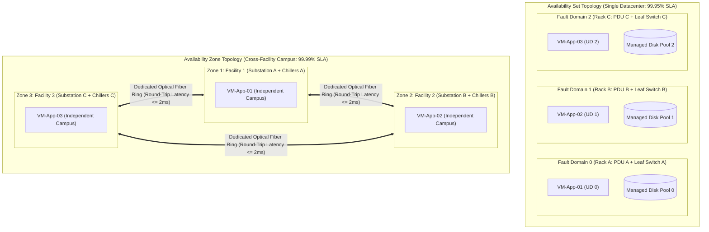
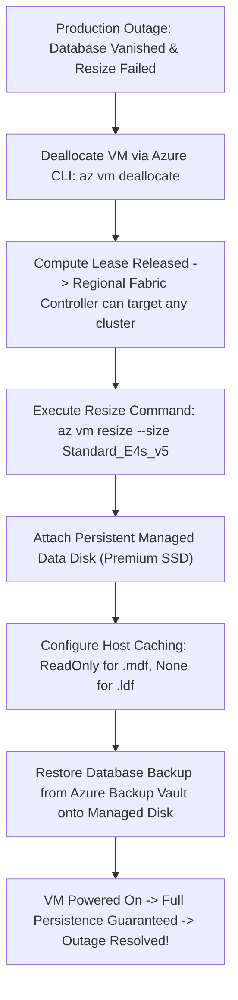

# Module 13-104-09: Administer Azure Virtual Machines, Managed Disks, Bastion & Scale Sets

**Breadcrumbs:** [[13-Index - Azure|☁️ Azure Reference MOC]] > [[13-Index - AZ-104|📘 AZ-104 Exam Track]] > **09 - Administer Azure Virtual Machines**

---

## 🎯 Stage 1: Executive Overview & The Conceptual Lecture

### 1. The Zero-Knowledge Starting Point: What is an IaaS Virtual Machine?
In a traditional on-premises datacenter, if an enterprise needed to run Windows Server 2022 or Ubuntu Linux, engineers purchased a physical steel server blade (from Dell, HP, or Cisco), mounted it into a 19-inch rack, connected dual power supplies, ran redundant Ethernet cables to Top-of-Rack switches, and installed an operating system from a bootable USB drive or PXE server.
* If you needed more CPU or RAM later, you had to physically shut down the server, pop open the chassis, and insert physical CPU chips and DIMM RAM sticks.
* If a motherboard capacitor blew up or a power supply died, that specific server halted immediately, taking down critical business applications.

In Microsoft Azure, an **Infrastructure as a Service (IaaS) Virtual Machine** is a virtual slice of a massive physical server blade running inside Microsoft's global datacenter fleet:
* Microsoft installs enterprise-grade physical server hardware running the **Azure Hypervisor** managed by regional Fabric Controllers.
* When you request a virtual machine, the Azure Resource Manager (ARM) commands the fabric controller to carve out specific virtual CPUs (vCPUs), RAM memory, and virtual network interfaces (vNICs) from the underlying hardware blade.
* **The Shared Responsibility Model in Action:**
  - **Microsoft Manages:** Physical datacenter security, HVAC cooling, electrical generators, physical motherboard, CPU silicon, RAM chips, hypervisor host OS, and physical fiber SDN backbones.
  - **You Manage:** The guest operating system (Windows/Linux), system updates, security patches, user accounts, firewall settings, software runtimes, application code, and data encryption.

### 2. The Apartment Lease Analogy (IaaS vs. PaaS)
* **IaaS (Virtual Machines):** Renting an unfurnished apartment. The landlord (Microsoft) guarantees the walls, roof, plumbing, and electricity work. However, you must bring your own furniture, paint the walls, lock your own doors, clean the floors, and install your own appliances. If your stove breaks, it is your responsibility to fix it.
* **PaaS (App Services / Serverless):** Staying at a luxury hotel room. You just show up with your clothes (application code). The hotel changes the sheets, cleans the bathroom, and maintains all appliances. You have zero control over the plumbing or building wiring, but you have zero maintenance burden!

### 3. Terminology Matrix: Zero-Knowledge to Enterprise Architect

| Terminology | What It Means to a Beginner | Real-World Analog | Enterprise Architecture Reality |
| :--- | :--- | :--- | :--- |
| **Virtual Machine (VM)** | A software computer running in the cloud. | A virtual partition on a shared physical server. | An ARM compute resource (`Microsoft.Compute/virtualMachines`) allocated vCPUs and RAM by the Azure Hypervisor. |
| **Managed Disk** | A virtual hard drive attached to your VM. | A plug-in external SSD that Azure manages so you don't worry about storage accounts. | An enterprise block-storage volume backed by page blobs with 99.999% availability, isolated across storage clusters. |
| **Temporary Disk (`D:` or `/dev/sdb`)** | A temporary scratch drive that wipes when restarted. | A hotel room dry-erase whiteboard that gets wiped clean every morning. | Physical NVMe SSD storage residing directly on the host server blade; all data is lost upon deallocation or hardware migration! |
| **Server-Side Encryption (SSE)** | Transparent disk encryption provided by Azure storage. | A bank vault that automatically locks any lockbox placed inside it. | Storage fabric encryption at rest using 256-bit AES. Supports Platform-Managed Keys (PMK) or Customer-Managed Keys (CMK) via Disk Encryption Sets. |
| **Azure Disk Encryption (ADE)** | BitLocker or DM-Crypt running inside the guest OS. | Locking your luggage with your own personal padlock before putting it in a bank vault. | Guest OS-level volume encryption using BitLocker (Windows) or DM-Crypt (Linux) backed by Azure Key Vault secrets and keys. Incompatible with Encryption at Host. |
| **Encryption at Host** | Encrypting data on the server blade before sending it to storage. | Encrypting a letter before it leaves your desk so the mail carrier never sees plain text. | Hypervisor host blade encryption protecting temp disks, host RAM caches, and storage flows over the network. Zero guest OS CPU overhead. |
| **Disk Encryption Set (DES)** | An Azure resource that links managed disks to Key Vault keys. | The security keycard reader that authorizes disk encryption using your corporate master key. | An ARM resource (`Microsoft.Compute/diskEncryptionSets`) with a managed identity holding crypto permissions in Key Vault. |
| **Trusted Launch** | Hardened VM boot security against rootkits. | A secure checkpoint verifying your ID and badge before allowing you into a building. | Gen2 VM security combining Secure Boot and virtual Trusted Platform Module (vTPM) to enforce boot integrity. |
| **Confidential Computing** | Memory encryption protecting data while in use. | A soundproof, lead-lined room where calculations occur in total isolation from the building owner. | Hardware-enforced memory encryption using AMD SEV-SNP (entire VM isolation) or Intel SGX (application enclave isolation). |
| **Ephemeral OS Disk** | Storing the OS disk on the host blade instead of remote storage. | Running an operating system entirely from high-speed RAM and temporary cache. | Bypasses remote Azure Storage, placing the OS disk directly on the host cache or temp SSD for instant re-imaging, sub-millisecond I/O, and $0 storage cost. |
| **Disk Bursting** | Temporarily exceeding disk IOPS/MBps limits during spikes. | A turbocharger in a sports car providing a burst of acceleration when passing. | Credit-based bursting (free for $\le 512$ GiB Premium SSDs) or On-demand bursting (paid per burst for $\ge 512$ GiB disks) to absorb traffic spikes. |
| **Availability Set** | Spreading VMs across different power racks in one building. | Placing backup generators on different electrical circuits in the same basement. | A logical grouping of VMs distributed across up to 3 Fault Domains (FD) and 20 Update Domains (UD) within a single datacenter (99.95% SLA). |
| **Availability Zone (AZ)** | Spreading VMs across separate buildings in the same city. | Opening three branch offices across town so an earthquake in one neighborhood doesn't stop business. | Distinct physical datacenter facilities within an Azure region, each with independent power, cooling, and networking (99.99% SLA). |
| **Proximity Placement Group (PPG)** | Pinning VMs physically close together inside one datacenter. | Seating team members in adjacent desks in the same room to eliminate walking time. | A logical grouping constraint ensuring VMs and scale sets reside in the same physical spine cluster to achieve $<1\text{ ms}$ network latency. |
| **Dedicated Host** | Renting the entire physical server blade just for your company. | Renting an entire private charter plane rather than buying individual passenger seats. | Single-tenant physical blade hardware (`Microsoft.Compute/hosts`) dedicated exclusively to your subscription for compliance and core licensing (BYOL). |
| **Azure Bastion** | A secure web portal to log into servers without public IPs. | A private guarded airlock hallway leading into a high-security vault. | A fully managed PaaS reverse proxy residing in `AzureBastionSubnet` (`/26`) providing RDP/SSH access over browser TLS 443. |
| **VMSS (Scale Sets)** | An auto-scaling fleet of identical worker VMs. | An automated taxi fleet that dispatches more cars when passenger lines grow long. | A managed pool of compute instances that dynamically scales out or in based on CPU/RAM metrics, schedules, or predictive AI algorithms. |

---

## 🏛️ Stage 2: Core Mental Model & Component Architecture

### 1. VM Sizing Families & Architecture
Selecting the correct VM size ensures you optimize both compute performance and cloud cost:

```text
+-------------------------------------------------------------------------------------------------+
|                                 AZURE VM SIZING FAMILIES                                        |
+-------------------------------------------------------------------------------------------------+
|  General Purpose (B-series, D-series)     |  Compute Optimized (F-series)                       |
|  - CPU-to-RAM Ratio: 1:4 (e.g., 2 CPU, 8GB)|  - CPU-to-RAM Ratio: 1:2 (e.g., 4 CPU, 8GB)         |
|  - B-series: Burstable (accumulates CPU   |  - High clock-speed processors                      |
|    credits; ideal for low-traffic dev/web)|  - Workloads: Batch processing, web app servers,    |
|  - D-series: Balanced enterprise baseline |    analytics, game servers                          |
+-------------------------------------------+-----------------------------------------------------+
|  Memory Optimized (E-series, M-series)    |  Storage & GPU Optimized (L-series, N-series)       |
|  - CPU-to-RAM Ratio: 1:8 to 1:28          |  - L-series: High NVMe throughput (NoSQL/Cassandra) |
|  - Massive RAM capacity (up to 12 TiB)    |  - N-series: Dedicated NVIDIA GPU co-processors     |
|  - Workloads: In-memory caches (Redis),   |  - Workloads: AI/ML deep learning model training,   |
|    enterprise SQL Server, SAP HANA        |    3D ray tracing, video rendering pipelines        |
+-------------------------------------------+-----------------------------------------------------+
|  Confidential Compute (DC-series, EC-series)                                                    |
|  - Hardware-enforced isolation and memory encryption for sensitive workloads                    |
|  - DC-series (Intel SGX): Application enclave isolation (requires code modification)            |
|  - DCA-series (AMD SEV-SNP): Whole VM memory encryption (zero code changes required)             |
+-------------------------------------------------------------------------------------------------+
```

#### Sizing Nomenclature Rules:
- **`s` suffix:** Supports Premium SSD storage (e.g., `Standard_D2s_v5` supports Premium SSD; `Standard_D2_v5` supports only Standard HDD/SSD).
- **`a` suffix:** AMD processors (e.g., `Standard_D4as_v5`).
- **`d` suffix:** Includes local temporary disk (e.g., `Standard_D2ds_v5` has a local temp SSD; `Standard_D2s_v5` is diskless or relies on remote storage).
- **`v` number:** Generation/version of hardware (e.g., `v5` runs newer processors and architecture than `v3`).

---

### 2. The 3-Disk Storage Hierarchy of an Azure VM
Every Azure Virtual Machine contains at least two disks, with the ability to attach multiple persistent data disks:

```text
[ Azure Virtual Machine Host Blade Engine ]
       │
       ├──► 1. OS Disk (Persistent Managed Disk)
       │    ├── Contains the Operating System (Windows `C:` or Linux `/dev/sda`)
       │    ├── Backed by remote triple-replicated Azure Storage page blobs
       │    ├── Default Host Caching: ReadWrite
       │    └── Max Size: 4,095 GiB (4 TiB)
       │
       ├──► 2. Temporary Disk (Ephemeral Host SSD - Non-Persistent!)
       │    ├── Windows `D:\pagefile.sys` or Linux `/dev/sdb1` swap space
       │    ├── Physical NVMe SSD sitting directly on the server blade hardware
       │    ├── Ultra-fast I/O for temporary cache, paging, and tempdb
       │    └── DANGER: WIPED CLEAN WHENEVER VM IS STOPPED / DEALLOCATED / MIGRATED!
       │
       └──► 3. Data Disks (Persistent Managed Disks - Optional LUN 0 to N)
            ├── Stores databases, transaction logs, web content, user application data
            ├── Backed by remote triple-replicated Azure Storage page blobs
            ├── Configurable Host Caching: None, ReadOnly, or ReadWrite
            └── Max Size per disk: 32,767 GiB (32 TiB); Max disks determined by VM SKU
```

#### Managed Disk Performance Tiers Comparison:

| Disk Tier | Underlying Tech | Max Disk Size | Max IOPS | Max Throughput | Typical Enterprise Use Cases |
| :--- | :--- | :--- | :--- | :--- | :--- |
| **Standard HDD** | Magnetic spinning platters | 32 TiB | 2,000 | 500 MB/s | Backup archives, dev/test, non-critical batch jobs |
| **Standard SSD** | Entry-level solid-state | 32 TiB | 6,000 | 750 MB/s | Cost-sensitive production, light web servers |
| **Premium SSD (v1)** | High-performance SSD | 32 TiB | 20,000 | 900 MB/s | Production databases, critical enterprise apps |
| **Premium SSD v2** | Next-gen sub-ms SSD | 64 TiB | 80,000 | 1,200 MB/s | High-transaction SQL, Oracle, Cassandra, SAP HANA |
| **Ultra Disk** | Top-tier NVMe block | 64 TiB | 160,000 | 4,000 MB/s | Extreme I/O workloads; dynamically adjustable IOPS |

---

### 3. Managed Disk Bursting Architecture: Credit-Based vs. On-Demand

#### 1. The Real-World Dilemma: Capacity-Tethered Performance vs. Cloud Waste (The "Why")
In Microsoft Azure Managed Disks (specifically Premium SSD v1), storage performance is not provisioned independently. Instead, disk performance (**IOPS** and **Throughput**) scales strictly in lockstep with provisioned disk storage capacity:
* **P4 Disk (32 GiB):** 120 IOPS baseline | 25 MB/s baseline (~$5/month)
* **P6 Disk (64 GiB):** 240 IOPS baseline | 50 MB/s baseline (~$10/month)
* **P10 Disk (128 GiB):** 500 IOPS baseline | 100 MB/s baseline (~$20/month)
* **P20 Disk (512 GiB):** 2,300 IOPS baseline | 150 MB/s baseline (~$73/month)
* **P30 Disk (1 TiB):** 5,000 IOPS baseline | 200 MB/s baseline (~$135/month)
* **P80 Disk (32 TiB):** 20,000 IOPS baseline | 900 MB/s baseline (~$3,000+/month)

```text
+-------------------------------------------------------------------------------------------------+
|                       THE TRADITIONAL CLOUD STORAGE OVERPROVISIONING DILEMMA                    |
+-------------------------------------------------------------------------------------------------+
|                                                                                                 |
|   [ Small Disk: 32 GiB P4 ]                                                                     |
|   ├── Capacity: 32 GiB (Adequate for 30 GiB OS footprint)                                       |
|   ├── Cost: ~$5 / month (Highly cost-effective)                                                 |
|   └── Baseline IOPS: 120 IOPS  <─── FATAL BOTTLENECK! (OS boot requires 2,500+ IOPS; 10 min lag)|
|                                                                                                 |
|   VS.                                                                                           |
|                                                                                                 |
|   [ Large Disk: 1 TiB P30 ]                                                                     |
|   ├── Baseline IOPS: 5,000 IOPS (Fast, smooth OS boot in 20 seconds)                            |
|   ├── Capacity: 1,024 GiB (Used: 30 GiB | WASTED UNUSED SPACE: 994 GiB / 97%)                   |
|   └── Cost: ~$135 / month (PAYING 27x THE PRICE SOLELY FOR 5 MINUTES OF BOOT IOPS!)             |
|                                                                                                 |
+-------------------------------------------------------------------------------------------------+
```

##### The Spiky Workload Reality:
Real-world enterprise servers rarely demand sustained, constant maximum I/O around the clock. Typical enterprise traffic is inherently bursty:
1. **Operating System Booting & Re-imaging:** When a Windows or Linux VM initializes, the kernel loads drivers, launches system daemons, and scans filesystems, demanding 2,000 to 3,000 IOPS for 2 to 5 minutes. Once booted, steady-state background OS activity plummets to merely 30–80 IOPS.
2. **Morning Login Rushes:** An enterprise virtual desktop (AVD) or ERP application server experiences a sharp 20-to-30-minute spike at 8:30 AM as thousands of workers simultaneously authenticate, load user profiles, and open productivity suites.
3. **Scheduled Patching & Batch Processing:** Nightly database index rebuilds, antivirus definitions scans, or monthly OS security updates cause intense write activity for 15–30 minutes before returning to dormancy.

##### The Cloud Waste Trap:
Historically, to prevent a virtual machine from grinding to a halt during a 5-minute boot sequence or morning rush, cloud architects were forced to size disks based on the **peak demand** rather than the **average demand**. Sizing a disk for 5,000 peak IOPS meant provisioning an oversized 1 TiB P30 disk for a workload that only consumed 30 GiB of data—incurring massive, unnecessary cloud waste by paying for hundreds of gigabytes of idle storage capacity purely to rent short-term IOPS headroom.

##### The Bursting Solution:
**Disk Bursting** shatters this dilemma by decoupling baseline capacity from short-term peak performance. It allows managed disks to temporarily exceed their provisioned baseline limits to absorb high-intensity, short-lived I/O spikes without requiring organizations to upscale disk tiers or pay for unneeded terabytes of storage.

---

#### 2. Model 1: Credit-Based Bursting (The "Rechargeable Battery / Piggy Bank" Metaphor)
Credit-Based Bursting is an automated, self-regulating performance mechanism tailored for small-to-medium enterprise workloads.

* **Target Disk Tiers:** Small Premium SSDs $\le 512\text{ GiB}$ (specifically sizes **P1, P2, P3, P4, P6, P10, P15, and P20**).
* **Cost Model:** **100% Free, automatic, and zero configuration.** It is enabled by default across all Azure regions at no additional charge.
* **Metaphor: The Rechargeable Battery (or Piggy Bank):**
  - **Recharging Phase (Depositing Credits):** When a virtual machine's workload consumes *less* than the disk's provisioned baseline IOPS and MB/s (such as during idle midday hours or overnight), the unused I/O performance is automatically banked as "burst credits" into an internal burst credit bucket.
  - **Discharging Phase (Spending Credits):** When a sudden I/O surge occurs (such as an OS reboot, software installation, or heavy batch job), the disk immediately draws credits from the bucket, surging beyond its baseline up to **3,500 IOPS** and **170 MB/s**—regardless of whether the disk is a 4 GiB P1 or a 512 GiB P20!
* **The 30-Minute Depletion Limit:**
  - The credit bucket has a finite maximum capacity, engineered to hold up to **30 consecutive minutes** of maximum burst performance ($3,500\text{ IOPS} / 170\text{ MB/s}$).
  - If a sustained, heavy workload continuously consumes peak burst performance for more than 30 minutes, the credit bucket completely empties.
  - **The Depletion Penalty:** Once the bucket hits 0 credits, Azure immediately throttles disk performance back down to its hard provisioned baseline (e.g., dropping a P4 back down to 120 IOPS).
  - The disk cannot burst again until application activity subsides below baseline, allowing the bucket to recharge.

```text
+-------------------------------------------------------------------------------------------------+
|                       CREDIT-BASED BURSTING: THE RECHARGEABLE BUCKET                            |
+-------------------------------------------------------------------------------------------------+
|                                                                                                 |
|   SCENARIO A: VM IDLE / LOW I/O (Recharging)                  SCENARIO B: VM I/O SPIKE (Discharging)     |
|   Workload demands 40 IOPS (Baseline = 120 IOPS)              Workload demands 3,000 IOPS (Boot/Patch)  |
|                                                                                                 |
|   Provisioned Baseline: 120 IOPS                              Application Demand: 3,000 IOPS            |
|   Actual Consumption:   -40 IOPS                                       ▲                                |
|   ──────────────────────────────                                       │ Draws 2,880 IOPS from credits  |
|   SURPLUS TO ACCRUE:    +80 IOPS / sec                                 │                                |
|              │                                                ┌────────┴────────┐                       |
|              ▼                                                │  CREDIT BUCKET  │ ──► [ DRAINING ]      |
|      ┌───────────────┐                                        └────────┬────────┘                       |
|      │  CREDIT BUCKET│ ──► [ ACCUMULATING CREDITS ]                    │                                |
|      └───────────────┘     (Capacity: Max 30 mins)                     ▼ Max burst ceiling:             |
|                                                               3,500 IOPS / 170 MB/s delivered!          |
|                                                                                                 |
|   THE DEPLETION RULE:                                                                           |
|   If burst duration exceeds 30 continuous minutes: Bucket = EMPTY ──► Throttled to 120 IOPS!    |
|                                                                                                 |
+-------------------------------------------------------------------------------------------------+
```

---

#### 3. Model 2: On-Demand Bursting (The "Unlimited Credit Card" Metaphor)
On-Demand Bursting removes credit tracking and bucket depletion boundaries, providing an enterprise-grade elastic performance model for mission-critical applications.

* **Target Disk Tiers:** Larger Premium SSDs $> 512\text{ GiB}$ (specifically sizes **P30, P40, P50, P60, P70, and P80**), and can also be explicitly toggled on for disks $\le 512\text{ GiB}$ (overriding credit-based mode).
* **Cost Model:** **Paid model** consisting of two billing vectors:
  1. **Flat Hourly Enablement Fee:** A nominal hourly fee billed continuously while On-Demand Bursting is toggled `ON` (even if no bursting occurs).
  2. **Burst Transaction Fee:** A per-transaction fee billed for burst I/O blocks consumed beyond the provisioned baseline limits (billed in units of 10,000 I/O transactions).
* **Metaphor: The Unlimited Corporate Credit Card:**
  - Unlike a rechargeable battery that runs dry after 30 minutes, On-Demand Bursting functions like an unlimited corporate credit card: swipe as much performance as required, whenever needed, and settle the invoice at the end of the month.
  - **Zero Depletion Limits:** There is no credit bucket, no waiting for idle recharge cycles, and no 30-minute shutdown timer.
  - The disk surges instantly whenever the operating system or database requests it, scaling up to **30,000 IOPS** and **1,000 MB/s** (1 GB/s).
  - The burst can sustain for hours, days, or weeks uninterrupted without ever throttling back to baseline—guaranteeing consistent application responsiveness during massive unpredicted traffic surges.
* **Target Enterprise Workloads:**
  - High-transaction enterprise databases (SQL Server, Oracle, PostgreSQL) experiencing sudden, unexpected query surges.
  - E-commerce platforms during seasonal shopping flash sales (e.g., Black Friday, Cyber Monday).
  - Unscheduled, high-volume batch ETL processing and data warehouse ingestion pipelines where processing delays translate into direct financial impact.

---

#### 4. Comparison Matrix: Credit-Based vs. On-Demand Bursting

| Dimension | Credit-Based Bursting | On-Demand Bursting |
| :--- | :--- | :--- |
| **Cognitive Metaphor** | **Rechargeable Battery / Piggy Bank** (saves unused credits; discharges during spikes) | **Unlimited Corporate Credit Card** (burst on demand without limits; pay for what you use) |
| **Cost Model** | **100% Free** (included at zero extra cost) | **Paid** (flat hourly enablement fee + per-burst transaction usage fee) |
| **Supported Disk Sizes** | Premium SSDs $\le 512\text{ GiB}$ (**P1 to P20**) | Premium SSDs $> 512\text{ GiB}$ (**P30 to P80**), or explicitly enabled on $\le 512\text{ GiB}$ |
| **Max Burst Duration** | **Up to 30 consecutive minutes** (governed strictly by credit bucket capacity) | **Unlimited / Indefinite** (sustains as long as the workload demands; never throttled) |
| **Peak Burst Ceilings** | Up to **3,500 IOPS** and **170 MB/s** | Up to **30,000 IOPS** and **1,000 MB/s** (1 GB/s) |
| **Activation & Control** | **Default & Automatic** (zero configuration; enabled out-of-the-box) | **Manual Opt-In** (toggled on via Azure Portal, Azure CLI, PowerShell, or ARM) |
| **Primary Use Cases** | OS boot, application installation, dev/test compile cycles, morning login rushes | Mission-critical production databases, Black Friday retail spikes, unplanned large-scale ETL |

---

#### 5. The #1 AZ-104 Exam Trap: The "Two-Ceiling Rule" (VM Hypervisor Bottleneck)

> [!WARNING]
> **The Two-Ceiling Rule Law:**
> In Azure, disk storage performance is gated by TWO independent, hierarchical throttles:
> $$\text{Effective Storage Performance} = \min\Big(\text{Disk Burst / Provisioned IOPS Limit},\; \text{Virtual Machine Hypervisor IOPS Limit}\Big)$$
> Having a managed disk that can burst to 3,500 IOPS **DOES NOT** mean your application will achieve 3,500 IOPS!

```text
+-------------------------------------------------------------------------------------------------+
|                       THE TWO-CEILING HYPERVISOR BOTTLENECK IN ACTION                           |
+-------------------------------------------------------------------------------------------------+
|                                                                                                 |
|   [ Guest OS Application / Database ]                                                           |
|                 │                                                                               |
|                 ▼ Generates high I/O spike: Demands 3,500 IOPS                                  |
|   ===========================================================================================   |
|   CEILING 1: VM HYPERVISOR THROTTLE (Standard_B2s Host Limit = 1,280 IOPS)                       |
|   ===========================================================================================   |
|                 │                                                                               |
|                 ├──► Application requests: 3,500 IOPS                                           |
|                 └──► VM Hypervisor TRUNCATES traffic to: 1,280 IOPS! (Ceiling 1 Trumps!)        |
|                 │                                                                               |
|                 ▼ Actual I/O dispatched across storage fabric: 1,280 IOPS                       |
|   ===========================================================================================   |
|   CEILING 2: MANAGED DISK STORAGE SUBSYSTEM (128 GiB P10 Disk with Bursting = 3,500 IOPS)       |
|   ===========================================================================================   |
|                 │                                                                               |
|                 └──► Storage cluster receives 1,280 IOPS and easily handles it.                 |
|                      The disk's remaining 2,220 IOPS burst headroom is COMPLETELY WASTED!       |
|                                                                                                 |
+-------------------------------------------------------------------------------------------------+
```

##### Concrete Failure Scenario (Exam Question Walkthrough):
* **The Scenario:** An administrator provisions a cost-effective `Standard_B2s` VM (2 vCPUs, 4 GiB RAM) hosting an internal application. The VM uses a 128 GiB P10 Premium SSD (baseline 500 IOPS, credit-bursting up to 3,500 IOPS). During heavy report generation, application performance severely degrades. Storage monitoring graphs indicate that disk I/O flatlines at exactly 1,280 IOPS and refuses to climb any higher.
* **The Root Cause:**
  - The administrator assumed that because the attached P10 disk is capable of bursting to 3,500 IOPS, the VM would deliver 3,500 IOPS.
  - However, storage I/O must pass through the **host blade hypervisor I/O scheduler**. Every Azure VM size SKU enforces a strict ceiling on uncached disk throughput.
  - A `Standard_B2s` VM has a hard hypervisor ceiling of **1,280 IOPS and 15 MB/s**.
  - Even though the storage disk was fully capable and ready to burst to 3,500 IOPS, the VM hypervisor intercepted and dropped all I/O exceeding 1,280 IOPS.
* **The Architectural Resolution:**
  - Both ceilings must be intentionally aligned! To achieve 3,500 IOPS from a bursting managed disk, the administrator must resize the virtual machine to a SKU whose uncached disk IOPS limit is equal to or greater than 3,500 IOPS (such as a `Standard_D4s_v5`, which supports up to 12,800 uncached IOPS), or enable host caching (`ReadOnly` or `ReadWrite`) to service I/O directly from host RAM!

---

### 4. Ephemeral OS Disks vs. Traditional Managed Remote OS Disks

#### 1. The Real-World Dilemma: The Storage Tax & I/O Bottleneck of Stateless Fleets (The "Why")
In modern cloud architecture, massive compute fleets are increasingly **stateless**:
* **Kubernetes Worker Nodes (AKS):** Container hosts that run ephemeral pods; all persistent state is mounted to external Azure Files or Managed Disks.
* **Virtual Machine Scale Sets (VMSS):** Auto-scaling web tiers where instances are dynamically spun up during peak traffic and terminated when load subsides.
* **Batch Computing & CI/CD Agents:** Build runners, video rendering engines, and machine learning inference workers that initialize, execute a 15-minute job, and terminate.

Yet, in a traditional Azure VM deployment, every single VM is provisioned with a **Remote Managed OS Disk**:
1. **Network I/O Tax:** Every single operating system operation—reading a DLL, writing to `/var/log`, swapping memory, or updating system services—must travel across the physical host PCIe bus, through the hypervisor vSwitch, across the datacenter SDN fabric, to a remote triple-replicated Azure Storage cluster (Page Blob). This introduces a mandatory network hop penalty ($1.0\text{ to }3.0\text{ ms}$ latency).
2. **Monthly Cloud Storage Invoicing:** Organizations pay provisioned monthly capacity costs for remote managed disks. Sizing a 1,000-node AKS cluster with standard 128 GiB P10 OS disks incurs over **$20,000 per month** in storage invoices alone—paying for persistent disk storage for instances that live for only a few hours!
3. **Provisioning & Re-imaging Bottleneck:** Re-imaging or deploying a VM with a remote managed disk takes several minutes while Azure commands remote storage fabrics to allocate page blobs, copy snapshots, and map SCSI LUNs over the network fabric.

```text
+-------------------------------------------------------------------------------------------------+
|                       THE STATELESS FLEET STORAGE DILEMMA: REMOTE vs. LOCAL                     |
+-------------------------------------------------------------------------------------------------+
|                                                                                                 |
|   [ TRADITIONAL MANAGED OS DISK (REMOTE) ]                                                      |
|   ┌───────────────────────┐        Datacenter SDN Fabric        ┌─────────────────────────────┐ |
|   │ Host Blade vCPU / RAM │ ══════════(1 - 3 ms Latency)═══════►│ Remote Azure Storage Cluster│ |
|   └───────────────────────┘                                     │ (Triple-Replicated Blobs)   │ |
|   - Cost: Monthly provisioned disk storage fee ($$$)            └─────────────────────────────┘ |
|   - Re-imaging: Slow (2 - 5 minutes network blob copy)                                          |
|   - Performance: Capped by remote disk SKU limits (e.g., 500 IOPS / 100 MB/s for P10)           |
|                                                                                                 |
|   VS.                                                                                           |
|                                                                                                 |
|   [ EPHEMERAL OS DISK (LOCAL TO HOST BLADE) ]                                                   |
|   ┌─────────────────────────────────────────────────────────────┐                               |
|   │ PHYSICAL SERVER BLADE                                       │                               |
|   │  ┌───────────────────────┐    High-Speed Internal PCIe Bus  │                               |
|   │  │ Host Blade vCPU / RAM │ ════════(Sub-millisecond)═══════╗│                               |
|   │  └───────────────────────┘                                 ║│                               |
|   │                                                            ▼│                               |
|   │             ┌─────────────────────────────────────────────┐ │                               |
|   │             │ Local Host Storage: NVMe SSD / Blade Cache  │ │                               |
|   │             └─────────────────────────────────────────────┘ │                               |
|   └─────────────────────────────────────────────────────────────┘                               |
|   - Cost: EXACTLY $0.00 STORAGE COST! (Zero disk billing; pay only for VM compute)              |
|   - Re-imaging: Near-instantaneous (10 - 20 seconds; streamed directly from local blade media)   |
|   - Performance: High-throughput local PCIe speeds (up to 80,000+ IOPS & 1,000+ MB/s)           |
|                                                                                                 |
+-------------------------------------------------------------------------------------------------+
```

#### 2. The Concrete Metaphor: The Downtown Safe Deposit Box vs. The Hotel Dry-Erase Whiteboard
To understand Ephemeral OS Disks, imagine the difference between storing notes in a bank vault versus writing them on a whiteboard in your temporary room:
* **Traditional Managed OS Disk (The Downtown Safe Deposit Box):**
  - Renting a heavy-duty, fireproof safe deposit box in a bank vault downtown.
  - Every time your worker needs to write a note or look up a document, an armored courier must drive across town through traffic (SDN fabric) to access the box.
  - The bank charges you a monthly storage fee forever, even when you only need scratch paper to perform daily calculations.
* **Ephemeral OS Disk (The Hotel Room Dry-Erase Whiteboard):**
  - Walking into a hotel room and writing your equations directly onto a massive dry-erase whiteboard mounted on the bedroom wall.
  - You can write and erase at the speed of thought (internal PCIe bus speeds)—zero courier delays!
  - The whiteboard is completely free with the room ($0 storage cost).
  - When you check out of the hotel, the room cleaner wipes the whiteboard completely clean. If you forgot to copy down your notes, they are gone forever!

#### 3. The Mechanical & Topological Reality: PCIe Bypasses, Caches, and Placement Modes
Under the hood of an Azure datacenter, an Ephemeral OS Disk completely eliminates remote storage dependencies by repurposing local silicon sitting directly inside the physical server blade.

```text
+-------------------------------------------------------------------------------------------------+
|                       EPHEMERAL OS DISK PLACEMENT ARCHITECTURES                                 |
+-------------------------------------------------------------------------------------------------+
|                                                                                                 |
|   Option A: VM Cache Placement (diffDiskPlacement: "CacheDisk")                                 |
|   ┌─────────────────────────────────────────────────────────────────────────┐                   |
|   │ Physical Server Blade                                                   │                   |
|   │  [ vCPU & Host RAM ]                                                    │                   |
|   │          │                                                              │                   |
|   │          ├──► [ Ephemeral OS Disk ] ──► Resides in Dedicated Host Cache │                   |
|   │          │                              (Fast RAM / Dedicated NVMe)     │                   |
|   │          └──► [ Temp Disk (D: / /dev/sdb) ] ──► Remains FREE & INTACT!  │                   |
|   │                                                 (Available for paging)  │                   |
|   └─────────────────────────────────────────────────────────────────────────┘                   |
|                                                                                                 |
|   Option B: Resource Disk Placement (diffDiskPlacement: "ResourceDisk")                         |
|   ┌─────────────────────────────────────────────────────────────────────────┐                   |
|   │ Physical Server Blade                                                   │                   |
|   │  [ vCPU & Host RAM ]                                                    │                   |
|   │          │                                                              │                   |
|   │          └──► [ Ephemeral OS Disk ] ──► Consumes Local Temp Disk (D:)   │                   |
|   │                                         (Physical NVMe Scratch Drive)   │                   |
|   │                                         NO separate temp drive mapped!  │                   |
|   └─────────────────────────────────────────────────────────────────────────┘                   |
|                                                                                                 |
+-------------------------------------------------------------------------------------------------+
```

##### 1. Placement Architecture Modes:
1. **VM Cache Placement (`CacheDisk`):**
   * The OS disk is placed into the VM's dedicated host caching layer (the high-speed NVMe/RAM cache allocated by the hypervisor).
   * **Advantage:** Preserves the VM's local temporary resource disk (`D:\` on Windows or `/dev/sdb` on Linux), meaning your application can still utilize the temp disk for pagefiles or database tempdb scratch files.
   * **Requirement:** The target VM size SKU must have a host cache size greater than or equal to the OS disk size:
     $$\text{VM Cache Capacity (GiB)} \ge \text{OS Disk Image Size (GiB)}$$
     *(For example, Ubuntu's 30 GiB image easily fits inside a `Standard_D4s_v5` with 100 GiB cache).*
2. **Resource Disk Placement (`ResourceDisk`):**
   * The OS disk is placed directly into the physical host temporary scratch drive (the NVMe disk that traditionally surfaces as `D:`).
   * **Advantage:** Available on VM SKUs that possess large temporary disks but small or non-existent host caches (e.g., `Standard_D4ds_v5` or `Standard_E4ds_v5`).
   * **Trade-off:** Consumes the temporary drive space; the guest OS will not see a separate physical `D:` scratch disk.
   * **Requirement:**
     $$\text{VM Temp / Resource Disk Capacity (GiB)} \ge \text{OS Disk Image Size (GiB)}$$
3. **NVMe Disk Placement:**
   * On newer generation hardware (such as `Lsv3` and `Ebsv5`), the OS disk can be placed directly on dedicated physical host NVMe controllers for unprecedented sub-millisecond read/write performance.

##### 2. Ephemeral vs. Traditional Managed Remote OS Disks Matrix:

| Feature / Dimension | Traditional Managed Remote OS Disk | Ephemeral OS Disk (`diffDiskPlacement`) |
| :--- | :--- | :--- |
| **Physical Storage Location** | Remote Azure Storage Cluster (Page Blob) | **Local Host Blade Hardware** (NVMe / Cache) |
| **Storage Capacity Cost** | Billed monthly based on disk tier/size | **$0.00 Disk Cost** (100% free with VM compute) |
| **I/O Latency** | $1.0\text{ to }3.0\text{ ms}$ (cross-fabric network trip) | **$< 0.3\text{ ms}$** (internal PCIe/NVMe bus speed) |
| **Maximum Throughput/IOPS** | Throttled by disk tier SKU (e.g., P10 = 500 IOPS) | **Host-level max limits** (up to 80,000+ IOPS) |
| **Re-image / Reset Speed** | Minutes (remote blob provisioning & copy) | **Seconds (10–20s)** (streamed to local media) |
| **Data Persistence on Deallocate** | **Persistent** (data preserved in storage cluster) | **DESTROYED** (state wiped when host blade released) |
| **Stop / Deallocate Support** | Full support (`az vm deallocate` preserves state) | **NOT SUPPORTED** (stopping releases host blade!) |
| **Disk Snapshots & Azure Backup** | Native snapshot and Azure Backup support | **NOT SUPPORTED** (cannot snapshot ephemeral disks) |
| **Disk Resizing Support** | Expand disk online or offline | **Fixed at creation** (cannot resize in-place) |
| **Ideal Architectural Workloads** | Stateful enterprise apps, Active Directory, DBs | **AKS worker nodes, VMSS web tiers, CI/CD, ETL** |

#### 4. The Production Failure Loop & Exam Trap: Ephemeral Constraints

##### Trap 1: The `OSDiskSizeExceedsCacheSize` Deployment Failure
* **The Scenario:** An engineer attempts to deploy a Windows Server 2022 virtual machine with an Ephemeral OS disk on a `Standard_D2s_v5` VM SKU using Cache placement. The deployment crashes instantly with:
  ```text
  EphemeralLocalDiskPlacementError: The OS disk of size 136314880 KB (127 GiB) is 
  larger than the cache size 53687091 KB (50 GiB) for VM size Standard_D2s_v5.
  ```
* **The Root Cause:** Windows Server default OS images are **127 GiB**. A `Standard_D2s_v5` only has **50 GiB** of host cache. The OS image physically cannot fit into the blade's provisioned cache!
* **The Resolution:** 
  1. Use a smaller OS image footprint, such as Windows Server Core or Linux (Ubuntu images are ~30 GiB).
  2. Scale up to a larger VM SKU with a host cache $\ge 127\text{ GiB}$ (e.g., `Standard_D8s_v5` has 200 GiB cache).
  3. Switch from `CacheDisk` placement to `ResourceDisk` placement on a "d-series" SKU that includes a large temp disk (e.g., `Standard_D4ds_v5` has a 150 GiB NVMe temp disk).

##### Trap 2: The "Stopped VM Deallocation State Loss" Disaster
* **The Scenario:** A junior engineer provisions an ephemeral VMSS node running a legacy microservice that writes incoming batch files to `C:\ProgramData\IncomingQueue`. During maintenance, the engineer deallocates the VMSS instance. When restarted, the queue directory is completely empty, and the application crashes with missing configuration files.
* **The Root Cause:** Ephemeral OS Disks do not retain state across deallocation. When a VM with an ephemeral OS disk is stopped/deallocated, **the Azure Fabric Controller completely tears down the VM container and releases the physical host blade silicon**. When restarted, the VM lands on a completely different physical server blade, and Azure flashes a freshly reimaged base OS image onto the new blade's local disk!
* **The Architectural Law:**
  > [!WARNING]
  > Never store persistent business state, application logs, or database transactions on an Ephemeral OS Disk! Ephemeral disks are strictly for stateless worker processes. All persistent application state MUST be offloaded to external Azure Managed Data Disks, Azure Files, Azure SQL, or Blob Storage.

---

### 5. High Availability Spectrum: Single VM, Availability Sets, and Availability Zones

#### 1. The Real-World Dilemma: Hardware Fragility vs. Facility-Wide Catastrophe (The "Why")
When running critical enterprise workloads in the cloud, infrastructure engineers must answer a fundamental question: **What failure boundary are we engineering against?**

Every virtual machine runs on physical hardware that will eventually fail:
1. **Single Blade Failures:** A power supply capacitor explodes, an ECC RAM stick throws uncorrectable multi-bit errors, or the hypervisor kernel encounters a panic. A standalone VM running on that single blade halts immediately.
2. **Rack-Level Outages (The Shared Spine):** A 7-foot server rack houses 40 to 80 physical blades. If the rack's primary Power Distribution Unit (PDU) trips its circuit breaker, or if the Top-of-Rack (ToR) leaf network switch burns out its ASIC, **every single server blade in that cabinet drops dead simultaneously**. If your primary and secondary web servers sit on adjacent blades in that same rack, both servers crash at the exact same instant!
3. **Planned Hypervisor Maintenance:** Microsoft continuously rolls out security patches to the physical hypervisor host OS. When a hypervisor requires a host reboot, every VM on that blade must pause, migrate, or restart.
4. **Catastrophic Facility Outages:** A lightning strike blows up a regional municipal power substation, a severe flood submerges datacenter backup generators, or an HVAC chilled water pipe ruptures, causing datacenter ambient temperatures to hit thermal shutdown thresholds. An entire physical datacenter building goes dark.

To protect workloads against these distinct failure domains, Azure provides two distinct high-availability primitives: **Availability Sets** (intra-datacenter rack isolation) and **Availability Zones** (cross-datacenter facility isolation).

```text
+-------------------------------------------------------------------------------------------------+
|                       AZURE HIGH AVAILABILITY PHYSICAL FAILURE BOUNDARIES                       |
+-------------------------------------------------------------------------------------------------+
|                                                                                                 |
|   LEVEL 1: SINGLE VM (99.9% SLA with Premium SSD)                                               |
|   ┌────────────────────────────────┐                                                            |
|   │ Physical Server Blade          │ ──► Single point of failure! If blade CPU/RAM dies or host  |
|   │ [ VM-01 ]                      │     hypervisor patches reboot, your application goes DOWN.  |
|   └────────────────────────────────┘                                                            |
|                                                                                                 |
|   LEVEL 2: AVAILABILITY SET (99.95% SLA) ──► INSIDE ONE PHYSICAL BUILDING                       |
|   ┌─────────────────────────────────────────────────────────────────────────────────────────┐   |
|   │ SINGLE DATACENTER BUILDING (Shared Municipal Substation, Chilled Water, and Roof)       │   |
|   │                                                                                         │   |
|   │   Rack A (FD 0 / UD 0)          Rack B (FD 1 / UD 1)          Rack C (FD 2 / UD 2)      │   |
|   │   ┌─────────────────────┐       ┌─────────────────────┐       ┌─────────────────────┐   |
|   │   │ [ Leaf Switch A ]   │       │ [ Leaf Switch B ]   │       │ [ Leaf Switch C ]   │   |
|   │   │ [ PDU Circuit A ]   │       │ [ PDU Circuit B ]   │       │ [ PDU Circuit C ]   │   |
|   │   │  ... Blades ...     │       │  ... Blades ...     │       │  ... Blades ...     │   |
|   │   │ ┌─────────────────┐ │       │ ┌─────────────────┐ │       │ ┌─────────────────┐ │   |
|   │   │ │ VM-Web-01       │ │       │ │ VM-Web-02       │ │       │ │ VM-Web-03       │ │   |
|   │   │ └─────────────────┘ │       │ └─────────────────┘ │       │ └─────────────────┘ │   |
|   │   └─────────────────────┘       └─────────────────────┘       └─────────────────────┘   |
|   │   Protects against: PDU failure, rack switch failure, sequential hypervisor OS updates. │   |
|   │   VULNERABLE TO: Building flood, municipal grid blackout, lightning strike on facility! │   |
|   └─────────────────────────────────────────────────────────────────────────────────────────┘   |
|                                                                                                 |
|   LEVEL 3: AVAILABILITY ZONES (99.99% SLA) ──► ACROSS DISTINCT PHYSICAL FACILITIES               |
|   ┌───────────────────────┐       ┌───────────────────────┐       ┌───────────────────────┐     |
|   │ ZONE 1 (Facility A)   │       │ ZONE 2 (Facility B)   │       │ ZONE 3 (Facility C)   │     |
|   │ - Independent Power   │       │ - Independent Power   │       │ - Independent Cooling │     |
|   │ - Independent Cooling │       │ - Independent Cooling │       │ - Independent Substat.│     |
|   │ - Independent Substat.│       │ - Independent Substat.│       │ ┌───────────────────┐ │     |
|   │ ┌───────────────────┐ │       │ ┌───────────────────┐ │       │ │ VM-Web-03         │ │     |
|   │ │ VM-Web-01         │ │       │ │ VM-Web-02         │ │       │ └───────────────────┘ │     |
|   │ └───────────────────┘ │       │ └───────────────────┘ │       └───────────┬───────────┘     |
|   └───────────┬───────────┘       └───────────┬───────────┘                   │                 |
|               │                               │                               │                 |
|               └═══════════════════════════════╧═══════════════════════════════╝                 |
|                       Dedicated Ultra-Low Latency (<2ms) Regional Optical Fiber Ring            |
|                                                                                                 |
+-------------------------------------------------------------------------------------------------+
```

#### 2. The Concrete Metaphor: The Office Circuit Breakers vs. Multi-Campus Redundancy
To clearly conceptualize the architectural difference, contrast an in-office electrical setup with geographically separated corporate branch facilities:
* **Availability Set (The Office Circuit Breakers):**
  - Imagine you run a medical clinic with two life-saving vaccine refrigerators in the basement.
  - To prevent a blown fuse from spoiling the medicine, you plug Refrigerator 1 into Circuit Breaker A (Fault Domain 0) and Refrigerator 2 into Circuit Breaker B (Fault Domain 1).
  - If a technician shorts out Circuit A, Refrigerator 2 keeps running uninterrupted.
  - **The Catch:** Both refrigerators sit inside the **exact same basement**. If the municipal water main bursts and floods the basement, or if a fire engulfs the building, **both refrigerators are destroyed simultaneously**!
* **Availability Zones (The Multi-Campus Redundancy):**
  - Instead of putting both refrigerators in one basement, you place Refrigerator 1 in your downtown clinic (Zone 1), Refrigerator 2 in your north suburbs clinic (Zone 2), and Refrigerator 3 in your west valley clinic (Zone 3).
  - Each clinic is powered by a different municipal power utility company, draws water from a different reservoir, and has its own underground diesel generator.
  - Even if a catastrophic gas line explosion or catastrophic blackout levels the entire downtown district, the north and west clinics continue operating at 100% capacity!

#### 3. The Mechanical & Topological Reality: Fault Domains, Update Domains, and Optical Envelopes



##### 1. Availability Sets Mechanical Deep-Dive:
An **Availability Set** (`Microsoft.Compute/availabilitySets`) is a logical placement contract commanding the Azure Fabric Controller to distribute instances across physical hardware boundaries within **a single datacenter facility**:
1. **Fault Domains (FD):**
   * **Definition:** A Fault Domain is a physical server rack (or cluster of racks) sharing a common physical power supply (PDU) and network switch (ToR).
   * **Scale:** Supports up to **3 Fault Domains** (FD 0, FD 1, FD 2) in regions supporting managed disks (some legacy or peripheral regions support only 2 FDs).
   * **Managed Disk Alignment:** When you attach Managed Disks to VMs in an Availability Set, Azure automatically aligns the underlying storage cluster allocation with the compute Fault Domains. VM in FD 0 attaches to storage clusters isolated from storage clusters serving FD 1!
2. **Update Domains (UD):**
   * **Definition:** An Update Domain is a logical grouping of physical server blades for planned platform maintenance (such as hypervisor OS kernel upgrades, hypervisor firmware flashes, or security updates).
   * **Scale:** Configurable from **1 up to 20 Update Domains** (default is 5).
   * **Rolling Reboot Orchestration:**
     * During planned maintenance, the Azure Fabric Controller updates only **one Update Domain at a time**.
     * Once UD 0 completes its update and all VMs on it pass health checks, Azure pauses for a **30-minute recovery period** before beginning updates on UD 1.
     * This guarantees that if you have 5 VMs spread across 5 UDs, at least 4 VMs (80% capacity) remain running and handling traffic at all times during hypervisor patching!
3. **Availability Set SLA:** **99.95%** availability SLA for the fleet (strictly requires at least 2 VMs provisioned across distinct fault domains behind a load balancer).

##### 2. Availability Zones Mechanical Deep-Dive:
An **Availability Zone** is a physical, standalone datacenter campus within an Azure region:
1. **Physical Isolation Architecture:**
   * Each zone consists of **one or more distinct physical datacenter buildings**.
   * **Substation Independence:** Each zone is wired to a distinct, independent high-voltage utility power grid substation. A blackout in one municipal electrical district cannot affect the adjacent zone.
   * **Cooling Independence:** Each zone operates dedicated industrial cooling towers, chilled water loops, and air handling equipment.
   * **Generators:** Each zone maintains an on-site diesel generator yard with hundreds of thousands of gallons of fuel storage capable of powering the entire facility for multiple days without utility grid power.
2. **The 2ms Optical Latency Envelope:**
   * Availability Zones within a region are typically located **10 to 25 miles apart**—far enough to ensure a localized catastrophe (tornado, explosion, river flood) cannot destroy multiple zones, yet close enough that light traveling through optical fiber keeps round-trip network latency **$\le 2.0\text{ ms}$**.
   * This sub-2ms speed allows applications to perform **synchronous database replication** (e.g., SQL Server Always On Availability Groups, Azure SQL Business Critical) across zones without degrading transactional commit throughput.
3. **Availability Zone SLA:** **99.99%** uptime SLA (requires at least 2 VMs distributed across two or more Availability Zones).
4. **Subscription-to-Physical Zone Logical Mapping (Indirection):**
   * Azure decouples the logical zone numbers you see in the portal (`Zone 1`, `Zone 2`, `Zone 3`) from the physical buildings.
   * To prevent all Azure customers from universally deploying everything to physical Building 1, Azure automatically randomizes the mapping per subscription:
     - In **Subscription A**: Logical `Zone 1` might map to Physical Datacenter `East US Facility C`.
     - In **Subscription B**: Logical `Zone 1` might map to Physical Datacenter `East US Facility A`.
   * For cross-subscription low-latency deployments, enterprises use the `AvailabilityZonesLogicalToPhysicalMap` API to align physical zones across tenants.

##### 3. Comprehensive High Availability Comparison Matrix:

| Architectural Metric | Standalone Single VM | Availability Set | Availability Zone (AZ) |
| :--- | :--- | :--- | :--- |
| **Physical Scope** | Single server blade | Multiple racks in **one facility** | **Multiple physical datacenter campuses** |
| **SLA Guarantee** | **99.9%** (Premium/Ultra SSD only) | **99.95%** (2+ instances) | **99.99%** (2+ instances across zones) |
| **Power Infrastructure** | Single rack PDU | Separate rack PDUs in building | **Independent utility substations & generators** |
| **Network Infrastructure** | Single leaf switch | Separate ToR leaf switches | **Independent regional fiber routing spines** |
| **Cooling Infrastructure** | Shared building chillers | Shared building chillers | **Independent chilled water loops per campus** |
| **Failure Protection** | None (blade crash = downtime) | Rack power loss, switch burn, UD update | **Complete datacenter flood, fire, or grid collapse** |
| **Fault Domain Count** | 1 | Up to **3 Fault Domains** (FD 0, 1, 2) | Up to **3 Availability Zones** (Zone 1, 2, 3) |
| **Update Domain Count** | 1 | Up to **20 Update Domains** (UD 0..19) | Zone-by-zone rolling updates |
| **Cross-Instance Latency** | $0.1\text{ ms} - 0.2\text{ ms}$ | $0.2\text{ ms} - 0.5\text{ ms}$ | $1.0\text{ ms} - 2.0\text{ ms}$ |
| **Configuration Timing** | Anytime | **At creation time only!** | **At creation time only!** |
| **Cost Implication** | Pay for 1 VM compute | Pay for N VM computes ($0 AvSet fee)| Pay for N VM computes + inter-zone egress data |

#### 4. The Production Failure Loop & Exam Trap: High-Availability Traps

##### Trap 1: The "Add Existing VM to Availability Set" Immutability Trap
* **The Scenario:** A company provisions a standalone VM `vm-web-prod` in production. Two months later, after an outage, management demands that this VM be added to an existing Availability Set `as-web-fleet` to achieve the 99.95% SLA. The administrator spends hours searching the Azure Portal for an "Add to Availability Set" button.
* **The Ground Truth & Root Cause:** **A Virtual Machine CANNOT be added to an Availability Set (or Availability Zone) after it has been created!** The placement constraint must be fed to the Azure Compute Fabric Controller at the exact millisecond the VM's hardware lease is generated.
* **The Remediation Protocol:**
  1. Stop and deallocate the VM.
  2. Delete the virtual machine resource—**CRITICAL: DO NOT DELETE THE MANAGED OS DISK!**
  3. Recreate the virtual machine from the existing managed OS disk using Azure CLI, specifying `--availability-set as-web-fleet` (or `--zone 1`).

##### Trap 2: The Shared Datacenter Facility Blindspot (The 99.95% Fallacy)
* **The Scenario:** An architect builds a mission-critical banking portal with 4 web servers and 2 database nodes distributed across 3 Fault Domains in an Availability Set. A massive summer thunderstorm triggers a catastrophic electrical transformer explosion at the primary municipal power substation serving the datacenter. The entire facility drops offline, and the banking portal experiences a 6-hour total outage.
* **The Root Cause:** The architect confused **rack-level resilience** with **facility-level disaster recovery**. Availability Sets protect against a rack power strip failure or leaf switch failure. They provide **zero protection** against facility-wide floods, municipal grid blackouts, or structural damage.
* **The Architectural Law:**
  > [!IMPORTANT]
  > For all production workloads requiring business continuity, always deploy across **Availability Zones** (99.99% SLA). Reserve Availability Sets only for legacy Azure regions that lack Availability Zone infrastructure, or for specialized legacy software clustering that cannot tolerate the 1.5ms inter-zone fiber latency.

##### Trap 3: The Single VM 99.9% SLA Disqualification Trap
* **The Scenario:** A cost-conscious administrator deploys a single VM without an Availability Set or Zone, but promises stakeholders a 99.9% uptime SLA because "Azure guarantees 99.9% on single VMs." To save money, the administrator equips the VM with a `Standard HDD` OS disk and a `Standard SSD` data disk. The VM experiences 45 minutes of downtime due to physical host repairs, but Microsoft denies the SLA credit claim.
* **The Ground Truth:** Azure's **99.9% Single VM SLA applies STRICTLY when ALL attached disks (both OS and Data disks) are Premium SSD or Ultra Disk!** If even one attached disk uses Standard SSD (which drops the SLA to 99.5%) or Standard HDD (which provides **NO SLA at all**), the virtual machine loses its 99.9% SLA entitlement!

---

## 🏢 Stage 3: Deep-Intuition Platform Mechanics & Topology

### 1. The Azure VM & Disk Encryption Spectrum (Crucial Architecture & Exam Core)
Azure offers multiple distinct layers of encryption to protect data at rest, data in transit, and data in use:

```text
+-------------------------------------------------------------------------------------------------+
|                                AZURE DISK & COMPUTE ENCRYPTION SPECTRUM                         |
+-------------------------------------------------------------------------------------------------+
| Layer 1: Server-Side Encryption (SSE)                                                           |
| ├── Default: Enabled on ALL Managed Disks, Snapshots, and Images using 256-bit AES.             |
| ├── Key Option A: Platform-Managed Keys (PMK) - Transparent, zero cost, rotated by Microsoft.   |
| ├── Key Option B: Customer-Managed Keys (CMK) - Keys in Azure Key Vault via Disk Encryption Set.|
| └── Key Option C: Double Encryption at Rest - Combines two independent layers (PMK + CMK).      |
+-------------------------------------------------------------------------------------------------+
| Layer 2: Encryption at Host (End-to-End Host Blade Encryption)                                  |
| ├── Where it Encrypts: On the physical hypervisor server blade before transmission.             |
| ├── What it Covers: Temporary Disks (D:), Host RAM caches, OS/Data disk network flows to storage|
| ├── Performance: Zero guest OS CPU overhead (handled by hypervisor hardware).                   |
| └── Compatibility Law: MUTUALLY EXCLUSIVE WITH AZURE DISK ENCRYPTION (ADE)! Cannot use both!    |
+-------------------------------------------------------------------------------------------------+
| Layer 3: Azure Disk Encryption (ADE)                                                            |
| ├── Where it Encrypts: Inside the Guest Operating System.                                       |
| ├── Technology: BitLocker (Windows) and DM-Crypt (Linux).                                       |
| ├── Key Hierarchy: BitLocker Encryption Key (BEK) wrapped by Key Encryption Key (KEK) in AKV.   |
| ├── Performance: Incurs CPU overhead inside the VM OS for cryptographic operations.             |
| └── Requirement: Key Vault must have '--enabled-for-disk-encryption true' flag set!             |
+-------------------------------------------------------------------------------------------------+
| Layer 4: Confidential Computing (Encryption in Use)                                             |
| ├── AMD SEV-SNP (DCA/ECA series): Encrypts entire VM RAM memory; hypervisor cannot peek.        |
| └── Intel SGX (DC series): Hardware enclaves inside CPU; requires application refactoring.      |
+-------------------------------------------------------------------------------------------------+
```

#### Detailed Comparison: SSE vs. Encryption at Host vs. ADE

| Feature                        | Server-Side Encryption (SSE)          | Encryption at Host                    | Azure Disk Encryption (ADE)             |
| :----------------------------- | :------------------------------------ | :------------------------------------ | :-------------------------------------- |
| **Encryption Location**        | Azure Storage Cluster Backend         | Physical Hypervisor Host Blade        | Inside Guest OS Kernel                  |
| **Protects Remote Disks?**     | Yes (at rest in storage clusters)     | Yes (encrypted before leaving host)   | Yes (encrypted volume blocks)           |
| **Protects Temp Disk (`D:`)?** | **NO!** (Temp disk is local to blade) | **YES!** (Protects temp disk at rest) | **NO!** (Only OS and Data LUNs)         |
| **Protects Host Cache?**       | **NO!** (Unencrypted in host RAM)     | **YES!** (Encrypted in host RAM/SSD)  | **YES!** (Data in cache is encrypted)   |
| **Guest OS CPU Overhead?**     | 0% (handled by storage clusters)      | 0% (handled by host CPU silicon)      | 3% - 10% (guest CPU performs crypto)    |
| **Key Vault Setup Required?**  | Only if using CMK (via DES)           | Optional (supports PMK or CMK)        | **Mandatory** (Key Vault with ADE flag) |
| **Mutually Exclusive With?**   | Fully compatible with all             | **Incompatible with ADE!**            | **Incompatible with Host Encryption!**  |

---

### 2. Disk Encryption Sets (DES) Architecture & Permissions Flow
When an enterprise uses **Customer-Managed Keys (CMK)** for Managed Disks or Encryption at Host, Azure requires a dedicated bridge resource called a **Disk Encryption Set (DES)**:

```text
[ Azure Key Vault (AKV) ]
  ├── Master Key: rsa-disk-key-01 (HSM or Software-protected)
  └── Role: "Key Vault Crypto Service Encryption User"
             ▲
             │ (Grants Wrap / Unwrap Key permissions)
             ▼
[ Disk Encryption Set (DES) ]  <--- Holds System-Assigned or User-Assigned Managed Identity
             ▲
             │ (Associated during disk creation or update)
             ▼
[ Managed Disks / Snapshots / Host Encryption ]
```

#### The DES Deployment Sequence:
1. Create Azure Key Vault with **Purge Protection** and **Soft Delete** enabled (mandatory for CMK to prevent catastrophic disk loss!).
2. Create an RSA Key inside Key Vault (e.g., 2048, 3072, or 4096-bit).
3. Create the **Disk Encryption Set** (`az disk-encryption-set create`).
4. Assign the DES Managed Identity the `Key Vault Crypto Service Encryption User` role on the Key Vault.
5. Create or associate Managed Disks pointing to the DES ID.

---

### 3. VM States: Stopped vs. Stopped (Deallocated) (High-Yield Concept!)
One of the most common billing traps in Azure computing is misunderstanding the two different "stopped" states:

```text
State 1: Stopped (Guest OS Shutdown)
├── Triggered By: Running 'shutdown -h now' inside Linux or Windows Start -> Shut down
├── Hypervisor Action: OS halts, but hardware vCPUs and RAM remain RESERVED on the physical blade!
└── Billing Impact: YOU ARE STILL BILLED FOR FULL COMPUTE CORES AND RAM! (No cost savings!)

State 2: Stopped (Deallocated) (Cloud Fabric Shutdown)
├── Triggered By: Clicking 'Stop' in Azure Portal, or running 'az vm deallocate'
├── Hypervisor Action: Fabric Controller releases hardware lease; CPU and RAM freed back to pool
└── Billing Impact: COMPUTE BILLING DROPS TO $0.00! (You only pay for attached disk storage).
```

---

### 4. VM Resizing Mechanics & The `AllocationFailed` Error
When you resize a virtual machine (e.g., from `Standard_B2s` to `Standard_E4s_v5`):
* If the VM is currently **Running**, Azure attempts to resize the VM *in-place on the same physical server blade cluster*.
* If that physical server blade cluster does not have enough unallocated RAM or does not support the new hardware family (e.g., jumping from an older Intel cluster to a newer AMD EPYC cluster), ARM immediately aborts with:
  `AllocationFailed: Allocation failed. We do not have sufficient capacity for the requested VM size in this region or cluster.`
* **The Solution:** You must first **Deallocate** the VM (`az vm deallocate`). Once deallocated, Azure's regional fabric controller is free to allocate the VM onto *any physical hardware cluster in the entire datacenter* that supports the target VM size!

---

### 5. Managed Disk Host Caching Mechanics (Database Integrity Law)
When data is written to a Managed Disk, the Azure Hypervisor on the host server blade provides an in-memory and local SSD cache:

```text
[ Application Write: INSERT INTO Orders VALUES (...) ]
                       │
                       ▼
            [ Host Hypervisor Cache ]
                       │
       ┌───────────────┴───────────────┐
       ▼                               ▼
[ ReadWrite Caching ]          [ None (No Caching) ]
- Writes acked in Host RAM     - Write passes through host cache directly
- Flushed to disk later        - Acked ONLY when committed to triple-replicated disk
- DANGER: If host loses power, - Zero data loss risk during unexpected crash!
  unwritten blocks are lost!   - MANDATORY FOR SQL TRANSACTION LOGS (.ldf)!
```

#### Host Caching Rules of Thumb:
* **`ReadWrite` (Default):** Ideal for OS disks. Speeds up general OS boot times and application loading.
* **`ReadOnly`:** Reads are cached in fast host RAM; writes pass through directly to disk. **Recommended for SQL Server data files (`.mdf`)** and static read-heavy files.
* **`None` (No Caching):** Bypasses host cache completely. **Mandatory for database transaction logs (SQL `.ldf`, Oracle redo logs)** to prevent database corruption during unexpected physical host crashes!

---

### 6. Proximity Placement Groups (PPG) vs. Dedicated Hosts

When architecting enterprise cloud compute, engineers face two distinct physical hardware challenges: **minimizing network latency between interconnected tiers** and **enforcing single-tenant physical isolation for compliance and licensing**. Azure provides two dedicated primitives to control physical blade placement: **Proximity Placement Groups (PPG)** and **Azure Dedicated Hosts**.

```text
+----------------------------------------------------------------------------------------------------+
|                                ADVANCED COMPUTE PLACEMENT ARCHITECTURE                              |
+----------------------------------------------------------------------------------------------------+
|  1. Proximity Placement Group (PPG)               |  2. Azure Dedicated Hosts                      |
|  - Goal: Sub-millisecond network latency (<0.5ms) |  - Goal: Single-tenant physical hardware       |
|  - Scope: Colocates resources in same spine pod   |  - Scope: Allocates an entire physical blade   |
|  - How it Works: Forces Azure Fabric to pin       |  - How it Works: You reserve dedicated silicon  |
|    all VMs, AvSets, and VMSS into the same        |    (`hostGroups` & `hosts`) to run only your   |
|    physical rack neighborhood / local spine.      |    organization's hypervisor VMs.          |
|  - Trade-off: Sacrifices fault isolation and      |  - Trade-off: High static operational cost;    |
|    triggers `AllocationFailed` when row fills up. |    you pay for the entire host blade.      |
|  - Target Workloads: SAP HANA, MPI, HPC, and      |  - Target Workloads: Strict regulatory HIPAA/  |
|    ultra-low latency multi-tier transactions.     |    PCI-DSS, BYOL core licensing, maintenance.  |
+----------------------------------------------------------------------------------------------------+
```

---

#### The Ground-Zero Physical Datacenter Reality: The Mechanics of Network Latency

To understand why Proximity Placement Groups exist, you must step inside the physical reality of a modern hyperscale Azure datacenter. Cloud computing is not abstract magic; it is physical silicon, copper, glass fiber, and steel cabinets deployed across vast real estate.

```text
                         THE HYPERSCALE DATACENTER PHYSICAL HIERARCHY
                         
  [ OVERHEAD SPINE MASTER HIGHWAY ] (Spine Switches hanging from ceiling cable trays)
              ▲                                              ▲
              │ 400 Gbps Optical Fiber Trunks                │ 400 Gbps Optical Fiber Trunks
              ▼                                              ▼
   [ LEAF SWITCH (ToR 1) ]                        [ LEAF SWITCH (ToR 1000) ]
   (Top shelf of Rack 1)                          (Top shelf of Rack 1000)
       ├── 1m Direct Patch Cable                      ├── 1m Direct Patch Cable
       ▼                                              ▼
  ┌───────────────────────┐                      ┌───────────────────────┐
  │ Physical Blade Server │                      │ Physical Blade Server │
  │ [VM-A] (App Tier)     │                      │ [VM-C] (Random Rack)  │
  ├───────────────────────┤                      ├───────────────────────┤
  │ Physical Blade Server │                      │ Physical Blade Server │
  │ [VM-B] (In-Rack DB)   │                      │                       │
  ├───────────────────────┤                      ├───────────────────────┤
  │  ... 40-80 Blades ... │                      │  ... 40-80 Blades ... │
  └───────────────────────┘                      └───────────────────────┘
     RACK 1 (Neighborhood A)                        RACK 1000 (4 Football Fields Away)
```

##### Step 1: The Server Blade & The Rack
* The base physical unit of compute is a **Server Blade** (a standard 1U/2U server chassis containing multi-socket CPUs, hundreds of gigabytes of RAM, local SSDs, and PCIe SmartNICs).
* These blades do not sit on tables. They are mounted vertically inside a standard 19-inch steel cabinet known as an **Equipment Rack** (a 7-foot tall enclosure roughly the size of a commercial refrigerator).
* A single rack holds **40 to 80 physical server blades** stacked one above the other, drawing upwards of 20 to 40 kilowatts of power and cooled by chilled water or forced airflow.

##### Step 2: The "Leaf" (Top-of-Rack / ToR) Switch
* Sitting on the top shelf of every single rack is a dedicated enterprise networking switch called the **Top-of-Rack (ToR)** or **Leaf Switch**.
* Every single server blade inside that rack plugs directly into this ToR switch using a short, 1-meter high-speed copper DAC (Direct Attach Copper) or short-range fiber cable.
* **The In-Rack Latency Advantage:** If `VM-A` and `VM-B` land on two server blades inside the **exact same physical rack**, their network packets travel up to the ToR switch and immediately bounce back down to the destination blade. The packet **never leaves the cabinet**. Latency is practically instantaneous: **$0.1\text{ to }0.2\text{ ms}$**.

##### Step 3: The 4-Football-Field Warehouse Dilemma
* A single Azure datacenter building is a massive industrial facility spanning the footprint of **3 to 4 American football fields** (hundreds of thousands of square feet).
* It houses **thousands of racks** arranged in long aisles (hot-aisle/cold-aisle containment rows).
* **The Physical Wiring Impossibility:** You cannot run point-to-point network cables between every rack. Connecting 1,000 racks directly to one another would require $\frac{N(N - 1)}{2} = \frac{1000 \times 999}{2} \approx 500,000$ discrete fiber links. Datacenter cable trays would collapse under the physical weight, and running kilometers of optical fiber across warehouse floors creates massive routing chaos.

##### Step 4: The "Spine" Overhead Master Highway (Clos Network Topology)
* To solve this scale problem, Azure employs a two-tier **Spine-and-Leaf (Clos) network topology**:
  * The **Leaf Switches (ToR)** sit in the racks directly connected to the server blades.
  * The **Spine Switches** are high-throughput core routing switches suspended from overhead ceiling cable trays, acting as a massive data highway.
* Every Leaf switch connects upwards to multiple Spine switches. No Leaf switch connects directly to another Leaf switch.
* **The Predictable 2-Hop Cross-Datacenter Journey:**
  When `VM-A` (in Rack 1) communicates with `VM-C` (located in Rack 1,000 across the warehouse floor), the packet traverses a clean, deterministic 2-hop path:
  ```text
  [ Server A (Blade) ]
          │ (1-meter cable)
          ▼
    [ Leaf Switch 1 ] (Rack 1 ToR)
          │ (Overhead fiber trunk - hundreds of meters across facility)
          ▼
  [ Overhead Spine Switch ] (Core Routing Fabric)
          │ (Downlink fiber trunk)
          ▼
   [ Leaf Switch 1000 ] (Rack 1000 ToR)
          │ (1-meter cable)
          ▼
  [ Server C (Blade) ]
  ```
* While this topology guarantees consistent non-blocking bisectional bandwidth, physical speed-of-light limits over hundreds of meters of optical fiber plus switch buffer serialization delays add up to **$1.0\text{ to }2.0+\text{ ms}$ of latency**. For web apps, 2 ms is imperceptible. For high-frequency financial trading, MPI clustered computing, or real-time SAP HANA in-memory databases executing millions of queries per second, a 2 ms round-trip penalty creates massive processing bottlenecks!

##### Step 5: The Physical Spine Datacenter Cluster (Network Pod / Neighborhood)
* To manage failure domains and physical scale, Azure organizes datacenter racks into **Network Pods (Neighborhoods)**: clusters of **20 to 30 adjacent racks** situated in the same aisle, all wired into a dedicated local spine aggregation group.
* Within this local spine neighborhood, fiber distances are measured in meters rather than football fields, eliminating intermediate buffering and optical propagation delays.

---

#### Proximity Placement Groups (PPG): Colocation Architecture

A **Proximity Placement Group (PPG)** is an Azure Resource Manager (ARM) logical constraint resource (`Microsoft.Compute/proximityPlacementGroups`). 

When you assign VMs, Availability Sets, or Virtual Machine Scale Sets (VMSS) to a PPG, you are explicitly commanding the Azure Compute Fabric Controller:
> *"Do not distribute these compute instances across the datacenter for fault tolerance. Instead, force every single instance to physically land inside the exact same physical spine cluster neighborhood (Pod)!"*

```text
                  AZURE COMPUTE FABRIC CONTROLLER WITH PPG
                  
           ┌────────────────────────────────────────────────────────┐
           │        Azure Compute Fabric Controller Placement       │
           └───────────────────────────┬────────────────────────────┘
                                       │
     ┌─────────────────────────────────┴─────────────────────────────────┐
     │ Without PPG (Default Allocation)                                  │ With PPG Enabled (`--ppg ppg-sap-prod`)
     ▼                                                                   ▼
[ Datacenter Floor ]                                            [ Single Physical Spine Pod ]
├── Rack 012 (Row A)  ──► VM-Web-01                             ├── Rack 045 (Row C) ──► VM-App-01
├── Rack 384 (Row M)  ──► VM-App-01   (Spine hops across rows)  ├── Rack 045 (Row C) ──► VM-App-02 (Same Rack!)
└── Rack 912 (Row Z)  ──► VM-DB-01    (Latency: 1.2ms - 2.5ms)  └── Rack 046 (Row C) ──► VM-DB-01  (Adjacent Rack!)
                                                                 (Latency: Sub-millisecond < 0.5ms down to 0.2ms!)
```

##### Physical Colocation Characteristics:
* **Microsecond Latency:** Because the server blades reside in the same rack or immediately adjacent racks connected to the same local switch, packet round-trip time drops to **sub-millisecond levels ($< 0.5\text{ ms}$, frequently hitting $0.2\text{ ms}$)**.
* **Accelerated Networking Synergy:** When combined with Azure **Accelerated Networking (SR-IOV bypasses the hypervisor virtual switch directly to physical SmartNIC FPGA hardware)**, latency reaches near bare-metal speeds.
* **Target Workloads:**
  * **SAP HANA & SAP NetWeaver:** Multi-tier enterprise database architectures requiring intense synchronous communication between the application server tier and database memory pool.
  * **MPI (Message Passing Interface) & HPC (High-Performance Computing):** Scientific simulations, computational fluid dynamics, and distributed machine learning where node-to-node communication latency directly dictates job completion times.
  * **High-Frequency In-Memory Caching:** Ultra-fast Redis/Memcached clusters syncing with primary relational databases.

##### Azure CLI Deployment Workflow:
```bash
# Step 1: Create the Proximity Placement Group constrained to a specific Availability Zone
az ppg create \
  --resource-group rg-workloads \
  --name ppg-sap-prod \
  --location eastus \
  --zone 1

# Step 2: Deploy Virtual Machine directly pinned inside the PPG
az vm create \
  --resource-group rg-workloads \
  --name vm-sap-db01 \
  --image Ubuntu2204 \
  --size Standard_E8s_v5 \
  --zone 1 \
  --ppg ppg-sap-prod \
  --admin-username azureuser \
  --generate-ssh-keys

# Step 3: Add an Availability Set or VMSS to the same PPG
az vmss create \
  --resource-group rg-workloads \
  --name vmss-sap-app \
  --image Ubuntu2204 \
  --vm-sku Standard_D4s_v5 \
  --instance-count 3 \
  --zone 1 \
  --ppg ppg-sap-prod \
  --admin-username azureuser \
  --generate-ssh-keys
```

---

#### Azure Dedicated Hosts: Single-Tenant Physical Silicon Isolation

While Proximity Placement Groups manipulate network proximity, **Azure Dedicated Hosts** manipulate **tenancy and hypervisor placement**.

In standard public cloud multi-tenancy, your VM shares a physical blade server with VMs belonging to other Azure customers (isolated logically by the Hyper-V hypervisor). A Dedicated Host allocates an entire physical server blade (`Microsoft.Compute/hosts`) solely to your organization:

```text
       STANDARD MULTI-TENANT HOST                    AZURE DEDICATED HOST
  ┌─────────────────────────────────┐        ┌─────────────────────────────────┐
  │ Physical Server Blade (Hardware)│        │ Physical Server Blade (Hardware)│
  ├─────────────────────────────────┤        ├─────────────────────────────────┤
  │ [ Tenant A VM ]  [ Tenant B VM ]│        │ [ Your Org VM-1 ]  [ Your VM-2 ]│
  │ [ Tenant C VM ]  [ YOUR VM-01  ]│        │ [ Your Org VM-3 ]  [ Your VM-4 ]│
  │ (Shared CPU, L3 Cache, Memory)  │        │ (100% Dedicated Physical Silicon│
  │ (Subject to "Noisy Neighbors")  │        │  Zero Multi-Tenant Sharing)     │
  └─────────────────────────────────┘        └─────────────────────────────────┘
```

##### Structural Hierarchy:
1. **Dedicated Host Group (`Microsoft.Compute/hostGroups`):** A collection of dedicated hosts. Defines the region, Availability Zone, and fault domain count (allocating hosts across physical racks).
2. **Dedicated Host (`Microsoft.Compute/hosts`):** The actual physical server blade reserved in an Azure datacenter, tied to a specific hardware family (e.g., `Type3-Dsv3` based on Intel Xeon hardware or `Type1-Easv4` based on AMD EPYC).
3. **Hosted VMs:** Virtual machines provisioned onto that specific dedicated host or host group.

##### Key Enterprise Drivers for Dedicated Hosts:
* **Stringent Regulatory & Compliance Isolation:** Physical hardware isolation is mandatory for high-security defense contracts, PCI-DSS compliance zones, and healthcare environments where security audits prohibit running hypervisors alongside unvetted third-party multi-tenant workloads.
* **Mitigation of Speculative Execution Side-Channels:** Protects highly sensitive financial data from CPU cache side-channel vulnerabilities (e.g., Spectre, Meltdown, Microarchitectural Data Sampling) that exploit shared L1/L2/L3 physical CPU caches across virtual cores.
* **BYOL (Bring Your Own License) Cost Savings:** Many legacy enterprise software licenses (e.g., Windows Server Datacenter, SQL Server Enterprise) are licensed strictly per **physical processor socket or physical core**, rather than per virtual CPU (vCPU). Dedicated Hosts permit organizations to utilize existing on-premises enterprise licenses across all VMs packed onto that physical blade without paying cloud licensing markups.
* **Control Over Hypervisor Maintenance Windows:** Standard VMs undergo platform updates whenever Azure schedules them. Dedicated Hosts allow administrators to pause or defer hypervisor host updates within a **35-day rolling maintenance window**, synchronizing platform patching with business change-control windows.

---

#### The Two High-Yield AZ-104 Architectural Catches (The "Gotchas")

Deploying Proximity Placement Groups introduces severe architectural constraints that frequently appear in real-world infrastructure failures and AZ-104 exam scenario questions:

##### Catch 1: High Availability vs. Latency Trade-off (The Shared Fate Fallacy)
* **The Conflict:** High availability relies on **separation** (spreading VMs across separate physical racks, power distribution units, and cooling loops via Fault Domains or Availability Zones). Conversely, Proximity Placement Groups mandate **extreme colocation** (stuffing all VMs into the exact same physical rack row).
* **The Failure Mode:** When you bind an Availability Set or multiple tier VMs into a single PPG, you trade physical resilience for network speed. If that local spine aggregation switch suffers an ASIC failure, or if a technician accidentally disconnects the row's primary PDU (Power Distribution Unit), **all clustered virtual machines in your stack drop simultaneously**.
* **The Architecture Rule:**
  > [!WARNING]
  > Never put both your primary and disaster recovery (DR) instances inside the same Proximity Placement Group! A PPG maximizes performance within an operational tier; it does NOT provide multi-rack survivability. Always maintain independent replica instances in separate Availability Zones or regions outside the PPG.

##### Catch 2: The `AllocationFailed` Capacity Trap (Physical Slot Exhaustion)
* **The Mechanics:** An Azure datacenter neighborhood has a finite number of physical racks and server blades. When you deploy the first VM of a PPG, the Fabric Controller locks the PPG's anchor to that specific hardware cluster.
* **The Trap:** Six months later, your application team attempts to scale out a VMSS from 5 instances to 10 instances, or attempts to deploy a new database VM of a different size family (e.g., adding an `M-series` memory-optimized giant into a row populated with `D-series` blades). The deployment abruptly crashes with:
  ```text
  AllocationFailed: Allocation failed. We do not have sufficient capacity for 
  the requested VM size in this region or cluster.
  ```
* **Why It Happens:** The physical rack row anchored to your PPG is completely out of unallocated blade slots, or the physical racks in that row do not physically house the motherboard/chassis type required by the new VM size family!
* **The Remediation Protocol:**
  ```text
  [ RUNNING PPG CLUSTER ] ──► (Anchored to Full Physical Pod A)
            │
            ▼ Step 1: Deallocate ALL VMs in the PPG (`az vm deallocate`)
  [ DEALLOCATED STATE ]   ──► (Fabric Controller anchor releases physical lock on Pod A!)
            │
            ▼ Step 2: Start all VMs simultaneously (`az vm start`)
  [ NEW RUNNING STATE ]   ──► (Fabric Controller finds Pod B with enough contiguous empty
                               blade capacity to accommodate the entire fleet!)
  ```
  1. You must **stop and deallocate every single VM and VMSS attached to the PPG**.
  2. Once all instances are fully in the `Stopped (Deallocated)` state, the Fabric Controller's physical pinning lock is released.
  3. Start all instances together as a unified batch. The Fabric Controller will search the entire Availability Zone to find a new, larger physical spine neighborhood with sufficient empty blades to host the entire fleet.

---

#### Architecture Comparison Matrix: Compute Placement Strategies

| Architectural Dimension | Default Standard VM Placement | Proximity Placement Group (PPG) | Azure Dedicated Host | Availability Zones (AZ) |
| :--- | :--- | :--- | :--- | :--- |
| **Primary Design Objective** | Dynamic load balancing across regional datacenter | Extreme sub-millisecond network latency ($< 0.5\text{ ms}$) | Hardware isolation, compliance & BYOL licensing | Datacenter-level fault isolation & disaster recovery |
| **Physical Scope** | Random blade across entire datacenter/zone | Same physical rack neighborhood (local spine pod) | Single dedicated physical server blade chassis | Separate physical datacenter buildings with independent power/cooling |
| **Tenancy Model** | Multi-tenant hypervisor | Multi-tenant hypervisor (physically colocated) | **100% Single-tenant physical hardware** | Multi-tenant hypervisor |
| **Target Latency** | $1.0\text{ ms} - 2.5\text{ ms}$ | **$0.2\text{ ms} - 0.5\text{ ms}$** | Normal in-host bus speed for co-hosted VMs | $1.0\text{ ms} - 2.0\text{ ms}$ (cross-building fiber) |
| **Risk / Trade-off** | Unpredictable cross-aisle latency hops | High risk of `AllocationFailed`; shared rack fate | High static billing; you pay for unallocated cores | Increased inter-zone egress latency ($1\text{ - }2\text{ ms}$) |
| **ARM Resource Type** | `Microsoft.Compute/virtualMachines` | `Microsoft.Compute/proximityPlacementGroups` | `Microsoft.Compute/hostGroups` & `hosts` | Defined via `zones: ["1"]` parameter |
| **Best-Fit Workload** | Standard web APIs, batch jobs, dev/test | SAP HANA, MPI, HPC, distributed cache | HIPAA/PCI-DSS regulated data, SQL core BYOL | Mission-critical production applications (99.99% SLA) |

---

### 7. Azure Bastion Architecture: Zero Public IP Management
Exposing SSH port 22 or RDP port 3389 directly to the public internet using Public IPs is an extreme security vulnerability—automated botnets scan the internet and attack open ports with brute-force dictionary exploits within seconds.

**Azure Bastion** eliminates public IPs from virtual machines entirely:

```text
[ Administrator Browser ]
        │ HTTPS over Port 443 (TLS Encrypted WebRTC Session)
        ▼
[ AzureBastionSubnet (/26) inside your Virtual Network ]
  ├── Azure Bastion Host (Managed PaaS Cluster)
  └── Communicates internally over private SDN IP:
        ├── Private RDP (Port 3389) ──► [ Target Windows VM: 10.90.1.4 ] (NO Public IP!)
        └── Private SSH (Port 22)   ──► [ Target Linux VM: 10.90.1.5 ]   (NO Public IP!)
```

#### Mandatory Azure Bastion Requirements:
* Must reside in a dedicated subnet named strictly **`AzureBastionSubnet`**.
* The subnet prefix must be **`/26` or larger** (`/26`, `/25`, `/24`) to support autoscale proxy instances.
* Cannot contain any other resources (no VMs, no load balancers).
* Does not support User-Defined Routes (UDRs) redirecting traffic to firewalls (`0.0.0.0/0 -> NVA` will break Bastion!).

---

### 8. Virtual Machine Scale Sets (VMSS): Flexible vs. Uniform Orchestration, Autoscaling & Scale-In Policies

#### 1. The Real-World Dilemma: The Elasticity vs. Fleet Flexibility Paradox (The "Why")
Modern enterprise cloud workloads do not run at constant utilization:
* **The Traffic Rollercoaster:** A national tax filing portal or retail e-commerce site experiences 10x traffic spikes during tax week or Black Friday, but drops to a skeleton crew overnight. Provisioning peak capacity 24/7 drains millions in wasted cloud spend, while under-provisioning guarantees website crashes during surges.
* **The Monolithic Fleet Dilemma (Legacy VMSS):** Historically, Azure Virtual Machine Scale Sets enforced strict **Uniform Orchestration**. Every single VM instance had to be 100% identical—the exact same VM size, same image, and same lifecycle. You could not mix inexpensive Spot VMs (which offer up to a 90% discount for interruptible tasks) with On-Demand baseline instances. You could not mix 4-core instances with 8-core memory-optimized instances for heterogeneous microservices.
* **The Eviction Risk:** When traffic subsides and the autoscale engine commands the fleet to "scale in" (delete 5 VMs), how does Azure decide which VMs to destroy? If it arbitrarily terminates an instance running a 4-hour batch report or holding active customer shopping carts, users experience transaction failure.

To resolve these challenges, modern Azure compute introduces **Flexible Orchestration**, intelligent **Metric & Scheduled Autoscale**, and configurable **Instance Scale-In Policies**.

```text
+-------------------------------------------------------------------------------------------------+
|                       VMSS ORCHESTRATION ARCHITECTURES: UNIFORM vs. FLEXIBLE                    |
+-------------------------------------------------------------------------------------------------+
|                                                                                                 |
|   MODEL A: UNIFORM ORCHESTRATION (Legacy Monolithic Fleet)                                      |
|   ┌─────────────────────────────────────────────────────────────────────────────────────────┐   |
|   │ Monolithic VMSS Container Resource (Microsoft.Compute/virtualMachineScaleSets)          │   |
|   │  - Single shared VM model template (Homogeneous: ALL instances MUST be identical SKU)   │   |
|   │  - Instances are sub-resources (vmss/virtualMachines/0, 1, 2); NOT first-class ARM VMs  │   |
|   │  - Cannot attach existing standalone VMs; cannot mix Spot and On-Demand instances       │   |
|   │  - Fault domains scoped only within a single datacenter building                        │   |
|   └─────────────────────────────────────────────────────────────────────────────────────────┘   |
|                                                                                                 |
|   VS.                                                                                           |
|                                                                                                 |
|   MODEL B: FLEXIBLE ORCHESTRATION (Modern Disaggregated Cloud-Native Fleet)                     |
|   ┌─────────────────────────────────────────────────────────────────────────────────────────┐   |
|   │ Disaggregated Fleet Coordinator (Microsoft.Compute/virtualMachineScaleSets - Flexible)   │   |
|   │  ├── Instance 01: Standard_D4s_v5 (On-Demand Baseline)  ──► First-Class ARM VM Resource │   |
|   │  ├── Instance 02: Standard_D8s_v5 (Memory-Heavy Worker) ──► First-Class ARM VM Resource │   |
|   │  ├── Instance 03: Standard_D4s_v5 (Spot VM: 90% Off!)   ──► First-Class ARM VM Resource │   |
|   │  └── Instance 04: Standalone Pre-Existing Legacy VM     ──► First-Class ARM VM Resource │   |
|   │  - Native Multi-Zone Spreading (Automatically balances across Zone 1, 2, and 3)         │   |
|   │  - Direct L4/L7 Load Balancer Backend Pool integration without NAT rule complexity      │   |
|   └─────────────────────────────────────────────────────────────────────────────────────────┘   |
|                                                                                                 |
+-------------------------------------------------------------------------------------------------+
```

#### 2. The Concrete Metaphor: The Rigid Passenger Train vs. The Modular Smart Rideshare Fleet
To internalize the architectural difference, contrast a rigid industrial passenger train with a dynamic municipal rideshare logistics network:
* **Uniform VMSS (The Rigid Passenger Train):**
  - A 20-car transcontinental passenger train. Every single car is identical in size, weight, and seat configuration.
  - If you need to expand capacity, you can only couple another identical passenger car of the exact same model.
  - You cannot detach an individual car to send it to another station, you cannot attach an open flatbed cargo car, and you cannot mix discount stand-by passenger wagons. The train is managed strictly as a single, rigid, indivisible unit.
* **Flexible VMSS (The Modular Smart Rideshare Fleet):**
  - A modern metropolitan rideshare logistics dispatch system.
  - The fleet controller dispatches whatever vehicle fits the demand: a standard 4-door sedan (D4s_v5) for standard commuters, a 15-passenger van (D8s_v5) for groups, or a discount standby driver who works only when prices are low (Spot instances).
  - The dispatch system can absorb an independent contractor who already owns their vehicle (attaching an existing standalone VM).
  - Individual cars can be inspected, repaired, or detached without impacting the rest of the fleet!

#### 3. The Mechanical & Topological Reality: Orchestration Modes, Autoscale Engines, and Eviction Policies

##### 1. Orchestration Modes Detailed Comparison:

| Feature Dimension | Flexible Orchestration (`Flexible`) | Uniform Orchestration (`Uniform`) |
| :--- | :--- | :--- |
| **Architectural Model** | **Disaggregated fleet** (First-class ARM VMs) | **Monolithic fleet** (Sub-resource VMs) |
| **VM Sizing Diversity** | **Heterogeneous** (Mix multiple VM SKUs in one set) | **Homogeneous** (All VMs strictly identical SKU) |
| **Spot & On-Demand Mixing**| **Supported** (Specify base on-demand + % spot) | **Unsupported** (All On-Demand or all Spot) |
| **External VM Attachment** | **Supported** (Add existing standalone VMs to VMSS)| **Unsupported** (VMs must be born in the VMSS) |
| **High Availability Spreading**| Fault domains across **Availability Zones** | Fault domains within a single datacenter |
| **ARM Resource Identity** | Each VM has full `Microsoft.Compute/virtualMachines` | VM is sub-resource of scale set |
| **Max Instance Scale** | Up to **1,000 instances** | Up to **1,000 instances** (100 for custom images)|
| **Best-Fit Workloads** | Kubernetes (AKS), microservices, mixed batch/spot | Massive legacy homogeneous stateless web farms |

##### 2. The Autoscale Engine & Trigger Algorithms:
Azure Monitor operates the autoscale engine, continuously evaluating incoming metric streams against defined rule criteria:
1. **Metric-Triggered Rules (Dynamic Autoscaling):**
   * **Aggregation Mechanics:** Azure Monitor collects metrics (e.g., `Percentage CPU`, `Disk Read Bytes`, `Network In Total`) every 1 minute (time grain) and calculates an aggregation (Average, Minimum, Maximum, Total) over a sliding duration (time window, e.g., 5 or 10 minutes).
   * **Scale-Out Trigger:** When the aggregated metric breaches the threshold:
     $$\text{Condition: } \text{Average CPU} > 75\% \text{ for 5 consecutive minutes} \implies \text{Action: Increase instances by 2}$$
   * **Scale-In Trigger:** When demand subsides:
     $$\text{Condition: } \text{Average CPU} < 25\% \text{ for 5 consecutive minutes} \implies \text{Action: Decrease instances by 1}$$
   * **The Cool-Down (Refractory) Period:**
     * Crucial parameter: The number of minutes (e.g., 5 to 10 minutes) Azure waits *after* a scaling action before evaluating metrics again.
     * **Mechanical Purpose:** Newly provisioned virtual machines take 2 to 3 minutes to boot the OS, initialize runtimes, and join the load balancer. Without a cool-down period, average CPU remains elevated during the boot phase, causing the autoscale engine to fire duplicate scale-out actions erroneously!
2. **Schedule-Based Rules (Predictable Autoscaling):**
   * Overrides metric rules based on calendar timestamps or recurring cron schedules.
   * **Example:** Every Monday at 08:00 AM UTC, scale default instances to 20; every Friday at 19:00 PM UTC, scale default instances to 2.
3. **Predictive Autoscale:**
   * Uses machine learning models to analyze the past **7 to 14 days of historical CPU telemetry**.
   * Identifies recurring cyclical patterns and initiates scale-out **15 to 20 minutes before the anticipated traffic surge occurs**, ensuring instances are fully booted and warmed up before user traffic arrives!

##### 3. Instance Scale-In Policies (The Eviction Engine):
When an autoscale rule commands the scale set to shrink (e.g., reduce count from 10 to 6), the Azure Fabric Controller must choose which 4 physical instances to terminate:

```text
+-------------------------------------------------------------------------------------------------+
|                       VMSS SCALE-IN POLICY DECISION LOGIC                                       |
+-------------------------------------------------------------------------------------------------+
|                                                                                                 |
|   Scale-In Event Triggered (-2 Instances)                                                       |
|                     │                                                                           |
|                     ▼                                                                           |
|   [ STEP 1: Topological Zone & Fault Domain Balance Check ]                                     |
|   ├── Zone 1: 4 Instances  ──► Target Zone 1 for termination to restore balance!               |
|   ├── Zone 2: 3 Instances                                                                       |
|   └── Zone 3: 3 Instances                                                                       |
|                     │                                                                           |
|                     ▼                                                                           |
|   [ STEP 2: Evaluate Configured Scale-In Policy ]                                               |
|   ├── If 'Default':                                                                             |
|   │   └── Selects the NEWEST VM in the unbalanced zone/FD (protects long-running baseline).     |
|   ├── If 'NewestVM':                                                                            |
|   │   └── Selects the instance with the most recent creation timestamp across the target zone.  |
|   └── If 'OldestVM':                                                                            |
|       └── Selects the instance with the oldest creation timestamp (ideal for rolling canary).  |
|                     │                                                                           |
|                     ▼                                                                           |
|   [ STEP 3: Scale-In Protection Check ]                                                         |
|   ├── Does instance have 'protectFromScaleIn: true'?                                            |
|   │   ├── YES ──► SKIP THIS INSTANCE! Evaluate next candidate.                                  |
|   │   └── NO  ──► Send termination notification (15m grace) ──► Graceful Drain ──► Delete VM.   |
|                                                                                                 |
+-------------------------------------------------------------------------------------------------+
```

* **Policy 1: `Default`**
  - First evaluates zone and fault domain distribution to prevent geographical skew across Availability Zones.
  - Within the over-represented zone, it terminates the newest VM.
* **Policy 2: `NewestVM`**
  - Strictly terminates the most recently provisioned instance.
  - **Ideal Use Case:** Testing new auto-scale rules or application configs where newly spawned nodes are most likely to be experimental.
* **Policy 3: `OldestVM`**
  - Strictly terminates the oldest running instances first.
  - **Ideal Use Case:** Rolling application upgrades and continuous deployment pipelines. By scaling out with new VM versions and then scaling in with `OldestVM`, the scale set naturally phases out legacy VM images without manual intervention!
* **Scale-In Protection (`protectFromScaleIn`):**
  - An administrative lock placed on specific VMSS instances.
  - If a worker instance is processing a high-priority 2-hour financial batch calculation, the application can set `protectFromScaleIn = true`. Autoscale scale-in will bypass this instance and choose unprotected instances instead.

#### 4. The Production Failure Loop & Exam Trap: Autoscale Traps

##### Trap 1: The "Autoscale Flapping Oscillation" Storm
* **The Scenario:** An administrator configures autoscale on a VMSS with 4 instances:
  - Scale-Out: If Average CPU $> 65\%$, add 2 instances (Cool-down: 1 minute).
  - Scale-In: If Average CPU $< 55\%$, remove 2 instances (Cool-down: 1 minute).
  A sudden traffic burst hits the fleet, pushing CPU to 70%. Two new instances spin up. As the load is distributed across 6 instances, average CPU drops to 48%. The autoscale engine immediately triggers a scale-in, terminating 2 instances. CPU immediately spikes back to 72%, triggering scale-out!
* **The Failure Loop:** The scale set enters a violent loop of continuous VM provisioning and de-provisioning ("flapping") every 2 minutes. CPU cycles are wasted on OS boot sequences, web sessions drop, and cloud costs skyrocket.
* **The Architectural Resolution:**
  1. **Widen the Metric Hysteresis Band:** Ensure a wide gap between scale-out and scale-in thresholds (e.g., Scale-Out at $>75\%$; Scale-In at $<25\%$).
  2. **Increase the Cool-Down Window:** Set cool-down to at least 5 to 10 minutes to allow newly booted instances to stabilize before re-evaluating metrics.

##### Trap 2: Stateful Instance Termination Data Loss
* **The Scenario:** A scale set processes asynchronous user video uploads. When scale-in fires, Azure immediately deallocates instance `vmss_4` while it is in the middle of writing a 2 GB processed video file to disk. The video is corrupted, and the user receives a processing error.
* **The Root Cause:** By default, VMSS scale-in issues a sudden hardware shutdown.
* **The Remediation Protocol:**
  1. Enable **Scheduled Events / Instance Termination Notifications** on the VMSS (`terminationNotificationProfile` with a 5 to 15-minute delay).
  2. The application daemon listens to the local Azure Instance Metadata Service (IMDS) at `http://169.254.169.254/metadata/scheduledevents`.
  3. When a `Preempt` or `Terminate` event is detected, the app marks the worker node as draining, completes the active video upload, commits data to Blob storage, and signals Azure that it is ready for termination!

##### Trap 3: The Uniform vs. Flexible Immutability Lock
* **The Scenario:** An organization deploys a large scale set using Uniform orchestration. Later, the DevOps team decides to migrate workloads to AKS and needs Flexible orchestration to support mixed Spot instances and heterogeneous VM sizes.
* **The Trap:** The team searches the Azure Portal and CLI for a command to convert the VMSS from Uniform to Flexible.
* **The Ground Truth:** The Orchestration Mode (`orchestrationMode`) is **strictly immutable**. Once a scale set is provisioned as `Uniform`, it **CANNOT** be converted to `Flexible`. The team must provision a brand-new Flexible VMSS, attach it to the backend pool, and drain traffic from the old Uniform set.

---

## ⚙️ Stage 4: Declarative & Automation Engine (CLI & PowerShell Core)

### 1. Azure CLI: Provisioning VM with Encryption at Host & Premium Disks

```bash
# ==============================================================================
# 1. REGISTER SUBSCRIPTION FOR ENCRYPTION AT HOST (ONE-TIME TENANT REQUIREMENT)
# ==============================================================================
az feature register --namespace Microsoft.Compute --name EncryptionAtHost
az provider register -n Microsoft.Compute

# ==============================================================================
# 2. CREATE VIRTUAL MACHINE WITH ENCRYPTION AT HOST ENABLED
# ==============================================================================
az vm create \
  --resource-group "rg-compute-prod" \
  --name "vm-secure-app01" \
  --image "Ubuntu2204" \
  --size "Standard_D4s_v5" \
  --zone 1 \
  --admin-username "azureadmin" \
  --generate-ssh-keys \
  --vnet-name "vnet-compute-prod" \
  --subnet "snet-workload" \
  --public-ip-address "" \
  --encryption-at-host true \
  --assign-identity \
  --output json

# ==============================================================================
# 3. ATTACH DATA DISKS WITH CACHING & ON-DEMAND BURSTING
# ==============================================================================

# Attach Analytical Data Disk (ReadOnly Caching - LUN 0)
az vm disk attach \
  --resource-group "rg-compute-prod" \
  --vm-name "vm-secure-app01" \
  --name "disk-app-data" \
  --size-gb 256 \
  --sku "Premium_LRS" \
  --caching "ReadOnly" \
  --lun 0 \
  --new

# Attach Transactional Database Log Disk (None Caching - LUN 1)
az vm disk attach \
  --resource-group "rg-compute-prod" \
  --vm-name "vm-secure-app01" \
  --name "disk-app-wal-log" \
  --size-gb 128 \
  --sku "Premium_LRS" \
  --caching "None" \
  --lun 1 \
  --new
```

### 2. Azure CLI: Configuring Azure Disk Encryption (ADE) with Key Vault

```bash
# ==============================================================================
# 4. CONFIGURE KEY VAULT FOR AZURE DISK ENCRYPTION (ADE)
# ==============================================================================
RG_NAME="rg-compute-prod"
KV_NAME="kv-disk-sec-$(az rand --max 99999)"
LOCATION="eastus"

# Create Key Vault with Purge Protection and ADE enabled
az keyvault create \
  --name "${KV_NAME}" \
  --resource-group "${RG_NAME}" \
  --location "${LOCATION}" \
  --enabled-for-disk-encryption true \
  --enable-purge-protection true

# Create Key Encryption Key (KEK) inside Key Vault
az keyvault key create \
  --vault-name "${KV_NAME}" \
  --name "kek-disk-wrap-key" \
  --kty RSA \
  --size 2048

# Enable ADE on Target VM (Encrypts OS and Data disks using BitLocker / DM-Crypt)
az vm encryption enable \
  --resource-group "${RG_NAME}" \
  --name "vm-legacy-app" \
  --disk-encryption-keyvault "${KV_NAME}" \
  --key-encryption-key "kek-disk-wrap-key" \
  --key-encryption-keyvault "${KV_NAME}" \
  --volume-type "ALL"
```

### 3. Azure CLI: Deploy Virtual Machine Scale Set (VMSS) with Autoscale

```bash
# ==============================================================================
# 5. CREATE MULTI-ZONE VIRTUAL MACHINE SCALE SET (VMSS) FLEXIBLE
# ==============================================================================
az vmss create \
  --resource-group "rg-compute-prod" \
  --name "vmss-web-fleet" \
  --image "Ubuntu2204" \
  --vm-sku "Standard_B2s" \
  --instance-count 2 \
  --zones 1 2 3 \
  --vnet-name "vnet-compute-prod" \
  --subnet "snet-workload" \
  --load-balancer "lb-web-prod" \
  --backend-pool-name "be-web-pool" \
  --admin-username "azureadmin" \
  --generate-ssh-keys \
  --orchestration-mode "Flexible"

# Scale Out Rule: Add 2 instances if Average CPU > 75% for 5 minutes
az monitor autoscale rule create \
  --resource-group "rg-compute-prod" \
  --autoscale-name "autoscale-cpu-rules" \
  --condition "Percentage CPU > 75 avg 5m" \
  --scale out 2

# Scale In Rule: Remove 1 instance if Average CPU < 25% for 5 minutes
az monitor autoscale rule create \
  --resource-group "rg-compute-prod" \
  --autoscale-name "autoscale-cpu-rules" \
  --condition "Percentage CPU < 25 avg 5m" \
  --scale in 1
```

---

## 🖥️ Stage 5: Step-by-Step Azure Portal GUI Walkthrough

### Task 1: Provisioning a Secure Virtual Machine with Host Encryption
1. In the top search bar, type **Virtual machines** and select it.
2. Click **+ Create** $\rightarrow$ **Azure virtual machine**:
   - **Resource group:** `rg-compute-prod`.
   - **Virtual machine name:** `vm-secure-node01`.
   - **Region:** `East US`.
   - **Availability options:** Select **Availability zones**.
   - **Availability zone:** Select **Zone 1**.
   - **Security type:** Select **Trusted launch** (Enables Secure Boot and vTPM).
   - **Image:** Select *Ubuntu Server 22.04 LTS - x64 Gen2*.
   - **Size:** Select *Standard_D4s_v5* (4 vCPUs, 16 GiB memory).
3. In the **Disks** tab:
   - **OS disk type:** Select **Premium SSD (locally-redundant storage)**.
   - Under **Encryption**, check **Encryption at host** *(Encrypts temporary disk and host cache with zero guest OS overhead)*.
   - Under *Data disks*, click **Create and attach a new disk**:
     - *Name:* `disk-app-data`.
     - *Size:* `256 GiB`.
     - *Host caching:* Change dropdown from Read/Write to **Read-only**!
     - Click **OK**.
4. In the **Networking** tab:
   - **Virtual network:** Select `vnet-compute-prod`.
   - **Subnet:** Select `snet-workload`.
   - **Public IP:** Select **None** (Security best practice: No public IP!).
5. In the **Management** tab:
   - Check **Enable system-assigned managed identity**.
6. Click **Review + create** $\rightarrow$ **Create**. Download your private key pair (`.pem`).

### Task 2: Deploying Azure Bastion in the Portal
1. In the top search bar, type **Bastions** and select it.
2. Click **+ Create**:
   - **Resource group:** `rg-compute-prod`.
   - **Name:** `bastion-core`.
   - **Region:** `East US`.
   - **Tier:** Select **Basic** (or Standard).
   - **Virtual network:** Select `vnet-compute-prod`.
   - Under *Subnet*, verify that `AzureBastionSubnet` (`10.90.10.0/26`) is selected.
   - **Public IP:** Create new public IP named `pip-bastion`.
3. Click **Review + create** $\rightarrow$ **Create**.
4. Once deployed, open your private VM `vm-secure-node01`:
   - Click **Connect** on the top toolbar $\rightarrow$ select **Connect via Bastion**.
   - Enter username `azureadmin` and upload your downloaded `.pem` private key.
   - Click **Connect**. A full interactive SSH terminal opens directly inside your web browser over secure HTTPS port 443!

### Task 3: Creating a Virtual Machine Scale Set (VMSS) with Flexible Orchestration
1. In the top search bar, type **Virtual machine scale sets** and select it.
2. Click **+ Create**:
   - **Resource group:** `rg-compute-prod`.
   - **Virtual machine scale set name:** `vmss-web-fleet`.
   - **Region:** `East US`.
   - **Orchestration mode:** Select **Flexible**.
   - **Availability zones:** Check **Zone 1**, **Zone 2**, and **Zone 3**.
   - **Image:** *Ubuntu Server 22.04 LTS*.
   - **Size:** *Standard_B2s*.
3. In the **Scaling** tab:
   - **Initial instance count:** `2`.
   - **Scaling policy:** Select **Custom**.
   - *Minimum number of VMs:* `2`.
   - *Maximum number of VMs:* `10`.
   - *Scale out metric:* CPU threshold `75%` for `5` minutes $\rightarrow$ increase by `2`.
   - *Scale in metric:* CPU threshold `25%` for `5` minutes $\rightarrow$ decrease by `1`.
4. Click **Review + create** $\rightarrow$ **Create**.

---

## 🔬 Stage 6: Hands-On Enterprise Lab Bridge

To implement this full multi-zone compute topology, configure managed disk caching, and manage instances through Azure Bastion, proceed directly to the comprehensive practical lab:

> [!TIP]
> **Practical Implementation Companion:**
> Access the comprehensive engineering lab at:
> **[[Lab-09_VM_Resilience_Managed_Disks_Bastion_and_VMSS|Lab 09: Enterprise Virtual Machines, Managed Disks, Azure Bastion & VMSS Autoscaling]]**
> 
> *Target Lab File:* `Projects/AZ-104/09_Virtual_Machines_and_Scale_Sets/Lab-09_VM_Resilience_Managed_Disks_Bastion_and_VMSS.md`

### Lab Objectives Matrix:

```text
+-----------------------------------------------------------------------------------------+
| Lab 09 Enterprise Milestone Goals                                                       |
+-----------------------------------------------------------------------------------------+
| 1. Deploy multi-zone IaaS virtual machines pinned across Availability Zones (Zone 1, 2) |
| 2. Enable Encryption at Host and attach Managed Disks with specialized host caching     |
| 3. Deploy Azure Bastion inside dedicated /26 subnet and establish browser-based SSH    |
| 4. Engineer a Virtual Machine Scale Set (VMSS) with Flexible Orchestration              |
| 5. Configure metric-based CPU autoscale rules and inspect instance scale-in policies    |
+-----------------------------------------------------------------------------------------+
```

---

## ⚠️ Stage 7: "See It in Action" Real-World Failure & Recovery Loop (AARF)

### Scenario 1: The "Temporary Disk Data Loss & Resizing Lock" Outage

#### 1. The Architectural Setup & Assumptions
An administrator deploys an Azure Virtual Machine running SQL Server 2022 to host a critical internal reporting database. During installation, the administrator notices drive `D:` is labeled as a fast physical SSD with 64 GB of free space. To achieve high disk I/O, the administrator places the database data files (`.mdf`) and backup archives onto drive `D:`.

#### 2. The Production Failure Manifestation
A month later, reporting queries begin running slowly during peak hours. The administrator decides to upgrade the VM from `Standard_B2s` (2 vCPUs, 4 GB RAM) to `Standard_E4s_v5` (4 vCPUs, 32 GB RAM). 
The administrator navigates to the portal while the VM is running and clicks *Resize*:
```text
Failed to resize virtual machine 'vm-sql-prod'.
Error: AllocationFailed
Allocation failed. We do not have sufficient capacity for the requested VM size in this region or cluster.
```
Frustrated, the administrator runs `shutdown -h now` inside the VM, starts it back up, and discovers: **The entire database has vanished! Drive `D:` is completely empty except for a file named `DATALOSS_WARNING_README.txt`!**

#### 3. Root Cause Analysis (RCA) & Deep Investigation
Why did this catastrophic double failure occur?
1. **The Temporary Disk Disaster:** Drive `D:` on Windows (or `/dev/sdb1` on Linux) is the **Temporary Ephemeral Disk**. It is physical NVMe storage on the server blade host hardware designed strictly for pagefile swap space. **Azure explicitly wipes this drive clean** whenever a VM is stopped (deallocated), restarted onto another host, or migrated during hardware servicing!
2. **The Allocation Lock:** The VM was running on an older physical blade cluster that did not physically host E-series hardware blades. Because the VM was running, ARM was restricted to searching only that specific blade cluster.
3. **The Guest Shutdown Mistake:** Running `shutdown` from inside the OS transitioned the VM to **Stopped**, but NOT **Stopped (Deallocated)**. Compute cores remained locked to the old blade cluster, continuing the allocation lock!

#### 4. Remediation & Diagnostic Verification Loop



---

### Scenario 2: The "Encryption at Host vs. ADE Incompatibility Collision"

#### 1. The Architectural Setup
A security compliance auditor flags a production payment-processing VM because its temporary swap disk (`/dev/sdb1`) contains unencrypted cached customer records. The cloud security engineer enables **Encryption at Host** on the VM to encrypt the physical host temporary disk and host cache.

#### 2. The Failure Manifestation
A week later, an infrastructure administrator attempts to apply a corporate Azure Policy enforcing **Azure Disk Encryption (ADE)** via BitLocker across all VMs. When the ADE extension runs on the payment VM, the deployment fails with a critical error:
```text
Deployment failed: VirtualMachineExtensionProvisioningError
VM has reported a failure when processing extension 'AzureDiskEncryption'.
Error: Azure Disk Encryption cannot be enabled on virtual machine 'vm-payment-node' because Encryption at Host is currently enabled.
```

#### 3. Root Cause Analysis (RCA)
* **The Invariant Law:** Azure enforces strict mutual exclusivity between **Encryption at Host** and **Azure Disk Encryption (ADE)**.
* **Why?** Encryption at Host encrypts data using the host server blade hypervisor before writing to local caches or streaming over the network. If ADE (BitLocker/DM-Crypt) is also active inside the guest OS, double encryption collision and cryptographic key conflicts destabilize the Azure hypervisor block layer.
* **The Architect's Resolution:** Encryption at Host is the modern Microsoft-recommended standard because it encrypts the temporary disk, host caches, and network flows with **zero guest OS CPU overhead**. ADE should only be reserved for legacy environments requiring internal OS-level volume BitLocker verification.

---

## 💡 Stage 8: High-Yield AZ-104 Exam Scenarios & Trick Question Traps

### Trick Question Trap 1: The Ephemeral Temporary Disk (`D:`) Trap
* **The Scenario:** A developer installs an application on an Azure VM and stores uploaded customer images on drive `D:`. That evening, the administrator resizes the VM to a larger SKU. The developer logs in the next day and reports all uploaded images are gone.
* **The Trap:** Did an attacker hack the server? Did the disk corrupt?
* **The Ground Truth:** Drive `D:` is the **Temporary Disk**! It is ephemeral host storage. Any data written to drive `D:` is **permanently destroyed** when the VM is deallocated or moved to another physical host blade. Always store application data on attached **Managed Data Disks**!

### Trick Question Trap 2: Adding Existing VMs to an Availability Set
* **The Scenario:** A company deploys a standalone production VM. Later, management requests adding this VM to an existing Availability Set named `as-prod-web` to improve SLA.
* **The Trap:** The administrator searches the portal for a button to add the VM to the set.
* **The Ground Truth:** **You CANNOT add an existing VM to an Availability Set!** A VM can only be placed into an Availability Set **during VM creation**. To move an existing VM into an Availability Set, you must delete the VM (retaining its OS disk) and recreate the VM from the OS disk while specifying the Availability Set.

### Trick Question Trap 3: Stopped vs. Stopped (Deallocated) Billing
* **The Scenario:** An administrator wants to save money on a test VM over the weekend. They log into Windows and click *Start $\rightarrow$ Shut down*. On Monday, the finance team notices the company was still billed 100% of the compute costs for the weekend.
* **The Trap:** Why did shutting down the OS fail to stop billing?
* **The Ground Truth:** Shutting down from within the OS changes the state to **Stopped**. Azure continues reserving the physical CPU cores and RAM on the blade, so compute billing continues! To stop compute charges, the administrator must stop the VM from the **Azure Portal, CLI, or PowerShell (`az vm deallocate`)**, transitioning the state to **Stopped (Deallocated)**.

### Trick Question Trap 4: Azure Bastion Subnet Sizing Constraint
* **The Scenario:** An administrator creates a subnet named `AzureBastionSubnet` with CIDR `10.0.10.0/28` (16 total addresses). When they attempt to deploy Azure Bastion into this subnet, the deployment fails.
* **The Trap:** Why does Bastion fail on a `/28` subnet?
* **The Ground Truth:** Azure Bastion requires a **dedicated subnet sized at minimum `/26`** (64 addresses) or larger (`/25`, `/24`). A `/27` or `/28` subnet does not have sufficient IP space to support Bastion's autoscale instance pool!

### Trick Question Trap 5: Mutual Exclusivity of Encryption at Host and ADE
* **The Scenario:** A company wants maximum disk security and configures both Azure Disk Encryption (BitLocker) and Encryption at Host on the same production virtual machine.
* **The Trap:** Will this provide double protection for the OS disk?
* **The Ground Truth:** **No! Azure explicitly blocks enabling both simultaneously.** Encryption at Host and Azure Disk Encryption (ADE) are mutually exclusive. To achieve double encryption at rest, use **Server-Side Encryption (SSE) with Customer-Managed Keys (CMK) and Platform-Managed Keys (PMK)**, or combine Encryption at Host with SSE CMK.

### Trick Question Trap 6: Single VM SLA Requirements
* **The Scenario:** An architect designs a solution with a single standalone Azure VM (no Availability Set or Availability Zone) and promises management a 99.9% uptime SLA.
* **The Trap:** Does every single VM in Azure qualify for the 99.9% SLA?
* **The Ground Truth:** **No!** To qualify for the **99.9% Single VM SLA**, all operating system and data disks attached to that VM must be **Premium SSD or Ultra Disk**. If any disk uses Standard SSD or Standard HDD, the single VM SLA drops to 99.5% or has no SLA!

---

## 🌐 Authoritative References & Inflow Citations

* **Udemy AZ-104 Master Class by Scott Duffy:** [Inflow: Module 05 - Virtual Machines and VMSS](file:///F:/Dump%20one/BrainDump/inflow/AZ-104-ScottDuffy/05_Administer_Azure_Virtual_Machines_and_VMSS.md) *(Disk options, Encryption at Host, BitLocker vs SSE)*
* **John Savill’s Azure Master Class & Deep Dives:**
  - [Inflow: Part 7 - VMs and VMSS](file:///F:/Dump%20one/BrainDump/inflow/AZ-104-JohnSavill/19_Azure_Master_Class_v3_-_Part_7_-_VMs_and_VMSS.md) *(Sizing ratios, Confidential Computing AMD SEV-SNP vs Intel SGX, Flexible vs Uniform VMSS)*
  - [Inflow: Managed Disks Deep Dive](file:///F:/Dump%20one/BrainDump/inflow/AZ-104-JohnSavill-DeepDives/15_Azure_Managed_Disks_Deep_Dive.md) *(Credit-based vs On-demand bursting, Ephemeral OS disks, Shared disks, Ultra Disk dynamic IOPS)*
* **Moe Intelligence AZ-104 Curriculum:** Lessons 28 through 29 *(VM Provisioning, Managed Disks, Availability Sets, Scale Sets)*
* **KodeKloud AZ-104 Course:** [Lesson 10: Storage Service Encryption SSE and Azure Disk Encryption ADE](https://notes.kodekloud.com/docs/Updated-AZ-104-Microsoft-Azure-Administrator/Administer-Azure-Storage/Storage-Service-Encryption-SSE-and-Azure-Disk-Encryption-ADE/page.md)
* **Official Microsoft Learn Documentation:**
  - [Server-side encryption of Azure managed disks](https://learn.microsoft.com/en-us/azure/virtual-machines/disk-encryption)
  - [Encryption at host - End-to-end encryption for your VM data](https://learn.microsoft.com/en-us/azure/virtual-machines/disk-encryption-host)
  - [Azure Disk Encryption for virtual machines](https://learn.microsoft.com/en-us/azure/virtual-machines/azure-disk-encryption-overview)
  - [Ephemeral OS disks for Azure VMs](https://learn.microsoft.com/en-us/azure/virtual-machines/ephemeral-os-disks)
  - [Managed disk bursting overview](https://learn.microsoft.com/en-us/azure/virtual-machines/disk-bursting)
  - [What are virtual machine scale sets?](https://learn.microsoft.com/en-us/azure/virtual-machine-scale-sets/overview)
