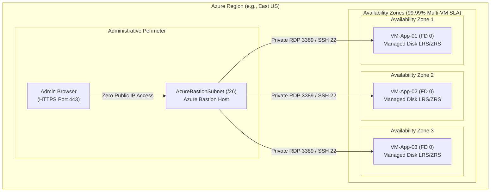
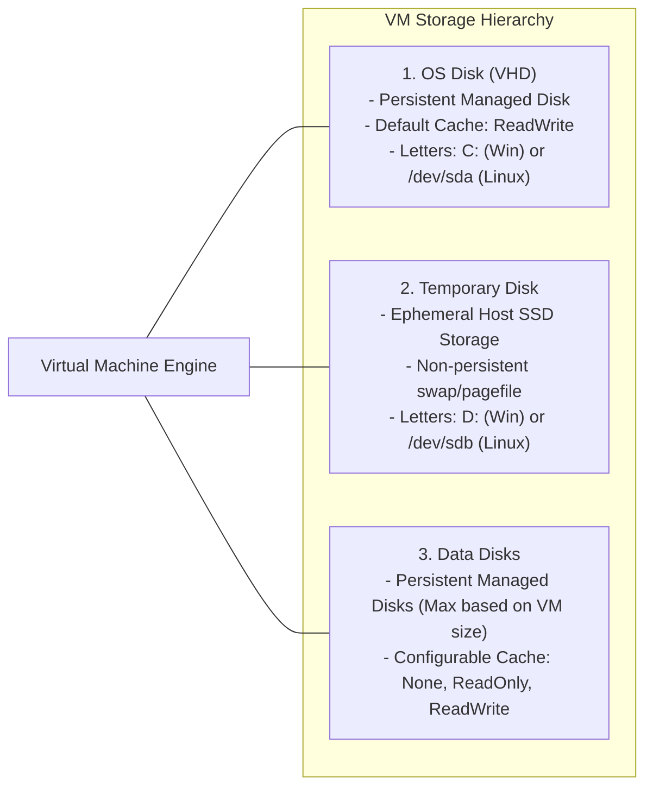
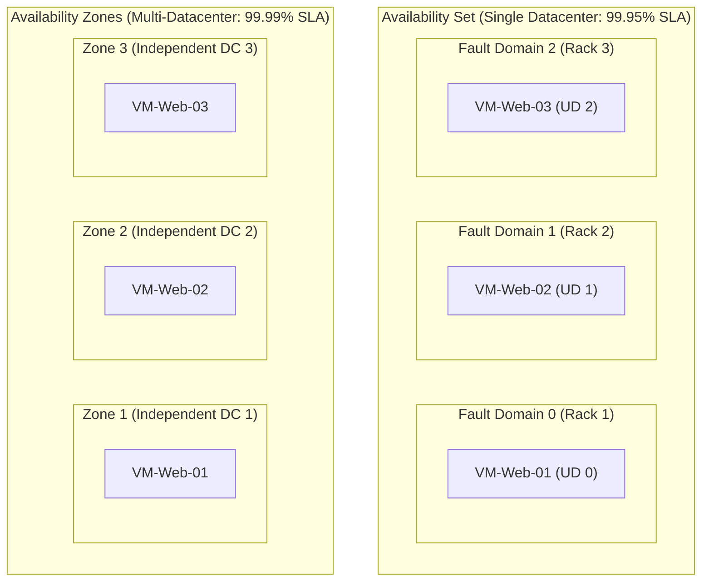
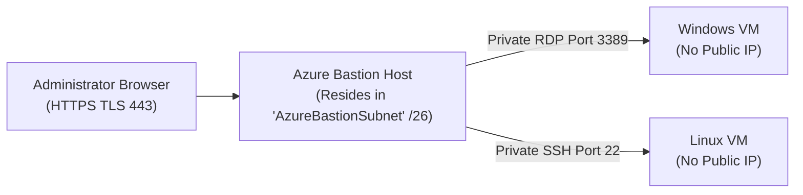
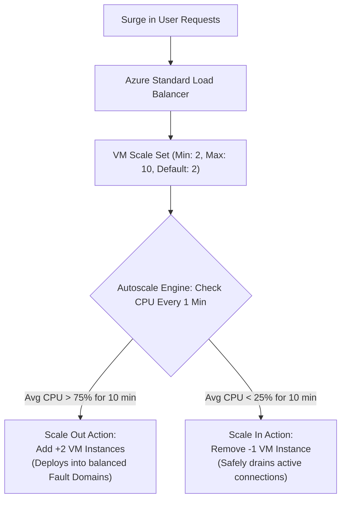

# Module 13-104-09: Administer Azure Virtual Machines, Bastion & Scale Sets

**Breadcrumbs:** [[13-Index - Azure|☁️ Azure Reference MOC]] > [[13-Index - AZ-104|📘 AZ-104 Exam Track]] > **09 - Administer Azure Virtual Machines**

---

## 🎯 Executive Overview & IaaS Compute Architecture

Azure Virtual Machines (VMs) provide on-demand, scalable Infrastructure as a Service (IaaS) compute resources. In the cloud shared responsibility model, Microsoft manages the physical hardware, hypervisors, and datacenter infrastructure, while the enterprise administrator retains responsibility for operating system configuration, patch management, network interface bindings, disk encryption, and application software.



---

## 🖥️ VM Sizing & Workload Families

Selecting the appropriate VM size balances computational throughput, memory capacity, IOPS limits, and cost:

| Family | Series Identifiers | CPU to Memory Ratio | Optimized Workloads |
| :--- | :--- | :---: | :--- |
| **General Purpose** | **B-series** (burstable), **D-series** (Dsv5) | Balanced (1:4) | Web servers, small-to-medium databases, dev/test environments. |
| **Compute Optimized** | **F-series** (Fsv2) | High CPU (1:2) | Batch processing, web application servers, game servers. |
| **Memory Optimized** | **E-series** (Esv5), **M-series** | High Memory (1:8 to 1:28)| In-memory caches (Redis), enterprise SQL/SAP HANA databases. |
| **Storage Optimized** | **L-series** (Lsv3) | High Disk I/O | Big Data analytics, NoSQL engines (Cassandra, MongoDB). |
| **GPU Accelerated** | **N-series** (NC, NV, ND) | GPU Co-processors | AI/ML model training, 3D rendering, video encoding. |
| **Confidential Compute**| **DC-series**, **EC-series** | Hardware Enclaves (AMD SEV-SNP / Intel SGX) | Financial fraud detection, sensitive medical data processing. |

---

## 💾 Virtual Machine Storage & Disk Types

Every Azure VM contains at least an **OS disk** and a local **Temporary disk**, with the ability to attach multiple **Data disks**:



> [!CAUTION]
> **Temporary Disk Data Loss:** The temporary disk (`D:` on Windows, `/dev/sdb` on Linux) resides on the physical host machine hardware. **Any data stored on the temporary disk is permanently lost** when the VM is stopped (deallocated), restarted onto another host, or serviced during hardware maintenance. Never store application databases or user files on the temporary drive.

### Managed Disk Performance Tiers

| Disk Tier | Max Disk Size | Max IOPS | Max Throughput | Typical Production Workloads |
| :--- | :---: | :---: | :---: | :--- |
| **Standard HDD** | 32 TiB | 2,000 IOPS | 500 MB/s | Backup, non-critical batch jobs, infrequent access. |
| **Standard SSD** | 32 TiB | 6,000 IOPS | 750 MB/s | Web servers, lightly used enterprise apps, dev/test. |
| **Premium SSD (v1/v2)**| 32 TiB | 20,000 / 80,000 IOPS| 900 / 1,200 MB/s | Production databases, high-transaction enterprise apps. |
| **Ultra Disk** | 64 TiB | **160,000 IOPS** | **4,000 MB/s** | Extremely demanding I/O workloads (SAP HANA, Oracle). Dynamic IOPS scaling without reboot. |

---

## 🏰 High Availability: Availability Sets vs. Availability Zones

Azure provides two primary high-availability architectures to protect workloads against physical failures:



### Fault Domains vs. Update Domains
1. **Fault Domains (FD):** Physical server racks sharing common power sources and network switches. An Availability Set supports up to **3 Fault Domains** (FD 0, 1, 2).
2. **Update Domains (UD):** Logical groups of virtual machines that are rebooted together during planned Azure platform maintenance. An Availability Set supports up to **20 Update Domains**. Only one update domain is rebooted at a time, ensuring at least 80–95% of capacity remains online.

| HA Architecture | Scope of Isolation | Resiliency Level | SLA for 2+ VMs |
| :--- | :--- | :--- | :---: |
| **Single VM (Premium SSD)**| Single Host Server | Hardware failure on host causes automatic migration. | 99.9% |
| **Availability Set** | Single Datacenter (Across racks) | Protects against power, rack, and top-of-rack switch failures. | **99.95%** |
| **Availability Zones** | Across Datacenters within Region | Protects against complete datacenter facility outages (flood, power). | **99.99%** |

---

## 🛡️ Secure Remote Access: Azure Bastion

Azure Bastion is a fully platform-managed PaaS reverse proxy that provides secure, seamless RDP and SSH connectivity to virtual machines directly through the Azure Portal over **TLS port 443**, without exposing public IP addresses on target VMs:



### Architectural Requirements for Azure Bastion
- Must be deployed into a dedicated subnet named exactly **`AzureBastionSubnet`**.
- Subnet mask must be at least **`/26`** (e.g., `10.0.100.0/26`) to accommodate Bastion autoscale host instances.
- Cannot place any other resources (VMs, gateways) inside `AzureBastionSubnet`.
- NSG on `AzureBastionSubnet` must permit inbound HTTPS (port 443) from `Internet` and outbound RDP/SSH (ports 3389/22) to `VirtualNetwork`.

---

## 📈 Virtual Machine Scale Sets (VMSS) & Autoscaling

Virtual Machine Scale Sets deploy and manage a group of identical, load-balanced virtual machines that automatically scale in or out based on demand or scheduled rules:



### Orchestration Modes
1. **Uniform (Classic):** Optimized for large-scale, stateless workloads with identical VM instances deployed from a single golden image.
2. **Flexible:** High-availability orchestration that allows mixing different VM sizes, spot/on-demand instances, and manual VM additions across availability zones.

---

## 🛠️ Contextual Proof of Concept: CLI & PowerShell Recipes

### 1. Azure CLI: Deploy Linux VM with SSH Key, Custom Script Extension & NSG

```bash
# 1. Create a Linux Virtual Machine in an Availability Zone with SSH key generation
az vm create \
  --resource-group "rg-enterprise-core" \
  --name "vm-web-prod-01" \
  --image "Ubuntu2204" \
  --size "Standard_D2s_v5" \
  --zone 1 \
  --admin-username "azureadmin" \
  --generate-ssh-keys \
  --vnet-name "vnet-enterprise" \
  --subnet "snet-web" \
  --public-ip-address "" \
  --nsg "nsg-backend"

# 2. Attach a 128 GB Premium SSD Data Disk with ReadOnly caching
az vm disk attach \
  --resource-group "rg-enterprise-core" \
  --vm-name "vm-web-prod-01" \
  --name "disk-web-data-01" \
  --size-gb 128 \
  --sku "Premium_LRS" \
  --caching "ReadOnly" \
  --new

# 3. Deploy Custom Script Extension to install Nginx
az vm extension set \
  --resource-group "rg-enterprise-core" \
  --vm-name "vm-web-prod-01" \
  --name "customScript" \
  --publisher "Microsoft.Azure.Extensions" \
  --settings '{"commandToExecute": "apt-get update && apt-get install -y nginx"}'
```

### 2. Azure CLI: Deploy Virtual Machine Scale Set (VMSS)

```bash
# Deploy a multi-zone VM Scale Set with autoscale capabilities
az vmss create \
  --resource-group "rg-enterprise-core" \
  --name "vmss-web-cluster" \
  --image "Ubuntu2204" \
  --vm-sku "Standard_B2s" \
  --instance-count 2 \
  --zones 1 2 3 \
  --vnet-name "vnet-enterprise" \
  --subnet "snet-web" \
  --load-balancer "lb-web-prod" \
  --backend-pool-name "be-web-pool" \
  --admin-username "azureadmin" \
  --generate-ssh-keys \
  --upgrade-policy-mode "Automatic"
```

---

## 🔍 Deep-Intuition AARF Framework

### Scenario: Diagnosing VM Allocation Failure During Sizing Reconfiguration

- **The Answer (Core Configuration):** Stop and deallocate the virtual machine (`az vm deallocate --resource-group "rg-core" --name "vm-app"`) before modifying its size to a new hardware family, or select a VM size available within the current physical cluster hardware cluster.
- **The Assumptions (Prerequisites):** 
  - Operator executes `az vm resize --size "Standard_M128s"` while the VM is in the `Running` state.
- **The Rationale (Why):** When a VM is running, its hardware execution context is pinned to a specific physical server blade and cluster in the datacenter. Some specialized VM sizes (such as M-series memory-optimized or N-series GPU hosts) exist only on dedicated physical hardware clusters. Resizing a running VM requires the new size to be supported by the *same physical blade cluster*.
- **The Failure Loop (What if misconfigured):**
  - *Symptom:* The resize operation fails with an allocation error.
  - *Exact Error Message:* `AllocationFailed: Allocation failed. We do not have sufficient capacity for the requested VM size in this region or cluster. Try resizing after stopping (deallocating) the VM.`
- **The Alternative Case (When to use 'if not'):** If the VM is deallocated, Azure releases its lease on the physical blade. Resizing the deallocated VM allows Azure's regional fabric controller to allocate the VM onto any physical hardware cluster in the datacenter capable of hosting that size.

---

## 💡 AZ-104 Exam Tips & Gotchas

> [!TIP]
> **Stopped vs. Stopped (Deallocated):**
> - If an administrator shuts down a Windows/Linux VM from *inside the guest OS* (`shutdown -h now` or Windows Start -> Shut down), the VM status is **Stopped**. **You are still billed for compute cores and RAM** because hardware resources remain reserved on the physical blade.
> - To completely stop billing for compute, you must stop the VM from the Azure Portal, CLI, or PowerShell (`az vm deallocate`), transitioning the status to **Stopped (Deallocated)**. Only disk storage costs apply while deallocated.

> [!WARNING]
> **Availability Set Placement Rule:**
> - A virtual machine can ONLY be placed into an Availability Set **during VM creation**.
> - You **cannot add an existing virtual machine to an Availability Set** after deployment without deleting and recreating the VM from its OS disk.

---

## 🎙️ Video Deep Dive & Real-World Builds (Moe Intelligence Series)

> [!NOTE]
> **Source Attribution:** Transcripts and architectural walkthroughs synthesized from *Moe Intelligence (Arabic Comprehensive AZ-104 Series)*, Lessons 28 & 29 ([Playlist Reference](https://www.youtube.com/playlist?list=PLczK3J2J4clmeh328CC13dJrcALcSFZFb)). Translated to English while preserving technical taxonomy.

### 1. Workload Architecture: VMs vs. Containers vs. ACI (Lesson 28)
- **Architectural Trade-offs:**
  - *Virtual Machines (IaaS):* Full OS abstraction with dedicated kernel space. Best for monolithic apps, software requiring custom kernel drivers, or Windows Desktop services. Slower provisioning (minutes), higher operational maintenance (patching, antivirus).
  - *Containers (Docker/OCI):* Share the host OS kernel and isolate workloads via user namespaces and cgroups. Millisecond startup times and ultra-dense resource packing.
  - *Azure Container Instances (ACI):* Serverless container execution. Spin up individual containers on demand in seconds without provisioning VMs, clusters, or orchestrators. Billed per second of vCPU/RAM.
- **When to Choose What on the AZ-104 Exam:**
  - Need to run a batch job or event-driven script in a container for 15 minutes? ➔ **Azure Container Instances (ACI)**.
  - Need full hypervisor-level isolation and custom kernel extensions? ➔ **Azure Virtual Machines**.
  - Need microservice orchestration with auto-healing and ingress? ➔ **Azure Container Apps (ACA)** or **AKS**.

### 2. VM Disk Storage Architecture & Host Caching (Lesson 29)
- **The Ephemeral Temporary Disk (`D:` in Windows, `/dev/sdb` in Linux):**
  - Physical NVMe SSD located directly on the hypervisor host blade.
  - *Critical Warning:* Used strictly for pagefile/swap. **All data on this disk is permanently erased** if the VM is stopped, deallocated, restarted, or live-migrated during hardware servicing.
- **Host Caching Guidelines:**
  - *Read/Write Caching:* Default for OS disks; caches reads and writes in host RAM for fast performance.
  - *None / Read-Only Caching:* Recommended for high-transaction database data disks (SQL Server `.mdf` and `.ldf` files) to prevent write-cache writeback loss during host crashes.

---

## 🌐 Authoritative References & Citations

- [KodeKloud AZ-104 Course - Administer Azure Virtual Machines Module](https://notes.kodekloud.com/docs/Updated-AZ-104-Microsoft-Azure-Administrator/Administer-Azure-Virtual-Machines/Module-Introduction/page.md)
- [Moe Intelligence AZ-104 Video Series (Lessons 28–29)](https://www.youtube.com/playlist?list=PLczK3J2J4clmeh328CC13dJrcALcSFZFb)
- [Microsoft Learn: Manage virtual machines in Azure](https://learn.microsoft.com/en-us/training/modules/manage-virtual-machines-with-azure-cli/)
- [Microsoft Learn: Create high availability virtual machine infrastructure](https://learn.microsoft.com/en-us/training/modules/build-first-azure-virtual-machine/)
- [Azure Virtual Machines Documentation](https://learn.microsoft.com/azure/virtual-machines/)
- [Kubernetes Documentation Ecosystem Reference](https://kubernetes.io/docs/)
- [Terraform Registry Provider for Azure (azurerm)](https://registry.terraform.io/)
