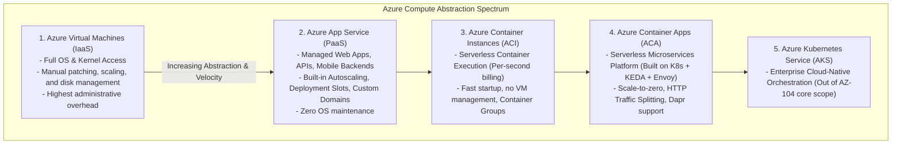
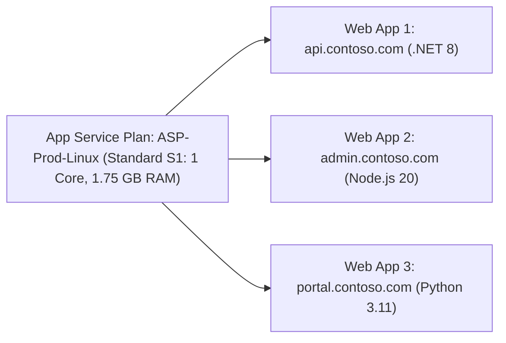
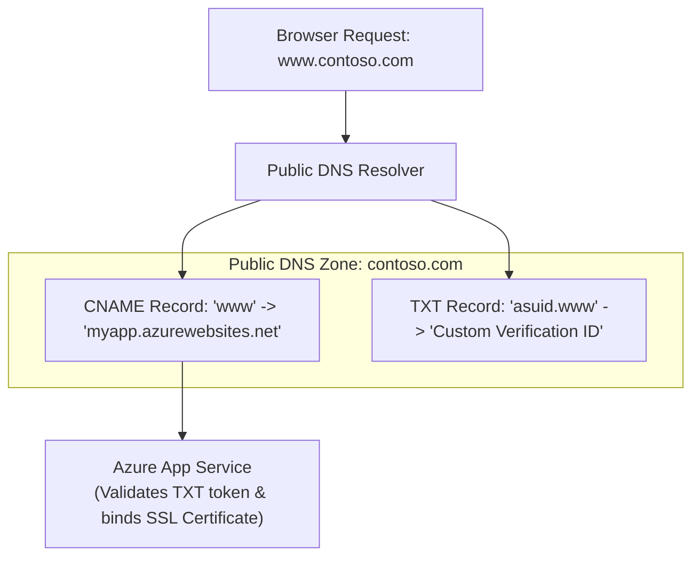
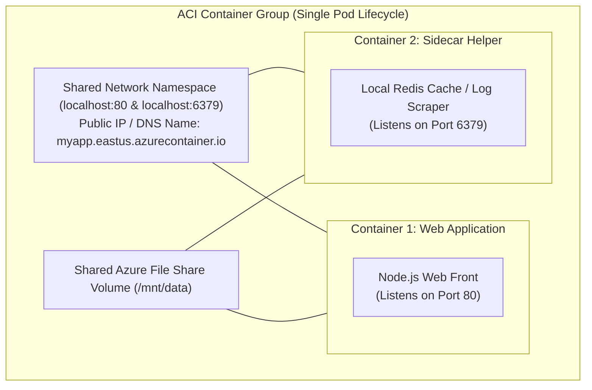

# Module 13-104-10: Administer PaaS Compute, App Services & Container Instances

**Breadcrumbs:** [[13-Index - Azure|☁️ Azure Reference MOC]] > [[13-Index - AZ-104|📘 AZ-104 Exam Track]] > **10 - Administer PaaS Compute Options**

---

## 🎯 Executive Overview & PaaS Compute Spectrum

Azure Platform-as-a-Service (PaaS) compute abstracts the underlying operating system, server patching, runtime installation, and hypervisor management. This enables engineering teams to deploy web applications, microservices, and containerized workloads with built-in autoscaling, high availability, and automated CI/CD deployment pipelines:



---

## 🏗️ Azure App Service Plans: Tiers & Scaling Models

An **App Service Plan (ASP)** defines the physical/virtual compute resources (CPU, RAM, disk space, and region) that host one or more web applications. You are billed for the App Service Plan whether your web apps receive traffic or remain idle.



### App Service Plan Tier Comparison

| Pricing Tier | Compute Model | Auto-Scale | Deployment Slots | Max Scale-Out Instances | Storage Quota | Ideal Production Workload |
| :--- | :--- | :---: | :---: | :---: | :---: | :--- |
| **Free (F1)** | Shared VM | ❌ No | 0 | 1 instance | 1 GB | Learning, experimentation (60 CPU min/day limit). |
| **Shared (D1)**| Shared VM | ❌ No | 0 | 1 instance | 1 GB | Testing with custom domain support. |
| **Basic (B1-B3)**| **Dedicated VM** | ❌ Manual only | 0 | 3 instances | 10 GB | Small production apps without autoscaling needs. |
| **Standard (S1-S3)**| **Dedicated VM** | ✅ **Yes** | **5 slots** | **10 instances** | **50 GB** | **Enterprise production apps, automated CI/CD.** |
| **Premium (P1v3-P3v3)**| **Dedicated VM (Fast SSD)**| ✅ **Yes** | **20 slots**| **30 instances** | **250 GB** | High-traffic applications, memory-intensive workloads. |
| **Isolated (I1v2-I3v2)**| **Isolated VNet (ASEv3)**| ✅ **Yes** | **20 slots**| **100 instances**| **1 TB** | Strict compliance, healthcare, private VNet injection. |

> [!IMPORTANT]
> **Key Feature Tier Thresholds for the Exam:**
> - To enable **Autoscaling**, **Deployment Slots**, or **Automated Backups**, the minimum required tier is **Standard (S1)**.
> - To enable **Custom Domains**, the minimum tier is **Shared (D1)**.
> - To enable **Virtual Network Injection (App Service Environment - ASE)**, the required tier is **Isolated**.

---

## 🔒 Securing Azure App Services

### 1. App Service Authentication (EasyAuth)
Provides turn-key user authentication without writing code. Intercepts incoming HTTP requests and forces user sign-in against identity providers:
- Microsoft Entra ID (native enterprise single sign-on).
- Social identity providers (Google, GitHub, Facebook, Twitter/X).
- OpenID Connect (OIDC) custom providers.

### 2. Managed Identity & Key Vault Integration
Eliminates credentials and secrets stored in code or configuration files:
- **System-Assigned Managed Identity:** Tied directly to the lifecycle of the web app.
- **User-Assigned Managed Identity:** Independent identity object shared across multiple applications.
- **Key Vault References:** Syntax in Application Settings:
  `@Microsoft.KeyVault(SecretUri=https://myvault.vault.azure.net/secrets/DbPassword/xxx)`

### 3. Inbound Access Restrictions & Private Endpoints
- **Access Restrictions:** Evaluates an ordered list of IP addresses, CIDR blocks, or VNet service endpoints (5-tuple allow/deny) before requests reach the app.
- **Private Endpoints (Inbound):** Deploys a private NIC into a subnet, disabling all public internet exposure.
- **VNet Integration (Outbound):** Allows the web app to initiate outbound connections to private databases and VMs residing inside an Azure Virtual Network.

---

## 🌐 Custom Domains & TLS/SSL Bindings

By default, every Azure Web App receives a public hostname: `https://<app-name>.azurewebsites.net`.



### Configuration Steps
1. **Verification Token:** Retrieve the *Custom Domain Verification ID* from the App Service blade.
2. **DNS Configuration at Registrar:**
   - Create a **TXT record**: `asuid.www` with the verification ID string.
   - Create a **CNAME record**: `www` pointing to `<app-name>.azurewebsites.net` (for subdomains).
   - For root/apex domains (`@`), create an **A record** pointing to the App Service inbound IP address + a TXT record for verification.
3. **SSL/TLS Bindings:**
   - **SNI SSL (Server Name Indication):** Multiple SSL certificates hosted on a single IP address (modern web standard; no extra charge).
   - **IP-based SSL:** Maps a dedicated public IP address to the certificate (required for legacy browser compatibility).
   - **App Service Managed Certificate:** Free, auto-renewing TLS certificate issued by Microsoft for validated custom domains.

---

## 🔄 Deployment Slots & Zero-Downtime Swaps

Deployment slots are independent live web apps running on the same App Service Plan, each assigned its own distinct URL:

```mermaid
flowchart LR
    subgraph StagingSlot ["Staging Slot (myapp-staging.azurewebsites.net)"]
        NewCode["New Application Build (v2.0)"]
        StageDB["Staging DB Connection (Slot-Sticky Setting)"]
    end

    subgraph ProductionSlot ["Production Slot (myapp.azurewebsites.net)"]
        LiveCode["Active Production Code (v1.0)"]
        ProdDB["Production DB Connection (Slot-Sticky Setting)"]
    end

    Internet["100% Live Production User Traffic"] --> ProductionSlot
    DevQA["Dev / QA Testing Traffic"] --> StagingSlot

    ProductionSlot <-->|Instant VIP Swap (Zero Downtime)| StagingSlot
```

### Slot Swap Mechanics
1. **Warm-up Phase:** When a swap is initiated, Azure sends HTTP requests to the target slot to warm up worker processes, load in-memory caches, and compile code before redirecting traffic.
2. **VIP Redirection:** The underlying Azure front-end load balancer swaps the virtual IP routing tables. **Zero requests are dropped**.
3. **Swap with Preview:** Allows applying production configurations to the staging slot first, validating the app live, and then completing the swap.

### Slot-Sticky Settings vs. Swapped Settings

| Setting Type | Examples | Swapped During Slot Swap? |
| :--- | :--- | :---: |
| **Swapped Settings** | Code binaries, Docker container images, general app settings. | ✅ **Yes** (Swapped into production) |
| **Slot-Sticky Settings** | Database connection strings, custom domain bindings, SSL certs, publishing credentials. | ❌ **No** (Remains pinned to slot) |

---

## 🐳 Azure Container Instances (ACI) & Container Groups

Azure Container Instances provides serverless container execution without provisioning virtual machines or managing container orchestrators.



### 1. Container Restart Policies
- **Always (Default):** Restarts container continuously if it stops (used for long-running web servers).
- **OnFailure:** Restarts container only when it exits with a non-zero exit code (used for batch processing).
- **Never:** Container runs once and terminates (used for initialization or scheduled one-shot tasks).

### 2. Container Groups
A Container Group is a collection of containers scheduled on the same host machine that share:
- Lifecycle (started, stopped, deleted together).
- Network namespace (all containers communicate over `localhost`).
- Port space (containers in the same group cannot listen on the same port).
- Storage volumes (mounted Azure File shares).

---

## 🛠️ Contextual Proof of Concept: CLI Automation

```bash
# 1. Create a Linux App Service Plan in the Standard S1 tier
az appservice plan create \
  --resource-group "rg-enterprise-core" \
  --name "asp-enterprise-linux" \
  --is-linux \
  --sku "S1" \
  --location "eastus"

# 2. Deploy a Python Web App
az webapp create \
  --resource-group "rg-enterprise-core" \
  --plan "asp-enterprise-linux" \
  --name "app-corp-portal-2026" \
  --runtime "PYTHON:3.11"

# 3. Create a Staging Deployment Slot
az webapp deployment slot create \
  --resource-group "rg-enterprise-core" \
  --name "app-corp-portal-2026" \
  --slot "staging"

# 4. Mark a Database Connection String as 'Slot-Sticky' (Does not swap)
az webapp config appsettings set \
  --resource-group "rg-enterprise-core" \
  --name "app-corp-portal-2026" \
  --slot "staging" \
  --slot-settings DB_CONN="Server=stagedb.internal;Database=TestDB"

# 5. Execute a zero-downtime Slot Swap from Staging into Production
az webapp deployment slot swap \
  --resource-group "rg-enterprise-core" \
  --name "app-corp-portal-2026" \
  --slot "staging" \
  --target-slot "production"

# 6. Deploy an Azure Container Instance with restart policy OnFailure
az container create \
  --resource-group "rg-enterprise-core" \
  --name "aci-data-processor" \
  --image "mcr.microsoft.com/azure-cli:latest" \
  --restart-policy "OnFailure" \
  --cpu 1 \
  --memory 1.5 \
  --command-line "az --version"
```

---

## 🔍 Deep-Intuition AARF Framework

### Scenario: Staging Database Connection Leaking Into Production After Slot Swap

- **The Answer (Core Configuration):** Explicitly designate environment-specific variables (e.g., database connection strings, API keys) as **Deployment Slot Settings** (sticky settings) using the `--slot-settings` parameter in CLI or by checking the "Deployment slot setting" checkbox in the Azure Portal.
- **The Assumptions (Prerequisites):** 
  - Web App is running on an App Service Plan of tier **Standard** or higher with a `staging` slot.
  - Staging slot points to a staging database; production slot points to a production database.
- **The Rationale (Why):** By default, an App Service slot swap swaps all application settings along with the code binaries. If a database connection string is not marked as sticky, swapping staging to production will move the *staging database connection string* into the production slot, causing production users to write live transactions into the staging test database.
- **The Failure Loop (What if misconfigured):**
  - *Symptom:* Immediately following a code release via slot swap, live customers report missing orders, and test records appear in customer dashboards.
  - *Root Cause:* Unchecked slot setting caused `DATABASE_URL=stagedb.postgres.database.azure.com` to swap into production.
- **The Alternative Case (When to use 'if not'):** Non-environment-specific application configuration keys (such as `FEATURE_FLAG_NEW_UI=true` or `MAX_PAGE_SIZE=50`) should remain non-sticky so that feature toggles tested in staging swap cleanly into production alongside the code.

---

## 💡 AZ-104 Exam Tips & Gotchas

> [!TIP]
> **Autoscale Metric Rules Gotcha:** Autoscale scale-out and scale-in rules must be complementary:
> - Scale-out condition: `CPU > 80% for 10 minutes -> Increase count by 1`.
> - Scale-in condition: `CPU < 25% for 10 minutes -> Decrease count by 1`.
> - Always maintain a generous buffer between scale-out (80%) and scale-in (25%) thresholds to prevent **"flapping"** (rapid, continuous scaling out and scaling in).

> [!WARNING]
> **Stopped Web App Billing:**
> Stopping an individual Web App (`az webapp stop`) **does NOT stop billing**. The underlying App Service Plan is still running dedicated VMs and reserving CPU/RAM. To eliminate costs, you must delete the web app and delete or downscale the App Service Plan itself.

---

## 🌐 Authoritative References & Citations

- [KodeKloud AZ-104 Course - Administer PaaS Compute Options Module](https://notes.kodekloud.com/docs/Updated-AZ-104-Microsoft-Azure-Administrator/Administer-PaaS-Compute-Options/Module-Introduction/page.md)
- [Microsoft Learn: Configure Azure App Service Plans and Web Apps](https://learn.microsoft.com/en-us/training/modules/configure-app-service-plans/)
- [Microsoft Learn: Run container images in Azure Container Instances](https://learn.microsoft.com/en-us/training/modules/run-container-images-azure-container-instances/)
- [Azure App Service Deployment Slots Documentation](https://learn.microsoft.com/en-us/azure/app-service/deploy-staging-slots)
