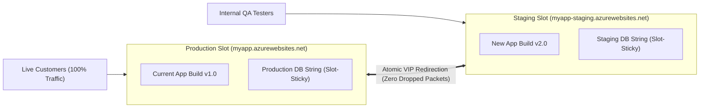
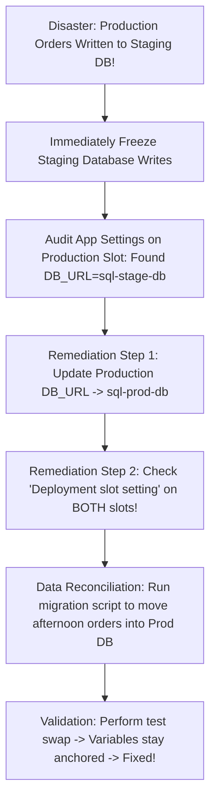

# Module 13-104-10: Administer PaaS Compute, App Services & Container Instances

**Breadcrumbs:** [[13-Index - Azure|☁️ Azure Reference MOC]] > [[13-Index - AZ-104|📘 AZ-104 Exam Track]] > **10 - Administer PaaS Compute Options**

---

## 🎯 Stage 1: Executive Overview & The Conceptual Lecture

### 1. The Zero-Knowledge Starting Point: The Evolution Beyond Virtual Machines
In Module 09, we mastered Infrastructure as a Service (IaaS) Virtual Machines. While VMs give you complete administrative control down to the operating system kernel, they come with a heavy operational burden:
* Every Tuesday, someone must patch Windows or Linux.
* If the web server process crashes, an engineer must log in via SSH/RDP to restart it.
* If web traffic surges by 500%, you must manually provision new VMs, attach disks, join them to load balancers, and deploy code.
* To perform a code update without downtime, you have to build elaborate blue/green infrastructure setups from scratch.

Modern cloud engineering aims to eliminate this operational friction using **Platform as a Service (PaaS)** and **Serverless Containers**:
* In PaaS, you do not manage operating systems, hypervisors, disk partitions, or security patches.
* You bring your application code (in .NET, Python, Node.js, Java, or a Docker container) and hand it to Azure.
* Azure handles runtime execution, security patching, auto-scaling, SSL certificates, custom domains, and zero-downtime blue/green deployment slots automatically!

### 2. The Restaurant Kitchen Analogy
* **IaaS (Virtual Machines):** Building your own restaurant from scratch. You rent the building, buy commercial ovens, hire plumbers, wire electrical outlets, and sweep the floors every night. You have complete freedom to install any stove you want, but if the refrigeration compressor fails, dinner service stops.
* **PaaS (Azure App Service):** Renting a fully staffed, turnkey commercial kitchen. The ovens, stoves, electricity, and dishwashers are already installed, inspected, and maintained by the facility owner. You simply bring your ingredients and master recipes (application code) and start cooking immediately!
* **Serverless Containers (ACI / ACA):** Hiring an on-demand food truck for a 2-hour festival. The truck arrives, serves food, and departs immediately when the event finishes. You pay strictly for the minutes the truck operated, with zero ongoing building lease!

### 3. Terminology Matrix: Zero-Knowledge to Enterprise Architect

| Terminology | What It Means to a Beginner | Real-World Analog | Enterprise Architecture Reality |
| :--- | :--- | :--- | :--- |
| **App Service Plan (ASP)** | The server engine that runs your web apps. | The physical engine in a boat that powers multiple propellers. | A managed compute tier defining the dedicated vCPUs, RAM, and scale limits shared across one or more web apps. |
| **Azure Web App** | The actual website or API running your code. | The commercial storefront facing the public. | A PaaS hosting container running on an ASP worker pool, reachable via HTTPS and managed by Microsoft's ARR routing fabric. |
| **Deployment Slot** | A staging clone of your website for testing. | An identical dress-rehearsal stage behind the velvet curtain. | An isolated live web app sharing the same ASP compute, used for pre-swap warming and instant zero-downtime blue/green cutover. |
| **Slot-Sticky Setting** | A configuration setting that stays behind during a swap. | A room key that stays with the physical room, not the guest. | An App Setting with `slotSetting: true` that anchors environment-specific configs (like DB connections) to a specific slot during swaps. |
| **Azure Container Instances (ACI)** | Running a single Docker container on-demand. | Calling an Uber for a single 15-minute ride. | Serverless container execution billed per-second of vCPU/RAM allocation, supporting Container Groups sharing localhost networking. |
| **Azure Container Apps (ACA)** | Running microservices that scale to zero. | A taxi dispatch system that sends 10 cars during a rush and parks them all when quiet. | Serverless microservices platform built on Kubernetes, KEDA, and Envoy, supporting event-driven autoscaling and HTTP traffic splitting. |
| **Custom Domain & SNI** | Using `company.com` instead of `.azurewebsites.net`. | Putting your company sign over the storefront door. | DNS CNAME/TXT verification mapping your registrar domain to Azure, secured by Server Name Indication (SNI) TLS certificates. |

---

## 🏛️ Stage 2: Core Mental Model & Component Architecture

### 1. Azure App Service Plans: Tiers & Capabilities
An **App Service Plan (ASP)** is the fundamental billing and compute boundary. All web applications assigned to the same App Service Plan share the same CPU and RAM resources:

```text
[ App Service Plan: asp-enterprise-prod (Standard S1: 1 Core, 1.75 GB RAM) ]
       │
       ├──► Web App 1: https://shop.contoso.com (.NET 8 Core)
       ├──► Web App 2: https://api.contoso.com (Node.js 20 REST API)
       └──► Web App 3: https://portal.contoso.com (Python 3.11 Backend)
       (All 3 apps run simultaneously on the same underlying worker instances!)
```

#### Detailed Pricing Tier Comparison:

| Pricing Tier | Worker Model | Autoscaling | Deployment Slots | Max Scale-Out Instances | Storage | Key Production Features |
| :--- | :--- | :---: | :---: | :---: | :---: | :--- |
| **Free (F1)** | Shared VM | ❌ No | 0 | 1 instance | 1 GB | Experimentation only (60 CPU minutes/day limit). |
| **Shared (D1)** | Shared VM | ❌ No | 0 | 1 instance | 1 GB | Dev/Test with custom domain support. |
| **Basic (B1–B3)** | **Dedicated VM** | ❌ Manual only | 0 | 3 instances | 10 GB | Entry production apps without autoscaling needs. |
| **Standard (S1–S3)** | **Dedicated VM** | ✅ **Yes** | **5 slots** | **10 instances** | **50 GB** | **Enterprise production baseline, slots, autoscale.** |
| **Premium (P1v3–P3v3)**| **Dedicated VM (NVMe)**| ✅ **Yes** | **20 slots** | **30 instances** | **250 GB** | High-traffic apps, memory caching, vNet integration. |
| **Isolated (I1v2–I3v2)**| **Dedicated VNet (ASE)**| ✅ **Yes** | **20 slots** | **100 instances** | **1 TB** | Strict compliance, banking, direct private VNet hosting. |

> [!IMPORTANT]
> **Key Exam Tier Thresholds:**
> - To unlock **Autoscaling**, **Deployment Slots**, or **Automated Backups**, the minimum tier required is **Standard (S1)**.
> - To unlock **Custom Domain Bindings**, the minimum tier is **Shared (D1)**.
> - To unlock **Private VNet Injection (App Service Environment - ASE)**, the tier must be **Isolated**.

---

### 2. Blue/Green Deployment Slots & The Zero-Downtime Swap
Deploying code updates directly to a live production server is dangerous. If the code has a bug or takes 30 seconds to compile, users experience `HTTP 500 Internal Server Error` or slow cold-start latency.

**Deployment Slots** provide zero-downtime releases:



#### The Slot Swap Sequence:
1. **Target Slot Deployment:** You push new application code (v2.0) into the `staging` slot.
2. **Warm-Up Phase:** Azure sends HTTP warmup requests to the staging instances. Code compiles, caches populate, and runtime processes start.
3. **VIP Redirection:** Once staging responds `HTTP 200 OK`, Azure front-end Application Request Routing (ARR) routers instantly swap the virtual IP bindings. Live production traffic now hits v2.0 with **zero dropped requests**!
4. **Instant Rollback:** If a bug is detected after the swap, you click **Swap** again to instantly revert back to v1.0 in seconds!

---

### 3. Slot-Sticky Settings vs. Swapped Settings
When a slot swap executes, Azure swaps the application binaries. But what happens to environment configuration settings?

```text
+-------------------------------------------------------------------------------------------------+
|                       SWAPPED SETTINGS vs. SLOT-STICKY SETTINGS                                 |
+-------------------------------------------------------------------------------------------------+
|  Swapped Settings (Move with the Code)        |  Slot-Sticky Settings (Stay Pinned to the Slot) |
+-----------------------------------------------+-------------------------------------------------+
| - General application settings                | - Database connection strings                   |
| - Framework versions (.NET 8, Node 20)        | - Environment identifiers (APP_ENV=Staging)     |
| - Container image tags                        | - Custom Domain and SSL certificate bindings    |
| - Handler mappings and web sockets            | - Publishing credentials & Webhook endpoints    |
| - Feature flags (e.g., FEATURE_NEW_UI=true)   | - IP Access Restriction rules                   |
+-----------------------------------------------+-------------------------------------------------+
```

> [!CAUTION]
> **The Staging Database Leak Hazard:**
> If you do not check the box **"Deployment slot setting"** on your database connection string, swapping staging to production will move the *staging database connection string* into the production slot! Production users will begin writing live credit card transactions into your test database! Always mark environment-specific variables as **Slot-Sticky**.

---

### 4. Containerized PaaS Compute: ACI vs. ACA
When you need to run containers without managing virtual machines, Azure provides two complementary serverless options:

```text
Azure Container Instances (ACI)                    Azure Container Apps (ACA)
+---------------------------------------+         +-------------------------------------------------+
| - Serverless container execution      |         | - Serverless microservices platform             |
| - Spins up in seconds (per-second cost|         | - Built on Kubernetes + KEDA + Envoy            |
| - Container Groups (shared localhost) |         | - Scale-to-Zero capability (Zero idle cost!)    |
| - No orchestrator or ingress routing  |         | - Native HTTP traffic splitting & blue/green    |
| - Best for: Quick batch jobs, ETL,    |         | - Best for: Microservice fleets, background queue|
|   one-off processing scripts          |         |   workers, web apps with variable traffic       |
+---------------------------------------+         +-------------------------------------------------+
```

#### ACI Container Groups & Restart Policies:
A **Container Group** is a collection of containers scheduled on the same host physical blade that share:
* **Lifecycle:** Started, stopped, and deleted together.
* **Network Namespace:** Containers communicate with each other over `localhost` on different ports.
* **Storage Volumes:** Can mount shared Azure File shares across all containers in the group.
* **Restart Policies:**
  - `Always` (Default): Restarts container continuously if it stops (for web servers).
  - `OnFailure`: Restarts only if the container exits with a non-zero exit code (for batch jobs).
  - `Never`: Runs once and halts (for migration scripts).

---

## 🏢 Stage 3: Deep-Intuition Platform Mechanics & Topology

### 1. App Service Under the Hood: The ARR Routing Fabric
How does Azure deliver requests to your web app without a dedicated virtual machine?
1. **The External Traffic Gate:** Incoming requests hit Microsoft's globally distributed **Application Request Routing (ARR)** reverse proxy frontend nodes.
2. **Hostname Inspection:** ARR inspects the HTTP `Host:` header (e.g., `shop.contoso.com`).
3. **Internal Routing Matrix:** ARR matches the host header to your specific App Service Plan and dispatches the request over private datacenter backplanes to your dedicated worker VM instances.
4. **ARR Affinity Cookie:** By default, App Service injects an `ARRAffinity` session cookie into the client's browser. As long as the user's browser sends this cookie, all subsequent requests are pinned to the exact same backend worker instance.

---

### 2. Custom Domains & Free Managed Certificates
By default, every Azure Web App receives a generic public domain name: `<app-name>.azurewebsites.net`. To bind a corporate domain (e.g., `www.contoso.com`):
* **DNS Verification Handshake:**
  1. Create a `CNAME` record pointing `www` to `myapp.azurewebsites.net`.
  2. Create a `TXT` record named `asuid.www` containing your unique App Service Custom Domain Verification ID string.
  3. Azure validates ownership and enables the custom hostname.
* **App Service Managed Certificate:** Azure provides **free, platform-managed SSL/TLS certificates** for validated custom domains that automatically renew every 6 months with zero administrator intervention!

---

## ⚙️ Stage 4: Declarative & Automation Engine (CLI & PowerShell Core)

### 1. Azure CLI: App Service, Staging Slots & Sticky Settings Automation

```bash
# ==============================================================================
# 1. CREATE PRODUCTION APP SERVICE PLAN & WEB APP
# ==============================================================================
az appservice plan create \
  --resource-group "rg-paas-lab" \
  --name "asp-enterprise-prod" \
  --is-linux \
  --sku "P1v3" \
  --location "eastus"

az webapp create \
  --resource-group "rg-paas-lab" \
  --plan "asp-enterprise-prod" \
  --name "app-ecommerce-core-2026" \
  --runtime "PYTHON:3.11"

# ==============================================================================
# 2. CREATE DEPLOYMENT SLOT & CONFIGURE SLOT-STICKY SETTINGS
# ==============================================================================

# Create Staging Slot
az webapp deployment slot create \
  --resource-group "rg-paas-lab" \
  --name "app-ecommerce-core-2026" \
  --slot "staging"

# Configure Slot-Sticky Database Connection (Does NOT swap into production!)
az webapp config appsettings set \
  --resource-group "rg-paas-lab" \
  --name "app-ecommerce-core-2026" \
  --slot "staging" \
  --slot-settings DB_HOST="staging-sql.internal" DB_NAME="StagingDB"

# Configure Production Slot Database Connection (Stays in production!)
az webapp config appsettings set \
  --resource-group "rg-paas-lab" \
  --name "app-ecommerce-core-2026" \
  --slot-settings DB_HOST="prod-sql.internal" DB_NAME="ProductionDB"

# ==============================================================================
# 3. CANARY TRAFFIC ROUTING & ATOMIC ZERO-DOWNTIME SWAP
# ==============================================================================

# Route 15% of live traffic to Staging slot for canary validation
az webapp traffic-routing set \
  --resource-group "rg-paas-lab" \
  --name "app-ecommerce-core-2026" \
  --distribution staging=15

# Execute full zero-downtime atomic slot swap
az webapp deployment slot swap \
  --resource-group "rg-paas-lab" \
  --name "app-ecommerce-core-2026" \
  --slot "staging" \
  --target-slot "production"
```

### 2. Azure CLI: Azure Container Instances (ACI) Automation

```bash
# ==============================================================================
# 4. DEPLOY SERVERLESS CONTAINER INSTANCE (ACI) WITH RESTART POLICY
# ==============================================================================
az container create \
  --resource-group "rg-paas-lab" \
  --name "aci-data-worker" \
  --image "mcr.microsoft.com/azure-cli:latest" \
  --restart-policy "OnFailure" \
  --cpu 1 \
  --memory 1.5 \
  --environment-variables JOB_ENV="Production" \
  --command-line "az --version"
```

---

## 🖥️ Stage 5: Step-by-Step Azure Portal GUI Walkthrough

Follow these exact navigation steps in the **Azure Portal** (`https://portal.azure.com`) to master PaaS compute:

### Task 1: Creating an App Service Plan and Web App
1. In the top search bar, type **App Services** and select it.
2. Click **+ Create** $\rightarrow$ **Web App**:
   - **Resource group:** `rg-paas-lab`.
   - **Name:** Enter a globally unique name (e.g., `app-enterprise-prod-2026`).
   - **Publish:** Select **Code**.
   - **Runtime stack:** Select *Python 3.11* (or .NET 8).
   - **Operating System:** *Linux*.
   - **Region:** `East US`.
3. Under **Pricing plan**:
   - Click *Explore pricing plans* $\rightarrow$ select **Premium v3 (P1v3)** or **Standard (S1)** (required for slots!).
4. Click **Review + create** $\rightarrow$ **Create**.

### Task 2: Creating a Staging Deployment Slot & Setting Sticky Settings
1. Open your newly created Web App.
2. In the left navigation menu under **Deployment**, click **Deployment slots**.
3. Click **+ Add Slot**:
   - **Name:** `staging`.
   - **Clone settings from:** Select your production web app.
   - Click **Add**.
4. In the left navigation menu under **Settings**, click **Environment variables** (or Configuration):
   - Under *App settings*, click **+ Add**:
     - *Name:* `DATABASE_SERVER`.
     - *Value:* `sql-prod-cluster.internal`.
     - **Check the box:** **Deployment slot setting**! (This makes it sticky!).
   - Click **Apply** on the bottom, then click **Confirm**.
5. Switch to your `staging` slot in the portal:
   - Go to Environment variables $\rightarrow$ add `DATABASE_SERVER` with value `sql-stage-cluster.internal` $\rightarrow$ check **Deployment slot setting** $\rightarrow$ click **Apply**.

### Task 3: Testing Canary Traffic Splitting and Performing a Swap
1. Navigate back to the **Deployment slots** blade of your primary Web App.
2. In the slot list, locate the **Traffic %** column:
   - For `staging`, change the traffic value from `0` to **`15`** (Production automatically becomes `85%`).
   - Click **Save** on the top toolbar. Live production requests will now be randomly routed 15% to Staging!
3. On the top command bar, click **Swap**:
   - **Swap type:** *Swap*.
   - **Source:** `staging`.
   - **Target:** `production`.
4. Click **Swap**. Watch the progress bar execute the warmup calls and switch the VIP routing with zero dropped packets!

---

## 🔬 Stage 6: Hands-On Enterprise Lab Bridge

To apply these PaaS compute principles, configure blue/green deployment slots, test canary traffic routing, and deploy serverless containers, proceed directly to the comprehensive practical lab:

> [!TIP]
> **Practical Implementation Companion:**
> Access the comprehensive engineering lab at:
> **[[Lab-10_App_Service_Blue_Green_Slots_and_Container_Apps|Lab 10: App Service Blue/Green Deployment Slots, Sticky Settings & Azure Container Apps]]**
> 
> *Target Lab File:* `Projects/AZ-104/10_PaaS_Compute_and_Containers/Lab-10_App_Service_Blue_Green_Slots_and_Container_Apps.md`

### Lab Objectives Matrix:

```text
+-----------------------------------------------------------------------------------------+
| Lab 10 Enterprise Milestone Goals                                                       |
+-----------------------------------------------------------------------------------------+
| 1. Provision a dedicated App Service Plan (P1v3 / S1) capable of deployment slots      |
| 2. Deploy an isolated Staging slot alongside Production for blue/green releases        |
| 3. Configure Slot-Sticky application settings to anchor database strings across swaps   |
| 4. Configure Canary Traffic Splitting (90% Prod / 10% Staging) to evaluate telemetry   |
| 5. Deploy an Azure Container App (ACA) with KEDA autoscaling to scale from 0 to N      |
+-----------------------------------------------------------------------------------------+
```

---

## ⚠️ Stage 7: "See It in Action" Real-World Failure & Recovery Loop (AARF)

### Scenario: The "Staging Database Connection Leak" Disaster

#### 1. The Architectural Setup & Assumptions
A fintech startup hosts their payment gateway web app on Azure App Service Standard S1. To execute zero-downtime updates, the DevOps team utilizes a `staging` slot.
* The production slot environment variable points to: `DB_URL=sql-prod-db.database.windows.net`.
* The staging slot environment variable points to: `DB_URL=sql-stage-db.database.windows.net`.

#### 2. The Production Failure Manifestation
The team deploys version 2.1 to staging, validates that QA tests pass, and clicks **Swap**. The swap completes cleanly in 45 seconds with status `Succeeded`.
Three hours later, the finance director notices a massive anomaly: **The production database shows zero customer orders for the afternoon**, while customer credit cards were charged!
Upon investigating the staging test database, the team makes a horrifying discovery: **All live customer production orders and financial records were written into the staging test database!**

#### 3. Root Cause Analysis (RCA) & Deep Investigation
Why did live production traffic write to the staging database?
1. **The Default Swapping Law:** By default, Azure App Service slot swaps treat application settings as **part of the application code**, swapping them into production along with the binaries.
2. **The Missing Sticky Flag:** When the engineer configured `DB_URL=sql-stage-db...` on the staging slot, they **forgot to check the "Deployment slot setting" checkbox**.
3. **The Configuration Migration:** During the swap, Azure faithfully took the staging setting (`sql-stage-db`) and moved it into the production slot!
4. **The Silent Contamination:** When live production traffic hit the production slot after the swap, the app read the newly swapped `DB_URL` and began connecting to the test database!

#### 4. Remediation & Diagnostic Verification Loop



```bash
# Diagnostic & Remediation Script (Azure CLI)

# 1. Immediately fix the production slot to point back to the production database
az webapp config appsettings set \
  --resource-group "rg-paas-lab" \
  --name "app-ecommerce-core-2026" \
  --slot-settings DB_URL="sql-prod-db.database.windows.net"

# 2. Fix the staging slot and enforce the slot-sticky flag
az webapp config appsettings set \
  --resource-group "rg-paas-lab" \
  --name "app-ecommerce-core-2026" \
  --slot "staging" \
  --slot-settings DB_URL="sql-stage-db.database.windows.net"

# 3. Verify that DB_URL is listed under slot-sticky settings
az webapp config appsettings list \
  --resource-group "rg-paas-lab" \
  --name "app-ecommerce-core-2026" \
  --query "[?name=='DB_URL']"
```

---

## 💡 Stage 8: High-Yield AZ-104 Exam Scenarios & Trick Question Traps

### Trick Question Trap 1: Stopping a Web App Does Not Stop Compute Billing
* **The Scenario:** A company hosts a dev web app on a `Standard_S1` App Service Plan. Over the weekend, an administrator stops the web app (`az webapp stop`).
* **The Trap:** Does stopping the web app stop Azure compute billing for the weekend?
* **The Ground Truth:** **NO! You are STILL BILLED 100% of the App Service Plan cost!** The underlying worker VMs in the App Service Plan are still running and reserving dedicated CPU and RAM. To stop billing, you must delete or downscale the **App Service Plan** itself.

### Trick Question Trap 2: Minimum Tier for Deployment Slots and Autoscaling
* **The Scenario:** A startup provisions a Web App on the **Basic (B1)** tier. The team attempts to create a `staging` slot and configure CPU autoscaling rules.
* **The Trap:** Why are deployment slots and autoscale options grayed out or unavailable?
* **The Ground Truth:** The **Basic (B1)** tier supports dedicated compute, but **DOES NOT support deployment slots or autoscaling**! To unlock deployment slots and metric-based autoscaling, you **MUST scale up to at least the Standard (S1) tier** (or Premium).

### Trick Question Trap 3: ACI Container Group Localhost Communication
* **The Scenario:** You deploy an Azure Container Instance with two containers in a single Container Group (Container 1: Web Frontend, Container 2: Redis Cache).
* **The Question:** How does Container 1 communicate with Container 2?
* **The Ground Truth:** Containers within the same Container Group share a local network namespace and communicate directly over **`localhost`** (`localhost:6379`)! They cannot listen on the same port.

### Trick Question Trap 4: Deployment Slot Custom Domains Immutability
* **The Scenario:** You have a custom domain `www.company.com` bound to your production slot. You execute a slot swap with the staging slot.
* **The Trap:** Does `www.company.com` move to the staging slot?
* **The Ground Truth:** **NO! Custom domain bindings and SSL certificates are strictly SLOT-STICKY by design.** When a swap occurs, `www.company.com` remains permanently bound to the production slot endpoint, and traffic immediately routes to the new code that swapped into production!

---

## 🌐 Authoritative References & Inflow Citations

* **Udemy AZ-104 Master Class by Scott Duffy:** [Inflow: Module 07 - PaaS Compute, App Services and Containers](file:///F:/Dump%20one/BrainDump/inflow/AZ-104-ScottDuffy/07_Administer_PaaS_Compute_App_Services_and_Containers.md)
* **John Savill’s Azure Master Class & Deep Dives:** App Service Internal Architecture, ARR Frontend Routing, Blue/Green Deployment Slots, and Container Compute Continuum (ACI vs. ACA vs. AKS).
* **Moe Intelligence AZ-104 Video Curriculum:** Lessons 26 through 27 (App Service Plans, Scaling, Web Apps, Slots).
* **KodeKloud AZ-104 Course:** [Administer PaaS Compute Options Module](https://notes.kodekloud.com/docs/Updated-AZ-104-Microsoft-Azure-Administrator/Administer-PaaS-Compute-Options/Module-Introduction/page.md)
* **Official Microsoft Learn Documentation:**
  - [Azure App Service overview](https://learn.microsoft.com/en-us/azure/app-service/overview)
  - [Azure App Service plan overview](https://learn.microsoft.com/en-us/azure/app-service/overview-hosting-plans)
  - [Set up staging environments in Azure App Service](https://learn.microsoft.com/en-us/azure/app-service/deploy-staging-slots)
  - [What is Azure Container Instances?](https://learn.microsoft.com/en-us/azure/container-instances/container-instances-overview)
  - [Azure Container Apps overview](https://learn.microsoft.com/en-us/azure/container-apps/overview)