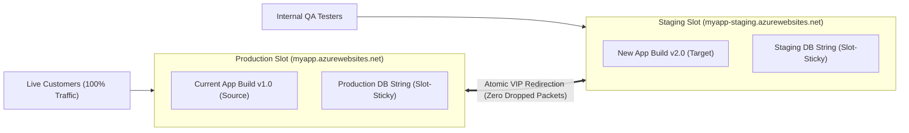
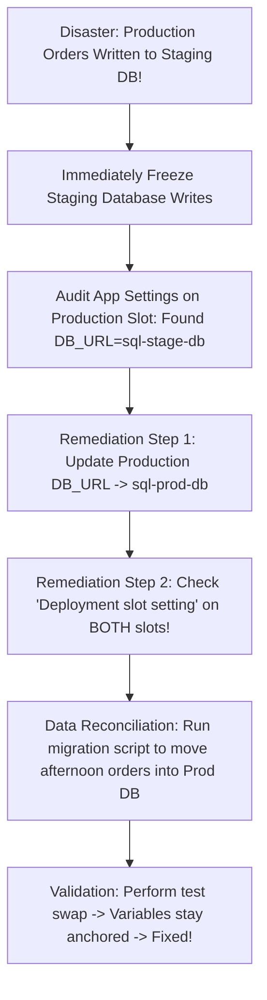

# Module 13-104-10: Administer PaaS Compute, App Services, Containers & AKS

**Breadcrumbs:** [[13-Index - Azure|☁️ Azure Reference MOC]] > [[13-Index - AZ-104|📘 AZ-104 Exam Track]] > **10 - Administer PaaS Compute Options**

---

## 🎯 Stage 1: Executive Overview & The Conceptual Lecture

### 1. The Zero-Knowledge Starting Point: The Evolution Beyond Virtual Machines
In Module 09, we mastered Infrastructure as a Service (IaaS) Virtual Machines. While VMs give you complete administrative control down to the operating system kernel, they come with a heavy operational burden:
* Every Tuesday, someone must patch Windows or Linux security updates.
* If the web server process crashes, an engineer must log in via SSH/RDP to restart it.
* If web traffic surges by 500%, you must manually provision new VMs, attach disks, join them to load balancers, and deploy code.
* To perform a code update without downtime, you have to build elaborate blue/green infrastructure setups from scratch.

Modern cloud engineering aims to eliminate this operational friction using **Platform as a Service (PaaS)** and **Serverless Containers**:
* In PaaS, you do not manage operating systems, hypervisors, disk partitions, or security patches.
* You bring your application code (in .NET, Python, Node.js, Java, or a Docker container) and hand it to Azure.
* Azure handles runtime execution, security patching, auto-scaling, SSL certificates, custom domains, and zero-downtime blue/green deployment slots automatically!

---

### 2. The Restaurant Kitchen Analogy
* **IaaS (Virtual Machines):** Building your own restaurant from scratch. You rent the building, buy commercial ovens, hire plumbers, wire electrical outlets, and sweep the floors every night. You have complete freedom to install any stove you want, but if the refrigeration compressor fails, dinner service stops.
* **PaaS (Azure App Service):** Renting a fully staffed, turnkey commercial kitchen. The ovens, stoves, electricity, and dishwashers are already installed, inspected, and maintained by the facility owner. You simply bring your ingredients and master recipes (application code) and start cooking immediately!
* **Serverless Containers (ACI / ACA):** Hiring an on-demand food truck for a 2-hour festival. The truck arrives, serves food, and departs immediately when the event finishes. You pay strictly for the minutes the truck operated, with zero ongoing building lease!
* **Orchestrated Containers (AKS):** Managing an entire nationwide fleet of 100 food trucks with an automated logistics dispatch center, coordinating schedules, route detours, and auto-dispatching replacement trucks if any vehicle breaks down.

---

### 3. Terminology Matrix: Zero-Knowledge to Enterprise Architect

| Terminology | What It Means to a Beginner | Real-World Analog | Enterprise Architecture Reality |
| :--- | :--- | :--- | :--- |
| **App Service Plan (ASP)** | The server engine that runs your web apps. | The physical engine in a boat that powers multiple propellers. | A managed compute tier defining the dedicated vCPUs, RAM, and scale limits shared across one or more web apps. |
| **Azure Web App** | The actual website or API running your code. | The commercial storefront facing the public. | A PaaS hosting container running on an ASP worker pool, reachable via HTTPS and managed by Microsoft's ARR routing fabric. |
| **Deployment Slot** | A staging clone of your website for testing. | An identical dress-rehearsal stage behind the velvet curtain. | An isolated live web app sharing the same ASP compute, used for pre-swap warming and instant zero-downtime blue/green cutover. |
| **Slot-Sticky Setting** | A configuration setting that stays behind during a swap. | A room key that stays with the physical room, not the guest. | An App Setting with `slotSetting: true` that anchors environment-specific configs (like DB connections) to a specific slot during swaps. |
| **VNet Integration (Outbound)** | Giving your web app a private wire into your virtual network. | Running a private underground telephone cable from a store to its warehouse. | Outbound regional VNet delegation routing web app calls to private VMs, databases, and on-premises over VPN/ExpressRoute. |
| **Private Endpoint (Inbound)** | Giving your web app a private IP so the public internet cannot hit it. | Locking the public front doors of a store and only letting authorized staff enter through an alley door. | Binds the web app's inbound HTTPS endpoint to a private IP in a local subnet, disabling public internet DNS access. |
| **Azure Container Instances (ACI)** | Running a single Docker container on-demand. | Calling an Uber for a single 15-minute ride. | Serverless container execution billed per-second of vCPU/RAM allocation, supporting Container Groups sharing localhost networking. |
| **Azure Container Apps (ACA)** | Running microservices that scale to zero. | A taxi dispatch system that sends 10 cars during a rush and parks them all when quiet. | Serverless microservices platform built on Kubernetes, KEDA, and Envoy, supporting event-driven autoscaling and HTTP traffic splitting. |
| **Azure Kubernetes Service (AKS)** | A full enterprise container management cluster. | An automated air traffic control system directing 500 airplanes simultaneously. | Managed production Kubernetes engine where Microsoft provides the control plane for free and you pay only for worker VMSS nodes. |
| **Kubenet vs. Azure CNI** | The two networking modes in AKS. | Using house extensions (Kubenet NAT) vs giving every resident their own external phone number (Azure CNI). | Kubenet uses pod overlay CIDR with node-level NAT; Azure CNI allocates true VNet subnet private IPs directly to every container pod. |

---

## 🏛️ Stage 2: Core Mental Model & Component Architecture

### 1. Azure App Service Plans: Tiers, ACU Mechanics & Compute Boundaries

#### 1. The Real-World Dilemma: Multi-Tenant Contention vs. Dedicated FinOps Waste (The "Why")
When hosting web applications in the cloud, enterprise architects face a severe balancing act between isolation, performance, and financial cost:
* **The Noisy Neighbor Dilemma:** In entry-level shared cloud hosting, your web code runs on physical servers alongside hundreds of unknown third-party companies. If a neighboring tenant executes a malformed recursive database query or triggers a crypto-miner, the physical host's CPU cycles spike to 100%, and your web application experiences severe latency spikes or HTTP 504 Gateway Timeouts.
* **The Traffic Spike Collapse:** Many web applications run fine at 5 requests per second, but collapse during marketing campaigns or Black Friday flash sales. If your hosting tier lacks the ability to scale horizontally (adding VM instances) or dynamically adjust to CPU/RAM pressure, the site halts.
* **The FinOps Over-Provisioning Trap:** Conversely, jumping directly to high-end isolated hosting environments for simple dev/test workloads or internal administrative tools runs up thousands of dollars a month in idle compute spend.

In Azure, an **App Service Plan (ASP)** (`Microsoft.Web/serverfarms`) is the fundamental billing, compute, and physical boundary. Sizing an ASP requires understanding **compute tenancy (shared vs. dedicated)**, **compute horsepower (Azure Compute Units / ACU)**, and **feature gating thresholds (custom domains, autoscaling, deployment slots, and VNet integration)**.

```text
+-------------------------------------------------------------------------------------------------+
|                       APP SERVICE PLAN (ASP) COMPUTE & PACKING BOUNDARY                         |
+-------------------------------------------------------------------------------------------------+
|                                                                                                 |
|   App Service Plan: "asp-enterprise-prod" (Standard S2: 2 Cores / 3.5 GiB RAM)                  |
|   ┌─────────────────────────────────────────────────────────────────────────────────────────┐   |
|   │ Dedicated Virtual Machine Worker Instance (Allocated from Azure Cloud Fabric)           │   |
|   │                                                                                         │   |
|   │  ┌───────────────────────┐  ┌───────────────────────┐  ┌──────────────────────────────┐ │   |
|   │  │ Web App 1: e-Commerce │  │ Web App 2: REST API   │  │ Web App 3: Background Worker │ │   |
|   │  │ https://shop.corp.com │  │ https://api.corp.com  │  │ https://jobs.corp.com        │ │   |
|   │  │ (.NET 8 Core)         │  │ (Node.js 20 REST)     │  │ (Python 3.11 Daemon)         │ │   |
|   │  └───────────┬───────────┘  └───────────┬───────────┘  └──────────────┬───────────────┘ │   |
|   │              │                          │                             │                 │   |
|   │              ▼                          ▼                             ▼                 │   |
|   │  ═════════════════════════════════════════════════════════════════════════════════════  │   |
|   │  SHARED WORKER HARDWARE BOUNDARY: All 3 apps SHARE the same 2 vCPUs and 3.5 GiB RAM!    │   |
|   │  (Over-packing apps onto an undersized plan triggers memory paging and mutual crash!)   │   |
|   └─────────────────────────────────────────────────────────────────────────────────────────┘   |
|                                                                                                 |
+-------------------------------------------------------------------------------------------------+
```

#### 2. The Concrete Metaphor: The Housing Property Spectrum
To easily memorize and understand the App Service Plan pricing tiers, picture the spectrum of real estate housing options:
* **Free / Shared Tier (F1 / D1) — The 16-Bed Hostel Dorm Bunk:**
  - You rent a single bunk bed in a crowded youth hostel. You share a room, bathroom, and single electrical outlet with random strangers (multi-tenant shared VMs).
  - If a stranger plays loud music or hogs the bathroom, you suffer.
  - On the Free tier, the landlord shuts off your electricity after **60 minutes of CPU time per day**!
* **Basic Tier (B1–B3) — The Leased Studio Apartment:**
  - You lease a small, private studio apartment. The room, lock, and electrical meter are 100% yours (dedicated VM).
  - No noisy neighbors can steal your electricity.
  - **The Catch:** The building has no concierge, no extra guest bedrooms (no deployment slots), and no automated cleaning staff (no autoscale). You must manually clean and manage your space.
* **Standard Tier (S1–S3) — The Suburban Single-Family Home:**
  - A private home with a dedicated driveway and automated smart appliances.
  - Features automated climate control (metric-based autoscaling up to 10 instances), 5 guest suites for dress rehearsals (5 deployment slots), and daily automated maid service (automated daily backups).
  - **The Enterprise Production Baseline!**
* **Premium v3 Tier (P1v3–P3v3) — The High-Tech Luxury Penthouse Estate:**
  - Built with reinforced concrete and industrial NVMe soundproofing (local NVMe SSDs, ACU 195–210 per core—nearly double the processing speed of Standard!).
  - Includes 20 guest rehearsal suites (20 deployment slots), scales up to 30 instances, and features native regional VNet integration plumbing.
* **Isolated v2 Tier (I1v2–I6v2) — The Guarded Gated Citadel on Private Land:**
  - A fortified compound built inside your private corporate security fence (dedicated App Service Environment - ASE v3).
  - Injected directly into your private VNet with zero multitenant exposure, scaling up to 100 instances for banking and high-security compliance.

#### 3. The Mechanical & Topological Reality: ACUs, Memory Ratios & Tier Specifications
Under the hood, an App Service Plan provisions virtual machine worker nodes managed by the Azure Fabric Controller.
* **Azure Compute Units (ACU):** A standardized benchmarking unit used by Azure to compare compute performance across hardware families. A baseline of 100 ACUs corresponds to a legacy Small (A1) VM core.

```text
+-------------------------------------------------------------------------------------------------+
|                       AZURE APP SERVICE PLAN HARDWARE & TIER MATRIX                             |
+-------------------------------------------------------------------------------------------------+
| Feature / Tier       | Free (F1) / Shared (D1)| Basic (B1 - B3)    | Standard (S1 - S3) | Premium v3 (P1v3 - P3v3) |
+----------------------+------------------------+--------------------+--------------------+--------------------------+
| Tenancy Model        | Shared Multi-Tenant VM | Dedicated VM       | Dedicated VM       | Dedicated VM (NVMe Host) |
| ACU per vCPU Core    | Shared / Throttled     | ~100 ACU           | ~100 ACU           | 195 - 210 ACU (2x Fast!) |
| Memory per Core      | 1 GiB (Shared)         | 1.75 GiB / core    | 1.75 GiB / core    | 4.0 - 8.0 GiB / core     |
| Autoscaling Engine   | ❌ None (Fixed 1 VM)    | ❌ Manual Only (3) | ✅ Auto (Up to 10)  | ✅ Auto (Up to 30)        |
| Deployment Slots     | 0 Slots                | 0 Slots            | 5 Slots            | 20 Slots                 |
| Included Storage     | 1 GiB                  | 10 GiB             | 50 GiB             | 250 GiB                  |
| Custom Domains & SSL | Shared D1 only (F1: ❌) | ✅ Yes             | ✅ Yes             | ✅ Yes                   |
| VNet Integration     | ❌ Unsupported         | ✅ Basic Outbound  | ✅ Full Regional   | ✅ Full Regional (Fast)  |
| Max CPU Usage Limits | 60 mins/day (F1)       | Unlimited (100%)   | Unlimited (100%)   | Unlimited (100%)         |
+-------------------------------------------------------------------------------------------------+
```

##### Critical Tier Threshold Rules:
1. **Autoscaling & Deployment Slots Gate:** The absolute minimum tier required to unlock metric-based autoscaling or blue/green deployment slots is **Standard (S1)**.
2. **Custom Domain Gate:** The absolute minimum tier required to bind a custom domain (e.g., `www.contoso.com`) is **Shared (D1)**.
3. **App Service Environment (ASE) Gate:** The only tier that supports full VNet injection with dedicated single-tenant host infrastructure and up to 100 instances is **Isolated v2 (Iv2)**.

#### 4. The Production Failure Loop & Exam Trap: Sizing Catastrophes

##### Trap 1: The "App Service Plan Over-Packing" Memory Exhaustion Crash
* **The Scenario:** An engineering team provisions a single `Standard_S1` App Service Plan (1 vCPU, 1.75 GiB RAM). Over six months, developers deploy 12 independent web applications and REST APIs into this single plan because "Azure allows unlimited apps per plan." During a midday traffic bump, all 12 websites suddenly crash simultaneously, returning `HTTP 503 Service Unavailable`.
* **The Root Cause:** While Azure does not restrict the number of apps you associate with an ASP, **all apps share the exact same physical RAM memory pool**. Twelve web apps running Node.js and Python runtimes consumed 1.9 GiB of working memory. The underlying Linux hypervisor experienced severe memory pressure, invoking the OOM (Out Of Memory) killer and constantly recycling the worker processes!
* **The Architectural Law:**
  > [!WARNING]
  > An App Service Plan is a finite compute boundary. Monitor the `Memory Percentage` metric of your App Service Plan in Azure Monitor. If memory exceeds 75–80%, scale up the plan to a larger SKU (e.g., S2/S3 or P1v3/P2v3) or scale out across multiple App Service Plans.

##### Trap 2: The "Stopped Web App Still Bills" FinOps Trap
* **The Scenario:** A DevOps engineer attempts to cut costs over the weekend by stopping 5 non-production web applications (`az webapp stop`). On Monday morning, the FinOps report shows the company was billed 100% of the compute costs for the entire weekend!
* **The Ground Truth:** Stopping an individual Web App halts the application process, but **does NOT deallocate the underlying App Service Plan worker VMs**. Azure continues reserving dedicated vCPUs and RAM for your plan. To stop compute billing, you must delete or downscale the **App Service Plan** itself!

---

### 2. Deployment Slots: Zero-Downtime Swaps, ARR Mechanics & State Drift

#### 1. The Real-World Dilemma: The Production High-Wire Act & Cold-Start Latency (The "Why")
Deploying application updates directly to a live production server is fraught with operational hazards:
1. **Locked Binaries & 500 Outages:** Modern web engines (.NET, Java, Node.js) lock runtime binaries in memory. Overwriting DLLs or class files while active web requests are processing results in file lock conflicts, application crashes, and transient `HTTP 500 Internal Server Error` spikes.
2. **The "Cold-Start" Latency Wall:** When a freshly deployed web application initializes, the runtime must JIT-compile classes, initialize Dependency Injection (DI) containers, compile views, authenticate with databases, and pre-warm in-memory caches. For the first 30 to 60 seconds after a release, incoming live customers experience crippling 10-second page load latencies or gateway timeouts.
3. **The Catastrophic Bug & Rollback Lag:** If an untested edge-case bug slips past CI into production, rolling back code via traditional redeployment pipelines takes 15 to 30 minutes while packages recompile and deploy—prolonging the outage and damaging corporate reputation.

**Deployment Slots** (`Microsoft.Web/sites/slots`) solve this dilemma by providing a blue/green deployment architecture with built-in cold-start pre-warming and sub-second atomic traffic redirection.

```text
+-------------------------------------------------------------------------------------------------+
|                       DEPLOYMENT SLOT SWAP ARCHITECTURE & ARR ROUTING                           |
+-------------------------------------------------------------------------------------------------+
|                                                                                                 |
|   PHASE 1: PRE-SWAP TESTING & WARM-UP (Zero Live User Impact)                                   |
|                                                                                                 |
|   Live Customers ──► [ ARR Frontend Router ] ──► [ Production Slot: v1.0 ]                      |
|                      (myapp.azurewebsites.net)    (Warmed, active, 100% traffic)                |
|                                                                                                 |
|   DevOps / QA   ──► [ Staging ARR Router ]   ──► [ Staging Slot: v2.0 ]                         |
|                      (myapp-staging.azurewebsites) (Cold code deploys here!)                    |
|                                                     ├── Azure sends synthetic warmup probes     |
|                                                     ├── DI containers compile, caches pre-warm  |
|                                                     └── QA executes smoke tests against DB      |
|                                                                                                 |
|   PHASE 2: ATOMIC VIP / ROUTER SWAP (Zero Dropped TCP Packets!)                                 |
|                                                                                                 |
|   Live Customers ──► [ ARR Frontend Router ] ═══╗                                               |
|                      (myapp.azurewebsites.net)  ║ (Atomic pointer flip in software)             |
|                                                 ▼                                               |
|                      [ Staging Slot Hardware: NOW SERVING v2.0 TO LIVE USERS! ]                 |
|                      (Instantaneous cutover; zero cold start; zero downtime!)                   |
|                                                                                                 |
+-------------------------------------------------------------------------------------------------+
```

#### 2. The Concrete Metaphor: The Broadway Revolving Stage
To intuitively grasp deployment slots, picture a Broadway musical performance:
* **Direct Production Deployment (Traditional):**
  - Between Scene 1 and Scene 2, the curtain stays up. Stagehands run around with hammers, ladders, and paint cans, dragging heavy couches across the stage while the paying audience sits watching in awkward confusion. If a couch breaks, the show halts for 20 minutes.
* **Deployment Slots (The Revolving Turntable Stage):**
  - The theater stage is built on a massive circular rotating turntable.
  - While Scene 1 (Production) is playing live in front of the audience, the actors for Scene 2 (Staging) get completely into position, tune their instruments, test their microphones, and warm up their voices on the backstage half of the turntable behind the curtain.
  - When Scene 1 finishes, the director flips a switch: the turntable **rotates 180 degrees in 3 seconds**.
  - The audience is instantly presented with a fully illuminated, perfectly rehearsed, fully warmed-up Scene 2!
  - If the lead actor in Scene 2 suddenly faints, the director flips the switch and rotates the turntable right back to Scene 1 in 3 seconds!

#### 3. The Mechanical & Topological Reality: ARR Routing, Pre-Warming, and Sticky Flags



##### 1. The 5-Phase Slot Swap Sequence (Under the Hood):
1. **Configuration Staging & Dependency Application:**
   * Azure reads the settings of the target slot (Production). Any settings that are **not marked as slot-sticky** are applied to the source slot (Staging).
   * If **Swap with Preview** is initiated, production configuration is applied to the staging slot first, allowing engineers to validate that the new code connects successfully to production databases *before* traffic cutover.
2. **HTTP Cold-Start Pre-Warming Handshake:**
   * Azure's **Application Request Routing (ARR)** reverse proxy frontends dispatch synthetic HTTP warmup requests to the staging worker processes.
   * By default, ARR pings the root URL (`/`). If configured in `web.config` (`<applicationInitialization>`), Azure pings designated warmup paths (e.g., `/warmup`, `/healthz`).
   * Azure waits for the application to respond with `HTTP 200 OK`. The runtime initializes assemblies, builds internal caches, and primes connection pools.
3. **VIP / ARR Router Redirection (The Atomic Flip):**
   * Once all worker instances in the staging slot have successfully warmed up, Azure commands the front-end ARR load balancers to atomically switch the internal routing rules.
   * Requests hitting `myapp.azurewebsites.net` are instantly steered to the newly warmed worker instances. **Zero dropped TCP packets; zero cold-start delay for end users!**
4. **Source Slot Code Re-hosting:**
   * The previous production code (v1.0) now resides in the staging slot (`myapp-staging.azurewebsites.net`).
5. **Instant Rollback Capability:**
   * If monitoring telemetry (Application Insights) reveals unexpected runtime exceptions on v2.0, clicking **Swap** again immediately reverts the ARR routing rules, returning live customers to v1.0 in seconds!

##### 2. Canary Traffic Splitting (Testing in Production):
* App Service allows routing a specific percentage of live production traffic to a staging slot (e.g., **90% Production / 10% Staging**).
* ARR injects a routing cookie named `x-ms-routing-name=staging` into the client's browser. As long as the user's session includes this cookie, all subsequent requests hit the canary staging slot, enabling real-world telemetry evaluation without risking 100% of the customer base.

##### 3. Swapped Settings vs. Slot-Sticky Settings Matrix:
During a slot swap, Azure swaps the application binaries. But configuration settings behave strictly according to whether the **"Deployment slot setting"** checkbox is checked:

| Configuration Setting Category | Swapped (Moves with the Code Build) | Slot-Sticky (Stays Anchored to the Slot) |
| :--- | :--- | :--- |
| **Database Connection Strings** | Standard app settings without checkbox | **Checked: "Deployment slot setting"** |
| **Environment Identifiers** | Generic feature flags | `APP_ENV=Production` vs. `APP_ENV=Staging` |
| **Custom Domains & SSL Certificates**| ❌ Cannot be swapped | **Permanently anchored to the slot!** |
| **Publishing Credentials** | ❌ Cannot be swapped | **Unique per slot** |
| **IP Access Restrictions & Firewalls** | ❌ Cannot be swapped | **Unique per slot** |
| **VNet Integration / Private Endpoints**| ❌ Cannot be swapped | **Unique per slot** |
| **Scale Settings (Autoscale Rules)** | ❌ Cannot be swapped | **Unique per slot** |
| **Framework Versions (.NET / Python)** | **Swapped with application** | ❌ Does not stay |
| **Handler Mappings & Web Sockets** | **Swapped with application** | ❌ Does not stay |

#### 4. The Production Failure Loop & Exam Trap: Slot Catastrophes

##### Trap 1: The Missing Slot-Sticky Flag Database Contamination Disaster
* **The Scenario:** A fintech startup deploys code updates to a `staging` slot. Production uses `DB_CONN=sql-prod-db`, and staging uses `DB_CONN=sql-stage-db`. When the developer configured the staging connection string, they **forgot to check "Deployment slot setting"**. The QA team runs smoke tests, and the developer executes a swap.
* **The Catastrophe:** Because the setting was not marked sticky, **Azure moved the staging connection string into the production slot!** For the next 4 hours, live customer checkout orders were silently inserted into the staging test database. When QA truncated the staging database that evening, **thousands of live production financial transactions were permanently erased!**
* **The Architectural Law:**
  > [!CAUTION]
  > Always mark database connection strings, payment gateway API keys, and environment identifiers as **"Deployment slot setting"** on BOTH the production slot and every staging slot!

##### Trap 2: The Staging Slot Memory Exhaustion Crash
* **The Scenario:** A company runs their production app on a `Standard_S1` App Service Plan (1 vCPU, 1.75 GiB RAM). During peak midday traffic, a developer pushes a massive new application build to the `staging` slot and triggers automated load tests. Five minutes later, the live production website crashes with `HTTP 503 Service Unavailable`.
* **The Root Cause:** Remember the compute boundary law: **All deployment slots share the exact same underlying App Service Plan compute instances!** The staging slot's load tests consumed 100% of the host CPU and exhausted RAM, starving the production worker processes on that same virtual machine.
* **The Resolution:** For resource-intensive staging testing or load testing, deploy staging slots to a separate dedicated App Service Plan before executing the swap!

---

### 3. App Service Networking: Regional VNet Integration vs. Private Endpoints

#### 1. The Real-World Dilemma: The Asymmetric Perimeter Wall (The "Why")
Azure App Service is a PaaS service residing in Microsoft's shared public edge. By default:
1. **The Inbound Vulnerability:** Anyone on the public internet can resolve `https://myapp.azurewebsites.net` and attempt to flood the endpoint with requests or exploit application vulnerabilities.
2. **The Outbound Barrier:** When your web application needs to query an enterprise SQL database, SAP backend, or internal VM sitting inside a private corporate Virtual Network (VNet), the web app cannot reach private RFC 1918 IP addresses (`10.0.0.0/8`, `172.16.0.0/12`, `192.168.0.0/16`) because the app lives outside the VNet!

Enterprise security architectures demand solving two completely different problems:
* **Securing INBOUND Traffic:** Completely blocking public internet access so only authorized internal corporate users can reach the web app.
* **Enabling OUTBOUND Connectivity:** Allowing the web app to initiate outbound calls into private VNets, on-premises datacenters, or databases without exposing backend databases to the public internet.

```text
+-------------------------------------------------------------------------------------------------+
|                       APP SERVICE NETWORKING: INBOUND vs. OUTBOUND                              |
+-------------------------------------------------------------------------------------------------+
|                                                                                                 |
|   INBOUND FLOW: Who can REACH the Web App?                                                      |
|   [ Public Internet ] ──► (Blocked by Private Endpoint!)                                        |
|                                  │                                                              |
|   [ Internal Corporate Client ] ─┼──► [ Private Endpoint (Private Link) ]                       |
|   (Inside VNet: 10.0.1.15)       │    ├── Allocates Private IP: 10.0.2.10                       |
|                                  │    └── Disables public DNS routing completely!               |
|                                  ▼                                                              |
|                      ┌───────────────────────┐                                                  |
|                      │   Azure App Service   │                                                  |
|                      └───────────┬───────────┘                                                  |
|                                  │                                                              |
|   OUTBOUND FLOW: What can the Web App REACH?                                                    |
|                                  ▼                                                              |
|                      [ Regional VNet Integration ]                                              |
|                      ├── Dedicated Delegated Subnet ('Microsoft.Web/serverFarms')               |
|                      ├── Injects worker vNICs directly into your private VNet                   |
|                      └── Enables app to initiate calls OUT to private backend resources         |
|                                  │                                                              |
|                                  ▼                                                              |
|             ┌─────────────────────────────────────────────────┐                                 |
|             │ Private Backend Subnets / On-Premises Network   │                                 |
|             │ ├── Azure SQL Managed Instance: 10.0.3.5        │                                 |
|             │ ├── Internal Linux VM: 10.0.3.20                │                                 |
|             │ └── On-Premises DB over ExpressRoute / VPN      │                                 |
|             └─────────────────────────────────────────────────┘                                 |
|                                                                                                 |
+-------------------------------------------------------------------------------------------------+
```

#### 2. The Concrete Metaphor: The Bulletproof Courtyard Door vs. The Private Underground Batphone
To prevent confusing inbound and outbound networking controls, use this physical metaphor:
* **Private Endpoint (Inbound Protection) — The Bulletproof Courtyard Door:**
  - Imagine you run an executive private bank. You completely brick up the public front doors and street-facing windows. The public walking on the street cannot enter or even see inside.
  - You install a single bulletproof card-key door located deep inside your private, gated underground employee courtyard.
  - Only authorized staff who are already inside the secured private courtyard can walk through the door into the bank.
* **Regional VNet Integration (Outbound Connectivity) — The Private Underground Batphone:**
  - You run a retail store where customers enter through the public front door.
  - However, you need to talk to your corporate gold vault downtown. Instead of yelling account numbers out the front window over the public street, you lay a private, dedicated underground fiber-optic phone line from behind the cash register directly into the vault downtown.
  - The store clerk can pick up the phone and query the vault (outbound requests). But nobody standing in the gold vault can walk through the telephone wire into your retail store—it is strictly a **one-way outbound communication conduit**!

#### 3. The Mechanical & Topological Reality: Subnet Delegation, Injected vNICs & DNS Linkages

```text
                                INBOUND TRAFFIC
                        [ Public Internet or Corporate Client ]
                                         │
                                         ▼
                 ┌───────────────────────────────────────────────┐
                 │ Method A: Access Restrictions                 │
                 │ ├── Whitelists/blacklists specific Client IPs │
                 │ └── Enforces Service Endpoints                │
                 ├───────────────────────────────────────────────┤
                 │ Method B: Private Endpoint (Private Link)     │
                 │ ├── Binds App Service to private IP in subnet │
                 │ └── Disables public DNS endpoint completely!  │
                 └──────────────────────┬────────────────────────┘
                                        │
                                        ▼
                             [ Azure App Service ]
                                        │
                                        ▼
                 ┌───────────────────────────────────────────────┐
                 │ Method C: Regional VNet Integration           │
                 │ ├── Requires dedicated delegated subnet       │
                 │ │   ('Microsoft.Web/serverFarms', >= /28)     │
                 │ ├── Routes OUTBOUND calls to private VMs/DBs  │
                 │ └── 'Route All' forces internet traffic to    │
                 │     an Azure Firewall via default UDR!        │
                 └──────────────────────┬────────────────────────┘
                                        │
                                OUTBOUND TRAFFIC
                                        ▼
                [ Private Backend VM / SQL DB / On-Premises Network ]
```

##### 1. Regional VNet Integration Mechanical Mechanics (Outbound):
* **Dedicated Subnet Delegation:** Regional VNet Integration requires an empty subnet delegated strictly to service **`Microsoft.Web/serverFarms`**.
* **Subnet Sizing Rules:**
  - Absolute minimum subnet size: **`/28`** (16 addresses, 11 usable).
  - Recommended enterprise size: **`/26`** (64 addresses) or `/25`.
  - **Why?** Azure injects a dedicated virtual network interface (vNIC) into the subnet for each worker instance in your App Service Plan. If an autoscale rule scales out your plan to 20 instances, Azure requires 20 available IP addresses in the delegated subnet!
* **Routing Scope & The `Route All` Law (`WEBSITE_VNET_ROUTE_ALL`):**
  - **Default Behavior:** By default, VNet Integration routes **only RFC 1918 private IP traffic** (`10.0.0.0/8`, `172.16.0.0/12`, `192.168.0.0/16`) into the VNet. All public internet calls (e.g., calling Stripe or SendGrid APIs) bypass the VNet and egress directly through Microsoft's public edge IPs.
  - **Route All Enabled (`WEBSITE_VNET_ROUTE_ALL = 1`):** Commands Azure to route **100% of outbound traffic** (both private and public internet) through the delegated subnet. This enables you to attach a User-Defined Route (UDR) with `0.0.0.0/0 -> Azure Firewall / NVA` to inspect, log, or restrict all external outbound web traffic!

##### 2. Private Endpoints Mechanical Mechanics (Inbound):
* **Architecture:** Utilizes **Azure Private Link** (`Microsoft.Network/privateEndpoints`).
* **IP Allocation:** Carves out a single private IP address from your chosen client subnet (e.g., `10.0.2.10`) and binds it to the App Service.
* **Public Access Lockdown:** Public network access is disabled. External requests hitting `myapp.azurewebsites.net` receive an immediate `HTTP 403 Forbidden - IP Forbidden`.
* **DNS Resolution Flow:**
  1. Azure creates a CNAME for `myapp.azurewebsites.net` pointing to `myapp.privatelink.azurewebsites.net`.
  2. An Azure **Private DNS Zone** named `privatelink.azurewebsites.net` is linked to your Virtual Network.
  3. Inside the Private DNS Zone, an `A` record points `myapp` to the private IP (`10.0.2.10`).
  4. When an internal VM queries `myapp.azurewebsites.net`, the local DNS resolver follows the CNAME chain and returns the private IP!

##### 3. Networking Comparison Matrix: Inbound vs. Outbound Controls:

| Architectural Metric | Regional VNet Integration | Private Endpoint (Private Link) |
| :--- | :--- | :--- |
| **Traffic Direction** | **OUTBOUND ONLY** (Web App $\to$ Private VNet/DB) | **INBOUND ONLY** (Client $\to$ Web App) |
| **Subnet Delegation Required?**| **YES** (`Microsoft.Web/serverFarms`) | **NO** (Any standard workload subnet) |
| **Subnet Exclusivity** | **Subnet must be 100% empty & dedicated!** | Can share subnet with VMs and other endpoints|
| **Does it secure public web access?**| **NO** (Public internet can still access app!)| **YES** (Completely blocks public internet!) |
| **IP Address Consumption** | 1 IP per App Service Plan worker instance | Exactly **1 private IP** for the endpoint |
| **On-Premises Connectivity** | Accesses on-prem over ExpressRoute/VPN | Accessible from on-prem over ExpressRoute/VPN |
| **Primary Production Use Case**| Querying private SQL databases & backend APIs | Securing internal corporate intranet portals |

#### 4. The Production Failure Loop & Exam Trap: Networking Traps

##### Trap 1: The Subnet Delegation Collision Error
* **The Scenario:** An administrator attempts to enable VNet Integration on an App Service web app. In the portal dropdown, they select an existing subnet `snet-backend` that already hosts two virtual machines. The deployment fails with:
  ```text
  SubnetIsAlreadyInUse: Subnet /subscriptions/.../subnets/snet-backend has other 
  resources and cannot be used for App Service VNet integration.
  ```
* **The Root Cause:** Subnets used for Regional VNet Integration **strictly prohibit housing any other Azure resources** (no VMs, no Application Gateways, no storage endpoints). The subnet must be completely empty before applying delegation to `Microsoft.Web/serverFarms`.

##### Trap 2: The "Split-Brain" DNS Resolution Blackout
* **The Scenario:** A security team configures a Private Endpoint on an App Service to lock down an internal payroll tool. They configure the private IP `10.0.2.50`. However, when developers on internal corporate VMs attempt to browse to `https://payroll.azurewebsites.net`, the browser throws `HTTP 403 Forbidden - IP Forbidden`.
* **The Root Cause:** The developers' VMs are still resolving the **public IP address** of the App Service! The team provisioned the Private Endpoint, but **failed to link the `privatelink.azurewebsites.net` Azure Private DNS Zone to the clients' Virtual Network**. Because the internal VNet could not resolve the Private DNS Zone, it queried public DNS, hit the blocked public endpoint, and was denied access!

##### Trap 3: The Outbound Firewall Bypass Leak
* **The Scenario:** An enterprise mandates that all cloud egress traffic must pass through an Azure Firewall for compliance logging. The DevOps team enables VNet Integration on the web app and verifies it can ping backend databases. However, network auditors discover that API calls to third-party payment providers are bypassing the Azure Firewall completely!
* **The Root Cause:** The team forgot the **`Route All`** rule! By default, VNet Integration only routes RFC 1918 traffic into the VNet. To force external internet traffic into the VNet and through the Azure Firewall UDR, they must toggle **Route All** in the portal or set application setting `WEBSITE_VNET_ROUTE_ALL = 1`.

---

### 4. The Container Compute Continuum: ACI vs. ACA vs. AKS

#### 1. The Real-World Dilemma: Operational Overhead vs. Microservice Agility (The "Why")
Containerization using Docker/OCI standards has revolutionized software deployment. However, engineering leaders face a critical architectural decision: **What level of operational abstraction is appropriate for our workloads?**
* **The Full Kubernetes Burden (AKS):** Azure Kubernetes Service provides raw power and CNCF ecosystem compatibility. But operating AKS requires configuring node pools, managing CNI IP CIDR budgets, updating cluster control planes, configuring Ingress Controllers (NGINX/AGIC), and maintaining complex Helm charts. Running a 3-node AKS cluster for a single batch script or lightweight microservice introduces massive operational and financial overhead.
* **The Idle Compute Waste:** Many containerized tasks (nightly batch ETL scripts, webhook processors, queue consumers) run for only 10 minutes an hour. Running dedicated VMs or standard clusters around the clock forces organizations to pay 100% of compute costs for 90% idle time.
* **The Microservices Routing Gap:** Lightweight containers often require Layer 7 traffic routing, blue/green canary splits, and event-driven scaling (e.g., scaling based on RabbitMQ or Service Bus message counts) without managing Kubernetes manifests.

To solve this spectrum of requirements, Azure provides three container compute tiers: **Azure Container Instances (ACI)**, **Azure Container Apps (ACA)**, and **Azure Kubernetes Service (AKS)**.

```text
+-------------------------------------------------------------------------------------------------+
|                       AZURE CONTAINER COMPUTE SPECTRUM: ACI vs. ACA vs. AKS                     |
+-------------------------------------------------------------------------------------------------+
|                                                                                                 |
|   TIER 1: AZURE CONTAINER INSTANCES (ACI) ──► Raw Serverless Container Execution                 |
|   ┌─────────────────────────────────────────────────────────────────────────────────────────┐   |
|   │ Hypervisor-Isolated Container Groups (Fast boot: seconds; per-second billing)           │   |
|   │ - No cluster, no orchestrator, no ingress, no autoscaling. Runs a container to completion│   |
|   │ - Ideal for: Batch ETL jobs, CI/CD runners, quick ad-hoc scripts.                       │   |
|   └─────────────────────────────────────────────────────────────────────────────────────────┘   |
|                                                                                                 |
|   TIER 2: AZURE CONTAINER APPS (ACA) ──► Managed Serverless Microservices Platform              |
|   ┌─────────────────────────────────────────────────────────────────────────────────────────┐   |
|   │ Built on Managed Kubernetes + KEDA + Envoy Proxy + Dapr                                 │   |
|   │ - SCALE TO ZERO! ($0 compute when idle; scales on HTTP concurrency or queue depth)     │   |
|   │ - Built-in Envoy Layer 7 Ingress with Canary Traffic Splitting (80% v1 / 20% v2)         │   |
|   │ - Ideal for: Modern event-driven microservices fleets, background queue processors.      │   |
|   └─────────────────────────────────────────────────────────────────────────────────────────┘   |
|                                                                                                 |
|   TIER 3: AZURE KUBERNETES SERVICE (AKS) ──► Full Enterprise Container Orchestration            |
|   ┌─────────────────────────────────────────────────────────────────────────────────────────┐   |
|   │ Upstream CNCF Kubernetes Engine (Microsoft manages free Control Plane; you manage nodes)│   |
|   │ - Full control over DaemonSets, StatefulSets, custom CRDs, service meshes, host nodes    │   |
|   │ - Ideal for: Massive enterprise container platforms, complex multi-tier microservices.  │   |
|   └─────────────────────────────────────────────────────────────────────────────────────────┘   |
|                                                                                                 |
+-------------------------------------------------------------------------------------------------+
```

#### 2. The Concrete Metaphor: The Rental Kick-Scooter vs. The Autonomous Robotaxi vs. The Transcontinental Rail System
To intuitively grasp when to choose each container service, contrast three transportation modalities:
* **Azure Container Instances (The Rental Kick-Scooter):**
  - You need to travel 6 blocks to grab lunch. You spot an electric kick-scooter on the sidewalk, unlock it with your phone, ride for 6 minutes, park it, and lock it.
  - You pay strictly for the 6 minutes ridden. You don't own the scooter, you don't grease the wheels, and you don't build a garage. Point-to-point, zero ongoing overhead!
* **Azure Container Apps (The Autonomous Robotaxi Fleet):**
  - A smart municipal on-demand robotaxi fleet.
  - When 50 passengers arrive at a transit stop (KEDA queue trigger), the dispatch system automatically summons 5 autonomous shuttles. When the rush ends, all shuttles park and shut off their engines ($0 cost when idle!).
  - Built-in traffic routers direct 80% of passengers to standard shuttles and 20% to experimental electric models (Envoy traffic splitting). Vehicles communicate over secure two-way radios without drivers writing custom networking code (Dapr sidecars).
* **Azure Kubernetes Service (The Transcontinental Railway Grid):**
  - A massive multi-track rail network with freight depots, switching towers, automated signals, heavy diesel locomotives, and dedicated repair yards.
  - Unmatched throughput, power, and customization, but requires a dedicated team of train conductors and track engineers to operate!

#### 3. The Mechanical & Topological Reality: KEDA, Envoy, Dapr & Container Groups

##### 1. Azure Container Instances (ACI) Mechanics:
* **Hypervisor Isolation:** Each ACI deployment runs inside an isolated hypervisor boundary without sharing a kernel with other tenants.
* **Per-Second Billing:** Billed strictly per vCPU-second and GB-memory-second consumed while running.
* **Container Groups:** The top-level scheduling resource in ACI. A collection of one or more containers scheduled onto the same physical host blade, sharing:
  - The same local network namespace: Containers communicate with each other over **`localhost`** (e.g., `localhost:6379`)!
  - The same public/private IP address and port space (cannot bind to the same port).
  - The same mounted storage volumes (e.g., mounting an Azure Files share to `/mnt/data`).
* **Restart Policies:**
  - `Always`: Restarts container whenever it exits (used for web servers).
  - `Never`: Runs once and never restarts (used for run-once migration scripts).
  - `OnFailure`: Restarts only if the container exits with a non-zero exit code (ideal for batch jobs).

##### 2. Azure Container Apps (ACA) Mechanics:
ACA abstracts away Kubernetes complexity while providing enterprise microservice capabilities:
* **The KEDA Scaling Engine (Kubernetes Event-driven Autoscaling):**
  - Monitors external event triggers (HTTP request volume, Azure Service Bus queue length, Kafka lag, or custom Cron schedules).
  - **Scale to Zero:** When zero events or requests are pending, ACA scales container replicas down to **`0`**. Compute charges drop to **$0.00**!
* **Built-in Envoy Layer 7 Ingress:**
  - Provides integrated SSL/TLS termination and hostname routing.
  - **Canary Traffic Splitting:** Supports zero-downtime blue/green deployments and percentage-based traffic routing across container revisions (e.g., 90% traffic to Revision 1; 10% to Revision 2).
* **Managed Dapr (Distributed Application Runtime) Integration:**
  - Injects managed sidecar containers that handle state storage, pub/sub messaging (via Service Bus/Redis), service-to-service discovery, and mTLS cryptography with zero custom code!
* **Container Apps Environment:** The logical security and network boundary. Multiple container apps within the same environment share the same virtual network subnet and export logs to the same Log Analytics workspace.

##### 3. Comprehensive Container Compute Matrix (ACI vs. ACA vs. AKS):

| Feature Dimension | Azure Container Instances (ACI) | Azure Container Apps (ACA) | Azure Kubernetes Service (AKS) |
| :--- | :--- | :--- | :--- |
| **Architectural Model** | Standalone Container Groups | Serverless Microservices Platform | Full CNCF Container Orchestrator |
| **Underlying Engine** | Hypervisor-isolated containers | Managed Kubernetes + KEDA + Envoy | Upstream Kubernetes Cluster |
| **Scale to Zero (0 Cost)**| ❌ No (Instance terminates) | ✅ **YES (0 Replicas = $0 Cost!)** | ❌ (Worker nodes stay running) |
| **Scaling Triggers** | Manual or custom script | **KEDA (HTTP, Queue, Cron, Event)**| **HPA** (CPU/RAM) + Cluster Autoscaler |
| **Ingress & L7 Routing** | Basic Public IP / DNS name | **Built-in Envoy (Traffic Splitting)**| Ingress Controllers (NGINX/AGIC) |
| **Traffic Splitting (Canary)**| ❌ Unsupported | ✅ **Supported (Percentage splits)**| ✅ Supported (Service Mesh / Ingress) |
| **Microservice Mesh (Dapr)**| ❌ Manual DIY | ✅ **Native Managed Dapr Sidecars** | ❌ Manual Helm installation |
| **Management Burden** | Ultra-Low (Single container) | Low (No cluster maintenance) | Medium to High (Cluster operations) |
| **Billing Model** | Per-second vCPU/RAM allocation | Per-second active/idle vCPU/RAM | Pay for underlying VMSS worker nodes |
| **Best-Fit Workloads** | Batch jobs, ETL tasks, build runners| Event-driven APIs, microservices | Complex multi-tier enterprise systems |

#### 4. The Production Failure Loop & Exam Trap: Container Traps

##### Trap 1: The ACI Container Group Port Collision Crash
* **The Scenario:** A developer configures an ACI Container Group containing two containers: a web frontend container and an NGINX reverse proxy. Both container Dockerfiles expose port 80. The deployment crashes immediately with:
  ```text
  ContainerGroupPortAllocationFailed: Port 80 is already allocated to container 'frontend'.
  ```
* **The Ground Truth:** Containers within the same ACI Container Group share the **exact same network namespace and IP address**! They communicate via `localhost` and **CANNOT bind to the same port**. To resolve this, change the backend container to listen on an alternate port (e.g., port 8080) and let NGINX proxy to `localhost:8080`.

##### Trap 2: The ACA Scale-from-Zero Cold Start Latency Penalty
* **The Scenario:** An enterprise deploys a customer checkout API on Azure Container Apps with autoscale rules configured with `minReplicas = 0` to minimize cloud costs. During low-traffic periods, customers clicking "Pay Now" experience an 8-to-12 second spinning spinner before receiving a confirmation.
* **The Root Cause:** While scaling to zero eliminates compute charges, scaling from zero requires the underlying infrastructure to provision a container runtime, pull container image layers, boot the application runtime, and execute DI startup hooks.
* **The Resolution:** For latency-critical public APIs, configure **`minReplicas = 1`** (or 2) to maintain a warm baseline instance, while reserving scale-to-zero for asynchronous background queue processors and webhook handlers!

##### Trap 3: The ACI `RestartPolicy: Always` Infinite Billing Loop
* **The Scenario:** A DevOps engineer deploys a database migration script on ACI. The script executes for 45 seconds, finishes cleanly, and exits with code 0. However, the engineer left the default setting `RestartPolicy: Always`.
* **The Failure Loop:** Because the policy is set to `Always`, ACI detects that the container stopped and **immediately boots it up again**! The script runs in an infinite loop, executing migrations repeatedly and billing the subscription for weeks!
* **The Rule:** For batch tasks, scripts, and ETL jobs, **ALWAYS set `--restart-policy OnFailure` or `Never`**!

---

### 5. AKS Core Architecture & Networking Models: Kubenet vs. Azure CNI
Azure Kubernetes Service manages the complexity of running Kubernetes in the enterprise:
* **The Shared Responsibility Model in AKS:**
  - **Microsoft Manages (Free):** The Kubernetes Control Plane (API Server, `etcd` state store, Scheduler, and Controller Manager). Microsoft ensures 99.95% uptime of the API server.
  - **You Manage:** The Worker Node Pools (powered by underlying Azure Virtual Machine Scale Sets). You choose VM sizes, scale out nodes, and patch node images.

#### Kubenet vs. Azure CNI Networking (High-Yield Exam Core):

| Networking Dimension | Kubenet (Basic / Overlay) | Azure CNI (Advanced / Direct VNet) |
| :--- | :--- | :--- |
| **Pod IP Allocation** | Pods receive private IPs from an internal overlay CIDR (e.g., `10.244.0.0/16`). | Every single Pod receives a **true private IP address directly from your Azure Subnet**! |
| **Subnet Sizing Requirement** | Small subnet is sufficient (e.g., `/24` hosts all nodes). | **Massive subnet CIDR required!** (`NodeCount + (NodeCount * MaxPodsPerNode)`). |
| **VNet Direct Reachability** | External VMs in the VNet cannot ping Pod IPs directly (requires NAT). | Any VM in the VNet or on-prem over ExpressRoute can **directly ping Pod IPs**! |
| **Windows Server Nodes** | ❌ Not supported | ✅ **Supported** (Mandatory for Windows container nodes) |
| **IP Address Exhaustion Risk**| Very low | High (if subnet is sized too small!) |

---

## 🏢 Stage 3: Deep-Intuition Platform Mechanics & Topology

### 1. App Service Under the Hood: The ARR Routing Fabric
How does Azure deliver requests to your web app without a dedicated virtual machine?
1. **The External Traffic Gate:** Incoming requests hit Microsoft's globally distributed **Application Request Routing (ARR)** reverse proxy frontend nodes.
2. **Hostname Inspection:** ARR inspects the HTTP `Host:` header (e.g., `shop.contoso.com`).
3. **Internal Routing Matrix:** ARR matches the host header to your specific App Service Plan and dispatches the request over private datacenter backplanes to your dedicated worker VM instances.
4. **ARR Affinity Cookie:** By default, App Service injects an `ARRAffinity` session cookie into the client's browser. As long as the user's browser sends this cookie, all subsequent requests are pinned to the exact same backend worker instance.

---

### 2. Custom Domains & Free Managed Certificates
By default, every Azure Web App receives a generic public domain name: `<app-name>.azurewebsites.net`. To bind a corporate domain (e.g., `www.contoso.com`):
* **DNS Verification Handshake:**
  1. Create a `CNAME` record pointing `www` to `myapp.azurewebsites.net`.
  2. Create a `TXT` record named `asuid.www` containing your unique App Service Custom Domain Verification ID string.
  3. Azure validates ownership and enables the custom hostname.
* **App Service Managed Certificate:** Azure provides **free, platform-managed SSL/TLS certificates** for validated custom domains that automatically renew every 6 months with zero administrator intervention!

---

## ⚙️ Stage 4: Declarative & Automation Engine (CLI & PowerShell Core)

### 1. Azure CLI: App Service, Staging Slots, Sticky Settings & VNet Integration

```bash
# ==============================================================================
# 1. CREATE PRODUCTION APP SERVICE PLAN & WEB APP
# ==============================================================================
RG_NAME="rg-paas-prod"
LOCATION="eastus"

az appservice plan create \
  --resource-group "${RG_NAME}" \
  --name "asp-enterprise-prod" \
  --is-linux \
  --sku "P1v3" \
  --location "${LOCATION}"

az webapp create \
  --resource-group "${RG_NAME}" \
  --plan "asp-enterprise-prod" \
  --name "app-ecommerce-core-2026" \
  --runtime "PYTHON:3.11"

# ==============================================================================
# 2. CONFIGURE VNET INTEGRATION WITH ROUTE ALL
# ==============================================================================
az webapp vnet-integration add \
  --resource-group "${RG_NAME}" \
  --name "app-ecommerce-core-2026" \
  --vnet "vnet-traffic-prod" \
  --subnet "snet-appservice-delegated"

# Enable Route All to force all outbound internet traffic through VNet
az webapp config set \
  --resource-group "${RG_NAME}" \
  --name "app-ecommerce-core-2026" \
  --vnet-route-all-enabled true

# ==============================================================================
# 3. CREATE DEPLOYMENT SLOT & CONFIGURE SLOT-STICKY SETTINGS
# ==============================================================================
az webapp deployment slot create \
  --resource-group "${RG_NAME}" \
  --name "app-ecommerce-core-2026" \
  --slot "staging"

# Configure Slot-Sticky Database Connection on Staging
az webapp config appsettings set \
  --resource-group "${RG_NAME}" \
  --name "app-ecommerce-core-2026" \
  --slot "staging" \
  --slot-settings DB_HOST="staging-sql.internal" DB_NAME="StagingDB"

# Configure Slot-Sticky Database Connection on Production
az webapp config appsettings set \
  --resource-group "${RG_NAME}" \
  --name "app-ecommerce-core-2026" \
  --slot-settings DB_HOST="prod-sql.internal" DB_NAME="ProductionDB"

# ==============================================================================
# 4. CANARY TRAFFIC ROUTING & ATOMIC ZERO-DOWNTIME SWAP
# ==============================================================================

# Route 15% of live production traffic to Staging slot for canary testing
az webapp traffic-routing set \
  --resource-group "${RG_NAME}" \
  --name "app-ecommerce-core-2026" \
  --distribution staging=15

# Execute zero-downtime atomic slot swap
az webapp deployment slot swap \
  --resource-group "${RG_NAME}" \
  --name "app-ecommerce-core-2026" \
  --slot "staging" \
  --target-slot "production"
```

### 2. Azure CLI: Azure Container Instances (ACI) Automation

```bash
# ==============================================================================
# 5. DEPLOY SERVERLESS CONTAINER INSTANCE (ACI) WITH RESTART POLICY
# ==============================================================================
az container create \
  --resource-group "${RG_NAME}" \
  --name "aci-data-worker" \
  --image "mcr.microsoft.com/azure-cli:latest" \
  --restart-policy "OnFailure" \
  --cpu 1 \
  --memory 1.5 \
  --environment-variables JOB_ENV="Production" \
  --command-line "az --version"
```

---

## 🖥️ Stage 5: Step-by-Step Azure Portal GUI Walkthrough

### Task 1: Creating an App Service Plan and Web App
1. In the top search bar, type **App Services** and select it.
2. Click **+ Create** $\rightarrow$ **Web App**:
   - **Resource group:** `rg-paas-prod`.
   - **Name:** Enter globally unique name (e.g., `app-enterprise-prod-2026`).
   - **Publish:** Select **Code**.
   - **Runtime stack:** Select *Python 3.11* (or .NET 8).
   - **Operating System:** *Linux*.
   - **Region:** `East US`.
3. Under **Pricing plan**:
   - Click *Explore pricing plans* $\rightarrow$ select **Premium v3 (P1v3)** or **Standard (S1)** (required for slots!).
4. Click **Review + create** $\rightarrow$ **Create**.

### Task 2: Creating a Staging Deployment Slot & Setting Sticky Settings
1. Open your newly created Web App.
2. In the left navigation menu under **Deployment**, click **Deployment slots**.
3. Click **+ Add Slot**:
   - **Name:** `staging`.
   - **Clone settings from:** Select your production web app.
   - Click **Add**.
4. In the left navigation menu under **Settings**, click **Environment variables** (or Configuration):
   - Under *App settings*, click **+ Add**:
     - *Name:* `DATABASE_SERVER`.
     - *Value:* `sql-prod-cluster.internal`.
     - **Check the box:** **Deployment slot setting**! (This makes it sticky!).
   - Click **Apply** on the bottom, then click **Confirm**.
5. Switch to your `staging` slot in the portal:
   - Go to Environment variables $\rightarrow$ add `DATABASE_SERVER` with value `sql-stage-cluster.internal` $\rightarrow$ check **Deployment slot setting** $\rightarrow$ click **Apply**.

### Task 3: Testing Canary Traffic Splitting and Performing a Swap
1. Navigate back to the **Deployment slots** blade of your primary Web App.
2. In the slot list, locate the **Traffic %** column:
   - For `staging`, change the traffic value from `0` to **`15`** (Production automatically becomes `85%`).
   - Click **Save** on the top toolbar. Live production requests will now be randomly routed 15% to Staging!
3. On the top command bar, click **Swap**:
   - **Swap type:** *Swap*.
   - **Source:** `staging`.
   - **Target:** `production`.
4. Click **Swap**. Watch the progress bar execute the warmup calls and switch the VIP routing with zero dropped packets!

---

## 🔬 Stage 6: Hands-On Enterprise Lab Bridge

To apply these PaaS compute principles, configure blue/green deployment slots, test canary traffic routing, and deploy serverless containers, proceed directly to the comprehensive practical lab:

> [!TIP]
> **Practical Implementation Companion:**
> Access the comprehensive engineering lab at:
> **[[Lab-10_App_Service_Blue_Green_Slots_and_Container_Apps|Lab 10: App Service Blue/Green Deployment Slots, Sticky Settings & Azure Container Apps]]**
> 
> *Target Lab File:* `Projects/AZ-104/10_PaaS_Compute_and_Containers/Lab-10_App_Service_Blue_Green_Slots_and_Container_Apps.md`

### Lab Objectives Matrix:

```text
+-----------------------------------------------------------------------------------------+
| Lab 10 Enterprise Milestone Goals                                                       |
+-----------------------------------------------------------------------------------------+
| 1. Provision a dedicated App Service Plan (P1v3 / S1) capable of deployment slots      |
| 2. Deploy an isolated Staging slot alongside Production for blue/green releases        |
| 3. Configure Slot-Sticky application settings to anchor database strings across swaps   |
| 4. Configure Canary Traffic Splitting (90% Prod / 10% Staging) to evaluate telemetry   |
| 5. Deploy an Azure Container App (ACA) with KEDA autoscaling to scale from 0 to N      |
+-----------------------------------------------------------------------------------------+
```

---

## ⚠️ Stage 7: "See It in Action" Real-World Failure & Recovery Loop (AARF)

### Scenario 1: The "Staging Database Connection Leak" Disaster

#### 1. The Architectural Setup & Assumptions
A fintech startup hosts their payment gateway web app on Azure App Service Standard S1. To execute zero-downtime updates, the DevOps team utilizes a `staging` slot.
* The production slot environment variable points to: `DB_URL=sql-prod-db.database.windows.net`.
* The staging slot environment variable points to: `DB_URL=sql-stage-db.database.windows.net`.

#### 2. The Production Failure Manifestation
The team deploys version 2.1 to staging, validates that QA tests pass, and clicks **Swap**. The swap completes cleanly in 45 seconds with status `Succeeded`.
Three hours later, the finance director notices a massive anomaly: **The production database shows zero customer orders for the afternoon**, while customer credit cards were charged!
Upon investigating the staging test database, the team makes a horrifying discovery: **All live customer production orders and financial records were written into the staging test database!**

#### 3. Root Cause Analysis (RCA) & Deep Investigation
Why did live production traffic write to the staging database?
1. **The Default Swapping Law:** By default, Azure App Service slot swaps treat application settings as **part of the application code**, swapping them into production along with the binaries.
2. **The Missing Sticky Flag:** When the engineer configured `DB_URL=sql-stage-db...` on the staging slot, they **forgot to check the "Deployment slot setting" checkbox**.
3. **The Configuration Migration:** During the swap, Azure faithfully took the staging setting (`sql-stage-db`) and moved it into the production slot!
4. **The Silent Contamination:** When live production traffic hit the production slot after the swap, the app read the newly swapped `DB_URL` and began connecting to the test database!

#### 4. Remediation & Diagnostic Verification Loop



---

### Scenario 2: The "VNet Integration Subnet Delegation Failure"

#### 1. The Architectural Setup
A developer attempts to enable VNet Integration on an App Service web app to allow it to reach a private Azure SQL Database inside `vnet-enterprise-prod`. The developer selects an existing subnet named `snet-workload` that currently contains three application VMs.

#### 2. The Failure Manifestation
The Azure Portal displays an immediate deployment failure:
```text
Subnet /subscriptions/.../subnets/snet-workload is not delegated to Microsoft.Web/serverFarms.
Failed to setup VNet integration: The subnet already contains resources or does not have delegation enabled.
```

#### 3. Root Cause Analysis (RCA)
* **The Dedicated Delegation Rule:** Regional VNet Integration **strictly requires a dedicated subnet delegated to service `Microsoft.Web/serverFarms`**.
* The subnet **cannot contain any other Azure resources** (no VMs, no Application Gateways, no Private Endpoints).
* **The Fix:** Create a new empty subnet (sized at minimum `/28`, though `/26` is recommended for future App Service scale-out) with delegation configured for `Microsoft.Web/serverFarms`.

---

## 💡 Stage 8: High-Yield AZ-104 Exam Scenarios & Trick Question Traps

### Trick Question Trap 1: Stopping a Web App Does Not Stop Compute Billing
* **The Scenario:** A company hosts a dev web app on a `Standard_S1` App Service Plan. Over the weekend, an administrator stops the web app (`az webapp stop`).
* **The Trap:** Does stopping the web app stop Azure compute billing for the weekend?
* **The Ground Truth:** **NO! You are STILL BILLED 100% of the App Service Plan cost!** The underlying worker VMs in the App Service Plan are still running and reserving dedicated CPU and RAM. To stop billing, you must delete or downscale the **App Service Plan** itself.

### Trick Question Trap 2: Minimum Tier for Deployment Slots and Autoscaling
* **The Scenario:** A startup provisions a Web App on the **Basic (B1)** tier. The team attempts to create a `staging` slot and configure CPU autoscaling rules.
* **The Trap:** Why are deployment slots and autoscale options grayed out or unavailable?
* **The Ground Truth:** The **Basic (B1)** tier supports dedicated compute, but **DOES NOT support deployment slots or autoscaling**! To unlock deployment slots and metric-based autoscaling, you **MUST scale up to at least the Standard (S1) tier** (or Premium).

### Trick Question Trap 3: ACI Container Group Localhost Communication
* **The Scenario:** You deploy an Azure Container Instance with two containers in a single Container Group (Container 1: Web Frontend, Container 2: Redis Cache).
* **The Question:** How does Container 1 communicate with Container 2?
* **The Ground Truth:** Containers within the same Container Group share a local network namespace and communicate directly over **`localhost`** (`localhost:6379`)! They cannot listen on the same port.

### Trick Question Trap 4: Deployment Slot Custom Domains Immutability
* **The Scenario:** You have a custom domain `www.company.com` bound to your production slot. You execute a slot swap with the staging slot.
* **The Trap:** Does `www.company.com` move to the staging slot?
* **The Ground Truth:** **NO! Custom domain bindings and SSL certificates are strictly SLOT-STICKY by design.** When a swap occurs, `www.company.com` remains permanently bound to the production slot endpoint, and traffic immediately routes to the new code that swapped into production!

### Trick Question Trap 5: AKS Kubenet vs. Azure CNI Windows Support
* **The Scenario:** An architect wants to deploy Windows Server container worker nodes into an AKS cluster using the Kubenet network plugin to save IP addresses.
* **The Trap:** Why does the node pool creation fail?
* **The Ground Truth:** **Kubenet DOES NOT support Windows Server node pools in AKS!** Windows container networking requires direct host vNIC mapping, which is supported **strictly by Azure CNI**.

---

## 🌐 Authoritative References & Inflow Citations

* **Udemy AZ-104 Master Class by Scott Duffy:** [Inflow: Module 07 - PaaS Compute, App Services and Containers](file:///F:/Dump%20one/BrainDump/inflow/AZ-104-ScottDuffy/07_Administer_PaaS_Compute_App_Services_and_Containers.md)
* **John Savill’s Azure Master Class & Deep Dives:**
  - [Inflow: Module 8 - App Services](file:///F:/Dump%20one/BrainDump/inflow/AZ-104-JohnSavill/21_Azure_Master_Class_v2_-_Module_8_-_App_Services.md) *(ARR frontend routing, deployment slots, custom domains & SSL)*
  - [Inflow: AKS Networking Deep Dive](file:///F:/Dump%20one/BrainDump/inflow/AZ-104-JohnSavill-DeepDives/02_Azure_Kubernetes_Service_(AKS)_Networking_Deep_Dive.md) *(Kubenet vs Azure CNI, Node Pools, AGIC ingress)*
* **Moe Intelligence AZ-104 Curriculum:** Lessons 26 through 28 *(App Services, Scaling, Containers)*
* **KodeKloud AZ-104 Course:** [Administer PaaS Compute Options Module](https://notes.kodekloud.com/docs/Updated-AZ-104-Microsoft-Azure-Administrator/Administer-PaaS-Compute-Options/Module-Introduction/page.md)
* **Official Microsoft Learn Documentation:**
  - [Azure App Service overview](https://learn.microsoft.com/en-us/azure/app-service/overview)
  - [Integrate your app with an Azure virtual network](https://learn.microsoft.com/en-us/azure/app-service/overview-vnet-integration)
  - [Set up staging environments in Azure App Service](https://learn.microsoft.com/en-us/azure/app-service/deploy-staging-slots)
  - [What is Azure Container Instances?](https://learn.microsoft.com/en-us/azure/container-instances/container-instances-overview)
  - [Azure Container Apps overview](https://learn.microsoft.com/en-us/azure/container-apps/overview)
  - [Network concepts for applications in AKS](https://learn.microsoft.com/en-us/azure/aks/concepts-network)
