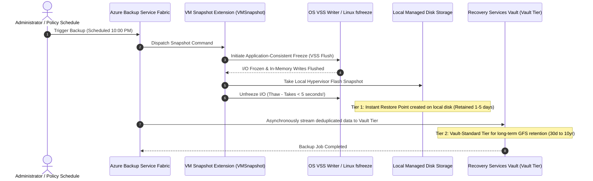
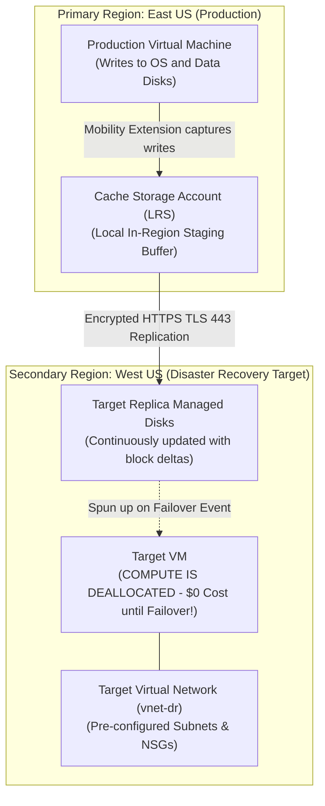
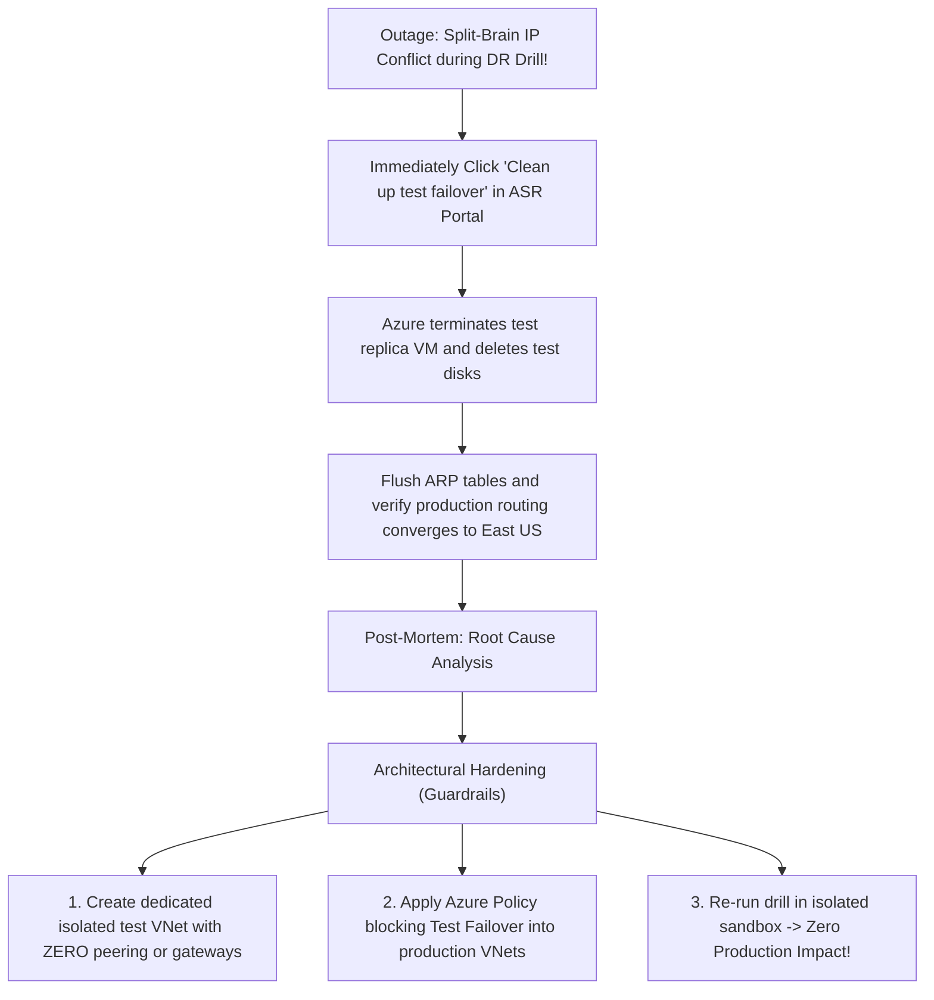

# Module 13-104-11: Administer Data Protection, Azure Backup & Site Recovery

**Breadcrumbs:** [[13-Index - Azure|☁️ Azure Reference MOC]] > [[13-Index - AZ-104|📘 AZ-104 Exam Track]] > **11 - Administer Data Protection**

---

## 🎯 Stage 1: Executive Overview & The Conceptual Lecture

### 1. The Zero-Knowledge Starting Point: HA vs. Backup vs. Disaster Recovery
A common misconception among beginner cloud administrators is believing that High Availability (HA) makes backups unnecessary:
* *"I have Zone-Redundant Storage (ZRS) with 3 copies across 3 availability zones! Why do I need a backup?"*
* **The Fatal Flaw:** If a disgruntled employee or buggy script runs `DROP TABLE Customers;`, ZRS will synchronously replicate that deletion across all 3 availability zones in **2 milliseconds**! Your data is now flawlessly, highly-available... **PERMANENTLY DESTROYED**.

To design enterprise business continuity and disaster recovery (BCDR), you must decouple three distinct disciplines:

```text
+-------------------------------------------------------------------------------------------------+
|                       HIGH AVAILABILITY vs. BACKUP vs. DISASTER RECOVERY                        |
+-------------------------------------------------------------------------------------------------+
|  1. High Availability (HA)   |  2. Azure Backup             |  3. Azure Site Recovery (ASR)    |
|     (Hardware Fault Tolerance)|     (Point-in-Time Recovery) |     (Disaster Recovery & BCDR)   |
+------------------------------+------------------------------+----------------------------------+
| - Protects Against: Single   | - Protects Against: Human    | - Protects Against: Catastrophic |
|   rack, server, or DC outages|   error, accidental deletion,|   regional outages (hurricane,   |
| - Mechanics: Availability    |   malware, ransomware locks  |   power grid blackout)           |
|   Zones, Load Balancers, ZRS | - Mechanics: Historical      | - Mechanics: Continuous block    |
| - Time Horizon: Real-time    |   point-in-time snapshots    |   replication to another region; |
|   failover (0 seconds)       | - Time Horizon: Days, months,|   rapid workload spin-up         |
| - Does NOT prevent data loss |   or 10-year GFS compliance  | - Focus: RTO (Minutes) and       |
|   from corruption or deletes!| - Focus: Recovering lost data|   RPO (Seconds) for entire apps  |
+-------------------------------------------------------------------------------------------------+
```

---

### 2. Decoding RTO and RPO (The North Star Metrics of Disaster Recovery)
Every enterprise backup and disaster recovery policy is measured by two industry-standard metrics:
* **Recovery Point Objective (RPO):** *"How much data can we afford to lose, measured in time?"*
  - If your last backup ran at 12:00 AM midnight and the server crashes at 4:00 PM, your data loss is 16 hours. If your company cannot tolerate more than 15 minutes of lost transactions, your RPO is 15 minutes.
* **Recovery Time Objective (RTO):** *"How long can we afford to be completely down before business resumes?"*
  - If the database crashes, how many minutes or hours does it take to restore disks, boot VMs, and re-establish network connectivity? If the CEO demands the website be back up within 30 minutes, your RTO is 30 minutes.

---

### 3. Terminology Matrix: Zero-Knowledge to Enterprise Architect

| Terminology | What It Means to a Beginner | Real-World Analog | Enterprise Architecture Reality |
| :--- | :--- | :--- | :--- |
| **Recovery Services Vault (RSV)** | The digital bank vault that holds backups. | A dedicated off-site fireproof archive warehouse. | An ARM storage and orchestration container used to manage backups for Azure VMs, SQL, SAP HANA, Azure Files, and ASR replication. |
| **Instant Restore Snapshot** | A super-fast backup stored right on the VM's disk. | Keeping a photocopy of today's receipts right in your desk drawer. | A local disk snapshot retained for 1–5 days allowing instant VM recovery in under 2 minutes without downloading from the vault. |
| **Vault-Standard Tier** | Long-term backup storage in the vault. | Shipping old boxes of paper tax returns to an underground salt mine. | Compressed, deduplicated, cold storage pool inside the vault used for multi-year Grandfather-Father-Son (GFS) retention. |
| **Cross-Region Restore (CRR)** | Restoring backups in another city even if home is fine. | A safety deposit box key that works at a branch office in another state. | A feature of GRS vaults allowing administrators to initiate restores directly in the secondary paired region at any time for compliance drills. |
| **Application-Consistent Backup** | A backup taken while applications are cleanly paused. | Freezing a sports game cleanly before taking a team photograph. | Coordinates with Windows VSS writers or Linux `fsfreeze` to flush uncommitted RAM memory to disk before snapping. |
| **Enhanced Soft Delete** | A 14-day safety recycle bin for deleted backups. | A trash can with a 14-day time lock that prevents the shredder from running. | A security guardrail that retains deleted backup items in an immutable state for 14 to 180 days, defeating ransomware purge attacks. |
| **Resource Guard (MUA)** | Requiring two separate people to approve deleting backups. | Dual keys required to open a nuclear launch safe. | Multi-User Authorization requiring authorization from an independent Entra ID tenant/subscription before destructive backup actions proceed. |
| **Azure Site Recovery (ASR)** | Having an exact replica standby server in another city. | A standby airplane fueled and ready on a runway in another airport. | Near-continuous block-level replication engine synchronizing running workloads to a secondary region, orchestrating failover in minutes. |
| **Mobility Service** | A lightweight spy watching disk writes for ASR. | A court stenographer recording every word spoken in real-time. | In-guest driver capturing OS and file-system write blocks and streaming them to a local cache storage account over TLS 443. |
| **Test Failover** | Practicing a fire drill in a fake building. | A mock evacuation drill conducted on a simulator without stopping real factory work. | Spinning up replicated VMs in an isolated sandbox VNet with zero interruption to ongoing production replication or live traffic. |

---

## 🏛️ Stage 2: Core Mental Model & Component Architecture

### 1. The Three Backup Consistency Levels (High-Yield Exam Core)
When taking a snapshot of a running virtual machine, the state of the operating system and running databases determines the consistency tier:

```text
+-------------------------------------------------------------------------------------------------+
|                                 AZURE VM BACKUP CONSISTENCY LEVELS                              |
+-------------------------------------------------------------------------------------------------+
| Level 1: Application-Consistent Backup (Gold Standard for Databases)                           |
| ├── Windows: Invokes Volume Shadow Copy Service (VSS) writers to flush memory caches to disk.   |
| ├── Linux: Executes pre/post freeze scripts ('fsfreeze') to pause database I/O transactions.    |
| ├── Guarantee: Zero data truncation; databases (SQL, Oracle, SAP) boot with ZERO corruption!    |
| └── Behavior: The VM snapshot extension coordinate with the OS kernel before snapping disks.   |
+-------------------------------------------------------------------------------------------------+
| Level 2: File-System Consistent Backup (Standard for Web/File Servers)                         |
| ├── What it Means: All disk files are snapped simultaneously, but in-memory RAM is NOT flushed. |
| ├── When it Occurs: When VSS writers fail, or when Linux has no database freeze scripts.        |
| └── Behavior: Files are consistent on disk, but pending unwritten memory transactions are lost. |
+-------------------------------------------------------------------------------------------------+
| Level 3: Crash-Consistent Backup (The Pull-the-Plug Snapshot)                                   |
| ├── What it Means: Exactly equivalent to pulling the physical power cord from a running server. |
| ├── When it Occurs: Non-VSS operating systems, or when the VM OS is completely frozen/crashed.  |
| └── Behavior: Captures data committed to the physical disk blocks at that millisecond; requires|
|     the OS to run 'chkdsk' or database transaction replay on boot.                              |
+-------------------------------------------------------------------------------------------------+
```

---

### 2. Azure Virtual Machine Backup: The Two-Tier Pipeline
When Azure Backup protects an Azure VM, it utilizes a highly efficient **two-tier architecture**:



#### The Two Tiers Explained:
1. **Tier 1: Snapshot Tier (Instant Restore):**
   - Retained locally on the VM's disk cluster for **1 to 5 days** (default: 2 days).
   - **Restoration Speed:** **Under 2 minutes!** Because data sits locally, Azure restores the VM directly from the snapshot without transferring gigabytes across the network!
2. **Tier 2: Vault-Standard Tier:**
   - Snapshots are compressed, deduplicated, and copied asynchronously to the Recovery Services Vault storage pool.
   - Used for long-term **Grandfather-Father-Son (GFS)** compliance retention (Daily, Weekly, Monthly, Yearly).

---

### 3. Azure VM Restore Capabilities
Azure Backup provides four flexible recovery mechanisms depending on the disaster scenario:

```text
[ Restore Point in Recovery Services Vault ]
       │
       ├──► 1. Create New Virtual Machine
       │    ├── Builds a brand-new VM from the backup point
       │    └── Configures new VM name, VNet, subnet, and sizing parameters
       │
       ├──► 2. Restore Disks
       │    ├── Restores VHD files to an Azure Storage Account container
       │    └── Generates an ARM deployment template to customize and recreate the VM
       │
       ├──► 3. Replace Existing Disks
       │    ├── Replaces the OS and data disks on the active running VM in-place
       │    └── Preserves the VM's private IP, MAC address, and resource ID (Zero config drift!)
       │
       └──► 4. Item-Level Recovery (File Recovery - FLR)
            ├── Generates an executable script (.exe for Windows, .sh for Linux)
            ├── Script establishes an encrypted iSCSI tunnel directly to the backup snapshot
            └── Mounts backup disks as local drive letters (E:, F:), allowing selective file copy!
```

---

### 4. Azure Files Backup Architecture
Unlike Azure VMs which stream data into a Recovery Services Vault storage pool, **Azure Files Backup** operates via **Storage Account Snapshots**:
* Backups are taken as native snapshots directly inside the Azure Storage Account hosting the file share.
* The Recovery Services Vault acts purely as the **orchestrator and scheduler**.
* **Benefits:** Instant restore times, zero network egress charges, and the ability to restore individual files or the entire share directly in seconds!

---

## 🏢 Stage 3: Deep-Intuition Platform Mechanics & Topology

### 1. Enhanced Soft Delete & Immutable Vaults: Anti-Ransomware Defense
A common cyberattack tactic is hacking an administrator account and executing `Delete-AzBackupItem` to purge all backup history before detonating ransomware across production servers.

Azure Backup neutralizes this attack using a two-tier defense:

```text
Layer 1: Enhanced Soft Delete
├── Action: Deleted backup items are NOT wiped! They enter a 14 to 180-day quarantine.
├── Protection: During quarantine, backups can be un-deleted directly from the portal.
└── Billing: Azure stores the data safely; Microsoft Support cannot override soft delete!

Layer 2: Immutable Vaults (WORM for Backups)
├── Unlocked State: Immutability is active, but administrators can disable it if needed.
└── Locked State: PERMANENTLY LOCKED! Nobody—not even Global Admins or Microsoft Support—
    can disable immutability or shorten retention policies until the policy expiration!
```

#### Multi-User Authorization (MUA) with Azure Resource Guard:
* Protects against rogue administrators by requiring approval from an independent **Resource Guard** resource.
* The Resource Guard is located in a **separate subscription or separate Microsoft Entra tenant**.
* Critical destructive actions (e.g., deleting backups, disabling soft delete) prompt for authorization from the external Resource Guard owner.

---

### 2. Azure Site Recovery (ASR): Continuous Block Replication Mechanics
Unlike backups which capture periodic point-in-time snapshots (e.g., once a day), **Azure Site Recovery (ASR)** is an active disaster recovery engine delivering near-zero data loss:



#### The Cost Efficiency Law of ASR:
* Notice that during normal everyday operations, the target virtual machine in the secondary region **does NOT exist as an active compute instance**!
* You are **NOT paying for CPU or RAM** in the secondary region. You pay only for the storage of the replicated managed disks and a small monthly ASR license per protected server.
* The VM compute instances are instantiated **only when you execute a failover event or test failover drill**!

---

### 3. ASR Failover Types & Lifecycle Management

```text
1. Test Failover (Non-Disruptive Audit Drill)
   ├── Target: Spins up replica VM in an ISOLATED SANDBOX VNet.
   ├── Impact on Production: ZERO downtime, ZERO traffic interruption.
   └── Replication Status: Continuous replication between regions NEVER STOPS!

2. Planned Failover (Controlled Maintenance / Anticipated Storm)
   ├── Source Action: Gracefully shuts down primary VM in East US.
   ├── Final Sync: Replicates remaining in-flight uncommitted blocks to ensure 0 DATA LOSS.
   └── Target Action: Boots secondary VM in West US as the new production primary.

3. Unplanned Failover (Disaster Recovery Emergency)
   ├── Source Action: Assumes primary region is completely dead.
   ├── Target Action: Instantly boots secondary VM from latest processed recovery point.
   └── Data Loss Potential: Minor data loss equal to the RPO (typically < 15 minutes).

4. Reprotect & Failback (Post-Disaster Recovery)
   ├── Reprotect: Reverses replication direction (West US now replicates changes back to East US).
   └── Failback: Gracefully fails back to East US once the datacenter is restored!
```

---

## ⚙️ Stage 4: Declarative & Automation Engine (CLI & PowerShell Core)

### 1. Azure CLI: Recovery Services Vault & Backup Policy Automation

```bash
# ==============================================================================
# 1. CREATE RECOVERY SERVICES VAULT WITH GEO-REDUNDANCY & CRR
# ==============================================================================
RG_NAME="rg-dataprotection-prod"
LOCATION="eastus"

az backup vault create \
  --resource-group "${RG_NAME}" \
  --name "rsv-enterprise-backup" \
  --location "${LOCATION}"

# Configure GRS Redundancy and Cross-Region Restore (CRR)
az backup vault backup-properties set \
  --resource-group "${RG_NAME}" \
  --name "rsv-enterprise-backup" \
  --backup-storage-redundancy "GeoRedundant" \
  --cross-region-restore-flag true

# ==============================================================================
# 2. CREATE DAILY BACKUP POLICY WITH 2-DAY INSTANT RESTORE
# ==============================================================================
cat << 'EOF' > vm-backup-policy.json
{
  "properties": {
    "backupManagementType": "AzureIaasVM",
    "schedulePolicy": {
      "schedulePolicyType": "SimpleSchedulePolicy",
      "scheduleRunFrequency": "Daily",
      "scheduleRunTimes": ["2026-10-01T22:00:00Z"]
    },
    "retentionPolicy": {
      "retentionPolicyType": "LongTermRetentionPolicy",
      "dailySchedule": {
        "retentionTimes": ["2026-10-01T22:00:00Z"],
        "retentionDuration": { "count": 30, "durationType": "Days" }
      }
    },
    "instantRpRetentionRangeInDays": 2
  }
}
EOF

az backup policy create \
  --resource-group "${RG_NAME}" \
  --vault-name "rsv-enterprise-backup" \
  --name "Daily-InstantRestore-Policy" \
  --policy @vm-backup-policy.json

# Enable Backup on Virtual Machine
az backup protection enable-for-vm \
  --resource-group "${RG_NAME}" \
  --vault-name "rsv-enterprise-backup" \
  --vm "vm-app-primary" \
  --policy-name "Daily-InstantRestore-Policy"
```

### 2. Azure PowerShell: Restore Virtual Machine Disks

```powershell
# ==============================================================================
# 3. RESTORE VM DISKS USING AZURE POWERSHELL
# ==============================================================================
$vault = Get-AzRecoveryServicesVault -ResourceGroupName "rg-dataprotection-prod" -Name "rsv-enterprise-backup"
$container = Get-AzRecoveryServicesBackupContainer -VaultId $vault.ID -ContainerType "AzureVM" -Status "Registered" -FriendlyName "vm-app-primary"
$item = Get-AzRecoveryServicesBackupItem -VaultId $vault.ID -Container $container -WorkloadType "AzureVM"

# Retrieve latest recovery point
$rp = Get-AzRecoveryServicesBackupRecoveryPoint -VaultId $vault.ID -Item $item | Select-Object -First 1

# Execute disk restore to staging storage account
$storageAccount = Get-AzStorageAccount -ResourceGroupName "rg-dataprotection-prod" -Name "ststagingrestore"
Restore-AzRecoveryServicesBackupItem `
  -VaultId $vault.ID `
  -RecoveryPoint $rp `
  -StorageAccountName $storageAccount.StorageAccountName `
  -StorageAccountResourceGroupName "rg-dataprotection-prod"
```

---

## 🖥️ Stage 5: Step-by-Step Azure Portal GUI Walkthrough

### Task 1: Creating a Recovery Services Vault with Cross-Region Restore
1. In the top search bar, type **Recovery Services vaults** and select it.
2. Click **+ Create** on the command bar:
   - **Resource group:** `rg-dataprotection-prod`.
   - **Vault name:** `rsv-enterprise-backup`.
   - **Region:** `East US`.
3. Click **Review + create** $\rightarrow$ **Create**.
4. Open `rsv-enterprise-backup`:
   - In the left navigation menu under **Settings**, click **Properties**.
   - Under **Backup Configuration**, click **Update**:
     - *Storage replication type:* Select **Geo-redundant**.
     - *Cross Region Restore:* Check the box for **Enable Cross Region Restore**!
     - Click **Save**.

### Task 2: Protecting an Azure Virtual Machine
1. In the vault's left navigation menu under **Protected items**, click **Backup items**.
2. Click **+ Backup** on the command bar:
   - *Where is your workload running:* Select **Azure**.
   - *What do you want to back up:* Select **Virtual machine**.
   - Click **Configure Backup**.
3. In the configuration blade:
   - Under *Backup policy*, select `DailyPolicy` with 2-day Instant Restore.
   - Under *Virtual Machines*, click **Add** $\rightarrow$ select `vm-app-primary`.
   - Click **Enable backup**.

### Task 3: Performing File-Level Recovery (FLR) via iSCSI
1. In the vault, navigate to **Backup items** $\rightarrow$ click on your backed-up VM.
2. On the VM backup details blade, click **File Recovery** on the top toolbar:
   - Select recovery point date/time.
   - Click **Download Executable** (generates a `.exe` for Windows or `.sh` for Linux).
   - Copy the generated **Password**.
3. Run the script on your local workstation:
   - The script establishes an encrypted iSCSI tunnel directly to Azure Backup snapshot storage.
   - Backup disks mount locally as drive letters (e.g., `E:`, `F:`).
   - Copy the specific needed files directly using File Explorer, then click **Unmount Disks** on the portal blade!

### Task 4: Configuring an ASR Test Failover Drill
1. Open the Recovery Services Vault $\rightarrow$ under **Protected items**, click **Replicated items**.
2. Click on the replicated virtual machine.
3. On the top command bar, click **Test Failover**:
   - *Recovery point:* Select **Latest processed**.
   - *Azure virtual network:* Select your **isolated test sandbox virtual network** (e.g., `vnet-dr-test-sandbox`).
4. Click **OK**.
5. Once tested, click **Clean up test failover** to delete the test VM automatically.

---

## 🔬 Stage 6: Hands-On Enterprise Lab Bridge

To apply these data protection principles, configure GFS retention policies, test File-Level Recovery, and execute an ASR Test Failover drill, proceed directly to the comprehensive practical lab:

> [!TIP]
> **Practical Implementation Companion:**
> Access the comprehensive engineering lab at:
> **[[Lab-11_Azure_Backup_Soft_Delete_Resource_Guard_and_ASR|Lab 11: Azure Backup GFS, Enhanced Soft Delete, Resource Guard MUA & ASR Test Failover]]**
> 
> *Target Lab File:* `Projects/AZ-104/11_Data_Protection_and_Site_Recovery/Lab-11_Azure_Backup_Soft_Delete_Resource_Guard_and_ASR.md`

### Lab Objectives Matrix:

```text
+-----------------------------------------------------------------------------------------+
| Lab 11 Enterprise Milestone Goals                                                       |
+-----------------------------------------------------------------------------------------+
| 1. Deploy a Recovery Services Vault with Geo-Redundant Storage and Cross-Region Restore |
| 2. Configure a two-tier Backup Policy leveraging 2-day local Instant Restore snapshots   |
| 3. Execute File-Level Recovery (FLR) using an iSCSI mount script to restore files       |
| 4. Validate Enhanced Soft Delete (14-day quarantine) against accidental purge attacks   |
| 5. Launch a non-disruptive Azure Site Recovery (ASR) Test Failover in an isolated VNet  |
+-----------------------------------------------------------------------------------------+
```

---

## ⚠️ Stage 7: "See It in Action" Real-World Failure & Recovery Loop (AARF)

### Scenario: The "Split-Brain Production Outage" Disaster Recovery Drill

#### 1. The Architectural Setup & Assumptions
An enterprise financial system continuously replicates a production virtual machine (`vm-app-primary` with IP `10.110.1.4`) from `East US` to `West US` using **Azure Site Recovery (ASR)**. The disaster recovery team schedules a mandatory quarterly DR audit drill.

#### 2. The Production Failure Manifestation
A junior DR engineer navigates to the portal, opens the replicated item, and clicks **Test Failover**. 
In the configuration dropdown for *Azure virtual network*, the engineer accidentally selects the **live secondary production VNet (`vnet-dr-production`)** instead of the designated isolated sandbox VNet (`vnet-dr-test`).

Within 2 minutes:
* Production database transactions fail with TCP connection resets.
* Internal routing reports asymmetric routing loops and packet duplication.
* Monitoring alerts fire: **Dual IP Address Conflict detected for `10.110.1.4`!**

#### 3. Root Cause Analysis (RCA) & Deep Investigation
Why did conducting a drill cause a live production outage?
1. **The Subnet Bridging Error:** The primary VNet and the secondary production VNet were connected to on-premises headquarters via ExpressRoute and VNet Peering.
2. **The Exact Replica IP:** When ASR boots a replica VM, it boots with the **exact same private IP address (`10.110.1.4`)** as the primary source VM to prevent application reconfiguration.
3. **The Split-Brain Routing Partition:** By launching the test VM into the live production network, two active servers with the exact same IP and hostname were suddenly running simultaneously on the corporate network!
4. **Traffic Partitioning:** Routers, domain controllers, and clients began dividing packets between the real production VM in East US and the test VM in West US, corrupting in-flight transactions and halting business!

#### 4. Remediation & Diagnostic Verification Loop



---

## 💡 Stage 8: High-Yield AZ-104 Exam Scenarios & Trick Question Traps

### Trick Question Trap 1: Non-Disruptive Disaster Recovery Testing
* **The Scenario:** An auditor requires the IT team to execute a full disaster recovery drill for a multi-tier application replicated via Azure Site Recovery (ASR), with zero downtime to the primary production application and zero stoppage of continuous replication.
* **The Trap:** Should the administrator choose *Planned Failover*, *Unplanned Failover*, or *Test Failover*?
* **The Ground Truth:** Choose **Test Failover**! A Test Failover spins up replica VMs in an **isolated test virtual network**. It causes **zero downtime** to primary VMs and **does NOT stop or pause ongoing continuous replication**. Both Planned and Unplanned failovers initiate real operational handovers and sever source workloads.

### Trick Question Trap 2: Restoring a Single Corrupted File
* **The Scenario:** A user accidentally deletes a critical 10 MB spreadsheet from a 500 GB Azure VM backed up daily. The administrator needs to restore the file with the least administrative effort and lowest cost.
* **The Trap:** Should the administrator restore the full VM or restore the disks?
* **The Ground Truth:** Choose **Item-Level Recovery (File Recovery - FLR)**! Azure generates an executable script that mounts an **iSCSI target** directly onto the administrator's computer. The backup disks mount as drive letters, allowing the administrator to copy the single 10 MB spreadsheet directly without provisioning a new VM or downloading 500 GB of disks!

### Trick Question Trap 3: MARS Agent for On-Premises SQL Application Consistency
* **The Scenario:** A company needs to back up an on-premises physical server hosting Microsoft SQL Server to an Azure Recovery Services Vault. The backup must truncate SQL transaction logs and guarantee application consistency.
* **The Trap:** The question offers the Microsoft Azure Recovery Services (MARS) agent.
* **The Ground Truth:** The **MARS Agent CANNOT do this!** MARS only supports **files, folders, and Windows System State**. It does not possess VSS database integration. To back up on-premises SQL Server with application consistency, you **MUST use Microsoft Azure Backup Server (MABS)** or System Center DPM.

### Trick Question Trap 4: Changing Vault Storage Redundancy After Registering Items
* **The Scenario:** An administrator creates a Recovery Services Vault with Locally Redundant Storage (LRS) and registers 5 virtual machines. Management later mandates Geo-Redundant Storage (GRS) for compliance.
* **The Trap:** Can the administrator switch the vault from LRS to GRS in the properties blade?
* **The Ground Truth:** **NO! You CANNOT change vault storage redundancy once backup items are protected!** If any items are registered, the replication option is permanently locked. You would have to unprotect and delete all backup data, change the setting to GRS, and re-protect the VMs from scratch.

### Trick Question Trap 5: Azure Files Backup Destination
* **The Scenario:** An administrator sets up backup for an Azure File Share using a Recovery Services Vault. They check the vault storage usage but see 0 GB stored.
* **The Trap:** Did the backup job fail?
* **The Ground Truth:** **NO! Azure Files backups are stored as native snapshots inside the storage account itself!** The Recovery Services Vault orchestrates and schedules the backups, but the snapshot blocks reside within the source storage account, incurring zero vault storage data transfer charges.

---

## 🌐 Authoritative References & Inflow Citations

* **Udemy AZ-104 Master Class by Scott Duffy:** [Inflow: Module 11 - Administer Data Protection, Backup and Recovery](file:///F:/Dump%20one/BrainDump/inflow/AZ-104-ScottDuffy/11_Administer_Data_Protection_Backup_and_Recovery.md)
* **John Savill’s Azure Master Class & Deep Dives:**
  - [Inflow: Part 4 - Resiliency](file:///F:/Dump%20one/BrainDump/inflow/AZ-104-JohnSavill/13_Azure_Master_Class_v3_-_Part_4_-_Resiliency.md) *(Instant Restore snapshot internals, Application consistency vs Crash consistency)*
  - [Inflow: Disaster Recovery in Microsoft Azure](file:///F:/Dump%20one/BrainDump/inflow/AZ-104-JohnSavill/15_Disaster_Recovery_in_Microsoft_Azure.md) *(ASR continuous block replication, mobility service, failover vs reprotect)*
  - [Inflow: Azure AD Resiliency Deep Dive](file:///F:/Dump%20one/BrainDump/inflow/AZ-104-JohnSavill-DeepDives/11_Microsoft_Azure_AD_Resiliency_Deep_Dive.md)
* **Moe Intelligence AZ-104 Curriculum:** Lesson 41 *(Data Protection, Vaults, Policies, Soft Delete)*
* **KodeKloud AZ-104 Course:** [Administer Data Protection Module](https://notes.kodekloud.com/docs/Updated-AZ-104-Microsoft-Azure-Administrator/Administer-Data-Protection/Module-introduction/page.md)
* **Official Microsoft Learn Documentation:**
  - [Azure Backup overview](https://learn.microsoft.com/en-us/azure/backup/backup-overview)
  - [About Azure VM backup](https://learn.microsoft.com/en-us/azure/backup/backup-azure-vms-introduction)
  - [Soft delete for Azure Backup](https://learn.microsoft.com/en-us/azure/backup/backup-azure-security-feature-cloud)
  - [Multi-user authorization using Azure Resource Guard](https://learn.microsoft.com/en-us/azure/backup/multi-user-authorization-concept)
  - [About Azure Site Recovery](https://learn.microsoft.com/en-us/azure/site-recovery/site-recovery-overview)
