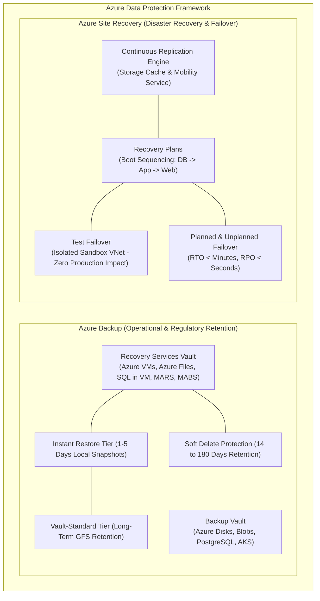
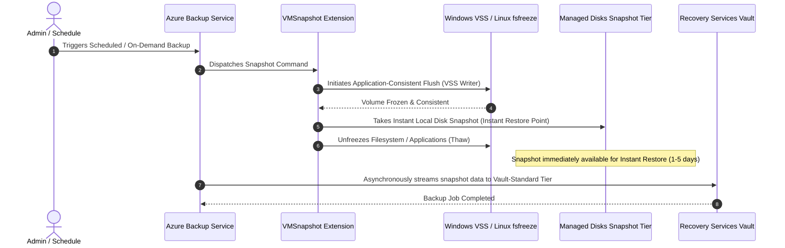
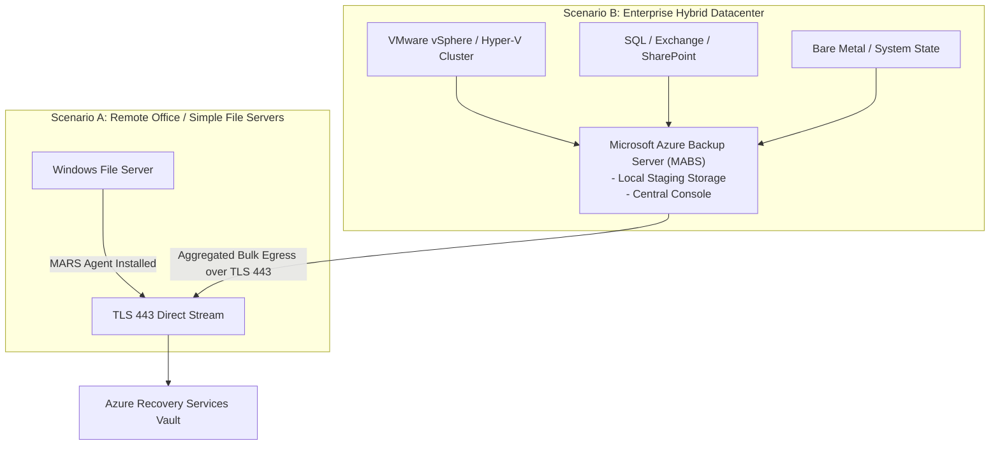
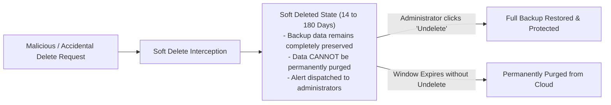
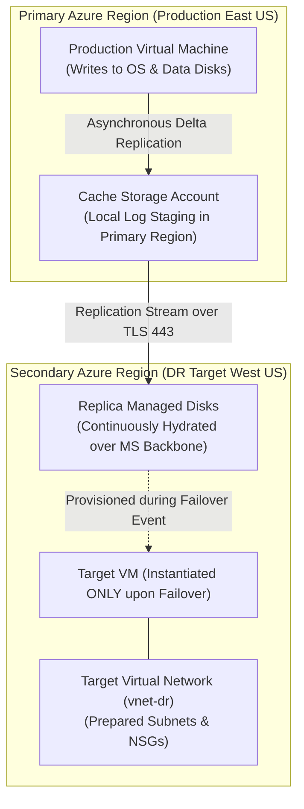

# Module 13-104-11: Administer Data Protection, Azure Backup & Site Recovery

**Breadcrumbs:** [[13-Index - Azure|☁️ Azure Reference MOC]] > [[13-Index - AZ-104|📘 AZ-104 Exam Track]] > **11 - Administer Data Protection**

---

## 🎯 Executive Overview & Protection Matrix

Business continuity and disaster recovery (BCDR) in Microsoft Azure is governed by two complementary cloud-native services:
1. **Azure Backup:** Focuses on operational data recovery, granular file/folder restoration, and regulatory historical retention across IaaS VMs, Azure Files, databases, and on-premises physical/virtual infrastructure.
2. **Azure Site Recovery (ASR):** Focuses on disaster recovery, orchestration, business continuity, and real-time workload failover to a secondary region or cloud datacenter with minimal RTO and RPO.



---

## 🏛️ Recovery Services Vault vs. Backup Vault

Azure utilizes two distinct vault types depending on the data source and workload architecture:

| Vault Type | Supported Target Workloads | Core Architecture & Engine |
| :--- | :--- | :--- |
| **Recovery Services Vault (RSV)** | Azure Virtual Machines, SQL Server in Azure VMs, SAP HANA, Azure Files, on-premises machines via MARS Agent, System Center DPM / MABS, **Azure Site Recovery (ASR)**. | Traditional enterprise backup and replication engine; supports Cross-Region Restore (CRR). |
| **Backup Vault** | Azure Managed Disks, Azure Blob Storage (operational backup), Azure Database for PostgreSQL, Azure Kubernetes Service (AKS). | Modern unified backup platform designed for cloud-native microservices and hyperscale storage. |

### Vault Storage Redundancy & Cross-Region Restore (CRR)
- **Locally Redundant Storage (LRS):** 3 copies within a single datacenter. Lowest cost; cannot be changed to GRS once backup items are registered.
- **Geo-Redundant Storage (GRS):** 3 copies in the primary region + 3 copies asynchronously replicated to the paired secondary region.
- **Cross-Region Restore (CRR):** Available when GRS is enabled. Allows administrators to **trigger restores directly in the secondary paired region at any time**, even if the primary region is completely healthy (critical for DR drill compliance).

---

## 🔄 Azure Virtual Machine Backup Architecture

Azure VM Backup takes application-consistent snapshots without shutting down the virtual machine:



### Two-Tier Backup Mechanics
1. **Snapshot Tier (Instant Restore):** Azure retains disk snapshots locally alongside the VM disks for **1 to 5 days** (configurable in backup policy). Restores from Instant Restore take minutes because data does not need to transfer from the vault across the network.
2. **Vault-Standard Tier:** Data is transferred to the Recovery Services Vault storage pool for long-term Grandfather-Father-Son (GFS) retention (daily, weekly, monthly, yearly retention).

### Restore Capabilities for Azure VMs
- **Create New Virtual Machine:** Provisions an entirely new VM from the restore point with specified network, disk, and sizing parameters.
- **Restore Disks:** Restores the VHD files to a designated storage account, generating an automated ARM template or PowerShell script to recreate the VM manually.
- **Replace Existing VM:** Replaces the OS and data disks on the current VM in-place with zero IP configuration drift.
- **Item-Level Recovery (ILR):** Generates and downloads an executable script that mounts an **iSCSI target volume** onto the administrator's workstation, permitting selective extraction of individual files and folders.

---

## 💻 On-Premises Backup: MARS Agent vs. MABS

Protecting on-premises servers into an Azure Recovery Services Vault uses one of two mechanisms:



### MARS vs. MABS Technical Comparison

| Technical Dimension | Microsoft Azure Recovery Services (MARS) | Microsoft Azure Backup Server (MABS) |
| :--- | :--- | :--- |
| **Infrastructure Needed** | Lightweight agent installed directly on the target machine. | Dedicated on-premises Windows Server VM + local staging storage pool. |
| **Supported Workloads** | **Files, Folders, and Windows System State ONLY**. | **Files, Folders, VMware VMs, Hyper-V VMs, SQL Server, Exchange, SharePoint, Bare Metal**. |
| **Application Consistency** | ❌ No (File-level consistency only). | ✅ **Yes** (VSS integrated across database engines). |
| **Linux Support** | ❌ No (Windows OS only). | ✅ **Yes** (Protects Linux VMs hosted on Hyper-V/VMware). |
| **Encryption Passphrase** | 36-character encryption passphrase generated locally; **Microsoft never possesses the key**. If lost, data is unrecoverable. | Managed centrally by MABS server certificate and vault credentials. |
| **Cost** | Free agent; pay only for vault storage consumed. | Free software license; requires dedicated Windows Server VM and local backup disks. |

---

## 🛡️ Soft Delete Protection

Soft Delete safeguards backup data against accidental deletion, administrative mistakes, and malicious ransomware attacks:



### Soft Delete Parameters
- **Default Retention Window:** **14 days** of retention after deletion.
- **Configurable Range:** Can be extended up to **180 days**.
- **Immutable Protection:** While soft delete is active, backup items cannot be permanently deleted, even by Subscription Owners or Global Administrators.

---

## 🚨 Azure Site Recovery (ASR): Disaster Recovery Architecture

While Azure Backup protects data, **Azure Site Recovery (ASR)** replicates running workloads to ensure continuous availability during catastrophic datacenter failures:



### Core Disaster Recovery Concepts
1. **RTO (Recovery Time Objective):** The maximum tolerable duration of downtime after a disaster before service is restored (ASR achieves RTO in minutes).
2. **RPO (Recovery Point Objective):** The maximum acceptable data loss measured in time (ASR replication occurs every few seconds, achieving an RPO of seconds to minutes).
3. **Recovery Plans:** Automates multi-tier application failover ordering:
   - *Group 1:* Database tier (SQL Server / Oracle).
   - *Group 2:* Middleware & Application tier.
   - *Group 3:* Web frontend tier.
   - *Action Hooks:* Executes automated Azure Automation Runbooks (e.g., updating DNS records or attaching public IPs).
4. **Test Failover:** Spins up a copy of the replicated VMs in a designated **isolated test VNet** without interrupting ongoing production replication or causing downtime.

---

## 🛠️ Contextual Proof of Concept: CLI Automation

```bash
# 1. Create a Recovery Services Vault with GRS and Cross-Region Restore
az backup vault create \
  --resource-group "rg-enterprise-core" \
  --name "rsv-az104-protection" \
  --location "eastus"

az backup vault backup-properties set \
  --resource-group "rg-enterprise-core" \
  --name "rsv-az104-protection" \
  --backup-storage-redundancy "GeoRedundant" \
  --cross-region-restore-flag true

# 2. Configure a Daily Azure VM Backup Policy
az backup policy create \
  --resource-group "rg-enterprise-core" \
  --vault-name "rsv-az104-protection" \
  --name "Daily-VM-Policy" \
  --policy '{
    "properties": {
      "backupManagementType": "AzureIaasVM",
      "schedulePolicy": {
        "schedulePolicyType": "SimpleSchedulePolicy",
        "scheduleRunFrequency": "Daily",
        "scheduleRunTimes": ["2026-09-26T22:00:00Z"]
      },
      "retentionPolicy": {
        "retentionPolicyType": "LongTermRetentionPolicy",
        "dailySchedule": {
          "retentionTimes": ["2026-09-26T22:00:00Z"],
          "retentionDuration": { "count": 30, "durationType": "Days" }
        }
      },
      "instantRpRetentionRangeInDays": 2
    }
  }'

# 3. Enable protection on a target Virtual Machine
az backup protection enable-for-vm \
  --resource-group "rg-enterprise-core" \
  --vault-name "rsv-az104-protection" \
  --vm "vm-web-prod-01" \
  --policy-name "Daily-VM-Policy"

# 4. Trigger an immediate on-demand backup
az backup protection backup-now \
  --resource-group "rg-enterprise-core" \
  --vault-name "rsv-az104-protection" \
  --item-name "vm-web-prod-01" \
  --retain-until "2026-10-31T00:00:00Z"
```

---

## 🔍 Deep-Intuition AARF Framework

### Scenario: Diagnosing Lost Passphrase on MARS Agent Restore

- **The Answer (Core Configuration):** The 36-character encryption passphrase generated during the initial MARS agent registration must be securely archived in Azure Key Vault or enterprise password managers; it is the *only* mechanism capable of decrypting data during out-of-place restores.
- **The Assumptions (Prerequisites):** 
  - On-premises server running MARS agent suffered total catastrophic hardware failure.
  - Administrator attempts to restore files to an alternate server.
- **The Rationale (Why):** Azure Backup enforces client-side zero-knowledge encryption for MARS backups. Data is encrypted using AES-256 with the customer's passphrase *before* it leaves the on-premises machine over TLS 443. Microsoft does not store, transmit, or possess a copy of the passphrase.
- **The Failure Loop (What if misconfigured):**
  - *Symptom:* The restore wizard prompts for the passphrase. If the administrator cannot supply the 36-character key, the restore aborts.
  - *Result:* **Data is mathematically lost and unrecoverable**. Microsoft Support cannot override or reset the passphrase.
- **The Alternative Case (When to use 'if not'):** For Azure IaaS VMs, Azure Backup uses platform-integrated Storage Service Encryption (SSE) with Azure-managed keys (PMK) or Key Vault customer-managed keys (CMK), eliminating the risk of lost client-side agent passphrases.

---

## 💡 AZ-104 Exam Tips & Gotchas

> [!TIP]
> **Test Failover Rule in ASR:**
> In Azure Site Recovery exam questions: *"How can an administrator test disaster recovery compliance without impacting production workloads or stopping replication?"*
> - **Answer:** Execute a **Test Failover** and select a dedicated, isolated Virtual Network that has no connectivity to production networks.

> [!WARNING]
> **MARS vs. MABS Application Consistency:**
> - If an exam question asks how to back up an on-premises **SQL Server** or **Exchange Server** with full application consistency and transaction log truncation, the **MARS Agent is incorrect**.
> - The correct answer is **Microsoft Azure Backup Server (MABS)** or Azure Backup Server with System Center DPM.

---

## 🌐 Authoritative References & Citations

- [KodeKloud AZ-104 Course - Administer Data Protection Module](https://notes.kodekloud.com/docs/Updated-AZ-104-Microsoft-Azure-Administrator/Administer-Data-Protection/Module-introduction/page.md)
- [Microsoft Learn: Protect your virtual machines with Azure Backup](https://learn.microsoft.com/en-us/training/modules/protect-virtual-machines-with-azure-backup/)
- [Microsoft Learn: Protect on-premises infrastructure with Azure Site Recovery](https://learn.microsoft.com/en-us/training/modules/protect-on-premises-infrastructure-with-azure-site-recovery/)
- [Azure Backup Technical Best Practices](https://docs.microsoft.com/en-us/azure/backup/backup-best-practices)
- [Azure Site Recovery Documentation](https://azure.microsoft.com/en-us/services/site-recovery/)
