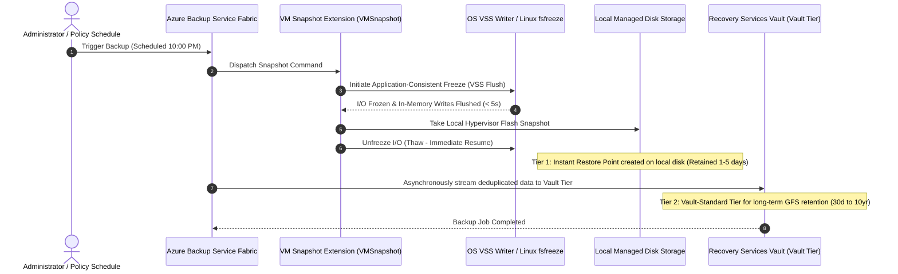
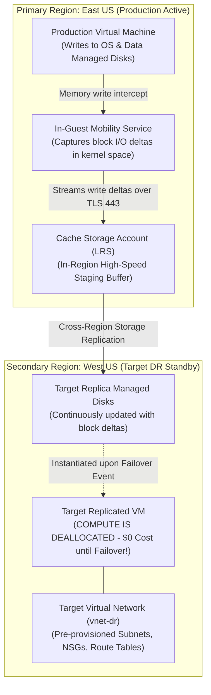
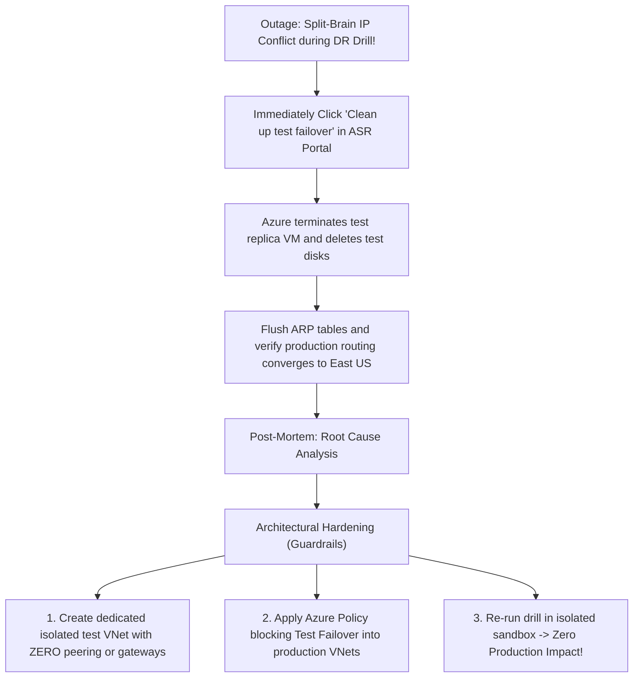

# Module 13-104-11: Administer Data Protection, Azure Backup & Site Recovery

**Breadcrumbs:** [[13-Index - Azure|☁️ Azure Reference MOC]] > [[13-Index - AZ-104|📘 AZ-104 Exam Track]] > **11 - Administer Data Protection**

---

## 🎯 Stage 1: Executive Overview & The Conceptual Lecture

### 1. The Zero-Knowledge Starting Point: HA vs. Backup vs. Disaster Recovery

#### 1. The Real-World Dilemma: Hardware Redundancy vs. Instant Corruption Propagation (The 'Why')
A widespread misconception among junior cloud engineers is assuming that High Availability (HA) eliminates the need for backups:
* *"My application runs across 3 Availability Zones on Zone-Redundant Storage (ZRS). Why do I need to pay for backups?"*
* **The Fatal Flaw:** Storage replication protocols have zero semantic awareness of data integrity. If an application bug, rogue administrator, or ransomware payload executes `DROP DATABASE Production;` or writes corrupted encrypted blocks to disk, **ZRS will synchronously replicate that corruption across all three physical datacenters in less than two milliseconds.**
* Your data is now flawlessly, highly-available... **PERMANENTLY DESTROYED**.

To design enterprise Business Continuity and Disaster Recovery (BCDR), an architect must strictly decouple three independent engineering disciplines:

```text
+-------------------------------------------------------------------------------------------------+
|                       HIGH AVAILABILITY vs. BACKUP vs. DISASTER RECOVERY                        |
+-------------------------------------------------------------------------------------------------+
|  1. High Availability (HA)   |  2. Azure Backup             |  3. Azure Site Recovery (ASR)    |
|     (Hardware Fault Tolerance)|     (Point-in-Time Recovery) |     (Disaster Recovery & BCDR)   |
+------------------------------+------------------------------+----------------------------------+
| - Protects Against: Single   | - Protects Against: Human    | - Protects Against: Catastrophic |
|   rack, server, or DC outages|   error, accidental deletion,|   regional outages (hurricane,   |
| - Mechanics: Availability    |   malware, ransomware locks  |   power grid blackout)           |
|   Zones, Load Balancers, ZRS | - Mechanics: Historical      | - Mechanics: Continuous block    |
| - Time Horizon: Real-time    |   point-in-time snapshots    |   replication to another region; |
|   failover (0 seconds)       | - Time Horizon: Days, months,|   rapid workload spin-up         |
| - Does NOT prevent data loss |   or 10-year GFS compliance  | - Focus: RTO (Minutes) and       |
|   from corruption or deletes!| - Focus: Recovering lost data|   RPO (Seconds) for entire apps  |
+-------------------------------------------------------------------------------------------------+
```

#### 2. The Concrete Metaphor: The Three Shields of Corporate Survival
* **High Availability (HA):** Having **triplicate mirrors** in your home. If one mirror cracks, you glance at the other two. But if you throw black paint at yourself, all three mirrors instantly reflect a paint-covered face. HA protects against equipment breakage, not bad data.
* **Azure Backup:** A **daily photographic album** stored in a fireproof safety deposit box. If you accidentally spill paint over your house, you cannot undo the mess immediately, but you can consult yesterday's album to reconstruct exactly what the room looked like before the spill.
* **Azure Site Recovery (ASR):** Maintaining a **fully furnished, dormant replica house in another city**. If an earthquake destroys your primary home, your family catches a fast train to the second city and resumes living within minutes, without rebuilding the foundation from scratch.

---

### 2. Decoding RTO and RPO (The North Star Metrics of Disaster Recovery)

Every enterprise backup and disaster recovery policy is measured by two industry-standard operational metrics:

```text
+-------------------------------------------------------------------------------------------------+
|                          THE RPO AND RTO DISASTER TIMELINE SPECTRUM                             |
+-------------------------------------------------------------------------------------------------+
|                                                                                                 |
|  [ Last Known Backup ]                  [ Incident / Crash ]               [ System Fully Online]
|  ─────●─────────────────────────────────────────●─────────────────────────────────────●───────►  |
|       │                                        │                                     │     Time |
|       │◄────────── Recovery Point ────────────►│◄────────── Recovery Time ──────────►│          |
|       │           Objective (RPO)              │            Objective (RTO)          │          |
|       │        "How much data can we           │       "How many minutes/hours can   │          |
|       │             afford to lose?"           │        we afford to stay offline?"  │          |
|                                                                                                 |
|  - Backup Strategy: Daily Backup = 24h RPO     - Instant Restore Tier: RTO < 2 minutes          |
|  - ASR Strategy: Continuous Replic = <15s RPO  - Standard Vault Tier: RTO = 1 to 4 hours        |
+-------------------------------------------------------------------------------------------------+
```

* **Recovery Point Objective (RPO):** *"How much data can we afford to lose, measured in time?"*
  - If your last backup completed at 12:00 AM midnight and a disk array fails at 4:00 PM, you have permanently lost 16 hours of business transactions.
  - If an organization's compliance mandate allows no more than 15 minutes of transactional loss, your RPO target is **$\le 15\text{ minutes}$**, which requires continuous asynchronous replication (ASR) rather than traditional daily backups.
* **Recovery Time Objective (RTO):** *"How long can the business afford to be completely down before operations resume?"*
  - If a production server crashes, how many minutes or hours does it take to restore managed disks, deploy virtual machines, configure network interfaces, and run application sanity checks?
  - If executive leadership requires critical systems back online within 30 minutes, your RTO target is **$\le 30\text{ minutes}$**.

---

### 3. The Vault Architecture Divide: Recovery Services Vault vs. Backup Vault

#### 1. The Real-World Dilemma: Legacy Monolith vs. Cloud-Native Workload Sprawl (The 'Why')
In earlier iterations of Microsoft Azure, all data protection was funneled into a single construct: the **Recovery Services Vault (RSV)**. However, as cloud-native microservices, containerized clusters, and serverless database architectures proliferated, the rigid infrastructure of the RSV created severe architectural friction:
* Modern workloads like **Azure Disks (crash-consistent disk snapshots)**, **Azure Blobs (operational continuous backup)**, and **Azure Kubernetes Service (AKS)** do not stream data into centralized backup storage pools. They operate via distributed hypervisor and storage fabric APIs.
* Attempting to force modern PaaS snapshot orchestration into an RSV caused permission sprawl, regional binding limitations, and operational confusion.
* To solve this, Microsoft divided Azure Data Protection into two distinct vault architectures: the **Recovery Services Vault** and the modern **Backup Vault**.

#### 2. The Concrete Metaphor: The Off-Site Vault Warehouse vs. The Distributed Smart-Locker Hub
* **Recovery Services Vault (RSV):** An **off-site, heavily guarded commercial bank vault warehouse**. You pack physical assets into standard crates (VMs, SQL databases, files) and ship them over highways to be locked inside deep underground storage vaults. It handles heavy, traditional enterprise workloads and disaster recovery replication.
* **Backup Vault (BV):** A **modern distributed network of electronic smart lockers**. Rather than shipping everything across the country to one warehouse, the smart locker coordinates local digital snapshots right where the resources already live (in the local storage cluster or disk fabric), managing metadata and access permissions with lightweight cloud-native agility.

#### 3. The Mechanical & Topological Reality: Workload Compatibility Matrix

Understanding which vault protects which workload is a critical high-yield requirement for enterprise architecture and the AZ-104 examination:

| Protection Workload Vector | Recovery Services Vault (RSV) | Backup Vault (BV) | Underlying Mechanics & Storage Destination |
| :--- | :---: | :---: | :--- |
| **Azure Virtual Machines (IaaS)** | ✅ **YES** | ❌ NO | Two-tier architecture: Local snapshot tier (1–5d) + Vault-Standard tier. |
| **SQL Server in Azure VMs** | ✅ **YES** | ❌ NO | Native VDI streaming into vault storage with 15-minute log backups. |
| **SAP HANA in Azure VMs** | ✅ **YES** | ❌ NO | Backint interface streaming database snapshots directly to vault storage. |
| **Azure Files (File Shares)** | ✅ **YES** | ❌ NO | Orchestrated native storage snapshots residing within the storage account. |
| **Azure Site Recovery (ASR)** | ✅ **YES** | ❌ NO | Continuous block-level replication engine and disaster recovery target. |
| **On-Premises Servers (MARS / MABS)**| ✅ **YES** | ❌ NO | Microsoft Azure Recovery Services agent and DPM backup server integration. |
| **Azure Managed Disks** | ❌ NO | ✅ **YES** | Agentless, scheduled managed disk snapshots stored in disk storage pool. |
| **Azure Blob Storage** | ❌ NO | ✅ **YES** | Operational backup using Blob Versioning, Soft Delete, and Change Feed. |
| **Azure Database for PostgreSQL** | ❌ NO | ✅ **YES** | Native pg_dumpall or long-term retention serverless streaming. |
| **Azure Kubernetes Service (AKS)** | ❌ NO | ✅ **YES** | AKS Backup extension leveraging CSI volume snapshots and etcd cluster state. |

```text
+-------------------------------------------------------------------------------------------------+
|                       AZURE DATA PROTECTION VAULT WORKLOAD ROUTING TOPOLOGY                     |
+-------------------------------------------------------------------------------------------------+
|                                                                                                 |
|   ENTERPRISE WORKLOADS                          AZURE DATA PROTECTION VAULTS                    |
|                                                                                                 |
|   ┌───────────────────────────┐                 ┌───────────────────────────────────────────┐   |
|   │ • Azure Virtual Machines  │                 │                                           │   |
|   │ • SQL Server in Azure VM  │────────────────►│         RECOVERY SERVICES VAULT           │   |
|   │ • SAP HANA in Azure VM    │  (IaaS & BCDR)  │                  (RSV)                    │   |
|   │ • Azure File Shares       │                 │  - Central Vault Storage Pool             │   |
|   │ • Azure Site Recovery(ASR)│                 │  - Multi-Year GFS Retention Engine        │   |
|   │ • On-Prem (MARS / MABS)   │                 │  - Supports Cross-Region Restore (CRR)    │   |
|   └───────────────────────────┘                 └───────────────────────────────────────────┘   |
|                                                                                                 |
|   ┌───────────────────────────┐                 ┌───────────────────────────────────────────┐   |
|   │ • Azure Managed Disks     │                 │                                           │   |
|   │ • Azure Blob Storage      │────────────────►│               BACKUP VAULT                │   |
|   │ • Azure PostgreSQL Flex   │  (Cloud-Native) │                   (BV)                    │   |
|   │ • AKS Cluster Volumes     │                 │  - Zero Data Egress Overhead              │   |
|   │ • Azure Large Instances   │                 │  - Manages Local Operational Snapshots    │   |
|   └───────────────────────────┘                 └───────────────────────────────────────────┘   |
|                                                                                                 |
+-------------------------------------------------------------------------------------------------+
```

#### 4. Production Failure Loop & Exam Traps: The Incompatible Vault Configuration
* **The Exam Trap:** An exam scenario asks: *"You need to configure an automated daily backup policy for raw Azure Managed Disks detached from virtual machines. You deploy a Recovery Services Vault in the same region, but when creating a Backup Policy, 'Azure Disks' does not appear in the workload dropdown."*
* **The Root Cause:** Azure Managed Disks are unsupported in Recovery Services Vaults. They **strictly require a Backup Vault**.
* **The FinOps Gotcha:** Recovery Services Vault storage is billed on a per-GB vaulted storage model ($/GB/month for data residing in the vault). Backup Vaults protecting Disks and Blobs orchestrate native snapshots that reside within your subscription's storage footprint, shifting billing directly to standard disk snapshot and blob storage consumption!

---

### 4. Terminology Matrix: Zero-Knowledge to Enterprise Architect

| Terminology | What It Means to a Beginner | Real-World Analog | Enterprise Architecture Reality |
| :--- | :--- | :--- | :--- |
| **Recovery Services Vault (RSV)** | The digital bank vault that holds backups. | A dedicated off-site fireproof archive warehouse. | An ARM storage and orchestration container used to manage backups for Azure VMs, SQL, SAP HANA, Azure Files, and ASR replication. |
| **Backup Vault (BV)** | A modern manager for cloud-native backups. | A digital locker coordinator managing local safety boxes. | An ARM container tailored for modern workloads (Azure Disks, Blobs, AKS, PostgreSQL) utilizing operational and vaulted tiers. |
| **Instant Restore Snapshot** | A super-fast backup stored right on the VM's disk. | Keeping a photocopy of today's receipts right in your desk drawer. | A local disk snapshot retained for 1–5 days allowing instant VM recovery in under 2 minutes without downloading from the vault. |
| **Vault-Standard Tier** | Long-term backup storage in the vault. | Shipping old boxes of paper tax returns to an underground salt mine. | Compressed, deduplicated, cold storage pool inside the vault used for multi-year Grandfather-Father-Son (GFS) retention. |
| **Cross-Region Restore (CRR)** | Restoring backups in another city even if home is fine. | A safety deposit box key that works at a branch office in another state. | A feature of GRS vaults allowing administrators to initiate restores directly in the secondary paired region at any time for compliance drills. |
| **Application-Consistent Backup** | A backup taken while applications are cleanly paused. | Freezing a sports game cleanly before taking a team photograph. | Coordinates with Windows VSS writers or Linux `fsfreeze` to flush uncommitted RAM memory to disk before snapping. |
| **Enhanced Soft Delete** | A 14 to 180-day safety recycle bin for deleted backups. | A trash can with a 14-day time lock that prevents the shredder from running. | A security guardrail that retains deleted backup items in an immutable quarantine state for 14 to 180 days, defeating ransomware purge attacks. |
| **Resource Guard (MUA)** | Requiring two separate people to approve deleting backups. | Dual keys required to open a nuclear launch safe. | Multi-User Authorization requiring authorization from an independent Entra ID tenant/subscription before destructive backup actions proceed. |
| **Azure Site Recovery (ASR)** | Having an exact replica standby server in another city. | A standby airplane fueled and ready on a runway in another airport. | Near-continuous block-level replication engine synchronizing running workloads to a secondary region, orchestrating failover in minutes. |
| **Mobility Service** | A lightweight spy watching disk writes for ASR. | A court stenographer recording every word spoken in real-time. | In-guest driver capturing OS and file-system write blocks and streaming them to a local cache storage account over TLS 443. |
| **Test Failover** | Practicing a fire drill in a fake building. | A mock evacuation drill conducted on a simulator without stopping real factory work. | Spinning up replicated VMs in an isolated sandbox VNet with zero interruption to ongoing production replication or live traffic. |

---

## 🏛️ Stage 2: Core Mental Model & Component Architecture

### 1. The Three Backup Consistency Levels (High-Yield Exam Core)

#### 1. The Real-World Dilemma: In-Flight RAM Cache Corruption vs. Backup Speed (The 'Why')
When an operating system is running under heavy transactional load, gigabytes of modified data exist solely in volatile host RAM (database buffer pools, uncommitted file system journals, memory caches) before being asynchronously committed to physical disk sectors:
* If a backup engine captures a snapshot of the disk storage while the database is mid-transaction, the captured disk image contains half-written tables and missing pointers.
* Upon booting a VM from such a backup, the database engine detects torn pages and index corruptions, often requiring manual recovery or failing to mount entirely.
* Azure Backup addresses this challenge through three rigorously defined consistency tiers.

#### 2. The Concrete Metaphor: Capturing a High-Speed Sports Play
* **Application-Consistent:** The referee blows the whistle. All 22 players freeze in place. The scorekeeper commits all pending points to the official ledger. The photographer takes a crisp, pristine photograph, and the referee blows the whistle to resume play. Zero ambiguity, zero missing data.
* **File-System Consistent:** The photographer snaps a high-speed photograph of the stadium while players are running. The field and physical yard markers are completely sharp, but players' hands are blurry and balls in mid-air are unrecorded.
* **Crash-Consistent:** A catastrophic stadium power outage plunges everything into pitch blackness. You develop whatever image happened to hit the camera sensor at the exact microsecond the power severed. When the lights return, players must reconstruct who was holding the ball.

#### 3. The Mechanical & Topological Reality: Windows VSS & Linux fsfreeze

```text
+-------------------------------------------------------------------------------------------------+
|                                 AZURE VM BACKUP CONSISTENCY LEVELS                              |
+-------------------------------------------------------------------------------------------------+
| Level 1: Application-Consistent Backup (Gold Standard for Production Databases)                 |
| ├── Windows Architecture:                                                                       |
| │   ├── 1. VSS Coordinator invokes registered VSS Writers (SQL Server, Active Directory, Exch). |
| │   ├── 2. Writers command database engines to flush dirty RAM buffer caches to managed disks.  |
| │   ├── 3. Writers pause pending I/O transactions for < 5 seconds.                              |
| │   ├── 4. Azure Hypervisor snaps the managed disk blocks.                                      |
| │   └── 5. VSS Thaw command resumes normal I/O execution. Zero database corruption on boot!    |
| └── Linux Architecture:                                                                         |
|     ├── Executes pre-backup scripts located in '/etc/azure/backupScripts/preScript.sh'.         |
|     ├── Calls 'fsfreeze' to halt filesystem write operations and flush buffer caches.          |
|     └── Executes post-backup script ('postScript.sh') to unfreeze filesystems immediately.      |
+-------------------------------------------------------------------------------------------------+
| Level 2: File-System Consistent Backup (Standard for Web & Stateless App Servers)              |
| ├── Mechanics: Disks are snapped simultaneously, guaranteeing file-system sector consistency.   |
| ├── When it Occurs: When VSS writers encounter a software timeout, or on Linux VMs without      |
| │   database pre/post freeze scripts configured.                                                |
| └── Behavior: Files on disk are intact, but uncommitted volatile memory transactions are lost.  |
+-------------------------------------------------------------------------------------------------+
| Level 3: Crash-Consistent Backup (The Pull-the-Plug Hypervisor Snapshot)                        |
| ├── Mechanics: Captures the raw disk sectors at the exact millisecond of snapshot invocation.   |
| ├── When it Occurs: Operating system is completely frozen, VM is powered off, or backup agent    |
| │   is disabled/incompatible.                                                                   |
| └── Behavior: Exact equivalent of pulling the physical power cord from a running server.        |
|     Requires operating system to execute 'chkdsk' or database log replay during boot recovery.  |
+-------------------------------------------------------------------------------------------------+
```

#### 4. Production Failure Loop & Exam Traps: The VSS Writer Timeout Fallback
* **The Failure Loop:** A production Windows VM running SQL Server experiences 98% sustained CPU utilization during a nightly batch job. When Azure Backup triggers an Application-Consistent backup, the `VMSnapshot` extension invokes the Windows VSS writer. Because the CPU is saturated, the SQL VSS writer fails to flush its cache within the mandatory **30-second timeout window**.
* **The Silent Fallback:** Azure Backup does **NOT fail the backup job**! To guarantee point-in-time protection, Azure Backup automatically drops its consistency tier and takes a **Crash-Consistent backup**, reporting a warning: `VSS_E_WRITER_TIMEOUT`.
* **The Exam Trap:** An administrator assumes that because the backup status says "Success / Completed", their SQL database is application-consistent. If disaster strikes, restoring this point requires transaction log replay and may result in lost in-memory transactions! Always audit backup job sub-status logs for consistency downgrades!

---

### 2. Azure Virtual Machine Backup: The Two-Tier Pipeline

#### 1. The Real-World Dilemma: Multi-Terabyte Disk Bloat vs. Sub-Minute RTO (The 'Why')
Restoring a 4 Terabyte virtual machine by downloading deduplicated, compressed data blocks from a remote cloud vault storage pool across network fabric takes **several hours** (often yielding an unacceptable RTO). Conversely, keeping multi-terabyte point-in-time full disk copies on high-performance primary storage for weeks consumes enormous, costly storage capacity.
* Azure Backup solves this engineering dilemma through an intelligent **Two-Tier Pipeline**: combining a local **Snapshot Tier (Instant Restore)** for ultra-fast local operational recoveries, with a remote **Vault-Standard Tier** for cost-effective long-term GFS compliance.



#### 2. The Two Tiers Decoded:

##### Tier 1: Instant Restore (Snapshot Tier)
* **Location:** Stored locally within the same storage cluster / resource group as the virtual machine's managed disks.
* **Retention Window:** Configurable for **1 to 5 days** (default: **2 days**).
* **Restoration Speed:** **Under 2 minutes!**
* **Underlying Mechanics:** Because the snapshot sits directly on local storage fabric, Azure performs a hypervisor pointer reassignment or local copy. It does **not** transfer gigabytes of data across the Azure backbone network.
* **Cost Impact:** You pay standard Managed Disk Snapshot pricing ($/GB/month) for the differential delta blocks changed during those 1–5 days.

##### Tier 2: Vault-Standard Tier (Long-Term GFS)
* **Location:** Compressed, deduplicated, and transferred asynchronously into the Recovery Services Vault dedicated storage pool.
* **Retention Window:** Supports comprehensive **Grandfather-Father-Son (GFS)** compliance retention:
  - Daily backups: Retained for up to 9,999 days.
  - Weekly backups: Retained for up to 516 weeks.
  - Monthly backups: Retained for up to 120 months.
  - Yearly backups: Retained for up to 10 years.
* **Restoration Speed:** **15 minutes to several hours**, depending on VM disk size, because blocks must be rehydrated, transferred across fabric, and synthesized into managed disks.

---

### 3. Cross-Region Restore (CRR) & Storage Redundancy

#### 1. The Real-World Dilemma: Waiting on Microsoft vs. Tenant-Controlled DR (The 'Why')
When provisioning a Recovery Services Vault, you configure its storage replication: **Locally Redundant (LRS)**, **Zone-Redundant (ZRS)**, or **Geo-Redundant (GRS)**.
* **The Standard GRS Trap:** In a standard GRS vault, backup data is asynchronously replicated to the paired secondary region (e.g., East US $\rightarrow$ West US). However, in a standard GRS configuration, the secondary data is **completely read-inaccessible to the tenant** during normal operations!
* If a hurricane damages cooling infrastructure in East US, you **CANNOT restore your backups in West US until Microsoft officially declares a full regional disaster** and initiates platform-level DNS failovers. If Microsoft takes 8 hours to declare a regional outage, your business is dead in the water for 8 hours!

```text
+-------------------------------------------------------------------------------------------------+
|                       STANDARD GRS vs. CROSS-REGION RESTORE (CRR)                               |
+-------------------------------------------------------------------------------------------------+
| Dimension               | Standard GRS Vault                     | GRS Vault with CRR Enabled    |
+-------------------------+----------------------------------------+-------------------------------+
| Secondary Region Access | ❌ Inaccessible during normal times    | ✅ 24/7/365 Tenant Accessible |
| Initiation Authority    | Microsoft Platform Engineers ONLY      | YOU (Tenant Administrator)    |
| Disaster Drill Feasibility| ❌ Impossible to test in secondary   | ✅ Supported anytime at will  |
| Workload Compatibility  | All supported RSV workloads            | Azure VMs, SQL, SAP HANA      |
| Secondary RPO Lag       | ~15 minutes (Storage replication lag)  | ~15 minutes (BSS sync lag)    |
| Cost Model              | Base GRS storage pricing               | GRS storage + CRR compute fee |
+-------------------------------------------------------------------------------------------------+
```

#### 2. The CRR Solution:
Enabling **Cross-Region Restore (CRR)** on a GRS vault permanently breaks this dependency. It grants tenant administrators the immediate authority to initiate restores in the secondary paired region **at any time, 24/7/365**, without waiting for Microsoft to declare an outage. This makes CRR the gold standard for mandatory corporate disaster recovery audits and compliance drills.

---

### 4. Azure VM Restore Capabilities

When recovering an Azure Virtual Machine from an Instant Restore or Vault-Standard restore point, Azure Backup provides four distinct recovery paths:

```text
[ Restore Point in Recovery Services Vault ]
       │
       ├──► 1. Create New Virtual Machine
       │    ├── Builds a brand-new VM from the backup point
       │    └── Configures new VM name, VNet, subnet, and sizing parameters
       │
       ├──► 2. Restore Disks
       │    ├── Restores VHD files to an Azure Storage Account container
       │    └── Generates an ARM deployment template to customize and recreate the VM
       │
       ├──► 3. Replace Existing Disks
       │    ├── Replaces the OS and data disks on the active running VM in-place
       │    └── Preserves the VM's private IP, MAC address, and resource ID (Zero config drift!)
       │
       └──► 4. Item-Level Recovery (File Recovery - FLR)
            ├── Generates an executable script (.exe for Windows, .sh for Linux)
            ├── Script establishes an encrypted iSCSI tunnel directly to the backup snapshot
            └── Mounts backup disks as local drive letters (E:, F:), allowing selective file copy!
```

1. **Create New Virtual Machine:**
   - Deploys an entirely new virtual machine directly from the recovery point.
   - Requires specifying target Resource Group, Virtual Network, Subnet, and VM name.
2. **Restore Disks:**
   - Restores raw Managed Disks or VHD blobs into a staging Azure Storage Account.
   - Generates a pre-configured ARM JSON deployment template inside the storage container, enabling customized infrastructure-as-code VM provisioning.
3. **Replace Existing Disks (Zero Configuration Drift):**
   - Swaps out the OS and attached data disks on the currently running VM in-place.
   - **Critical Architecture Benefit:** Preserves the virtual machine's internal ARM Resource ID, static Private IP address, MAC address, and Virtual Network associations. External load balancers and DNS records experience zero configuration drift!
4. **Item-Level Recovery (File Recovery - FLR via iSCSI):**
   - Solves the scenario where an administrator only needs to recover a single corrupted 5 MB document from a 1 TB server.
   - Clicking **File Recovery** in the portal downloads a lightweight script (`.exe` for Windows, `.sh` for Linux) with an ephemeral password.
   - Running the script mounts an encrypted **iSCSI target** directly from Azure Backup storage over port **3260**.
   - The backup volumes mount locally as drive letters (e.g., `E:`, `F:`). You copy the specific needed files via File Explorer or `rsync`, then unmount the volume. Zero VM provisioning overhead!

---

### 5. Azure Files & Managed Disk Backup Architecture

#### Azure Files Backup: Native Storage Fabric Snapshots
Unlike Azure VMs which stream data into a Recovery Services Vault storage pool, **Azure Files Backup** operates via **native Storage Account Snapshots**:
* Backups are taken as point-in-time read-only share snapshots directly inside the Azure Storage Account hosting the file share.
* The Recovery Services Vault acts purely as the **orchestrator, scheduler, and retention governor**.
* **Key Architecture Characteristics:**
  - **Zero Data Egress:** Data never leaves the storage account boundary; zero network transfer charges.
  - **Instant Restore:** File shares and individual files restore in seconds via pointer reassignment.
  - **Vault Storage Metric:** The RSV storage dashboard shows **0 GB stored** because the snapshot blocks reside within the source storage account's local storage footprint!

---

## 🏢 Stage 3: Deep-Intuition Platform Mechanics & Topology

### 1. Enhanced Soft Delete & Immutable Vaults: Anti-Ransomware Defense

#### 1. The Real-World Dilemma: Compromised Global Admin & Extinction Attacks (The 'Why')
The most catastrophic cyberattack vector targeting cloud enterprises is the **Rogue Administrator or Compromised Identity Extinction Attack**:
* Ransomware operators breach a privileged account (such as a Global Administrator or Backup Contributor) using credential stuffing or phishing.
* Before detonating ransomware across production virtual machines, the attacker logs into the Azure Portal or executes Azure CLI scripts (`az backup item delete`) to permanently purge all historical backup snapshots.
* With backups erased, the enterprise is stripped of all recovery mechanisms, forcing them to pay millions in extortion ransoms.
* To defeat this existential threat, Azure Backup implements **Enhanced Soft Delete** and **Immutable Vaults**.

```text
+-------------------------------------------------------------------------------------------------+
|                       AZURE BACKUP DEFENSE-IN-DEPTH SECURITY PYRAMID                            |
+-------------------------------------------------------------------------------------------------+
|                                                                                                 |
|                                     ▲                                                           |
|                                    / \                                                          |
|                                   /   \     LAYER 3: RESOURCE GUARD (MUA)                       |
|                                  /     \    Dual-custody authorization across isolated tenants  |
|                                 /───────\                                                       |
|                                /         \    LAYER 2: IMMUTABLE VAULTS (WORM)                  |
|                               /           \   Locked state: Nobody can disable or shorten reten |
|                              /─────────────\                                                    |
|                             /               \   LAYER 1: ENHANCED SOFT DELETE                   |
|                            /                 \  14 to 180-day quarantine retention buffer       |
|                           /───────────────────\                                                 |
|                                                                                                 |
+-------------------------------------------------------------------------------------------------+
```

#### 2. The Concrete Metaphor: The Blast-Proof Delay Airlock & Dual Nuclear Keys
* **Enhanced Soft Delete:** A **time-locked quarantine trash compactor**. When an attacker hits the "Incinerate" button, the trash does not drop into the furnace. It drops into a steel quarantine room with a 14-day unbreakable mechanical time lock. During those 14 days, the real security team can press "Undelete" at any moment to retrieve every file intact.
* **Immutable Vaults:** Pouring **quick-drying cement** over the vault controls. Once locked, the dials cannot be turned back. Even if a rogue CEO orders the vault destroyed, the physical laws of the vault prevent alterations until the time lock expires.
* **Resource Guard (Multi-User Authorization - MUA):** The **two-man rule in a nuclear missile silo**. Turning the launch key in Silo A does nothing unless an independent officer located in Silo B, hundreds of miles away, simultaneously turns a second key.

#### 3. The Mechanical & Topological Reality: Soft Delete State Transitions

```text
+-------------------------------------------------------------------------------------------------+
|                             SOFT DELETE STATE TRANSITION MACHINE                                |
+-------------------------------------------------------------------------------------------------+
|                                                                                                 |
|   [ Active Backup Item ]                                                                        |
|             │                                                                                   |
|             │ User/Attacker triggers "Stop Protection and Delete Data"                          |
|             ▼                                                                                   |
|   [ Soft-Deleted State (Quarantine) ] ◄─────────────────────────────────────────────┐           |
|   ├── Item remains visible in Vault under "Soft-Deleted Items"                      │           |
|   ├── Data is completely retained and protected against modification                │           |
|   ├── Configurable Retention Period: 14 to 180 Days (Default: 14 Days)              │           |
|   ├── Daily Cost: Billed at standard backup storage rate                            │           |
|             │                                                                       │           |
|             ├──────────────────────────────────────┐                                │           |
|             │ Retention window expires (Day 15+)   │ Admin clicks "Undelete"        │           |
|             ▼                                      ▼                                │           |
|   [ Permanent Destruction ]              [ Re-activated Backup Item ]               │           |
|   - Data erased by storage fabric        - Resumes normal backup schedule           │           |
|                                          - Historical recovery points restored ─────┘           |
|                                                                                                 |
+-------------------------------------------------------------------------------------------------+
```

##### Multi-User Authorization (MUA) with Azure Resource Guard:
* Protects critical operations: deleting backup data, disabling soft delete, modifying backup policies, and reducing retention duration.
* The **Resource Guard** resource (`Microsoft.DataProtection/resourceGuards`) is deliberately provisioned in a **completely separate Azure Subscription or separate Microsoft Entra ID tenant**.
* The operational backup admin in Tenant A has zero permissions over the Resource Guard in Tenant B. When the backup admin attempts a destructive action, Azure Resource Manager enforces an authentication challenge requiring authorization from the independent Resource Guard security officer.

#### 4. Production Failure Loop & Exam Traps: The "Zombie Vault" Resource Group Deletion Lock
* **The Failure Scenario:** An engineer attempts to clean up a test environment by running `az group delete --name rg-dataprotection-test`. The command stalls for 45 minutes and terminates with a fatal HTTP 409 Conflict: `ResourceGroupDeletionBlocked: Vault rsv-test contains backup items in soft-deleted state.`
* **The Root Cause:** Under Azure governance rules, **a Resource Group cannot be deleted if it contains an active Recovery Services Vault, and a Recovery Services Vault cannot be deleted if it contains any backup items—including items in the soft-deleted quarantine state!**
* **The Remediation Loop:**
  1. Open the Recovery Services Vault $\rightarrow$ navigate to **Backup Items**.
  2. Locate the items listed with status **Soft-Deleted**.
  3. Click **Undelete** on each item to return them to an active, manageable state.
  4. Navigate to Vault **Properties** $\rightarrow$ **Security Settings** $\rightarrow$ disable **Soft Delete**.
  5. Delete the backup items with **Permanent Delete**.
  6. Now, delete the empty Recovery Services Vault, and finally delete the parent Resource Group!

---

### 2. Azure Site Recovery (ASR): Continuous Block Replication Mechanics

#### 1. The Real-World Dilemma: 24-Hour Backup Data Loss vs. Idle Standby Server Costs (The 'Why')
Traditional daily backups create an unavoidable 24-hour RPO gap. If disaster strikes at 11:59 PM, 23 hours and 59 minutes of customer transactions vanish forever.
* The traditional on-premises solution was building an identical cold/warm standby datacenter: purchasing duplicate physical servers, running them 24/7, and licensing secondary software—doubling corporate infrastructure expenditure.
* **Azure Site Recovery (ASR)** solves this via **continuous asynchronous block-level replication** with **$0 active compute cost**.



#### 2. The Mechanics of Zero-Cost Compute Standby:
* **The Mobility Service Extension:** An in-guest filter driver (Windows: `InMage Scout`, Linux: kernel driver) intercepts all disk I/O writes before they commit to the virtual disk.
* **The In-Region Cache Storage Account:** The Mobility Service does **not** attempt to transmit writes across thousands of miles directly to the secondary region (which would cause disk write stalls and latency locks). Instead, writes are immediately streamed over HTTPS TLS 443 to a local, low-cost **Cache Storage Account** residing in the primary region.
* **Continuous Asynchronous Sync:** Azure fabric asynchronously pulls block deltas from the cache storage account and applies them to the **Replica Managed Disks** in the secondary target region.
* **$0 Compute Architecture:** Notice that during normal everyday operations, the target virtual machine **does not exist as an active compute instance**. There is no running VM, no CPU allocated, and no RAM consumed. You pay only for:
  1. The target replica managed disks.
  2. The local cache storage account transactions.
  3. A fixed monthly ASR license fee per protected server (~$25/server).
* Compute billing begins **only when a Test Failover drill or real Disaster Recovery failover is executed**!

---

### 3. ASR Failover Types & Lifecycle Management

```text
+-------------------------------------------------------------------------------------------------+
|                                ASR FAILOVER LIFECYCLE TAXONOMY                                  |
+-------------------------------------------------------------------------------------------------+
|  1. Test Failover (Non-Disruptive Audit Drill)                                                  |
|  ├── Target: Spins up replica VM in an ISOLATED SANDBOX VNet.                                   |
|  ├── Production Impact: ZERO downtime, ZERO live traffic interruption.                          |
|  └── Replication Status: Continuous replication between regions NEVER STOPS!                    |
+-------------------------------------------------------------------------------------------------+
|  2. Planned Failover (Controlled Maintenance / Approaching Disaster)                           |
|  ├── Source Action: Gracefully shuts down primary VM in East US.                                |
|  ├── Final Sync: Flushes and replicates remaining in-flight cache blocks (GUARANTEES 0 DATA LOSS)|
|  └── Target Action: Boots secondary VM in West US as the new authoritative production primary.   |
+-------------------------------------------------------------------------------------------------+
|  3. Unplanned Failover (Catastrophic Datacenter Blackout Emergency)                             |
|  ├── Source Action: Assumes primary region is completely incinerated/dead.                      |
|  ├── Target Action: Instantly boots secondary VM from latest processed recovery point.          |
|  └── Data Loss Potential: Minor data loss equal to current RPO (typically < 15 seconds).         |
+-------------------------------------------------------------------------------------------------+
|  4. Reprotect & Failback (Post-Disaster Recovery Convergence)                                   |
|  ├── Reprotect: Reverses replication direction (West US now replicates changes back to East US). |
|  └── Failback: Gracefully fails back to East US once the primary datacenter is operational!     |
+-------------------------------------------------------------------------------------------------+
```

#### 4. The Churn Rate Limit Law:
* Every target managed disk tier possesses an upper limit on the volume of write deltas it can absorb per day (**churn rate**):
  - Standard SSD: Up to 12 MB/s churn.
  - Premium SSD: Up to 54 MB/s churn.
  - High Churn Premium SSD: Up to 100 MB/s churn.
* If a transactional database generates write deltas exceeding the churn limit of the cache storage account or target replica disk, replication falls behind, the RPO target breaches, and ASR enters a **High Replication Lag / Critical** state!

---

## ⚙️ Stage 4: Declarative & Automation Engine (CLI & PowerShell Core)

### 1. Azure CLI: Recovery Services Vault & Backup Policy Automation

```bash
# ==============================================================================
# 1. CREATE RECOVERY SERVICES VAULT WITH GEO-REDUNDANCY & CRR
# ==============================================================================
RG_NAME="rg-dataprotection-prod"
LOCATION="eastus"

az backup vault create \
  --resource-group "${RG_NAME}" \
  --name "rsv-enterprise-backup" \
  --location "${LOCATION}"

# Configure GRS Redundancy and Cross-Region Restore (CRR)
az backup vault backup-properties set \
  --resource-group "${RG_NAME}" \
  --name "rsv-enterprise-backup" \
  --backup-storage-redundancy "GeoRedundant" \
  --cross-region-restore-flag true

# ==============================================================================
# 2. CREATE DAILY BACKUP POLICY WITH 2-DAY INSTANT RESTORE (TIER 1)
# ==============================================================================
cat << 'EOF' > vm-backup-policy.json
{
  "properties": {
    "backupManagementType": "AzureIaasVM",
    "schedulePolicy": {
      "schedulePolicyType": "SimpleSchedulePolicy",
      "scheduleRunFrequency": "Daily",
      "scheduleRunTimes": ["2026-10-01T22:00:00Z"]
    },
    "retentionPolicy": {
      "retentionPolicyType": "LongTermRetentionPolicy",
      "dailySchedule": {
        "retentionTimes": ["2026-10-01T22:00:00Z"],
        "retentionDuration": { "count": 30, "durationType": "Days" }
      }
    },
    "instantRpRetentionRangeInDays": 2
  }
}
EOF

az backup policy create \
  --resource-group "${RG_NAME}" \
  --vault-name "rsv-enterprise-backup" \
  --name "Daily-InstantRestore-Policy" \
  --policy @vm-backup-policy.json

# Enable Backup on Virtual Machine
az backup protection enable-for-vm \
  --resource-group "${RG_NAME}" \
  --vault-name "rsv-enterprise-backup" \
  --vm "vm-app-primary" \
  --policy-name "Daily-InstantRestore-Policy"
```

### 2. Azure PowerShell: Restore Virtual Machine Disks

```powershell
# ==============================================================================
# 3. RESTORE VM DISKS USING AZURE POWERSHELL
# ==============================================================================
$vault = Get-AzRecoveryServicesVault -ResourceGroupName "rg-dataprotection-prod" -Name "rsv-enterprise-backup"
$container = Get-AzRecoveryServicesBackupContainer -VaultId $vault.ID -ContainerType "AzureVM" -Status "Registered" -FriendlyName "vm-app-primary"
$item = Get-AzRecoveryServicesBackupItem -VaultId $vault.ID -Container $container -WorkloadType "AzureVM"

# Retrieve latest recovery point
$rp = Get-AzRecoveryServicesBackupRecoveryPoint -VaultId $vault.ID -Item $item | Select-Object -First 1

# Execute disk restore to staging storage account
$storageAccount = Get-AzStorageAccount -ResourceGroupName "rg-dataprotection-prod" -Name "ststagingrestore"
Restore-AzRecoveryServicesBackupItem `
  -VaultId $vault.ID `
  -RecoveryPoint $rp `
  -StorageAccountName $storageAccount.StorageAccountName `
  -StorageAccountResourceGroupName "rg-dataprotection-prod"
```

---

## 🖥️ Stage 5: Step-by-Step Azure Portal GUI Walkthrough

### Task 1: Creating a Recovery Services Vault with Cross-Region Restore
1. In the top search bar, type **Recovery Services vaults** and select it.
2. Click **+ Create** on the command bar:
   - **Resource group:** `rg-dataprotection-prod`.
   - **Vault name:** `rsv-enterprise-backup`.
   - **Region:** `East US`.
3. Click **Review + create** $\rightarrow$ **Create**.
4. Open `rsv-enterprise-backup`:
   - In the left navigation menu under **Settings**, click **Properties**.
   - Under **Backup Configuration**, click **Update**:
     - *Storage replication type:* Select **Geo-redundant**.
     - *Cross Region Restore:* Check the box for **Enable Cross Region Restore**!
     - Click **Save**.

### Task 2: Protecting an Azure Virtual Machine
1. In the vault's left navigation menu under **Protected items**, click **Backup items**.
2. Click **+ Backup** on the command bar:
   - *Where is your workload running:* Select **Azure**.
   - *What do you want to back up:* Select **Virtual machine**.
   - Click **Configure Backup**.
3. In the configuration blade:
   - Under *Backup policy*, select `DailyPolicy` with 2-day Instant Restore.
   - Under *Virtual Machines*, click **Add** $\rightarrow$ select `vm-app-primary`.
   - Click **Enable backup**.

### Task 3: Performing File-Level Recovery (FLR) via iSCSI
1. In the vault, navigate to **Backup items** $\rightarrow$ click on your backed-up VM.
2. On the VM backup details blade, click **File Recovery** on the top toolbar:
   - Select recovery point date/time.
   - Click **Download Executable** (generates a `.exe` for Windows or `.sh` for Linux).
   - Copy the generated **Password**.
3. Run the script on your local workstation:
   - The script establishes an encrypted iSCSI tunnel directly to Azure Backup snapshot storage.
   - Backup disks mount locally as drive letters (e.g., `E:`, `F:`).
   - Copy the specific needed files directly using File Explorer, then click **Unmount Disks** on the portal blade!

### Task 4: Configuring an ASR Test Failover Drill
1. Open the Recovery Services Vault $\rightarrow$ under **Protected items**, click **Replicated items**.
2. Click on the replicated virtual machine.
3. On the top command bar, click **Test Failover**:
   - *Recovery point:* Select **Latest processed**.
   - *Azure virtual network:* Select your **isolated test sandbox virtual network** (e.g., `vnet-dr-test-sandbox`).
4. Click **OK**.
5. Once tested, click **Clean up test failover** to delete the test VM automatically.

---

## 🔬 Stage 6: Hands-On Enterprise Lab Bridge

To apply these data protection principles, configure GFS retention policies, test File-Level Recovery, and execute an ASR Test Failover drill, proceed directly to the comprehensive practical lab:

> [!TIP]
> **Practical Implementation Companion:**
> Access the comprehensive engineering lab at:
> **[[Lab-11_Azure_Backup_Soft_Delete_Resource_Guard_and_ASR|Lab 11: Azure Backup GFS, Enhanced Soft Delete, Resource Guard MUA & ASR Test Failover]]**
> 
> *Target Lab File:* `Projects/AZ-104/11_Data_Protection_and_Site_Recovery/Lab-11_Azure_Backup_Soft_Delete_Resource_Guard_and_ASR.md`

### Lab Objectives Matrix:

```text
+-----------------------------------------------------------------------------------------+
| Lab 11 Enterprise Milestone Goals                                                       |
+-----------------------------------------------------------------------------------------+
| 1. Deploy a Recovery Services Vault with Geo-Redundant Storage and Cross-Region Restore |
| 2. Configure a two-tier Backup Policy leveraging 2-day local Instant Restore snapshots   |
| 3. Execute File-Level Recovery (FLR) using an iSCSI mount script to restore files       |
| 4. Validate Enhanced Soft Delete (14-day quarantine) against accidental purge attacks   |
| 5. Launch a non-disruptive Azure Site Recovery (ASR) Test Failover in an isolated VNet  |
+-----------------------------------------------------------------------------------------+
```

---

## ⚠️ Stage 7: "See It in Action" Real-World Failure & Recovery Loop (AARF)

### Scenario 1: The "Split-Brain Production Outage" Disaster Recovery Drill

#### 1. The Architectural Setup & Assumptions
An enterprise financial system continuously replicates a production virtual machine (`vm-app-primary` with static IP `10.110.1.4`) from `East US` to `West US` using **Azure Site Recovery (ASR)**. The disaster recovery team schedules a mandatory quarterly DR audit drill.

#### 2. The Production Failure Manifestation
A junior DR engineer navigates to the portal, opens the replicated item, and clicks **Test Failover**. 
In the configuration dropdown for *Azure virtual network*, the engineer accidentally selects the **live secondary production VNet (`vnet-dr-production`)** instead of the designated isolated sandbox VNet (`vnet-dr-test`).

Within 2 minutes:
* Production database transactions fail with TCP connection resets.
* Internal routing reports asymmetric routing loops and packet duplication.
* Monitoring alerts fire: **Dual IP Address Conflict detected for `10.110.1.4`!**

#### 3. Root Cause Analysis (RCA) & Deep Investigation
Why did conducting a drill cause a live production outage?
1. **The Subnet Bridging Error:** The primary VNet and the secondary production VNet were connected to on-premises headquarters via ExpressRoute and VNet Peering.
2. **The Exact Replica IP:** When ASR boots a replica VM, it boots with the **exact same private IP address (`10.110.1.4`)** as the primary source VM to prevent application reconfiguration.
3. **The Split-Brain Routing Partition:** By launching the test VM into the live production network, two active servers with the exact same IP and hostname were suddenly running simultaneously on the corporate network!
4. **Traffic Partitioning:** Routers, domain controllers, and clients began dividing packets between the real production VM in East US and the test VM in West US, corrupting in-flight transactions and halting business!

#### 4. Remediation & Diagnostic Verification Loop



---

### Scenario 2: The Ransomware Purge & Soft Delete Recovery Operation

#### 1. The Incident
At 02:15 UTC, an automated attacker breaches a compromised DevOps service principal holding `Contributor` rights over `rg-dataprotection-prod`. The script executes:
```bash
az backup item delete --vault-name rsv-enterprise-backup --resource-group rg-dataprotection-prod \
  --container-name "IaasVMContainer;iaasvmcontainerv2;rg-dataprotection-prod;vm-app-primary" \
  --item-name "vm-app-primary" --delete-backup-data true
```
The attacker then encrypts the primary virtual machine's disks with ransomware.

#### 2. The Investigative Assessment
* The incident response team accesses the vault. At first glance, under **Backup items**, the list appears completely empty!
* The security analyst switches to the **Soft-Deleted Items** tab:
  - `vm-app-primary` is discovered in a **Soft-Deleted** state with `13 days remaining in quarantine`.
  - The attacker was unable to purge the data because **Enhanced Soft Delete** was configured in **Always-On** mode.

#### 3. Execution of the Recovery Protocol
1. On the soft-deleted item blade, the analyst clicks **Undelete**.
2. The item returns to the **Stop Protection, Retain Data** state.
3. The team selects the recovery point generated at 22:00 UTC (4 hours before the breach).
4. The engineer selects **Restore Disks** and deploys a clean VM in an isolated forensic VNet to verify file integrity.
5. Once clean, the engineer triggers **Replace Existing Disks** on `vm-app-primary`. Within 3 minutes (leveraging the Instant Restore snapshot tier), production is completely restored with zero ransom paid!

---

## 💡 Stage 8: High-Yield AZ-104 Exam Scenarios & Trick Question Traps

### Trick Question Trap 1: Non-Disruptive Disaster Recovery Testing
* **The Scenario:** An auditor requires the IT team to execute a full disaster recovery drill for a multi-tier application replicated via Azure Site Recovery (ASR), with zero downtime to the primary production application and zero stoppage of continuous replication.
* **The Trap:** Should the administrator choose *Planned Failover*, *Unplanned Failover*, or *Test Failover*?
* **The Ground Truth:** Choose **Test Failover**! A Test Failover spins up replica VMs in an **isolated test virtual network**. It causes **zero downtime** to primary VMs and **does NOT stop or pause ongoing continuous replication**. Both Planned and Unplanned failovers initiate real operational handovers and sever source workloads.

### Trick Question Trap 2: Restoring a Single Corrupted File
* **The Scenario:** A user accidentally deletes a critical 10 MB spreadsheet from a 500 GB Azure VM backed up daily. The administrator needs to restore the file with the least administrative effort and lowest cost.
* **The Trap:** Should the administrator restore the full VM or restore the disks?
* **The Ground Truth:** Choose **Item-Level Recovery (File Recovery - FLR)**! Azure generates an executable script that mounts an **iSCSI target** directly onto the administrator's computer. The backup disks mount as drive letters, allowing the administrator to copy the single 10 MB spreadsheet directly without provisioning a new VM or downloading 500 GB of disks!

### Trick Question Trap 3: Vault Type for Azure Disks vs. Azure VMs
* **The Scenario:** An administrator needs to configure centralized daily backups for standalone Azure Managed Disks and Azure Blob Storage containers, as well as several Azure IaaS Virtual Machines.
* **The Trap:** Can all of these resources be protected in a single Recovery Services Vault?
* **The Ground Truth:** **NO!** Azure Managed Disks and Azure Blobs **strictly require a Backup Vault (`Microsoft.DataProtection/backupVaults`)**. Azure VMs, SQL in Azure VM, and Azure Files **require a Recovery Services Vault (`Microsoft.RecoveryServices/vaults`)**. You must deploy both vault types!

### Trick Question Trap 4: Changing Vault Storage Redundancy After Registering Items
* **The Scenario:** An administrator creates a Recovery Services Vault with Locally Redundant Storage (LRS) and registers 5 virtual machines. Management later mandates Geo-Redundant Storage (GRS) for compliance.
* **The Trap:** Can the administrator switch the vault from LRS to GRS in the properties blade?
* **The Ground Truth:** **NO! You CANNOT change vault storage redundancy once backup items are protected!** If any items are registered, the replication option is permanently locked. You would have to unprotect and delete all backup data, change the setting to GRS, and re-protect the VMs from scratch.

### Trick Question Trap 5: Azure Files Backup Destination
* **The Scenario:** An administrator sets up backup for an Azure File Share using a Recovery Services Vault. They check the vault storage usage but see 0 GB stored.
* **The Trap:** Did the backup job fail?
* **The Ground Truth:** **NO! Azure Files backups are stored as native snapshots inside the storage account itself!** The Recovery Services Vault orchestrates and schedules the backups, but the snapshot blocks reside within the source storage account, incurring zero vault storage data transfer charges.

### Trick Question Trap 6: Cross-Region Restore vs. Standard GRS Secondary Access
* **The Scenario:** A regional blackout strikes East US. An administrator needs to restore Azure VMs in West US using a GRS Recovery Services Vault that did NOT have Cross-Region Restore (CRR) enabled.
* **The Trap:** Can the administrator immediately initiate a restore in West US?
* **The Ground Truth:** **NO!** In a standard GRS vault without CRR, secondary region backups are **only accessible if Microsoft officially declares a full regional disaster**. Without CRR, the tenant has zero power to initiate secondary region restores independently.

### Trick Question Trap 7: Deleting a Vault with Soft-Deleted Items
* **The Scenario:** An administrator attempts to delete a decommissioned Recovery Services Vault. All active VMs were deleted last week, but the portal throws an error: `Cannot delete vault as there are backup items in soft-deleted state`.
* **The Trap:** Can you bypass soft-delete retention by running a force delete command?
* **The Ground Truth:** **NO! Microsoft Support and Azure CLI cannot force-delete a vault containing soft-deleted items.** You must explicitly click **Undelete** on every item, disable Soft Delete in the vault security properties, permanently delete the items, and only then delete the vault.

---

## 🌐 Authoritative References & Inflow Citations

* **Udemy AZ-104 Master Class by Scott Duffy:** [Inflow: Module 11 - Administer Data Protection, Backup and Recovery](file:///F:/Dump%20one/BrainDump/inflow/AZ-104-ScottDuffy/11_Administer_Data_Protection_Backup_and_Recovery.md)
* **John Savill’s Azure Master Class & Deep Dives:**
  - [Inflow: Part 4 - Resiliency](file:///F:/Dump%20one/BrainDump/inflow/AZ-104-JohnSavill/13_Azure_Master_Class_v3_-_Part_4_-_Resiliency.md) *(Instant Restore snapshot internals, Application consistency vs Crash consistency)*
  - [Inflow: Disaster Recovery in Microsoft Azure](file:///F:/Dump%20one/BrainDump/inflow/AZ-104-JohnSavill/15_Disaster_Recovery_in_Microsoft_Azure.md) *(ASR continuous block replication, mobility service, failover vs reprotect)*
  - [Inflow: Azure AD Resiliency Deep Dive](file:///F:/Dump%20one/BrainDump/inflow/AZ-104-JohnSavill-DeepDives/11_Microsoft_Azure_AD_Resiliency_Deep_Dive.md)
* **Moe Intelligence AZ-104 Curriculum:** Lesson 41 *(Data Protection, Vaults, Policies, Soft Delete)*
* **KodeKloud AZ-104 Course:** [Administer Data Protection Module](https://notes.kodekloud.com/docs/Updated-AZ-104-Microsoft-Azure-Administrator/Administer-Data-Protection/Module-introduction/page.md)
* **Official Microsoft Learn Documentation:**
  - [Azure Backup overview](https://learn.microsoft.com/en-us/azure/backup/backup-overview)
  - [About Azure VM backup](https://learn.microsoft.com/en-us/azure/backup/backup-azure-vms-introduction)
  - [Soft delete for Azure Backup](https://learn.microsoft.com/en-us/azure/backup/backup-azure-security-feature-cloud)
  - [Multi-user authorization using Azure Resource Guard](https://learn.microsoft.com/en-us/azure/backup/multi-user-authorization-concept)
  - [About Azure Site Recovery](https://learn.microsoft.com/en-us/azure/site-recovery/site-recovery-overview)
