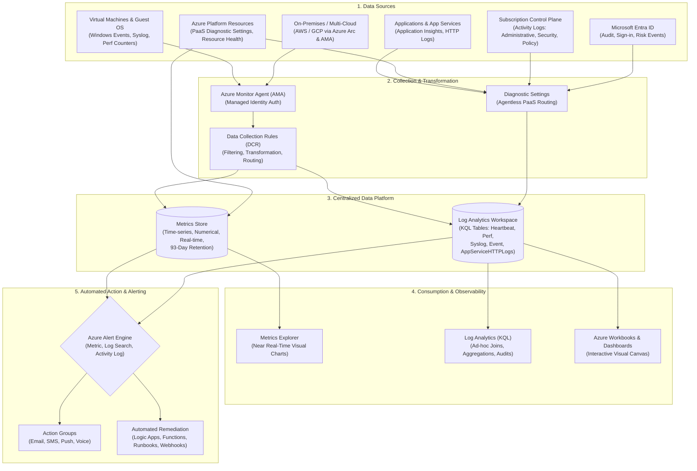
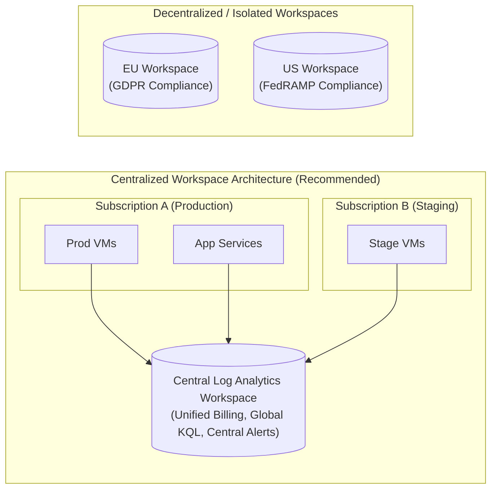
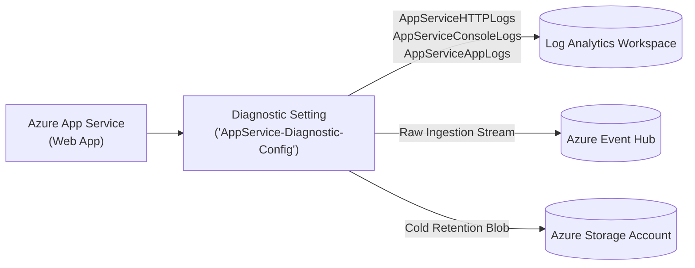
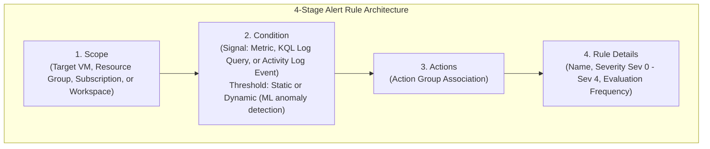
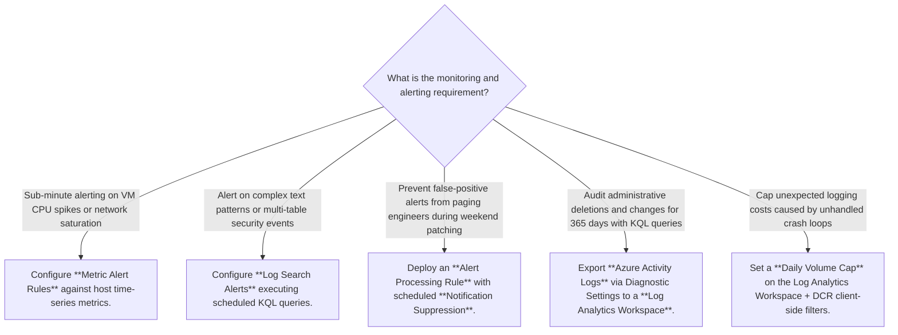

# Module 13-104-12: Administer Monitoring, Azure Monitor, Log Analytics & Alerts

**Breadcrumbs:** [[13-Index - Azure|☁️ Azure Reference MOC]] > [[13-Index - AZ-104|📘 AZ-104 Exam Track]] > **12 - Administer Monitoring**

---

## 🎯 Executive Overview & Observability Ecosystem

Azure Monitor serves as Microsoft's unified, enterprise-grade full-stack observability engine. It collects, correlates, analyzes, and responds to telemetry generated across cloud-native infrastructure, PaaS workloads, serverless applications, and hybrid/multi-cloud systems (including on-premises physical/virtual hosts, AWS, and GCP via Azure Arc).



---

## 📊 Metrics vs. Logs: Technical Anatomy & Comparison

Telemetry within Azure Monitor is strictly segregated into two foundational datatypes:

| Architectural Dimension | Azure Metrics | Azure Logs (Log Analytics) |
| :--- | :--- | :--- |
| **Data Format** | Numerical, time-series data points with timestamp and key-value dimensions. | Structured and semi-structured timestamped records organized into tabular schemas. |
| **Ingestion Latency** | Near real-time (< 1 minute latency). | Batch ingestion latency (typically 1 to 5 minutes). |
| **Primary Query Tool** | Azure Portal Metrics Explorer (GUI chart builder). | Kusto Query Language (KQL) in Log Analytics query editor. |
| **Data Retention** | **93 days** built-in at no extra charge. | **30 days** default (configurable up to 730 days; archive up to 12 years). |
| **Query Complexity** | Simple aggregations (Avg, Min, Max, Total, Count) across single metrics. | Advanced joins, unions, regex parsing, regex extraction, cross-resource/cross-workspace queries. |
| **Alert Trigger Speed** | Sub-minute evaluation frequency (fast response to CPU spikes or bandwidth saturation). | Typically evaluated every 5 to 15 minutes via scheduled search queries. |
| **Cost Model** | Ingestion of standard platform metrics is free; custom metrics and alert rules are billed per rule. | Ingestion billed per Gigabyte (GB) + retention charges beyond 30 days. |

---

## 📜 Azure Activity Logs: Control Plane Auditing

Azure Activity Logs record all control plane management operations executed against Azure Resource Manager (ARM).

### Operational Characteristics
- **Scope:** Operates strictly at the **Subscription level**. It tracks who did what, when, and on which resource across the entire subscription.
- **Logged Operations:** Any HTTP `PUT`, `POST`, or `DELETE` request issued via Azure Portal, Azure CLI, PowerShell, SDKs, or REST API (e.g., creating a VM, restarting a database, deleting an NSG rule).
- **Non-Logged Operations:** Read-only HTTP `GET` requests are **never** logged to Activity Logs.
- **Default Retention:** Retained in Azure Monitor for **90 days** without configuration or storage costs.
- **Position in Stack:** Sits at the ARM management layer. It does **not** capture internal guest operating system activities (e.g., Windows Event Logs, SSH logins, IIS service crashes).

### Event Categories & Audit Roles

| Category | Description & Typical Scenarios |
| :--- | :--- |
| **Administrative** | All create, update, delete, and action operations on resources via ARM (e.g., `Microsoft.Compute/virtualMachines/write`). |
| **Security** | Security-related events and alerts triggered by Microsoft Defender for Cloud. |
| **Service Health** | Declarations of platform incidents, service degradation, planned maintenance, and health advisories. |
| **Alert** | Historical activations and firings of Azure Monitor alert rules. |
| **Recommendation** | Proactive architectural, cost, security, and performance recommendations from Azure Advisor. |
| **Policy** | Actions and remediation tasks executed by Azure Policy (e.g., Deny, Audit, DeployIfNotExists). |
| **Autoscale** | Scaling events executed by Azure autoscale engines based on predefined rules. |
| **Resource Health** | Availability state transitions of individual resources (e.g., VM transitioned from Available to Unavailable). |

### Long-Term Archival & Routing
To retain Activity Logs beyond 90 days for compliance audits (e.g., PCI-DSS, SOC2, HIPAA requiring 365+ days):
1. **Log Analytics Workspace:** Enables complex KQL querying against the `AzureActivity` table, cross-referencing activity events with VM performance or firewall logs.
2. **Azure Storage Account:** Low-cost append-blob archive with immutability and lifecycle policies for multi-year cold storage.
3. **Event Hubs:** High-throughput streaming to third-party SIEM/SOAR platforms (Splunk, Datadog, IBM QRadar).

---

## 🏢 Azure Log Analytics Workspace Architecture & Pricing

A Log Analytics Workspace (`Microsoft.OperationalInsights/workspaces`) is the centralized repository and boundary for log data collection, access control, and KQL analytical processing.

### Architecture: Single vs. Multiple Workspaces



- **Consolidated Workspace (Standard Pattern):** Maximizes correlation efficiency, allows unified dashboards, simplifies RBAC, and achieves higher ingestion tiers for lower per-GB pricing.
- **Split Workspaces (Exceptions):** Required when regulatory frameworks mandate sovereign data residency (e.g., GDPR data cannot leave EU regions) or when strict administrative isolation is required between departments.

### Pricing Models & Capacity Reservations
1. **Pay-As-You-Go:**
   - Ingestion billed per GB uploaded.
   - First 30 days of retention are included free of charge.
   - Ideal for dynamic, small-to-medium enterprise workloads.
2. **Commitment Tiers (Capacity Reservations):**
   - For environments ingesting **> 100 GB/day**, organizations can reserve daily capacity (100 GB, 200 GB, 500 GB, up to 5,000 GB/day) for substantial discounts (up to 30-50% savings over Pay-As-You-Go).
3. **Microsoft Sentinel Considerations:**
   - Sentinel is enabled directly on top of a Log Analytics workspace.
   - Ingestion incurs **two billing components**: the underlying Log Analytics ingestion fee + the Microsoft Sentinel analysis tier fee.

---

## 🤖 Host Monitoring: Modern AMA vs. Legacy MMA

Microsoft completed a major architectural overhaul of host-level virtual machine monitoring. The legacy Microsoft Monitoring Agent (MMA / OMS Agent) reached formal retirement in **August 2024**.

### Architectural Comparison Matrix

| Feature / Capability | Legacy Agent (MMA / OMS) | Modern Agent (Azure Monitor Agent - AMA) |
| :--- | :--- | :--- |
| **Agent Binary** | `MicrosoftMonitoringAgent` (Windows) / `OmsAgentForLinux` | `AzureMonitorWindowsAgent` / `AzureMonitorLinuxAgent` |
| **Modern OS Support** | ❌ Incompatible with modern Linux kernels (e.g., Ubuntu 22.04+ failures). | ✅ Native support for modern Linux distributions and Windows Server 2022+. |
| **Configuration Model** | Workspace-centric: Configured inside workspace UI; pushed universally to all agents. | **Rule-centric via Data Collection Rules (DCRs)**: Granular, scoped configurations. |
| **Data Filtering at Source** | ❌ Minimal; streams all specified logs, driving up ingestion costs. | ✅ **Client-side XPath & Facility filtering**: Discards unwanted logs *before* transmission. |
| **Authentication** | Shared Workspace ID and Primary/Secondary Secret Keys. | **Managed Identity** (System-assigned or User-assigned Managed Identity). |
| **Multi-Cloud / Hybrid** | Direct agent install using workspace keys. | **Azure Arc-enabled servers** manage hybrid instances with standard ARM extensions. |
| **Multi-Homing** | Multi-homing supported only on Windows (Linux was single-workspace only). | ✅ Native multi-homing to multiple workspaces across both Windows and Linux. |

> [!WARNING]
> **Coexistence Billing Hazard:**
> If both the legacy MMA extension and modern AMA extension are installed simultaneously on the same virtual machine and targeting the same Log Analytics workspace, **telemetry will be collected twice**, resulting in duplicate ingestion charges.

### Data Collection Rules (DCR) Anatomy
A Data Collection Rule (`Microsoft.Insights/dataCollectionRules`) decouples the "what to collect" from the "where to send it":
1. **Data Sources:**
   - **Windows Event Logs:** Application, System, Security with XPath event query filters (e.g., `Application!*[System[(Level=1 or Level=2)]]`).
   - **Performance Counters:** CPU (`\Processor Information(_Total)\% Processor Time`), Memory (`\Memory\Available MBytes`), Logical Disk Free Space.
   - **Linux Syslog:** Facilities (`auth`, `daemon`, `syslog`, `kern`) and Severity levels (`Warning`, `Error`, `Critical`).
2. **Destinations:** Log Analytics Workspaces, Azure Monitor Metrics, or Event Hubs.
3. **Associations (DCRA):** Binds the DCR to specific virtual machines or Virtual Machine Scale Sets.

---

## ⚡ Diagnostic Settings for PaaS & App Services

Platform-as-a-Service (PaaS) architectures (Azure App Services, Key Vaults, Azure SQL, Application Gateways) are fully managed by Microsoft; administrators cannot install host agents on the underlying operating systems.

Observability for PaaS is achieved exclusively via **Diagnostic Settings**:



### Key Diagnostic Tables for Azure App Services
- `AppServiceHTTPLogs`: Inbound client web requests, HTTP response status codes (`ScStatus`), client IP addresses, user agents, time taken.
- `AppServiceConsoleLogs`: Standard Output (`stdout`) and Standard Error (`stderr`) generated by containerized or runtime application processes.
- `AppServiceAppLogs`: Application logging messages emitted via logging frameworks (Log4j, Serilog, Winston).
- `AppServiceAuditLogs`: Management and publishing events (FTP logins, deployment credentials).

---

## 🔍 Kusto Query Language (KQL) Practical Cheatsheet

Kusto Query Language (KQL) is a read-only, high-performance tabular query language designed specifically for querying large volumes of telemetry data in Log Analytics.

### Essential KQL Production Recipes

#### 1. Verifying Connected Agent Health (Heartbeat)
```kusto
Heartbeat
| where TimeGenerated > ago(1h)
| summarize LastHeartbeat = max(TimeGenerated) by Computer, Category, OSType, Version
| sort by LastHeartbeat desc
```

#### 2. Investigating High CPU Utilization Across VMs
```kusto
Perf
| where TimeGenerated > ago(4h)
| where ObjectName == "Processor" and CounterName == "% Processor Time" and InstanceName == "_Total"
| summarize AvgCPU = avg(CounterValue), MaxCPU = max(CounterValue) by Computer, bin(TimeGenerated, 15m)
| where AvgCPU > 80
| render timechart
```

#### 3. Tracking Free Disk Space on Production Volumes
```kusto
Perf
| where TimeGenerated > ago(1h)
| where ObjectName == "LogicalDisk" and CounterName == "% Free Space"
| where InstanceName !contains "_" and InstanceName !contains "Harddisk"
| summarize CurrentFreeSpace = arg_max(TimeGenerated, CounterValue) by Computer, InstanceName
| where CounterValue < 15
| project Computer, Drive = InstanceName, FreePercent = CounterValue
```

#### 4. Auditing App Service 5xx Errors and Slow Responses
```kusto
AppServiceHTTPLogs
| where TimeGenerated > ago(24h)
| where ScStatus >= 500 or TimeTaken > 5000
| project TimeGenerated, CsMethod, CsUriStem, ScStatus, TimeTaken, UserAgent, CIp
| sort by TimeTaken desc
```

#### 5. Tracking Failed Resource Deployments in Activity Logs
```kusto
AzureActivity
| where TimeGenerated > ago(7d)
| where ActivityStatusValue in ("Failed", "Failure")
| project TimeGenerated, Caller, OperationNameValue, ResourceGroup, SubscriptionId, ActivitySubstatusValue
| sort by TimeGenerated desc
```

---

## 🚨 Azure Monitor Alert Rules & Action Groups

Azure Monitor Alert Rules continuously monitor telemetry data and execute pre-configured responses when criteria are met.



### Alert Severity Hierarchy

| Severity Level | Name | Classification Criteria | Typical Examples |
| :--- | :--- | :--- | :--- |
| **Sev 0** | **Critical** | Catastrophic outage; immediate business stoppage. | Production VM offline, storage volume full, SQL failover failure. |
| **Sev 1** | **Error** | Significant degradation; critical service impacted. | Average CPU > 95% for 15 mins, HTTP 500 rate > 10%, gateway latency. |
| **Sev 2** | **Warning** | Early indicator of performance or resource pressure. | Disk free space < 15%, memory pressure, single-node failure in cluster. |
| **Sev 3** | **Informational**| Noteworthy operational state change; no immediate impact.| Autoscale engine scaled out VMSS instances, planned backup succeeded. |
| **Sev 4** | **Verbose** | Fine-grained telemetry and debug logs. | Diagnostic trace logs, routine API invocations. |

### Action Groups: Notification & Automated Remediation
An Action Group (`Microsoft.Insights/actionGroups`) is a reusable collection of notification and automation actions:

1. **Notification Receivers:**
   - **ARM Role:** Sends notifications to members holding RBAC roles (Owner, Contributor, Reader) at the subscription or resource group level.
   - **Email / SMS / Push / Voice:** Direct communication channels to designated on-call engineers.
2. **Automation Actions:**
   - **Azure Automation Runbook:** Executes PowerShell or Python scripts to restart stopped services or clean temporary disk files.
   - **Azure Function / Logic App:** Triggers serverless orchestration workflows or creates tickets in Jira / ServiceNow.
   - **Webhooks:** Pushes payload directly to external endpoints (Slack, Microsoft Teams, PagerDuty).
   - **Secure Webhook:** Requires Entra ID authentication before webhook delivery.

### Alert State Management Lifecycle
Alerts progress through explicit operational states to prevent duplicate triage:
- **New:** The alert condition was met and fired; no operator has triaged it yet.
- **Acknowledged:** An administrator has reviewed the alert and is actively investigating.
- **Closed:** The incident has been remediated and confirmed resolved.

---

## 🛠️ Contextual Proof-of-Concept & Diagnostic Recipes

### 1. Provisioning a Centralized Log Analytics Workspace (Azure CLI)
```bash
# Define deployment parameters
RESOURCE_GROUP="rg-monitoring-prod"
LOCATION="eastus"
WORKSPACE_NAME="law-enterprise-monitoring"

# Create the resource group
az group create --name $RESOURCE_GROUP --location $LOCATION

# Deploy the Log Analytics Workspace with 60-day retention
az monitor log-analytics workspace create \
  --resource-group $RESOURCE_GROUP \
  --workspace-name $WORKSPACE_NAME \
  --location $LOCATION \
  --retention-time 60 \
  --quota 50
```

### 2. Creating an Action Group with Email and Logic App Webhook
```bash
# Create an Action Group with both an on-call email and an ARM Role receiver
az monitor action-group create \
  --resource-group $RESOURCE_GROUP \
  --name "ag-secops-critical" \
  --short-name "SecOpsCrit" \
  --action email oncall-alert "ops-alerts@enterprise.com" \
  --action arm-role-receiver sub-owners "8e3af657-a8ff-443c-a75c-2fe8c4bcb635"
```

### 3. Creating a Static Metric Alert on Virtual Machine CPU
```bash
VM_ID=$(az vm show --resource-group $RESOURCE_GROUP --name "vm-linux-prod" --query id -o tsv)
ACTION_GROUP_ID=$(az monitor action-group show --resource-group $RESOURCE_GROUP --name "ag-secops-critical" --query id -o tsv)

# Create an alert rule firing when CPU > 80% for 5 minutes
az monitor metrics alert create \
  --name "alert-high-cpu-vm-linux-prod" \
  --resource-group $RESOURCE_GROUP \
  --scopes $VM_ID \
  --condition "avg Percentage CPU > 80" \
  --window-size 5m \
  --evaluation-frequency 1m \
  --severity 1 \
  --action $ACTION_GROUP_ID \
  --description "Fires when VM CPU utilization averages over 80% across a 5-minute rolling window."
```

### 4. Creating a Scheduled Query (Log Search) Alert Rule via KQL
```bash
WORKSPACE_ID=$(az monitor log-analytics workspace show --resource-group $RESOURCE_GROUP --workspace-name $WORKSPACE_NAME --query id -o tsv)

# Alert triggers if App Service reports more than 50 HTTP 5xx errors within 15 minutes
az monitor scheduled-query create \
  --name "alert-appservice-http5xx-threshold" \
  --resource-group $RESOURCE_GROUP \
  --scopes $WORKSPACE_ID \
  --condition "count 'AppServiceHTTPLogs | where ScStatus >= 500' > 50" \
  --condition-query "AppServiceHTTPLogs | where ScStatus >= 500" \
  --window-size 15m \
  --evaluation-frequency 5m \
  --severity 0 \
  --action $ACTION_GROUP_ID \
  --description "Fires if HTTP 5xx server error count exceeds 50 within 15 minutes."
```

### 5. In-Guest Verification: Linux VM CPU Stress Testing
```bash
# SSH into the target Linux VM
ssh azureuser@20.242.246.105

# Install stress test utility
sudo apt-get update && sudo apt-get install -y stress

# Saturate 4 virtual CPU cores at 100% load for 600 seconds (10 minutes)
stress --cpu 4 --timeout 600s

# In a secondary terminal session, monitor instant real-time CPU saturation
top
# Observe %Cpu(s) reaching 100.0 us
```

---

## 🔍 Deep-Intuition AARF Framework

### Scenario: Diagnosing Metric Alert vs. Log Search Alert Latency Discrepancy

- **The Answer (Core Configuration):** When sub-minute real-time alerting is required for infrastructure metrics (e.g., host CPU, network outbound spikes, memory exhaustion), configure a native **Metric Alert Rule** rather than a Log Search Query Alert.
- **The Assumptions (Prerequisites):**
  - Production virtual machines run mission-critical, low-latency financial API services.
  - SRE team mandates alerts fire within 2 minutes of system threshold violations.
- **The Rationale (Why):**
  - **Metric Alerts** read directly from the near real-time Azure Metrics time-series pipeline, which updates on sub-minute intervals. Evaluation frequencies can be configured as low as 1 minute with near zero ingestion lag.
  - **Log Search Alerts** depend on the Azure Monitor Agent batching logs, transmitting them over HTTPS to the Log Analytics Workspace, indexing the table schema, and running a scheduled KQL query. This multi-stage ingestion pipeline introduces a 3 to 7-minute data latency before query execution begins.
- **The Failure Loop (What if misconfigured):**
  - *Symptom:* The operations team configures an alert on high CPU usage using a KQL query against the `Perf` table in Log Analytics with an evaluation frequency of 5 minutes.
  - *Result:* By the time the log is ingested, indexed, and evaluated by KQL, the CPU saturation has persisted for **8 to 12 minutes**, breaching SLA thresholds and causing downstream timeout cascades before the on-call engineer receives the alert.
- **The Alternative Case (When to use 'if not'):** If the alert condition requires inspecting complex application text, correlation across multiple log tables (e.g., matching a Windows Security Event ID `4625` with an NSG Flow log denial), or custom regex parsing, a **Log Search Alert** is mandatory, as Metric Alerts cannot evaluate structured text or perform multi-table joins.

---

## 💡 AZ-104 Exam Tips & Gotchas

> [!TIP]
> **Activity Log 90-Day Retention Trap:**
> - Azure Activity Logs are kept for **90 days** free of charge.
> - If an exam scenario states: *"An auditor requires all administrative change events for the past 365 days to be queryable with SQL or KQL"*, the correct answer is: **Export Activity Logs using a Diagnostic Setting to a Log Analytics Workspace**.
> - Archiving solely to a Storage Account satisfies retention compliance, but does **not** allow immediate ad-hoc KQL querying from the portal.

> [!WARNING]
> **MMA Deprecation & Exam Terminology:**
> - While Microsoft retired the Microsoft Monitoring Agent (MMA/OMS) in August 2024, older AZ-104 exam pools may still refer to the Log Analytics Agent or MMA.
> - For modern questions, always select **Azure Monitor Agent (AMA)** with **Data Collection Rules (DCRs)** and **Azure Arc**.

> [!IMPORTANT]
> **Dynamic Thresholds for Cyclic / Seasonal Workloads:**
> - When an exam question describes workloads with high daytime traffic and low nighttime traffic, static metric thresholds (e.g., fixed 80% CPU) produce false positives at night or fail to detect anomalies during peak daytime hours.
> - The correct answer is to use **Dynamic Thresholds**, which leverage machine learning to establish dynamic baseline boundaries.

---

## 🏛️ Enterprise Observability, Alert Suppression & Runaway Cost Governance

### 1. Azure Workbooks: Dynamic Interactive Dashboards
- **Beyond Static Dashboards:** While standard Azure Dashboards display basic pinned tiles, **Azure Workbooks** provide an interactive canvas combining formatted text, dynamic parameter filters (e.g., filter by Subscription, TimeRange, or Environment), live KQL query tables, and visual charts.
- **Cross-Workspace Telemetry Correlation:** Workbooks execute unified analytical queries spanning multiple Log Analytics workspaces, Application Insights components, and Azure Resource Graph using the `workspace('law-name').Table` syntax.

### 2. Alert Processing Rules: Maintenance Window Suppression
- **The Operational Challenge:** During scheduled server maintenance, OS patching, or database re-indexing, hundreds of false-positive alerts fire, paging on-call engineers unnecessarily.
- **Alert Processing Rules (Suppression):**
  - Configured globally under *Azure Monitor ➔ Alerts ➔ Alert processing rules*.
  - Rule action: **Suppress notifications**.
  - Recurrence schedule: Can be set to a one-time maintenance window or a recurring weekly window (e.g., Sunday 01:00 to 05:00 UTC).
  - *Operational Guarantee:* Alert rules continue to evaluate and log in the Azure Monitor alert history for audit compliance, but notifications (SMS, email, push, PagerDuty, ServiceNow webhooks) are suppressed.

### 3. Log Analytics Pricing: FinOps & Controlling Runaway Ingestion Costs
- **The Financial Risk:** Log Analytics charges per Gigabyte ingested. If an application service enters an unhandled crash loop that writes millions of stack traces to `stdout`, a workspace can ingest hundreds of gigabytes within hours, causing substantial unexpected cost spikes.
- **Enterprise Cost Protection Controls:**
  1. *Daily Ingestion Volume Cap:* In the workspace *Usage and estimated costs* blade, set a **Daily Volume Cap** (e.g., 5 GB/day). Once reached, the workspace stops collecting non-security event logs for the remainder of the 24-hour UTC cycle.
  2. *Data Collection Rules (DCR) Client-Side Filtering:* With the modern Azure Monitor Agent (AMA), configure XPath queries in DCRs to ingest only Warning and Error events from Windows Event Viewer, completely filtering out verbose Informational events before network transmission.
  3. *Table Plan Optimization (Basic vs. Analytics Logs):* Ingest high-volume debug logs into the **Basic Log Table** plan (costing ~80% less per GB than Analytics tables), retaining them for ad-hoc debugging without long-term analytics overhead.
  4. *Capacity Reservations:* For enterprise workloads ingesting over 100 GB/day, reserve daily commitment tiers (100 GB, 200 GB, 500 GB/day) to reduce per-GB costs by up to 50% compared to Pay-As-You-Go.

---

## 💡 Observability Decision Tree & Articulation Guide



---

---

## 🏛️ Deep-Dive Observability & Cost Optimization (John Savill Master Class Insights)

### 1. Ingestion Latency Mechanics: Metrics vs. Logs
John Savill highlights why understanding data pipeline latency is essential for SLA alerting:
- **Metrics Pipeline (Sub-Minute Latency):** Azure service resource providers emit numerical time-series metrics directly to the lightweight Azure Monitor Metrics store. Metric alert rules evaluate near-instantaneously, firing within 1–2 minutes of threshold violations.
- **Logs Pipeline (3–7 Minute Ingestion Delay):** Telemetry emitted to Log Analytics must be collected by the Azure Monitor Agent, batched, transmitted over HTTPS, parsed, indexed into columnar table schemas, and evaluated by scheduled KQL queries. Alerts dependent on Log Analytics queries experience inherent ingestion latency.

### 2. Log Analytics FinOps: Commitment Tiers & Data Archiving
Log Analytics ingestion can become a runaway cost driver in large enterprises. John Savill details the cost optimization hierarchy:
- **Daily Volume Cap:** Emergency circuit breaker that stops non-security log collection when a daily gigabyte threshold is exceeded.
- **Commitment Tiers:** If an enterprise ingests over 100 GB/day, switching from Pay-As-You-Go ($2.30/GB) to the 100 GB/day Commitment Tier reduces costs by up to 15–20% (with discounts scaling up to 50% for 500 GB+/day).
- **Basic vs. Analytics Table Schema:**
  - *Analytics Logs:* Full KQL capabilities, alert support, 30–730 days interactive retention.
  - *Basic Logs:* Designed for high-volume debugging logs (e.g., container console logs, verbose IIS access logs). Ingestion cost is ~80% cheaper than Analytics logs, with 8 days of retention and simple single-table search queries.
- **Archive Tier:** Once interactive retention expires, logs can be retained in low-cost Archive storage for up to 12 years to meet regulatory compliance requirements.

## 📊 Azure Monitor Agent, DCR Ingestion Governance & KQL (Scott Duffy Insights)

### 1. Modern Azure Monitor Agent (AMA) vs. Legacy MMA Agent
*   **Legacy Log Analytics Agent (MMA/OMS):** Monolithic agent that ingested all Windows event logs or Syslog streams without filtering, leading to bloated data volume and unexpected billing. (Retired August 2024).
*   **Modern Azure Monitor Agent (AMA):** Uses centralized **Data Collection Rules (DCR)** to filter logs at the client operating system before transmission over the network.
*   **DCR Filtering Power:** An administrator can specify an XPath query to ingest *only* `Error` and `Critical` events from the `System` and `Application` logs, reducing ingested log volume by up to 85%!

### 2. Essential Kusto Query Language (KQL) Production Recipes
```kql
// 1. Audit all resource deletions across the entire subscription in the last 7 days
AzureActivity
| where TimeGenerated >= ago(7d)
| where OperationNameValue has "delete" and ActivityStatusValue == "Success"
| project TimeGenerated, Caller, ResourceGroup, OperationNameValue, ActivitySubstatusValue

// 2. Query top 5 virtual machines by Average CPU utilization over the past 24 hours
Perf
| where TimeGenerated >= ago(24h)
| where ObjectName == "Processor" and CounterName == "% Processor Time" and InstanceName == "_Total"
| summarize AvgCPU = avg(CounterValue) by Computer, bin(TimeGenerated, 1h)
| top 5 by AvgCPU desc

// 3. Detect failed SSH and RDP brute force attempts on virtual machines
SecurityEvent
| where TimeGenerated >= ago(24h)
| where EventID in (4625) // Failed Windows logon
| summarize FailedCount = count() by TargetUserName, IpAddress
| where FailedCount > 10
| order by FailedCount desc
```


## 🌐 Authoritative References & Citations

- [John Savill: Azure Master Class v2 - Module 10 - Monitoring & Security](https://www.youtube.com/playlist?list=PLlVtbbG169nGlGPWs9xaLKT1KfwqREHbs)

- [KodeKloud AZ-104 Course - Administer Monitoring Module](https://notes.kodekloud.com/docs/Updated-AZ-104-Microsoft-Azure-Administrator/Administer-Monitoring/Module-Introduction/page.md)
- [Moe Intelligence AZ-104 Video Series (Lessons 35, 37–40)](https://www.youtube.com/playlist?list=PLczK3J2J4clmeh328CC13dJrcALcSFZFb)
- [Microsoft Learn: Design and implement a monitoring strategy on Azure](https://learn.microsoft.com/en-us/training/modules/design-monitoring-strategy-on-azure/)
- [Microsoft Learn: Monitor and configure Azure resources with Azure Monitor](https://learn.microsoft.com/en-us/training/modules/monitor-azure-resources-with-azure-monitor/)
- [Azure Monitor Architecture & Platform Documentation](https://docs.microsoft.com/en-us/azure/azure-monitor/)
- [Azure Monitor Agent (AMA) Overview & Migration](https://learn.microsoft.com/en-us/azure/azure-monitor/agents/azure-monitor-agent-overview)
- [Log Analytics Workspace Pricing and Commitment Tiers](https://azure.microsoft.com/en-us/pricing/details/monitor/)
- Udemy AZ-104 Microsoft Azure Administrator Course by Scott Duffy ([Inflow: Module 10](file:///F:/Dump%20one/BrainDump/inflow/AZ-104-ScottDuffy/10_Administer_Monitoring_and_Log_Analytics.md))
