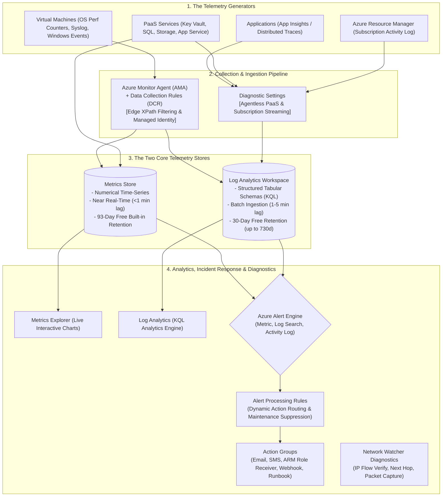

# Module 13-104-12: Administer Monitoring, Azure Monitor, Log Analytics, Alerts & Network Watcher

**Breadcrumbs:** [[13-Index - Azure|☁️ Azure Reference MOC]] > [[13-Index - AZ-104|📘 AZ-104 Exam Track]] > **12 - Administer Monitoring**

---

## 🎯 Stage 1: Executive Overview & The Observability Lecture

### 1. The Zero-Knowledge Starting Point: Why Cloud Observability Matters

#### 1. The Real-World Dilemma: Physical Crash Carts vs. The Invisible Cloud (The 'Why')
In traditional on-premises enterprise IT, when an operating system crashed, an administrator walked into the physical server room, located the flashing amber LED on the rack chassis, rolled up a "crash cart" with a physical keyboard and monitor, and inspected the kernel panic or bluescreen on the VGA port.
* In a hyperscale public cloud like Microsoft Azure, you have **zero physical access to the datacenters**. Your applications execute across thousands of shared hypervisors, software-defined networks (SDN), microservice clusters, and managed PaaS backends.
* If a virtual machine freezes, an API returns HTTP 500 errors, or an ExpressRoute gateway drops packets, you cannot inspect physical cables or motherboards.
* **The Law of Cloud Observability:** **If you cannot observe your infrastructure through telemetry pipelines, your cloud is completely invisible.** Without structured monitoring, you discover production outages only when paying customers report them on social media.

Observability in Microsoft Azure is not an isolated tool or simple portal toggle; it is a unified, end-to-end platform called **Azure Monitor**:



#### 2. The Concrete Metaphor: The Space Station Flight Deck vs. The Forensic Laboratory
* **Azure Monitor Metrics:** The **dashboard instruments on an astronaut's flight deck** (oxygen level gauge, cabin pressure needle, hull temperature sensor). The numbers refresh every second. If oxygen drops below 19%, an alarm flashes red instantly (< 10 seconds), prompting the crew to put on masks. However, the pressure gauge cannot explain *why* the hull breached.
* **Azure Monitor Logs (Log Analytics):** The **forensic flight data recorder (the "Black Box") and mission dispatch transcripts**. It captures complete communication logs, atmospheric chemical analyses, sensor dumps, and system error codes. You do not read the black box while piloting during launch; you open it during an investigation to execute sophisticated queries and determine the exact mechanical root cause of a failure.
* **Activity Log:** The **courthouse legal registry and security entrance badge reader**. It records who walked into the control room, when they entered, and which administrative switches they flipped (e.g., "Engineer Jane clicked Deploy on Subnet Gateway at 03:14 UTC").

---

### 2. Terminology Matrix: Zero-Knowledge to Enterprise Architect

| Terminology | What It Means to a Beginner | Real-World Analog | Enterprise Architecture Reality |
| :--- | :--- | :--- | :--- |
| **Azure Monitor** | The central dashboard watching everything in Azure. | The mission control center for an entire space agency. | The umbrella observability platform ingesting, storing, and analyzing metrics, logs, and traces across Azure, on-premises, and multicloud. |
| **Metrics** | Real-time numbers tracking system performance. | A sports car's speedometer and tachometer updating every millisecond. | Lightweight, numerical, time-series data points with sub-minute ingestion latency, retained for 93 days free of charge. |
| **Logs (Log Analytics)** | Detailed timestamped text records of what happened. | A ship's captain's log recording every event, command, and malfunction. | High-fidelity tabular event records stored in a Log Analytics workspace, queryable via Kusto Query Language (KQL). |
| **Activity Log** | A diary of who did what to your cloud resources. | A building entrance security sign-in sheet recording who visited and what they modified. | Control plane audit trail recording all ARM operations (create, update, delete) across a subscription, retained for 90 days. |
| **Azure Monitor Agent (AMA)** | A software sensor running inside your virtual machine. | A telemetry computer mounted inside a Formula 1 engine transmitting diagnostic codes. | Unified VM extension replacing legacy MMA/OMS, authenticating via Managed Identity and configured using Data Collection Rules. |
| **Data Collection Rule (DCR)** | A recipe telling the agent what data to collect and where to send it. | A packing manifest telling a warehouse worker which packages to ship and which to discard. | An ARM resource defining data sources (perf counters, syslog, event logs), client-side XPath filters, and multi-tenant destinations. |
| **Action Group** | A phone tree of people to notify when something breaks. | An automated fire alarm dispatching the fire brigade, police, and building supervisor. | Reusable notification and remediation container (Email, SMS, Push, Voice, ARM Role receiver, Webhook, Logic App, Runbook). |
| **Alert Processing Rule** | Rules that intercept alerts and redirect or silence them. | A "Do Not Disturb" sign hung on a hotel door during scheduled sleeping hours. | Post-alert routing engine that dynamically applies action groups or suppresses notifications during maintenance windows. |
| **Network Watcher** | A network diagnostic toolkit for Azure SDN. | A mechanic's OBD scanner plugged into an engine to detect why fuel isn't flowing. | Regional SDN diagnostic suite providing IP Flow Verify, Next Hop, Connection Troubleshoot, Packet Capture, and NSG Flow Logs. |

---

## 🏛️ Stage 2: Core Mental Model & Component Architecture

### 1. Azure Metrics vs. Azure Logs (The Telemetry Divide)

#### 1. The Real-World Dilemma: Ingestion Latency vs. Forensic Depth (The 'Why')
Engineers frequently struggle with choosing between Metrics and Logs when architecting observability:
* **The Responsiveness Trap:** When a production web application suffers a traffic spike, CPU utilization hits 100%. If an autoscaling rule or emergency pager relies on a log-based query, the batch ingestion and indexing pipeline can take **2 to 5 minutes** to commit those records to disk. By the time the alert evaluates, the server has crashed and customer transactions are lost.
* **The Blind Number Trap:** Conversely, if an administrator relies solely on metrics, they see that CPU spiked to 100% at 14:02 UTC. But a metric is merely a floating-point number; it **cannot reveal which SQL query, rogue process, or malicious user IP address triggered that spike**.
* Enterprise systems require both: **Metrics for near-real-time alerting and autoscaling**, and **Logs for forensic root-cause analysis**.

```text
+---------------------------------------------------------------------------------------------------+
|                               AZURE METRICS vs. AZURE LOGS (LOG ANALYTICS)                        |
+---------------------------------------------------------------------------------------------------+
| Dimension             | Azure Metrics                          | Azure Logs (Log Analytics)       |
+-----------------------+----------------------------------------+----------------------------------+
| What is it?           | Numerical, time-series data points     | Detailed, timestamped records    |
|                       | (e.g. CPU = 85.4%, Disk IOPS = 1,200)  | (e.g. Syslog, Windows Event 4625)|
+-----------------------+----------------------------------------+----------------------------------+
| Ingestion Latency     | Near Real-Time (< 1 minute)            | Batch latency (1 to 5 minutes)   |
+-----------------------+----------------------------------------+----------------------------------+
| Default Retention     | 93 Days (Included free, unchangeable)  | 30 Days (Included free, up to    |
|                       |                                        | 730 days interactive, 12y archive|
+-----------------------+----------------------------------------+----------------------------------+
| Primary Analysis Tool | Metrics Explorer (Visual Chart GUI)    | Log Analytics via KQL queries    |
+-----------------------+----------------------------------------+----------------------------------+
| Query Complexity      | Simple single-metric aggregations      | Complex multi-table joins, regex,|
|                       | (Avg, Min, Max, Total, Count)          | string parsing, aggregations     |
+-----------------------+----------------------------------------+----------------------------------+
| Alert Responsiveness  | Sub-minute evaluation (Ultra fast)     | Scheduled queries (every 5-15m)  |
+-----------------------+----------------------------------------+----------------------------------+
| Billing Model         | Platform metrics ingestion is FREE.    | Billed Pay-As-You-Go per GB      |
|                       | Alerts billed per active rule.         | ingested + retention > 30 days.  |
+-----------------------+----------------------------------------+----------------------------------+
```

---

### 2. Control Plane Auditing: The Azure Activity Log

#### 1. The Real-World Dilemma: "Who Deleted the Production Gateway at 3:00 AM?" (The 'Why')
In a corporate Azure environment where hundreds of developers, operations engineers, and automated CI/CD pipelines possess role-based permissions, infrastructure changes occur constantly:
* If a critical Virtual Network Gateway or NSG security rule is deleted, causing an outage, the first operational question is: *"Who executed this change, from what IP address, using which credential, and when?"*
* Without an immutable control-plane audit trail, troubleshooting becomes finger-pointing, and malicious insider activity remains undetectable.

```text
+-------------------------------------------------------------------------------------------------+
|                                 AZURE ACTIVITY LOG EVENT ARCHITECTURE                           |
+-------------------------------------------------------------------------------------------------+
|                                                                                                 |
|   Client / Admin / Pipeline                                                                     |
|             │                                                                                   |
|             ▼ HTTP REST Request (e.g., PUT /subscriptions/.../virtualNetworks/vnet-prod)        |
|   ┌─────────────────────────────────────────────────────────┐                                   |
|   │       AZURE RESOURCE MANAGER (ARM CONTROL PLANE)        │                                   |
|   │             https://management.azure.com                │                                   |
|   └────────────────────────────┬────────────────────────────┘                                   |
|                                │ Generates Event                                                |
|                                ▼                                                                |
|   ┌─────────────────────────────────────────────────────────┐                                   |
|   │                   AZURE ACTIVITY LOG                    │                                   |
|   │                                                         │                                   |
|   │ • Event Properties Recorded:                            │                                   |
|   │   ├── Caller: "sarah.admin@enterprise.com"              │                                   |
|   │   ├── OperationName: "Microsoft.Network/vNets/write"    │                                   |
|   │   ├── Status: "Succeeded"                               │                                   |
|   │   ├── TimeStamp: "2026-10-14T03:14:22Z"                 │                                   |
|   │   ├── ResourceId: "/subscriptions/.../vnet-prod"        │                                   |
|   │   └── ClientIP: "198.51.100.45"                         │                                   |
|   │                                                         │                                   |
|   │ • BUILT-IN RETENTION: Exactly 90 Days (Free)            │                                   |
|   └────────────────────────────┬────────────────────────────┘                                   |
|                                │                                                                |
|                                │ Long-Term Compliance Streaming via Diagnostic Setting          |
|                                ▼                                                                |
|   ┌─────────────────────────────────────────────────────────┐                                   |
|   │            DESTINATIONS FOR EXTENDED RETENTION          │                                   |
|   │ ├── 1. Log Analytics Workspace (KQL Queryable for 365d) │                                   |
|   │ ├── 2. Azure Storage Account (Immutable WORM Archive)   │                                   |
|   │ └── 3. Azure Event Hubs (SIEM / Splunk / Sentinel)      │                                   |
|   └─────────────────────────────────────────────────────────┘                                   |
|                                                                                                 |
+-------------------------------------------------------------------------------------------------+
```

#### 2. Key Operational Truths of the Activity Log:
* **What it records:** All administrative actions submitted to Azure Resource Manager: HTTP `PUT`, `POST`, and `DELETE`. Examples: restarting a VM, modifying an NSG rule, changing RBAC role assignments, or scaling a VMSS.
* **What it NEVER records:** HTTP `GET` read operations! Viewing a resource in the portal or running `Get-AzVM` creates zero Activity Log entries. Furthermore, it does **not** record internal data-plane operations (such as reading a blob inside a storage account or querying a database table).
* **The 90-Day Fixed Retention Trap:** The built-in Activity Log retains events for **strictly 90 days**. There is **no slider, button, or toggle in the Activity Log blade to extend retention to 180 or 365 days**!
* **The Compliance Rule:** If an auditor requires 365-day retention queryable via KQL, you **MUST configure a Subscription-Level Diagnostic Setting** and stream Activity Logs to a **Log Analytics Workspace**!

---

### 3. Modern Host Observability: Azure Monitor Agent (AMA) vs. Legacy MMA

#### 1. The Real-World Dilemma: The Monolithic Noise Firehose (The 'Why')
In August 2024, Microsoft formally retired the legacy **Microsoft Monitoring Agent (MMA / OMS / Log Analytics Agent)**.
* Under legacy MMA, configuration was monolithic and workspace-centric. When you attached a VM to a workspace, the agent streamed **every single event log and performance counter across the WAN**, flooding the workspace with gigabytes of useless informational noise and inflating cloud ingestion bills by thousands of dollars.
* Authentication relied on static **Workspace IDs and Shared Primary Keys**, introducing severe secret-sprawl vulnerabilities.
* The modern **Azure Monitor Agent (AMA)** completely re-architects host telemetry by decoupling configuration into **Data Collection Rules (DCRs)** and authenticating exclusively via **Managed Identities**.

```text
+-------------------------------------------------------------------------------------------------+
|                               AMA vs. LEGACY MMA ARCHITECTURAL COMPARISON                       |
+-------------------------------------------------------------------------------------------------+
| Vector                 | Legacy Agent (MMA / OMS) [RETIRED]    | Modern Azure Monitor Agent (AMA) |
+------------------------+---------------------------------------+----------------------------------+
| Configuration Model    | Workspace-centric (Monolithic push)   | Rule-centric via DCRs            |
| Client-Side Filtering  | ❌ None (Streams all noise to cloud)  | ✅ Custom XPath filters drop logs|
| Authentication         | Workspace ID + Static Primary Key     | **Managed Identity** (Zero Keys!)|
| Multi-Homing           | Windows only (Single on Linux)        | Native Windows and Linux         |
| Hybrid Cloud Support   | Basic standalone installer            | Built-in via **Azure Arc**       |
| Ingestion-Time ETL     | ❌ None (Ingests raw payload)         | ✅ KQL Ingestion Transforms      |
+-------------------------------------------------------------------------------------------------+
```

#### 2. Data Collection Rules (DCR) Client-Side Filtering (FinOps Optimization):
A Data Collection Rule (`Microsoft.Insights/dataCollectionRules`) specifies three architectural components:
1. **Data Sources:** What to collect (e.g., Windows Event Logs, Linux Syslog, OS Performance Counters).
2. **Streams & Transforms:** Client-side XPath filters that drop unwanted noise at the host edge, plus optional KQL transformation rules during cloud ingestion.
3. **Destinations:** Where to deliver the data (Log Analytics Workspace, Azure Monitor Metrics, Event Hubs, Azure Storage).

```xpath
<!-- FINOPS OPTIMIZATION: Discard all Informational events at the host edge -->
Application!*[System[(Level=1 or Level=2)]]
System!*[System[(Level=1 or Level=2)]]
```

By instructing the Azure Monitor Agent to drop Level 3 (Warning), Level 4 (Information), and Level 5 (Verbose) events directly inside host memory before transmitting over TLS 443, organizations slash Log Analytics ingestion costs by **up to 80%**!

---

### 4. Log Analytics Workspace Table Plans & FinOps Guardrails

A Log Analytics Workspace provides strict architectural tiers and financial boundaries to prevent runaway cloud telemetry expenditure:

```text
+-------------------------------------------------------------------------------------------------+
|                         LOG ANALYTICS WORKSPACE STORAGE & RETENTION TIERS                       |
+-------------------------------------------------------------------------------------------------+
|                                                                                                 |
|   Incoming Telemetry Stream                                                                     |
|             │                                                                                   |
|             ├──► 1. Analytics Table Plan (Standard Production)                                  |
|             │    ├── Full KQL query capability, joins, aggregations, alerts                     |
|             │    ├── Retention: 30 days free, expandable up to 730 days (2 years)               |
|             │    └── Price: Standard Pay-As-You-Go per GB ($2.30/GB)                            |
|             │                                                                                   |
|             ├──► 2. Basic Table Plan (High-Volume Debugging Logs)                               |
|             │    ├── Optimized for massive logs (ContainerLogV2, AppTraces, Firewall logs)      |
|             │    ├── Retention: Fixed 8 days                                                    |
|             │    └── Price: ~80% cheaper per GB than Analytics tables ($0.50/GB)                |
|             │                                                                                   |
|             └──► 3. Archive Tier (Long-Term Regulatory Compliance)                              |
|                  ├── Deep cold storage for audit records (HIPAA, PCI-DSS)                       |
|                  ├── Retention: Retain logs for up to 12 years (4,383 days)                     |
|                  └── Price: Deeply discounted cold archive storage pricing                      |
|                                                                                                 |
|   FINOPS HARD CAP GUARDRAIL:                                                                    |
|   Daily Volume Cap (e.g., 5.0 GB/day) ──► Halts non-security ingestion upon limit breach!       |
|                                                                                                 |
+-------------------------------------------------------------------------------------------------+
```

---

## 🏢 Stage 3: Deep-Intuition Platform Mechanics & Topology

### 1. Alert Rules & The Three-Tier Alert Architecture

Azure Monitor decouples alert evaluation, policy routing, and notification dispatch into three independent stages:

```text
[ 1. Telemetry Stream ]  Metrics Store, Log Analytics Workspace, or Activity Log
          │
          ▼
[ 2. Alert Rule Condition ]
  ├── A. Metric Alert: Numerical threshold (CPU > 85% for 5 mins). Sub-minute evaluation. Stateful.
  ├── B. Log Search Alert: KQL scheduled query (Failed logins > 10 in 15 mins). Scheduled batch.
  └── C. Activity Log Alert: ARM event trigger (VM Deallocated, NSG deleted). Control-plane reactive.
          │ (When Condition Evaluates to True)
          ▼
[ 3. Alert Processing Rules ] (Intermediary Routing & Suppression Engine)
  ├── Action A: Suppress notifications (Scheduled Sunday 02:00-04:00 maintenance window)
  └── Action B: Dynamically route to specific Action Group based on resource tags or severity
          │
          ▼
[ 4. Action Group Dispatch ]
  ├── Direct Notification: Email, SMS, Voice Call, Azure Mobile App Push Notification
  ├── Role-Based Notification: ARM Role Receiver (Owner, Contributor, Monitoring Reader)
  └── Automated Remediation: Automation Runbook, Logic App, Azure Function, Secure Webhook
```

#### 1. Metric Alerts vs. Log Search Alerts: High-Yield Comparison

| Architectural Vector | Metric Alerts | Log Search Alerts |
| :--- | :--- | :--- |
| **Data Evaluated** | Lightweight numerical time-series metrics | Tabular log records via KQL queries |
| **Evaluation Frequency** | Sub-minute (every 1 minute or 30 seconds) | Scheduled intervals (every 5, 10, or 15 mins) |
| **State Management** | **Stateful:** Automatically resolves when metric drops below threshold | **Stateless:** Evaluates query; fires alert; does not auto-resolve |
| **Threshold Types** | **Static** (Fixed number) or **Dynamic** (ML-driven baseline) | Number of results or Metric measurement table |
| **Ideal Use Case** | Infrastructure health: CPU, RAM, Disk IOPS, Network Drops | Forensic patterns: HTTP 500 error spikes, brute-force logins |

#### 2. The ARM Role Receiver (High-Yield Exam Core):
When configuring Action Groups, a common anti-pattern is hardcoding personal corporate email addresses (`john.smith@company.com`). When John leaves the company, alerts bounce and the operations team is blinded:
* **The Architecture Solution:** Configure an **ARM Role Receiver** targeting built-in RBAC roles: **Owner**, **Contributor**, or **Monitoring Reader** at the subscription or resource group scope.
* Whenever a new engineer is assigned that role, they **automatically begin receiving alert emails and notifications with zero maintenance required on the Action Group!**

---

### 2. Network Watcher Diagnostic Toolkit (SDN Diagnostics)

Because Azure Software Defined Networking (SDN) abstracts physical routers and switches, administrators use **Azure Network Watcher** to troubleshoot virtual network traffic:

```text
+-------------------------------------------------------------------------------------------------+
|                                 AZURE NETWORK WATCHER TOOLKIT                                   |
+-------------------------------------------------------------------------------------------------+
|  1. IP Flow Verify          |  2. Next Hop                 |  3. Connection Troubleshoot        |
+-----------------------------+------------------------------+------------------------------------+
| - Checks: Is a 5-tuple      | - Checks: Where is Azure's   | - Checks: End-to-end TCP latency   |
|   packet allowed by NSGs?   |   SDN routing this packet?   |   and hop-by-hop packet drops.     |
| - Output: "Access Allowed"  | - Output: "Next Hop Type:    | - Output: Visual topological path  |
|   or "Access Denied by      |   VirtualAppliance (10.0.1.4)|   with latency in milliseconds and |
|   Rule: Custom-Deny-100"    |   or 'None' (Blackhole!)"    |   firewall drop indicators.        |
+-----------------------------+------------------------------+------------------------------------+
|  4. Packet Capture          |  5. NSG Flow Logs & Traffic  |  6. Effective Security Rules       |
+-----------------------------+------------------------------+------------------------------------+
| - Remotely captures .pcap   | - Streams flow metadata to   | - Displays the merged evaluation   |
|   traces on live VM disks   |   Storage & Log Analytics    |   of Subnet NSG + NIC NSG rules    |
|   without logging in!       |   with Layer 7 geo-mapping.  |   with winning priority rankings.  |
+-------------------------------------------------------------------------------------------------+
```

---

## 🔍 Stage 4: Kusto Query Language (KQL) Production Recipes

KQL is a fast, read-only data manipulation language structured as a pipeline using the pipe character (`|`):

### 1. VM Availability & Heartbeat Health Check
```kusto
Heartbeat
| where TimeGenerated >= ago(1h)
| summarize LastHeartbeat = max(TimeGenerated) by Computer, OSType, Version
| where LastHeartbeat < ago(15m)
| sort by LastHeartbeat desc
```
*Purpose:* Pinpoints virtual machines whose agents have stopped reporting within the last 15 minutes (unresponsive or crashed hosts).

### 2. Low Disk Space Warning Across VM Fleet (< 15% Free)
```kusto
Perf
| where TimeGenerated >= ago(1h)
| where ObjectName == "LogicalDisk" and CounterName == "% Free Space"
| where InstanceName !contains "_" and InstanceName !contains "Harddisk"
| summarize CurrentFree = arg_max(TimeGenerated, CounterValue) by Computer, Drive = InstanceName
| where CounterValue < 15
| project Computer, Drive, FreePercent = CounterValue
```
*Purpose:* Identifies all production storage volumes nearing capacity before database write stalls occur.

### 3. Auditing Failed ARM Administrative Operations
```kusto
AzureActivity
| where TimeGenerated >= ago(7d)
| where ActivityStatusValue in ("Failed", "Failure")
| project TimeGenerated, Caller, OperationNameValue, ResourceGroup, ActivitySubstatusValue
| sort by TimeGenerated desc
```
*Purpose:* Reveals which administrative user or pipeline triggered an ARM operation that failed validation.

### 4. FinOps: Ingestion Volume Breakdown by Table
```kusto
Usage
| where TimeGenerated >= ago(24h)
| where DataType == "Metric"
| summarize TotalGB = sum(Quantity) / 1024 by TableName = SubType
| sort by TotalGB desc
```
*Purpose:* Breaks down which Log Analytics table (e.g., `AppTraces`, `ContainerLogV2`, `W3CIISLog`) is consuming the highest ingestion volume to optimize DCR filters.

---

## ⚙️ Stage 5: Declarative & Automation Engine (CLI & PowerShell Core)

### 1. Azure CLI: Provision Log Analytics, Daily Cap & Metric Alerts

```bash
# ==============================================================================
# 1. CREATE LOG ANALYTICS WORKSPACE WITH FINOPS DAILY CAP
# ==============================================================================
RG_NAME="rg-monitoring-prod"
LOCATION="eastus"
WORKSPACE_NAME="law-enterprise-prod"

az monitor log-analytics workspace create \
  --resource-group "${RG_NAME}" \
  --workspace-name "${WORKSPACE_NAME}" \
  --location "${LOCATION}" \
  --retention-time 30 \
  --sku "PerGB2018"

# Set FinOps Daily Volume Cap to 2.0 GB/day to prevent runaway billing
az monitor log-analytics workspace update \
  --resource-group "${RG_NAME}" \
  --workspace-name "${WORKSPACE_NAME}" \
  --quota 2.0

# ==============================================================================
# 2. CREATE REUSABLE ACTION GROUP WITH ARM ROLE RECEIVER
# ==============================================================================
az monitor action-group create \
  --resource-group "${RG_NAME}" \
  --name "ag-sre-incident-team" \
  --short-name "sre-alerts" \
  --arm-role-receivers name="SubscriptionOwners" role-id="8e3af657-a8ff-443c-a75c-2fe8c4bcb635" use-common-alert-schema=true

# ==============================================================================
# 3. CREATE HIGH-SEVERITY METRIC ALERT RULE (CPU > 85%)
# ==============================================================================
SUB_ID=$(az account show --query id -o tsv)
ACTION_GROUP_ID="/subscriptions/${SUB_ID}/resourceGroups/${RG_NAME}/providers/Microsoft.Insights/actionGroups/ag-sre-incident-team"

az monitor metrics alert create \
  --resource-group "${RG_NAME}" \
  --name "alert-high-cpu-prod" \
  --scopes "/subscriptions/${SUB_ID}/resourceGroups/${RG_NAME}/providers/Microsoft.Compute/virtualMachines/vm-app-primary" \
  --condition "avg Percentage CPU > 85" \
  --window-size 5m \
  --evaluation-frequency 1m \
  --severity 1 \
  --action "${ACTION_GROUP_ID}"
```

---

## 🖥️ Stage 6: Step-by-Step Azure Portal GUI Walkthrough

### Task 1: Setting Up a Log Analytics Workspace with Daily Cap
1. In the top search bar, type **Log Analytics workspaces** and select it.
2. Click **+ Create**:
   - **Resource group:** `rg-monitoring-prod`.
   - **Name:** `law-enterprise-prod`.
   - **Region:** `East US`.
3. Click **Review + create** $\rightarrow$ **Create**.
4. Open `law-enterprise-prod`:
   - Under **Settings**, click **Usage and estimated costs**.
   - Click **Daily cap** on the top command bar $\rightarrow$ toggle **On** $\rightarrow$ enter `2.0` GB/day $\rightarrow$ click **OK**.

### Task 2: Creating an Action Group with ARM Role Receiver
1. In the top search bar, type **Monitor** $\rightarrow$ select **Alerts** in the left menu.
2. Click **Action groups** on the top toolbar $\rightarrow$ click **+ Create**:
   - **Resource group:** `rg-monitoring-prod`.
   - **Action group name:** `ag-operations-core`.
   - **Display name:** `ops-core`.
3. In the **Notifications** tab:
   - *Notification type:* Select **Email Azure Resource Manager Role**.
   - *Name:* `Notify-Owners`.
   - *Role:* Select **Owner**.
   - *Enable the common alert schema:* Select **Yes**.
4. Click **Review + create** $\rightarrow$ **Create**.

### Task 3: Configuring an Alert Processing Rule to Suppress Maintenance Alerts
1. In Azure Monitor $\rightarrow$ click **Alerts** $\rightarrow$ click **Alert processing rules**.
2. Click **+ Create**:
   - **Scope:** Select your resource group `rg-monitoring-prod`.
   - In the **Rule settings** tab:
     - Select **Suppress notifications**.
   - In the **Scheduling** tab:
     - Select **Recurring**.
     - Set to recur every Sunday from `02:00` to `04:00` UTC.
3. Click **Review + create** $\rightarrow$ **Create**.

### Task 4: Creating a Data Collection Rule (DCR) for Azure Monitor Agent
1. In the top search bar, type **Monitor** $\rightarrow$ click **Data Collection Rules**.
2. Click **+ Create**:
   - **Rule Name:** `dcr-linux-servers`.
   - **Platform Type:** `Linux`.
3. On the **Resources** tab, click **+ Add resources** $\rightarrow$ select your target VMs.
4. On the **Collect and deliver** tab:
   - Click **+ Add data source** $\rightarrow$ select **Linux Syslog**.
   - Filter log levels: Select **LOG_ERR** and **LOG_CRIT** only (suppressing Informational noise).
   - Set destination: Select your **Log Analytics Workspace** (`law-enterprise-prod`).
5. Click **Review + create** $\rightarrow$ **Create**.

---

## 🔬 Stage 7: Hands-On Enterprise Lab Bridge

To apply these monitoring principles, deploy the Azure Monitor Agent, configure DCR client-side filtering, and execute synthetic stress drills, proceed directly to the comprehensive practical lab:

> [!TIP]
> **Practical Implementation Companion:**
> Access the comprehensive engineering lab at:
> **[[Lab-12_Full_Stack_Observability_AMA_KQL_and_Alert_Suppression|Lab 12: Full Stack Observability, AMA, KQL & Alert Suppression]]**
> 
> *Target Lab File:* `Projects/AZ-104/12_Monitoring_Observability_and_FinOps/Lab-12_Full_Stack_Observability_AMA_KQL_and_Alert_Suppression.md`

### Lab Objectives Matrix:

```text
+-----------------------------------------------------------------------------------------+
| Lab 12 Enterprise Milestone Goals                                                       |
+-----------------------------------------------------------------------------------------+
| 1. Deploy a Log Analytics Workspace and configure a FinOps 1.0 GB Daily Volume Cap      |
| 2. Provision Data Collection Rules (DCR) with XPath filtering to suppress noisy events  |
| 3. Deploy multi-channel Action Groups with ARM Role receivers and email dispatch        |
| 4. Execute Linux CPU stress testing (`stress-ng`) and audit live alert state changes   |
| 5. Configure Alert Processing Rules for scheduled maintenance notification suppression  |
+-----------------------------------------------------------------------------------------+
```

---

## ⚠️ Stage 8: "See It in Action" Real-World Failure & Recovery Loop (AARF)

### Scenario 1: The "10-Minute Alert Delay" Outage

#### 1. The Architectural Setup & Assumptions
An SRE team monitors CPU utilization on critical payment-processing VMs. The engineer creates a **Log Search Alert Rule** running a scheduled KQL query against the `Perf` table evaluated every 5 minutes. The team assumes they will be paged immediately if CPU saturates.

#### 2. The Production Failure Manifestation
At `12:00:00`, a rogue query triggers a 100% CPU lockup on the VM. External customer checkouts fail immediately. However, the SRE team receives **zero alert notifications until 12:10:00**—ten full minutes after the outage began!

#### 3. Root Cause Analysis (RCA)
Why did the alert take 10 minutes to trigger?
1. **Agent Batching:** The in-guest agent batches telemetry in host memory for 2 minutes before uploading over HTTPS.
2. **Ingestion & Indexing Pipeline:** Log Analytics takes 2–3 minutes to parse, index, and commit records into columnar storage.
3. **Query Evaluation Schedule:** The scheduled log query ran at `12:05:00`, but because the newly arriving telemetry was still committing to disk, the records fell outside the query window. The alert did not catch the event until the next evaluation cycle at `12:10:00`!
4. **The Resolution Law:** For low-latency infrastructure alerting (CPU, RAM, network saturation), **always configure Metric Alerts** (near real-time sub-minute evaluation)! Reserve Log Search Alerts for complex pattern matching, text logs, and multi-table security audits.

---

### Scenario 2: The "Notification Storm & Flapping Alert" Failure Loop

#### 1. The Incident
An administrator configures a high-priority Metric Alert on a web server fleet with condition: `Percentage CPU > 80%`, evaluated every 1 minute with a 1-minute window size. The Action Group sends an SMS and Voice Call to the on-call engineer.
* At 02:00 UTC, the server's CPU fluctuates between **79.5% and 80.5%** continuously for two hours.
* The alert engine flips between `Fired` and `Resolved` every 60 seconds, bombarding the engineer with **120 phone calls and SMS messages in two hours**!
* Exhausted, the engineer puts their phone on silent. At 04:30 UTC, a genuine memory leak causes a complete cluster crash that goes unnoticed for three hours.

#### 2. Root Cause Analysis
* **The Hysteresis Defect:** The alert was configured with an instantaneous 1-minute aggregation window without hysteresis buffer, making it hypersensitive to minor baseline oscillation.
* **The Static Threshold Mismatch:** The threshold did not account for natural workload variance.

#### 3. Remediation & Hardening:
1. **Increase Aggregation Window:** Change the time window to **5 minutes** or **15 minutes** (e.g., Average CPU > 80% for 5 consecutive minutes).
2. **Deploy Dynamic Thresholds:** Switch from Static Threshold to **Dynamic Thresholds**. Azure Monitor's machine learning model builds a dynamic baseline envelope that ignores benign oscillations while flagging genuine anomalies.
3. **Configure Alert Processing Rules:** Route alerts through a deduplication policy or suppress low-priority notification channels during off-hours.

---

## 💡 Stage 9: High-Yield AZ-104 Exam Scenarios & Trick Question Traps

### Trick Question Trap 1: Activity Log 90-Day Retention Trap
* **The Scenario:** An auditor requires all subscription administrative change events for the past 365 days to be queryable via KQL from the Azure Portal.
* **The Trap:** Should the administrator change the retention slider in the Activity Log blade or export to a storage account?
* **The Ground Truth:** You **CANNOT change retention in the Activity Log blade** (it is fixed at 90 days!). Exporting solely to a storage account satisfies retention compliance, but does NOT allow immediate ad-hoc KQL querying from the portal. The correct answer is to **create a Subscription-Level Diagnostic Setting and export Activity Logs to a Log Analytics Workspace**!

### Trick Question Trap 2: Dynamic Thresholds for Cyclic / Seasonal Workloads
* **The Scenario:** An e-commerce web application experiences high customer traffic during business hours (averaging 70% CPU) and minimal traffic at night (averaging 15% CPU). A static alert threshold of 80% misses nighttime anomalies, while a lower threshold triggers false alarms during the day.
* **The Question:** Which alert condition should you configure?
* **The Ground Truth:** Configure **Dynamic Thresholds**! Dynamic Thresholds leverage built-in machine learning algorithms to establish a dynamic baseline boundary that automatically adapts to historical cyclic patterns.

### Trick Question Trap 3: Suppressing Alerts During Maintenance Windows
* **The Scenario:** An operations team patches database servers every Saturday night. Management wants to prevent incident alerts from paging on-call staff during this window, while preserving the alert history for auditing.
* **The Trap:** Should the administrator disable the alert rules during maintenance?
* **The Ground Truth:** **NO!** Disabling alert rules creates manual overhead and risks forgetting to re-enable them. The correct solution is to create an **Alert Processing Rule** with the action set to **"Suppress notifications"** scheduled for the recurring maintenance window.

### Trick Question Trap 4: Network Watcher "IP Flow Verify" vs. "Effective Security Rules"
* **The Scenario:** A VM cannot reach an external database port. An administrator needs to quickly test if an inbound packet is allowed and determine which exact NSG rule is responsible.
* **The Trap:** Does Effective Security Rules execute active packet simulation?
* **The Ground Truth:** **No!** *Effective Security Rules* only displays a static table of merged subnet and NIC NSG rules. To perform an active packet test that simulates a 5-tuple flow and outputs an instant `Access Allowed` or `Access Denied` verdict with the winning rule name, use **Network Watcher IP Flow Verify**!

### Trick Question Trap 5: Azure Monitor Agent (AMA) Authentication Failure
* **The Scenario:** An administrator deploys the Azure Monitor Agent extension to a fleet of 50 Azure virtual machines and assigns a Data Collection Rule. However, none of the VMs stream heartbeat or syslog telemetry to the Log Analytics workspace.
* **The Trap:** Is the workspace primary key configured incorrectly?
* **The Ground Truth:** **NO! AMA does NOT use workspace keys!** AMA authenticates to Azure Resource Manager strictly via **Managed Identity (System-Assigned or User-Assigned)**. If the VMs do not have a Managed Identity enabled, AMA cannot authenticate to fetch its Data Collection Rule configuration!

### Trick Question Trap 6: Basic Table vs. Analytics Table Query Capabilities
* **The Scenario:** A security team configures a high-volume container log table using the Basic Table plan to save 80% on ingestion costs. An engineer writes a scheduled Log Search Alert running complex KQL multi-table `join` operations against this table.
* **The Trap:** Why does the alert rule fail to save?
* **The Ground Truth:** **Basic Tables do NOT support complex KQL joins or scheduled alert rules!** Basic tables only support a limited subset of KQL for ad-hoc debugging queries. If you require scheduled alert rules and full KQL analytical operators, the table must use the **Analytics Table Plan**.

---

## 🌐 Authoritative References & Inflow Citations

* **Udemy AZ-104 Master Class by Scott Duffy:** [Inflow: Module 10 - Administer Monitoring and Log Analytics](file:///F:/Dump%20one/BrainDump/inflow/AZ-104-ScottDuffy/10_Administer_Monitoring_and_Log_Analytics.md)
* **John Savill’s Azure Master Class & Deep Dives:**
  - [Inflow: Module 10 - Monitoring & Security](file:///F:/Dump%20one/BrainDump/inflow/AZ-104-JohnSavill/25_Azure_Master_Class_v2_-_Module_10_-_Monitoring_&_Security.md) *(Azure Monitor Agent, DCR XPath filtering, Alert Processing Rules, Prometheus workspaces)*
* **Moe Intelligence AZ-104 Curriculum:** Lessons 35 through 40 *(Azure Monitor, Logs, Workbooks, Alerts, Action Groups, Pricing)*
* **KodeKloud AZ-104 Course:** [Administer Monitoring Module](https://notes.kodekloud.com/docs/Updated-AZ-104-Microsoft-Azure-Administrator/Administer-Monitoring/Module-Introduction/page.md)
* **Official Microsoft Learn Documentation:**
  - [Azure Monitor overview](https://learn.microsoft.com/en-us/azure/azure-monitor/overview)
  - [Azure Monitor Agent overview](https://learn.microsoft.com/en-us/azure/azure-monitor/agents/azure-monitor-agent-overview)
  - [Data Collection Rules in Azure Monitor](https://learn.microsoft.com/en-us/azure/azure-monitor/essentials/data-collection-rule-overview)
  - [Alert processing rules for Azure Monitor alerts](https://learn.microsoft.com/en-us/azure/azure-monitor/alerts/alerts-processing-rules)
  - [What is Azure Network Watcher?](https://learn.microsoft.com/en-us/azure/network-watcher/network-watcher-monitoring-overview)
