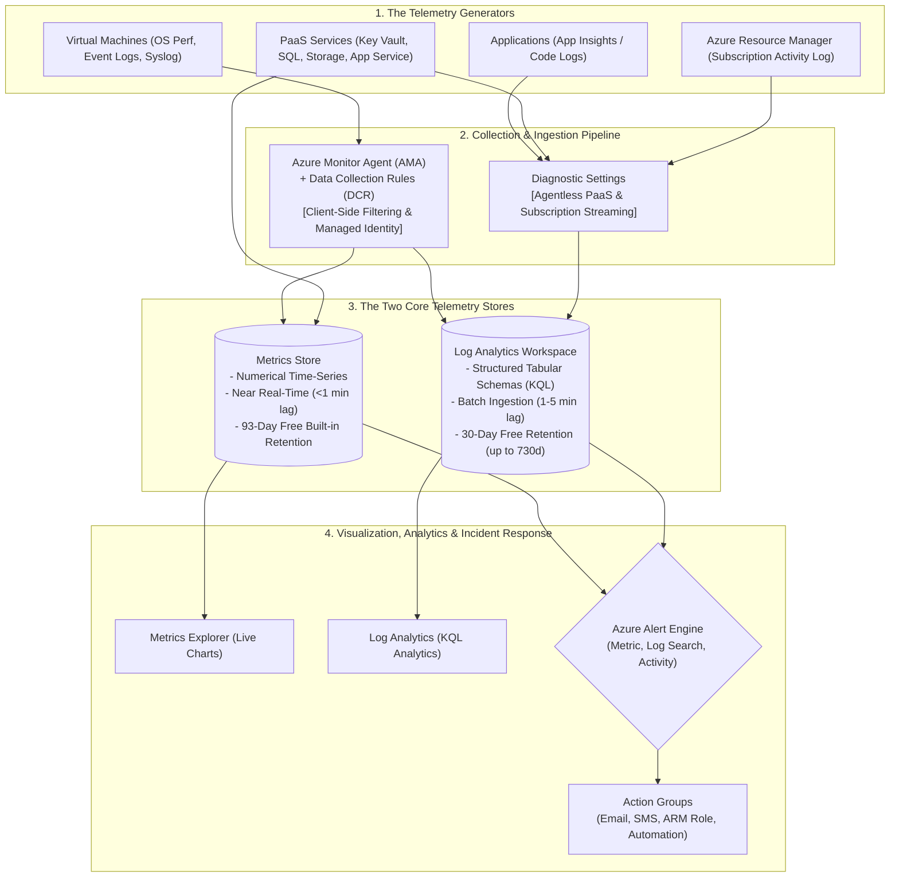

# Module 13-104-12: Administer Monitoring, Azure Monitor, Log Analytics & Alerts

**Breadcrumbs:** [[13-Index - Azure|☁️ Azure Reference MOC]] > [[13-Index - AZ-104|📘 AZ-104 Exam Track]] > **12 - Administer Monitoring**

---

## 🎯 Executive Overview & The Observability Lecture

In on-premises computing, when a physical server crashes, an administrator walks into the server room, looks at the flashing amber LED on the chassis, connects a crash cart monitor, and reads the kernel panic or bluescreen. In modern cloud environments, you do not have physical access to Microsoft's datacenters. Your systems run across hundreds of hypervisors, microservices, load balancers, and managed PaaS backends. **If you cannot observe your infrastructure through telemetry, your cloud is completely invisible.**

Observability in Microsoft Azure is not a single product or toggle; it is an **integrated ecosystem called Azure Monitor**. This lecture builds the entire observability architecture progressively: starting from the physical and virtual data sources, separating numerical metrics from unstructured logs, routing through intelligent collection agents, analyzing via Kusto Query Language (KQL), configuring automated incident alerts, and guarding against runaway cloud billing.



---

## 🏛️ Stage 1: The Core Mental Model — Metrics vs. Logs

Before touching any service names, you must understand the two fundamental data types in Azure telemetry:

```text
+---------------------------------------------------------------------------------------------------+
|                               AZURE METRICS vs. AZURE LOGS (LOG ANALYTICS)                        |
+---------------------------------------------------------------------------------------------------+
| Dimension             | Azure Metrics                          | Azure Logs (Log Analytics)       |
+-----------------------+----------------------------------------+----------------------------------+
| What is it?           | Numerical, time-series data points     | Detailed, timestamped records    |
|                       | (e.g. CPU = 85.4%, Disk IOPS = 1,200)  | (e.g. Syslog, Windows Event 4625)|
+-----------------------+----------------------------------------+----------------------------------+
| Ingestion Latency     | Near Real-Time (< 1 minute)            | Batch latency (1 to 5 minutes)   |
+-----------------------+----------------------------------------+----------------------------------+
| Default Retention     | 93 Days (Included free, unchangeable)  | 30 Days (Included free, up to    |
|                       |                                        | 730 days interactive, 12y archive|
+-----------------------+----------------------------------------+----------------------------------+
| Primary Analysis Tool | Metrics Explorer (Visual Chart GUI)    | Log Analytics via KQL queries    |
+-----------------------+----------------------------------------+----------------------------------+
| Query Complexity      | Simple single-metric aggregations      | Complex multi-table joins, regex,|
|                       | (Avg, Min, Max, Total, Count)          | string parsing, aggregations     |
+-----------------------+----------------------------------------+----------------------------------+
| Alert Responsiveness  | Sub-minute evaluation (Ultra fast)     | Scheduled queries (every 5-15m)  |
+-----------------------+----------------------------------------+----------------------------------+
| Billing Model         | Platform metrics ingestion is FREE.    | Billed Pay-As-You-Go per GB      |
|                       | Alerts billed per active rule.         | ingested + retention > 30 days.  |
+-----------------------+----------------------------------------+----------------------------------+
```

### The Architectural Intuition:
*   Use **Metrics** when you need instant, real-time alerting on numerical hardware or platform health (e.g., autoscaling a VMSS when CPU > 75%, detecting network saturation, triggering failovers).
*   Use **Logs** when you need root-cause forensics, compliance audits, text pattern matching, or correlating multiple events across resources (e.g., finding which IP address executed 50 failed SSH logins followed by a successful admin password reset).

---

## 📜 Stage 2: Control Plane Auditing — The Azure Activity Log

Every time anyone—a human engineer in the Azure Portal, a DevOps pipeline using Terraform, or an automated script—interacts with Azure, they submit an HTTP request to the **Azure Resource Manager (ARM)** API gateway (`https://management.azure.com`).

The **Azure Activity Log** is the built-in control plane audit trail for your entire subscription:
*   **What it records:** Every create, update, delete, and action operation (HTTP `PUT`, `POST`, `DELETE`). Examples include: stopping a VM, modifying an NSG security rule, assigning an RBAC role, or deleting a storage container.
*   **What it NEVER records:** Read operations (HTTP `GET`). Merely viewing a list of virtual machines or downloading a blob does **not** generate an Activity Log entry.
*   **Built-in Retention:** Kept for **90 days free of charge**. You cannot change this slider in the Activity Log blade.
*   **The 365-Day Compliance Trap (AZ-104 Exam Classic):**
    If an auditor requires Activity Logs to be queryable for 1 year (365 days):
    *   *Wrong Answer:* Change retention in the Activity Log settings (impossible, fixed at 90 days).
    *   *Wrong Answer:* Archive solely to a Storage Account (satisfies retention, but cannot run ad-hoc KQL queries from the portal).
    *   *Correct Answer:* Create a **Subscription-Level Diagnostic Setting** and export Activity Logs to a **Log Analytics Workspace**.

---

## 🤖 Stage 3: Host Observability — Modern AMA vs. Legacy MMA

Virtual machines have an operating system boundary. The Azure hypervisor can measure external metrics (CPU percentage, disk read bytes, network out), but it cannot see inside the OS kernel (free RAM, running Windows services, Linux Syslog, or application crashes). To capture internal OS telemetry, you must deploy an in-guest agent.

### The Agent Revolution (August 2024 Transition)
Microsoft formally **retired the legacy Microsoft Monitoring Agent (MMA / OMS / Log Analytics Agent) in August 2024**. The modern enterprise standard is the **Azure Monitor Agent (AMA)**:

| Architectural Vector | Legacy Agent (MMA / OMS) [RETIRED] | Modern Agent (Azure Monitor Agent - AMA) |
| :--- | :--- | :--- |
| **Agent Executable** | `MicrosoftMonitoringAgent` / `OmsAgentForLinux` | `AzureMonitorWindowsAgent` / `AzureMonitorLinuxAgent` |
| **Configuration Model** | Workspace-centric (Pushed universally to all VMs) | **Rule-centric via Data Collection Rules (DCRs)** |
| **Source Filtering** | ❌ Minimal; streams all logs, inflating bills | ✅ **Client-side XPath & facility filtering** drops unwanted logs *before* transmission |
| **Authentication** | Shared Workspace ID & Primary Secret Key | **Managed Identity** (System or User-Assigned) |
| **Multi-Homing** | Windows only (Linux was single-workspace) | ✅ Native multi-homing to multiple workspaces on both Linux and Windows |

### Data Collection Rules (DCR): The FinOps Game-Changer
A Data Collection Rule (`Microsoft.Insights/dataCollectionRules`) separates **what to collect** from **where to send it**:
1.  **Data Sources:** Performance counters (CPU, RAM, Disk), Windows Event Logs (Application, System, Security), Linux Syslog facilities (`auth`, `daemon`, `kern`).
2.  **Client-Side Filtering via XPath:** Instead of streaming millions of harmless Informational events into your workspace, an XPath query like:
    ```xpath
    Application!*[System[(Level=1 or Level=2)]]
    System!*[System[(Level=1 or Level=2)]]
    ```
    instructs the agent to **discard everything except Critical (1) and Error (2) events** directly in OS memory before transmission. This single configuration frequently cuts enterprise Log Analytics ingestion bills by **up to 80%**!
3.  **Destinations:** Route to Log Analytics Workspaces, Azure Monitor Metrics, or Event Hubs.
4.  **Associations (DCRA):** The DCR is bound to specific virtual machines or Scale Sets. When a VM is associated with a DCR, Azure **automatically installs the AMA extension** via Managed Identity—no manual installation scripts required!

---

## ⚡ Stage 4: PaaS Monitoring — Diagnostic Settings

Platform-as-a-Service (PaaS) offerings (such as Azure App Services, Azure SQL, Key Vaults, and Application Gateways) are fully managed by Microsoft; there is no accessible OS to install an agent.

PaaS telemetry is collected exclusively through **Diagnostic Settings**:
*   **Source:** The PaaS resource.
*   **Log Categories:** Service-specific tables. For an App Service: `AppServiceHTTPLogs` (inbound requests and HTTP status codes), `AppServiceConsoleLogs` (`stdout` and `stderr`), `AppServiceAppLogs` (application framework traces).
*   **Metric Categories:** `AllMetrics`.
*   **Destinations:**
    1.  **Log Analytics Workspace:** For interactive KQL troubleshooting and alerts.
    2.  **Azure Storage Account:** Low-cost cold archival for multi-year regulatory retention.
    3.  **Event Hub:** High-throughput streaming to external SIEM/SOAR platforms (Splunk, Datadog).

---

## 🏢 Stage 5: The Analytics Engine — Log Analytics Workspace & FinOps

A **Log Analytics Workspace** (`Microsoft.OperationalInsights/workspaces`) is the centralized repository and data engine where logs from VMs, PaaS services, and subscriptions are aggregated, indexed, and queried.

### FinOps & Controlling Runaway Ingestion Costs
In cloud monitoring, an unhandled application bug that logs stack traces in an infinite loop can ingest 500 GB in a few hours, resulting in massive unexpected charges. Azure provides strict financial guardrails:
1.  **Daily Volume Cap:** Inside the workspace (*Usage and estimated costs ➔ Daily cap*), set a ceiling (e.g. `1.0 GB/day` or `5.0 GB/day`). Once reached, the workspace automatically halts non-security log collection for the remainder of the UTC day.
2.  **Interactive Data Retention:** The first **30 days** of retention are included completely free. Retention can be extended up to **730 days (2 years)** on an interactive basis, and archived for up to **12 years**.
3.  **Basic vs. Analytics Table Plans:** High-volume, low-value debugging logs can be routed to **Basic Log Tables** (costing ~80% less per GB than Analytics tables) with 8 days of retention for ad-hoc debugging.
4.  **Capacity Reservations:** For enterprise environments ingesting **> 100 GB/day**, organizations reserve daily tiers (100 GB, 200 GB, 500 GB/day) for discounts up to 30–50% over Pay-As-You-Go.

---

## 🔍 Stage 6: Analyzing Telemetry — Kusto Query Language (KQL)

Log Analytics uses **Kusto Query Language (KQL)**. KQL is read-only, fast, and structured like a data pipeline using the pipe character (`|`), where the output of one command flows into the input of the next.

```text
TableName
| filter step    (where)
| group/calc     (summarize)
| shape/project  (project)
| sort/visualize (sort / render)
```

### Essential KQL Production Recipes for AZ-104

#### 1. Checking VM Agent Connectivity (Heartbeat)
```kusto
Heartbeat
| where TimeGenerated >= ago(1h)
| summarize LastHeartbeat = max(TimeGenerated) by Computer, OSType, Version
| where LastHeartbeat < ago(15m)
| sort by LastHeartbeat desc
```
*Purpose:* Identifies servers that have stopped reporting to Azure Monitor in the last 15 minutes.

#### 2. Calculating Average CPU across VMs in 15-Minute Buckets
```kusto
Perf
| where TimeGenerated >= ago(4h)
| where ObjectName == "Processor" and CounterName == "% Processor Time" and InstanceName == "_Total"
| summarize AvgCPU = avg(CounterValue), MaxCPU = max(CounterValue) by Computer, bin(TimeGenerated, 15m)
| where AvgCPU > 80
| render timechart
```
*Purpose:* Visualizes CPU saturation trends and generates an interactive line chart right in the portal.

#### 3. Identifying Volumes with Low Disk Space (< 15%)
```kusto
Perf
| where TimeGenerated >= ago(1h)
| where ObjectName == "LogicalDisk" and CounterName == "% Free Space"
| where InstanceName !contains "_" and InstanceName !contains "Harddisk"
| summarize CurrentFree = arg_max(TimeGenerated, CounterValue) by Computer, Drive = InstanceName
| where CounterValue < 15
| project Computer, Drive, FreePercent = CounterValue
```
*Purpose:* Pinpoints specific drive letters running out of storage space.

#### 4. Auditing Failed Resource Operations in Activity Logs
```kusto
AzureActivity
| where TimeGenerated >= ago(7d)
| where ActivityStatusValue in ("Failed", "Failure")
| project TimeGenerated, Caller, OperationNameValue, ResourceGroup, ActivitySubstatusValue
| sort by TimeGenerated desc
```
*Purpose:* Reveals who triggered an operation that failed ARM validation.

---

## 🚨 Stage 7: Automated Incident Response — Alert Rules & Action Groups

Observability is incomplete without automated response. The **Azure Alert Engine** monitors telemetry and initiates actions when thresholds are breached.

```text
[ 1. Scope ]       Target VM, Resource Group, Subscription, or Log Analytics Workspace
     │
     ▼
[ 2. Condition ]   Metric Alert (Numerical) vs. Log Search Alert (KQL) vs. Activity Log Event
     │
     ▼
[ 3. Actions ]     Action Group (Email, SMS, ARM Role Receiver, Webhook, Logic App, Runbook)
     │
     ▼
[ 4. Details ]     Severity (Sev 0 Critical -> Sev 4 Verbose) + Evaluation Frequency
```

### The Severity Scale
*   **Sev 0 (Critical):** Catastrophic business outage (Production database offline, core network unreachable).
*   **Sev 1 (Error):** Major service degradation (CPU > 90% for 15 mins, HTTP 500 error spike > 10%).
*   **Sev 2 (Warning):** Early warning indicator (Disk free space < 15%, memory pressure).
*   **Sev 3 (Informational):** Normal operational state change (Autoscale engine scaled out VMSS instances).
*   **Sev 4 (Verbose):** Low-level debug and diagnostic traces.

### Action Groups & The ARM Role Receiver
An **Action Group** (`Microsoft.Insights/actionGroups`) is a reusable collection of notification channels:
*   **Direct Notifications:** Email, SMS, Azure Mobile App Push, Voice call.
*   **The ARM Role Receiver (Exam Gold):**
    Configures alerts to notify anyone holding a specific RBAC role (e.g. `Owner`, `Contributor`, `Monitoring Reader`) on the subscription. When new team members are onboarded, they automatically receive incident emails with zero maintenance on the Action Group!
*   **Automated Remediation:**
    *   *Azure Automation Runbook:* Executes PowerShell/Python scripts to restart a stopped service or clear temp files.
    *   *Azure Logic App / Function:* Triggers serverless orchestration workflows or opens tickets in ServiceNow/Jira.
    *   *Secure Webhook:* Pushes incident JSON payloads to Slack, Microsoft Teams, or PagerDuty.

### Alert Processing Rules (Maintenance Windows)
During scheduled weekend maintenance or database patching, hundreds of false-positive alerts fire. An **Alert Processing Rule** is configured to **Suppress notifications** during specific maintenance windows. The alerts are still logged for auditing, but engineers are not paged!

---

## 🖥️ Stage 8: Step-by-Step Azure Portal GUI Walkthrough

To connect theory to your actual screen, follow this navigation path in the Azure Portal:

```
Azure Portal Navigation Path
 1. Search Bar ➔ "Monitor"
    ├── Activity log ➔ Click "Export Activity Logs" ➔ "+ Add diagnostic setting" (Subscription audit)
    ├── Log Analytics workspaces ➔ "+ Create" (Basics ➔ Region East US ➔ Create)
    │     ├── Settings ➔ "Usage and estimated costs" ➔ "Daily cap" (Set 1.0 GB)
    │     └── Settings ➔ "Data retention" (30 days free slider)
    ├── Data Collection Rules ➔ "+ Create"
    │     ├── Resources tab ➔ Select VMs (Installs AMA automatically)
    │     └── Collect and deliver tab ➔ Performance counters + Custom XPath (Level=1 or 2)
    ├── Logs ➔ Write KQL query ➔ Click "▶ Run" ➔ Click "[Chart]" tab
    ├── Metrics ➔ Select Scope (VM) ➔ Metric (Percentage CPU) ➔ Aggregation (Avg)
    └── Alerts ➔ "Create" ➔ "Alert rule" ➔ Condition (CPU > 80%) ➔ Action Group (ARM Role: Owner)
```

---

## 🔬 Hands-On Enterprise Lab Bridge

To build and verify this entire architecture hands-on, execute the complete production lab in your workspace:

👉 **Corresponding Hands-On Lab:** [[Projects/AZ-104/12_Monitoring_Observability_and_FinOps/Lab-12_Full_Stack_Observability_AMA_KQL_and_Alert_Suppression|Lab 12: Full Stack Observability, AMA, KQL & Alert Suppression]]

### Lab Deliverables in `Lab-12`:
1.  **Task 1:** Provision a centralized Log Analytics Workspace with a FinOps 1.0 GB Daily Cap.
2.  **Task 2:** Deploy the Azure Monitor Agent (AMA) and configure Data Collection Rules with XPath filtering.
3.  **Task 3:** Configure PaaS Diagnostic Settings streaming to Log Analytics.
4.  **Task 4:** Deploy multi-channel Action Groups with ARM Role receivers and email dispatch.
5.  **Task 5:** Execute synthetic Linux CPU stress drills (`stress-ng`) and observe real-time state transition from `Healthy` to `Fired`.
6.  **Task 6:** Configure Alert Processing Rules for scheduled maintenance window notification suppression.

---

## ⚠️ "See It in Action" Real-World Failure & Recovery Loop (AARF)

### Scenario: The 10-Minute Alert Delay Outage
*   **The Assumption:** An SRE team writes an alert rule on CPU utilization using a KQL Scheduled Query against the `Perf` table evaluated every 5 minutes. They assume this will notify them immediately when a CPU spike occurs.
*   **The Architecture:**
    `VM Host` ➔ `Azure Monitor Agent (AMA)` ➔ `Batch HTTPS Transmission` ➔ `Log Analytics Ingestion Pipeline` ➔ `Perf Table Indexing` ➔ `Scheduled Query Rule (KQL)` ➔ `Action Group`.
*   **The Root Cause Failure:**
    *   CPU spikes to 100% at `12:00:00`.
    *   The AMA agent batches telemetry locally for 2 minutes before uploading.
    *   The Log Analytics ingestion pipeline takes 3 minutes to index the batch into columnar storage.
    *   The Scheduled Query fires at `12:05:00`, querying data with a 5-minute lookback window; the newly arriving records have not finished committing.
    *   The alert finally triggers at `12:10:00`—**10 full minutes after the outage began**, violating their 3-minute SLA and causing customer transactions to fail!
*   **The Live Remediation:**
    *   For low-latency infrastructure metrics (CPU, RAM, Network), **always configure Metric Alert Rules**, which query the streaming time-series pipeline with sub-minute latency.
    *   Reserve **Log Search Alerts** for text pattern searches, error logs, and multi-table security correlations where 5–15 minute evaluation is acceptable.

---

## 💡 High-Yield AZ-104 Exam Scenarios & Trick Traps

> [!TIP]
> **Activity Log 90-Day Retention Trap:**
> - Azure Activity Logs are kept for **90 days** free of charge.
> - If an exam scenario states: *"An auditor requires all administrative change events for the past 365 days to be queryable with SQL or KQL"*, the correct answer is: **Export Activity Logs using a Diagnostic Setting to a Log Analytics Workspace**.
> - Archiving solely to a Storage Account satisfies retention compliance, but does **not** allow immediate ad-hoc KQL querying from the portal.

> [!WARNING]
> **MMA Deprecation & Exam Terminology:**
> - While Microsoft retired the Microsoft Monitoring Agent (MMA/OMS) in August 2024, older AZ-104 exam pools may still refer to the Log Analytics Agent or MMA.
> - For modern questions, always select **Azure Monitor Agent (AMA)** with **Data Collection Rules (DCRs)** and **Azure Arc**.

> [!IMPORTANT]
> **Dynamic Thresholds for Cyclic / Seasonal Workloads:**
> - When an exam question describes workloads with high daytime traffic and low nighttime traffic, static metric thresholds (e.g., fixed 80% CPU) produce false positives at night or fail to detect anomalies during peak daytime hours.
> - The correct answer is to use **Dynamic Thresholds**, which leverage machine learning to establish dynamic baseline boundaries.

---

## 🌐 Authoritative References & Citations

- [Microsoft Learn: Design and implement a monitoring strategy on Azure](https://learn.microsoft.com/en-us/training/modules/design-monitoring-strategy-on-azure/)
- [Microsoft Learn: Monitor and configure Azure resources with Azure Monitor](https://learn.microsoft.com/en-us/training/modules/monitor-azure-resources-with-azure-monitor/)
- [Azure Monitor Architecture & Platform Documentation](https://docs.microsoft.com/en-us/azure/azure-monitor/)
- [Azure Monitor Agent (AMA) Overview & Migration](https://learn.microsoft.com/en-us/azure/azure-monitor/agents/azure-monitor-agent-overview)
- [Log Analytics Workspace Pricing and Commitment Tiers](https://azure.microsoft.com/en-us/pricing/details/monitor/)
- [John Savill: Azure Master Class v2 - Module 10 - Monitoring & Security](https://www.youtube.com/playlist?list=PLlVtbbG169nGlGPWs9xaLKT1KfwqREHbs)
- [KodeKloud AZ-104 Course - Administer Monitoring Module](https://notes.kodekloud.com/docs/Updated-AZ-104-Microsoft-Azure-Administrator/Administer-Monitoring/Module-Introduction/page.md)
- [Moe Intelligence AZ-104 Video Series (Lessons 35, 37–40)](https://www.youtube.com/playlist?list=PLczK3J2J4clmeh328CC13dJrcALcSFZFb)
- Udemy AZ-104 Microsoft Azure Administrator Course by Scott Duffy ([Inflow: Module 10](file:///F:/Dump%20one/BrainDump/inflow/AZ-104-ScottDuffy/10_Administer_Monitoring_and_Log_Analytics.md))
