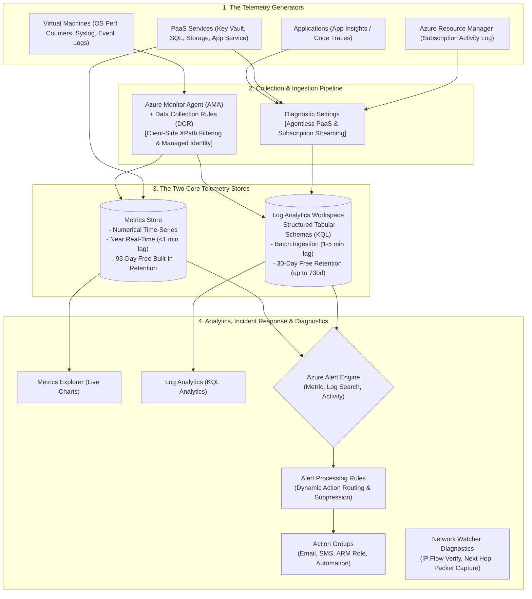

# Module 13-104-12: Administer Monitoring, Azure Monitor, Log Analytics, Alerts & Network Watcher

**Breadcrumbs:** [[13-Index - Azure|☁️ Azure Reference MOC]] > [[13-Index - AZ-104|📘 AZ-104 Exam Track]] > **12 - Administer Monitoring**

---

## 🎯 Stage 1: Executive Overview & The Observability Lecture

### 1. The Zero-Knowledge Starting Point: Why Cloud Observability Matters
In traditional on-premises IT, when a physical server crashes, an administrator walks into the server room, looks at the flashing amber LED on the chassis, connects a crash cart monitor, and reads the kernel panic or bluescreen. In modern cloud environments, you do not have physical access to Microsoft's datacenters. Your systems run across hundreds of hypervisors, microservices, load balancers, and managed PaaS backends. **If you cannot observe your infrastructure through telemetry, your cloud is completely invisible.**

Observability in Microsoft Azure is not a single product or toggle; it is an **integrated ecosystem called Azure Monitor**. This lecture builds the entire observability architecture progressively: starting from the physical and virtual data sources, separating numerical metrics from unstructured logs, routing through intelligent collection agents (AMA), analyzing via Kusto Query Language (KQL), configuring automated incident alerts and alert processing rules, and diagnosing SDN connectivity using Network Watcher.



---

### 2. Terminology Matrix: Zero-Knowledge to Enterprise Architect

| Terminology | What It Means to a Beginner | Real-World Analog | Enterprise Architecture Reality |
| :--- | :--- | :--- | :--- |
| **Azure Monitor** | The central dashboard watching everything in Azure. | The central mission control room for the entire space station. | The umbrella observability platform ingesting, storing, and analyzing metrics, logs, and traces across Azure and hybrid clouds. |
| **Metrics** | Real-time numbers tracking system performance. | A car's speedometer and fuel gauge updating every second. | Lightweight, numerical, time-series data points with sub-minute ingestion latency, retained for 93 days free of charge. |
| **Logs (Log Analytics)** | Detailed timestamped text records of what happened. | A ship's captain's log recording every event, order, and maintenance action. | High-fidelity tabular event records stored in a Log Analytics workspace, queryable via Kusto Query Language (KQL). |
| **Activity Log** | A diary of who did what to your cloud resources. | A building entrance security sign-in sheet recording who visited and what they carried. | Control plane audit trail recording all ARM operations (create, update, delete) across a subscription, retained for 90 days. |
| **Azure Monitor Agent (AMA)** | A software spy running inside your virtual machine. | A telemetry sensor mounted inside a race car engine transmitting diagnostic codes. | Unified VM extension replacing legacy MMA, authenticating via Managed Identity and configured using Data Collection Rules. |
| **Data Collection Rule (DCR)** | A recipe telling the agent what data to collect and where to send it. | A packing list telling a warehouse worker which boxes to ship and which to discard. | An ARM resource defining data sources (perf counters, syslog, event logs), client-side XPath filters, and destinations. |
| **Action Group** | A phone tree of people to notify when something breaks. | An automated fire alarm dispatching the fire department, police, and building owner. | Reusable notification and remediation container (Email, SMS, Push, Voice, ARM Role receiver, Webhook, Logic App, Runbook). |
| **Alert Processing Rule** | Rules that intercept alerts and redirect or silence them. | A "Do Not Disturb" sign hung on a hotel door during scheduled sleeping hours. | Post-alert routing engine that dynamically applies action groups or suppresses notifications during maintenance windows. |
| **Network Watcher** | A network diagnostic toolkit for Azure SDN. | A mechanic's OBD scanner plugged into an engine to detect why fuel isn't flowing. | Regional SDN diagnostic suite providing IP Flow Verify, Next Hop, Connection Troubleshoot, Packet Capture, and NSG Flow Logs. |

---

## 🏛️ Stage 2: Core Mental Model & Component Architecture

### 1. Azure Metrics vs. Azure Logs (The Telemetry Divide)
Understanding when to use Metrics versus Logs is fundamental for system performance and FinOps cost control:

```text
+---------------------------------------------------------------------------------------------------+
|                               AZURE METRICS vs. AZURE LOGS (LOG ANALYTICS)                        |
+---------------------------------------------------------------------------------------------------+
| Dimension             | Azure Metrics                          | Azure Logs (Log Analytics)       |
+-----------------------+----------------------------------------+----------------------------------+
| What is it?           | Numerical, time-series data points     | Detailed, timestamped records    |
|                       | (e.g. CPU = 85.4%, Disk IOPS = 1,200)  | (e.g. Syslog, Windows Event 4625)|
+-----------------------+----------------------------------------+----------------------------------+
| Ingestion Latency     | Near Real-Time (< 1 minute)            | Batch latency (1 to 5 minutes)   |
+-----------------------+----------------------------------------+----------------------------------+
| Default Retention     | 93 Days (Included free, unchangeable)  | 30 Days (Included free, up to    |
|                       |                                        | 730 days interactive, 12y archive|
+-----------------------+----------------------------------------+----------------------------------+
| Primary Analysis Tool | Metrics Explorer (Visual Chart GUI)    | Log Analytics via KQL queries    |
+-----------------------+----------------------------------------+----------------------------------+
| Query Complexity      | Simple single-metric aggregations      | Complex multi-table joins, regex,|
|                       | (Avg, Min, Max, Total, Count)          | string parsing, aggregations     |
+-----------------------+----------------------------------------+----------------------------------+
| Alert Responsiveness  | Sub-minute evaluation (Ultra fast)     | Scheduled queries (every 5-15m)  |
+-----------------------+----------------------------------------+----------------------------------+
| Billing Model         | Platform metrics ingestion is FREE.    | Billed Pay-As-You-Go per GB      |
|                       | Alerts billed per active rule.         | ingested + retention > 30 days.  |
+-----------------------+----------------------------------------+----------------------------------+
```

---

### 2. Control Plane Auditing: The Azure Activity Log
Every administrative action executed against Azure Resource Manager (ARM API: `https://management.azure.com`) is permanently logged:
* **What it records:** Operations that create, update, or delete resources (HTTP `PUT`, `POST`, `DELETE`). Examples: stopping a VM, creating an NSG rule, modifying an RBAC role assignment.
* **What it NEVER records:** Read operations (HTTP `GET`). Simply listing resources or viewing a configuration generates zero Activity Log entries.
* **Built-in Retention:** Kept for **90 days free of charge**.
* **The 365-Day Compliance Rule:** If an auditor requires Activity Logs to be queryable via KQL for 1 year (365 days), you **MUST create a Subscription-Level Diagnostic Setting** and stream Activity Logs to a **Log Analytics Workspace**!

---

### 3. Modern Host Observability: Azure Monitor Agent (AMA) vs. Legacy MMA
Microsoft formally retired the legacy Microsoft Monitoring Agent (MMA / OMS / Log Analytics Agent) in August 2024. The modern enterprise standard is the **Azure Monitor Agent (AMA)**:

```text
+-------------------------------------------------------------------------------------------------+
|                               AMA vs. LEGACY MMA ARCHITECTURAL COMPARISON                       |
+-------------------------------------------------------------------------------------------------+
| Vector                 | Legacy Agent (MMA / OMS) [RETIRED]    | Modern Azure Monitor Agent (AMA) |
+------------------------+---------------------------------------+----------------------------------+
| Configuration Model    | Workspace-centric (Monolithic push)   | Rule-centric via DCRs            |
| Client-Side Filtering  | ❌ None (Streams all noise to cloud)  | ✅ Custom XPath filters drop logs|
| Authentication         | Workspace ID + Static Primary Key     | **Managed Identity** (Zero Keys!)|
| Multi-Homing           | Windows only                          | Native Windows and Linux         |
| Hybrid Cloud Support   | Basic                                 | Built-in via **Azure Arc**       |
+-------------------------------------------------------------------------------------------------+
```

#### Data Collection Rules (DCR) Client-Side Filtering (FinOps Optimization):
Instead of streaming millions of harmless Informational events into your workspace, a DCR XPath filter:
```xpath
Application!*[System[(Level=1 or Level=2)]]
System!*[System[(Level=1 or Level=2)]]
```
instructs the agent to **discard everything except Critical (Level 1) and Error (Level 2) events** directly inside host memory before transmission, slashing cloud ingestion bills by **up to 80%**!

---

### 4. Log Analytics Workspace Table Plans & FinOps Guardrails
A Log Analytics Workspace (`Microsoft.OperationalInsights/workspaces`) provides strict financial controls to prevent runaway telemetry bills:
1. **Analytics Tables:** Standard interactive tables supporting the full KQL query spectrum, joins, and alerting. Includes 30 days free retention; retention expandable up to 730 days (2 years).
2. **Basic Tables:** Designed for high-volume, low-value debugging logs (e.g., container console logs, firewall packet logs). Costs ~80% less per GB than Analytics tables; offers 8 days of retention for ad-hoc troubleshooting.
3. **Archive Tier:** Retains logs for up to **12 years** at deep cold storage pricing for regulatory compliance (HIPAA, PCI-DSS, SEC).
4. **Daily Volume Cap:** Configures a strict daily ceiling (e.g., `5.0 GB/day`). Once reached, non-security log ingestion automatically halts for the rest of the UTC day, protecting your budget from rogue application logging loops!

---

## 🏢 Stage 3: Deep-Intuition Platform Mechanics & Topology

### 1. Alert Rules & The Three-Tier Alert Architecture

```text
[ 1. Telemetry Stream ]  Metrics Store, Log Analytics Workspace, or Activity Log
          │
          ▼
[ 2. Alert Rule Condition ]
  ├── A. Metric Alert: Threshold comparison (e.g., CPU > 80% for 5 mins). Sub-minute evaluation.
  ├── B. Log Search Alert: KQL scheduled query (e.g., > 10 failed logins in 15 mins).
  └── C. Activity Log Alert: ARM event trigger (e.g., VM Deallocate initiated).
          │ (When Condition is True)
          ▼
[ 3. Alert Processing Rules ] (Optional Intermediary Routing / Suppression Engine)
  ├── Action A: Suppress notifications (Scheduled weekend maintenance window)
  └── Action B: Dynamically route to specific Action Group based on severity or resource tag
          │
          ▼
[ 4. Action Group Dispatch ]
  ├── Direct Notification: Email, SMS, Voice, Azure Mobile App Push
  ├── Role-Based Notification: ARM Role Receiver (Owner, Contributor, Monitoring Reader)
  └── Automated Remediation: Automation Runbook, Logic App, Azure Function, Secure Webhook
```

#### The ARM Role Receiver (High-Yield Exam Core):
Instead of hardcoding personal engineer email addresses into Action Groups (which breaks whenever employees leave the company), configure an **ARM Role Receiver**:
* Target the **Owner**, **Contributor**, or **Monitoring Reader** role at the subscription or resource group scope.
* Whenever a new engineer is granted that RBAC role, they **automatically begin receiving alert notifications** with zero maintenance required on the Action Group!

---

### 2. Network Watcher Diagnostic Toolkit (SDN Diagnostics)
Azure Network Watcher provides granular diagnostic tools to isolate packet drops across Azure Software Defined Networking:

```text
+-------------------------------------------------------------------------------------------------+
|                                 AZURE NETWORK WATCHER TOOLKIT                                   |
+-------------------------------------------------------------------------------------------------+
|  1. IP Flow Verify          |  2. Next Hop                 |  3. Connection Troubleshoot        |
+-----------------------------+------------------------------+------------------------------------+
| - Checks: Is a 5-tuple      | - Checks: Where is Azure's   | - Checks: End-to-end TCP latency   |
|   packet allowed by NSGs?   |   SDN routing this packet?   |   and hop-by-hop packet drops.     |
| - Output: "Access Allowed"  | - Output: "Next Hop Type:    | - Output: Visual topological path  |
|   or "Access Denied by      |   VirtualAppliance (10.0.1.4)|   with latency in milliseconds and |
|   Rule: Custom-Deny-100"    |   or 'None' (Blackhole!)"    |   firewall drop indicators.        |
+-----------------------------+------------------------------+------------------------------------+
|  4. Packet Capture          |  5. NSG Flow Logs & Traffic  |  6. Effective Security Rules       |
+-----------------------------+------------------------------+------------------------------------+
| - Remotely captures .pcap   | - Streams flow metadata to   | - Displays the merged evaluation   |
|   traces on live VM disks   |   Storage & Log Analytics    |   of Subnet NSG + NIC NSG rules    |
|   without logging in!       |   with Layer 7 geo-mapping.  |   with winning priority rankings.  |
+-------------------------------------------------------------------------------------------------+
```

---

## 🔍 Stage 4: Kusto Query Language (KQL) Production Recipes

KQL is read-only, fast, and structured like a data pipeline using the pipe character (`|`):

### 1. VM Availability & Heartbeat Health Check
```kusto
Heartbeat
| where TimeGenerated >= ago(1h)
| summarize LastHeartbeat = max(TimeGenerated) by Computer, OSType, Version
| where LastHeartbeat < ago(15m)
| sort by LastHeartbeat desc
```
*Purpose:* Identifies virtual machines that have stopped reporting telemetry in the last 15 minutes.

### 2. Identifying Low Disk Space Across Fleet (< 15% Free)
```kusto
Perf
| where TimeGenerated >= ago(1h)
| where ObjectName == "LogicalDisk" and CounterName == "% Free Space"
| where InstanceName !contains "_" and InstanceName !contains "Harddisk"
| summarize CurrentFree = arg_max(TimeGenerated, CounterValue) by Computer, Drive = InstanceName
| where CounterValue < 15
| project Computer, Drive, FreePercent = CounterValue
```
*Purpose:* Pinpoints volumes running out of disk space before application crashes occur.

### 3. Auditing Failed ARM Administrative Operations
```kusto
AzureActivity
| where TimeGenerated >= ago(7d)
| where ActivityStatusValue in ("Failed", "Failure")
| project TimeGenerated, Caller, OperationNameValue, ResourceGroup, ActivitySubstatusValue
| sort by TimeGenerated desc
```
*Purpose:* Reveals who triggered an administrative action that failed ARM validation.

---

## ⚙️ Stage 5: Declarative & Automation Engine (CLI & PowerShell Core)

### 1. Azure CLI: Provision Log Analytics, Daily Cap & Diagnostic Settings

```bash
# ==============================================================================
# 1. CREATE LOG ANALYTICS WORKSPACE WITH FINOPS DAILY CAP
# ==============================================================================
RG_NAME="rg-monitoring-prod"
LOCATION="eastus"
WORKSPACE_NAME="law-enterprise-prod"

az monitor log-analytics workspace create \
  --resource-group "${RG_NAME}" \
  --workspace-name "${WORKSPACE_NAME}" \
  --location "${LOCATION}" \
  --retention-time 30 \
  --sku "PerGB2018"

# Set FinOps Daily Volume Cap to 2.0 GB/day to prevent runaway billing
az monitor log-analytics workspace update \
  --resource-group "${RG_NAME}" \
  --workspace-name "${WORKSPACE_NAME}" \
  --quota 2.0

# ==============================================================================
# 2. CREATE REUSABLE ACTION GROUP WITH ARM ROLE RECEIVER
# ==============================================================================
az monitor action-group create \
  --resource-group "${RG_NAME}" \
  --name "ag-sre-incident-team" \
  --short-name "sre-alerts" \
  --arm-role-receivers name="SubscriptionOwners" role-id="8e3af657-a8ff-443c-a75c-2fe8c4bcb635" use-common-alert-schema=true

# ==============================================================================
# 3. CREATE HIGH-SEVERITY METRIC ALERT RULE (CPU > 85%)
# ==============================================================================
SUB_ID=$(az account show --query id -o tsv)
ACTION_GROUP_ID="/subscriptions/${SUB_ID}/resourceGroups/${RG_NAME}/providers/Microsoft.Insights/actionGroups/ag-sre-incident-team"

az monitor metrics alert create \
  --resource-group "${RG_NAME}" \
  --name "alert-high-cpu-prod" \
  --scopes "/subscriptions/${SUB_ID}/resourceGroups/${RG_NAME}/providers/Microsoft.Compute/virtualMachines/vm-app-primary" \
  --condition "avg Percentage CPU > 85" \
  --window-size 5m \
  --evaluation-frequency 1m \
  --severity 1 \
  --action "${ACTION_GROUP_ID}"
```

---

## 🖥️ Stage 6: Step-by-Step Azure Portal GUI Walkthrough

### Task 1: Setting Up a Log Analytics Workspace with Daily Cap
1. In the top search bar, type **Log Analytics workspaces** and select it.
2. Click **+ Create**:
   - **Resource group:** `rg-monitoring-prod`.
   - **Name:** `law-enterprise-prod`.
   - **Region:** `East US`.
3. Click **Review + create** $\rightarrow$ **Create**.
4. Open `law-enterprise-prod`:
   - Under **Settings**, click **Usage and estimated costs**.
   - Click **Daily cap** on the top command bar $\rightarrow$ toggle **On** $\rightarrow$ enter `2.0` GB/day $\rightarrow$ click **OK**.

### Task 2: Creating an Action Group with ARM Role Receiver
1. In the top search bar, type **Monitor** $\rightarrow$ select **Alerts** in the left menu.
2. Click **Action groups** on the top toolbar $\rightarrow$ click **+ Create**:
   - **Resource group:** `rg-monitoring-prod`.
   - **Action group name:** `ag-operations-core`.
   - **Display name:** `ops-core`.
3. In the **Notifications** tab:
   - *Notification type:* Select **Email Azure Resource Manager Role**.
   - *Name:* `Notify-Owners`.
   - *Role:* Select **Owner**.
   - *Enable the common alert schema:* Select **Yes**.
4. Click **Review + create** $\rightarrow$ **Create**.

### Task 3: Configuring an Alert Processing Rule to Suppress Maintenance Alerts
1. In Azure Monitor $\rightarrow$ click **Alerts** $\rightarrow$ click **Alert processing rules**.
2. Click **+ Create**:
   - **Scope:** Select your resource group `rg-monitoring-prod`.
   - In the **Rule settings** tab:
     - Select **Suppress notifications**.
   - In the **Scheduling** tab:
     - Select **Recurring**.
     - Set to recur every Sunday from `02:00` to `04:00` UTC.
3. Click **Review + create** $\rightarrow$ **Create**.

---

## 🔬 Stage 7: Hands-On Enterprise Lab Bridge

To apply these monitoring principles, deploy the Azure Monitor Agent, configure DCR client-side filtering, and execute synthetic stress drills, proceed directly to the comprehensive practical lab:

> [!TIP]
> **Practical Implementation Companion:**
> Access the comprehensive engineering lab at:
> **[[Lab-12_Full_Stack_Observability_AMA_KQL_and_Alert_Suppression|Lab 12: Full Stack Observability, AMA, KQL & Alert Suppression]]**
> 
> *Target Lab File:* `Projects/AZ-104/12_Monitoring_Observability_and_FinOps/Lab-12_Full_Stack_Observability_AMA_KQL_and_Alert_Suppression.md`

### Lab Objectives Matrix:

```text
+-----------------------------------------------------------------------------------------+
| Lab 12 Enterprise Milestone Goals                                                       |
+-----------------------------------------------------------------------------------------+
| 1. Deploy a Log Analytics Workspace and configure a FinOps 1.0 GB Daily Volume Cap      |
| 2. Provision Data Collection Rules (DCR) with XPath filtering to suppress noisy events  |
| 3. Deploy multi-channel Action Groups with ARM Role receivers and email dispatch        |
| 4. Execute Linux CPU stress testing (`stress-ng`) and audit live alert state changes   |
| 5. Configure Alert Processing Rules for scheduled maintenance notification suppression  |
+-----------------------------------------------------------------------------------------+
```

---

## ⚠️ Stage 8: "See It in Action" Real-World Failure & Recovery Loop (AARF)

### Scenario: The "10-Minute Alert Delay" Outage

#### 1. The Architectural Setup & Assumptions
An SRE team monitors CPU utilization on critical payment-processing VMs. The engineer creates a **Log Search Alert Rule** running a scheduled KQL query against the `Perf` table evaluated every 5 minutes. The team assumes they will be paged immediately if CPU saturates.

#### 2. The Production Failure Manifestation
At `12:00:00`, a rogue query triggers a 100% CPU lockup on the VM. External customer checkouts fail immediately. However, the SRE team receives **zero alert notifications until 12:10:00**—ten full minutes after the outage began!

#### 3. Root Cause Analysis (RCA)
Why did the alert take 10 minutes to trigger?
1. **Agent Batching:** The in-guest agent batches telemetry in host memory for 2 minutes before uploading over HTTPS.
2. **Ingestion & Indexing Pipeline:** Log Analytics takes 2–3 minutes to parse, index, and commit records into columnar storage.
3. **Query Evaluation Schedule:** The scheduled log query ran at `12:05:00`, but because the newly arriving telemetry was still committing to disk, the records fell outside the query window. The alert did not catch the event until the next evaluation cycle at `12:10:00`!
4. **The Resolution Law:** For low-latency infrastructure alerting (CPU, RAM, network saturation), **always configure Metric Alerts** (near real-time sub-minute evaluation)! Reserve Log Search Alerts for complex pattern matching, text logs, and multi-table security audits.

---

## 💡 Stage 9: High-Yield AZ-104 Exam Scenarios & Trick Question Traps

### Trick Question Trap 1: Activity Log 90-Day Retention Trap
* **The Scenario:** An auditor requires all subscription administrative change events for the past 365 days to be queryable via KQL from the Azure Portal.
* **The Trap:** Should the administrator change the retention slider in the Activity Log blade or export to a storage account?
* **The Ground Truth:** You **CANNOT change retention in the Activity Log blade** (it is fixed at 90 days!). Exporting solely to a storage account satisfies retention compliance, but does NOT allow immediate ad-hoc KQL querying from the portal. The correct answer is to **create a Subscription-Level Diagnostic Setting and export Activity Logs to a Log Analytics Workspace**!

### Trick Question Trap 2: Dynamic Thresholds for Cyclic / Seasonal Workloads
* **The Scenario:** An e-commerce web application experiences high customer traffic during business hours (averaging 70% CPU) and minimal traffic at night (averaging 15% CPU). A static alert threshold of 80% misses nighttime anomalies, while a lower threshold triggers false alarms during the day.
* **The Question:** Which alert condition should you configure?
* **The Ground Truth:** Configure **Dynamic Thresholds**! Dynamic Thresholds leverage built-in machine learning algorithms to establish a dynamic baseline boundary that automatically adapts to historical cyclic patterns.

### Trick Question Trap 3: Suppressing Alerts During Maintenance Windows
* **The Scenario:** An operations team patches database servers every Saturday night. Management wants to prevent incident alerts from paging on-call staff during this window, while preserving the alert history for auditing.
* **The Trap:** Should the administrator disable the alert rules during maintenance?
* **The Ground Truth:** **NO!** Disabling alert rules creates manual overhead and risks forgetting to re-enable them. The correct solution is to create an **Alert Processing Rule** with the action set to **"Suppress notifications"** scheduled for the recurring maintenance window.

### Trick Question Trap 4: Network Watcher "IP Flow Verify" vs. "Effective Security Rules"
* **The Scenario:** A VM cannot reach an external database port. An administrator needs to quickly test if an inbound packet is allowed and determine which exact NSG rule is responsible.
* **The Trap:** Does Effective Security Rules execute active packet simulation?
* **The Ground Truth:** **No!** *Effective Security Rules* only displays a static table of merged subnet and NIC NSG rules. To perform an active packet test that simulates a 5-tuple flow and outputs an instant `Access Allowed` or `Access Denied` verdict with the winning rule name, use **Network Watcher IP Flow Verify**!

---

## 🌐 Authoritative References & Inflow Citations

* **Udemy AZ-104 Master Class by Scott Duffy:** [Inflow: Module 10 - Administer Monitoring and Log Analytics](file:///F:/Dump%20one/BrainDump/inflow/AZ-104-ScottDuffy/10_Administer_Monitoring_and_Log_Analytics.md)
* **John Savill’s Azure Master Class & Deep Dives:**
  - [Inflow: Module 10 - Monitoring & Security](file:///F:/Dump%20one/BrainDump/inflow/AZ-104-JohnSavill/25_Azure_Master_Class_v2_-_Module_10_-_Monitoring_&_Security.md) *(Azure Monitor Agent, DCR XPath filtering, Alert Processing Rules, Prometheus workspaces)*
* **Moe Intelligence AZ-104 Curriculum:** Lessons 35 through 40 *(Azure Monitor, Logs, Workbooks, Alerts, Action Groups, Pricing)*
* **KodeKloud AZ-104 Course:** [Administer Monitoring Module](https://notes.kodekloud.com/docs/Updated-AZ-104-Microsoft-Azure-Administrator/Administer-Monitoring/Module-Introduction/page.md)
* **Official Microsoft Learn Documentation:**
  - [Azure Monitor overview](https://learn.microsoft.com/en-us/azure/azure-monitor/overview)
  - [Azure Monitor Agent overview](https://learn.microsoft.com/en-us/azure/azure-monitor/agents/azure-monitor-agent-overview)
  - [Data Collection Rules in Azure Monitor](https://learn.microsoft.com/en-us/azure/azure-monitor/essentials/data-collection-rule-overview)
  - [Alert processing rules for Azure Monitor alerts](https://learn.microsoft.com/en-us/azure/azure-monitor/alerts/alerts-processing-rules)
  - [What is Azure Network Watcher?](https://learn.microsoft.com/en-us/azure/network-watcher/network-watcher-monitoring-overview)
