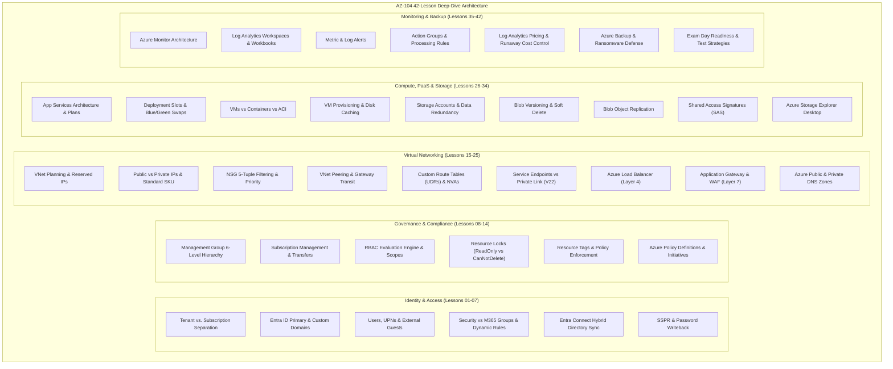

# Module 13-104-V: AZ-104 Deep-Dive Lectures & Real-World Builds (Moe Intelligence Series)

**Breadcrumbs:** [[13-Index - Azure|☁️ Azure Reference MOC]] > [[13-Index - AZ-104|📘 AZ-104 Exam Track]] > **AZ-104 Video Lecture Master Digest**

---

## 🎯 Executive Overview & Course Structure

This reference note compiles and synthesizes the complete 42-lesson technical video lecture series for **AZ-104: Microsoft Azure Administrator**, delivered by **Moe Intelligence** (*Arabic Full Courses: AZ-900 + AZ-104 شرح بالعربي*).

The course is celebrated for its progressive architectural explanations, step-by-step hands-on portal builds, real-world troubleshooting intuition, and granular breakdown of edge cases often tested in the AZ-104 certification exam.

> [!NOTE]
> **Multilingual Source Attribution:**
> The primary video source was recorded in Arabic with English technical nomenclature. In accordance with vault rules, all conceptual explanations, architectural analyses, troubleshooting flows, and configurations are translated into high-quality technical English while preserving authoritative Azure terminology.

---

## 🏛️ Comprehensive Module Digest & Technical Insights

### Section 1: Identity & Directory Architecture (Lessons 01–07)

#### Lesson 02: Azure Subscription vs. Entra ID (The Critical Distinction)
- **The Core Paradox:** Beginners frequently conflate an Azure Subscription with Microsoft Entra ID (formerly Azure Active Directory).
- **Architectural Boundary:**
  - **Microsoft Entra ID:** The identity, authentication, and directory boundary. Stores user objects, groups, service principals, app registrations, and conditional access policies.
  - **Azure Subscription:** The billing, financial, and resource container boundary. Governs resource quotas, payment instruments, and resource deployments.
- **The Relationship Rules:**
  1. An Azure Subscription **must trust exactly one** Entra ID tenant for authentication.
  2. A single Entra ID tenant **can be trusted by multiple** subscriptions (e.g., Dev, Test, Prod subscriptions under the same corporate tenant).
  3. Subscription ownership does not grant Entra ID Global Administrator privileges by default, and vice versa. An administrator can be an Owner of a subscription without having directory rights in Entra ID.

#### Lesson 03 & 04: Entra ID Tenants, Custom Domains & User Management
- **Initial Domain:** Every new tenant is provisioned with `tenantname.onmicrosoft.com`.
- **Custom Domain Onboarding:** To use a custom domain (e.g., `company.com`):
  1. Add custom domain name in Entra ID.
  2. Verify domain ownership at the external DNS registrar by publishing a **TXT record** (or MX record) containing the verification string provided by Azure.
  3. Set as primary domain so new user accounts default to `@company.com`.
- **User Object Types:**
  - *Member (Cloud-Only):* Created directly in the cloud; authenticates against Entra ID.
  - *Directory Synced:* Synchronized from on-premises Active Directory Domain Services (AD DS); read-only in the cloud.
  - *Guest (External / B2B):* External user invited via email; authenticates with their home identity provider (e.g., personal Google/Microsoft account or external corporate Entra ID).

#### Lesson 05: Security Groups vs. Microsoft 365 Groups
- **Security Groups:** Used for granting access to Azure resources, assigning RBAC roles, applying Intune MDM policies, and licensing. Does not provision email mailboxes or SharePoint sites.
- **Microsoft 365 Groups:** Collaborative groups that automatically provision shared mailboxes, shared calendars, a SharePoint document library, and Teams workspaces.
- **Dynamic Group Rule Syntax:** Uses expressions evaluated by the directory engine:
  - Example: `(user.department -eq "Finance") and (user.accountEnabled -eq true)`
  - Requires Microsoft Entra ID P1 or P2 licenses for all dynamic members.

#### Lesson 06: Hybrid Identity with Microsoft Entra Connect
- **Architecture:** Bridges on-premises Active Directory Domain Services (AD DS) with Microsoft Entra ID.
- **Authentication Models:**
  1. **Password Hash Synchronization (PHS):** Syncs cryptographic hashes of password hashes (SHA-256 with 1000 iterations) from on-prem to Entra ID. Enables sign-in even if on-premises domain controllers are completely offline. (Recommended by Microsoft as default).
  2. **Pass-Through Authentication (PTA):** Validates passwords in real-time against on-premises domain controllers via lightweight outbound-only agents. Does not store password hashes in the cloud.
  3. **Federation (AD FS):** Hands off authentication to an on-premises Active Directory Federation Services farm for complex smart-card/MFA requirements.
- **Soft Matching vs. Hard Matching:**
  - *Soft Match:* Matches objects by comparing `mail` or `UserPrincipalName`.
  - *Hard Match:* Binds objects using immutable binary identifiers (`mS-DS-ConsistencyGuid` or `objectGUID`).

#### Lesson 07: Self-Service Password Reset (SSPR)
- **Policy Requirements:** Enabled for None, Selected (a designated security group), or All users.
- **Authentication Methods Available:** Mobile App notification/code, SMS, Email, Security questions.
- **Password Writeback:** Requires Microsoft Entra ID P1/P2. Writes password changes initiated in the cloud back to on-premises AD DS domain controllers over the Entra Connect agent via TLS 443 outbound.

---

### Section 2: Governance, Subscriptions & Compliance (Lessons 08–14)

#### Lesson 08: Management Groups Hierarchy
- **Scale:** Can organize millions of resources across subscriptions into an organizational tree with up to **6 levels of depth** (excluding the root and subscription levels).
- **The Tenant Root Group:** Built-in top-level group. Every subscription in the directory rolls up to this root. Global Administrators can elevate themselves to `User Access Administrator` at the Tenant Root Group to manage permissions globally.

#### Lesson 10 & 11: Azure RBAC Implementation Details
- **The 3 Core RBAC Pillars:**
  1. **Security Principal:** Who gets access? (User, Group, Service Principal, Managed Identity).
  2. **Role Definition:** What can they do? (Collection of allowed `Actions`, disallowed `NotActions`, allowed `DataActions`, and disallowed `NotDataActions`).
  3. **Scope:** Where does it apply? (Inherited downward: `Management Group ➔ Subscription ➔ Resource Group ➔ Resource`).
- **Evaluation Mechanism:** An action is authorized if:
  `Action is present in Actions` **AND** `Action is NOT present in NotActions` **AND** `No Deny Assignment matches the request`.
  *Note:* Deny Assignments take absolute precedence over allow role assignments (created primarily by Azure Blueprints and Azure Managed Applications).

#### Lesson 12: Resource Locks (`ReadOnly` vs. `CanNotDelete`)
- **ReadOnly (`ReadOnly`):** Authorized users can view resources, but cannot delete or modify them. *Gotcha:* Prevents starting or stopping a Virtual Machine because starting changes the VM's state and updates allocation data.
- **CanNotDelete (`DoNotDelete`):** Authorized users can view and modify resources, but cannot delete them.
- **Lock Override:** Locks apply to all users, including Subscription Owners. To delete a resource, an Owner must explicitly delete the lock first.

#### Lesson 13 & 14: Resource Tags & Azure Policy
- **Tags Limitations:** Tags do **not** automatically inherit from Resource Groups to underlying resources.
- **Azure Policy for Tag Governance:** Use an Azure Policy rule with the `Modify` or `DeployIfNotExists` effect to automatically inherit tags from parent resource groups upon resource creation.
- **Policy Structure:**
  - `Policy Definition`: JSON rule defining the conditions and execution effect (`Deny`, `Audit`, `Append`, `Modify`, `DeployIfNotExists`, `Disabled`).
  - `Policy Initiative (Policy Set)`: A logical collection of multiple policy definitions managed and assigned as a single unit (e.g., CIS Azure Benchmark initiative).

---

### Section 3: Virtual Networking & Traffic Engineering (Lessons 15–25)

#### Lesson 15 & 16: VNet Topology & Subnet IP Reservation
- **The 5 Azure-Reserved IPs:** In every subnet, 5 IP addresses are reserved by the platform and cannot be assigned:
  1. `x.x.x.0`: Network address.
  2. `x.x.x.1`: Default gateway.
  3. `x.x.x.2`: Azure DNS service address mapping (`168.63.129.16`).
  4. `x.x.x.3`: Azure DNS mapping / platform future reservation.
  5. `x.x.x.255`: Subnet broadcast address (Azure VNets do not broadcast, but address is reserved).
- *Practical Usability Calculation:* A `/24` subnet has 256 addresses total, but only **251 usable IPs** for workloads (`256 - 5 = 251`).

#### Lesson 18: Network Security Groups (NSGs) Evaluation Logic
- **Rules Structure:** Evaluated in order of priority (lower number = higher priority, between 100 and 4096).
- **The 3 Default Inbound Rules:**
  1. `AllowVNetInBound` (Priority 65000): Allows all traffic between all subnets in the VNet and peered VNets.
  2. `AllowAzureLoadBalancerInBound` (Priority 65001): Allows Azure load balancer health probe traffic.
  3. `DenyAllInBound` (Priority 65500): Blocks all other inbound traffic from the Internet and external sources.
- **Subnet vs. NIC NSG Evaluation:**
  - *Inbound Traffic:* Evaluated at **Subnet NSG first**, then at **NIC NSG second**. Both must allow the traffic.
  - *Outbound Traffic:* Evaluated at **NIC NSG first**, then at **Subnet NSG second**.

#### Lesson 19 & 20: VNet Peering & User-Defined Routes (UDRs)
- **Non-Transitive Nature:** If VNet A peers with VNet B, and VNet B peers with VNet C, **VNet A cannot talk to VNet C** through VNet B by default.
- **Gateway Transit:** Allows VNet A to use a VPN/ExpressRoute Gateway located in peered VNet B:
  - On VNet B (Hub): Enable `Allow gateway transit`.
  - On VNet A (Spoke): Enable `Use remote gateways`.
- **User-Defined Routes (UDRs):** To force all outbound Internet traffic through a central firewall (NVA) in the Hub VNet:
  - Create Route Table with route: `0.0.0.0/0` -> Next Hop: `Virtual Appliance` -> IP: `10.0.1.4` (Firewall internal IP).
  - Associate Route Table with Spoke subnets.

#### Lesson 21 & 22: Service Endpoints vs. Private Endpoints (Private Link)
- **Service Endpoints:**
  - Traffic stays on Microsoft optical backbone.
  - PaaS service firewall is configured to allow traffic only from specific VNet subnets.
  - *Drawback:* The PaaS service continues to resolve to its **public IP address**; the source IP is rewritten to private VNet address at the Azure SDN layer.
- **Private Endpoints (Azure Private Link):**
  - Allocates a **real private IP address** directly from the local VNet subnet for the PaaS service (e.g., `10.1.2.15`).
  - Completely disables public endpoint access on the PaaS service.
  - Integrates with Azure Private DNS zones (e.g., `privatelink.blob.core.windows.net`) to transparently resolve the storage account FQDN to `10.1.2.15`.

#### Lesson 23 & 24: Load Balancer vs. Application Gateway
- **Azure Load Balancer (Layer 4):**
  - Operates at transport layer (TCP/UDP).
  - High performance, ultra-low latency, millions of requests per second.
  - Does not inspect HTTP headers, cookies, or SSL certificates.
  - Basic SKU is deprecated; Standard SKU requires Network Security Groups on backend VMs.
- **Azure Application Gateway (Layer 7):**
  - Operates at application layer (HTTP/HTTPS/HTTP2/WebSocket).
  - Features: URL path-based routing (`/images/*` -> Pool A, `/api/*` -> Pool B), Multi-site hosting, Cookie-based session affinity, SSL/TLS Termination and offloading.
  - Web Application Firewall (WAF v2): OWASP Core Rule Set (CRS 3.2+) protection against SQL injection (SQLi), Cross-Site Scripting (XSS), and session hijacking.

---

### Section 4: Compute, PaaS & Storage Architecture (Lessons 26–34)

#### Lesson 26 & 27: App Services & Deployment Slots
- **App Service Plans:** Dictate the underlying compute resources (CPU, RAM, OS: Linux/Windows).
- **Deployment Slots (Blue/Green Swapping):**
  - Available in **Standard**, **Premium**, and **Isolated** tiers (not in Free or Basic).
  - Allows deploying updates to a `staging` slot, running integration tests, and executing a **warm swap** with the `production` slot.
  - *Swap Mechanics:* Azure swaps virtual IP pointers and routing rules at the frontend load balancers. **Zero downtime** and zero cold starts.
  - *Slot Settings (Sticky Settings):* Configurations (like database connection strings) marked as "deployment slot setting" do **not** follow the code swap; they stay locked to the specific slot environment.

#### Lesson 28 & 29: Virtual Machines vs Containers vs ACI
- **Virtual Machines (IaaS):** Complete OS virtualization; administrator manages kernel, OS patching, runtime, and security configurations.
- **Azure Container Instances (ACI):** Serverless Docker containers; runs isolated containers in seconds without managing VM infrastructure or Kubernetes clusters. Billed per second of vCPU and memory allocated.
- **VM Disk Architecture:**
  - *OS Disk:* Default `C:` (Windows) or `/dev/sda` (Linux); persistent storage backed by managed disk.
  - *Temporary Disk (`D:` / `/dev/sdb`):* Non-persistent, fast local SSD on physical hypervisor host. Lost during stop/deallocate and host servicing operations. **Never store production databases or logs on temporary disks.**
  - *Data Disks:* Persistent managed disks attached for application storage.

#### Lesson 30–33: Azure Storage Accounts, Versioning & Access Control
- **Blob Access Tiers:**
  - *Hot:* Frequent access; low access cost, higher storage cost.
  - *Cool:* Infrequent access (30-day minimum retention); lower storage cost, higher access fee.
  - *Cold:* Rare access (90-day minimum retention); deep storage savings.
  - *Archive:* Offline storage (180-day minimum retention); lowest storage cost, high retrieval cost; requires rehydration (hours) before data can be read.
- **Blob Versioning vs. Soft Delete:**
  - *Versioning:* Automatically preserves previous iterations of a blob whenever an overwrite occurs.
  - *Soft Delete:* Protects against accidental deletion; retains deleted blobs in a "deleted" state for 1 to 365 days before permanent purging.
- **Shared Access Signatures (SAS):**
  - Grants delegated, time-limited access to storage resources without revealing master Account Keys.
  - *Best Practice:* Use **User Delegation SAS** signed by Entra ID credentials rather than Account SAS signed by Account Storage Keys.

---

### Section 5: Observability, Alerts & Exam Mastery (Lessons 35–42)

#### Lesson 35 & 37: Azure Monitor Architecture & Log Workbooks
- **Metrics vs. Logs:**
  - *Metrics:* Lightweight numerical measurements collected every minute, stored in time-series database for 93 days, ideal for immediate threshold alerts.
  - *Logs:* Detailed textual records stored in Log Analytics tables, queryable with KQL, ideal for root-cause analysis and complex correlation.
- **Workbooks:** Customizable, dynamic interactive reports combining KQL query charts, metric graphs, and text markdown into shareable operational canvases.

#### Lesson 38 & 39: Alerts, Action Groups & Processing Rules
- **Alert Types:**
  1. *Metric Alerts:* Evaluate numeric thresholds (e.g., CPU > 80% for 5 mins). Fast sub-minute firing.
  2. *Log Search Alerts:* Run scheduled KQL queries (e.g., HTTP 500 error count > 10 in 15 mins).
  3. *Activity Log Alerts:* Trigger on ARM administrative operations (e.g., someone deleted a Virtual Network).
- **Action Groups:** Modular notification definitions (Email, SMS, Azure Push, Voice) and automated runbooks/webhooks.
- **Alert Processing Rules:** Apply filters or actions across all alert firings:
  - *Suppression Rule:* Suppress all notification delivery during planned weekend maintenance windows while preserving alert audit records.

#### Lesson 40: Log Analytics Pricing & Runaway Cost Control
- **Cost Drivers:**
  - Data Ingestion ($/GB uploaded).
  - Data Retention ($/GB/month beyond 30 days).
- **Preventing Unexpected Bills:**
  1. Configure **Daily Cap (GB/day)** in Log Analytics workspace to halt ingestion when limits are reached.
  2. Use Data Collection Rules (DCRs) with Azure Monitor Agent (AMA) to filter out verbose Windows Event IDs and debug logs *at the host* before transmission.
  3. Switch to Commitment Tiers (Capacity Reservations starting at 100 GB/day) for high-volume environments to save 30–50%.

#### Lesson 41: Why Azure Backup?
- **Ransomware Protection:** Backup data is stored in isolated, Microsoft-managed storage isolated from the customer's production virtual network.
- **Soft Delete for Backup:** Retains deleted backup data for **14 days** at no additional cost. If a rogue administrator or ransomware compromises the vault and attempts to delete backups, data is retained in a soft-deleted state and can be recovered within the 14-day window.
- **Multi-User Authorization (MUA):** Enforces a Resource Guard in a separate subscription or tenant, requiring a secondary administrator's approval before backup policies or soft-delete settings can be disabled.

#### Lesson 42: AZ-104 Exam Preparation & Tactical Advice
- **Exam Structure:**
  - 40 to 60 questions in 100–120 minutes.
  - Passing score: **700 / 1000**.
  - Question types: Multiple choice, drag-and-drop, build lists, and **Case Studies** (cannot return to case study questions once submitted).
- **Time Management:**
  - Do not linger on ambiguous questions; mark for review and proceed.
  - Save 25–30 minutes for the Case Study at the end of the exam.
- **Core Focus Areas for Max Points:**
  1. *Networking (VNets, Peering, Gateway Transit, NSGs, Private Endpoints, App Gateway)*: ~20% of exam.
  2. *Identity & Governance (Entra ID, RBAC, Subscriptions, Policies)*: ~25% of exam.
  3. *Storage (Access Tiers, Lifecycle Rules, SAS, Redundancy)*: ~15% of exam.
  4. *Compute (VM sizing, Availability Sets vs Zones, VMSS, App Services)*: ~25% of exam.

---

## 🌐 Authoritative References & Citations

- [Moe Intelligence: Arabic Full Courses - AZ-900 + AZ 104 شرح بالعربي (YouTube Playlist)](https://www.youtube.com/playlist?list=PLczK3J2J4clmeh328CC13dJrcALcSFZFb)
- [Microsoft Learn: AZ-104 Prerequisites and Learning Paths](https://learn.microsoft.com/en-us/credentials/certifications/azure-administrator/)
- [Microsoft Learn: Manage subscriptions, governance, and compliance](https://learn.microsoft.com/en-us/training/modules/manage-subscriptions-governance-azure/)
- [Microsoft Learn: Design and implement Azure networking](https://learn.microsoft.com/en-us/training/modules/configure-virtual-networks-azure/)
