# 🛠️ AZ-104: Microsoft Azure Administrator Complete Track MOC

**Breadcrumbs:** [[--Index--|🏠 Root Index]] > [[13-Index - Azure|☁️ Azure Reference MOC]] > **AZ-104 Track MOC**

---

## 🎯 Executive Overview & Exam Blueprint

This Map of Content (MOC) indexes the complete 12-module technical curriculum for the **Microsoft Certified: Azure Administrator Associate (AZ-104)** track. It consolidates all authoritative learning inputs—combining KodeKloud's updated curriculum, Moe Intelligence's deep-dive video lectures, Microsoft Learn documentation, and the Azure Architecture Center—into exhaustive, unified engineering reference notes.

The AZ-104 certification validates foundational to intermediate subject matter expertise in implementing, managing, and monitoring an organization’s Microsoft Azure environment—spanning identity, governance, storage, compute, and virtual networking.

```mermaid
flowchart TD
    subgraph IdentityGovernance ["Domain 1: Identity & Governance (20-25%)"]
        M02["[[13-104-02_administer_identity|02 - Administer Identity]]\n(Entra ID, SSPR, Dynamic Groups, AUs)"]
        M03["[[13-104-03_administer_governance_and_compliance|03 - Governance & Compliance]]\n(Subscriptions, Locks, Azure Policy, RBAC)"]
        M04["[[13-104-04_administer_azure_resources|04 - Administer Resources]]\n(ARM Templates, Bicep, CLI/PowerShell)"]
    end

    subgraph Networking ["Domain 4: Virtual Networking (15-20%)"]
        M05["[[13-104-05_administer_virtual_networking|05 - Virtual Networking]]\n(VNets, Subnets, NSGs, ASGs, Azure DNS)"]
        M06["[[13-104-06_administer_intersite_connectivity|06 - Intersite Connectivity]]\n(Peering, Gateway Transit, VPN, UDRs, Private Link)"]
        M07["[[13-104-07_administer_network_traffic|07 - Network Traffic]]\n(Load Balancer, App Gateway, WAF, Network Watcher)"]
    end

    subgraph StorageCompute ["Domains 2 & 3: Storage (15-20%) & Compute (20-25%)"]
        M08["[[13-104-08_administer_azure_storage|08 - Administer Storage]]\n(Redundancy, Access Tiers, Files, SAS, Security)"]
        M09["[[13-104-09_administer_azure_virtual_machines|09 - Virtual Machines]]\n(Sizing, Managed Disks, Bastion, AvSets, VMSS)"]
        M10["[[13-104-10_administer_paas_compute_options|10 - PaaS Compute Options]]\n(App Service Plans, Slots, ACI, ACA)"]
    end

    subgraph OperationsMonitoring ["Domain 5: Monitoring & Backup (10-15%)"]
        M11["[[13-104-11_administer_data_protection|11 - Data Protection]]\n(Azure Backup, Soft Delete, Site Recovery)"]
        M12["[[13-104-12_administer_monitoring|12 - Administer Monitoring]]\n(Azure Monitor, Activity Logs, Log Analytics, KQL, Alerts)"]
    end

    M01["[[13-104-01_course_introduction_and_certification|01 - Course Introduction & Exam Roadmap]]"] --> IdentityGovernance
    IdentityGovernance --> Networking
    Networking --> StorageCompute
    StorageCompute --> OperationsMonitoring
```

---

## 🛠️ Hands-On Enterprise Projects & Lab Curriculum

Access the complete, production-grade hands-on laboratory curriculum under `Projects/AZ-104/`:
- 🚀 **[[Projects/AZ-104/README.md|Master Hands-On Project Curriculum Hub]]**: Complete index, architecture roadmap, prerequisite chains, and dual GUI/CLI execution paths.
  * **Module 01 (Governance & Tooling):** [[Lab-01_Enterprise_Subscription_Baseline_and_Tooling|Lab 01: Subscription Baseline & Tooling]]
  * **Module 02 (Identity & Entra ID):** [[Lab-02_Enterprise_Identity_SSPR_and_Administrative_Units|Lab 02: Entra ID, SSPR & Administrative Units]]
  * **Module 03 (Governance & Compliance):** [[Lab-03_Custom_RBAC_Resource_Locks_and_Azure_Policy|Lab 03: Custom RBAC, Resource Locks & Policy]]
  * **Module 04 (Resources & Bicep):** [[Lab-04_Declarative_IaC_with_Bicep_and_ARM|Lab 04: Declarative IaC with Bicep & ARM]]
  * **Module 05 (Virtual Networking):** [[Lab-05_VNet_Architecture_Subnetting_NSG_and_Private_DNS|Lab 05: VNet, Subnets, NSGs & Private DNS]]
  * **Module 06 (Intersite Connectivity):** [[Lab-06_Hub_and_Spoke_Peering_UDR_and_Private_Link|Lab 06: Hub-Spoke, UDR & Private Link]]
  * **Module 07 (Traffic Management):** [[Lab-07_Azure_Load_Balancer_Application_Gateway_and_WAF|Lab 07: Load Balancers, App Gateway & WAF]]
  * **Module 08 (Storage & Protection):** [[Lab-08_Storage_Redundancy_Lifecycle_and_User_Delegation_SAS|Lab 08: Storage Redundancy, Lifecycle & WORM SAS]]
  * **Module 09 (VMs & Scale Sets):** [[Lab-09_VM_Resilience_Managed_Disks_Bastion_and_VMSS|Lab 09: VMs, Managed Disks, Bastion & VMSS]]
  * **Module 10 (PaaS & Containers):** [[Lab-10_App_Service_Blue_Green_Slots_and_Container_Apps|Lab 10: App Service Blue/Green Slots & ACA]]
  * **Module 11 (Data Protection & DR):** [[Lab-11_Azure_Backup_Soft_Delete_Resource_Guard_and_ASR|Lab 11: Azure Backup GFS, MUA & ASR Failover]]
  * **Module 12 (Monitoring & FinOps):** [[Lab-12_Full_Stack_Observability_AMA_KQL_and_Alert_Suppression|Lab 12: Observability, AMA, KQL & Alert Suppression]]

---

## 📊 Exam Domain Weightings & Module Mapping

| Official Microsoft Exam Domain | Official Exam Weight | Ingested Course Modules | Primary Architectural Topics |
| :--- | :--- | :--- | :--- |
| **Manage Azure identities and governance** | **20–25%** | • [[13-104-02_administer_identity\|Module 02]] • [[13-104-03_administer_governance_and_compliance\|Module 03]] • [[13-104-04_administer_azure_resources\|Module 04]] | Entra ID users & groups, SSPR, Administrative Units, Custom RBAC roles, Azure Policy definitions & initiatives, Resource Locks, ARM/Bicep IaC. |
| **Implement and manage storage** | **15–20%** | • [[13-104-08_administer_azure_storage\|Module 08]] | Storage account types, LRS/ZRS/GRS/GZRS redundancy, Blob access tiers & lifecycle rules, Azure Files SMB/NFS, Azure File Sync, SAS tokens, Storage Firewall. |
| **Deploy and manage Azure compute resources** | **20–25%** | • [[13-104-09_administer_azure_virtual_machines\|Module 09]] • [[13-104-10_administer_paas_compute_options\|Module 10]] | VM sizing & compute series, OS/Data disks, Azure Bastion, Availability Sets & Availability Zones, VMSS autoscaling, App Service Plans & Deployment Slots, Azure Container Instances (ACI), Azure Container Apps (ACA). |
| **Implement and manage virtual networking** | **15–20%** | • [[13-104-05_administer_virtual_networking\|Module 05]] • [[13-104-06_administer_intersite_connectivity\|Module 06]] • [[13-104-07_administer_network_traffic\|Module 07]] | VNet topologies, subnetting & reserved IPs, NSGs & ASGs, Azure Private/Public DNS, VNet Peering & Gateway Transit, Site-to-Site VPN, UDR routing & NVAs, Private Endpoints & Service Endpoints, Azure Load Balancer, Application Gateway (Layer 7 & WAF), Network Watcher. |
| **Monitor and maintain Azure resources** | **10–15%** | • [[13-104-11_administer_data_protection\|Module 11]] • [[13-104-12_administer_monitoring\|Module 12]] | Recovery Services Vault & Backup Vault, Azure Backup policies & Instant Restore, Soft Delete, MARS vs. MABS, Azure Site Recovery (ASR) failover, Azure Monitor metrics vs. logs, Activity Logs (90-day retention), Log Analytics workspaces, KQL queries, Azure Monitor Agent (AMA) & DCRs, Metric Alerts & Action Groups. |

---

## 📚 Complete AZ-104 Curriculum Index

### Module 01: Course Introduction & Certification Blueprint
- 🚀 **[[13-104-01_course_introduction_and_certification|Module 13-104-01: Course Introduction & Certification Guide]]**
  * In-depth breakdown of the AZ-104 exam format (40–60 questions, case studies, scenario simulations); passing score (700/1000); official domain weighting; testing strategies; and lab environment recommendations.

### Module 02: Administer Identity
- 🔐 **[[13-104-02_administer_identity|Module 13-104-02: Administer Identity]]**
  * Microsoft Entra ID directory architecture; user creation, bulk provisioning via CSV, and external guest invitations; Self-Service Password Reset (SSPR) authentication policies and writeback; security groups vs. Microsoft 365 groups; dynamic membership rule syntax (`user.department -eq "Sales"`); and Administrative Units (AUs) for delegated regional administration.

### Module 03: Administer Governance and Compliance
- 📜 **[[13-104-03_administer_governance_and_compliance|Module 13-104-03: Administer Governance and Compliance]]**
  * Subscription management and billing boundaries; Resource Locks (`ReadOnly` vs. `CanNotDelete`) and ARM operation restrictions; Azure Policy architecture (definitions, parameters, initiatives/policy sets, and enforcement modes: `Deny`, `Audit`, `DeployIfNotExists`); and Azure RBAC (Security Principal + Role Definition + Scope assignment, built-in vs. custom roles, role assignment evaluation mechanics).

### Module 04: Administer Azure Resources
- ⚙️ **[[13-104-04_administer_azure_resources|Module 13-104-04: Administer Azure Resources]]**
  * Administrative tooling comparison (Azure Portal, Cloud Shell, Azure CLI `az`, PowerShell `Az` module); Azure Resource Manager (ARM) JSON template structure (`parameters`, `variables`, `resources`, `outputs`); Bicep domain-specific language syntax, modules, and compilation; and deployment modes (`Incremental` vs. `Complete`).

### Module 05: Administer Virtual Networking
- 🕸️ **[[13-104-05_administer_virtual_networking|Module 13-104-05: Administer Virtual Networking]]**
  * Virtual Network (VNet) topology and IPv4 CIDR allocation; the 5 Azure-reserved IP addresses per subnet; Network Security Groups (NSGs) 5-tuple evaluation and default rules; Application Security Groups (ASGs) workload grouping; Azure Public DNS domains vs. Azure Private DNS zones; and virtual network auto-registration vs. manual resolution.

### Module 06: Administer Intersite Connectivity
- 🌉 **[[13-104-06_administer_intersite_connectivity|Module 13-104-06: Administer Intersite Connectivity]]**
  * VNet Peering non-transitive characteristics and private Microsoft backbone routing; Gateway Transit and Remote Gateway configuration; Site-to-Site (S2S) VPN Gateway architecture (`VpnGw` SKUs, active-active topologies); User-Defined Routes (UDRs) and custom routing tables targeting Network Virtual Appliances (NVAs); and Service Endpoints vs. Private Endpoints (Private Link).

### Module 07: Administer Network Traffic
- 🚦 **[[13-104-07_administer_network_traffic|Module 13-104-07: Administer Network Traffic]]**
  * Azure Load Balancer (Layer 4) Basic vs. Standard SKU comparison, Frontend IP, Backend Pools, Health Probes, and Load Balancing Rules; Azure Application Gateway (Layer 7) URL path-based routing, multi-site listeners, SSL/TLS termination, and Web Application Firewall (WAF); and Network Watcher diagnostics (IP Flow Verify, Next Hop, Connection Troubleshoot, Packet Capture).

### Module 08: Administer Azure Storage
- 💾 **[[13-104-08_administer_azure_storage|Module 13-104-08: Administer Azure Storage]]**
  * Unified Storage Account architecture (Standard General Purpose v2 vs. Premium); Data redundancy models (LRS, ZRS, GRS, GZRS, RA-GRS); Blob access tiers (Hot, Cool, Cold, Archive) and Lifecycle Management policies; Azure Files (SMB 3.0 vs. NFS 4.1) and Azure File Sync (Cloud Tiering, Sync Groups, Server Endpoints); Shared Access Signatures (Account, Service, User Delegation SAS); and Storage Firewall rules.

### Module 09: Administer Azure Virtual Machines
- 🖥️ **[[13-104-09_administer_azure_virtual_machines|Module 13-104-09: Administer Azure Virtual Machines]]**
  * Virtual Machine sizing categories (General Purpose, Compute, Memory, Storage); Managed Disk types (Ultra Disk, Premium SSD v2, Standard SSD, Standard HDD); secure administrative access via Azure Bastion (browser-based HTML5 over TLS 443); High Availability architectures: Availability Sets (Fault Domains & Update Domains - 99.95% SLA) vs. Availability Zones (99.99% SLA); and Virtual Machine Scale Sets (VMSS) horizontal autoscaling rules.

### Module 10: Administer PaaS Compute Options
- 🚀 **[[13-104-10_administer_paas_compute_options|Module 13-104-10: Administer PaaS Compute Options]]**
  * Azure App Service Plan tiers (Free/Shared, Basic, Standard, Premium v3, Isolated v2); Deployment Slots (zero-downtime blue/green traffic swapping, slot settings); Azure Container Instances (ACI) serverless fast container spin-up and volume mounting; and Azure Container Apps (ACA) serverless microservices with built-in KEDA autoscaling, Dapr integration, and Envoy ingress.

### Module 11: Administer Data Protection
- 🛡️ **[[13-104-11_administer_data_protection|Module 13-104-11: Administer Data Protection]]**
  * Recovery Services Vault vs. Backup Vault; Azure VM Backup policies, Instant Restore snapshots (1–5 days), and long-term GFS vault retention; Soft Delete protection against ransomware and accidental deletion (14 to 180 days); on-premises server protection: MARS Agent (file/folder only) vs. MABS (application-consistent SQL/Exchange); and Azure Site Recovery (ASR) continuous replication, Recovery Plans, and zero-impact Test Failovers.

### Module 12: Administer Monitoring
- 📈 **[[13-104-12_administer_monitoring|Module 13-104-12: Administer Monitoring]]**
  * Full-stack observability with Azure Monitor; Metrics (numerical time-series, 93-day retention) vs. Logs (semi-structured tabular, 30-day default); Azure Activity Logs (ARM control plane auditing, 90-day retention, diagnostic export); Log Analytics Workspace architecture, pricing tiers, and Kusto Query Language (KQL); host monitoring transition: Azure Monitor Agent (AMA) + Data Collection Rules (DCRs) vs. deprecated MMA; and Azure Monitor Alert Rules (Sev 0 to Sev 4) with Action Groups.

---

## 🔍 Rapid-Fire Exam Scenarios & Rule Matrix

| Architectural Scenario | Correct Azure Solution | Why / Rationale |
| :--- | :--- | :--- |
| **Prevent resource group deletion while allowing resource modification** | Apply a `CanNotDelete` Resource Lock at the Resource Group scope. | `CanNotDelete` permits read and modify (`PUT`/`POST`) operations but blocks all `DELETE` operations. |
| **Enforce required tags on new resources during deployment** | Assign an Azure Policy with effect `Deny` or `Modify`. | `Deny` halts non-compliant ARM deployments; `Modify` automatically injects the required tag. |
| **Allow users to reset passwords without admin intervention** | Enable Entra ID Self-Service Password Reset (SSPR). | Configure authentication methods and enable password writeback to on-premises AD DS. |
| **Inspect denied packets between subnets** | Configure NSG Flow Logs (Network Watcher) or IP Flow Verify. | Evaluates effective 5-tuple security rules to determine if traffic is allowed or blocked. |
| **Route all Internet-bound VM traffic through a central firewall** | Deploy a User-Defined Route (UDR) with `0.0.0.0/0` -> Next Hop: `Virtual Appliance`. | Overrides Azure default system route (`0.0.0.0/0` -> `Internet`) to enforce egress inspection. |
| **Connect two VNets across regions with private routing** | Configure Global VNet Peering. | Traffic traverses Microsoft's high-speed private optical backbone without exposing public IPs. |
| **Route web requests to different pools based on `/images` URL path** | Deploy Azure Application Gateway (Standard v2 or WAF v2). | Layer 7 application gateway inspects HTTP request URIs and dispatches to specific backend pools. |
| **Provide secure, agentless SSH/RDP access without public IPs** | Deploy Azure Bastion into a dedicated `AzureBastionSubnet` (/26 minimum). | Proxies RDP/SSH sessions directly inside the Azure Portal over HTTPS (port 443). |
| **Auto-tier unaccessed blobs after 60 days to reduce storage spend** | Configure an Azure Blob Lifecycle Management rule. | Rule transitions blobs from Hot to Cool/Cold tier if `daysAfterLastAccessTimeGreaterThan: 60`. |
| **Test DR failover without disrupting ongoing replication or production** | Execute an Azure Site Recovery (ASR) **Test Failover**. | Spins up isolated replica VMs in a non-production test VNet with zero production impact. |
| **Audit administrative deletions older than 90 days** | Export Activity Logs via Diagnostic Settings to a Log Analytics Workspace. | Default portal Activity Log retention is capped at 90 days; Log Analytics enables multi-year KQL queries. |

---

## 🌐 Authoritative References & Citations

- [Microsoft Certified: Azure Administrator Associate (AZ-104) Official Exam Page](https://learn.microsoft.com/en-us/credentials/certifications/azure-administrator/)
- [Microsoft Learn: AZ-104 Study Guide & Exam Blueprint](https://learn.microsoft.com/en-us/credentials/certifications/resources/study-guides/az-104)
- [KodeKloud [Updated] AZ-104: Microsoft Azure Administrator Course](https://notes.kodekloud.com/docs/Updated-AZ-104-Microsoft-Azure-Administrator/Introduction/Course-Introduction/page)
- [John Savill: AZ-104 Azure Administrator Certification Study Playlist & Master Class](https://www.youtube.com/playlist?list=PLlVtbbG169nGlGPWs9xaLKT1KfwqREHbs)
- [John Savill: Azure Deep Dives Master Class Playlist](https://www.youtube.com/playlist?list=PLlVtbbG169nGekKEV-l3TOXDLLEAj8jU2)
- [Moe Intelligence: Arabic Full Courses - AZ-900 + AZ 104 شرح بالعربي (YouTube Playlist)](https://www.youtube.com/playlist?list=PLczK3J2J4clmeh328CC13dJrcALcSFZFb)
- [Azure Architecture Center](https://learn.microsoft.com/en-us/azure/architecture/)
