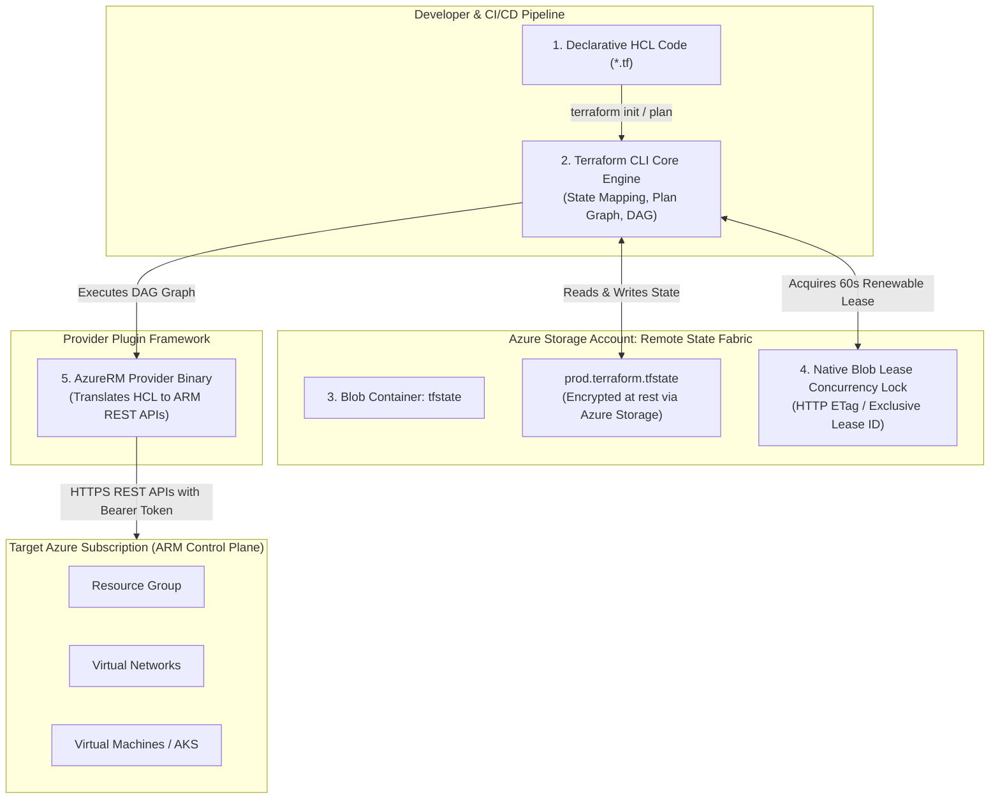

# Module 14-1: Terraform Core Engine, AzureRM Provider & State Locking

**Breadcrumbs:** [[--Index--|🏠 Index]] > [[14-Index - Terraform on Azure|☁️ Terraform on Azure MOC]] > **Module 14-1: Foundations & State**

---

## 🎯 Architectural Overview & Cognitive Map

Terraform is HashiCorp's declarative Infrastructure as Code (IaC) tool. In Microsoft Azure environments, Terraform translates human-readable HCL (HashiCorp Configuration Language) declarations into native Azure Resource Manager (ARM) REST API calls via the **`azurerm`** provider.



---

## 1. Declarative IaC Foundations & Terraform Core Mechanics

### A. Declarative vs. Imperative Cloud Provisioning
*   **Imperative Paradigms (Azure CLI, PowerShell scripts, Bash):** Require specifying the sequential procedure step-by-step (e.g., `az group create`, then `az network vnet create`, then checking for errors). If an imperative script terminates midway, re-running it often crashes due to resource naming conflicts or creates duplicate unmanaged resources.
*   **Declarative Paradigms (Terraform HCL, Azure Bicep, ARM JSON):** You define *what* the target cloud architecture must look like (e.g., "A VNet with CIDR 10.0.0.0/16 and 3 subnets"). Terraform calculates the current state, identifies the delta (create, update, or destroy), and applies the minimal set of changes required to reach the desired state. It is inherently **idempotent**.

### B. Mutable vs. Immutable Infrastructure
*   **Mutable Infrastructure:** Servers and services are patched and updated in-place (e.g., SSH into Linux VMs to update packages, modifying portal settings manually). Over time, configuration drift accumulates between staging and production instances, making incident triage unpredictable.
*   **Immutable Infrastructure:** Cloud compute instances are treated as disposable artifacts. Upgrades are performed by provisioning brand new virtual machines or container nodes from updated base images, routing traffic to the new instances, and terminating the old ones. Terraform natively supports immutable patterns via lifecycle meta-arguments (`create_before_destroy`).

### C. Under-the-Hood Engine Architecture
Terraform is decoupled into two primary layers:
1.  **Terraform Core (Go Binary):** Reads HCL configurations, parses variable inputs, evaluates expressions, inspects the current state database, constructs a **Directed Acyclic Graph (DAG)** of resource dependencies, and generates an execution plan.
2.  **Terraform Providers (Plugins):** Independent Go binaries communicating with Terraform Core via gRPC over local RPC sockets. The **`azurerm`** provider receives abstract resource schemas from Core and maps them directly into Azure Resource Manager REST API requests (`PUT`, `GET`, `PATCH`, `DELETE`).

---

## 2. The `azurerm` Provider & Authentication Architecture

### A. Provider Configuration & The Mandatory `features {}` Block
In Terraform, the AzureRM provider requires an explicit configuration block. A unique syntactical requirement of `azurerm` is the mandatory **`features {}`** block:

```hcl
terraform {
  required_version = ">= 1.5.0"
  
  required_providers {
    azurerm = {
      source  = "hashicorp/azurerm"
      version = "~> 3.90.0" # Pessimistic constraint: allows 3.90.x but blocks breaking 4.0.0
    }
    azuread = {
      source  = "hashicorp/azuread"
      version = "~> 2.47.0"
    }
    random = {
      source  = "hashicorp/random"
      version = "~> 3.6.0"
    }
  }
}

provider "azurerm" {
  # The features block is MANDATORY. Even if empty, it configures provider runtime behavior.
  features {
    resource_group {
      prevent_deletion_if_contains_resources = false
    }
    virtual_machine {
      delete_os_disk_on_deletion     = true
      graceful_shutdown              = false
      skip_shutdown_and_force_delete = false
    }
    key_vault {
      purge_soft_delete_on_destroy    = false
      recover_soft_deleted_key_vaults = true
    }
  }
}
```

> [!IMPORTANT]
> **Why is `features {}` mandatory?**
> Azure services frequently have cascading deletion and recovery behaviors (e.g., Key Vault soft delete, VM OS disk detachment vs deletion). The `features {}` block tells the provider how to handle these Azure-specific control-plane behaviors on `terraform destroy`.

### B. Azure Authentication Models
Terraform supports five primary authentication mechanisms to connect to Azure:

| Authentication Method | Ideal Use Case | Security Characteristics | Required Configuration / Environment Variables |
| :--- | :--- | :--- | :--- |
| **1. Azure CLI (`az login`)** | Local development and workstation testing. | Uses developer's personal Entra ID credentials; interactive MFA. | No credentials in code. Relies on active `az account show` session. |
| **2. Service Principal with Secret** | Legacy CI/CD automation pipelines. | Long-lived secret string; security risk if leaked. | `ARM_CLIENT_ID`, `ARM_CLIENT_SECRET`, `ARM_TENANT_ID`, `ARM_SUBSCRIPTION_ID`. |
| **3. Service Principal with Certificate** | Enterprise automation requiring PKI compliance. | Cryptographically strong; certificate rotated via enterprise CA. | `ARM_CLIENT_CERTIFICATE_PATH`, `ARM_CLIENT_CERTIFICATE_PASSWORD`. |
| **4. Managed Identity (MSI)** | Terraform running inside Azure VMs, Container Instances, or VMSS. | **Passwordless & Zero-Trust.** Azure hypervisor automatically manages token acquisition via IMDS (`169.254.169.254`). | Set `use_msi = true` in provider block. |
| **5. Workload Identity Federation (OIDC)** | Modern GitHub Actions / Azure DevOps CI/CD. | **Passwordless & Secret-free.** Cloud provider exchanges short-lived OIDC tokens directly with Microsoft Entra ID. | Set `use_oidc = true`. Requires federated credential link in Entra ID. |

---

## 3. Remote State Management & Azure Blob Concurrency Locking

The Terraform state file (`terraform.tfstate`) is the single source of truth mapping declared HCL code to physical Azure Resource IDs (`/subscriptions/.../resourceGroups/...`).

### A. The Dangers of Local State
*   **Concurrency Collision:** Multiple engineers applying changes simultaneously overwrite each other's state, corrupting infrastructure records.
*   **Security Vulnerability:** State files contain unencrypted sensitive values (such as initial VM passwords, database connection strings, and certificates). Storing state locally risks committing secrets into version control.
*   **Disaster Exposure:** A single hard drive failure loses the state file, requiring complex reverse-engineering import operations.

### B. Remote Backend Architecture: Azure Storage Account
In production, state must be stored centrally in an **Azure Storage Account Blob Container**.

```hcl
# backend.tf
terraform {
  backend "azurerm" {
    resource_group_name  = "rg-terraform-state-mgmt"
    storage_account_name = "sttfstatemgmt001"
    container_name       = "tfstate"
    key                  = "production.terraform.tfstate"
    
    # Recommended: Use Entra ID authentication instead of access keys
    use_azuread_auth     = true
  }
}
```

### C. Concurrency Locking: Azure Blob Lease vs. AWS DynamoDB
A major architectural difference between cloud providers is how state concurrency locking is achieved:

*   **AWS:** Terraform requires deploying an external **Amazon DynamoDB table** alongside an S3 bucket. Terraform writes a lock item to DynamoDB before planning and deletes it after applying.
*   **Azure:** Terraform leverages Azure Blob Storage's **Native Blob Lease mechanism**.
    *   When `terraform apply` or `terraform plan` executes, Terraform issues an HTTP PUT request with header `x-ms-lease-action: acquire` against the target `.tfstate` blob.
    *   Azure Storage grants an exclusive 60-second lease with a unique GUID `x-ms-lease-id`. Terraform continuously renews this lease while running.
    *   If another engineer attempts to run Terraform concurrently, Azure Storage returns `HTTP 412 (Precondition Failed) - There is currently a lease on the blob`, cleanly terminating the second operation before any drift or corruption can occur!

```
+-------------------------------------------------------------------------------------------------+
|                                 Azure Blob Lease Locking Loop                                   |
|                                                                                                 |
|   Engineer A: terraform apply                                                                   |
|         │                                                                                       |
|         ├───► Acquires Blob Lease (x-ms-lease-id: a1b2c3d4) ──► Blob Locked (Status: Leased)   |
|         │     Executes API updates in Azure Subscription...                                     |
|         │                                                                                       |
|   Engineer B: terraform apply (Simultaneous Run)                                                |
|         │                                                                                       |
|         └───► Attempts to acquire lease ──► Azure Storage rejects: HTTP 412 LeaseAlreadyPresent  |
|                                              Engineer B is blocked with error message!          |
|                                                                                                 |
|   Engineer A finishes ──► Releases Lease ──► Blob Unlocked (Status: Available)                  |
+-------------------------------------------------------------------------------------------------+
```

---

## 4. Deep-Intuition (AARF) Failure-Loop Breakdowns

### Scenario: The Leaked Storage Account Access Key Failure
*   **The Architecture:** An engineering team provisions an Azure Storage Account to store their production Terraform state files. They configure `backend "azurerm"` using storage account access key 1 (`account_key = "..."`).
*   **The Assumption:** The team assumes that using access keys is the simplest way to authenticate Terraform pipelines.
*   **The Failure Loop:**
    *   The `backend.tf` configuration containing the plaintext storage key is inadvertently pushed to a public or widely shared internal git repository.
    *   An adversary grabs the storage account key.
    *   The adversary downloads `production.terraform.tfstate`, which contains decrypted database administrator passwords, TLS private keys, and service principal secrets.
    *   The adversary takes full administrative control of the organization's database tier.
*   **The Root Cause:**
    *   Storage Account keys grant absolute, root-level administrative access to all data plane operations and bypass RBAC audit trails.
*   **The Architectural Remediation:**
    1.  Disable Shared Key access on the Storage Account:
        ```bash
        az storage account update \
          --name "sttfstatemgmt001" \
          --resource-group "rg-terraform-state-mgmt" \
          --allow-shared-key-access false
        ```
    2.  Set `use_azuread_auth = true` in the Terraform backend block.
    3.  Assign the deploying identity (User or Service Principal) the **`Storage Blob Data Contributor`** role via Entra ID RBAC. Access is now governed by zero-trust identity policies and logged in Azure Activity logs.

---

## 5. Bootstrap Automation Recipe: Azure Remote State Infrastructure

Execute this script in Azure Cloud Shell to establish a hardened, production-ready remote state backend:

```bash
#!/usr/bin/env bash
set -euo pipefail

# 1. Variables
export RG_NAME="rg-terraform-state-mgmt"
export LOCATION="eastus"
export STORAGE_NAME="sttfstate$(openssl rand -hex 3)"
export CONTAINER_NAME="tfstate"

# 2. Create Resource Group
az group create --name "${RG_NAME}" --location "${LOCATION}" --tags Environment=Management ManagedBy=Terraform

# 3. Create Storage Account with ZRS and TLS 1.2 Enforced
az storage account create \
  --name "${STORAGE_NAME}" \
  --resource-group "${RG_NAME}" \
  --location "${LOCATION}" \
  --sku "Standard_ZRS" \
  --kind "StorageV2" \
  --min-tls-version "TLS1_2" \
  --allow-blob-public-access false

# 4. Enable Blob Versioning (Guarantees Historical State Restores)
az storage account blob-service-properties update \
  --account-name "${STORAGE_NAME}" \
  --resource-group "${RG_NAME}" \
  --enable-versioning true \
  --enable-delete-retention true \
  --delete-retention-days 30

# 5. Create Blob Container
az storage container create \
  --name "${CONTAINER_NAME}" \
  --account-name "${STORAGE_NAME}" \
  --auth-mode login

# 6. Assign Storage Blob Data Contributor to Current User
CURRENT_USER_ID=$(az ad signed-in-user show --query id -o tsv)
STORAGE_ID=$(az storage account show --name "${STORAGE_NAME}" --resource-group "${RG_NAME}" --query id -o tsv)

az role assignment create \
  --assignee "${CURRENT_USER_ID}" \
  --role "Storage Blob Data Contributor" \
  --scope "${STORAGE_ID}"

echo "=========================================================="
echo "Terraform Remote State Backend Initialized!"
echo "Resource Group:  ${RG_NAME}"
echo "Storage Account: ${STORAGE_NAME}"
echo "Container:       ${CONTAINER_NAME}"
echo "=========================================================="
```
