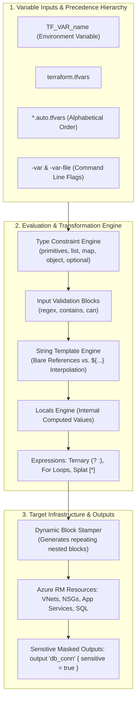

# Module 14-2: Variables, Type Constraints, Dynamic Blocks & Expressions

**Breadcrumbs:** [[--Index--|🏠 Index]] > [[14-Index - Terraform on Azure|☁️ Terraform on Azure MOC]] > **Module 14-2: Variables & Expressions**

---

## 🎯 Architectural Overview & Cognitive Map

In production-grade Terraform on Microsoft Azure, hardcoding parameters (such as resource names, IP CIDR ranges, SKU tiers, and admin credentials) creates rigid, brittle templates that cannot be reused across environments (`dev`, `staging`, `prod`).

This module establishes the comprehensive mechanics of **Variables (Input, Output, Locals)**, **String Interpolation & Templates**, **Progressive Type Constraints** (Primitive ➔ Collection ➔ Structural), **Expressions**, and **Dynamic Blocks** for repeating nested Azure architectures.



---

## 1. The Variable Trinity: Inputs, Outputs, and Locals

Terraform organizes data handling into three distinct constructs, each serving a specific lifecycle purpose:

```text
+---------------------------------------------------------------------------------------------------+
|                                      THE VARIABLE TRINITY                                         |
|                                                                                                   |
|   1. INPUT VARIABLES (variable "...")     ──► External Parameters passed INTO the module.        |
|                                                (e.g., environment = "dev", location = "eastus")   |
|                                                                                                   |
|   2. LOCAL VALUES (locals { ... })        ──► Internal Computations & Standardized Constants.     |
|                                                (e.g., prefix = "${var.project}-${var.env}")       |
|                                                                                                   |
|   3. OUTPUT VARIABLES (output "...")      ──► Return Values exposed OUT of the module.            |
|                                                (e.g., primary_blob_endpoint, database_fqdn)       |
+---------------------------------------------------------------------------------------------------+
```

---

### A. Input Variables: Syntax & Anatomy
An input variable parameterizes your Terraform code. It accepts the following arguments:

```hcl
variable "environment" {
  type        = string                          # 1. Type constraint (Mandatory best practice)
  description = "Target deployment environment" # 2. Documentation for consumers
  default     = "dev"                           # 3. Fallback value if omitted by caller
  sensitive   = false                           # 4. If true, masks value in CLI plan/apply logs
  nullable    = false                           # 5. If false, disallows caller passing explicit null

  # 6. Custom Runtime Validation Rule (Terraform 1.3+)
  validation {
    condition     = contains(["dev", "staging", "prod"], lower(var.environment))
    error_message = "The environment variable must be one of: dev, staging, or prod."
  }
}
```

#### Custom Validation with `regex()` and `can()`
You can validate complex naming conventions and Azure regions before Terraform calls the cloud API:

```hcl
variable "storage_account_name" {
  type        = string
  description = "Name of the Azure Storage Account (3-24 lowercase alphanumeric chars)."

  validation {
    condition     = can(regex("^[a-z0-9]{3,24}$", var.storage_account_name))
    error_message = "Azure Storage Account names must be between 3 and 24 characters and contain lowercase letters and numbers only."
  }
}
```

---

### B. Output Variables & The `sensitive` Flag
Outputs serve two purposes:
1. Printing key resource attributes to the terminal console after `terraform apply`.
2. Exposing data from a **child module** to a **parent root module**.

```hcl
# Standard Public Output
output "storage_account_id" {
  description = "The Resource Manager ID of the storage account."
  value       = azurerm_storage_account.st.id
}

# Sensitive Output (Prevents secret leakage in CI/CD stdout logs)
output "database_connection_string" {
  description = "The ADO.NET connection string for application runtime."
  value       = "Server=tcp:${azurerm_mssql_server.sql.fully_qualified_domain_name},1433;Database=${azurerm_mssql_database.db.name};"
  sensitive   = true # Terraform prints: database_connection_string = (sensitive value)
}
```

> [!CAUTION]
> **State File Security:** Marking an output as `sensitive = true` only masks it from console stdout display. The sensitive string is **still stored in plaintext inside `terraform.tfstate`**! Never treat Terraform console masking as a substitute for securing your state file.

---

### C. Local Values (`locals`)
Unlike input variables (which are passed in from the outside), **locals are computed internally** within the module. They cannot be overridden from the CLI or tfvars files.

* **Use Case 1:** Enforcing corporate naming conventions.
* **Use Case 2:** Eliminating duplicate expressions.
* **Use Case 3:** Merging common tags.

```hcl
locals {
  # 1. Standardized naming convention: <resource_type>-<project>-<env>-<region>
  resource_prefix = "${var.project_name}-${var.environment}-${var.location}"

  # 2. Reusable Tags dictionary
  common_tags = merge(var.custom_tags, {
    Project     = var.project_name
    Environment = var.environment
    ManagedBy   = "Terraform"
    CreatedOn   = formatdate("YYYY-MM-DD", timestamp())
  })
}

resource "azurerm_resource_group" "rg" {
  name     = "rg-${local.resource_prefix}" # Reference via local.<name>
  location = var.location
  tags     = local.common_tags             # Reference via local.<name>
}
```

---

## 2. String Templates & Interpolation Syntax (`${...}`)

Understanding when to use bare references versus string interpolation is fundamental in HCL2.

### A. The Golden Rule: Bare References vs. Interpolation

```text
Is the value ENTIRELY a variable or attribute reference?
  ├── YES ──► Use BARE Syntax (No quotes, no ${}):
  │           location = var.location
  │           server_id = azurerm_mssql_server.sql.id
  │
  └── NO (Embedded inside literal text or combined with other variables) ──► Use INTERPOLATION (${}):
              name = "rg-${var.project}-${var.environment}"
              url  = "https://${azurerm_linux_web_app.app.default_hostname}:443"
```

### B. The HCL1 vs. HCL2 Historical Context
* In **Terraform 0.11 (HCL1)**, the parser required `${}` for every reference: `name = "${var.environment}"`.
* In **Terraform >= 0.12 (HCL2)**, expressions became first-class citizens. Writing `name = "${var.environment}"` is considered an anti-pattern. You write `name = var.environment`.
* However, when building connection strings or compound hostnames, `${}` is mandatory:
  ```hcl
  connection_string = "Server=tcp:${azurerm_mssql_server.sql.fully_qualified_domain_name},1433;Database=${azurerm_mssql_database.db.name};"
  ```

### C. Escaping Interpolation (`$${}`)
If you need the literal characters `${}` inside a string without Terraform attempting to evaluate it (e.g., inside an Azure VM Custom Script Extension or an App Service setting read by bash):
```hcl
app_settings = {
  # Produces literal text "${PORT}" in the output:
  "DOCKER_PORT_PLACEHOLDER" = "$${PORT}"
}
```

---

## 3. Variable Precedence Hierarchy (How Terraform Resolves Clashes)

When the same variable is assigned values in multiple places, Terraform resolves the conflict using a strict, deterministic order of precedence (from lowest to highest):

```text
[ Lowest Precedence ]
   │
   ├── 1. Default value in variable "..." block
   │
   ├── 2. Environment variables: TF_VAR_<variable_name>
   │
   ├── 3. terraform.tfvars file
   │
   ├── 4. terraform.tfvars.json file
   │
   ├── 5. *.auto.tfvars or *.auto.tfvars.json (Evaluated in alphabetical order)
   │
   └── 6. CLI Command Line Flags: -var or -var-file (Highest Precedence)
   │
[ Highest Precedence: Overwrites all prior definitions ]
```

### Practical Demonstration of Precedence:
Suppose `environment` is configured in three places:
1. `variable "environment" { default = "dev" }`
2. `terraform.tfvars`: `environment = "staging"`
3. Terminal command: `terraform apply -var="environment=prod"`

**Result:** Terraform uses `"prod"`, because the CLI flag `-var` overrides all files and defaults.

---

## 4. Progressive Type Constraints: From Primitives to Structural Records

Terraform enforces type safety to prevent bad data from reaching cloud APIs. Type constraints are organized into three tiers of complexity:

```text
[Tier 1: Primitives]     string, number, bool (Single scalar values)
        │
        ▼
[Tier 2: Collections]    list(T), set(T), map(T) (Multiple values of the SAME type T)
        │
        ▼
[Tier 3: Structural]     tuple([...]), object({...}) (Multiple values of DIFFERENT types)
```

---

### Tier 1: Primitive Types
Primitives store a single atomic value:
* **`string`**: Text sequence (`"eastus"`, `"Standard_B2s"`).
* **`number`**: Integer or floating-point (`3`, `100.5`, `1433`).
* **`bool`**: Boolean flag (`true`, `false`).

```hcl
variable "vm_count" {
  type    = number
  default = 3
}

variable "enable_https_only" {
  type    = bool
  default = true
}
```

---

### Tier 2: Collection Types (Homogeneous Elements)

Collections hold multiple values where **every element must share the exact same type**:

#### 1. List (`list(type)`)
An ordered sequence indexed by integers starting at `0`.
```hcl
variable "dns_servers" {
  type    = list(string)
  default = ["10.0.0.4", "10.0.0.5", "168.63.129.16"]
}

# Accessing elements:
# var.dns_servers[0] -> "10.0.0.4"
# var.dns_servers[2] -> "168.63.129.16"
```

#### 2. Set (`set(type)`)
An **unordered** collection of unique elements. Duplicates are discarded automatically.
```hcl
variable "firewall_allowed_ports" {
  type    = set(number)
  default = [80, 443, 8080, 443] # Duplicate 443 is automatically deduplicated!
}
```
> [!NOTE]
> **List vs. Set:** You cannot access set elements via index (`var.firewall_allowed_ports[0]` will fail) because sets have no defined order. Sets are used primarily for iterating with `for_each`.

#### 3. Map (`map(type)`)
A key-value lookup table where keys are always strings and all values share the same type:
```hcl
variable "environment_skus" {
  type = map(string)
  default = {
    "dev"     = "Standard_B1s"
    "staging" = "Standard_B2s"
    "prod"    = "Standard_D4s_v5"
  }
}

# Accessing map values:
# var.environment_skus["prod"] -> "Standard_D4s_v5"
```

---

### Tier 3: Structural Types (Heterogeneous Records)

Structural types allow grouping **different data types together** inside a single variable.

#### 1. Tuple (`tuple([type, type, ...])`)
A fixed-length list where each position can have a different type:
```hcl
variable "network_rule_spec" {
  type    = tuple([string, number, bool])
  default = ["10.0.0.0/16", 443, true]
}
```

#### 2. Object (`object({...})`)
A named record where every attribute has its own specific type. This is the **standard pattern for production Azure modules**:

```hcl
variable "database_config" {
  type = object({
    db_name     = string
    max_size_gb = number
    collation   = string
    auto_pause  = bool
  })
  default = {
    db_name     = "oh-auth-db"
    max_size_gb = 50
    collation   = "SQL_Latin1_General_CP1_CI_AS"
    auto_pause  = true
  }
}
```

---

### Tier 4: The `optional()` Modifier with Defaults (Terraform 1.3+)

In complex modules, requiring callers to specify every single attribute of an object creates painful boilerplate. The `optional(type, default)` function solves this:

```hcl
variable "subnets" {
  type = map(object({
    cidr_block           = string                      # Mandatory
    service_endpoints    = optional(list(string), [])  # Defaults to empty list (NOT null)
    enforce_private_link = optional(bool, false)       # Defaults to false
    delegation           = optional(string, null)      # Defaults to null
  }))

  default = {
    "snet-web" = {
      cidr_block        = "10.100.1.0/24"
      service_endpoints = ["Microsoft.Storage"]
      # enforce_private_link omitted -> becomes false
      # delegation omitted           -> becomes null
    }
    "snet-app" = {
      cidr_block = "10.100.2.0/24"
      delegation = "Microsoft.Web/serverFarms"
    }
  }
}
```

---

## 5. Expressions in Action: Conditionals, Loops & Splats

HCL provides an expression engine to compute dynamic values at runtime.

### A. Conditional Expressions (Inline Ternary)
Evaluates a condition and returns one of two values:

```text
condition ? value_if_true : value_if_false
```

```hcl
# Select high-availability replication for prod, cost-optimized for dev:
resource "azurerm_storage_account" "st" {
  name                     = "stohtfstate001"
  resource_group_name      = azurerm_resource_group.rg.name
  location                 = azurerm_resource_group.rg.location
  account_tier             = "Standard"
  account_replication_type = var.environment == "prod" ? "GRS" : "LRS"
}
```

---

### B. `for` Expressions (List & Map Comprehensions)
`for` expressions transform one collection into another, with optional filtering (`if`):

#### 1. List Transformation:
```hcl
# Capitalize all environment names:
locals {
  raw_envs   = ["dev", "staging", "prod"]
  upper_envs = [for e in local.raw_envs : upper(e)]
  # Result: ["DEV", "STAGING", "PROD"]
}
```

#### 2. Filtering a Map:
```hcl
# Filter only subnets that have service endpoints enabled:
locals {
  subnets_with_endpoints = {
    for k, v in var.subnets : k => v
    if length(v.service_endpoints) > 0
  }
}
```

#### 3. Transforming a List of Objects into a Map for `for_each`:
```hcl
variable "subnet_list" {
  type = list(object({
    name = string
    cidr = string
  }))
}

# for_each requires a MAP or a SET of strings, NOT a list of objects!
locals {
  subnet_map = { for s in var.subnet_list : s.name => s }
}
```

---

### C. Splat Expressions (`[*]`) vs. `for` Expressions

When you create multiple resources using `count` or `for_each`, you often need an output containing all their IDs:

```text
Did you use COUNT or FOR_EACH to create the resources?
  ├── COUNT    ──► Use SPLAT ([*]):       azurerm_subnet.snet[*].id
  └── FOR_EACH ──► Use FOR Expression:   [for s in azurerm_subnet.snet : s.id]
```

* **Why?** `count` creates a **List** (ordered by index `0, 1, 2`). The splat operator `[*]` works directly on lists.
* `for_each` creates a **Map** (keyed by string names). Splat `[*]` throws a syntax error on maps, so you use `[for s in ... : s.id]`.

---

## 6. Dynamic Blocks: The Nested Block Stamper

In Azure resource schemas, many resources contain **nested configuration blocks** inside the parent resource:
* `security_rule { ... }` inside `azurerm_network_security_group`
* `ip_restriction { ... }` inside `azurerm_linux_web_app`
* `network_rules { ... }` inside `azurerm_storage_account`

### The Problem
You **cannot** put a standard `for_each` on a nested block:
```hcl
# SYNTAX ERROR! Illegal HCL syntax:
resource "azurerm_network_security_group" "nsg" {
  security_rule {
    for_each = var.rules # <-- FAILS!
  }
}
```

### The Solution: The `dynamic` Block
The `dynamic` block acts as a **code stamper**. It loops over a collection and stamps out repeated nested blocks:

```hcl
variable "nsg_rules" {
  type = list(object({
    name      = string
    priority  = number
    direction = string
    access    = string
    protocol  = string
    port      = string
    source    = string
  }))
  default = [
    {
      name      = "AllowHTTP"
      priority  = 100
      direction = "Inbound"
      access    = "Allow"
      protocol  = "Tcp"
      port      = "80"
      source    = "*"
    },
    {
      name      = "AllowHTTPS"
      priority  = 110
      direction = "Inbound"
      access    = "Allow"
      protocol  = "Tcp"
      port      = "443"
      source    = "*"
    }
  ]
}

resource "azurerm_network_security_group" "nsg" {
  name                = "nsg-app-dev"
  location            = "eastus"
  resource_group_name = "rg-app-dev"

  # Dynamic Block Definition:
  dynamic "security_rule" {       # 1. The name of the nested block to stamp out
    for_each = var.nsg_rules      # 2. The collection to iterate over
    content {                     # 3. The template for each stamped block
      name                       = security_rule.value.name
      priority                   = security_rule.value.priority
      direction                  = security_rule.value.direction
      access                     = security_rule.value.access
      protocol                   = security_rule.value.protocol
      source_port_range          = "*"
      destination_port_range     = security_rule.value.port
      source_address_prefix      = security_rule.value.source
      destination_address_prefix = "*"
    }
  }
}
```

### The Automatic Iterator Rule:
Inside the `content { ... }` block, Terraform creates an iterator variable **identically named after the block label**:
* `dynamic "security_rule"` ➔ Accessed via `security_rule.value.<attribute>`.
* `dynamic "ip_restriction"` ➔ Accessed via `ip_restriction.value.<attribute>`.

*(You can customize this using `iterator = rule`, in which case you write `rule.value.<attribute>`)*.

---

## 7. Deep-Intuition (AARF) Failure-Loop Breakdowns

### Failure Loop: The Silent `-var` Default Fallback Disaster
* **The Architecture:** An engineering team provisions Azure App Services. `variables.tf` specifies:
  ```hcl
  variable "sku_name" {
    type    = string
    default = "B1" # Dev cost-optimized SKU
  }
  ```
  The production parameter file `prod.tfvars` specifies `sku_name = "P1v3"` (High Performance, Auto-scaling).
* **The Failure Loop:**
  * During maintenance, an engineer runs:
    `terraform apply -var="location=eastus"`
  * The engineer assumed Terraform would automatically read `prod.tfvars` from the folder.
  * **What actually happened:** Specifying `-var` on the CLI told Terraform to use only that flag and the defaults. Terraform completely ignored `prod.tfvars`!
  * Terraform dowgraded the production App Service Plan from `P1v3` to `B1`. Production CPU spiked to 100%, crashing the website under load.
* **The Remediation:**
  1. Never rely on manual `-var` CLI flags for production deployments.
  2. Adopt the standardized auto-loaded naming convention: **`prod.auto.tfvars`**. Files matching `*.auto.tfvars` are **always loaded automatically** by Terraform Core without requiring manual flags.
  3. Enforce structural validation preconditions:
     ```hcl
     lifecycle {
       precondition {
         condition     = var.environment != "prod" || var.sku_name != "B1"
         error_message = "Production environments are prohibited from using Basic (B1) App Service SKUs."
       }
     }
     ```
