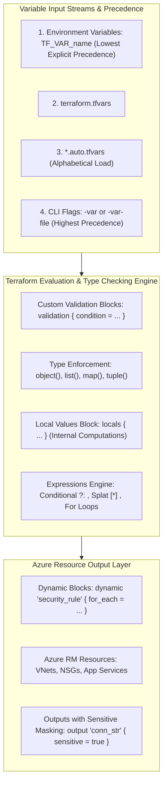

# Module 14-2: Variables, Type Constraints, Dynamic Blocks & Expressions

**Breadcrumbs:** [[--Index--|🏠 Index]] > [[14-Index - Terraform on Azure|☁️ Terraform on Azure MOC]] > **Module 14-2: Variables & Expressions**

---

## 🎯 Architectural Overview & Cognitive Map

In modular, production-grade Terraform architectures on Microsoft Azure, hardcoding values (such as IP CIDRs, SKU tiers, location strings, and environment tags) creates brittle code that cannot be promoted across environments (Dev ➔ Staging ➔ Prod).

This module details how to decouple configuration from implementation using **Input Variables, Validation Blocks, Local Values, Structural Types, Advanced Expressions, and Dynamic Blocks**.



---

## 1. The Variable Trinity: Inputs, Outputs, and Locals

### A. Input Variables & Custom Validation Rules
Input variables serve as parameters for Terraform modules. Modern Terraform (1.3+) supports custom runtime validation rules that intercept invalid architectural inputs before API execution:

```hcl
variable "environment" {
  type        = string
  description = "Target deployment environment tier."
  default     = "dev"

  validation {
    condition     = contains(["dev", "staging", "prod"], lower(var.environment))
    error_message = "The environment variable must be one of: dev, staging, prod."
  }
}

variable "location" {
  type        = string
  description = "Target Azure paired region."
  default     = "eastus"

  validation {
    condition     = can(regex("^(eastus|westus2|westeurope|northeurope)$", var.location))
    error_message = "The region specified is not in the organization's approved Azure regions list."
  }
}
```

### B. Output Variables & The `sensitive` Directive
Output variables expose computed attributes (such as private IPs, Resource IDs, and FQDNs) to parent modules or external CI/CD systems. When outputs contain credentials or connection strings, the **`sensitive = true`** argument prevents values from being printed to console stdout logs:

```hcl
output "database_connection_string" {
  value       = "Server=tcp:${azurerm_mssql_server.sql.fully_qualified_domain_name},1433;Database=${azurerm_mssql_database.db.name};"
  description = "The ADO.NET connection string for application runtime."
  sensitive   = true # Intercepts console logging and masks with (sensitive value)
}

output "web_app_url" {
  value       = "https://${azurerm_linux_web_app.app.default_hostname}"
  description = "Public HTTPS endpoint of the deployed application."
  sensitive   = false
}
```

### C. Local Values (`locals`)
Locals are private, non-configurable internal variables used to eliminate duplicate code, compute standard naming conventions, and construct complex merged structures:

```hcl
locals {
  # Enforce standardized corporate naming convention: <type>-<project>-<env>-<region>
  resource_prefix = "${var.project_name}-${var.environment}-${var.location}"
  
  common_tags = {
    Project     = var.project_name
    Environment = var.environment
    ManagedBy   = "Terraform"
    CreatedDate = formatdate("YYYY-MM-DD", timestamp())
  }
}

resource "azurerm_resource_group" "rg" {
  name     = "rg-${local.resource_prefix}"
  location = var.location
  tags     = local.common_tags
}
```

---

## 2. Variable Precedence Hierarchy

When the same variable is defined across multiple sources, Terraform resolves values using a strict, deterministic hierarchy (from lowest to highest precedence):

```
Lowest Precedence
   │   1. Default value inside the variable {} block
   │   2. Environment variables: TF_VAR_name
   │   3. terraform.tfvars file
   │   4. terraform.tfvars.json file
   │   5. Any *.auto.tfvars or *.auto.tfvars.json files (evaluated alphabetically)
   ▼   6. CLI command line flags: -var "name=value" or -var-file="secret.tfvars"
Highest Precedence (Overrides all prior values)
```

---

## 3. Advanced Type Constraints

Terraform separates data types into **Primitive Types** (`string`, `number`, `bool`) and **Complex Types**:

### A. Collection vs. Structural Types
*   **List (`list(type)`):** Ordered sequence of elements of the *same* type. Indexed by 0-based integer.
*   **Set (`set(type)`):** Unordered collection of unique values of the *same* type. Does not allow duplicates.
*   **Map (`map(type)`):** Key-value lookup table where all values share the *same* type.
*   **Tuple (`tuple([string, number, bool])`):** Fixed-length ordered sequence where each element can have a *different* type.
*   **Object (`object({ ... })`):** Key-value record where each attribute has an explicitly defined type.

### B. Enterprise Object Constraint with `optional()` Attributes
In production Azure module design, the `optional()` modifier allows consumers to omit non-mandatory attributes while automatically applying sensible defaults:

```hcl
variable "subnet_configurations" {
  type = map(object({
    cidr_block           = string
    service_endpoints    = optional(list(string), [])
    enforce_private_link = optional(bool, false)
    delegation           = optional(string, null)
  }))
  description = "Map of subnet specifications to provision within the target VNet."
  
  default = {
    "snet-web" = {
      cidr_block        = "10.0.1.0/24"
      service_endpoints = ["Microsoft.Storage", "Microsoft.KeyVault"]
    }
    "snet-data" = {
      cidr_block           = "10.0.2.0/24"
      enforce_private_link = true
    }
    "snet-appsvc" = {
      cidr_block = "10.0.3.0/24"
      delegation = "Microsoft.Web/serverFarms"
    }
  }
}
```

---

## 4. Expressions & Dynamic Blocks in Action

### A. Conditional Expressions
Terraform uses ternary syntax `condition ? true_val : false_val`:

```hcl
# Automatically deploy Zone-Redundant Storage in Prod, and LRS in Dev/Staging
resource "azurerm_storage_account" "st" {
  name                     = "st${replace(local.resource_prefix, "-", "")}"
  resource_group_name      = azurerm_resource_group.rg.name
  location                 = azurerm_resource_group.rg.location
  account_tier             = "Standard"
  account_replication_type = var.environment == "prod" ? "ZRS" : "LRS"
}
```

### B. `for` Expressions & Filtering
Generate new lists or maps dynamically from input collections:

```hcl
# Filter out only subnets that require service endpoints
locals {
  subnets_with_endpoints = {
    for k, v in var.subnet_configurations : k => v
    if length(v.service_endpoints) > 0
  }
}
```

### C. Splat Expressions (`[*]`)
Capture a single attribute across all instances of a resource:

```hcl
# Retrieve list of all subnet IDs generated by for_each
output "all_subnet_ids" {
  value = [for s in azurerm_subnet.subnets : s.id]
}

# When using count, use the splat operator directly:
# value = azurerm_subnet.subnets[*].id
```

### D. Dynamic Blocks for Repeating Azure Nested Structures
In Azure resource declarations, certain elements exist as repeated nested blocks inside a parent resource (e.g., `security_rule` in NSGs, `frontend_ip_configuration` in Load Balancers, or `ip_restriction` in App Services).

Instead of copy-pasting nested blocks, use the **`dynamic`** block:

```hcl
variable "nsg_rules" {
  type = list(object({
    name                   = string
    priority               = number
    direction              = string
    access                 = string
    protocol               = string
    source_port_range      = string
    destination_port_range = string
    source_address_prefix  = string
  }))
  default = [
    {
      name                   = "AllowHTTP"
      priority               = 100
      direction              = "Inbound"
      access                 = "Allow"
      protocol               = "Tcp"
      source_port_range      = "*"
      destination_port_range = "80"
      source_address_prefix  = "*"
    },
    {
      name                   = "AllowHTTPS"
      priority               = 110
      direction              = "Inbound"
      access                 = "Allow"
      protocol               = "Tcp"
      source_port_range      = "*"
      destination_port_range = "443"
      source_address_prefix  = "*"
    },
    {
      name                   = "AllowSSHFromBastion"
      priority               = 120
      direction              = "Inbound"
      access                 = "Allow"
      protocol               = "Tcp"
      source_port_range      = "*"
      destination_port_range = "22"
      source_address_prefix  = "10.0.10.0/26" # AzureBastionSubnet CIDR
    }
  ]
}

resource "azurerm_network_security_group" "nsg" {
  name                = "nsg-${local.resource_prefix}"
  location            = azurerm_resource_group.rg.location
  resource_group_name = azurerm_resource_group.rg.name

  # The dynamic block loops through var.nsg_rules and injects clean security_rule blocks
  dynamic "security_rule" {
    for_each = var.nsg_rules
    content {
      name                       = security_rule.value.name
      priority                   = security_rule.value.priority
      direction                  = security_rule.value.direction
      access                     = security_rule.value.access
      protocol                   = security_rule.value.protocol
      source_port_range          = security_rule.value.source_port_range
      destination_port_range     = security_rule.value.destination_port_range
      source_address_prefix      = security_rule.value.source_address_prefix
      destination_address_prefix = "*"
    }
  }
}
```

---

## 5. Deep-Intuition (AARF) Failure-Loop Breakdowns

### Scenario: The Variable Precedence Overwrite Disaster
*   **The Architecture:** An enterprise deploys an Azure Kubernetes Service (AKS) cluster across multiple environments. The `variables.tf` file defines a default node pool size of 3 nodes: `default = 3`.
*   **The Assumption:** The engineer maintains a production configuration file `production.tfvars` that specifies `node_count = 10`.
*   **The Failure Loop:**
    *   During emergency weekend maintenance, an engineer runs:
        `terraform apply -var="location=eastus"`
    *   The engineer notices in the execution plan that Terraform is actively destroying 7 active production worker nodes, scaling AKS from 10 down to 3!
    *   Customer applications experience heavy outages due to CPU exhaustion on the remaining 3 nodes.
*   **The Root Cause:**
    *   When passing the `-var` command-line flag, Terraform only evaluates the variables passed via CLI. Because the engineer did not explicitly append `-var-file="production.tfvars"`, Terraform bypassed the `production.tfvars` file and fell back to the `default = 3` defined in `variables.tf`!
*   **The Architectural Remediation:**
    1.  Never rely on manual CLI flags (`-var`) in production environments.
    2.  Adopt the standardized naming convention **`production.auto.tfvars`**. Files matching `*.auto.tfvars` are **automatically loaded** by Terraform Core without requiring manual `-var-file` arguments!
    3.  Enforce validation checks or preconditions on minimum node counts for production tiers:
        ```hcl
        lifecycle {
          precondition {
            condition     = var.environment != "prod" || var.node_count >= 5
            error_message = "Production AKS clusters must maintain at least 5 nodes to ensure quorum and failover resilience."
          }
        }
        ```
