# Module 14-3: Meta-Arguments, Lifecycle Control, Functions & Data Sources

**Breadcrumbs:** [[--Index--|🏠 Index]] > [[14-Index - Terraform on Azure|☁️ Terraform on Azure MOC]] > **Module 14-3: Meta-Arguments & Functions**

---

## 🎯 Architectural Overview & Cognitive Map

In production Azure deployments, writing basic single-resource definitions is insufficient. Cloud architects must manage multiple resource instances dynamically, enforce immutable safety rails against accidental production destruction, transform complex data structures using pure functions, and query pre-existing cloud infrastructure.

This module details the deep mechanics of **Meta-Arguments** (`count`, `for_each`, `depends_on`, `provider`), **Lifecycle Safety Blocks** (`prevent_destroy`, `ignore_changes`, `create_before_destroy`, `replace_triggered_by`), the **Built-in Function Transformation Suite**, and **Data Sources** for querying live Azure fabric.

```mermaid
flowchart TD
    subgraph MetaArguments ["1. Resource Control Meta-Arguments"]
        Count["count: Integer-based looping (0..N)\nConditional creation: flag ? 1 : 0\nWarning: Susceptible to Array Shift!"]
        ForEach["for_each: Map/Set-based looping\nStable Keyed Addresses (each.key, each.value)\nRequires toset() for raw string lists"]
        DependsOn["depends_on: Explicit DAG Graph Forcing\nHandles Azure RBAC & async propagation delays"]
        ProviderAlias["provider = azurerm.alias: Multi-Region / Cross-Sub Routing"]
    end

    subgraph LifecycleControl ["2. Lifecycle Safety Rails & Guarantees"]
        CBD["create_before_destroy: Zero-downtime swaps\n(Caveat: Azure global name clashes)"]
        PD["prevent_destroy: Hard lock on production databases & state"]
        IC["ignore_changes: Drift immunity for Autoscale, Tags & Policies"]
        RTB["replace_triggered_by: Forces rebuild on config delta"]
        Conditions["precondition & postcondition: Architectural assertion gates"]
    end

    subgraph FunctionEngine ["3. Built-in Function Transformation Engine"]
        Strings["Strings: format(), join(), split(), replace(), lower()"]
        Collections["Collections: merge(), flatten(), lookup(), toset(), distinct()"]
        Filesystem["Filesystem: file(), templatefile()"]
        Encoding["Encoding: jsonencode(), base64encode()"]
    end

    subgraph QueryPlane ["4. Data Sources: Reading Existing Azure Fabric"]
        ClientConfig["data.azurerm_client_config: Tenant, Sub & Caller Object ID"]
        LiveVNet["data.azurerm_virtual_network: Query Platform Hub VNet"]
        LiveSecrets["data.azurerm_key_vault_secret: Read external secrets"]
    end

    MetaArguments --> LifecycleControl
    LifecycleControl --> FunctionEngine
    FunctionEngine --> QueryPlane
```



---

## 1. Resource Looping Meta-Arguments: `count` vs. `for_each`

In HCL, every resource block normally creates exactly one physical Azure resource. When you need multiple identical or parameterized instances, Terraform provides two meta-arguments: **`count`** and **`for_each`**.

---

### A. The Mechanics of `count`
`count` accepts an integer. Terraform stamps out that exact number of resource instances, tracking them as an **indexed array** (`[0]`, `[1]`, `[2]`):

```hcl
variable "vm_count" {
  type    = number
  default = 3
}

resource "azurerm_linux_virtual_machine" "vm" {
  count               = var.vm_count
  name                = "vm-app-${count.index + 1}" # count.index provides 0-based counter (0, 1, 2)
  location            = "eastus"
  resource_group_name = "rg-app-dev"
  # ...
}
```

#### The Ideal Use Case for `count`: Conditional Resource Creation
The best and safest use case for `count` is toggling a single optional resource on or off using a boolean flag:

```hcl
variable "enable_bastion" {
  type        = bool
  description = "Set to true to deploy Azure Bastion in this environment."
  default     = false
}

# If enable_bastion is true -> count is 1 (Resource created)
# If enable_bastion is false -> count is 0 (Resource destroyed or skipped)
resource "azurerm_bastion_host" "bastion" {
  count               = var.enable_bastion ? 1 : 0
  name                = "bastion-hub"
  resource_group_name = "rg-hub-network"
  location            = "eastus"
  # ...
}
```

---

### B. The Catastrophic `count` Array-Shift Trap
When engineers use `count` to loop over a **list of named items**, disaster can strike:

```hcl
# DANGEROUS PATTERN:
variable "subnet_names" {
  type    = list(string)
  default = ["snet-web", "snet-app", "snet-db"]
}

resource "azurerm_subnet" "subnets" {
  count                = length(var.subnet_names)
  name                 = var.subnet_names[count.index]
  resource_group_name  = "rg-network"
  virtual_network_name = "vnet-workload"
  address_prefixes     = ["10.0.${count.index}.0/24"]
}
```

#### The Array-Shift Failure Loop:
1. Terraform creates three subnets in state:
   * `azurerm_subnet.subnets[0]` ➔ `"snet-web"`
   * `azurerm_subnet.subnets[1]` ➔ `"snet-app"`
   * `azurerm_subnet.subnets[2]` ➔ `"snet-db"`
2. A developer deletes `"snet-web"` from the front of the list (`["snet-app", "snet-db"]`).
3. **The Disaster Occurs:**
   * Index `[0]` was `"snet-web"`, but is now `"snet-app"`.
   * Index `[1]` was `"snet-app"`, but is now `"snet-db"`.
   * Index `[2]` no longer exists.
4. **Terraform's Plan:**
   * It renames index `[0]` to `"snet-app"` (triggering replacement!).
   * It renames index `[1]` to `"snet-db"` (triggering replacement!).
   * It deletes index `[2]`.
   * **Result:** Every virtual machine, database, and network interface attached to `"snet-app"` and `"snet-db"` is destroyed!

---

### C. The Solution: `for_each` with Stable String Keys
`for_each` accepts either a **`map`** or a **`set(string)`**. Each resource instance is keyed to an **immutable string name**, not an integer index:

```hcl
variable "subnets" {
  type = map(string)
  default = {
    "snet-web" = "10.0.1.0/24"
    "snet-app" = "10.0.2.0/24"
    "snet-db"  = "10.0.3.0/24"
  }
}

resource "azurerm_subnet" "subnets" {
  for_each             = var.subnets
  name                 = each.key           # Stable key: "snet-web", "snet-app", "snet-db"
  address_prefixes     = [each.value]       # Value: "10.0.1.0/24"
  resource_group_name  = "rg-network"
  virtual_network_name = "vnet-workload"
}
```

#### Why `for_each` is Safe:
In state, resources are addressed as:
* `azurerm_subnet.subnets["snet-web"]`
* `azurerm_subnet.subnets["snet-app"]`
* `azurerm_subnet.subnets["snet-db"]`

If you delete `"snet-web"` from the map:
* Terraform destroys **strictly** `azurerm_subnet.subnets["snet-web"]`.
* `"snet-app"` and `"snet-db"` remain completely untouched!

---

### D. The `toset()` Requirement for Lists
If you have a `list(string)` and try to pass it to `for_each`, Terraform will fail:
```text
Error: Invalid for_each argument
The given "for_each" argument value is unsuitable: "for_each" supports maps and sets of strings,
but you have provided a value of type list of string.
```

**The Fix:** Wrap the list in **`toset()`**:
```hcl
variable "resource_groups" {
  type    = list(string)
  default = ["rg-network", "rg-compute", "rg-storage"]
}

resource "azurerm_resource_group" "rgs" {
  for_each = toset(var.resource_groups) # Converts list to set of strings
  name     = each.key                   # In a set, each.key and each.value are identical
  location = "eastus"
}
```

---

## 2. Dependencies (`depends_on`) & Provider Aliases

### A. Implicit vs. Explicit Dependencies
* **Implicit Dependencies (Default & Preferred):** Terraform builds 99% of its Directed Acyclic Graph automatically by parsing references between resources:
  ```hcl
  resource "azurerm_subnet" "snet" { ... }
  resource "azurerm_network_interface" "nic" {
    # Referencing snet.id tells Terraform snet MUST be created before nic!
    subnet_id = azurerm_subnet.snet.id
  }
  ```
* **Explicit Dependencies (`depends_on`):** Used when two resources have a dependency that **cannot be seen in the code attributes**.

#### Real-World Azure Use Case: Entra ID RBAC & Asynchronous APIs
Azure App Services connecting to Key Vault or Storage Accounts using Managed Identity:
```hcl
# 1. Grant App Service Managed Identity permission on Key Vault
resource "azurerm_role_assignment" "kv_secrets_officer" {
  scope                = azurerm_key_vault.kv.id
  role_definition_name = "Key Vault Secrets Officer"
  principal_id         = azurerm_linux_web_app.app.identity[0].principal_id
}

# 2. Deploy Container Configuration that reads secrets on startup
resource "azurerm_linux_web_app" "app" {
  name                = "oh-auth-app"
  resource_group_name = azurerm_resource_group.rg.name
  location            = "eastus"
  service_plan_id     = azurerm_service_plan.asp.id
  # ...

  # Without depends_on, Terraform might start the container BEFORE Azure RBAC
  # replicates across Microsoft Entra ID (which can take 15-30 seconds),
  # causing the app to crash with HTTP 403 on initial boot!
  depends_on = [
    azurerm_role_assignment.kv_secrets_officer
  ]
}
```

---

### B. Provider Aliases: Cross-Subscription & Multi-Region Topology
When deploying multi-region or cross-subscription architectures (e.g., Central Hub in Subscription A, Workload Spoke in Subscription B):

```hcl
# Primary Workload Provider
provider "azurerm" {
  features {}
  subscription_id = "11111111-1111-1111-1111-111111111111" # Workload Subscription
}

# Aliased Central Hub Provider
provider "azurerm" {
  alias           = "central_dns"
  features {}
  subscription_id = "c72daa19-9a38-4155-b2c6-9121045a0fdc" # Platform Hub Subscription
}

# Workload Resource Group (Uses Default Provider)
resource "azurerm_resource_group" "workload_rg" {
  name     = "rg-workload-dev"
  location = "eastus"
}

# Central Private DNS Zone (Explicitly routes to aliased provider)
resource "azurerm_private_dns_zone" "sql_dns" {
  provider            = azurerm.central_dns # <-- Explicit Provider Routing
  name                = "privatelink.database.windows.net"
  resource_group_name = "PZI-GXUS-P-RGP-ED01-P003"
}
```

---

## 3. Lifecycle Meta-Arguments: Production Safety Rails

The `lifecycle` block customizes how Terraform Core creates, updates, and destroys individual resources:

```hcl
resource "azurerm_mssql_database" "db" {
  name      = "sqldb-enterprise-prod"
  server_id = azurerm_mssql_server.sql.id
  sku_name  = "S1"

  lifecycle {
    prevent_destroy       = true
    create_before_destroy = false
    ignore_changes        = [tags["LastBackupDate"]]
  }
}
```

---

### A. `prevent_destroy = true`
A hard safeguard against accidental data loss:
* If anyone runs `terraform destroy`, or if a code change forces the resource to be replaced, **Terraform throws an immediate error during `terraform plan`** and halts execution before touching Azure!
* **How to delete when intentional:** You must explicitly remove `prevent_destroy = true` from the code and commit that change before Terraform will allow deletion.

---

### B. `create_before_destroy = true`
By default, when a resource requires replacement, Terraform **destroys the existing resource first, then creates the new one** (causing downtime).
* `create_before_destroy = true` flips the sequence: it provisions the new resource first, verifies creation, and only then destroys the old instance.

> [!WARNING]
> **The Azure Global Naming Trap with `create_before_destroy`:**
> Many Azure resources require **globally unique names** (Storage Accounts, Container Registries, Key Vaults) or subnet-scoped unique names.
> If you set `create_before_destroy = true` on a Storage Account, Terraform will try to create the new account with the **same name while the old one still exists** in Azure, which Azure ARM rejects with `StorageAccountAlreadyExists`! Only use `create_before_destroy` on resources that support random name suffixes or non-unique names.

---

### C. `ignore_changes = [...]`
In modern cloud architectures, outside processes (Azure Policies, auto-scalers, security scanners) alter resource attributes out-of-band. Without `ignore_changes`, Terraform will detect drift and try to undo those changes on every run.

```hcl
resource "azurerm_linux_web_app" "app" {
  name            = "oh-auth-dev"
  service_plan_id = azurerm_service_plan.asp.id
  # ...

  lifecycle {
    ignore_changes = [
      # 1. Ignore Image Tag: CI/CD pushes new Docker tags without Terraform reverting them to placeholder
      site_config[0].application_stack[0].docker_image_name,

      # 2. Ignore Azure Policy IP Injection: PwC Azure Policy periodically injects scanner IPs
      # into Key Vault/Network ACLs. SP lacks rights to remove them (Resolves Runbook Issue 5 & 6)
      site_config[0].ip_restriction,

      # 3. Ignore specific tags modified by backup tools
      tags["LastScannedDate"]
    ]
  }
}
```

---

### D. `replace_triggered_by = [...]` (Terraform 1.2+)
Forces a resource to be destroyed and replaced whenever another specific resource attribute changes:

```hcl
# Recreate the Virtual Machine whenever its Cloud-Init user_data script changes:
resource "azurerm_linux_virtual_machine" "vm" {
  name = "vm-app-01"
  # ...

  lifecycle {
    replace_triggered_by = [
      terraform_data.cloud_init_hash
    ]
  }
}
```

---

## 4. Built-in Function Transformation Suite

Terraform includes a comprehensive suite of **pure, deterministic built-in functions**. (Terraform does *not* support user-defined functions). You can test any function in real-time using `terraform console`.

---

### A. String & Formatting Functions

| Function | Syntax & Example | Real-World Azure Use Case |
| :--- | :--- | :--- |
| **`lower()` / `upper()`** | `lower("EastUS")` ➔ `"eastus"` | Enforcing lowercase for Storage Accounts and ACR. |
| **`replace()`** | `replace("my-storage-name", "-", "")` | Stripping hyphens for Azure Storage account names. |
| **`split()`** | `split("/", azurerm_subnet.snet.id)[8]` | Extracting a resource name from a 10-segment Azure Resource ID. |
| **`join()`** | `join(", ", ["10.0.1.0/24", "10.0.2.0/24"])` | Formatting CIDR lists for App Service settings. |
| **`format()`** | `format("vm-%s-%02d", "prod", 3)` ➔ `"vm-prod-03"` | Standardizing zero-padded hostnames. |
| **`substr()`** | `substr(var.name, 0, 24)` | Truncating strings to fit Azure Key Vault / Storage 24-char limits. |

---

### B. Collection & Map Functions

#### 1. `merge(map1, map2, ...)`
Combines multiple maps into one. Rightmost arguments overwrite conflicting keys:
```hcl
locals {
  base_tags = { ManagedBy = "Terraform", Owner = "PlatformTeam" }
  env_tags  = { Environment = "prod", Tier = "Critical" }
  all_tags  = merge(local.base_tags, local.env_tags)
}
```

#### 2. `lookup(map, key, default)`
Safely retrieves a map value without crashing if the key is missing:
```hcl
# If var.environment is "qa", lookup falls back to "Standard_B1s"
sku = lookup(var.sku_map, var.environment, "Standard_B1s")
```

#### 3. `flatten(list_of_lists)`
Takes nested multi-dimensional lists and collapses them into a single linear list:
```hcl
# Flattening subnets across multiple VNets for routing tables:
locals {
  nested_subnets = [["10.1.1.0/24", "10.1.2.0/24"], ["10.2.1.0/24"]]
  flat_subnets   = flatten(local.nested_subnets)
  # Result: ["10.1.1.0/24", "10.1.2.0/24", "10.2.1.0/24"]
}
```

#### 4. `distinct(list)`
Removes all duplicate elements from a list:
```hcl
# Deduplicating office IPs and runner IPs for SQL Server firewall:
locals {
  clean_ip_list = distinct(concat(var.office_ips, var.runner_ips))
}
```

---

### C. Filesystem & Template Functions

#### 1. `file(path)`
Reads raw file content from disk as a string:
```hcl
resource "azurerm_linux_virtual_machine" "vm" {
  # ...
  admin_ssh_key {
    username   = "azureuser"
    public_key = file("~/.ssh/id_rsa.pub")
  }
}
```

#### 2. `templatefile(path, vars_map)`
Reads an external template file (`.tftpl`) and renders it by injecting HCL variables dynamically:
```hcl
# cloud-init.tftpl:
# packages: [ ${join(", ", packages)} ]
# admin_user: ${admin}

custom_data = base64encode(templatefile("${path.module}/scripts/cloud-init.tftpl", {
  admin    = "azureuser"
  packages = ["nginx", "curl", "jq"]
}))
```

---

### D. Encoding & Hashing Functions

#### 1. `jsonencode(value)` / `jsondecode(string)`
Converts HCL data structures into valid JSON strings. Essential for Azure Policy definitions and Key Vault secrets:
```hcl
resource "azurerm_key_vault_secret" "app_settings_json" {
  name         = "app-settings"
  key_vault_id = azurerm_key_vault.kv.id
  value        = jsonencode({
    DatabaseHost = azurerm_mssql_server.sql.fully_qualified_domain_name
    Port         = 1433
    MaxPoolSize  = 100
  })
}
```

#### 2. `base64encode(string)`
Encodes strings into standard base64 representation. Mandatory for Azure VM `custom_data` (cloud-init):
```hcl
custom_data = base64encode(file("${path.module}/setup.sh"))
```

---

## 5. Data Sources: Reading Existing Azure Fabric

Data sources (`data "..."`) execute **read-only queries** against Azure Resource Manager. They allow your Terraform code to reference infrastructure managed by other teams, other repositories, or manual portal operations without taking over their lifecycle.

```text
    [ Existing Azure Infrastructure ] (Managed by Central Networking Team)
                   │
                   ▼ (GET /subscriptions/.../virtualNetworks/hub-vnet)
      data "azurerm_virtual_network" "hub" { ... }
                   │
                   ▼ (Exposes exported attributes: id, subnets, address_space)
      resource "azurerm_subnet" "my_workload_subnet" {
        virtual_network_name = data.azurerm_virtual_network.hub.name
      }
```

---

### A. The Core Client Config Data Source
The most widely used data source in Azure Terraform. It queries the active credentials currently executing Terraform:

```hcl
data "azurerm_client_config" "current" {}

output "deployer_tenant_id" {
  value = data.azurerm_client_config.current.tenant_id
}

output "deployer_service_principal_object_id" {
  value = data.azurerm_client_config.current.object_id
}

output "active_subscription_id" {
  value = data.azurerm_client_config.current.subscription_id
}
```

---

### B. Consuming Shared Platform Networking
In the OutcomesHub project ([`network.tf`](file:///C:/Users/karim/Desktop/WebApp-infra/oh-infra/terraform/dev/network.tf)), the application team does not own the Virtual Network or Subnets. They consume the platform team's networking via `data` sources:

```hcl
# 1. Query the centrally-managed VNet
data "azurerm_virtual_network" "platform_vnet" {
  name                = var.vnet_name
  resource_group_name = var.vnet_resource_group_name
}

# 2. Query the Private Endpoint Subnet
data "azurerm_subnet" "pe_subnet" {
  name                 = var.pe_subnet_name
  virtual_network_name = data.azurerm_virtual_network.platform_vnet.name
  resource_group_name  = var.vnet_resource_group_name
}

# 3. Query the App Service Integration Subnet
data "azurerm_subnet" "app_subnet" {
  name                 = var.app_subnet_name
  virtual_network_name = data.azurerm_virtual_network.platform_vnet.name
  resource_group_name  = var.vnet_resource_group_name
}
```

> [!CAUTION]
> **Data Source Failure Mode:**
> If a resource declared in a `data` block does not exist in Azure, `terraform plan` fails immediately with an HTTP 404 `ResourceNotFound` error. Ensure target resources are provisioned before running code that queries them.

---

## 6. Deep-Intuition (AARF) Failure-Loop Breakdowns

### Failure Loop: The Cross-Subscription DNS Zone Group 403 (Runbook Issue 7)
* **The Architecture:** In enterprise Azure (like PwC / OutcomesHub), Private DNS Zones reside in a central connectivity subscription (`PZI-GXUS-P-RGP-ED01-P003`, sub `c72daa19-...`). The workload pipeline runs under a Service Principal scoped *strictly* to the workload subscription.
* **The Symptom:**
  When Terraform needs to recreate or modify a Private Endpoint, `terraform apply` crashes with:
  ```text
  Error: deleting Private DNS Zone Group (Subscription: c72daa19...):
  autorest/azure: service returned an error. Status=403 Code="AuthorizationFailed"
  The client does not have authorization to perform action
  'Microsoft.Network/privateEndpoints/privateDnsZoneGroups/delete'
  over scope '/subscriptions/c72daa19-.../privateDnsZoneGroups/default'
  ```
* **The Root Cause:**
  When replacing a Private Endpoint, Terraform's provider tries to delete the old `private_dns_zone_group` first. Because the DNS zone lives in the central subscription, the workload Service Principal has no write/delete permissions on that subscription!
* **The Architectural Remediation:**
  Attach an explicit `lifecycle` block to every Private Endpoint to prevent Terraform from attempting to delete or replace the zone group:
  ```hcl
  resource "azurerm_private_endpoint" "pe" {
    # ...
    lifecycle {
      ignore_changes = [
        private_dns_zone_group,
        subnet_id
      ]
    }
  }
  ```
