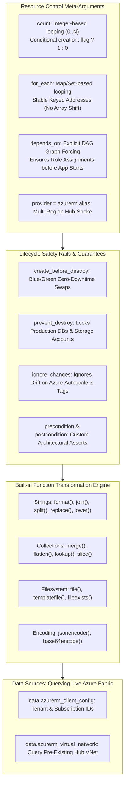

# Module 14-3: Meta-Arguments, Lifecycle Control, Functions & Data Sources

**Breadcrumbs:** [[--Index--|🏠 Index]] > [[14-Index - Terraform on Azure|☁️ Terraform on Azure MOC]] > **Module 14-3: Meta-Arguments & Functions**

---

## 🎯 Architectural Overview & Cognitive Map

In production Azure deployments, writing basic single-resource definitions is insufficient. Engineers must manage multiple instances of resources dynamically, enforce immutable safety rails against accidental production destruction, manipulate data types using built-in functions, and query live Azure infrastructure.



---

## 1. Resource Meta-Arguments: `count` vs. `for_each`

### A. The Mechanics of `count`
`count` accepts an integer and instantiates that number of resource copies. Each instance is indexed by a 0-based integer: `azurerm_subnet.subnets[0]`, `azurerm_subnet.subnets[1]`.

*   **Best Use Case:** Conditional resource creation:
    ```hcl
    variable "enable_bastion_host" {
      type    = bool
      default = true
    }

    # If enable_bastion_host is false, count resolves to 0 (no resource created)
    resource "azurerm_bastion_host" "bastion" {
      count               = var.enable_bastion_host ? 1 : 0
      name                = "bastion-hub"
      resource_group_name = azurerm_resource_group.rg.name
      location            = azurerm_resource_group.rg.location
      # ...
    }
    ```

### B. The `count` Array Shift Trap
When using `count` to loop over a list of resources:
```hcl
variable "subnets" {
  type    = list(string)
  default = ["subnet-web", "subnet-app", "subnet-db"]
}

resource "azurerm_subnet" "subnets" {
  count                = length(var.subnets)
  name                 = var.subnets[count.index]
  resource_group_name  = azurerm_resource_group.rg.name
  virtual_network_name = azurerm_virtual_network.vnet.name
  address_prefixes     = ["10.0.${count.index}.0/24"]
}
```
*   **The Catastrophe:** If an engineer removes `"subnet-web"` from the list, `"subnet-app"` shifts from index `[1]` to index `[0]`, and `"subnet-db"` shifts from `[2]` to `[1]`.
*   Terraform's DAG compares `subnets[0]` (previously `"subnet-web"`, now `"subnet-app"`) and triggers a **destructive in-place recreation of all subsequent subnets and every connected virtual machine/database!**

### C. The Solution: `for_each` with Stable Map Keys
`for_each` takes a `map` or `set(string)`. Each resource instance is keyed to an immutable, stable string name rather than an array index: `azurerm_subnet.subnets["subnet-web"]`.

```hcl
variable "subnets" {
  type = map(string)
  default = {
    "subnet-web" = "10.0.1.0/24"
    "subnet-app" = "10.0.2.0/24"
    "subnet-db"  = "10.0.3.0/24"
  }
}

resource "azurerm_subnet" "subnets" {
  for_each             = var.subnets
  name                 = each.key           # Stable key: "subnet-web"
  address_prefixes     = [each.value]       # CIDR: "10.0.1.0/24"
  resource_group_name  = azurerm_resource_group.rg.name
  virtual_network_name = azurerm_virtual_network.vnet.name
}
```
*   Removing `"subnet-web"` from the map cleanly destroys *only* `"subnet-web"`. The other subnets (`"subnet-app"` and `"subnet-db"`) remain completely untouched!

---

## 2. Explicit Dependencies (`depends_on`) & Provider Aliases

### A. The `depends_on` Meta-Argument
Terraform automatically builds a Directed Acyclic Graph (DAG) by analyzing resource references (e.g., `subnet_id = azurerm_subnet.snet.id`). However, in Azure control-plane operations, hidden dependencies exist where one service requires another to be fully initialized even without a direct HCL attribute reference.

```hcl
# The Azure Function App requires the Storage Account blob container to exist first,
# but the Function App resource does not take the container ID as a direct parameter.
resource "azurerm_linux_function_app" "app" {
  name                = "func-order-processor"
  resource_group_name = azurerm_resource_group.rg.name
  location            = azurerm_resource_group.rg.location
  # ...

  depends_on = [
    azurerm_storage_container.func_code,
    azurerm_role_assignment.storage_access
  ]
}
```

### B. Provider Aliases for Multi-Region / Multi-Subscription Architecture
To deploy resources across paired regions (e.g., East US and West US for Hub-and-Spoke peering or disaster recovery):

```hcl
# Default Provider (East US)
provider "azurerm" {
  features {}
}

# Aliased Secondary Provider (West US)
provider "azurerm" {
  alias = "westus"
  features {}
}

resource "azurerm_virtual_network" "hub_east" {
  name                = "vnet-hub-eastus"
  location            = "eastus"
  resource_group_name = azurerm_resource_group.rg.name
  address_space       = ["10.0.0.0/16"]
}

resource "azurerm_virtual_network" "dr_west" {
  provider            = azurerm.westus # Routes API calls to secondary provider
  name                = "vnet-dr-westus"
  location            = "westus"
  resource_group_name = azurerm_resource_group.rg_west.name
  address_space       = ["10.1.0.0/16"]
}
```

---

## 3. Lifecycle Meta-Arguments: Production Safety Rails

The `lifecycle` block alters Terraform's default create/update/destroy behavior:

```hcl
resource "azurerm_mssql_database" "prod_db" {
  name         = "sqldb-enterprise-prod"
  server_id    = azurerm_mssql_server.sql.id
  collation    = "SQL_Latin1_General_CP1_CI_AS"
  license_type = "LicenseIncluded"
  sku_name     = "S1"

  lifecycle {
    # 1. PREVENT DESTROY: Any terraform destroy or destructive update targeting this DB throws a hard error!
    prevent_destroy = true

    # 2. CREATE BEFORE DESTROY: Useful for immutable swaps (provisions new instance before tearing down old)
    create_before_destroy = false

    # 3. IGNORE CHANGES: Ignores attributes updated dynamically by Azure outside Terraform
    ignore_changes = [
      tags["LastScannedDate"],
      max_size_gb
    ]

    # 4. CUSTOM PRECONDITIONS & POSTCONDITIONS (Terraform 1.2+)
    precondition {
      condition     = var.environment == "prod"
      error_message = "Production database tier can only be instantiated when environment is set to 'prod'."
    }
  }
}
```

> [!WARNING]
> **Ignoring VMSS Autoscale Drift:**
> When using `azurerm_orchestrated_virtual_machine_scale_set` or AKS clusters, Azure Monitor dynamically adjusts the `instances` or `node_count` based on CPU load. Without `lifecycle { ignore_changes = [ instances ] }`, running Terraform will constantly reset the scale set back to its baseline capacity during traffic spikes!

---

## 4. Built-in Function Transformation Suite

Terraform includes a robust library of pure, deterministic functions. Terraform does *not* support user-defined functions; all logic is composed from built-ins:

### A. String & Formatting Functions
*   **`format("vnet-%s-%s", var.project, var.env)`**: Standard C-style string interpolation.
*   **`join(", ", var.allowed_cidrs)`**: Concatenates a list into a single delimited string.
*   **`split("/", azurerm_subnet.snet.id)`**: Splits a Resource ID string into a list of segments.
*   **`replace("my-storage-account", "-", "")`**: Strips hyphens to comply with Azure Storage naming rules.
*   **`lower() / upper()`**: Normalizes case sensitivity.

### B. Collection & Map Functions
*   **`merge(var.base_tags, { Tier = "Gold", CostCenter = "8810" })`**: Combines multiple maps into one.
*   **`lookup(var.sku_map, var.environment, "Standard_B1s")`**: Retrieves a map value with a fallback default.
*   **`flatten([ [1, 2], [3, 4] ])`**: Flattens nested lists into a single linear list (essential for multi-subnet rules).
*   **`element(var.availability_zones, count.index)`**: Safe wrap-around indexing over lists.

### C. Encoding & Filesystem Functions
*   **`file("${path.module}/scripts/init.sh")`**: Reads raw file content as a string.
*   **`templatefile("${path.module}/templates/cloud-init.yaml", { admin_user = var.user, hostname = var.host })`**: Renders dynamic templates by injecting HCL variables.
*   **`jsonencode({ key = "value" })`**: Converts HCL maps/objects into valid JSON strings for Azure Policy and ARM parameters.
*   **`base64encode(file("script.sh"))`**: Encodes scripts for `custom_data` or `user_data_base64` VM bootstrapping.

---

## 5. Data Sources: Reading Live Azure Infrastructure

Data sources allow Terraform to query read-only metadata from existing Azure resources without managing their lifecycle.

### A. The Universal Client Config Data Source
To dynamically discover your current Subscription ID, Tenant ID, and Caller Object ID:

```hcl
data "azurerm_client_config" "current" {}

output "deployer_object_id" {
  value       = data.azurerm_client_config.current.object_id
  description = "Entra ID Object ID of the executing identity (useful for Key Vault Access Policies)."
}

output "subscription_id" {
  value = data.azurerm_client_config.current.subscription_id
}
```

### B. Querying Existing Virtual Networks & Subnets
When deploying a microservice into an existing enterprise Hub-and-Spoke network managed by a separate team:

```hcl
data "azurerm_virtual_network" "hub" {
  name                = "vnet-enterprise-hub"
  resource_group_name = "rg-enterprise-network-shared"
}

data "azurerm_subnet" "app_subnet" {
  name                 = "snet-workload-apps"
  virtual_network_name = data.azurerm_virtual_network.hub.name
  resource_group_name  = data.azurerm_virtual_network.hub.resource_group_name
}

# Bind new Application Gateway or VM directly to the queried subnet ID
resource "azurerm_network_interface" "nic" {
  name                = "nic-app-01"
  location            = "eastus"
  resource_group_name = "rg-app-workload"

  ip_configuration {
    name                          = "internal"
    subnet_id                     = data.azurerm_subnet.app_subnet.id
    private_ip_address_allocation = "Dynamic"
  }
}
```

---

## 6. Deep-Intuition (AARF) Failure-Loop Breakdowns

### Scenario: The `count` List-Shift Destruction Catastrophe
*   **The Architecture:** An engineering team provisions 5 Azure Virtual Machines hosting Cassandra database nodes using `count = length(var.node_names)`.
*   **The Assumption:** The team assumes that removing an decommissioned node from the middle of the `var.node_names` list (`["node-1", "node-2", "node-3", "node-4", "node-5"]`) will simply delete that specific VM.
*   **The Failure Loop:**
    *   The engineer deletes `"node-2"` from the list and runs `terraform apply`.
    *   Because `node-3` becomes index `[1]`, `node-4` becomes `[2]`, and `node-5` becomes `[3]`, Terraform detects that the attributes of nodes 2, 3, and 4 have changed.
    *   Terraform simultaneously destroys and recreates 4 out of the 5 database nodes, causing permanent distributed quorum loss and data corruption!
*   **The Root Cause:**
    *   `count` binds resource identity to the **integer position** within an array. Any alteration to the array order triggers cascading recreation of all subsequent elements.
*   **The Architectural Remediation:**
    *   **NEVER use `count` for heterogeneous or stateful resources.**
    *   Convert the resource loop to **`for_each`** using a set of strings or a map. In `for_each`, each VM is identified by its persistent key (e.g., `azurerm_linux_virtual_machine.vm["node-2"]`), guaranteeing that deleting one key strictly affects only that specific target node!
