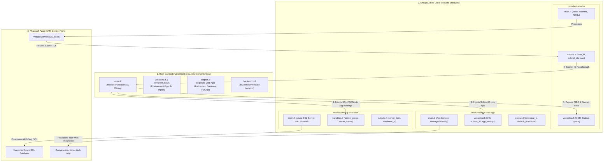

# Module 14-4: Modular Architecture, Code Organization & Reusable Modules

**Breadcrumbs:** [[--Index--|🏠 Index]] > [[14-Index - Terraform on Azure|☁️ Terraform on Azure MOC]] > **Module 14-4: Modules & Code Organization**

---

## 🎯 Architectural Overview & Cognitive Map

In real-world enterprise infrastructure engineering, writing all resources into a single monolithic `main.tf` file is an anti-pattern. Monoliths lead to massive blast radiuses, painful code duplication, merge conflicts in team settings, and zero reusability across projects.

**Terraform Modules** are self-contained packages of Terraform configurations that manage a group of related resources. Modules function like **reusable, versioned software libraries** (or LEGO bricks). A well-designed module encapsulates Azure best practices, policies, and security baselines so application teams can provision compliant infrastructure without re-inventing the wheel.



---

## 1. Directory Structure & File Layout Best Practices

Production Terraform repositories must follow clean, standardized file layouts. Two primary structural patterns govern enterprise architecture:

### Pattern A: Standard Child Module Internal Layout
Every reusable module must contain the **standard triad of files**, plus versioning and documentation:

```text
modules/storage-account/
├── README.md        # Comprehensive documentation: inputs, outputs, prerequisites, usage examples
├── main.tf          # Core Azure resource blocks (azurerm_storage_account, blob services)
├── variables.tf     # Explicit variable definitions with types, descriptions, and validations
├── outputs.tf       # Exported attributes (id, primary_blob_endpoint, name)
└── versions.tf      # Pins minimum Terraform Core and required provider versions
```

---

### Pattern B: Multi-Environment Directory-per-Environment (PwC / Enterprise Standard)
Rather than relying solely on Terraform workspaces (which share the same backend configuration and risk cross-environment state destruction), enterprise landing zones enforce **Directory-per-Environment isolation**:

```text
oh-infra/
├── modules/                               # Reusable Child Modules (1 per resource type)
│   ├── resource-group/
│   │   ├── main.tf, variables.tf, outputs.tf, versions.tf
│   ├── storage-account/
│   ├── linux-web-app/
│   ├── mssql-server/
│   ├── private-endpoint/
│   └── redis-cache/
└── environments/ (or terraform/)          # Calling Root Configurations
    ├── dev/
    │   ├── main.tf                        # Calls ../../modules/* with dev parameters
    │   ├── backend.hcl                    # Points to dev.terraform.tfstate (Zero Blast Radius!)
    │   ├── variables.tf
    │   ├── terraform.tfvars               # Dev values (e.g. SKU = "B1", LRS replication)
    │   └── versions.tf
    ├── staging/
    │   ├── main.tf
    │   ├── backend.hcl                    # Points to staging.terraform.tfstate
    │   └── terraform.tfvars               # Staging values
    └── prod/
        ├── main.tf
        ├── backend.hcl                    # Points to prod.terraform.tfstate
        └── terraform.tfvars               # Prod values (e.g. SKU = "P1v3", GRS replication, Multi-AZ)
```

---

### Directory-per-Environment vs. Terraform Workspaces Comparison

| Evaluation Metric | Terraform Workspaces | Directory-per-Environment (Enterprise Standard) |
| :--- | :--- | :--- |
| **State Storage** | Single backend storage with dynamic prefixes (`env:/<workspace>/...`). | **Completely independent remote state keys** (`dev.tfstate`, `prod.tfstate`). |
| **Blast Radius** | **High**: A misconfigured backend script or accidental `terraform destroy` can wipe out the wrong environment. | **Zero Blast Radius**: Destroying `dev` has zero physical possibility of touching `prod` state. |
| **RBAC Isolation** | Difficult: A single service principal often requires access across all workspaces. | **Native RBAC Boundary**: `dev` pipeline runs with Dev SP/MI; `prod` pipeline runs with Prod SP/MI. |
| **Architectural Drift** | Hard: Workspaces assume all environments share identical code structure. | **First-Class**: Prod can conditionally include Multi-AZ, Azure Front Door, or Geo-disaster recovery modules. |
| **Human Error** | High: Easy to forget which workspace is active (`terraform workspace select`). | **Low**: The folder path (`cd environments/dev`) makes the deployment target undeniable. |

---

## 2. Reusable Child Module Engineering

### A. Calling a Child Module
In Terraform HCL, a child module is invoked using the **`module`** block:

```hcl
# Calling the storage-account child module:
module "app_storage" {
  source = "../../modules/storage-account" # Relative path to child module directory

  name                          = "stappdata${var.environment}"
  resource_group_name           = module.resource_group.name
  location                      = module.resource_group.location
  account_tier                  = "Standard"
  account_replication_type      = var.environment == "prod" ? "GRS" : "LRS"
  public_network_access_enabled = false

  tags = local.common_tags
}
```

---

### B. The Provider Inversion Rule (CRITICAL)

A major architectural law in Terraform module design:

> [!IMPORTANT]
> **The Provider Inversion Rule:**
> **Child modules must NEVER contain `provider "azurerm" { ... }` configuration blocks!**
> 
> * Providers should only be configured **once**, in the calling **root module** (`environments/dev/providers.tf`).
> * Child modules must only declare their **provider requirements** in `versions.tf` inside `terraform { required_providers { ... } }`.
> * If a child module hardcodes a `provider` block, it breaks Terraform's ability to destroy resources, prevents using `for_each` on the module, and blocks passing aliased providers.

```hcl
# modules/storage-account/versions.tf (CORRECT: Required Providers Only!)
terraform {
  required_version = ">= 1.5.0"
  required_providers {
    azurerm = {
      source  = "hashicorp/azurerm"
      version = ">= 3.100.0"
    }
  }
}
# DO NOT put: provider "azurerm" {} here!
```

---

### C. The Output-to-Input Passthrough Pattern (Chaining Modules)

Resources inside one child module **cannot see or access** resources inside another child module directly. 
All cross-module communication must follow the **Output-to-Input Passthrough Pattern**:

```text
[ module.network ]
        │
        ▼ (Exports computed attribute via outputs.tf)
  output "subnet_id" { value = azurerm_subnet.app.id }
        │
        ▼ (Captured in root main.tf)
  subnet_id = module.network.subnet_id
        │
        ▼ (Passed as input argument into next module's variables.tf)
[ module.web_app ]
```

#### Step-by-Step Implementation:

1. **Child Module 1 (`modules/network/outputs.tf`)**:
   ```hcl
   output "app_subnet_id" {
     description = "Resource ID of the App Service integration subnet."
     value       = azurerm_subnet.app.id
   }
   ```

2. **Child Module 2 (`modules/linux-web-app/variables.tf`)**:
   ```hcl
   variable "virtual_network_subnet_id" {
     type        = string
     description = "ID of the subnet for regional VNet integration."
     default     = null
   }
   ```

3. **Root Module Wiring (`environments/dev/main.tf`)**:
   ```hcl
   # 1. Instantiate Network
   module "network" {
     source = "../../modules/network"
     # ...
   }

   # 2. Instantiate App Service, injecting output from Network:
   module "web_app" {
     source = "../../modules/linux-web-app"

     name                      = "app-api-dev"
     virtual_network_subnet_id = module.network.app_subnet_id # <-- PASSTHROUGH BINDING!
     # ...
   }
   ```

---

## 3. Advanced Module Operations: Looping, Providers & Pinning

### A. Dynamic Module Looping with `for_each`
Starting in Terraform 0.13, you can multiply an entire architectural module using `for_each`:

```hcl
variable "microservices" {
  type = map(object({
    port        = string
    memory_mb   = number
    db_required = bool
  }))
  default = {
    "auth"         = { port = "5001", memory_mb = 1024, db_required = true }
    "notification" = { port = "5002", memory_mb = 512,  db_required = true }
    "file-mgmt"    = { port = "5003", memory_mb = 2048, db_required = false }
  }
}

# Provisions a complete Web App stack for each microservice dynamically!
module "services" {
  for_each = var.microservices

  source = "../../modules/linux-web-app"

  name            = "oh-${each.key}-${var.environment}"
  service_plan_id = module.service_plan.id
  container_port  = each.value.port

  tags = local.common_tags
}
```

> [!WARNING]
> **The Golden Rule of Module `for_each` Keys:**
> The keys of the map passed to `for_each` (e.g., `"auth"`, `"notification"`) **must be known statically before planning**. You cannot use computed attributes from other resources as keys for module looping!

---

### B. Passing Providers to Modules (`providers` Map)
When child modules must deploy resources into alternate Azure subscriptions (e.g., Hub subscription vs. Spoke subscription):

```hcl
# Root main.tf
module "central_dns_records" {
  source = "../../modules/private-dns"

  # Explicitly map the aliased provider into the child module's default azurerm provider:
  providers = {
    azurerm = azurerm.hub_subscription
  }

  zone_name           = "privatelink.database.windows.net"
  resource_group_name = "rg-central-dns"
}
```

---

### C. Module Source Types & Version Pinning

| Source Type | Syntax | Recommended Use Case |
| :--- | :--- | :--- |
| **Local Relative Path** | `source = "../../modules/storage"` | Monorepos, internal project modules, rapid local iteration. |
| **Git Repository (Semantic Tag)** | `source = "git::https://github.com/my-org/tf-modules.git//storage?ref=v2.1.0"` | Shared enterprise libraries. **Always pin `ref=vX.Y.Z`**, never track `main` directly! |
| **Public Terraform Registry** | `source = "Azure/vnet/azurerm"`<br>`version = "~> 4.1.0"` | Open-source community modules. |
| **Private Terraform Registry** | `source = "app.terraform.io/my-org/storage/azurerm"`<br>`version = "1.0.0"` | HCP Terraform / Enterprise private registry. |

---

## 4. Refactoring Infrastructure Without Downtime (`moved {}` Blocks)

A common challenge in evolving infrastructure: You have resources defined in a monolithic `main.tf`, and you want to refactor them into a clean child module.

### The Problem: Accidental Destruction on Refactor
If you move a resource block into a child module and run `terraform plan`:
```text
Plan: 1 to add, 0 to change, 1 to destroy.
  - azurerm_linux_web_app.app will be destroyed!
  + module.web_app.azurerm_linux_web_app.this will be created!
```
Terraform sees `azurerm_linux_web_app.app` disappeared from root, and a new resource `module.web_app.azurerm_linux_web_app.this` appeared. It will **destroy your live production app**!

---

### The Modern Solution: Declarative `moved {}` Blocks (Terraform 1.1+)
Instead of risky manual CLI commands (`terraform state mv`), add declarative `moved` blocks to your code:

```hcl
# In your root main.tf:

# 1. New Module Invocation:
module "web_app" {
  source = "./modules/linux-web-app"
  name   = "app-api-prod"
  # ...
}

# 2. Declarative State Migration Instruction:
moved {
  from = azurerm_linux_web_app.app
  to   = module.web_app.azurerm_linux_web_app.this
}
```

When you run `terraform plan`:
```text
No changes. Your infrastructure matches the configuration.
(Terraform automatically updates the state address behind the scenes with ZERO cloud changes!)
```

---

## 5. Deep-Intuition (AARF) Failure-Loop Breakdowns

### Failure Loop 1: The Monolith-to-Module Refactoring Disaster
* **The Architecture:** An enterprise production database (`azurerm_mssql_database.prod_db`) holding customer financial records was originally written in root `main.tf`.
* **The Failure Loop:**
  * An engineer refactors the database into `module.database`.
  * The engineer runs `terraform apply -auto-approve` in the pipeline without a `moved {}` block.
  * Terraform drops the database (`- destroy`) and provisions a brand new empty database (`+ create`).
  * Customer financial data is instantly deleted from production.
* **The Root Cause:** Terraform identifies resources by their **State Address**. When the address changes from `azurerm_mssql_database.prod_db` to `module.database.azurerm_mssql_database.this`, Terraform treats it as a brand new resource unless told otherwise.
* **The Remediation:**
  1. Always add `prevent_destroy = true` inside the database lifecycle block.
  2. Always use `moved {}` blocks when refactoring code into modules.
  3. Verify with `terraform plan` that the plan reads `0 to add, 0 to change, 0 to destroy` before applying!

---

### Failure Loop 2: The Missing Module Initialization (`terraform get`)
* **The Scenario:** A new engineer clones the repository, checks out a branch that added `module "redis"`, and runs `terraform plan`.
* **The Error:**
  ```text
  Error: Module not installed
  This module is not yet installed. Run "terraform init" to install all modules.
  ```
* **The Root Cause:** Terraform stores module metadata inside the local `.terraform/modules/` directory. When new modules are added or module versions change in Git, Terraform Core does not auto-download them during `plan`.
* **The Remediation:**
  Execute `terraform init` or `terraform get -update` to synchronize module definitions before planning.
