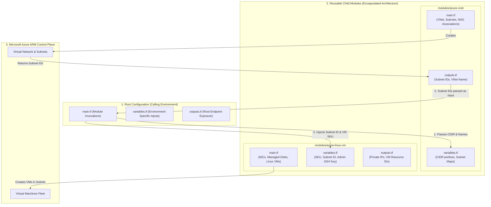

# Module 14-4: Modular Architecture, Code Organization & Reusable Modules

**Breadcrumbs:** [[--Index--|🏠 Index]] > [[14-Index - Terraform on Azure|☁️ Terraform on Azure MOC]] > **Module 14-4: Modules & Code Organization**

---

## 🎯 Architectural Overview & Cognitive Map

In real-world enterprise infrastructure engineering, writing all Terraform resources into a single monolithic `main.tf` file is an anti-pattern. Monoliths lead to code duplication, blast radius expansion, difficult debugging, and zero reusability across teams.

**Terraform Modules** are self-contained packages of Terraform configurations that manage a group of related resources. Modules function like **reusable, versioned software libraries** (or LEGO bricks).



---

## 1. Directory Structure & File Layout Best Practices

Production Terraform repositories must follow a clean, standardized file layout. Two primary directory patterns exist in enterprise engineering:

### Pattern A: Standard Module Internal Layout
Every reusable module must contain the following standard triad of files:
* `main.tf`: The core resource declarations.
* `variables.tf`: Explicit input variable definitions with type constraints, default values, and validation rules.
* `outputs.tf`: Exported attributes required by calling modules or end users.
* `versions.tf`: Pins required Terraform core versions and provider versions.
* `README.md`: Documents inputs, outputs, prerequisites, and usage examples.

### Pattern B: Multi-Environment Directory-per-Environment (Recommended)
Rather than relying solely on Terraform workspaces (which share the same backend configuration and can lead to accidental cross-environment state overwrites), enterprise landing zones separate environments by directory:

```text
terraform-azure-enterprise/
├── modules/                               # Reusable Child Modules
│   ├── networking/
│   │   ├── main.tf
│   │   ├── variables.tf
│   │   ├── outputs.tf
│   │   └── versions.tf
│   ├── compute/
│   │   ├── main.tf
│   │   ├── variables.tf
│   │   └── outputs.tf
│   └── database/
│       ├── main.tf
│       ├── variables.tf
│       └── outputs.tf
└── environments/                          # Calling Root Configurations
    ├── dev/
    │   ├── main.tf                        # Calls ../../modules/*
    │   ├── backend.tf                     # Points to dev.terraform.tfstate
    │   ├── variables.tf
    │   ├── terraform.tfvars               # Dev-specific sizing (e.g. Standard_B2s)
    │   └── versions.tf
    ├── staging/
    │   ├── main.tf
    │   ├── backend.tf                     # Points to staging.terraform.tfstate
    │   ├── terraform.tfvars
    │   └── versions.tf
    └── prod/
        ├── main.tf
        ├── backend.tf                     # Points to prod.terraform.tfstate
        ├── terraform.tfvars               # Prod sizing (e.g. Standard_D4s_v5, ZRS)
        └── versions.tf
```

---

## 2. Reusable Child Module Engineering & The Output Passthrough Pattern

### A. Calling a Child Module
In Terraform HCL, a module is invoked using the `module` block:

```hcl
# environments/prod/main.tf

module "network" {
  source = "../../modules/networking"

  resource_group_name = "rg-enterprise-prod"
  location            = "eastus"
  vnet_cidr           = "10.100.0.0/16"
  subnets = {
    frontend = "10.100.1.0/24"
    backend  = "10.100.2.0/24"
    data     = "10.100.3.0/24"
  }

  tags = {
    Environment = "Production"
    CostCenter  = "CC-104"
    ManagedBy   = "Terraform"
  }
}
```

### B. The Output Passthrough Pattern (Chaining Modules)
Resources inside one child module cannot directly see resources inside another child module. **All inter-module communication must pass through outputs and inputs in the calling root configuration**:

```hcl
# Passing the subnet ID exported by module.network into module.compute
module "app_servers" {
  source = "../../modules/compute"

  resource_group_name = "rg-enterprise-prod"
  location            = "eastus"
  
  # PASSTHROUGH: Consume output from the networking module!
  subnet_id           = module.network.subnet_ids["backend"]
  
  vm_count            = 3
  vm_size             = "Standard_D2s_v5"
  admin_username      = "azureadmin"
  ssh_public_key      = file("~/.ssh/id_rsa.pub")

  tags = module.network.tags
}
```

---

## 3. Module Looping, Providers & Versioning

### A. Dynamic Module Looping with `for_each`
Starting in Terraform 0.13, modules can be dynamically multiplied using `for_each`:

```hcl
variable "regional_deployments" {
  type = map(object({
    cidr        = string
    environment = string
  }))
  default = {
    eastus = { cidr = "10.10.0.0/16", environment = "prod-east" }
    westus = { cidr = "10.20.0.0/16", environment = "prod-west" }
  }
}

# Creates one entire network stack per region dynamically!
module "regional_network" {
  for_each = var.regional_deployments

  source              = "../../modules/networking"
  resource_group_name = "rg-network-${each.key}"
  location            = each.key
  vnet_cidr           = each.value.cidr

  tags = {
    Region      = each.key
    Environment = each.value.environment
  }
}
```

### B. Passing Providers to Modules (`providers` Map)
When child modules require alternate Azure subscriptions or specific provider configurations:

```hcl
module "hub_network" {
  source = "../../modules/networking"

  providers = {
    azurerm = azurerm.hub_subscription
  }

  resource_group_name = "rg-hub-connectivity"
  location            = "eastus"
  vnet_cidr           = "10.0.0.0/16"
}
```

### C. Module Source Types & Version Pinning
* **Local Relative Path:** `source = "./modules/vnet"` (Best for internal project modules).
* **Git Repository with Semantic Version Tag:**
  ```hcl
  source = "git::https://github.com/my-org/terraform-azure-vnet.git?ref=v2.1.0"
  ```
  *(Always pin to a tagged commit or semantic release, never use `main` directly in production!)*
* **Terraform Registry / Private Module Registry:**
  ```hcl
  source  = "Azure/vnet/azurerm"
  version = "4.1.0"
  ```

---

## 4. Production-Grade HCL Example: Reusable Azure VNet Child Module

### `modules/networking/variables.tf`
```hcl
variable "resource_group_name" {
  type        = string
  description = "The name of the target resource group."
}

variable "location" {
  type        = string
  description = "Azure region where the network will be deployed."
}

variable "vnet_cidr" {
  type        = string
  description = "CIDR block for the parent virtual network."
  validation {
    condition     = can(cidrnetmask(var.vnet_cidr))
    error_message = "The vnet_cidr variable must be a valid CIDR address (e.g., 10.0.0.0/16)."
  }
}

variable "subnets" {
  type        = map(string)
  description = "Map of subnet name to CIDR prefix."
}

variable "tags" {
  type        = map(string)
  default     = {}
  description = "Resource tags applied to networking resources."
}
```

### `modules/networking/main.tf`
```hcl
resource "azurerm_virtual_network" "vnet" {
  name                = "vnet-${var.resource_group_name}"
  location            = var.location
  resource_group_name = var.resource_group_name
  address_space       = [var.vnet_cidr]
  tags                = var.tags
}

resource "azurerm_subnet" "subnets" {
  for_each = var.subnets

  name                 = "snet-${each.key}"
  resource_group_name  = var.resource_group_name
  virtual_network_name = azurerm_virtual_network.vnet.name
  address_prefixes     = [each.value]
}

resource "azurerm_network_security_group" "nsg" {
  for_each = var.subnets

  name                = "nsg-${each.key}"
  location            = var.location
  resource_group_name = var.resource_group_name
  tags                = var.tags
}

resource "azurerm_subnet_network_security_group_association" "nsg_assoc" {
  for_each = var.subnets

  subnet_id                 = azurerm_subnet.subnets[each.key].id
  network_security_group_id = azurerm_network_security_group.nsg[each.key].id
}
```

### `modules/networking/outputs.tf`
```hcl
output "vnet_id" {
  value       = azurerm_virtual_network.vnet.id
  description = "Resource ID of the provisioned Virtual Network."
}

output "vnet_name" {
  value       = azurerm_virtual_network.vnet.name
  description = "Name of the provisioned Virtual Network."
}

output "subnet_ids" {
  value       = { for k, v in azurerm_subnet.subnets : k => v.id }
  description = "Map of subnet names to their Azure Resource IDs."
}
```

---

## 5. Deep-Intuition (AARF) Failure-Loop Breakdowns

### Scenario: The Monolith-to-Module Refactor Disaster (State Destruction Outage)

#### 1. The Architectural Setup & Assumptions
A cloud engineer has an active production environment originally defined monolithically in `main.tf`:
```hcl
resource "azurerm_linux_virtual_machine" "app" {
  name = "vm-prod-app-01"
  # ...
}
```
The engineer decides to clean up the code and refactors the VM into a child module called `module.compute`. They remove the standalone resource block and add:
```hcl
module "compute" {
  source = "./modules/compute"
  # ...
}
```

#### 2. The Production Failure Manifestation
The engineer runs `terraform apply`. To their horror, Terraform outputs:
```text
Plan: 1 to add, 0 to change, 1 to destroy.
  - azurerm_linux_virtual_machine.app will be destroyed!
  + module.compute.azurerm_linux_virtual_machine.app will be created!
```
If the engineer confirms `yes`, production VMs, attached disks, and customer data are completely deleted and recreated from scratch!

#### 3. Root Cause Analysis (RCA)
* Terraform identifies managed resources strictly by their **State Address**.
* Originally, the resource address was: `azurerm_linux_virtual_machine.app`.
* Inside the module, the new address became: `module.compute.azurerm_linux_virtual_machine.app`.
* Because Terraform did not know these two addresses represented the same physical Azure entity, the DAG engine scheduled a **Destroy and Recreate**!

#### 4. Remediation & Diagnostic Verification Loop
Never destroy and recreate resources during an HCL refactor! Use Terraform's state refactoring mechanisms:

```bash
# METHOD A: CLI State Move (Instant State Address Renaming)
terraform state mv \
  azurerm_linux_virtual_machine.app \
  module.compute.azurerm_linux_virtual_machine.app

# Verify that Terraform now sees 0 changes:
terraform plan
# Output: No changes. Your infrastructure matches the configuration!
```

```hcl
# METHOD B: Declarative moved {} Block (Terraform 1.1+)
# Add directly to your HCL:
moved {
  from = azurerm_linux_virtual_machine.app
  to   = module.compute.azurerm_linux_virtual_machine.app
}
```

---

## 6. High-Yield Real-World Engineering Traps

### Trap 1: The `terraform get` Forgotten Dependency Trap
* **The Scenario:** A developer clones a repository containing modules or updates a module source tag from `v1.0.0` to `v2.0.0`, then immediately runs `terraform plan`.
* **The Trap:** Terraform throws an error: `Error: Module not installed`.
* **The Ground Truth:** Whenever a new child module is added or its source changes, you must execute **`terraform init`** or **`terraform get -update`** to download and cache the module source files into the local `.terraform/modules` directory.

### Trap 2: Dynamic Keys in Module `for_each`
* **The Scenario:** An engineer attempts to loop over a module using `for_each` where the keys of the map are derived from an unapplied resource output (e.g., `for_each = azurerm_resource_group.rg[*].name`).
* **The Trap:** Terraform crashes during plan: `Error: The "for_each" value depends on resource attributes that cannot be determined until apply`.
* **The Ground Truth:** The keys of a `for_each` map **must be known statically at plan time**. You cannot use computed attributes from other resources as the keys for `for_each` in modules or resources.

---

## 🌐 Authoritative References & Inflow Citations

* **Inflow Reference:** [Piyush Sachdeva Azure Terraform Course - Day 06 & Day 20](file:///F:/Dump%20one/BrainDump/inflow/Terraform-Azure-PiyushSachdeva/20_Day_2028_-_Deploy_AKS_Cluster_In_Azure_With_Terraform_Custom_Modules__.md)
* **Official HashiCorp Documentation:**
  - [Terraform Module Creation Best Practices](https://developer.hashicorp.com/terraform/language/modules)
  - [Refactoring with Moved Blocks](https://developer.hashicorp.com/terraform/language/modules/develop/refactoring)
