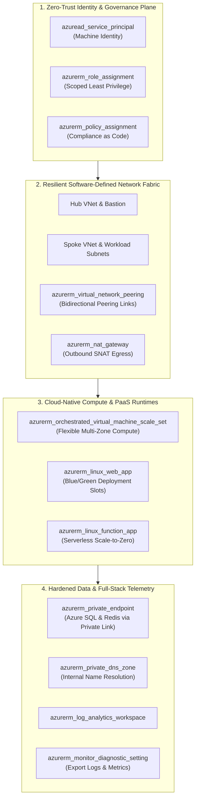

# Module 14-5: Enterprise Azure Infrastructure Patterns as Code

**Breadcrumbs:** [[--Index--|🏠 Index]] > [[14-Index - Terraform on Azure|☁️ Terraform on Azure MOC]] > **Module 14-5: Enterprise Infrastructure Patterns**

---

## 🎯 Architectural Overview & Cognitive Map

Real-world production environments require translating complex, multi-tier cloud architectures into declarative Terraform HCL. Rather than managing isolated resources, enterprise cloud engineers build integrated systems: multi-zone compute, segmented networks, zero-trust identity, hardened databases, and automated telemetry.

This module establishes the core patterns for **Hub-and-Spoke Networking**, **Zero-Downtime PaaS Runtimes**, **Serverless Event-Driven Compute**, **Zero-Trust Identity & Azure Policy Governance**, **Private Link Datastores**, and **Full-Stack Observability**.



---

## 1. Enterprise Networking Patterns as Code

Modern enterprise cloud topology centers on the **Hub-and-Spoke Architecture**:
* **Hub VNet:** Centralized shared services (Azure Firewall, Azure Bastion, VPN/ExpressRoute Gateways, Central Private DNS Zones).
* **Spoke VNets:** Workload-specific environments (`dev`, `staging`, `prod`) containing applications, microservices, and databases.

---

### A. Subnet Delegation & Regional VNet Integration
Azure App Services, Container Apps, and Databricks require dedicated subnets delegated to their underlying resource providers to inject outbound network interfaces:

```hcl
resource "azurerm_subnet" "appservice_subnet" {
  name                 = "snet-appservice-integration"
  resource_group_name  = var.resource_group_name
  virtual_network_name = azurerm_virtual_network.spoke.name
  address_prefixes     = ["10.100.2.0/24"]

  # DELEGATION BLOCK: Informs Azure SDN to dedicate this subnet to Web Apps
  delegation {
    name = "appservice-delegation"
    service_delegation {
      name    = "Microsoft.Web/serverFarms"
      actions = ["Microsoft.Network/virtualNetworks/subnets/action"]
    }
  }
}
```

> [!IMPORTANT]
> **Subnet Delegation Constraints:**
> Once a subnet is delegated to `Microsoft.Web/serverFarms`, no other resource types (Virtual Machines, Application Gateways, or Private Endpoints) can be deployed into it! Always allocate dedicated `/24` subnets specifically for integration.

---

### B. High-Scale Outbound Egress with Azure NAT Gateway
By default, Azure VMs and App Services rely on default outbound SNAT (Source Network Address Translation) provided by Azure load balancers, which allocates only 1,024 ephemeral ports per instance. High-throughput microservices frequently exhaust these ports, causing dropped outbound connections (`TCP connection timeouts`).

Attaching an **Azure NAT Gateway** provides up to 64,000 concurrent outbound flows per public IP:

```hcl
# 1. Static Standard Public IP for NAT Gateway
resource "azurerm_public_ip" "nat_pip" {
  name                = "pip-natgw-prod"
  location            = var.location
  resource_group_name = var.resource_group_name
  allocation_method   = "Static"
  sku                 = "Standard"
  zones               = ["1", "2", "3"] # Zone-redundant egress
}

# 2. Azure NAT Gateway Resource
resource "azurerm_nat_gateway" "nat_gw" {
  name                    = "natgw-prod-eastus"
  location                = var.location
  resource_group_name     = var.resource_group_name
  sku_name                = "Standard"
  idle_timeout_in_minutes = 10
}

# 3. Associate Public IP to NAT Gateway
resource "azurerm_nat_gateway_public_ip_association" "nat_pip_assoc" {
  nat_gateway_id       = azurerm_nat_gateway.nat_gw.id
  public_ip_address_id = azurerm_public_ip.nat_pip.id
}

# 4. Associate Subnet to NAT Gateway (All outbound subnet traffic now egresses via this IP!)
resource "azurerm_subnet_nat_gateway_association" "subnet_nat_assoc" {
  subnet_id      = azurerm_subnet.appservice_subnet.id
  nat_gateway_id = azurerm_nat_gateway.nat_gw.id
}
```

---

### C. Bidirectional VNet Peering as Code
VNet Peering connects two virtual networks via the private Microsoft backbone. 
A critical Terraform rule: **Peering is non-transitive and asymmetric—you must declare peering in BOTH directions!**

```hcl
# 1. Peering Link: Hub -> Spoke
resource "azurerm_virtual_network_peering" "hub_to_spoke" {
  name                         = "peer-hub-to-spoke-prod"
  resource_group_name          = azurerm_virtual_network.hub.resource_group_name
  virtual_network_name         = azurerm_virtual_network.hub.name
  remote_virtual_network_id    = azurerm_virtual_network.spoke.id
  allow_virtual_network_access = true
  allow_forwarded_traffic      = true
  allow_gateway_transit        = true # Allows spoke to share Hub VPN Gateway
}

# 2. Peering Link: Spoke -> Hub
resource "azurerm_virtual_network_peering" "spoke_to_hub" {
  name                         = "peer-spoke-prod-to-hub"
  resource_group_name          = azurerm_virtual_network.spoke.resource_group_name
  virtual_network_name         = azurerm_virtual_network.spoke.name
  remote_virtual_network_id    = azurerm_virtual_network.hub.id
  allow_virtual_network_access = true
  allow_forwarded_traffic      = true
  use_remote_gateways          = true # Routes spoke traffic through Hub Gateway

  # Explicit dependency guarantees Hub peering is established first
  depends_on = [azurerm_virtual_network_peering.hub_to_spoke]
}
```

---

## 2. Cloud-Native Compute & PaaS Deployment Slots

### A. Azure App Service with Blue/Green Zero-Downtime Deployment Slots
In enterprise engineering, deploying code directly to a live production App Service causes transient 502/503 errors during cold starts. **Deployment Slots** enable zero-downtime Blue/Green deployments:

```text
[ Developer Pipeline ] ──► Deploy Code to Staging Slot ("Blue")
                                     │
                                     ▼ (Warm-up & Health Probes 200 OK)
                            az webapp deployment slot swap
                                     │
                                     ▼ (Atomic DNS / VIP Swap)
                        Staging becomes Production ("Green")
```

```hcl
# 1. Linux Service Plan (Must be Standard S1 or Premium P1v3 to support slots!)
resource "azurerm_service_plan" "asp" {
  name                = "asp-enterprise-prod"
  location            = var.location
  resource_group_name = var.resource_group_name
  os_type             = "Linux"
  sku_name            = "P1v3"
}

# 2. Production Web App (The "Production" / Green Slot)
resource "azurerm_linux_web_app" "app" {
  name                = "app-portal-prod"
  location            = var.location
  resource_group_name = var.resource_group_name
  service_plan_id     = azurerm_service_plan.asp.id

  site_config {
    always_on = true
    application_stack {
      docker_image_name = "mcr.microsoft.com/appsvc/staticsite:latest"
    }
  }

  app_settings = {
    ENVIRONMENT_NAME = "Production"
    DATABASE_NAME    = "sqldb-orders-prod"
  }
}

# 3. Staging Deployment Slot (The "Staging" / Blue Slot)
resource "azurerm_linux_web_app_slot" "staging" {
  name           = "staging"
  app_service_id = azurerm_linux_web_app.app.id

  site_config {
    always_on = true
    application_stack {
      docker_image_name = "mcr.microsoft.com/appsvc/staticsite:latest"
    }
  }

  app_settings = {
    ENVIRONMENT_NAME = "Staging"
    DATABASE_NAME    = "sqldb-orders-staging" # Slot-specific database
  }
}
```

---

### B. Provisioners vs. Cloud-Init (Why Provisioners are an Anti-Pattern)
In Terraform, `local-exec` and `remote-exec` provisioners exist to execute shell scripts. However, HashiCorp explicitly documents provisioners as a **measure of last resort**:

| Evaluation Metric | Terraform Provisioners (`remote-exec`) | Native Cloud-Init / Custom Script Extensions |
| :--- | :--- | :--- |
| **Idempotency** | **Broken**: Provisioners run *only* during resource creation. If the script fails midway, state is corrupted. | **Native**: Managed by cloud hypervisor / cloud-init daemon. |
| **Network Dependency** | Requires the Terraform runner to maintain open SSH/WinRM ports into the VM (massive security exposure). | Runs entirely over the internal Azure control plane fabric via the Azure VM Guest Agent. |
| **Drift Detection** | Blind: Terraform cannot detect if a provisioned package was uninstalled. | Can be audited via Azure Policy and machine configuration extensions. |

#### The Recommended Pattern: VM Custom Script Extension
```hcl
resource "azurerm_virtual_machine_extension" "custom_script" {
  name                 = "vm-bootstrap"
  virtual_machine_id   = azurerm_linux_virtual_machine.vm.id
  publisher            = "Microsoft.Azure.Extensions"
  type                 = "CustomScript"
  type_handler_version = "2.1"

  settings = <<SETTINGS
    {
      "commandToExecute": "apt-get update && apt-get install -y nginx"
    }
SETTINGS
}
```

---

## 3. Zero-Trust Identity, RBAC & Azure Policy as Code

### A. Machine Identity & Scoped Azure RBAC
Avoid static passwords and long-lived client secrets. Modern workloads authenticate using **User-Assigned Managed Identities** or **Service Principals** scoped with least-privilege RBAC:

```hcl
# 1. User-Assigned Managed Identity
resource "azurerm_user_assigned_identity" "workload_mi" {
  name                = "id-order-processor-prod"
  location            = var.location
  resource_group_name = var.resource_group_name
}

# 2. Scoped Role Assignment (Scoped strictly to the Workload Resource Group!)
resource "azurerm_role_assignment" "storage_contributor" {
  scope                = azurerm_storage_account.workload_st.id # Least-privilege scope!
  role_definition_name = "Storage Blob Data Contributor"
  principal_id         = azurerm_user_assigned_identity.workload_mi.principal_id
}
```

---

### B. Azure Policy as Code (Enforcing CIS & Security Guardrails)
To prevent engineers from deploying non-compliant infrastructure (e.g., public storage accounts or unencrypted databases), deploy **Azure Policy Definitions and Assignments** via Terraform:

```hcl
# 1. Custom Policy Rule: Enforce HTTPS-Only on Storage Accounts
resource "azurerm_policy_definition" "enforce_https" {
  name         = "enforce-storage-https"
  policy_type  = "Custom"
  mode         = "All"
  display_name = "Enforce HTTPS traffic only on Storage Accounts"

  policy_rule = jsonencode({
    "if" : {
      "allOf" : [
        { "field" : "type", "equals" : "Microsoft.Storage/storageAccounts" },
        { "field" : "Microsoft.Storage/storageAccounts/supportsHttpsTrafficOnly", "notEquals" : "true" }
      ]
    },
    "then" : { "effect" : "Deny" } # Blocks non-compliant PUT API requests!
  })
}

# 2. Assign Policy to Target Resource Group
resource "azurerm_policy_assignment" "assign_https_policy" {
  name                 = "assign-storage-https"
  scope                = azurerm_resource_group.rg.id
  policy_definition_id = azurerm_policy_definition.enforce_https.id
  description          = "Blocks any storage account creation that lacks HTTPS-only enforcement."
}
```

---

## 4. Hardened Datastores & Private Link Architecture

Exposing cloud datastores or databases to the public internet using IP firewall rules is an enterprise anti-pattern. Production architectures enforce **Zero Public Network Access** and route all application traffic through **Azure Private Endpoints**.

```text
[ Linux App Service ] ──► (VNet Integration: 10.100.2.15)
                                    │
                                    ▼ (Routes through VNet)
[ Private Endpoint ] ─────► (Private IP: 10.100.1.5 in snet-pe)
                                    │
                                    ▼ (Private Link Backbone)
[ Azure SQL / Key Vault ] ► (Public Network Access: DISABLED)
```

---

### A. Enterprise Database Private Link Pattern (Azure SQL Server)

```hcl
# 1. Hardened Azure SQL Server (Public Access Disabled!)
resource "azurerm_mssql_server" "sql" {
  name                          = "sql-enterprise-prod-01"
  resource_group_name           = var.resource_group_name
  location                      = var.location
  version                       = "12.0"
  minimum_tls_version           = "1.2"
  public_network_access_enabled = false # Zero Internet Surface Area!

  # Azure AD-Only Authentication (Eliminates SQL Passwords!)
  azuread_administrator {
    login_username              = "SE2B4-PRD001-owner"
    object_id                   = var.aad_admin_group_object_id
    azuread_authentication_only = true
  }
}

# 2. Microservice Database
resource "azurerm_mssql_database" "db" {
  name      = "app-orders-prod-db"
  server_id = azurerm_mssql_server.sql.id
  sku_name  = "Basic"
}

# 3. Private DNS Zone for Azure SQL
resource "azurerm_private_dns_zone" "sql_dns" {
  name                = "privatelink.database.windows.net"
  resource_group_name = var.resource_group_name
}

# 4. Link Private DNS Zone to Spoke VNet
resource "azurerm_private_dns_zone_virtual_network_link" "vnet_link" {
  name                  = "vnet-link-sql"
  resource_group_name   = var.resource_group_name
  private_dns_zone_name = azurerm_private_dns_zone.sql_dns.name
  virtual_network_id    = azurerm_virtual_network.spoke.id
}

# 5. Private Endpoint (Allocates private IP inside snet-pe)
resource "azurerm_private_endpoint" "sql_pe" {
  name                = "pe-sql-database"
  location            = var.location
  resource_group_name = var.resource_group_name
  subnet_id           = azurerm_subnet.pe_subnet.id

  private_service_connection {
    name                           = "psc-sql-connection"
    private_connection_resource_id = azurerm_mssql_server.sql.id
    subresource_names              = ["sqlServer"]
    is_manual_connection           = false
  }

  private_dns_zone_group {
    name                 = "default"
    private_dns_zone_ids = [azurerm_private_dns_zone.sql_dns.id]
  }

  lifecycle {
    ignore_changes = [private_dns_zone_group, subnet_id]
  }
}
```

---

### B. Enterprise Secrets Datastore (Hardened Azure Key Vault)

Securing cryptographic secrets, API keys, and connection strings requires a Zero-Trust Key Vault hardened against accidental deletion, ransomware, and unauthorized public access:

```hcl
data "azurerm_client_config" "current" {}

resource "azurerm_key_vault" "kv" {
  name                          = "kv-enterprise-prod-01"
  resource_group_name           = var.resource_group_name
  location                      = var.location
  tenant_id                     = data.azurerm_client_config.current.tenant_id
  sku_name                      = "standard"
  soft_delete_retention_days    = 90
  purge_protection_enabled      = true
  enable_rbac_authorization     = true
  public_network_access_enabled = false # Disables public internet access!

  network_acls {
    default_action = "Deny"
    bypass         = "AzureServices"
  }

  # Immunizes Key Vault against out-of-band enterprise Azure Policy IP injections:
  lifecycle {
    ignore_changes = [
      network_acls[0].ip_rules
    ]
  }
}

# Dedicated Private Endpoint for Key Vault
resource "azurerm_private_endpoint" "kv_pe" {
  name                = "pe-keyvault"
  resource_group_name = var.resource_group_name
  location            = var.location
  subnet_id           = azurerm_subnet.pe_subnet.id

  private_service_connection {
    name                           = "psc-keyvault"
    private_connection_resource_id = azurerm_key_vault.kv.id
    subresource_names              = ["vault"] # Key Vault subresource
    is_manual_connection           = false
  }

  private_dns_zone_group {
    name                 = "pdzg-keyvault"
    private_dns_zone_ids = [azurerm_private_dns_zone.kv_dns.id]
  }

  lifecycle {
    ignore_changes = [private_dns_zone_group, subnet_id]
  }
}
```

---

### C. Anatomical Deconstruction of `azurerm_private_endpoint`

Understanding the underlying mechanics of an Azure Private Endpoint is crucial for troubleshooting enterprise connectivity:

1. **Physical NIC Allocation vs. Service Endpoints:**
   * **Service Endpoints:** Do NOT allocate any network interface in your subnet. Instead, traffic destined for public service tags routes across Microsoft's backbone to public VIPs, remaining vulnerable to cross-tenant data exfiltration.
   * **Private Endpoints:** Allocate an actual **synthetic Network Interface Card (NIC)** inside the target subnet (`snet-pe`). This NIC consumes a private RFC 1918 IP address (e.g., `10.100.1.5`). Traffic is cryptographically pinned to that specific resource instance.

2. **`private_service_connection` & Subresource Mapping:**
   A single PaaS resource type can expose multiple distinct sub-services or APIs. The `subresource_names` argument tells the Azure SDN fabric exactly which internal API daemon to bind to that private NIC:

| PaaS Resource Type | Resource Provider (`private_connection_resource_id`) | Target Subresource (`subresource_names`) | Dedicated Private DNS Zone FQDN |
| :--- | :--- | :--- | :--- |
| **Azure Key Vault** | `Microsoft.KeyVault/vaults` | `["vault"]` | `privatelink.vaultcore.azure.net` |
| **Azure Blob Storage** | `Microsoft.Storage/storageAccounts` | `["blob"]` | `privatelink.blob.core.windows.net` |
| **Azure Table Storage** | `Microsoft.Storage/storageAccounts` | `["table"]` | `privatelink.table.core.windows.net` |
| **Azure Queue Storage** | `Microsoft.Storage/storageAccounts` | `["queue"]` | `privatelink.queue.core.windows.net` |
| **Azure File Storage** | `Microsoft.Storage/storageAccounts` | `["file"]` | `privatelink.file.core.windows.net` |
| **Azure SQL Database** | `Microsoft.Sql/servers` | `["sqlServer"]` | `privatelink.database.windows.net` |
| **Azure Cache for Redis**| `Microsoft.Cache/redis` | `["redisCache"]` | `privatelink.redis.cache.windows.net` |
| **Azure App Service** | `Microsoft.Web/sites` | `["sites"]` | `privatelink.azurewebsites.net` |
| **Azure Container Registry**| `Microsoft.ContainerRegistry/registries` | `["registry"]` | `privatelink.azurecr.io` |

3. **`private_dns_zone_group` & The WireServer Interception Mechanism:**
   * When the Private Endpoint is created, Azure ARM creates a child resource `Microsoft.Network/privateEndpoints/privateDnsZoneGroups`.
   * ARM dynamically determines the allocated private IP and writes an **A-Record** into the target Private DNS Zone (e.g., `sql-enterprise-prod-01.privatelink.database.windows.net -> 10.100.1.5`).
   * When an application VM resolves `sql-enterprise-prod-01.database.windows.net`, public DNS returns a CNAME pointing to `sql-enterprise-prod-01.privatelink.database.windows.net`.
   * The Azure Recursive Resolver WireServer (`168.63.129.16`) intercepts the query against the linked Private DNS Zone and resolves directly to the internal private IP `10.100.1.5`!

---

## 5. Full-Stack Observability as Code

No infrastructure is production-ready without automated telemetry. Using Terraform, you can enforce centralized logging across all resources into an **Azure Log Analytics Workspace**:

```hcl
# 1. Centralized Log Analytics Workspace
resource "azurerm_log_analytics_workspace" "law" {
  name                = "law-workload-prod"
  location            = var.location
  resource_group_name = var.resource_group_name
  sku                 = "PerGB2018"
  retention_in_days   = 90
}

# 2. Automated Diagnostic Settings for Azure SQL Server
resource "azurerm_monitor_diagnostic_setting" "sql_diag" {
  name                       = "diag-sql-prod"
  target_resource_id         = azurerm_mssql_server.sql.id
  log_analytics_workspace_id = azurerm_log_analytics_workspace.law.id

  metric {
    category = "AllMetrics"
    enabled  = true
  }
}

# 3. Action Group for Automated Alerts (Email & Webhook)
resource "azurerm_monitor_action_group" "devops_alert" {
  name                = "ag-devops-oncall"
  resource_group_name = var.resource_group_name
  short_name          = "OnCallDevOps"

  email_receiver {
    name          = "DevOpsLeads"
    email_address = "devops-oncall@enterprise.com"
  }
}

# 4. Metric Alert: High CPU Alert on App Service Plan
resource "azurerm_monitor_metric_alert" "cpu_alert" {
  name                = "alert-high-cpu-appservice"
  resource_group_name = var.resource_group_name
  scopes              = [azurerm_service_plan.asp.id]
  severity            = 1 # Error
  frequency           = "PT1M"
  window_size         = "PT5M"

  criteria {
    metric_namespace = "Microsoft.Web/serverfarms"
    metric_name      = "CpuPercentage"
    aggregation      = "Average"
    operator         = "GreaterThan"
    threshold        = 85
  }

  action {
    action_group_id = azurerm_monitor_action_group.devops_alert.id
  }
}
```

---

## 6. Deep-Intuition (AARF) Failure-Loop Breakdowns

### Failure Loop 1: The In-Place Subnet Resizing Outage (`SubnetInUse`)
* **The Architecture:** An enterprise subnet `10.0.1.0/24` runs out of IP addresses due to rapid microservice growth.
* **The Failure Loop:**
  * An engineer changes the CIDR block in Terraform from `10.0.1.0/24` to `10.0.1.0/23` and runs `terraform apply`.
  * Azure Resource Manager rejects the change: `Error: Subnet 'snet-app' is in use by /subscriptions/.../networkInterfaces/nic-01 and cannot be modified`.
  * Terraform plans to destroy and recreate the subnet, bringing down all active services!
* **The Root Cause:** In Azure software-defined networking, you cannot modify the address prefix of an active subnet while connected network interfaces exist.
* **The Architectural Remediation:**
  1. Never resize an active subnet in-place.
  2. Provision a **brand new subnet** alongside the old one: `snet-app-v2` (`10.0.2.0/23`).
  3. Migrate or recreate workloads into `snet-app-v2`.
  4. Decommission and delete the old `snet-app`.

---

### Failure Loop 2: The Asymmetric VNet Peering Black Hole
* **The Scenario:** An engineer configures VNet peering from Spoke to Hub, but forgets to declare the reverse peering link from Hub to Spoke.
* **The Failure Loop:**
  * The engineer tests connectivity by pinging the Hub gateway from a Spoke VM.
  * The packet successfully egresses the Spoke VNet and reaches the Hub VM.
  * However, the Hub VM has no route to reply to the Spoke!
  * Packets are dropped silently with `Request timed out`.
* **The Root Cause:** VNet peering is **strictly non-transitive and unidirectional**. Each virtual network must have its own peering resource pointing to the remote peer.
* **The Remediation:** Always declare two peering resources (`azurerm_virtual_network_peering.hub_to_spoke` and `azurerm_virtual_network_peering.spoke_to_hub`) and chain them using `depends_on`.

---

### Failure Loop 3: The Corporate Azure Policy IP Injection Drift War (Runbook Issue 5)
* **The Architecture:** In enterprise environments, corporate governance mandates automated security audits. An enterprise Azure Policy (or security compliance orchestrator) automatically inspects newly provisioned PaaS resources (such as Key Vaults or Storage Accounts) and injects vulnerability scanner IPs (Qualys, Tenable Nessus, Defender for Cloud) and corporate VPN / ExpressRoute egress gateways into `network_acls.ip_rules`.
* **The Failure Loop:**
  * Terraform deploys the PaaS resource matching the local HCL configuration.
  * Azure Policy fires out-of-band and injects the corporate scanner IP addresses into ARM.
  * On the next CI/CD run, `terraform plan` compares state against live ARM and detects drift:
    ```text
    ~ network_acls {
        ~ ip_rules = [
            - "52.176.44.12",
            - "20.42.5.10/29",
          ]
      }
    ```
  * `terraform apply` strips the scanner IPs to conform to HCL.
  * Corporate security audits fail, triggering high-severity SIEM alerts; Azure Policy detects non-compliance and re-injects the IPs.
  * The cycle repeats indefinitely ("Ping-Pong Drift War").
* **The Root Cause:** Out-of-band enterprise policy management clashing with Terraform's declarative expectation of exclusive attribute ownership.
* **The Architectural Remediation:**
  Explicitly delegate ownership of the firewall rules to corporate policy via Terraform's `lifecycle` block:
  ```hcl
  lifecycle {
    ignore_changes = [
      network_acls[0].ip_rules
    ]
  }
  ```
  Terraform will ignore differences between local state and the live policy-injected IP rules, achieving permanent drift immunity.

---

### Failure Loop 4: The Soft-Deleted "Zombie Vault" Collision (`VaultAlreadyExists`) & Purge Protection Lock
* **The Architecture:** Azure Key Vault enforces mandatory Soft Delete with a configurable retention window (7 to 90 days). When `purge_protection_enabled = true` is activated, no user—including Subscription Owners and Microsoft Support—can permanently purge the vault until the retention period elapses.
* **The Failure Loop:**
  * An engineer executes `terraform destroy` or renames an existing Key Vault in HCL.
  * Terraform issues an HTTP `DELETE` to Azure ARM. The vault is removed from active service, but enters the soft-deleted quarantine state.
  * On the next `terraform apply`, Terraform attempts to create a vault with the same name.
  * ARM rejects the request with HTTP 409 Conflict:
    ```text
    Error: creating Key Vault "kv-enterprise-prod":
      Status=409 Code="VaultAlreadyExists"
      Message="The vault name 'kv-enterprise-prod' is already in use or is reserved by a soft-deleted vault."
    ```
  * Terraform cannot create the vault because the DNS name is reserved by the soft-deleted instance; Terraform cannot manage the existing vault because it is quarantined.
* **The Root Cause:** Soft-deleted vaults retain global DNS name reservations across Azure. If Purge Protection is enabled, premature recreation with the same name is strictly impossible until the retention duration expires.
* **The Architectural Remediation:**
  1. **Audit Soft-Deleted Vaults:**
     ```powershell
     az keyvault list-deleted --output table
     ```
  2. **If Recovery is Desired:** Restore the vault and reconcile Terraform state:
     ```powershell
     az keyvault recover --name "kv-enterprise-prod" --location "eastus" --resource-group "rg-enterprise-prod"
     terraform import azurerm_key_vault.kv /subscriptions/<sub_id>/resourceGroups/rg-enterprise-prod/providers/Microsoft.KeyVault/vaults/kv-enterprise-prod
     ```
  3. **If Purge is Desired (Only possible if Purge Protection was FALSE):**
     ```powershell
     az keyvault purge --name "kv-enterprise-prod" --location "eastus"
     ```
  4. **Ephemeral/Dev Provider Configuration:** For CI/CD sandbox environments with frequent teardowns, configure the provider to auto-recover soft-deleted vaults:
     ```hcl
     provider "azurerm" {
       features {
         key_vault {
           recover_soft_deleted_key_vaults = true
           purge_soft_delete_on_destroy    = false
         }
       }
     }
     ```
