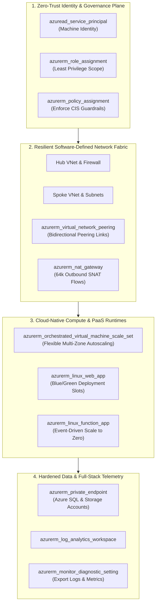

# Module 14-5: Enterprise Azure Infrastructure Patterns as Code

**Breadcrumbs:** [[--Index--|🏠 Index]] > [[14-Index - Terraform on Azure|☁️ Terraform on Azure MOC]] > **Module 14-5: Enterprise Infrastructure Patterns**

---

## 🎯 Architectural Overview & Cognitive Map

Real-world production environments require translating complex, multi-tier cloud architectures into declarative Terraform HCL. Rather than managing isolated resources, enterprise cloud engineers build integrated systems: multi-zone compute, segmented networks, zero-trust identity, hardened databases, and automated telemetry.



---

## 1. Enterprise Networking as Code

### A. Subnet Delegation & NSG Association Pattern
In modern Azure, certain PaaS services (e.g., App Service VNet Integration, Azure Container Instances) require subnet delegation. Terraform handles this natively:

```hcl
resource "azurerm_subnet" "appservice_subnet" {
  name                 = "snet-appservice-integration"
  resource_group_name  = var.resource_group_name
  virtual_network_name = azurerm_virtual_network.vnet.name
  address_prefixes     = ["10.100.10.0/24"]

  delegation {
    name = "appservice-delegation"
    service_delegation {
      name    = "Microsoft.Web/serverFarms"
      actions = ["Microsoft.Network/virtualNetworks/subnets/action"]
    }
  }
}
```

### B. High-Scale Outbound Egress with Azure NAT Gateway
To eliminate SNAT port exhaustion on outbound microservice traffic, attach a NAT Gateway to workload subnets:

```hcl
resource "azurerm_public_ip" "nat_pip" {
  name                = "pip-natgw-prod"
  location            = var.location
  resource_group_name = var.resource_group_name
  allocation_method   = "Static"
  sku                 = "Standard"
  zones               = ["1", "2", "3"]
}

resource "azurerm_nat_gateway" "nat_gw" {
  name                    = "natgw-prod-eastus"
  location                = var.location
  resource_group_name     = var.resource_group_name
  sku_name                = "Standard"
  idle_timeout_in_minutes = 10
}

resource "azurerm_nat_gateway_public_ip_association" "nat_pip_assoc" {
  nat_gateway_id       = azurerm_nat_gateway.nat_gw.id
  public_ip_address_id = azurerm_public_ip.nat_pip.id
}

resource "azurerm_subnet_nat_gateway_association" "subnet_nat_assoc" {
  subnet_id      = azurerm_subnet.workload_subnet.id
  nat_gateway_id = azurerm_nat_gateway.nat_gw.id
}
```

### C. Bidirectional VNet Peering as Code
VNet peering requires explicit configuration in **both directions**:

```hcl
# Link 1: Hub to Spoke
resource "azurerm_virtual_network_peering" "hub_to_spoke" {
  name                         = "peer-hub-to-spoke"
  resource_group_name          = azurerm_virtual_network.hub.resource_group_name
  virtual_network_name         = azurerm_virtual_network.hub.name
  remote_virtual_network_id    = azurerm_virtual_network.spoke.id
  allow_virtual_network_access = true
  allow_forwarded_traffic      = true
  allow_gateway_transit        = true
}

# Link 2: Spoke to Hub
resource "azurerm_virtual_network_peering" "spoke_to_hub" {
  name                         = "peer-spoke-to-hub"
  resource_group_name          = azurerm_virtual_network.spoke.resource_group_name
  virtual_network_name         = azurerm_virtual_network.spoke.name
  remote_virtual_network_id    = azurerm_virtual_network.hub.id
  allow_virtual_network_access = true
  allow_forwarded_traffic      = true
  use_remote_gateways          = true

  depends_on = [azurerm_virtual_network_peering.hub_to_spoke]
}
```

---

## 2. Cloud-Native Compute & Zero-Downtime PaaS

### A. Flexible VM Scale Sets with Proximity Placement Groups
For ultra-low latency compute tiers, cluster VMs inside a Proximity Placement Group (PPG):

```hcl
resource "azurerm_proximity_placement_group" "ppg" {
  name                = "ppg-app-cluster"
  location            = var.location
  resource_group_name = var.resource_group_name
}

resource "azurerm_orchestrated_virtual_machine_scale_set" "vmss" {
  name                        = "vmss-app-prod"
  location                    = var.location
  resource_group_name         = var.resource_group_name
  platform_fault_domain_count = 1
  zones                       = ["1"]
  proximity_placement_group_id= azurerm_proximity_placement_group.ppg.id

  instances = 2
  sku_name  = "Standard_D2s_v5"
  # ...
}
```

### B. Azure App Service with Blue/Green Deployment Slots
Zero-downtime application deployments using staging slots and slot-sticky configuration:

```hcl
resource "azurerm_service_plan" "asp" {
  name                = "asp-enterprise-prod"
  location            = var.location
  resource_group_name = var.resource_group_name
  os_type             = "Linux"
  sku_name            = "P1v3"
}

resource "azurerm_linux_web_app" "app" {
  name                = "app-customer-portal-prod"
  location            = var.location
  resource_group_name = var.resource_group_name
  service_plan_id     = azurerm_service_plan.asp.id

  site_config {
    always_on = true
    application_stack {
      python_version = "3.11"
    }
  }

  app_settings = {
    ENVIRONMENT_NAME = "Production"
  }
}

# Blue/Green Staging Slot
resource "azurerm_linux_web_app_slot" "staging" {
  name           = "staging"
  app_service_id = azurerm_linux_web_app.app.id

  site_config {
    always_on = true
    application_stack {
      python_version = "3.11"
    }
  }

  app_settings = {
    ENVIRONMENT_NAME = "Staging"
  }
}

# Sticky App Setting (Does not swap with slots!)
resource "azurerm_app_service_slot_custom_hostname_binding" "staging_binding" {
  # ...
}
```

---

## 3. Zero-Trust Identity, Hardened Data & Observability as Code

### A. Machine Identity & Scoped Azure RBAC as Code
Avoid hardcoding passwords. Provision an Entra ID Application, Service Principal, and bind it to Azure RBAC using least-privilege principles:

```hcl
resource "azuread_application" "cicd_app" {
  display_name = "spn-github-actions-terraform"
}

resource "azuread_service_principal" "cicd_spn" {
  client_id = azuread_application.cicd_app.client_id
}

# Scope role assignment strictly to the target Resource Group (Never Subscription-wide!)
resource "azurerm_role_assignment" "contributor" {
  scope                = azurerm_resource_group.rg.id
  role_definition_name = "Contributor"
  principal_id         = azuread_service_principal.cicd_spn.object_id
}
```

### B. Hardened Azure SQL Database & Private Endpoints
Enforce TLS 1.2, transparent data encryption, and isolate database network traffic via Private Endpoints:

```hcl
resource "azurerm_mssql_server" "sql" {
  name                         = "sql-enterprise-prod-01"
  resource_group_name          = var.resource_group_name
  location                     = var.location
  version                      = "12.0"
  administrator_login          = "sqladmin"
  administrator_login_password = var.db_password
  minimum_tls_version          = "1.2"
  public_network_access_enabled= false # Zero Internet Exposure!
}

resource "azurerm_mssql_database" "db" {
  name      = "sqldb-orders"
  server_id = azurerm_mssql_server.sql.id
  sku_name  = "GP_Gen5_2"
}

resource "azurerm_private_endpoint" "sql_pe" {
  name                = "pe-sql-database"
  location            = var.location
  resource_group_name = var.resource_group_name
  subnet_id           = azurerm_subnet.database_subnet.id

  private_service_connection {
    name                           = "psc-sql-connection"
    private_connection_resource_id = azurerm_mssql_server.sql.id
    subresource_names              = ["sqlServer"]
    is_manual_connection           = false
  }

  private_dns_zone_group {
    name                 = "pdz-group-sql"
    private_dns_zone_ids = [azurerm_private_dns_zone.privatelink_sql.id]
  }
}
```

### C. Full-Stack Observability as Code
Automate diagnostic settings to export all platform logs and metrics to a Log Analytics Workspace:

```hcl
resource "azurerm_log_analytics_workspace" "law" {
  name                = "law-enterprise-prod"
  location            = var.location
  resource_group_name = var.resource_group_name
  sku                 = "PerGB2018"
  retention_in_days   = 90
}

resource "azurerm_monitor_diagnostic_setting" "app_diag" {
  name                       = "diag-appservice"
  target_resource_id         = azurerm_linux_web_app.app.id
  log_analytics_workspace_id = azurerm_log_analytics_workspace.law.id

  enabled_log {
    category = "AppServiceHTTPLogs"
  }

  metric {
    category = "AllMetrics"
    enabled  = true
  }
}
```

---

## 4. Deep-Intuition (AARF) Failure-Loop Breakdowns

### Scenario: The Subnet-NSG In-Place Association Replacement Dropped Packets Outage

#### 1. The Architectural Setup & Assumptions
An engineer defines subnets and NSGs in Terraform. When modifying a security rule property, they restructure the code and unintentionally change the subnet association resource address or update the NSG in-place.

#### 2. The Production Failure Manifestation
During the `terraform apply` execution, active database queries and web traffic are suddenly severed for 45 seconds with connection resets:
`Connection refused (ECONNREFUSED)`.

#### 3. Root Cause Analysis (RCA)
* In older versions or improperly sequenced HCL, destroying or modifying `azurerm_subnet_network_security_group_association` causes Terraform to unlink the NSG from the subnet before linking the new one.
* While the subnet is unlinked, Azure SDN defaults to blocking or re-evaluating default platform security rules, dropping active TCP flows.

#### 4. Remediation & Diagnostic Verification Loop
Always utilize `lifecycle { create_before_destroy = true }` on network associations and critical security perimeter bindings to ensure seamless atomic handoffs without transient network drops.

---

## 5. High-Yield Real-World Engineering Traps

### Trap 1: Subnet Address Prefix In-Place Modification Destruction
* **The Scenario:** A team runs low on IP addresses in a subnet and changes the CIDR prefix in Terraform from `10.0.1.0/24` to `10.0.1.0/23`.
* **The Trap:** Azure ARM **does not support resizing a subnet in-place while virtual machines or NICs are attached**.
* **The Ground Truth:** Terraform will plan to destroy and recreate the subnet! But ARM will reject the destroy operation because active NICs exist, causing the entire Terraform pipeline to fail midway with `SubnetInUse` error.
* **Remediation:** In cloud architecture, never resize an active subnet in-place. Instead, create a new larger subnet, migrate or recreate the workloads into the new subnet, and then delete the old subnet.

---

## 🌐 Authoritative References & Inflow Citations

* **Inflow Reference:** [Piyush Sachdeva Azure Terraform Course - Days 14 to 23](file:///F:/Dump%20one/BrainDump/inflow/Terraform-Azure-PiyushSachdeva/27_Day_2728_-_Deploy_a_3_Tier_Architecture_In_Azure_Using_Terraform__Real.md)
* **Official Microsoft Learn Documentation:**
  - [Terraform with Azure Documentation Hub](https://learn.microsoft.com/en-us/azure/developer/terraform/)
  - [Provider azurerm Documentation on Terraform Registry](https://registry.terraform.io/providers/hashicorp/azurerm/latest/docs)
