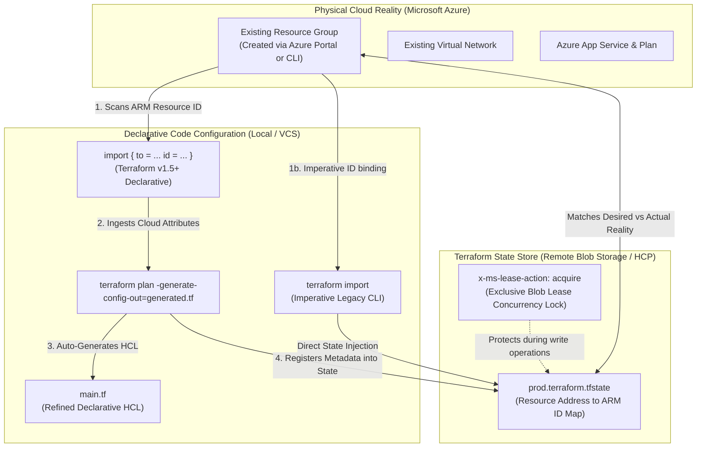

# Module 14-6: State Operations, Migration, `import` Blocks, `aztfy` & HCP Terraform

**Breadcrumbs:** [[--Index--|🏠 Index]] > [[14-Index - Terraform on Azure|☁️ Terraform on Azure MOC]] > **Module 14-6: State Operations & Migration**

---

## 🎯 Architectural Overview & Cognitive Map

The **Terraform State File (`terraform.tfstate`)** is the authoritative single source of truth mapping your declarative HCL configuration to real physical cloud resources in Microsoft Azure. Without state, Terraform has no memory of what it provisioned, what dependencies connect resources, or what platform-assigned metadata (ARM IDs, GUIDs, endpoints) were generated by Azure.



---

## 1. The Anatomy of State: Reality vs. Code vs. State Cache

Terraform operates across three distinct conceptual planes:
1. **The Physical Reality Plane (Azure):** The live resources running in Azure datacenters, managed via Azure Resource Manager (ARM) REST APIs.
2. **The Declarative Code Plane (`*.tf`):** The desired state authored by engineers in HCL files.
3. **The Recorded State Plane (`terraform.tfstate`):** The private JSON database containing the exact mapping between HCL resource addresses (e.g., `azurerm_resource_group.rg`) and Azure ARM Resource IDs (e.g., `/subscriptions/000.../resourceGroups/rg-prod`).

### Inside the State File JSON Schema
When inspected directly (via `terraform state pull`), the state file reveals its internal structure:

```json
{
  "version": 4,
  "terraform_version": "1.7.5",
  "serial": 42,
  "lineage": "e6a4b112-9c3a-44d5-8f67-1b07d612e45a",
  "resources": [
    {
      "mode": "managed",
      "type": "azurerm_resource_group",
      "name": "rg",
      "provider": "provider[\"registry.terraform.io/hashicorp/azurerm\"]",
      "instances": [
        {
          "schema_version": 0,
          "attributes": {
            "id": "/subscriptions/00000000-0000-0000-0000-000000000000/resourceGroups/rg-hub-prod-eastus",
            "location": "eastus",
            "name": "rg-hub-prod-eastus",
            "tags": {
              "Environment": "Production",
              "ManagedBy": "Terraform"
            }
          }
        }
      ]
    }
  ]
}
```

* **`serial`:** An incrementing monotonic integer. Every time the state file is modified, `serial` increases by 1. If two engineers or pipelines attempt to push state with conflicting serials, Terraform rejects the push to prevent state corruption.
* **`lineage`:** A unique UUID assigned when the state file is first created. It guarantees that state files belonging to different environments (e.g., `dev` vs. `prod`) are never accidentally swapped or overwritten.

---

## 2. Advanced State CLI Surgery Suite

In enterprise operations, engineers frequently need to inspect, manipulate, or untangle state without touching live Azure resources. State commands operate directly on the state database:

### Essential State Subcommands Matrix:

| Subcommand | Operational Purpose | Safety Impact | Modifies Live Azure? |
| :--- | :--- | :--- | :--- |
| `terraform state list` | Lists all resource addresses currently recorded in the state file. | **Read-Only** (Zero Risk) | ❌ No |
| `terraform state show <addr>` | Dumps all stored metadata and attributes for a specific resource address. | **Read-Only** (Zero Risk) | ❌ No |
| `terraform state mv <src> <dst>` | Renames a resource address or moves it into/out of a module without recreation. | **Modifies State** (High value for refactoring) | ❌ No |
| `terraform state rm <addr>` | Removes a resource from state tracking. Leaves the live cloud resource running. | **High Risk** (Orphans resource in Azure) | ❌ No |
| `terraform refresh` | Queries Azure ARM to update the state file with live reality (attributes/tags). | **Modifies State Cache** | ❌ No |
| `terraform state pull` | Dumps the remote state file raw JSON to `stdout`. Essential for backups before surgery. | **Read-Only** (Safe) | ❌ No |
| `terraform state push <file>` | Writes a local JSON state file directly into the remote backend. | **Extreme Risk** (Disaster Recovery only) | ❌ No |
| `terraform force-unlock <LOCK_ID>` | Manually breaks an orphaned concurrency lock lease if a CI/CD job crashes. | **High Impact** (Verify no job is running!) | ❌ No |

### The Standard State Surgery Workflow:
Whenever you must refactor, rename, or untangle state:

```bash
# Step 1: Export a dated, timestamped JSON snapshot of current remote state
terraform state pull > state_backup_$(date +%Y%m%d_%H%M%S).json

# Step 2: Verify the resource exists in state
terraform state list | grep azurerm_service_plan

# Step 3: Inspect specific resource attributes
terraform state show azurerm_service_plan.app_plan

# Step 4: Perform the surgery (e.g. rename or relocate into a child module)
terraform state mv azurerm_service_plan.app_plan module.compute.azurerm_service_plan.app_plan

# Step 5: Verify desired vs actual alignment
terraform plan
# Target: "No changes. Your infrastructure matches the configuration."
```

> [!CAUTION]
> **The Critical Difference: `terraform state rm` vs. `terraform destroy`**
> * **`terraform destroy`** contacts the Azure ARM API and physically tears down the resource in the cloud.
> * **`terraform state rm`** **DOES NOT touch Azure!** It only deletes the record from the state file. The physical Azure Virtual Machine, App Service, or SQL Database continues running, accumulating cloud billing as an **orphaned, unmanaged ghost resource**! Only use `state rm` when migrating resources to another Terraform repository or cleaning up autogenerated metadata traps.

---

## 3. Ingesting Existing Infrastructure: The 3 Core Methods

When adopting Terraform in brownfield environments where infrastructure was provisioned manually via the Azure Portal, ARM templates, or Azure CLI scripts, you must import those resources into Terraform management.

There are three primary methodologies:
1. **Method 1: Native Terraform `import` (Imperative CLI & Declarative `import {}` Blocks)**
2. **Method 2: Microsoft Azure Terrafy (`aztfy` / `aztfexport`)**
3. **Method 3: Google Open-Source `terraformer`**

### Comprehensive Comparison Matrix:

| Feature / Criteria | Native Declarative `import {}` (v1.5+) | Imperative `terraform import` (CLI) | Microsoft Azure Terrafy (`aztfy`) | Google Terraformer |
| :--- | :--- | :--- | :--- | :--- |
| **Official Support** | HashiCorp Core Engine | HashiCorp Core Engine | Microsoft Azure Team | Community (Google Open Source) |
| **HCL Code Generation** | ✅ Automated (`-generate-config-out`) | ❌ None (Must write HCL first) | ✅ Automated | ✅ Automated |
| **Interactive TUI** | ❌ Terminal command | ❌ Terminal command | ✅ Full Interactive TUI | ❌ Terminal command |
| **Resource Group Bulk Scan** | ❌ Manual ID declarations | ❌ Single resource per command | ✅ Entire Resource Group scan | ✅ Bulk scan with filters |
| **HCL Quality** | High (Idiomatic HashiCorp syntax) | High (Engineered by author) | Low/Medium (Hardcoded strings, explicit deps) | Low/Medium (Static strings, broad scope) |
| **Azure Provider Coverage** | 100% of `azurerm` provider | 100% of `azurerm` provider | Comprehensive (ARM-mapped) | Partial (Subset of core services) |
| **Production Suitability** | **Recommended Standard** | Legacy / One-off patches | Discovery & Prototype only | Multi-cloud discovery |

---

## 4. Method 1: Native Import & Modern Declarative `import {}` Blocks

### A. The Top-Down Ingestion Hierarchy for Azure
When importing existing Azure infrastructure, you **MUST follow a top-down dependency hierarchy**:
1. **Resource Group** (`azurerm_resource_group`) - The parent administrative boundary.
2. **Virtual Network** (`azurerm_virtual_network`) - The root network container.
3. **Subnets** (`azurerm_subnet`) - Network segments inside the VNet.
4. **App Service Plan / Compute Cluster** (`azurerm_service_plan` - Note: `azurerm_app_service_plan` is deprecated).
5. **Web Applications / VMs** (`azurerm_linux_web_app` - Note: `azurerm_app_service` is deprecated).

```text
[1. azurerm_resource_group] 
         │
         ├──► [2. azurerm_virtual_network] ──► [3. azurerm_subnet]
         │
         └──► [4. azurerm_service_plan] ──────► [5. azurerm_linux_web_app]
```

If you attempt to import child resources (e.g. a Web App) before their parent Resource Group and App Service Plan exist in code, Terraform cannot construct the DAG dependencies, resulting in broken configurations.

---

### B. Declarative `import {}` Blocks (Terraform 1.5+)
Starting in Terraform 1.5+, HashiCorp introduced the declarative `import` block. You define what resources you want to bring into management directly in your `.tf` files:

```hcl
# imports.tf

# 1. Parent Resource Group
import {
  to = azurerm_resource_group.rg
  id = "/subscriptions/00000000-0000-0000-0000-000000000000/resourceGroups/day24-rg"
}

# 2. Virtual Network
import {
  to = azurerm_virtual_network.vnet
  id = "/subscriptions/00000000-0000-0000-0000-000000000000/resourceGroups/day24-rg/providers/Microsoft.Network/virtualNetworks/day24-vnet"
}

# 3. Subnet
import {
  to = azurerm_subnet.default
  id = "/subscriptions/00000000-0000-0000-0000-000000000000/resourceGroups/day24-rg/providers/Microsoft.Network/virtualNetworks/day24-vnet/subnets/default"
}

# 4. App Service Plan (Modern AzureRM Service Plan)
import {
  to = azurerm_service_plan.asp
  id = "/subscriptions/00000000-0000-0000-0000-000000000000/resourceGroups/day24-rg/providers/Microsoft.Web/serverFarms/day24-plan"
}

# 5. Linux Web App (Modern AzureRM Linux Web App)
import {
  to = azurerm_linux_web_app.web
  id = "/subscriptions/00000000-0000-0000-0000-000000000000/resourceGroups/day24-rg/providers/Microsoft.Web/sites/day24-web-app-18462"
}
```

#### Constructing ARM Resource IDs
Azure ARM IDs follow a strict hierarchical URI pattern:
`/subscriptions/{subscriptionId}/resourceGroups/{resourceGroupName}/providers/{resourceProviderNamespace}/{resourceType}/{resourceName}`

* **Portal Tip:** For most resources, navigate to **Settings > Properties** in the Azure Portal to copy the **Resource ID**.
* **Missing Properties Edge Case:** For certain resources like Web Apps where the portal properties blade may hide the raw ID, construct it manually from the App Service Plan parent:
  `.../providers/Microsoft.Web/sites/<web_app_name>`

---

### C. The Magic Step: Automated HCL Generation (`-generate-config-out`)
Once `imports.tf` is declared, run `terraform plan` with the code generation flag:

```bash
terraform plan -generate-config-out=generated_resources.tf
```

#### What Happens Internally:
1. Terraform contacts Azure Resource Manager using the credentials configured in the provider.
2. It fetches all physical attributes, settings, and network configurations from the live Azure resources.
3. It constructs syntactically valid HCL resource blocks and writes them into `generated_resources.tf`.
4. It presents a plan showing `5 to import, 0 to add, 0 to change, 0 to destroy`.

#### Refinement & Reaching the Golden Plan:
Open `generated_resources.tf`. The autogenerated code will contain hardcoded strings and deprecated defaults:

```hcl
# generated_resources.tf (Before Refactoring)
resource "azurerm_resource_group" "rg" {
  location = "eastus"
  name     = "day24-rg"
}

resource "azurerm_virtual_network" "vnet" {
  address_space       = ["10.0.0.0/16"]
  location            = "eastus"
  name                = "day24-vnet"
  resource_group_name = "day24-rg" # Hardcoded string!
}
```

Refactor the code into production-grade idiomatic HCL by replacing hardcoded strings with clean implicit references:

```hcl
# main.tf (After Refactoring to Idiomatic HCL)
resource "azurerm_resource_group" "rg" {
  name     = "day24-rg"
  location = "eastus"
  tags     = local.common_tags
}

resource "azurerm_virtual_network" "vnet" {
  name                = "day24-vnet"
  resource_group_name = azurerm_resource_group.rg.name
  location            = azurerm_resource_group.rg.location
  address_space       = ["10.0.0.0/16"]
  tags                = local.common_tags
}

resource "azurerm_subnet" "default" {
  name                 = "default"
  resource_group_name  = azurerm_resource_group.rg.name
  virtual_network_name = azurerm_virtual_network.vnet.name
  address_prefixes     = ["10.0.1.0/24"]
}

resource "azurerm_service_plan" "asp" {
  name                = "day24-plan"
  resource_group_name = azurerm_resource_group.rg.name
  location            = azurerm_resource_group.rg.location
  os_type             = "Linux"
  sku_name            = "B1"
}

resource "azurerm_linux_web_app" "web" {
  name                = "day24-web-app-18462"
  resource_group_name = azurerm_resource_group.rg.name
  location            = azurerm_resource_group.rg.location
  service_plan_id     = azurerm_service_plan.asp.id

  site_config {
    application_stack {
      node_version = "18-lts"
    }
  }
}
```

Apply the import to write the metadata into state:
```bash
terraform apply
```

Run `terraform plan` to verify the golden state:
```text
No changes. Your infrastructure matches the configuration.
```

---

## 5. Method 2: Microsoft Azure Terrafy (`aztfy` / `aztfexport`)

For brownfield Azure environments containing dozens or hundreds of resources created manually in the portal, writing individual `import` blocks is time-consuming. Microsoft developed **`aztfy` (Azure Terrafy)** to automate reverse-engineering.

### Installation
```bash
# Windows (via WinGet)
winget install Microsoft.Aztfy

# macOS / Linux (via Homebrew)
brew install aztfy

# Direct Binary / Go
go install github.com/Azure/aztfy@latest
```

### Execution Modes
```bash
# 1. Interactive Terminal UI (TUI) Mode on an entire Resource Group:
aztfy rg day24-rg

# 2. Non-Interactive Bulk Export to a target directory:
aztfexport resource-group day24-rg --non-interactive --output-dir ./export

# 3. Export HCL Only (Without modifying local state):
aztfexport resource-group day24-rg --hcl-only --output-dir ./hcl_scaffold
```

### How `aztfy` Works Under the Hood:
1. Queries the Azure Resource Graph to enumerate all ARM resources in the specified Resource Group.
2. Cross-references ARM resource schemas against HashiCorp's `azurerm` provider schema.
3. Launches an interactive Terminal UI displaying all discovered resources, allowing the engineer to:
   - Accept the recommended `azurerm` mapping (press Enter).
   - Skip unneeded resources (press `s`).
   - Customize the resource address name (press `r`).
4. Generates `main.tf`, `provider.tf`, and imports all state directly into `terraform.tfstate`.

### ⚠️ The 4 Critical Limitations of `aztfy` in Enterprise Production:
1. **Hardcoded Everything:** `aztfy` generates raw, static strings for every attribute (locations, resource group names, CIDRs). No variables, locals, or dynamic expressions are generated.
2. **Explicit Dependency Bloat (`depends_on`):** Because `aztfy` cannot infer logical relationships between resources, it injects explicit `depends_on = [azurerm_resource_group.res-0]` into nearly every resource block instead of using clean implicit references (`azurerm_resource_group.rg.name`).
3. **Sensitive Attribute Leaks:** Secrets and configuration values stored in Azure are dumped as plaintext into the generated files.
4. **Autogenerated Child Resource Deadlocks:** `aztfy` exports hidden default child resources—most notably **`azurerm_app_service_custom_hostname_binding`**. When you later attempt to run `terraform destroy`, the Azure API rejects the request with HTTP 400 Bad Request because Azure does not allow deleting the default `*.azurewebsites.net` binding independently of the Web App! *(See Failure Loop 2 for the exact fix).*

---

## 6. Method 3: Google Open-Source `terraformer`

`terraformer` is a CLI tool generated by Google Cloud that supports multi-cloud reverse-engineering:

```bash
# 1. Authenticate with Azure Service Principal
export ARM_SUBSCRIPTION_ID="00000000-0000-0000-0000-000000000000"
export ARM_CLIENT_ID="11111111-1111-1111-1111-111111111111"
export ARM_CLIENT_SECRET="secret"
export ARM_TENANT_ID="22222222-2222-2222-2222-222222222222"

# 2. Export specific Azure resources with filters
terraformer import azure --resources=resource_group,virtual_network --filter="Type=resource_group;Name=day24-rg"
```

* **Pros:** Capable of importing infrastructure across multiple cloud providers; supports filtering by resource tags.
* **Cons:** Slower to adopt newer Azure API features; does not support modern Azure provider resources like `azurerm_service_plan` as quickly as Microsoft's native `aztfy` or HashiCorp's core engine.

---

## 7. HCP Terraform (Terraform Cloud) Architecture & State Migration

### A. Enterprise Multi-Tenant Hierarchy
HashiCorp Cloud Platform (HCP) Terraform provides a centralized, SaaS-managed control plane for executing Terraform pipelines and securing state files:

```text
Organization (e.g. "Acme-Enterprise")
    │
    ├──► Project: "Azure-Infrastructure"
    │         │
    │         ├──► Workspace: "networking-dev" (State: dev.tfstate)
    │         ├──► Workspace: "networking-stage" (State: stage.tfstate)
    │         └──► Workspace: "networking-prod" (State: prod.tfstate)
    │
    └──► Project: "Data-Platform"
              └──► Workspace: "azure-synapse-prod"
```

* **Organization:** Top-level administrative account. Defines global policies, single sign-on (SSO), and billing.
* **Projects:** Logical boundaries separating departments or major business units (e.g. `Azure-Infrastructure`, `Security-Governance`).
* **Workspaces:** The fundamental operational unit. **One Workspace in HCP Terraform corresponds to one environment folder in CLI.** Each workspace possesses its own state file, execution history, variables, and run triggers.

---

### B. The 3 Execution Workflows in HCP Terraform

```mermaid
flowchart LR
    subgraph VCS ["1. VCS-Driven Workflow"]
        GH["GitHub / GitLab Repo"] -->|Webhook on PR / Push| HCP1["HCP Terraform Runner"]
        HCP1 -->|Automated Speculative Plan| PR["PR Comment / UI"]
    end

    subgraph CLI ["2. CLI-Driven Workflow"]
        LocalDev["Engineer Laptop\n(terraform plan)"] -->|Streams execution via cloud {}| HCP2["HCP Terraform Remote Runner"]
        HCP2 -->|Streams terminal logs back| LocalDev
    end

    subgraph API ["3. API-Driven Workflow"]
        ExternalApp["Custom Internal Portal / ServiceNow"] -->|REST API Payload| HCP3["HCP Terraform Runner"]
    end
```

#### 1. VCS-Driven Workflow:
The workspace links directly to a GitHub/GitLab repository. Any commit to the target branch (e.g., `main`) or pull request automatically triggers remote speculative plans and scheduled applies.

#### 2. CLI-Driven Workflow (The `cloud {}` Block):
Allows engineers to run `terraform plan` and `terraform apply` from their local terminal, but **execution occurs remotely on HashiCorp runners**, eliminating local credential exposure:

```hcl
# main.tf / versions.tf
terraform {
  cloud {
    organization = "Tech-Tutorials-With-Piyush"

    workspaces {
      name = "cli-test-azure"
    }
  }
}
```

Authenticating the CLI with HCP Terraform:
```bash
# 1. Generate an API token and log in
terraform login

# 2. Initialize the cloud workspace
terraform init

# 3. Execute plan remotely (Output streams back to local console!)
terraform plan
```

---

### C. Variables Management: Environment Variables vs. Terraform Variables
HCP Terraform strictly segregates variables into two categories:

| Variable Category | Prefix / Scope | Operational Purpose | Azure Example |
| :--- | :--- | :--- | :--- |
| **Environment Variables** | Read by the OS runner environment | Cloud provider authentication credentials | `ARM_SUBSCRIPTION_ID`, `ARM_CLIENT_ID`, `ARM_CLIENT_SECRET`, `ARM_TENANT_ID` |
| **Terraform Variables** | Read by the HCL parser | Passed directly into `variable "..." {}` blocks | `storage_account_name = "stprod01"`, `environment = "production"` |

> [!IMPORTANT]
> **Marking Sensitive Credentials:**
> All Azure Service Principal secrets (`ARM_CLIENT_SECRET`) **MUST be marked "Sensitive"** in the HCP Terraform console. Once marked sensitive, values are encrypted at rest with Vault and can never be read via the web UI or API by developers.

---

### D. Seamless Remote State Migration (`terraform init -migrate-state`)
Migrating infrastructure state from a local developer laptop (`terraform.tfstate`) to an enterprise remote backend (Azure Storage Account or HCP Terraform):

#### Step 1: Configure the Target Remote Backend Block
```hcl
# backend.tf
terraform {
  backend "azurerm" {
    resource_group_name  = "rg-terraform-state-prod"
    storage_account_name = "sttfstateprod01"
    container_name       = "tfstate"
    key                  = "core-infra.terraform.tfstate"
    use_azuread_auth     = true # Secretless RBAC authentication!
  }
}
```

#### Step 2: Execute Migration Command
```bash
terraform init -migrate-state
```

#### Step 3: Handle the Interactive Confirmation Prompt
```text
Initializing the backend...
Do you want to copy existing state to the new backend?
  Pre-existing state was found while initializing the new backend. No existing
  state was found in the newly configured "azurerm" backend. Do you want to
  copy this state to the new "azurerm" backend? Enter "yes" to confirm.

  Enter a value: yes

Successfully configured the backend "azurerm"! Terraform will now
operate using this backend going forward.
```

* Terraform detects the state transition.
* Automatically copies the state file into the Azure Storage container blob.
* Enables native Azure Blob Lease locking on the remote file.
* Renames the local `terraform.tfstate` to `terraform.tfstate.backup`.

---

## 8. Deep-Intuition (AARF) Failure-Loop Breakdowns

### Scenario 1: The Orphaned Concurrency Lock CI/CD Pipeline Deadlock

#### 1. Architectural Setup & Assumptions
An automated CI/CD pipeline triggers a `terraform apply` on the production environment. Terraform acquires an exclusive 60-second renewable **Azure Blob Lease Lock** on `prod.terraform.tfstate`.

#### 2. Production Failure Manifestation
The build runner VM runs out of memory (OOMKilled) or the build agent is terminated mid-execution. When a subsequent developer pushes a bug fix or triggers a pipeline run, the job immediately crashes:
```text
Error: Error acquiring the state lock: state blob is already leased
Lock Info:
  ID:        b7f9a2e1-4c12-4011-85b4-d51e70a982f1
  Path:      tfstate/prod.terraform.tfstate
  Who:       runner-user@github-runner-04
  Created:   2026-11-08 14:20:00 UTC
  Info:      
```

#### 3. Root Cause Analysis (RCA)
Because the runner process crashed violently, it never executed its cleanup routines to send the HTTP `RELEASE` API call to the Azure Storage service. The storage blob remains in the `Leased` state indefinitely in Azure Storage metadata.

#### 4. Remediation & Diagnostic Verification Loop
1. Verify via CI/CD audit logs and runner process monitors that the crashed job is 100% terminated and no active process is writing to Azure.
2. Execute the `force-unlock` command, supplying the exact Lock ID:
```bash
terraform force-unlock b7f9a2e1-4c12-4011-85b4-d51e70a982f1
```
3. Terraform sends an explicit lease release call to Azure Blob Storage, breaking the lease and restoring pipeline operations.

---

### Scenario 2: The `aztfy` Autogenerated Custom Hostname Binding Deletion Deadlock

#### 1. Architectural Setup & Assumptions
An engineer used `aztfy` to reverse-engineer an existing Azure App Service and its parent Resource Group. `aztfy` automatically discovered and generated an HCL block for the default Azure hostname binding:
```hcl
resource "azurerm_app_service_custom_hostname_binding" "binding" {
  hostname            = "my-app.azurewebsites.net"
  app_service_name    = azurerm_linux_web_app.web.name
  resource_group_name = azurerm_resource_group.rg.name
}
```

#### 2. Production Failure Manifestation
Months later, the project is decommissioned. The engineer executes `terraform destroy`. The operation crashes with an HTTP 400 Bad Request error:
```text
Error: deleting Custom Hostname Binding (Subscription: "..." / Resource Group: "rg-prod" / Site: "my-app" / Hostname: "my-app.azurewebsites.net"):
web.AppsClient#DeleteHostNameBinding: Failure sending request: StatusCode=400
-- Original Error: Code="BadRequest" Message="The host name for site 'my-app' must include the default host name 'my-app.azurewebsites.net'."
```

#### 3. Root Cause Analysis (RCA)
In Microsoft Azure, every App Service automatically receives a default DNS hostname (`<name>.azurewebsites.net`). Azure's REST API **prohibits deleting the default hostname** while the Web App still exists! Because `aztfy` mistakenly treats the default hostname as an independent manageable resource, Terraform attempts to destroy the hostname before deleting the Web App, triggering an API validation error.

#### 4. Remediation & Diagnostic Verification Loop
1. Perform state surgery to remove the autogenerated binding from Terraform state tracking:
```bash
terraform state rm azurerm_app_service_custom_hostname_binding.binding
```
2. Delete the `azurerm_app_service_custom_hostname_binding` block from your `.tf` files.
3. Re-run `terraform destroy`. Terraform will now delete the Web App and App Service Plan directly, allowing Azure to clean up the default hostname automatically!

---

### Scenario 3: The `state rm` Silent Cloud Billing Leak

#### 1. Architectural Setup & Assumptions
A junior engineer wants to delete a high-cost GPU Virtual Machine (`Standard_NC6s_v3`) to reduce staging costs. They run:
```bash
terraform state rm azurerm_linux_virtual_machine.gpu_vm
```

#### 2. Production Failure Manifestation
At the end of the month, the cloud finance team notices a $900 charge for the GPU virtual machine, even though the engineer claimed they "removed it with Terraform."

#### 3. Root Cause Analysis (RCA)
`terraform state rm` **does not execute any API calls to delete resources in Azure!** It merely excises the resource record from the state file. As far as Azure is concerned, the VM and its managed disks were never touched and continue running at full hourly cost.

#### 4. Remediation & Diagnostic Verification Loop
1. If the goal is physical deletion, delete the HCL resource block from `main.tf` and execute:
```bash
terraform apply
```
2. Terraform will detect that the resource is present in state but absent from HCL code, generating a plan to destroy it in Azure:
```text
Plan: 0 to add, 0 to change, 1 to destroy.
```

---

## 🌐 Authoritative References & Inflow Citations

* **Inflow Reference:** [Piyush Sachdeva Azure Terraform Course - Day 24 (How To Import Existing Terraform Resources Azure)](file:///F:/Dump%20one/BrainDump/inflow/Terraform-Azure-PiyushSachdeva/24_Day_2428_-_How_To_Import_Existing_Terraform_Resources_Azure_(simply_ex.md)
* **Inflow Reference:** [Piyush Sachdeva Azure Terraform Course - Day 25 (HCP Terraform Explained - Terraform Cloud Tutorial)](file:///F:/Dump%20one/BrainDump/inflow/Terraform-Azure-PiyushSachdeva/25_Day_2528_-_HCP_Terraform_Explained_-_Terraform_Cloud_Tutorial.md)
* **Inflow Reference:** [Piyush Sachdeva Azure Terraform Course - Day 04 (State Management with Azure Storage)](file:///F:/Dump%20one/BrainDump/inflow/Terraform-Azure-PiyushSachdeva/04_Day_428_-_Terraform_StateFile_Management_With_Azure_Storage.md)
* **Official HashiCorp Documentation:**
  - [Importing Infrastructure into Terraform (Declarative import)](https://developer.hashicorp.com/terraform/language/import)
  - [Manipulating Terraform State via CLI](https://developer.hashicorp.com/terraform/cli/commands/state)
  - [HCP Terraform Overview & Workspaces](https://developer.hashicorp.com/terraform/cloud-docs)
* **Microsoft Azure Documentation:**
  - [Azure Terrafy (aztfy) GitHub Repository & Guide](https://github.com/Azure/aztfy)
  - [Azure Resource Manager REST API Architecture](https://learn.microsoft.com/en-us/azure/azure-resource-manager/management/overview)
