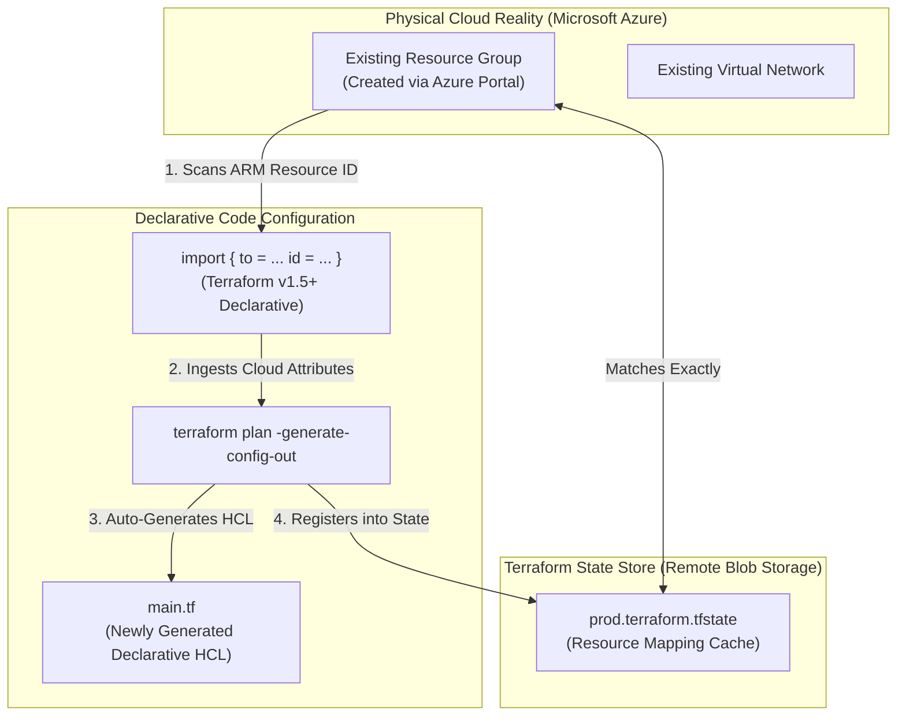

# Module 14-6: State Operations, Migration, `import` Blocks & `aztfy`

**Breadcrumbs:** [[--Index--|🏠 Index]] > [[14-Index - Terraform on Azure|☁️ Terraform on Azure MOC]] > **Module 14-6: State Operations & Migration**

---

## 🎯 Architectural Overview & Cognitive Map

The **Terraform State File (`terraform.tfstate`)** is the single source of truth mapping your declarative HCL code to real physical resources deployed in Azure. Without the state file, Terraform has no memory of what it created, what dependencies exist, or what attributes were assigned by the cloud platform.



---

## 1. Advanced State CLI Operations & Disaster Recovery

When maintaining infrastructure in production, engineers frequently need to inspect, manipulate, or untangle state without touching the live Azure cloud:

### Essential State Subcommands Matrix:

| Command | Operational Purpose | Safety Impact |
| :--- | :--- | :--- |
| `terraform state list` | Lists all resource addresses currently tracked in the state file. | **Read-Only** (Zero Risk) |
| `terraform state show <addr>` | Dumps all stored metadata and attributes for a specific resource address. | **Read-Only** (Zero Risk) |
| `terraform state mv <src> <dst>` | Renames a resource address in state without destroying the live Azure resource. | Modifies State (Essential for refactoring) |
| `terraform state rm <addr>` | Removes a resource from state management without deleting the physical Azure resource. | Untracks Resource (Leaves orphaned in Azure) |
| `terraform refresh` | Queries Azure ARM to update the state file with live reality (without making changes). | Updates state metadata |
| `terraform force-unlock <ID>` | Manually breaks an orphaned concurrency lock lease if a CI/CD job crashes. | **High Impact** (Verify no pipeline is running!) |

### Manual State Backup & Emergency Restoration:
Before performing any delicate state manipulation:
```bash
# 1. Pull remote state locally into a JSON backup file
terraform state pull > state-backup-$(date +%Y%m%d%H%M%S).json

# 2. Perform state modification (e.g. rename address)
terraform state mv azurerm_storage_account.old azurerm_storage_account.new

# 3. Emergency Restore (Only if state becomes corrupted!)
# terraform state push state-backup-XXXXX.json
```

---

## 2. Declarative `import` Blocks (Modern Terraform v1.5+)

Historically, importing existing Azure resources was an imperative, manual nightmare (`terraform import azurerm_resource_group.rg /subscriptions/...`), requiring engineers to manually guess and write hundreds of lines of exact matching HCL before the import could succeed.

Starting in **Terraform 1.5+**, HashiCorp introduced **Declarative Import Blocks** and **Automated Code Generation**:

```hcl
# main.tf (Define what to import)

import {
  to = azurerm_resource_group.legacy_rg
  id = "/subscriptions/00000000-0000-0000-0000-000000000000/resourceGroups/rg-legacy-portal"
}

import {
  to = azurerm_virtual_network.legacy_vnet
  id = "/subscriptions/00000000-0000-0000-0000-000000000000/resourceGroups/rg-legacy-portal/providers/Microsoft.Network/virtualNetworks/vnet-legacy"
}
```

### The Magic Step: Automated HCL Generation
Run the plan command with the `-generate-config-out` flag:
```bash
terraform plan -generate-config-out=generated_resources.tf
```

* Terraform inspects the live Azure resources via ARM API.
* Automatically writes the complete, syntactically correct HCL code into `generated_resources.tf`!
* Review the generated code, adjust variable references, and run:
```bash
terraform apply
```
* The existing Azure resources are now fully under Terraform management with zero manual HCL reverse engineering!

---

## 3. Microsoft Azure Terrafy (`aztfy`)

For brownfield environments containing dozens or hundreds of resources created manually in the Azure Portal, Microsoft provides **`aztfy` (Azure Terrafy)**:

```bash
# Install aztfy via Go or Package Manager
# winget install Microsoft.Aztfy (Windows)
# brew install aztfy (macOS/Linux)

# Run interactive reverse-engineering on an entire Resource Group:
aztfy rg rg-legacy-portal
```

### How `aztfy` Works:
1. Scans all ARM resources inside the target Resource Group.
2. Automatically identifies corresponding `azurerm` provider resource types.
3. Displays an interactive terminal UI allowing you to accept, skip, or re-map resource addresses.
4. Generates standard `main.tf`, `variables.tf`, and imports all state directly into `terraform.tfstate`.

---

## 4. State Migration & Backend Switching

Moving from a local state file (developed on a laptop) to an enterprise Azure Storage Account remote backend:

```hcl
# backend.tf
terraform {
  backend "azurerm" {
    resource_group_name  = "rg-terraform-state-prod"
    storage_account_name = "sttfstateprod01"
    container_name       = "tfstate"
    key                  = "core-infra.terraform.tfstate"
    use_azuread_auth     = true # Secretless RBAC authentication!
  }
}
```

### Executing the Migration:
```bash
terraform init -migrate-state
```
* Terraform detects the newly configured backend.
* Prompts: `Do you want to copy existing state to the new backend? Enter 'yes'`.
* Automatically transfers local state into the remote blob container with blob lease locking enabled.

---

## 5. Deep-Intuition (AARF) Failure-Loop Breakdowns

### Scenario: The Orphaned Concurrency Lock CI/CD Pipeline Deadlock

#### 1. The Architectural Setup & Assumptions
An automated CI/CD pipeline starts a `terraform apply` on the production environment. Terraform contacts the Azure Storage Account and acquires an exclusive 60-second renewable **Blob Lease Lock** on `prod.terraform.tfstate`.

#### 2. The Production Failure Manifestation
The build runner VM suddenly crashes or runs out of memory (OOMKilled) mid-execution. When a subsequent developer triggers a deployment or runs `terraform plan`, the pipeline immediately fails:
```text
Error: Error acquiring the state lock: state blob is already leased
Lock Info:
  ID:        b7f9a2e1-4c12-4011-85b4-d51e70a982f1
  Path:      tfstate/prod.terraform.tfstate
  Who:       runner-user@github-runner-04
  Created:   2026-11-08 14:20:00 UTC
```

#### 3. Root Cause Analysis (RCA)
Because the runner crashed violently, it never sent the HTTP `RELEASE` API call to release the Azure Storage blob lease lock. The lock remains active in Terraform's internal lock metadata.

#### 4. Remediation & Diagnostic Verification Loop
1. Verify via CI/CD audit logs that the crashed job is 100% terminated and no other engineer is applying changes.
2. Execute the `force-unlock` command supplying the Lock ID:
```bash
terraform force-unlock b7f9a2e1-4c12-4011-85b4-d51e70a982f1
```
3. Terraform releases the lock, restoring pipeline functionality.

---

## 6. High-Yield Real-World Engineering Traps

### Trap 1: The `terraform state rm` Accidental Drift Trap
* **The Scenario:** An engineer wants to delete an old test VM and runs `terraform state rm azurerm_linux_virtual_machine.test`.
* **The Trap:** The engineer expects the VM to disappear from Azure.
* **The Ground Truth:** `state rm` **does NOT delete anything in Azure!** It only deletes the record from the state file. The physical VM, public IP, and storage disks are now **completely unmanaged orphaned resources** continuing to incur cloud billing! To actually delete a resource, delete the HCL code block and run `terraform apply`.

---

## 🌐 Authoritative References & Inflow Citations

* **Inflow Reference:** [Piyush Sachdeva Azure Terraform Course - Day 24 & Day 25](file:///F:/Dump%20one/BrainDump/inflow/Terraform-Azure-PiyushSachdeva/24_Day_2428_-_How_To_Import_Existing_Terraform_Resources_Azure_(simply_ex.md)
* **Official HashiCorp Documentation:**
  - [Importing Infrastructure into Terraform](https://developer.hashicorp.com/terraform/language/import)
  - [Manipulating Terraform State](https://developer.hashicorp.com/terraform/cli/commands/state)
* **Microsoft Azure Documentation:**
  - [Azure Terrafy (aztfy) GitHub Repository](https://github.com/Azure/aztfy)
