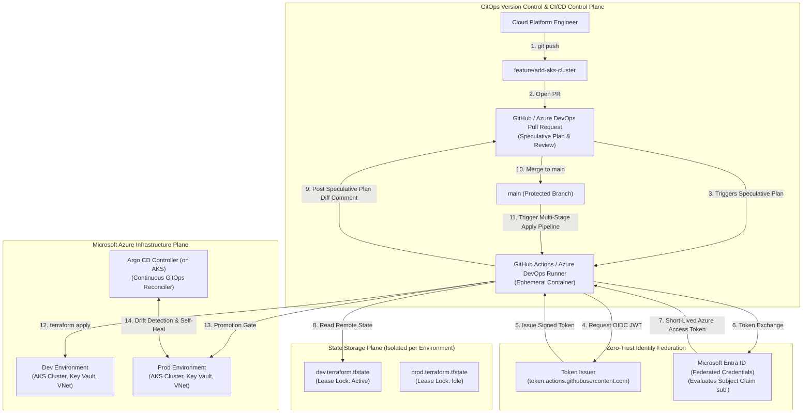
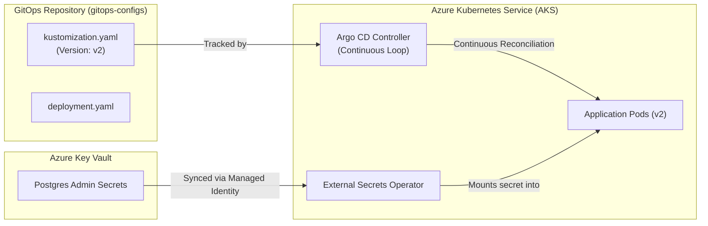

# Module 14-7: Enterprise CI/CD, GitOps Automation, Azure DevOps & Argo CD

**Breadcrumbs:** [[--Index--|🏠 Index]] > [[14-Index - Terraform on Azure|☁️ Terraform on Azure MOC]] > [[9-Index - GitHub Actions|🐙 GitHub Actions MOC]] > **Module 14-7: CI/CD & GitOps Automation**

---

## 🎯 Architectural Overview & Cognitive Map

In modern cloud platform engineering, executing `terraform apply` manually from an engineer's laptop is strictly prohibited in enterprise production. Manual execution creates "works on my machine" inconsistencies, untracked out-of-band drift, state lock deadlocks, and severe security vulnerabilities caused by storing high-privilege credentials on local workstations.

The enterprise standard is **Automated GitOps & CI/CD Pipelines**:
1. **Single Source of Truth:** Every infrastructure component is declared in Git.
2. **Branching & Pull Request Governance:** Code changes are validated via automated linters, security scans, and **Speculative Plans** before human approval.
3. **Secretless Cloud Authentication:** Pipelines authenticate to Azure using **OpenID Connect (OIDC)** and Workload Identity Federation—eliminating permanent passwords entirely.
4. **Multi-Environment Promotion:** Infrastructure progresses sequentially through isolated environments (`dev` ➔ `staging` ➔ `production`), each backed by dedicated state files and storage accounts.
5. **Continuous Reconciliation & Drift Detection:** Scheduled audit pipelines and GitOps controllers (Argo CD) continuously detect and heal configuration drift between live cloud reality and the Git desired state.



---

## 1. Branching Strategies for Enterprise Infrastructure

Infrastructure as Code repositories require disciplined branching models to prevent merge conflicts and state file corruption:

### A. The Feature Branching Workflow
1. **The Protected `main` Branch:** Represents the currently deployed reality of the target environment. Direct pushes to `main` are strictly blocked via GitHub Branch Protection Rules or Azure DevOps Branch Policies.
2. **Short-Lived Feature Branches (`feature/*`):** Created by engineers to introduce specific architectural changes (e.g., `feature/vnet-peering`, `feature/redis-cache`).
3. **The Validation Gate (Pull Request):** Opening a PR against `main` triggers automated formatting checks (`terraform fmt`), static analysis (`tflint`), security scanning (`checkov` / `tfsec`), and a speculative plan.
4. **Merge and Delete:** Once reviewed by two peer engineers, the PR is squashed and merged into `main`, and the feature branch is deleted.

```text
main branch:  ──●────────────────────────●───────────────● (Production Apply)
                 \                      /
feature branch:   └──● (Speculative) ──● (PR Review)
```

> [!IMPORTANT]
> **Why Long-Lived Branches Fail in Terraform:**
> In application software, teams often maintain long-lived branches (`dev`, `stage`, `prod`). **In Terraform, this is an anti-pattern!** If code diverges across branches, applying changes to production introduces untested, out-of-band drifts. Instead, maintain a single `main` branch with directory-per-environment separation (`environments/dev/`, `environments/prod/`) or pass environment-specific `.tfvars`.

---

## 2. Secretless Cloud Authentication via OpenID Connect (OIDC)

### A. The Fatal Flaws of Static Service Principal Passwords
Historically, CI/CD runners authenticated to Azure using static Service Principal passwords (Client Secrets) stored in CI secrets:
* **Permanent Blast Radius:** If a build log accidentally dumps secrets or a runner VM is compromised, attackers gain persistent access to your cloud subscription.
* **The 2:00 AM Expiration Outage:** Client secrets expire after 1 to 2 years. When they expire unannounced, all automated pipelines immediately crash.
* **Rotation Friction:** Rotating static secrets across hundreds of repositories requires complex automation and downtime windows.

### B. The Zero-Trust OIDC Architecture (Workload Identity Federation)
With **OpenID Connect (OIDC)**, **zero static passwords or secrets are stored in GitHub Actions or Azure DevOps**:
1. The CI runner requests an ephemeral, cryptographically signed JSON Web Token (JWT) from GitHub (`token.actions.githubusercontent.com`).
2. The runner presents this JWT to Microsoft Entra ID.
3. Entra ID verifies the token's signature against GitHub's public JSON Web Key Set (JWKS).
4. Entra ID evaluates the token's **Subject Claim (`sub`)** against a **Federated Identity Credential** registered on the Azure App Registration.
5. If the claim matches (e.g., matching the specific repository and branch), Entra ID issues an ephemeral Azure OAuth token valid for exactly 60 minutes.

```text
[GitHub Runner] ──1. Request JWT──► [GitHub OIDC Provider]
      │                                       │
      │◄───────2. Signed Ephemeral JWT────────┘
      │
      ├──3. Exchange JWT with Subject Claim──► [Microsoft Entra ID]
      │                                                │
      │◄──────4. 60-Minute Azure Access Token──────────┘
      │
      └──5. Provision Infrastructure──────────► [Azure Resource Manager]
```

### C. Azure CLI Setup: Configuring Federated Identity Trust

```bash
#!/usr/bin/env bash
set -euo pipefail

# 1. Variables
APP_NAME="spn-github-actions-terraform"
GITHUB_ORG="my-enterprise-org"
GITHUB_REPO="azure-infrastructure"
SUBSCRIPTION_ID=$(az account show --query id -o tsv)

# 2. Create Entra ID Application & Service Principal
APP_ID=$(az ad app create --display-name "${APP_NAME}" --query appId -o tsv)
SP_ID=$(az ad sp create --id "${APP_ID}" --query id -o tsv)

# 3. Grant Azure RBAC Roles (Contributor + Network Contributor)
az role assignment create \
  --role "Contributor" \
  --assignee-object-id "${SP_ID}" \
  --assignee-principal-type "ServicePrincipal" \
  --scope "/subscriptions/${SUBSCRIPTION_ID}"

az role assignment create \
  --role "Network Contributor" \
  --assignee-object-id "${SP_ID}" \
  --assignee-principal-type "ServicePrincipal" \
  --scope "/subscriptions/${SUBSCRIPTION_ID}"

# 4. Federated Identity Credential for Production Merges (Main Branch)
cat <<EOF > credential-main.json
{
  "name": "gh-actions-main-branch",
  "issuer": "https://token.actions.githubusercontent.com",
  "subject": "repo:${GITHUB_ORG}/${GITHUB_REPO}:ref:refs/heads/main",
  "description": "Allows GitHub Actions on main branch to authenticate without passwords",
  "audiences": ["api://AzureADTokenExchange"]
}
EOF

az ad app federated-credential create \
  --id "${APP_ID}" \
  --parameters credential-main.json

# 5. Federated Identity Credential for Pull Request Speculative Plans
cat <<EOF > credential-pr.json
{
  "name": "gh-actions-pull-requests",
  "issuer": "https://token.actions.githubusercontent.com",
  "subject": "repo:${GITHUB_ORG}/${GITHUB_REPO}:pull_request",
  "description": "Allows Pull Requests to generate speculative plans",
  "audiences": ["api://AzureADTokenExchange"]
}
EOF

az ad app federated-credential create \
  --id "${APP_ID}" \
  --parameters credential-pr.json

echo "OIDC Setup Complete! Client ID: ${APP_ID}"
```

---

## 3. Configuring Terraform for OIDC

To instruct the `azurerm` provider and backend to authenticate using OIDC tokens:

```hcl
# versions.tf / providers.tf

terraform {
  required_version = ">= 1.5.0"
  required_providers {
    azurerm = {
      source  = "hashicorp/azurerm"
      version = "~> 3.90"
    }
  }

  backend "azurerm" {
    resource_group_name  = "rg-terraform-state-prod"
    storage_account_name = "sttfstateprod01"
    container_name       = "tfstate"
    key                  = "prod.terraform.tfstate"
    use_oidc             = true # Enables OIDC for Remote State Storage!
    use_azuread_auth     = true
  }
}

provider "azurerm" {
  features {}
  use_oidc = true # Enables OIDC for Resource Management!
}
```

---

## 4. Production GitHub Actions Pipeline Implementations

### Pipeline 1: Pull Request Speculative Plan (`.github/workflows/terraform-pr.yml`)
Triggers on every PR targeting `main`. Generates a plan and posts an interactive Markdown table back into the PR:

```yaml
name: "Terraform Pull Request Pipeline"

on:
  pull_request:
    branches: [ "main" ]
    paths:
      - "environments/**"
      - "modules/**"

permissions:
  id-token: write      # MANDATORY: Required for requesting the OIDC JWT!
  contents: read       # Allows checking out code
  pull-requests: write # Allows posting plan comments to the PR

concurrency:
  group: terraform-pr-${{ github.ref }}
  cancel-in-progress: true

jobs:
  validate-and-plan:
    name: "Validate & Speculative Plan"
    runs-on: ubuntu-latest
    defaults:
      run:
        working-directory: environments/dev

    steps:
      - name: "Checkout Repository"
        uses: actions/checkout@v4

      - name: "Azure Login via OIDC"
        uses: azure/login@v2
        with:
          client-id: ${{ secrets.AZURE_CLIENT_ID }}
          tenant-id: ${{ secrets.AZURE_TENANT_ID }}
          subscription-id: ${{ secrets.AZURE_SUBSCRIPTION_ID }}

      - name: "Setup Terraform Engine"
        uses: hashicorp/setup-terraform@v3
        with:
          terraform_version: "1.7.5"
          terraform_wrapper: false

      - name: "Terraform Format Check"
        run: terraform fmt -check -recursive ../..

      - name: "Terraform Init"
        run: terraform init

      - name: "Terraform Validate"
        run: terraform validate

      - name: "Terraform Speculative Plan"
        id: plan
        run: |
          terraform plan -no-color -out=tfplan > plan_output.txt 2>&1
          cat plan_output.txt

      - name: "Post Plan Summary to Pull Request"
        uses: actions/github-script@v7
        if: always() && github.event_name == 'pull_request'
        with:
          script: |
            const fs = require('fs');
            let planText = "";
            try {
              planText = fs.readFileSync('environments/dev/plan_output.txt', 'utf8');
            } catch (err) {
              planText = "Error reading plan output.";
            }

            if (planText.length > 60000) {
              planText = planText.substring(0, 60000) + "\n... [Plan Output Truncated]";
            }

            const output = `#### 🪐 Terraform Pull Request Speculative Plan
            * **Pushed By:** @${{ github.actor }}
            * **Status:** \`${{ steps.plan.outcome }}\`
            * **Working Directory:** \`environments/dev\`

            <details><summary>Click to view full plan output</summary>

            \`\`\`hcl
            ${planText}
            \`\`\`

            </details>`;

            github.rest.issues.createComment({
              issue_number: context.issue.number,
              owner: context.repo.owner,
              repo: context.repo.repo,
              body: output
            });
```

---

### Pipeline 2: Multi-Environment Production Apply (`.github/workflows/terraform-apply.yml`)
Triggers strictly upon a successful merge to `main`. Enforces sequential promotion from `dev` to `prod` with **GitHub Protected Environment Approval Gates**:

```yaml
name: "Terraform Multi-Environment Apply"

on:
  push:
    branches: [ "main" ]
    paths:
      - "environments/**"
      - "modules/**"

permissions:
  id-token: write
  contents: read

concurrency:
  group: terraform-apply-main
  cancel-in-progress: false # NEVER cancel an active apply midway!

jobs:
  # ----------------------------------------------------
  # STAGE 1: DEV ENVIRONMENT APPLY
  # ----------------------------------------------------
  apply-dev:
    name: "Apply Development Infrastructure"
    runs-on: ubuntu-latest
    environment: development
    defaults:
      run:
        working-directory: environments/dev

    steps:
      - name: "Checkout Code"
        uses: actions/checkout@v4

      - name: "Azure Login via OIDC"
        uses: azure/login@v2
        with:
          client-id: ${{ secrets.AZURE_CLIENT_ID }}
          tenant-id: ${{ secrets.AZURE_TENANT_ID }}
          subscription-id: ${{ secrets.AZURE_SUBSCRIPTION_ID }}

      - name: "Setup Terraform"
        uses: hashicorp/setup-terraform@v3
        with:
          terraform_version: "1.7.5"
          terraform_wrapper: false

      - name: "Terraform Init"
        run: terraform init

      - name: "Terraform Apply (Dev)"
        run: terraform apply -auto-approve

  # ----------------------------------------------------
  # STAGE 2: PRODUCTION ENVIRONMENT APPLY (GATED)
  # ----------------------------------------------------
  apply-prod:
    name: "Apply Production Infrastructure"
    needs: apply-dev
    runs-on: ubuntu-latest
    environment: production # Requires manual approval in GitHub UI!
    defaults:
      run:
        working-directory: environments/prod

    steps:
      - name: "Checkout Code"
        uses: actions/checkout@v4

      - name: "Azure Login via OIDC"
        uses: azure/login@v2
        with:
          client-id: ${{ secrets.AZURE_CLIENT_ID }}
          tenant-id: ${{ secrets.AZURE_TENANT_ID }}
          subscription-id: ${{ secrets.AZURE_SUBSCRIPTION_ID }}

      - name: "Setup Terraform"
        uses: hashicorp/setup-terraform@v3
        with:
          terraform_version: "1.7.5"
          terraform_wrapper: false

      - name: "Terraform Init"
        run: terraform init

      - name: "Terraform Apply (Production)"
        run: terraform apply -auto-approve
```

---

## 5. Enterprise Azure DevOps Multi-Stage Pipeline Architecture

For enterprise organizations standardizing on Azure DevOps, infrastructure automation utilizes declarative YAML multi-stage pipelines with native **Service Connections**:

### A. The End-to-End Pipeline YAML (`azure-pipelines.yml`)

```yaml
trigger:
  branches:
    include:
      - main
      - feature/*
  paths:
    include:
      - lessons/Day26/**
      - azure-pipelines.yml

pool:
  vmImage: 'ubuntu-latest'

stages:
  # ====================================================
  # STAGE 1: CODE VALIDATION & LINTING
  # ====================================================
  - stage: Validate
    displayName: "Terraform Validate & Lint"
    jobs:
      - job: TFValidate
        displayName: "Run Init & Validate"
        steps:
          - task: TerraformInstaller@0
            displayName: "Install Terraform v1.7.5"
            inputs:
              terraformVersion: '1.7.5'

          - task: TerraformTaskV4@4
            displayName: "Terraform Init"
            inputs:
              provider: 'azurerm'
              command: 'init'
              workingDirectory: '$(System.DefaultWorkingDirectory)/lessons/Day26/dev'
              backendServiceArm: 'sc-azure-subscription'
              backendAzureRmResourceGroupName: 'terraformStateRG'
              backendAzureRmStorageAccountName: 'tfdevbackend01'
              backendAzureRmContainerName: 'tfstate'
              backendAzureRmKey: 'dev.terraform.tfstate'

          - task: TerraformTaskV4@4
            displayName: "Terraform Validate"
            inputs:
              provider: 'azurerm'
              command: 'validate'
              workingDirectory: '$(System.DefaultWorkingDirectory)/lessons/Day26/dev'

  # ====================================================
  # STAGE 2: DEVELOPMENT ENVIRONMENT DEPLOYMENT
  # ====================================================
  - stage: DevDeploy
    displayName: "Deploy to Development"
    dependsOn: Validate
    condition: and(succeeded(), eq(variables['Build.SourceBranch'], 'refs/heads/main'))
    jobs:
      - job: TFApplyDev
        displayName: "Terraform Apply (Dev)"
        steps:
          - task: TerraformInstaller@0
            inputs:
              terraformVersion: '1.7.5'

          - task: TerraformTaskV4@4
            displayName: "Terraform Init (Dev)"
            inputs:
              provider: 'azurerm'
              command: 'init'
              workingDirectory: '$(System.DefaultWorkingDirectory)/lessons/Day26/dev'
              backendServiceArm: 'sc-azure-subscription'
              backendAzureRmResourceGroupName: 'terraformStateRG'
              backendAzureRmStorageAccountName: 'tfdevbackend01'
              backendAzureRmContainerName: 'tfstate'
              backendAzureRmKey: 'dev.terraform.tfstate'

          - task: TerraformTaskV4@4
            displayName: "Terraform Apply (Dev)"
            inputs:
              provider: 'azurerm'
              command: 'apply'
              workingDirectory: '$(System.DefaultWorkingDirectory)/lessons/Day26/dev'
              environmentServiceNameAzureRM: 'sc-azure-subscription'
              commandOptions: '-auto-approve'

  # ====================================================
  # STAGE 3: STAGING ENVIRONMENT DEPLOYMENT
  # ====================================================
  - stage: StagingDeploy
    displayName: "Deploy to Staging"
    dependsOn: DevDeploy
    condition: and(succeeded(), eq(variables['Build.SourceBranch'], 'refs/heads/main'))
    jobs:
      - job: TFApplyStaging
        displayName: "Terraform Apply (Staging)"
        steps:
          - task: TerraformInstaller@0
            inputs:
              terraformVersion: '1.7.5'

          - task: TerraformTaskV4@4
            displayName: "Terraform Init (Staging)"
            inputs:
              provider: 'azurerm'
              command: 'init'
              workingDirectory: '$(System.DefaultWorkingDirectory)/lessons/Day26/staging'
              backendServiceArm: 'sc-azure-subscription'
              backendAzureRmResourceGroupName: 'terraformStateRG'
              backendAzureRmStorageAccountName: 'tfstagebackend01'
              backendAzureRmContainerName: 'tfstate'
              backendAzureRmKey: 'staging.terraform.tfstate'

          - task: TerraformTaskV4@4
            displayName: "Terraform Apply (Staging)"
            inputs:
              provider: 'azurerm'
              command: 'apply'
              workingDirectory: '$(System.DefaultWorkingDirectory)/lessons/Day26/staging'
              environmentServiceNameAzureRM: 'sc-azure-subscription'
              commandOptions: '-auto-approve'
```

---

### B. Dedicated On-Demand Environment Destruction Pipeline
To save cloud costs in non-production environments, maintain a dedicated parameterized destruction pipeline (`destroy-pipeline.yml`):

```yaml
parameters:
  - name: environment
    displayName: "Target Environment to Destroy"
    type: string
    default: dev
    values:
      - dev
      - staging

trigger: none # Purely manual on-demand execution!

pool:
  vmImage: 'ubuntu-latest'

jobs:
  - job: TFDestroy
    displayName: "Destroy ${{ parameters.environment }} Infrastructure"
    steps:
      - task: TerraformInstaller@0
        inputs:
          terraformVersion: '1.7.5'

      - task: TerraformTaskV4@4
        displayName: "Terraform Init"
        inputs:
          provider: 'azurerm'
          command: 'init'
          workingDirectory: '$(System.DefaultWorkingDirectory)/lessons/Day26/${{ parameters.environment }}'
          backendServiceArm: 'sc-azure-subscription'
          backendAzureRmResourceGroupName: 'terraformStateRG'
          backendAzureRmStorageAccountName: 'tf${{ parameters.environment }}backend01'
          backendAzureRmContainerName: 'tfstate'
          backendAzureRmKey: '${{ parameters.environment }}.terraform.tfstate'

      - task: TerraformTaskV4@4
        displayName: "Terraform Destroy"
        inputs:
          provider: 'azurerm'
          command: 'destroy'
          workingDirectory: '$(System.DefaultWorkingDirectory)/lessons/Day26/${{ parameters.environment }}'
          environmentServiceNameAzureRM: 'sc-azure-subscription'
          commandOptions: '-auto-approve'
```

---

## 6. Cloud-Native GitOps on Azure Kubernetes Service (AKS) with Argo CD

While Terraform excels at provisioning underlying Azure infrastructure (VNets, AKS clusters, Managed Identities, Key Vaults), managing dynamic application workloads and Kubernetes deployments is best accomplished via **GitOps with Argo CD**.

### A. The End-to-End GitOps Architecture
1. **Infrastructure Provisioning (Terraform):** Deploys the AKS cluster, installs the Helm release for Argo CD, and sets up Azure Key Vault with Managed Identity Operator bindings.
2. **Secret Management (External Secrets Operator - ESO):** Kubernetes pods cannot store plain secrets in Git. ESO securely synchronizes secrets from Azure Key Vault into native Kubernetes secrets in-cluster.
3. **Continuous Reconciliation (Argo CD):** Argo CD monitors a designated Git repository (`gitops-configs`). When application manifests change, Argo CD automatically syncs changes to AKS.



### B. Installing Argo CD via Terraform Helm Provider

```hcl
# kubernetes_argocd.tf

resource "kubernetes_namespace" "argocd" {
  metadata {
    name = "argocd"
  }
}

resource "helm_release" "argocd" {
  name       = "argo-cd"
  repository = "https://argoproj.github.io/argo-helm"
  chart      = "argo-cd"
  version    = "5.51.6"
  namespace  = kubernetes_namespace.argocd.metadata[0].name

  set {
    name  = "server.service.type"
    value = "LoadBalancer" # Exposes Argo CD UI via Azure Public Load Balancer
  }

  set {
    name  = "configs.params.server\\.insecure"
    value = "true"
  }
}
```

### C. The Argo CD Application Manifest (`kind: Application`)
This manifest establishes the GitOps contract between the repository and the cluster:

```yaml
apiVersion: argoproj.io/v1alpha1
kind: Application
metadata:
  name: three-tier-web-app
  namespace: argocd
  finalizers:
    - resources-finalizer.argocd.argoproj.io
spec:
  project: default
  source:
    repoURL: 'https://github.com/my-org/gitops-configs.git'
    targetRevision: HEAD
    path: three-tier-configs
  destination:
    server: 'https://kubernetes.default.svc'
    namespace: dev
  syncPolicy:
    automated:
      prune: true     # Deletes resources in K8s if removed from Git!
      selfHeal: true  # Reverts manual changes made directly in K8s back to Git state!
    syncOptions:
      - CreateNamespace=true
```

### D. Testing GitOps Drift Detection & Application Upgrades
1. **Testing Out-of-Band Drift:** If a rogue developer runs `kubectl scale deployment frontend --replicas=5`, Argo CD immediately flags the state as `OutOfSync` and automatically scales the deployment back to `2 replicas` within seconds (`selfHeal: true`).
2. **Testing Application Version Rollout:**
   - In `gitops-configs/three-tier-configs/kustomization.yaml`, update the container image tag:
     ```yaml
     images:
       - name: my-registry.azurecr.io/frontend
         newTag: v2 # Upgraded from v1!
     ```
   - Commit and push to Git.
   - Argo CD detects the commit, initiates a zero-downtime rolling update, and provisions the new v2 pods automatically.

---

## 7. Automated Drift Detection & Remediation Cron Pipeline

To catch out-of-band changes made via the Azure Portal (e.g. an engineer manually widening an NSG rule during an incident), run a scheduled nightly pipeline using `terraform plan -detailed-exitcode`:

```yaml
name: "Terraform Scheduled Drift Detection"

on:
  schedule:
    - cron: "0 2 * * *" # Runs nightly at 02:00 UTC
  workflow_dispatch:

permissions:
  id-token: write
  contents: read
  issues: write # Allows opening GitHub Issues on drift detection!

jobs:
  detect-drift:
    name: "Detect Production Drift"
    runs-on: ubuntu-latest
    defaults:
      run:
        working-directory: environments/prod

    steps:
      - name: "Checkout Code"
        uses: actions/checkout@v4

      - name: "Azure Login via OIDC"
        uses: azure/login@v2
        with:
          client-id: ${{ secrets.AZURE_CLIENT_ID }}
          tenant-id: ${{ secrets.AZURE_TENANT_ID }}
          subscription-id: ${{ secrets.AZURE_SUBSCRIPTION_ID }}

      - name: "Setup Terraform"
        uses: hashicorp/setup-terraform@v3
        with:
          terraform_version: "1.7.5"
          terraform_wrapper: false

      - name: "Terraform Init"
        run: terraform init

      - name: "Execute Drift Check (-detailed-exitcode)"
        id: drift
        # Exit code 0 = No changes (Clean)
        # Exit code 1 = Command error
        # Exit code 2 = Drift detected!
        continue-on-error: true
        run: |
          set +e
          terraform plan -detailed-exitcode -no-color > drift_report.txt
          EXIT_CODE=$?
          echo "exit_code=${EXIT_CODE}" >> $GITHUB_OUTPUT
          exit ${EXIT_CODE}

      - name: "Create GitHub Issue on Detected Drift"
        if: steps.drift.outputs.exit_code == '2'
        uses: actions/github-script@v7
        with:
          script: |
            const fs = require('fs');
            const driftReport = fs.readFileSync('environments/prod/drift_report.txt', 'utf8');
            
            github.rest.issues.create({
              owner: context.repo.owner,
              repo: context.repo.repo,
              title: '🚨 Production Infrastructure Drift Detected',
              body: `### Infrastructure Drift Alert\nNightly audit detected unmanaged changes in Azure!\n\n\`\`\`hcl\n${driftReport.substring(0, 50000)}\n\`\`\``
            });
```

---

## 8. Deep-Intuition (AARF) Failure-Loop Breakdowns

### Scenario 1: The OIDC Subject Mismatch Authentication Failure (`AADSTS70021`)

#### 1. Architectural Setup & Assumptions
A DevOps engineer configures an Azure App Registration federated credential with subject:
`repo:acme-corp/cloud-infra:ref:refs/heads/main`
They then set up a GitHub Actions workflow to run on pull requests.

#### 2. Production Failure Manifestation
A developer opens a pull request. The workflow crashes on `Azure Login via OIDC` with:
```text
Error: OpenIDConnect: AADSTS70021: No matching federated identity record found for presented assertion.
Assertion subject: 'repo:acme-corp/cloud-infra:pull_request'
Issuer: 'https://token.actions.githubusercontent.com'
```

#### 3. Root Cause Analysis (RCA)
When GitHub Actions runs on a **pull_request event**, GitHub dynamically sets the OIDC `sub` claim to `repo:<org>/<repo>:pull_request`. It does **not** use `ref:refs/heads/main`. Because Entra ID performs an exact string comparison against registered federated credentials, the token exchange is rejected with HTTP 400.

#### 4. Remediation & Diagnostic Verification Loop
Every repository using OIDC must register **two separate Federated Credentials** in Entra ID:
1. `repo:<org>/<repo>:ref:refs/heads/main` (for applies on merge)
2. `repo:<org>/<repo>:pull_request` (for speculative plans on PRs)

---

### Scenario 2: The In-Azure Self-Hosted Runner Network Egress Blackhole

#### 1. Architectural Setup & Assumptions
To eliminate internet data transfer costs, a team hosts their GitHub Actions runners inside an Azure Virtual Network subnet.

#### 2. Production Failure Manifestation
When the pipeline executes `terraform init`, it hangs for 15 minutes before crashing:
```text
Error: Failed to query available provider packages
Could not retrieve the list of available versions for provider hashicorp/azurerm:
could not connect to registry.terraform.io: dial tcp: i/o timeout
```

#### 3. Root Cause Analysis (RCA)
The runner subnet was configured with a strict Network Security Group (NSG) and default route table (`0.0.0.0/0`) lacking an Azure NAT Gateway. The runners had no outbound public internet egress to contact `registry.terraform.io` or `github.com`.

#### 4. Remediation & Diagnostic Verification Loop
1. Associate an Azure NAT Gateway with the runner subnet to grant high-reliability outbound SNAT egress.
2. In the subnet NSG, add outbound allow rules for service tags `AzureActiveDirectory`, `AzureResourceManager`, and internet HTTPS (port 443).

---

### Scenario 3: The Parallel Pull Request State Lock Race Condition

#### 1. Architectural Setup & Assumptions
Two engineers open pull requests simultaneously modifying different parts of the development environment.

#### 2. Production Failure Manifestation
Engineer A's PR plan executes smoothly. Engineer B's PR plan fails immediately:
```text
Error: Error acquiring the state lock: state blob is already leased
```

#### 3. Root Cause Analysis (RCA)
Even speculative plans (`terraform plan`) acquire a read lock by default unless configured otherwise. Because both pipelines targeted the exact same remote state file (`dev.terraform.tfstate`), the second pipeline encountered an active blob lease.

#### 4. Remediation & Diagnostic Verification Loop
Add `-lock=false` strictly to **speculative pull request planning commands**:
```bash
terraform plan -lock=false -no-color
```
> [!WARNING]
> Never use `-lock=false` during `terraform apply`. Only use it for read-only pull request plan checks!

---

## 9. High-Yield Real-World Engineering Traps

### Trap 1: Missing `permissions: id-token: write`
* **The Scenario:** A workflow fails on `azure/login@v2` with `Error: Unable to get ACTIONS_ID_TOKEN_REQUEST_URL or ACTIONS_ID_TOKEN_REQUEST_TOKEN`.
* **The Ground Truth:** By default, GitHub Actions workflows have read-only token permissions. You **MUST explicitly declare** `permissions: id-token: write` in the workflow YAML to allow GitHub to issue OIDC identity tokens.

### Trap 2: Plaintext Secrets Exposure in Plan Artifacts
* **The Scenario:** An engineer saves `terraform plan -out=tfplan` as a public workflow artifact for a subsequent apply job.
* **The Trap:** If the HCL creates resources with passwords or certificates (e.g., Azure SQL admin passwords), the binary plan file contains these secrets in unencrypted plaintext!
* **Remediation:** In multi-job workflows, never upload plan files as unencrypted public artifacts. Use GitHub Protected Environments with restricted branch access.

---

## 🌐 Authoritative References & Inflow Citations

* **Inflow Reference:** [Piyush Sachdeva Azure Terraform Course - Day 26 (Azure DevOps End-to-End Enterprise Project)](file:///F:/Dump%20one/BrainDump/inflow/Terraform-Azure-PiyushSachdeva/26_Day_2628_-_Azure_DevOps_End-to-End_Project_with_Terraform___Enterprise.md)
* **Inflow Reference:** [Piyush Sachdeva Azure Terraform Course - Day 28 (Terraform End-to-End Project with AKS and GitOps)](file:///F:/Dump%20one/BrainDump/inflow/Terraform-Azure-PiyushSachdeva/28_Day_2828_-_Terraform_end-to-end_Project_with_AKS_and_GitOps.md)
* **Inflow Reference:** [Automate AWS/Azure Infra Using Terraform and GitHub Actions](file:///F:/Dump%20one/BrainDump/inflow/2730%20-%20Automate%20AWS%20Infra%20Using%20Terraform%20and%20GitHub%20Actions%20%20Realtime%20Project.txt)
* **Inflow Reference:** [Drift Detection and Remediation Using Terraform and GitHub Actions](file:///F:/Dump%20one/BrainDump/inflow/3030%20-%20Drift%20Detection%20and%20Remediation%20Using%20Terraform%20and%20GitHub%20Actions%20%20Real%20Time%20Project.txt)
* **Inflow Reference:** [GitHub Actions Study Guide & Inflows](file:///F:/Dump%20one/BrainDump/inflow/github-actions-study-guide.md)
* **Official Microsoft & HashiCorp Documentation:**
  - [Configuring OpenID Connect in Azure](https://learn.microsoft.com/en-us/azure/developer/github/connect-from-azure?tabs=azure-portal%2Clinux)
  - [Automating Terraform with GitHub Actions](https://developer.hashicorp.com/terraform/tutorials/automation/github-actions)
  - [Argo CD Official Architecture Documentation](https://argo-cd.readthedocs.io/en/stable/)
