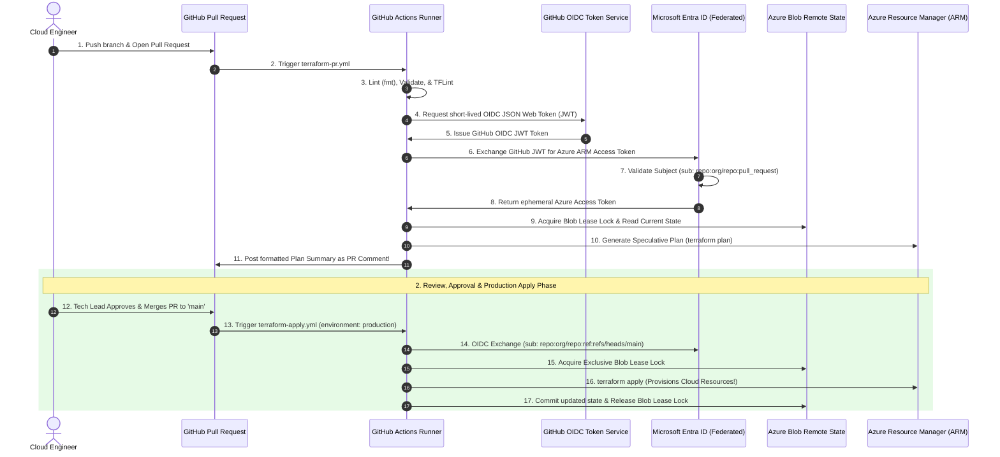

# Module 14-7: Enterprise CI/CD with GitHub Actions & Azure Terraform

**Breadcrumbs:** [[--Index--|🏠 Index]] > [[14-Index - Terraform on Azure|☁️ Terraform on Azure MOC]] > [[9-Index - GitHub Actions|🐙 GitHub Actions MOC]] > **Module 14-7: CI/CD Automation**

---

## 🎯 Architectural Overview & Cognitive Map

In modern platform engineering, executing `terraform apply` manually from a developer's workstation is strictly prohibited in enterprise production. Manual execution leads to "works on my machine" discrepancies, untracked out-of-band changes, state lock race conditions, and massive security exposure through long-lived administrative cloud credentials on laptops.

The industry-standard solution is **GitOps Infrastructure Automation via GitHub Actions**:
1. All infrastructure changes are proposed via **GitHub Pull Requests**.
2. Automated pipelines lint, validate, security-scan, and generate a **Speculative Terraform Plan**, posting the exact diff back into the PR.
3. Upon peer review and merge to `main`, an automated pipeline acquires **Secretless OpenID Connect (OIDC)** tokens from Azure, executes `terraform apply`, and releases state locks.



---

## 1. Secretless Cloud Authentication via OpenID Connect (OIDC)

### A. The Flaw of Static Service Principal Passwords
In legacy CI/CD pipelines, engineers created an Entra ID Service Principal with a client secret (password), copied it into `AZURE_CLIENT_SECRET` in GitHub Secrets, and forgot about it:
* **Security Risk:** If the GitHub repository or runner is compromised, attackers gain permanent cloud access.
* **Operational Outage:** Client secrets expire after 1 to 2 years. When they expire at 2:00 AM, all production deployment pipelines instantly collapse.

### B. The Zero-Trust OIDC Architecture (Workload Identity Federation)
With **OpenID Connect (OIDC)**, **zero static passwords or secrets are stored in GitHub**!
1. The GitHub Actions runner receives a cryptographically signed identity token from GitHub (`https://token.actions.githubusercontent.com`).
2. The runner presents this token to Microsoft Entra ID.
3. Entra ID verifies that the token's **Subject Claim (`sub`)** matches an authorized **Federated Credential** configured on the App Registration.
4. Entra ID issues a short-lived (60-minute) Azure OAuth token for that specific pipeline execution.

### C. Azure Setup CLI Recipe (Configuring Federated Trust)

```bash
#!/usr/bin/env bash
set -euo pipefail

# 1. Variables
APP_NAME="spn-github-actions-terraform"
GITHUB_ORG="my-enterprise-org"
GITHUB_REPO="terraform-azure-infra"
SUBSCRIPTION_ID=$(az account show --query id -o tsv)

# 2. Create Entra ID Application & Service Principal
APP_ID=$(az ad app create --display-name "${APP_NAME}" --query appId -o tsv)
SP_ID=$(az ad sp create --id "${APP_ID}" --query id -o tsv)

# 3. Grant Azure RBAC Contributor to the Service Principal
az role assignment create \
  --role "Contributor" \
  --assignee-object-id "${SP_ID}" \
  --assignee-principal-type "ServicePrincipal" \
  --scope "/subscriptions/${SUBSCRIPTION_ID}"

# 4. Add Federated Identity Credential for Main Branch
cat <<EOF > credential-main.json
{
  "name": "gh-actions-main-branch",
  "issuer": "https://token.actions.githubusercontent.com",
  "subject": "repo:${GITHUB_ORG}/${GITHUB_REPO}:ref:refs/heads/main",
  "description": "Allows GitHub Actions on main branch to authenticate without passwords",
  "audiences": ["api://AzureADTokenExchange"]
}
EOF

az ad app federated-credential create \
  --id "${APP_ID}" \
  --parameters credential-main.json

# 5. Add Federated Identity Credential for Pull Requests
cat <<EOF > credential-pr.json
{
  "name": "gh-actions-pull-requests",
  "issuer": "https://token.actions.githubusercontent.com",
  "subject": "repo:${GITHUB_ORG}/${GITHUB_REPO}:pull_request",
  "description": "Allows Pull Requests to generate speculative plans",
  "audiences": ["api://AzureADTokenExchange"]
}
EOF

az ad app federated-credential create \
  --id "${APP_ID}" \
  --parameters credential-pr.json

echo "Federated OIDC configuration complete!"
echo "Client ID: ${APP_ID}"
echo "Tenant ID: $(az account show --query tenantId -o tsv)"
echo "Subscription ID: ${SUBSCRIPTION_ID}"
```

---

## 2. Configuring the Terraform AzureRM Provider for OIDC

To instruct the `azurerm` provider and backend to authenticate using GitHub's OIDC tokens rather than looking for a client secret:

```hcl
# versions.tf / providers.tf

terraform {
  required_version = ">= 1.5.0"
  required_providers {
    azurerm = {
      source  = "hashicorp/azurerm"
      version = "~> 3.90"
    }
  }

  backend "azurerm" {
    resource_group_name  = "rg-terraform-state-prod"
    storage_account_name = "sttfstateprod01"
    container_name       = "tfstate"
    key                  = "prod.terraform.tfstate"
    use_oidc             = true # Enables OIDC for Remote State Storage!
    use_azuread_auth     = true
  }
}

provider "azurerm" {
  features {}
  use_oidc = true # Enables OIDC for Resource Management!
}
```

---

## 3. Production GitHub Actions Workflow Implementations

### Workflow 1: Pull Request Speculative Plan (`.github/workflows/terraform-pr.yml`)
Runs on every PR targeting `main`. Performs code quality checks and publishes the plan summary directly into the PR conversation:

```yaml
name: "Terraform Pull Request Pipeline"

on:
  pull_request:
    branches: [ "main" ]
    paths:
      - "environments/prod/**"
      - "modules/**"

permissions:
  id-token: write      # MANDATORY: Required for requesting the OIDC JWT!
  contents: read       # Allows checking out code
  pull-requests: write # Allows posting plan comments to the PR

concurrency:
  group: terraform-pr-${{ github.ref }}
  cancel-in-progress: true

jobs:
  validate-and-plan:
    name: "Validate & Speculative Plan"
    runs-on: ubuntu-latest
    defaults:
      run:
        working-directory: environments/prod

    steps:
      - name: "Checkout Repository"
        uses: actions/checkout@v4

      - name: "Azure Login via OIDC"
        uses: azure/login@v2
        with:
          client-id: ${{ secrets.AZURE_CLIENT_ID }}
          tenant-id: ${{ secrets.AZURE_TENANT_ID }}
          subscription-id: ${{ secrets.AZURE_SUBSCRIPTION_ID }}

      - name: "Setup Terraform Engine"
        uses: hashicorp/setup-terraform@v3
        with:
          terraform_version: "1.7.5"
          terraform_wrapper: false

      - name: "Terraform Format Check"
        run: terraform fmt -check -recursive ../..

      - name: "Terraform Init"
        run: terraform init

      - name: "Terraform Validate"
        run: terraform validate

      - name: "Terraform Speculative Plan"
        id: plan
        run: |
          terraform plan -no-color -out=tfplan > plan_output.txt 2>&1
          cat plan_output.txt

      - name: "Post Plan Summary to Pull Request"
        uses: actions/github-script@v7
        if: always() && github.event_name == 'pull_request'
        with:
          script: |
            const fs = require('fs');
            let planText = "";
            try {
              planText = fs.readFileSync('environments/prod/plan_output.txt', 'utf8');
            } catch (err) {
              planText = "Error reading plan output.";
            }

            // Truncate output if it exceeds GitHub comment character limit
            if (planText.length > 60000) {
              planText = planText.substring(0, 60000) + "\n... [Plan Output Truncated]";
            }

            const output = `#### 🪐 Terraform Pull Request Speculative Plan
            * **Pushed By:** @${{ github.actor }}
            * **Status:** \`${{ steps.plan.outcome }}\`
            * **Working Directory:** \`environments/prod\`

            <details><summary>Click to view full plan output</summary>

            \`\`\`hcl
            ${planText}
            \`\`\`

            </details>`;

            github.rest.issues.createComment({
              issue_number: context.issue.number,
              owner: context.repo.owner,
              repo: context.repo.repo,
              body: output
            });
```

---

### Workflow 2: Production Apply on Merge (`.github/workflows/terraform-apply.yml`)
Triggers strictly upon a successful merge to `main`. Enforces **GitHub Environment Protection Rules** requiring designated senior team members to approve before execution:

```yaml
name: "Terraform Production Apply"

on:
  push:
    branches: [ "main" ]
    paths:
      - "environments/prod/**"
      - "modules/**"

permissions:
  id-token: write
  contents: read

concurrency:
  group: terraform-production-apply
  cancel-in-progress: false # NEVER cancel an active apply midway!

jobs:
  apply:
    name: "Apply Infrastructure as Code"
    runs-on: ubuntu-latest
    environment: production # Bound to GitHub Protected Environment!
    defaults:
      run:
        working-directory: environments/prod

    steps:
      - name: "Checkout Code"
        uses: actions/checkout@v4

      - name: "Azure Login via OIDC"
        uses: azure/login@v2
        with:
          client-id: ${{ secrets.AZURE_CLIENT_ID }}
          tenant-id: ${{ secrets.AZURE_TENANT_ID }}
          subscription-id: ${{ secrets.AZURE_SUBSCRIPTION_ID }}

      - name: "Setup Terraform"
        uses: hashicorp/setup-terraform@v3
        with:
          terraform_version: "1.7.5"
          terraform_wrapper: false

      - name: "Terraform Init"
        run: terraform init

      - name: "Terraform Apply (Production)"
        run: terraform apply -auto-approve
```

---

## 4. Automated Drift Detection & Remediation Cron Pipeline

In enterprise organizations, engineers occasionally make emergency changes directly in the Azure Portal (e.g., resizing a VM during an outage, temporarily widening an NSG rule). These manual modifications cause **Configuration Drift**, causing the state file and live reality to diverge.

**Automated Drift Detection** executes on a nightly schedule using `terraform plan -detailed-exitcode`:

```yaml
name: "Terraform Scheduled Drift Detection"

on:
  schedule:
    # Executes nightly at 02:00 UTC
    - cron: "0 2 * * *"
  workflow_dispatch: # Allows manual trigger from GitHub UI

permissions:
  id-token: write
  contents: read
  issues: write # Allows automatically opening an issue when drift occurs!

jobs:
  detect-drift:
    name: "Detect Production Drift"
    runs-on: ubuntu-latest
    defaults:
      run:
        working-directory: environments/prod

    steps:
      - name: "Checkout Code"
        uses: actions/checkout@v4

      - name: "Azure Login via OIDC"
        uses: azure/login@v2
        with:
          client-id: ${{ secrets.AZURE_CLIENT_ID }}
          tenant-id: ${{ secrets.AZURE_TENANT_ID }}
          subscription-id: ${{ secrets.AZURE_SUBSCRIPTION_ID }}

      - name: "Setup Terraform"
        uses: hashicorp/setup-terraform@v3
        with:
          terraform_version: "1.7.5"
          terraform_wrapper: false

      - name: "Terraform Init"
        run: terraform init

      - name: "Execute Drift Check (-detailed-exitcode)"
        id: drift
        # Exit code 0 = No changes (Clean)
        # Exit code 1 = Command error
        # Exit code 2 = Drift detected (Infrastructure differs from HCL!)
        continue-on-error: true
        run: |
          set +e
          terraform plan -detailed-exitcode -no-color > drift_report.txt
          EXIT_CODE=$?
          echo "exit_code=${EXIT_CODE}" >> $GITHUB_OUTPUT
          exit ${EXIT_CODE}

      - name: "Create GitHub Issue on Detected Drift"
        if: steps.drift.outputs.exit_code == '2'
        uses: actions/github-script@v7
        with:
          script: |
            const fs = require('fs');
            const driftReport = fs.readFileSync('environments/prod/drift_report.txt', 'utf8');
            
            github.rest.issues.create({
              owner: context.repo.owner,
              repo: context.repo.repo,
              title: '🚨 Production Infrastructure Drift Detected',
              body: `### Infrastructure Drift Alert\nNightly audit detected unmanaged changes in Azure!\n\n\`\`\`hcl\n${driftReport.substring(0, 50000)}\n\`\`\``
            });
```

---

## 5. Deep-Intuition (AARF) Failure-Loop Breakdowns

### Scenario: The OIDC Subject Mismatch Authentication Failure (`AADSTS70021`)

#### 1. The Architectural Setup & Assumptions
A DevOps engineer configures a GitHub Actions workflow to run on pull requests. They register an Azure App Registration federated credential with the subject:
`repo:acme-corp/cloud-infra:ref:refs/heads/main`

#### 2. The Production Failure Manifestation
A developer opens a pull request from branch `feature/add-redis`. The GitHub Actions workflow fails on the `Azure Login via OIDC` step with error:
```text
Error: OpenIDConnect: AADSTS70021: No matching federated identity record found for presented assertion.
Assertion subject: 'repo:acme-corp/cloud-infra:pull_request'
Issuer: 'https://token.actions.githubusercontent.com'
```

#### 3. Root Cause Analysis (RCA)
* When GitHub Actions executes on a **push to main**, the OIDC token's `sub` claim is:
  `repo:<org>/<repo>:ref:refs/heads/main`
* When GitHub Actions executes on a **pull_request event**, GitHub intentionally issues a different subject claim:
  `repo:<org>/<repo>:pull_request`
* Because Entra ID strictly validates the subject claim string, it rejected the token!

#### 4. Remediation & Diagnostic Verification Loop
Every repository utilizing OIDC for both PR validation and merges must register **two distinct Federated Credentials** in Entra ID:
1. One credential for `ref:refs/heads/main` (Used for production applies).
2. One credential for `pull_request` (Used for speculative plans).

---

## 6. High-Yield Real-World Engineering Traps

### Trap 1: Missing `permissions: id-token: write`
* **The Scenario:** A workflow fails on `azure/login@v2` with `Error: Unable to get ACTIONS_ID_TOKEN_REQUEST_URL or ACTIONS_ID_TOKEN_REQUEST_TOKEN`.
* **The Ground Truth:** By default, GitHub Actions workflows have read-only permissions. You **MUST explicitly declare** `permissions: id-token: write` in the workflow YAML at the workflow or job level to allow GitHub to issue OIDC tokens.

### Trap 2: Plaintext Secrets Exposure in Plan Artifacts
* **The Scenario:** An engineer saves `terraform plan -out=tfplan` as a GitHub Actions workflow artifact so the apply job can download it.
* **The Trap:** If the Terraform configuration creates resources with passwords or certificates (e.g., Azure SQL admin passwords or SSH private keys), the binary plan file contains these secrets in unencrypted plaintext! Anyone with read access to the GitHub repository can download the artifact and extract the credentials.
* **Remediation:** In multi-job workflows, never upload plan files as public artifacts without encrypting them, or use GitHub Environments with restricted branch access.

---

## 🌐 Authoritative References & Inflow Citations

* **Inflow Reference:** [Piyush Sachdeva Azure Terraform Course - Day 26 (Enterprise CI/CD)](file:///F:/Dump%20one/BrainDump/inflow/Terraform-Azure-PiyushSachdeva/26_Day_2628_-_Azure_DevOps_End-to-End_Project_with_Terraform___Enterprise.md)
* **Inflow Reference:** [Automate AWS/Azure Infra Using Terraform and GitHub Actions](file:///F:/Dump%20one/BrainDump/inflow/2730%20-%20Automate%20AWS%20Infra%20Using%20Terraform%20and%20GitHub%20Actions%20%20Realtime%20Project.txt)
* **Inflow Reference:** [Drift Detection and Remediation Using Terraform and GitHub Actions](file:///F:/Dump%20one/BrainDump/inflow/3030%20-%20Drift%20Detection%20and%20Remediation%20Using%20Terraform%20and%20GitHub%20Actions%20%20Real%20Time%20Project.txt)
* **Inflow Reference:** [GitHub Actions Study Guide & Inflows](file:///F:/Dump%20one/BrainDump/inflow/github-actions-study-guide.md)
* **Official Microsoft & GitHub Documentation:**
  - [Configuring OpenID Connect in Azure](https://learn.microsoft.com/en-us/azure/developer/github/connect-from-azure?tabs=azure-portal%2Clinux)
  - [Automating Terraform with GitHub Actions](https://developer.hashicorp.com/terraform/tutorials/automation/github-actions)
