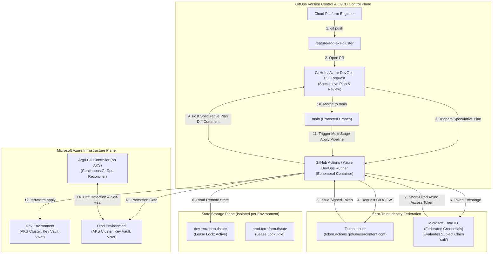
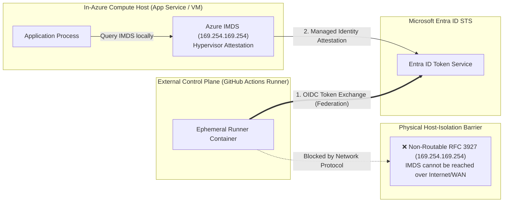
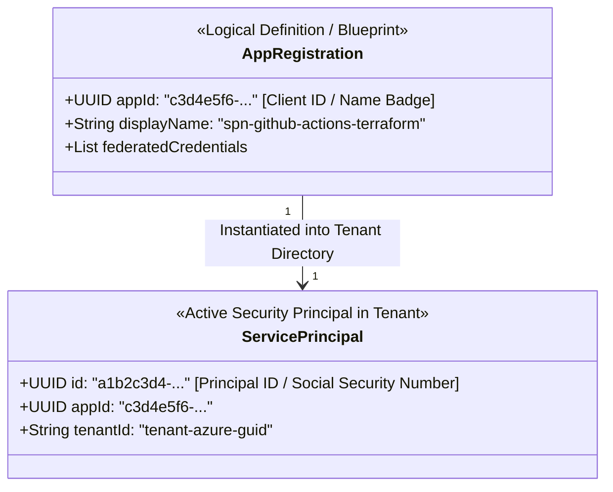
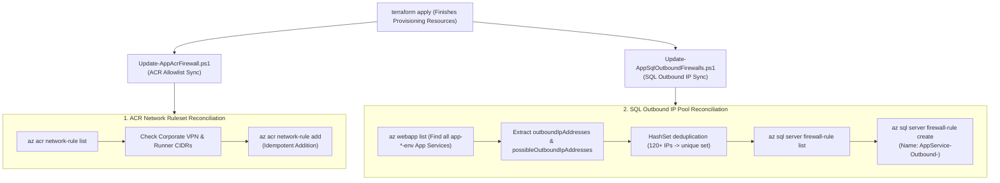
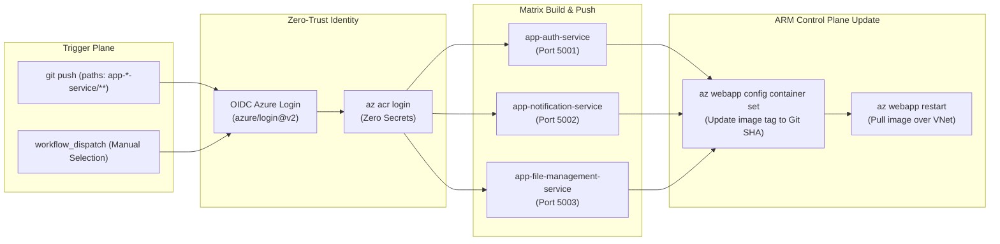
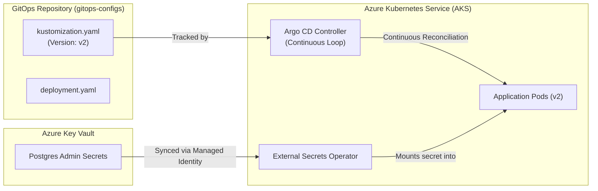

# Module 14-7: Enterprise CI/CD, GitOps Automation, Azure DevOps & Argo CD

**Breadcrumbs:** [[--Index--|🏠 Index]] > [[14-Index - Terraform on Azure|☁️ Terraform on Azure MOC]] > [[9-Index - GitHub Actions|🐙 GitHub Actions MOC]] > **Module 14-7: CI/CD & GitOps Automation**

---

## 🎯 Architectural Overview & Cognitive Map

In modern cloud platform engineering, executing `terraform apply` manually from an engineer's laptop is strictly prohibited in enterprise production. Manual execution creates "works on my machine" inconsistencies, untracked out-of-band drift, state lock deadlocks, and severe security vulnerabilities caused by storing high-privilege credentials on local workstations.

The enterprise standard is **Automated GitOps & CI/CD Pipelines**:
1. **Single Source of Truth:** Every infrastructure component is declared in Git.
2. **Branching & Pull Request Governance:** Code changes are validated via automated linters, security scans, and **Speculative Plans** before human approval.
3. **Secretless Cloud Authentication:** Pipelines authenticate to Azure using **OpenID Connect (OIDC)** and Workload Identity Federation—eliminating permanent passwords entirely.
4. **Multi-Environment Promotion:** Infrastructure progresses sequentially through isolated environments (`dev` ➔ `staging` ➔ `production`), each backed by dedicated state files and storage accounts.
5. **Continuous Reconciliation & Drift Detection:** Scheduled audit pipelines and GitOps controllers (Argo CD) continuously detect and heal configuration drift between live cloud reality and the Git desired state.



---

## 1. Branching Strategies for Enterprise Infrastructure

Infrastructure as Code repositories require disciplined branching models to prevent merge conflicts and state file corruption:

### A. The Feature Branching Workflow
1. **The Protected `main` Branch:** Represents the currently deployed reality of the target environment. Direct pushes to `main` are strictly blocked via GitHub Branch Protection Rules or Azure DevOps Branch Policies.
2. **Short-Lived Feature Branches (`feature/*`):** Created by engineers to introduce specific architectural changes (e.g., `feature/vnet-peering`, `feature/redis-cache`).
3. **The Validation Gate (Pull Request):** Opening a PR against `main` triggers automated formatting checks (`terraform fmt`), static analysis (`tflint`), security scanning (`checkov` / `tfsec`), and a speculative plan.
4. **Merge and Delete:** Once reviewed by two peer engineers, the PR is squashed and merged into `main`, and the feature branch is deleted.

```text
main branch:  ──●────────────────────────●───────────────● (Production Apply)
                 \                      /
feature branch:   └──● (Speculative) ──● (PR Review)
```

> [!IMPORTANT]
> **Why Long-Lived Branches Fail in Terraform:**
> In application software, teams often maintain long-lived branches (`dev`, `stage`, `prod`). **In Terraform, this is an anti-pattern!** If code diverges across branches, applying changes to production introduces untested, out-of-band drifts. Instead, maintain a single `main` branch with directory-per-environment separation (`environments/dev/`, `environments/prod/`) or pass environment-specific `.tfvars`.

---

## 2. Secretless Cloud Authentication via OpenID Connect (OIDC)

### A. The Fatal Flaws of Static Service Principal Passwords
Historically, CI/CD runners authenticated to Azure using static Service Principal passwords (Client Secrets) stored in CI secrets:
* **Permanent Blast Radius:** If a build log accidentally dumps secrets or a runner VM is compromised, attackers gain persistent access to your cloud subscription.
* **The 2:00 AM Expiration Outage:** Client secrets expire after 1 to 2 years. When they expire unannounced, all automated pipelines immediately crash.
* **Rotation Friction:** Rotating static secrets across hundreds of repositories requires complex automation and downtime windows.

---

### B. The Architectural Impasse: Why OIDC is Mandatory Despite Managed Identities Existing
A frequent question raised by cloud platform engineers is: *"Azure already has Managed Identities, which are passwordless and zero-trust. Why can't our GitHub Actions runners simply use an Azure Managed Identity?"*

The answer lies in the **physical networking and hypervisor host-isolation barrier of the Azure Instance Metadata Service (IMDS)**:
1. **The Link-Local Non-Routable Boundary (RFC 3927):** Managed Identities obtain tokens by querying Azure IMDS at the well-known link-local IPv4 address `http://169.254.169.254/metadata/identity/oauth2/token`. Link-local addresses (`169.254.0.0/16`) are strictly non-routable across subnets, WANs, and the public internet.
2. **Hypervisor Packet Interception:** Packets directed to `169.254.169.254` do not transit standard virtual network routes; they are physically intercepted by the Azure Hypervisor virtual switch on that specific physical server blade. The hypervisor provides the cryptographic attestation to Entra ID that the requesting process is executing on that exact VM or App Service instance.
3. **The Physical Barrier for External Runners:** GitHub Actions runners—whether hosted on GitHub's multi-tenant cloud infrastructure or external server racks—**cannot physically route packets to Azure's hypervisor IMDS endpoint**. Any attempt to send HTTP requests to `169.254.169.254` from an external runner terminates immediately at the runner's local host network stack.
4. **The Solution: Workload Identity Federation (OIDC):** Because external compute cannot reach IMDS, and static secrets are a major security vulnerability, **OpenID Connect (OIDC)** establishes a federated cryptographic bridge. GitHub acts as the external identity provider (token issuer), and Entra ID trusts GitHub's cryptographically signed tokens directly.



---

### C. The Zero-Trust OIDC Architecture (Workload Identity Federation)
With **OpenID Connect (OIDC)**, **zero static passwords or secrets are stored in GitHub Actions or Azure DevOps**:
1. The CI runner requests an ephemeral, cryptographically signed JSON Web Token (JWT) from GitHub (`token.actions.githubusercontent.com`).
2. The runner presents this JWT to Microsoft Entra ID.
3. Entra ID verifies the token's signature against GitHub's public JSON Web Key Set (JWKS).
4. Entra ID evaluates the token's **Subject Claim (`sub`)** against a **Federated Identity Credential** registered on the Azure App Registration.
5. If the claim matches (e.g., matching the specific repository and branch), Entra ID issues an ephemeral Azure OAuth token valid for exactly 60 minutes.

```text
[GitHub Runner] ──1. Request JWT──► [GitHub OIDC Provider]
      │                                       │
      │◄───────2. Signed Ephemeral JWT────────┘
      │
      ├──3. Exchange JWT with Subject Claim──► [Microsoft Entra ID]
      │                                                │
      │◄──────4. 60-Minute Azure Access Token──────────┘
      │
      └──5. Provision Infrastructure──────────► [Azure Resource Manager]
```

---

### D. Principal ID (Object ID) vs. Client ID (Application ID): The "Social Security vs. Name Badge" Analogy
In cloud automation and Terraform workflows, conflating an **Application ID (Client ID)** with a **Principal ID (Object ID)** is a leading cause of broken RBAC deployments:



1. **Application ID (Client ID) = The "Company Name Badge / Job Title":**
   - The logical definition of the application registered in Entra ID (the blueprint).
   - In GitHub Actions workflow files and the `azure/login` action, you supply `client-id` because GitHub must tell Entra ID *which application definition* is attempting authentication.
2. **Principal ID (Object ID) = The "Social Security Number (SSN)":**
   - The unique, immutable identity of the concrete **Service Principal Object** instantiated inside your specific Entra ID tenant.
   - It represents the actual actor holding access rights.
3. **Why Azure RBAC Strictly Requires Principal IDs (Object IDs):**
   - The Azure Resource Manager (ARM) RBAC authorization engine binds roles directly to directory security principals.
   - In CLI commands, passing an Application ID to `--assignee-object-id` fails immediately. While `az role assignment create --assignee <APP_ID>` exists, it forces the CLI to make an asynchronous Microsoft Graph API call to translate the Application ID into the Service Principal Object ID; in automated Terraform runs, this introduces race conditions.
   - In Terraform, `azurerm_role_assignment` requires `principal_id` (the Service Principal Object ID). Setting `principal_id` to the Application ID results in silent authorization failures or validation errors.

---

### E. What IDs Human Users Have vs. Software Applications

| Identity Attribute | Human User Account | Software Service Principal (CI/CD) | Managed Identity (Workload) |
| :--- | :--- | :--- | :--- |
| **Object ID (Principal ID)** | ✅ **YES** (Unique tenant GUID) | ✅ **YES** (Unique tenant GUID) | ✅ **YES** (Target of all RBAC grants) |
| **Application ID (Client ID)** | ❌ **NO** (Humans have no app schema) | ✅ **YES** (Supplied in `azure/login`) | ✅ **YES** (Used in SDK client selection) |
| **User Principal Name (UPN)** | ✅ **YES** (`devops@enterprise.com`) | ❌ **NO** | ❌ **NO** |
| **RBAC Assignment Target** | `principalId` of the user | `principalId` of the Service Principal | `principalId` of the Managed Identity |
| **Credential Type** | Password, MFA, FIDO2 | Ephemeral OIDC token exchange | Automatic Hypervisor IMDS assertions |

---

### F. System-Assigned vs. User-Assigned Managed Identities in Terraform CI/CD

When automating workload deployments with Terraform, choosing between System-Assigned Managed Identity (SAMI) and User-Assigned Managed Identity (UAMI) has direct architectural implications:

1. **The IaC Chicken-and-Egg Dependency Trap (Why SAMI Breaks Bootstrapping):**
   - **System-Assigned:** The identity is created concurrently with the resource. In Terraform, `azurerm_linux_virtual_machine` must be created *before* its `identity.0.principal_id` is exported. Therefore, `azurerm_role_assignment` blocks until the VM finishes provisioning. If the VM boots up and executes a `custom_data` script that immediately pulls database secrets from Azure Key Vault, **the script crashes with HTTP 403 Forbidden** because the role assignment has not yet been applied!
   - **User-Assigned:** The identity is a standalone ARM resource (`azurerm_user_assigned_identity`). In Terraform, you declare the UAMI first, declare the `azurerm_role_assignment` second, and attach the pre-authorized identity to the VM third. The VM boots up with full permissions on Day 0.
2. **Subscription RBAC Limit Protection:**
   - Azure subscriptions enforce a hard limit of **4,000 role assignments**.
   - If a cluster or VM scale set uses SAMI across 300 nodes, each requiring 3 roles, you consume **900 role assignments**.
   - With a single shared UAMI, all 300 instances share the same identity and consume **only 3 role assignments** in total.

---

### G. The Two Identity Lifecycles in Cloud Engineering: Provisioning (Phase A) vs. Runtime (Phase B)

Enterprise platform engineering maintains a strict separation between control-plane infrastructure deployment and data-plane application runtime:

```mermaid
flowchart TD
    subgraph PhaseA ["PHASE A: Infrastructure Provisioning Lifecycle (Control Plane)"]
        GHA["GitHub Actions Runner\n(Ephemeral Workflow)"]
        OIDC_Exchange["OIDC Token Exchange\n(GitHub JWT ➔ Entra ID)"]
        ARM_Deploy["Azure Resource Manager\n(Role: Contributor / User Access Admin)"]
        Infra_Resources["Provisions: VNet, App Service, Azure SQL, Redis,\nKey Vault, and UAMI ('id-order-service')"]

        GHA -->|1. Request Token| OIDC_Exchange
        OIDC_Exchange -->|2. Scoped ARM Token| GHA
        GHA -->|3. terraform apply| ARM_Deploy
        ARM_Deploy -->|4. Deploy & Assign Identity| Infra_Resources
    end

    subgraph PhaseB ["PHASE B: Application Runtime Lifecycle (Data Plane)"]
        AppSvc["App Service / Container Instance\n(Runs Order Processing Engine)"]
        IMDS_Endpoint["Local IMDS (169.254.169.254)\n(Hypervisor Token Exchange)"]
        SQL["Azure SQL Database\n(Contained DB User)"]
        Redis["Azure Cache for Redis\n(Entra Token Auth & Redis ACLs)"]
        KV["Azure Key Vault\n(Key Vault Secrets User)"]
        Microservice["Downstream Fulfillment API\n(Audience: api://fulfillment-service)"]

        AppSvc -->|1. Query IMDS for Scoped JWTs| IMDS_Endpoint
        IMDS_Endpoint -->|2. Return Target-Specific JWT| AppSvc
        AppSvc -->|3. Passwordless SQL Connection| SQL
        AppSvc -->|4. Entra Bearer Token| Redis
        AppSvc -->|5. Secretless Key Retrieval| KV
        AppSvc -->|6. Service-to-Service JWT (aud)| Microservice
    end

    PhaseA -.->|"Provisions Runtime Host & Attaches UAMI"| PhaseB
```

#### 1. Phase A: Infrastructure Provisioning Lifecycle (Control Plane Automation)
* **Identity:** Ephemeral CI/CD Runner authenticated via **OIDC Workload Identity Federation**.
* **Permissions:** Broad Azure Resource Manager (ARM) Control-Plane permissions (`Contributor` / `User Access Administrator`) scoped to the target Resource Group or Subscription.
* **Scope of Authority:** Creating and deleting Azure resources, binding network interfaces, modifying NSGs, and establishing IAM role assignments.

#### 2. Phase B: Application Runtime Lifecycle (Data Plane Workloads)
* **Identity:** User-Assigned Managed Identity (`id-order-service`) attached to the App Service, querying the local host IMDS (`169.254.169.254`).
* **Permissions:** Laser-focused, data-plane least privilege. **Zero ARM control-plane privileges** (the application cannot create or delete Azure resources).
* **Core Data-Plane Integrations:**
  1. **Azure SQL Contained Database Users:** The application does not store SQL passwords in connection strings. The database administrator or Terraform creates a contained database user in SQL mapped to the Managed Identity:
     ```sql
     CREATE USER [id-order-service] FROM EXTERNAL PROVIDER;
     ALTER ROLE db_datareader ADD MEMBER [id-order-service];
     ALTER ROLE db_datawriter ADD MEMBER [id-order-service];
     ```
  2. **Azure Cache for Redis:** Authenticates via Entra ID Bearer tokens integrated with Redis Access Control Lists (ACLs), retiring static 512-bit access keys.
  3. **Azure Key Vault:** Granted `Key Vault Secrets User` via Azure RBAC directly to the Managed Identity's Principal ID.
  4. **Downstream Microservices:** The application requests an access token scoped to the downstream service's Application ID URI (`api://fulfillment-service/.default`). The downstream API inspects the `aud` (audience) and `iss` (issuer) claims to validate the calling identity without sharing API keys.

---

### H. Azure CLI Setup: Configuring Federated Identity Trust

```bash
#!/usr/bin/env bash
set -euo pipefail

# 1. Variables
APP_NAME="spn-github-actions-terraform"
GITHUB_ORG="my-enterprise-org"
GITHUB_REPO="azure-infrastructure"
SUBSCRIPTION_ID=$(az account show --query id -o tsv)

# 2. Create Entra ID Application & Service Principal
APP_ID=$(az ad app create --display-name "${APP_NAME}" --query appId -o tsv)
SP_ID=$(az ad sp create --id "${APP_ID}" --query id -o tsv)

# 3. Grant Azure RBAC Roles (Contributor + Network Contributor)
# CRITICAL: Always pass the Service Principal Object ID (SP_ID) to --assignee-object-id!
az role assignment create \
  --role "Contributor" \
  --assignee-object-id "${SP_ID}" \
  --assignee-principal-type "ServicePrincipal" \
  --scope "/subscriptions/${SUBSCRIPTION_ID}"

az role assignment create \
  --role "Network Contributor" \
  --assignee-object-id "${SP_ID}" \
  --assignee-principal-type "ServicePrincipal" \
  --scope "/subscriptions/${SUBSCRIPTION_ID}"

# 4. Federated Identity Credential for Production Merges (Main Branch)
cat <<EOF > credential-main.json
{
  "name": "gh-actions-main-branch",
  "issuer": "https://token.actions.githubusercontent.com",
  "subject": "repo:${GITHUB_ORG}/${GITHUB_REPO}:ref:refs/heads/main",
  "description": "Allows GitHub Actions on main branch to authenticate without passwords",
  "audiences": ["api://AzureADTokenExchange"]
}
EOF

az ad app federated-credential create \
  --id "${APP_ID}" \
  --parameters credential-main.json

# 5. Federated Identity Credential for Pull Request Speculative Plans
cat <<EOF > credential-pr.json
{
  "name": "gh-actions-pull-requests",
  "issuer": "https://token.actions.githubusercontent.com",
  "subject": "repo:${GITHUB_ORG}/${GITHUB_REPO}:pull_request",
  "description": "Allows Pull Requests to generate speculative plans",
  "audiences": ["api://AzureADTokenExchange"]
}
EOF

az ad app federated-credential create \
  --id "${APP_ID}" \
  --parameters credential-pr.json

echo "OIDC Setup Complete! Client ID: ${APP_ID}, Principal ID: ${SP_ID}"
```

---

### I. The 3 Mandatory GitHub Actions OIDC Secrets & Value Retrieval
To enable secretless OpenID Connect authentication in GitHub Actions for AzureRM Terraform workflows, repositories require three mandatory secrets:

| Secret Name | Description | Scope / Source |
| :--- | :--- | :--- |
| **`ARM_CLIENT_ID`** | The Client ID (Application ID) of the User-Assigned Managed Identity or App Registration. Identifies the workload identity to Entra ID. | Environment or Repo Secret |
| **`ARM_TENANT_ID`** | The Azure Entra ID Tenant GUID. Directs authentication to the correct enterprise directory. | Environment or Repo Secret |
| **`ARM_SUBSCRIPTION_ID`** | The target Azure Subscription GUID where infrastructure resources are deployed. | Environment or Repo Secret |

#### Azure CLI Commands to Retrieve the Secret Values:
```bash
# 1. Retrieve the Managed Identity Client ID (ARM_CLIENT_ID):
az identity show \
  --resource-group "enterpriseapp-dev" \
  --name "uami-github-actions-dev" \
  --query "clientId" \
  --output tsv

# 2. Retrieve the Tenant GUID (ARM_TENANT_ID):
az account show --query "tenantId" --output tsv

# 3. Retrieve the Subscription GUID (ARM_SUBSCRIPTION_ID):
az account show --query "id" --output tsv
```

---

### J. App Service Compute & Data-Plane Bootstrapping Traps

#### 1. The `aad_sql_admin_object_id` Permanent Lockout Hazard
In `azurerm_mssql_server`, the `azuread_administrator` block designates the administrative identity of the server:
```hcl
azuread_administrator {
  login_username              = var.aad_sql_admin_group_name
  object_id                   = var.aad_sql_admin_object_id
  azuread_authentication_only = true # Disables standard SQL local user accounts!
}
```
* **Why It Cannot Be a Fake GUID:** Setting `azuread_authentication_only = true` permanently disables local SQL login passwords (`sa`, `sqladmin`). The identity defined in `azuread_administrator` is the **sole administrative identity** that can connect to the database on Day 1. If an engineer enters a dummy GUID (`00000000-0000-0000-0000-000000000000`), no Entra ID user or service principal holds that ID, causing permanent, unrecoverable lockout from the database. It must always be a valid user or group Object ID.

#### 2. The `application_stack` Placeholder Container Pattern
In `azurerm_linux_web_app`, the container image is initially declared using Microsoft's public placeholder:
```hcl
site_config {
  application_stack {
    docker_image_name = "mcr.microsoft.com/appsvc/staticsite:latest"
  }
}
```
* **Why the Placeholder is Used (The Chicken-and-Egg Dilemma):** Terraform deploys the hosting infrastructure (VNet, App Service Plan, Web App, Key Vault, Azure SQL, ACR) *before* the application code has been built or pushed to the registry. If Terraform referenced `appacrdev.azurecr.io/app-auth:v1.0.0` on Day 1, the apply would fail because that repository image does not exist yet. The public placeholder image (`staticsite:latest`) boots cleanly, verifies VNet integration, and waits safely for the application CI/CD pipeline to deploy real code.

#### 3. Continuous Deployment Drift & The `[0]` Index Syntax
Once live, application CI/CD pushes new container tags directly to the App Service. To prevent Terraform from overwriting real application releases:
```hcl
lifecycle {
  ignore_changes = [
    site_config[0].application_stack[0].docker_image_name
  ]
}
```
* **Why `ignore_changes` is Mandatory:** Without it, subsequent Terraform runs detect drift between the running image (`app-auth:v1.0.2`) and the placeholder in HCL (`staticsite:latest`), forcibly downgrading production to the placeholder image and causing severe downtime.
* **The `[0]` Index Syntax:** In the AzureRM provider schema, nested blocks (`site_config`, `application_stack`) are modeled internally as 1-element lists of objects. Targeting an attribute within `ignore_changes` requires explicit zero-index traversal: `site_config[0].application_stack[0].docker_image_name`.

#### 4. Where the `[app-auth-dev]` Contained User Came From
* Declaring `resource "azurerm_linux_web_app" "app"` with `name = "app-auth-dev"` and `identity { type = "SystemAssigned" }` causes Azure to automatically create an Enterprise Service Principal named `app-auth-dev` in Entra ID.
* In Azure SQL, running `CREATE USER [app-auth-dev] FROM EXTERNAL PROVIDER` instructs the database engine to bypass local SQL tables and query Microsoft Entra ID via Graph, binding the cloud identity to a database user in `sys.database_principals`.

#### 5. Runtime Managed Identity Authentication vs. One-Time Setup
* **One-Time Setup:** Running `CREATE USER [app-auth-dev] FROM EXTERNAL PROVIDER` and `ALTER ROLE db_datareader ADD MEMBER [app-auth-dev]` is performed once on Day 1 by a SQL Entra Admin.
* **Runtime Authentication:** Occurs on **every single query** without passwords:
  - The microservice connects using `Authentication=Active Directory Default`.
  - The Azure SDK queries the hypervisor IMDS endpoint at `http://169.254.169.254/metadata/identity/oauth2/token?resource=https://database.windows.net/`.
  - **In-Memory Token Caching:** The SDK caches the Bearer JWT in memory for ~50 minutes, providing sub-millisecond connection reuse and automatically refreshing before the 60-minute expiration.
  - Zero secrets exist in application configuration, eliminating credential leak risks and rotation downtime.

---

## 3. Configuring Terraform for OIDC

To instruct the `azurerm` provider and backend to authenticate using OIDC tokens:

```hcl
# versions.tf / providers.tf

terraform {
  required_version = ">= 1.5.0"
  required_providers {
    azurerm = {
      source  = "hashicorp/azurerm"
      version = "~> 3.90"
    }
  }

  backend "azurerm" {
    resource_group_name  = "rg-terraform-state-prod"
    storage_account_name = "sttfstateprod01"
    container_name       = "tfstate"
    key                  = "prod.terraform.tfstate"
    use_oidc             = true # Enables OIDC for Remote State Storage!
    use_azuread_auth     = true
  }
}

provider "azurerm" {
  features {}
  use_oidc = true # Enables OIDC for Resource Management!
}
```

---

## 4. Production GitHub Actions Pipeline Implementations

### Pipeline 1: Pull Request Speculative Plan (`.github/workflows/terraform-pr.yml`)
Triggers on every PR targeting `main`. Generates a plan and posts an interactive Markdown table back into the PR:

```yaml
name: "Terraform Pull Request Pipeline"

on:
  pull_request:
    branches: [ "main" ]
    paths:
      - "environments/**"
      - "modules/**"

permissions:
  id-token: write      # MANDATORY: Required for requesting the OIDC JWT!
  contents: read       # Allows checking out code
  pull-requests: write # Allows posting plan comments to the PR

concurrency:
  group: terraform-pr-${{ github.ref }}
  cancel-in-progress: true

jobs:
  validate-and-plan:
    name: "Validate & Speculative Plan"
    runs-on: ubuntu-latest
    defaults:
      run:
        working-directory: environments/dev

    steps:
      - name: "Checkout Repository"
        uses: actions/checkout@v4

      - name: "Azure Login via OIDC"
        uses: azure/login@v2
        with:
          client-id: ${{ secrets.AZURE_CLIENT_ID }}
          tenant-id: ${{ secrets.AZURE_TENANT_ID }}
          subscription-id: ${{ secrets.AZURE_SUBSCRIPTION_ID }}

      - name: "Setup Terraform Engine"
        uses: hashicorp/setup-terraform@v3
        with:
          terraform_version: "1.7.5"
          terraform_wrapper: false

      - name: "Terraform Format Check"
        run: terraform fmt -check -recursive ../..

      - name: "Terraform Init"
        run: terraform init

      - name: "Terraform Validate"
        run: terraform validate

      - name: "Terraform Speculative Plan"
        id: plan
        run: |
          terraform plan -no-color -out=tfplan > plan_output.txt 2>&1
          cat plan_output.txt

      - name: "Post Plan Summary to Pull Request"
        uses: actions/github-script@v7
        if: always() && github.event_name == 'pull_request'
        with:
          script: |
            const fs = require('fs');
            let planText = "";
            try {
              planText = fs.readFileSync('environments/dev/plan_output.txt', 'utf8');
            } catch (err) {
              planText = "Error reading plan output.";
            }

            if (planText.length > 60000) {
              planText = planText.substring(0, 60000) + "\n... [Plan Output Truncated]";
            }

            const output = `#### 🪐 Terraform Pull Request Speculative Plan
            * **Pushed By:** @${{ github.actor }}
            * **Status:** \`${{ steps.plan.outcome }}\`
            * **Working Directory:** \`environments/dev\`

            <details><summary>Click to view full plan output</summary>

            \`\`\`hcl
            ${planText}
            \`\`\`

            </details>`;

            github.rest.issues.createComment({
              issue_number: context.issue.number,
              owner: context.repo.owner,
              repo: context.repo.repo,
              body: output
            });
```

---

### Pipeline 2: Multi-Environment Production Apply (`.github/workflows/terraform-apply.yml`)
Triggers strictly upon a successful merge to `main`. Enforces sequential promotion from `dev` to `prod` with **GitHub Protected Environment Approval Gates**:

```yaml
name: "Terraform Multi-Environment Apply"

on:
  push:
    branches: [ "main" ]
    paths:
      - "environments/**"
      - "modules/**"

permissions:
  id-token: write
  contents: read

concurrency:
  group: terraform-apply-main
  cancel-in-progress: false # NEVER cancel an active apply midway!

jobs:
  # ----------------------------------------------------
  # STAGE 1: DEV ENVIRONMENT APPLY
  # ----------------------------------------------------
  apply-dev:
    name: "Apply Development Infrastructure"
    runs-on: ubuntu-latest
    environment: development
    defaults:
      run:
        working-directory: environments/dev

    steps:
      - name: "Checkout Code"
        uses: actions/checkout@v4

      - name: "Azure Login via OIDC"
        uses: azure/login@v2
        with:
          client-id: ${{ secrets.AZURE_CLIENT_ID }}
          tenant-id: ${{ secrets.AZURE_TENANT_ID }}
          subscription-id: ${{ secrets.AZURE_SUBSCRIPTION_ID }}

      - name: "Setup Terraform"
        uses: hashicorp/setup-terraform@v3
        with:
          terraform_version: "1.7.5"
          terraform_wrapper: false

      - name: "Terraform Init"
        run: terraform init

      - name: "Terraform Apply (Dev)"
        run: terraform apply -auto-approve

  # ----------------------------------------------------
  # STAGE 2: PRODUCTION ENVIRONMENT APPLY (GATED)
  # ----------------------------------------------------
  apply-prod:
    name: "Apply Production Infrastructure"
    needs: apply-dev
    runs-on: ubuntu-latest
    environment: production # Requires manual approval in GitHub UI!
    defaults:
      run:
        working-directory: environments/prod

    steps:
      - name: "Checkout Code"
        uses: actions/checkout@v4

      - name: "Azure Login via OIDC"
        uses: azure/login@v2
        with:
          client-id: ${{ secrets.AZURE_CLIENT_ID }}
          tenant-id: ${{ secrets.AZURE_TENANT_ID }}
          subscription-id: ${{ secrets.AZURE_SUBSCRIPTION_ID }}

      - name: "Setup Terraform"
        uses: hashicorp/setup-terraform@v3
        with:
          terraform_version: "1.7.5"
          terraform_wrapper: false

      - name: "Terraform Init"
        run: terraform init

      - name: "Terraform Apply (Production)"
        run: terraform apply -auto-approve
```

---

### Pipeline 3: EnterpriseApp Unified Multi-Environment Dispatch & Operational Pipeline (`terraform.yml`)

The production pipeline for EnterpriseApp implements a parameterized GitOps workflow that unifies `plan`, `apply`, and `destroy` operations across `dev`, `staging`, and `prod` with dynamic directory routing and post-apply firewall automation:

```yaml
name: "Terraform GitOps Pipeline"

on:
  workflow_dispatch:
    inputs:
      environment:
        description: "Target deployment environment"
        required: true
        type: choice
        options:
          - dev
          - staging
          - prod
        default: "dev"
      action:
        description: "Terraform action to execute"
        required: true
        type: choice
        options:
          - plan
          - apply
          - destroy
        default: "plan"

permissions:
  id-token: write # Mandatory for Azure GitHub OIDC
  contents: read  # Allows checkout of repository code

jobs:
  terraform:
    name: "Terraform ${{ inputs.action }} [${{ inputs.environment }}]"
    runs-on: ubuntu-latest
    environment: ${{ inputs.environment }}

    defaults:
      run:
        working-directory: terraform/${{ inputs.environment }}
        shell: bash

    steps:
      - name: Checkout Code
        uses: actions/checkout@v4

      - name: Setup Terraform
        uses: hashicorp/setup-terraform@v3
        with:
          terraform_version: "1.5.7"

      - name: Azure OIDC Login
        uses: azure/login@v2
        with:
          client-id: ${{ secrets.ARM_CLIENT_ID }}
          tenant-id: ${{ secrets.ARM_TENANT_ID }}
          subscription-id: ${{ secrets.ARM_SUBSCRIPTION_ID }}

      - name: Terraform Init
        run: |
          terraform init -backend-config=backend.hcl
        env:
          ARM_CLIENT_ID: ${{ secrets.ARM_CLIENT_ID }}
          ARM_TENANT_ID: ${{ secrets.ARM_TENANT_ID }}
          ARM_SUBSCRIPTION_ID: ${{ secrets.ARM_SUBSCRIPTION_ID }}
          ARM_USE_OIDC: "true"
          ARM_USE_AZUREAD: "true"

      - name: Terraform Format Check
        run: terraform fmt -check -recursive

      - name: Terraform Plan
        if: ${{ inputs.action == 'plan' || inputs.action == 'apply' }}
        run: |
          terraform plan -out=tfplan -var-file=terraform.tfvars
        env:
          ARM_CLIENT_ID: ${{ secrets.ARM_CLIENT_ID }}
          ARM_TENANT_ID: ${{ secrets.ARM_TENANT_ID }}
          ARM_SUBSCRIPTION_ID: ${{ secrets.ARM_SUBSCRIPTION_ID }}
          ARM_USE_OIDC: "true"
          ARM_USE_AZUREAD: "true"

      - name: Terraform Apply
        if: ${{ inputs.action == 'apply' }}
        run: |
          terraform apply -auto-approve tfplan
        env:
          ARM_CLIENT_ID: ${{ secrets.ARM_CLIENT_ID }}
          ARM_TENANT_ID: ${{ secrets.ARM_TENANT_ID }}
          ARM_SUBSCRIPTION_ID: ${{ secrets.ARM_SUBSCRIPTION_ID }}
          ARM_USE_OIDC: "true"
          ARM_USE_AZUREAD: "true"

      # Post-Apply Firewall Reconciliation (Operational Automation)
      - name: Post-Apply Firewall Reconciliation
        if: ${{ inputs.action == 'apply' }}
        working-directory: .
        shell: pwsh
        run: |
          ./scripts/Update-AppAcrFirewall.ps1 -Environment ${{ inputs.environment }}
          ./scripts/Update-AppSqlOutboundFirewalls.ps1 -Environment ${{ inputs.environment }}

      - name: Terraform Destroy
        if: ${{ inputs.action == 'destroy' }}
        run: |
          terraform destroy -auto-approve -var-file=terraform.tfvars
        env:
          ARM_CLIENT_ID: ${{ secrets.ARM_CLIENT_ID }}
          ARM_TENANT_ID: ${{ secrets.ARM_TENANT_ID }}
          ARM_SUBSCRIPTION_ID: ${{ secrets.ARM_SUBSCRIPTION_ID }}
          ARM_USE_OIDC: "true"
          ARM_USE_AZUREAD: "true"
```

---

### D. Operational Post-Apply Automation Scripts: Dynamic ACR & SQL Firewall Reconciliation

In enterprise cloud infrastructure, certain operational realities cannot or should not be declared in static Terraform HCL. EnterpriseApp addresses two critical platform bottlenecks through automated PowerShell scripts invoked post-apply:



#### 1. `Update-AppAcrFirewall.ps1`: Eliminating ACR Schema Churn
* **The Problem:** In Terraform 1.11 and the `azurerm` provider, managing dynamic IP rules inside `azurerm_container_registry.network_rule_set` triggers schema validation issues and continuous plan drift. Corporate VPN egress ranges and external runner pools shift out-of-band; representing them in HCL causes unnecessary registry churn.
* **The Solution:** The script queries existing ACR IP rules via `az acr network-rule list`, compares them against the defined corporate and runner CIDRs (`20.40.160.0/20`, `51.144.56.0/21`, `167.220.0.0/16`, `20.190.128.0/18`, `40.126.0.0/18`), and idempotently executes `az acr network-rule add` for missing entries.

#### 2. `Update-AppSqlOutboundFirewalls.ps1`: Managing the 120+ Dynamic App Service Outbound IPs
* **The Problem (The 120+ Dynamic IP Trap):**
  - Azure Linux App Service uses a multi-tenant architecture where each service receives 15–35 active outbound IPs plus a pool of fallback "possible" outbound IPs.
  - Across 4 microservices (`app-auth`, `app-notification`, `app-file-management`, etc.), the cumulative pool exceeds **120+ dynamic outbound IPs**.
  - Declaring 120+ individual `azurerm_mssql_firewall_rule` resources in Terraform leads to:
    1. **Severe State Bloat:** Hundreds of lines of repetitive rule declarations.
    2. **ARM API Throttling:** Azure ARM throttles API calls when checking 120+ firewall resources during `terraform plan`.
    3. **Connection Drops:** If Azure rotates an IP from the `possible` pool, the microservice immediately loses database access until a manual Terraform run occurs.
* **The Solution:** The script dynamically discovers all `app-*-<env>` App Services via `az webapp list`, extracts both `outboundIpAddresses` and `possibleOutboundIpAddresses`, de-duplicates them into a .NET `HashSet[string]`, and idempotently adds missing firewall rules named `AppService-Outbound-<ip>` to the SQL Server via Azure CLI.

---

### Pipeline 4: EnterpriseApp Microservices Application CI/CD Pipeline (`deploy-services.yml`)

While Pipelines 1, 2, and 3 manage the **Infrastructure Plane (Terraform Control Plane)**, the application lifecycle runs on an independent **Application Delivery Plane (Continuous Delivery)**. In EnterpriseApp, the three core microservices (`app-auth-service`, `app-notification-service`, `app-file-management-service`) are built and deployed via `.github/workflows/deploy-services.yml`.

This pipeline operationalizes the **Phase A vs. Phase B separation** (detailed in Section 2.G) and coordinates with Terraform's `lifecycle { ignore_changes = [ site_config[0].application_stack[0].docker_image_name ] }` (detailed in Section 2.J.3):



#### 1. The Application Deployment Workflow (`deploy-services.yml`)

```yaml
name: "Build and Deploy Microservices"

on:
  push:
    branches:
      - main
    paths:
      - "app-auth-service/**"
      - "app-notification-service/**"
      - "app-file-management-service/**"
  workflow_dispatch:
    inputs:
      service:
        description: "Select microservice to build and deploy"
        required: true
        type: choice
        options:
          - app-auth-service
          - app-notification-service
          - app-file-management-service
          - all
        default: "all"
      environment:
        description: "Target deployment environment"
        required: true
        type: choice
        options:
          - dev
          - staging
          - prod
        default: "dev"

permissions:
  id-token: write # Mandatory for Azure GitHub OIDC federated login
  contents: read  # Mandatory to checkout source code

env:
  ACR_NAME: "appacr${{ inputs.environment || 'dev' }}"
  RESOURCE_GROUP: "rg-enterprise-app-${{ inputs.environment || 'dev' }}"

jobs:
  build-and-deploy:
    name: "Deploy ${{ matrix.service }} [${{ inputs.environment || 'dev' }}]"
    runs-on: ubuntu-latest
    strategy:
      fail-fast: false
      matrix:
        service:
          - app-auth-service
          - app-notification-service
          - app-file-management-service

    if: |
      inputs.service == 'all' || 
      inputs.service == matrix.service || 
      (github.event_name == 'push')

    steps:
      - name: Checkout Code
        uses: actions/checkout@v4

      - name: Compute Target App Service Name
        id: vars
        run: |
          ENV="${{ inputs.environment || 'dev' }}"
          SERVICE="${{ matrix.service }}"
          SHORT_NAME="${SERVICE%-service}"
          APP_NAME="${SHORT_NAME}-${ENV}"
          echo "short_name=${SHORT_NAME}" >> $GITHUB_OUTPUT
          echo "app_name=${APP_NAME}" >> $GITHUB_OUTPUT
          echo "image_tag=${{ github.sha }}" >> $GITHUB_OUTPUT

      - name: Azure OIDC Login
        uses: azure/login@v2
        with:
          client-id: ${{ secrets.ARM_CLIENT_ID }}
          tenant-id: ${{ secrets.ARM_TENANT_ID }}
          subscription-id: ${{ secrets.ARM_SUBSCRIPTION_ID }}

      - name: ACR Authentication
        run: |
          az acr login --name ${{ env.ACR_NAME }}

      - name: Build Docker Image
        working-directory: ${{ matrix.service }}
        run: |
          LOGIN_SERVER="${{ env.ACR_NAME }}.azurecr.io"
          IMAGE_URI="${LOGIN_SERVER}/${{ matrix.service }}:${{ steps.vars.outputs.image_tag }}"
          LATEST_URI="${LOGIN_SERVER}/${{ matrix.service }}:latest"
          docker build \
            --tag "${IMAGE_URI}" \
            --tag "${LATEST_URI}" \
            .

      - name: Push Docker Image to ACR
        run: |
          LOGIN_SERVER="${{ env.ACR_NAME }}.azurecr.io"
          IMAGE_URI="${LOGIN_SERVER}/${{ matrix.service }}:${{ steps.vars.outputs.image_tag }}"
          LATEST_URI="${LOGIN_SERVER}/${{ matrix.service }}:latest"
          docker push "${IMAGE_URI}"
          docker push "${LATEST_URI}"

      - name: Deploy to Azure App Service
        run: |
          LOGIN_SERVER="${{ env.ACR_NAME }}.azurecr.io"
          TARGET_IMAGE="${LOGIN_SERVER}/${{ matrix.service }}:${{ steps.vars.outputs.image_tag }}"
          az webapp config container set \
            --name "${{ steps.vars.outputs.app_name }}" \
            --resource-group "${{ env.RESOURCE_GROUP }}" \
            --docker-custom-image-name "${TARGET_IMAGE}"

      - name: Restart Web App
        run: |
          az webapp restart \
            --name "${{ steps.vars.outputs.app_name }}" \
            --resource-group "${{ env.RESOURCE_GROUP }}"
```

#### 2. Multi-Stage Non-Root Docker Architecture

All three microservices utilize a standardized multi-stage build pattern that separates the heavy SDK build environment from the minimal runtime:

```dockerfile
# Stage 1: Build & Publish
FROM mcr.microsoft.com/dotnet/sdk:8.0 AS build
WORKDIR /src
COPY ["AuthService.csproj", "./"]
RUN dotnet restore "AuthService.csproj"
COPY . .
RUN dotnet publish "AuthService.csproj" -c Release -o /app/publish /p:UseAppHost=false

# Stage 2: Runtime
FROM mcr.microsoft.com/dotnet/aspnet:8.0 AS runtime
WORKDIR /app
COPY --from=build /app/publish .

ENV ASPNETCORE_URLS=http://+:5001
ENV WEBSITES_PORT=5001
EXPOSE 5001

# Hardened non-root security (CWE-250)
USER app
ENTRYPOINT ["dotnet", "AuthService.dll"]
```

#### 3. Data-Plane Verification & Microservice Matrix

| Service | Port | Backend Target | Passwordless Identity Protocol | Health & Verification Route |
| :--- | :---: | :--- | :--- | :--- |
| **`app-auth-service`** | `5001` | Azure SQL (`app-auth-db`)<br>Azure Cache for Redis<br>Azure Key Vault | • `Authentication=Active Directory Default`<br>• Entra Bearer token (`https://redis.azure.com/.default`)<br>• `DefaultAzureCredential` SecretClient | `GET /health`<br>`GET /api/db-test`<br>`GET /api/cache-test`<br>`GET /api/kv-test` |
| **`app-notification-service`** | `5002` | Azure SQL (`app-notification-db`)<br>Azure Key Vault | • Contained DB User via Managed Identity<br>• `DefaultAzureCredential` SecretClient | `GET /health`<br>`GET /api/db-test`<br>`POST /api/notify`<br>`GET /api/kv-test` |
| **`app-file-management-service`** | `5003` | Azure SQL (`app-file-management-db`)<br>Blob Storage (`appstorageaccountdev`)<br>Azure Key Vault | • Contained DB User via Managed Identity<br>• `BlobServiceClient` with Managed Identity RBAC (`Storage Blob Data Contributor`) | `GET /health`<br>`GET /api/db-test`<br>`GET /api/storage-test` |

#### 4. The Complete Continuous Delivery Lifecycle Loop
1. **Day 0 (Terraform):** `terraform apply` provisions the App Service with placeholder image `staticsite:latest` and registers `lifecycle { ignore_changes = [ site_config[0].application_stack[0].docker_image_name ] }`.
2. **Day 1 (Application CI/CD):** `deploy-services.yml` builds and pushes `app-auth-service:<git-sha>` to ACR and executes `az webapp config container set`.
3. **Day 2 (Reconciliation):** Subsequent `terraform plan` checks detect that the image name changed in Azure, but `ignore_changes` suppresses any plan modification. Infrastructure and application pipelines coexist with zero state collisions.

---

## 5. Enterprise Azure DevOps Multi-Stage Pipeline Architecture

For enterprise organizations standardizing on Azure DevOps, infrastructure automation utilizes declarative YAML multi-stage pipelines with native **Service Connections**:

### A. The End-to-End Pipeline YAML (`azure-pipelines.yml`)

```yaml
trigger:
  branches:
    include:
      - main
      - feature/*
  paths:
    include:
      - lessons/Day26/**
      - azure-pipelines.yml

pool:
  vmImage: 'ubuntu-latest'

stages:
  # ====================================================
  # STAGE 1: CODE VALIDATION & LINTING
  # ====================================================
  - stage: Validate
    displayName: "Terraform Validate & Lint"
    jobs:
      - job: TFValidate
        displayName: "Run Init & Validate"
        steps:
          - task: TerraformInstaller@0
            displayName: "Install Terraform v1.7.5"
            inputs:
              terraformVersion: '1.7.5'

          - task: TerraformTaskV4@4
            displayName: "Terraform Init"
            inputs:
              provider: 'azurerm'
              command: 'init'
              workingDirectory: '$(System.DefaultWorkingDirectory)/lessons/Day26/dev'
              backendServiceArm: 'sc-azure-subscription'
              backendAzureRmResourceGroupName: 'terraformStateRG'
              backendAzureRmStorageAccountName: 'tfdevbackend01'
              backendAzureRmContainerName: 'tfstate'
              backendAzureRmKey: 'dev.terraform.tfstate'

          - task: TerraformTaskV4@4
            displayName: "Terraform Validate"
            inputs:
              provider: 'azurerm'
              command: 'validate'
              workingDirectory: '$(System.DefaultWorkingDirectory)/lessons/Day26/dev'

  # ====================================================
  # STAGE 2: DEVELOPMENT ENVIRONMENT DEPLOYMENT
  # ====================================================
  - stage: DevDeploy
    displayName: "Deploy to Development"
    dependsOn: Validate
    condition: and(succeeded(), eq(variables['Build.SourceBranch'], 'refs/heads/main'))
    jobs:
      - job: TFApplyDev
        displayName: "Terraform Apply (Dev)"
        steps:
          - task: TerraformInstaller@0
            inputs:
              terraformVersion: '1.7.5'

          - task: TerraformTaskV4@4
            displayName: "Terraform Init (Dev)"
            inputs:
              provider: 'azurerm'
              command: 'init'
              workingDirectory: '$(System.DefaultWorkingDirectory)/lessons/Day26/dev'
              backendServiceArm: 'sc-azure-subscription'
              backendAzureRmResourceGroupName: 'terraformStateRG'
              backendAzureRmStorageAccountName: 'tfdevbackend01'
              backendAzureRmContainerName: 'tfstate'
              backendAzureRmKey: 'dev.terraform.tfstate'

          - task: TerraformTaskV4@4
            displayName: "Terraform Apply (Dev)"
            inputs:
              provider: 'azurerm'
              command: 'apply'
              workingDirectory: '$(System.DefaultWorkingDirectory)/lessons/Day26/dev'
              environmentServiceNameAzureRM: 'sc-azure-subscription'
              commandOptions: '-auto-approve'

  # ====================================================
  # STAGE 3: STAGING ENVIRONMENT DEPLOYMENT
  # ====================================================
  - stage: StagingDeploy
    displayName: "Deploy to Staging"
    dependsOn: DevDeploy
    condition: and(succeeded(), eq(variables['Build.SourceBranch'], 'refs/heads/main'))
    jobs:
      - job: TFApplyStaging
        displayName: "Terraform Apply (Staging)"
        steps:
          - task: TerraformInstaller@0
            inputs:
              terraformVersion: '1.7.5'

          - task: TerraformTaskV4@4
            displayName: "Terraform Init (Staging)"
            inputs:
              provider: 'azurerm'
              command: 'init'
              workingDirectory: '$(System.DefaultWorkingDirectory)/lessons/Day26/staging'
              backendServiceArm: 'sc-azure-subscription'
              backendAzureRmResourceGroupName: 'terraformStateRG'
              backendAzureRmStorageAccountName: 'tfstagebackend01'
              backendAzureRmContainerName: 'tfstate'
              backendAzureRmKey: 'staging.terraform.tfstate'

          - task: TerraformTaskV4@4
            displayName: "Terraform Apply (Staging)"
            inputs:
              provider: 'azurerm'
              command: 'apply'
              workingDirectory: '$(System.DefaultWorkingDirectory)/lessons/Day26/staging'
              environmentServiceNameAzureRM: 'sc-azure-subscription'
              commandOptions: '-auto-approve'
```

---

### B. Dedicated On-Demand Environment Destruction Pipeline
To save cloud costs in non-production environments, maintain a dedicated parameterized destruction pipeline (`destroy-pipeline.yml`):

```yaml
parameters:
  - name: environment
    displayName: "Target Environment to Destroy"
    type: string
    default: dev
    values:
      - dev
      - staging

trigger: none # Purely manual on-demand execution!

pool:
  vmImage: 'ubuntu-latest'

jobs:
  - job: TFDestroy
    displayName: "Destroy ${{ parameters.environment }} Infrastructure"
    steps:
      - task: TerraformInstaller@0
        inputs:
          terraformVersion: '1.7.5'

      - task: TerraformTaskV4@4
        displayName: "Terraform Init"
        inputs:
          provider: 'azurerm'
          command: 'init'
          workingDirectory: '$(System.DefaultWorkingDirectory)/lessons/Day26/${{ parameters.environment }}'
          backendServiceArm: 'sc-azure-subscription'
          backendAzureRmResourceGroupName: 'terraformStateRG'
          backendAzureRmStorageAccountName: 'tf${{ parameters.environment }}backend01'
          backendAzureRmContainerName: 'tfstate'
          backendAzureRmKey: '${{ parameters.environment }}.terraform.tfstate'

      - task: TerraformTaskV4@4
        displayName: "Terraform Destroy"
        inputs:
          provider: 'azurerm'
          command: 'destroy'
          workingDirectory: '$(System.DefaultWorkingDirectory)/lessons/Day26/${{ parameters.environment }}'
          environmentServiceNameAzureRM: 'sc-azure-subscription'
          commandOptions: '-auto-approve'
```

---

## 6. Cloud-Native GitOps on Azure Kubernetes Service (AKS) with Argo CD

While Terraform excels at provisioning underlying Azure infrastructure (VNets, AKS clusters, Managed Identities, Key Vaults), managing dynamic application workloads and Kubernetes deployments is best accomplished via **GitOps with Argo CD**.

### A. The End-to-End GitOps Architecture
1. **Infrastructure Provisioning (Terraform):** Deploys the AKS cluster, installs the Helm release for Argo CD, and sets up Azure Key Vault with Managed Identity Operator bindings.
2. **Secret Management (External Secrets Operator - ESO):** Kubernetes pods cannot store plain secrets in Git. ESO securely synchronizes secrets from Azure Key Vault into native Kubernetes secrets in-cluster.
3. **Continuous Reconciliation (Argo CD):** Argo CD monitors a designated Git repository (`gitops-configs`). When application manifests change, Argo CD automatically syncs changes to AKS.



### B. Installing Argo CD via Terraform Helm Provider

```hcl
# kubernetes_argocd.tf

resource "kubernetes_namespace" "argocd" {
  metadata {
    name = "argocd"
  }
}

resource "helm_release" "argocd" {
  name       = "argo-cd"
  repository = "https://argoproj.github.io/argo-helm"
  chart      = "argo-cd"
  version    = "5.51.6"
  namespace  = kubernetes_namespace.argocd.metadata[0].name

  set {
    name  = "server.service.type"
    value = "LoadBalancer" # Exposes Argo CD UI via Azure Public Load Balancer
  }

  set {
    name  = "configs.params.server\\.insecure"
    value = "true"
  }
}
```

### C. The Argo CD Application Manifest (`kind: Application`)
This manifest establishes the GitOps contract between the repository and the cluster:

```yaml
apiVersion: argoproj.io/v1alpha1
kind: Application
metadata:
  name: three-tier-web-app
  namespace: argocd
  finalizers:
    - resources-finalizer.argocd.argoproj.io
spec:
  project: default
  source:
    repoURL: 'https://github.com/my-org/gitops-configs.git'
    targetRevision: HEAD
    path: three-tier-configs
  destination:
    server: 'https://kubernetes.default.svc'
    namespace: dev
  syncPolicy:
    automated:
      prune: true     # Deletes resources in K8s if removed from Git!
      selfHeal: true  # Reverts manual changes made directly in K8s back to Git state!
    syncOptions:
      - CreateNamespace=true
```

### D. Testing GitOps Drift Detection & Application Upgrades
1. **Testing Out-of-Band Drift:** If a rogue developer runs `kubectl scale deployment frontend --replicas=5`, Argo CD immediately flags the state as `OutOfSync` and automatically scales the deployment back to `2 replicas` within seconds (`selfHeal: true`).
2. **Testing Application Version Rollout:**
   - In `gitops-configs/three-tier-configs/kustomization.yaml`, update the container image tag:
     ```yaml
     images:
       - name: my-registry.azurecr.io/frontend
         newTag: v2 # Upgraded from v1!
     ```
   - Commit and push to Git.
   - Argo CD detects the commit, initiates a zero-downtime rolling update, and provisions the new v2 pods automatically.

---

## 7. Automated Drift Detection & Remediation Cron Pipeline

To catch out-of-band changes made via the Azure Portal (e.g. an engineer manually widening an NSG rule during an incident), run a scheduled nightly pipeline using `terraform plan -detailed-exitcode`:

```yaml
name: "Terraform Scheduled Drift Detection"

on:
  schedule:
    - cron: "0 2 * * *" # Runs nightly at 02:00 UTC
  workflow_dispatch:

permissions:
  id-token: write
  contents: read
  issues: write # Allows opening GitHub Issues on drift detection!

jobs:
  detect-drift:
    name: "Detect Production Drift"
    runs-on: ubuntu-latest
    defaults:
      run:
        working-directory: environments/prod

    steps:
      - name: "Checkout Code"
        uses: actions/checkout@v4

      - name: "Azure Login via OIDC"
        uses: azure/login@v2
        with:
          client-id: ${{ secrets.AZURE_CLIENT_ID }}
          tenant-id: ${{ secrets.AZURE_TENANT_ID }}
          subscription-id: ${{ secrets.AZURE_SUBSCRIPTION_ID }}

      - name: "Setup Terraform"
        uses: hashicorp/setup-terraform@v3
        with:
          terraform_version: "1.7.5"
          terraform_wrapper: false

      - name: "Terraform Init"
        run: terraform init

      - name: "Execute Drift Check (-detailed-exitcode)"
        id: drift
        # Exit code 0 = No changes (Clean)
        # Exit code 1 = Command error
        # Exit code 2 = Drift detected!
        continue-on-error: true
        run: |
          set +e
          terraform plan -detailed-exitcode -no-color > drift_report.txt
          EXIT_CODE=$?
          echo "exit_code=${EXIT_CODE}" >> $GITHUB_OUTPUT
          exit ${EXIT_CODE}

      - name: "Create GitHub Issue on Detected Drift"
        if: steps.drift.outputs.exit_code == '2'
        uses: actions/github-script@v7
        with:
          script: |
            const fs = require('fs');
            const driftReport = fs.readFileSync('environments/prod/drift_report.txt', 'utf8');
            
            github.rest.issues.create({
              owner: context.repo.owner,
              repo: context.repo.repo,
              title: '🚨 Production Infrastructure Drift Detected',
              body: `### Infrastructure Drift Alert\nNightly audit detected unmanaged changes in Azure!\n\n\`\`\`hcl\n${driftReport.substring(0, 50000)}\n\`\`\``
            });
```

---

## 8. Deep-Intuition (AARF) Failure-Loop Breakdowns

### Scenario 1: The OIDC Subject Mismatch Authentication Failure (`AADSTS70021`)

#### 1. Architectural Setup & Assumptions
A DevOps engineer configures an Azure App Registration federated credential with subject:
`repo:acme-corp/cloud-infra:ref:refs/heads/main`
They then set up a GitHub Actions workflow to run on pull requests.

#### 2. Production Failure Manifestation
A developer opens a pull request. The workflow crashes on `Azure Login via OIDC` with:
```text
Error: OpenIDConnect: AADSTS70021: No matching federated identity record found for presented assertion.
Assertion subject: 'repo:acme-corp/cloud-infra:pull_request'
Issuer: 'https://token.actions.githubusercontent.com'
```

#### 3. Root Cause Analysis (RCA)
When GitHub Actions runs on a **pull_request event**, GitHub dynamically sets the OIDC `sub` claim to `repo:<org>/<repo>:pull_request`. It does **not** use `ref:refs/heads/main`. Because Entra ID performs an exact string comparison against registered federated credentials, the token exchange is rejected with HTTP 400.

#### 4. Remediation & Diagnostic Verification Loop
Every repository using OIDC must register **two separate Federated Credentials** in Entra ID:
1. `repo:<org>/<repo>:ref:refs/heads/main` (for applies on merge)
2. `repo:<org>/<repo>:pull_request` (for speculative plans on PRs)

---

### Scenario 2: The In-Azure Self-Hosted Runner Network Egress Blackhole

#### 1. Architectural Setup & Assumptions
To eliminate internet data transfer costs, a team hosts their GitHub Actions runners inside an Azure Virtual Network subnet.

#### 2. Production Failure Manifestation
When the pipeline executes `terraform init`, it hangs for 15 minutes before crashing:
```text
Error: Failed to query available provider packages
Could not retrieve the list of available versions for provider hashicorp/azurerm:
could not connect to registry.terraform.io: dial tcp: i/o timeout
```

#### 3. Root Cause Analysis (RCA)
The runner subnet was configured with a strict Network Security Group (NSG) and default route table (`0.0.0.0/0`) lacking an Azure NAT Gateway. The runners had no outbound public internet egress to contact `registry.terraform.io` or `github.com`.

#### 4. Remediation & Diagnostic Verification Loop
1. Associate an Azure NAT Gateway with the runner subnet to grant high-reliability outbound SNAT egress.
2. In the subnet NSG, add outbound allow rules for service tags `AzureActiveDirectory`, `AzureResourceManager`, and internet HTTPS (port 443).

---

### Scenario 3: The Parallel Pull Request State Lock Race Condition

#### 1. Architectural Setup & Assumptions
Two engineers open pull requests simultaneously modifying different parts of the development environment.

#### 2. Production Failure Manifestation
Engineer A's PR plan executes smoothly. Engineer B's PR plan fails immediately:
```text
Error: Error acquiring the state lock: state blob is already leased
```

#### 3. Root Cause Analysis (RCA)
Even speculative plans (`terraform plan`) acquire a read lock by default unless configured otherwise. Because both pipelines targeted the exact same remote state file (`dev.terraform.tfstate`), the second pipeline encountered an active blob lease.

#### 4. Remediation & Diagnostic Verification Loop
Add `-lock=false` strictly to **speculative pull request planning commands**:
```bash
terraform plan -lock=false -no-color
```
> [!WARNING]
> Never use `-lock=false` during `terraform apply`. Only use it for read-only pull request plan checks!

---

## 9. High-Yield Real-World Engineering Traps

### Trap 1: Missing `permissions: id-token: write`
* **The Scenario:** A workflow fails on `azure/login@v2` with `Error: Unable to get ACTIONS_ID_TOKEN_REQUEST_URL or ACTIONS_ID_TOKEN_REQUEST_TOKEN`.
* **The Ground Truth:** By default, GitHub Actions workflows have read-only token permissions. You **MUST explicitly declare** `permissions: id-token: write` in the workflow YAML to allow GitHub to issue OIDC identity tokens.

### Trap 2: Plaintext Secrets Exposure in Plan Artifacts
* **The Scenario:** An engineer saves `terraform plan -out=tfplan` as a public workflow artifact for a subsequent apply job.
* **The Trap:** If the HCL creates resources with passwords or certificates (e.g., Azure SQL admin passwords), the binary plan file contains these secrets in unencrypted plaintext!
* **Remediation:** In multi-job workflows, never upload plan files as unencrypted public artifacts. Use GitHub Protected Environments with restricted branch access.

---

## 🌐 Authoritative References & Inflow Citations

* **Inflow Reference:** [Piyush Sachdeva Azure Terraform Course - Day 26 (Azure DevOps End-to-End Enterprise Project)](file:///F:/Dump%20one/BrainDump/inflow/Terraform-Azure-PiyushSachdeva/26_Day_2628_-_Azure_DevOps_End-to-End_Project_with_Terraform___Enterprise.md)
* **Inflow Reference:** [Piyush Sachdeva Azure Terraform Course - Day 28 (Terraform End-to-End Project with AKS and GitOps)](file:///F:/Dump%20one/BrainDump/inflow/Terraform-Azure-PiyushSachdeva/28_Day_2828_-_Terraform_end-to-end_Project_with_AKS_and_GitOps.md)
* **Inflow Reference:** [Automate AWS/Azure Infra Using Terraform and GitHub Actions](file:///F:/Dump%20one/BrainDump/inflow/2730%20-%20Automate%20AWS%20Infra%20Using%20Terraform%20and%20GitHub%20Actions%20%20Realtime%20Project.txt)
* **Inflow Reference:** [Drift Detection and Remediation Using Terraform and GitHub Actions](file:///F:/Dump%20one/BrainDump/inflow/3030%20-%20Drift%20Detection%20and%20Remediation%20Using%20Terraform%20and%20GitHub%20Actions%20%20Real%20Time%20Project.txt)
* **Inflow Reference:** [GitHub Actions Study Guide & Inflows](file:///F:/Dump%20one/BrainDump/inflow/github-actions-study-guide.md)
* **Official Microsoft & HashiCorp Documentation:**
  - [Configuring OpenID Connect in Azure](https://learn.microsoft.com/en-us/azure/developer/github/connect-from-azure?tabs=azure-portal%2Clinux)
  - [Automating Terraform with GitHub Actions](https://developer.hashicorp.com/terraform/tutorials/automation/github-actions)
  - [Argo CD Official Architecture Documentation](https://argo-cd.readthedocs.io/en/stable/)
